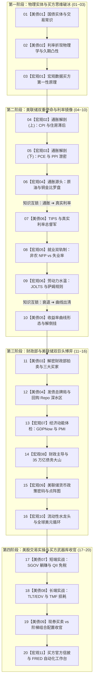

# 《宏观穿透与买方美债：双螺旋交叉学习与连载总路线图（20讲）》
## 微信公众号硬核投研·成文排期、认知跃迁与连载追踪总纲（永久保存档）

---

## 📌 路线图设计哲学与认知心智模型

本路线图专为追求**“由浅入深、概念零断层、兼具买方级深度”**的系统性学习者量身定制。

传统单一学科连载存在天然缺陷：
* **单走美债**：在读到收益率曲线倒挂与 TIPS 真实利率时，因缺少通胀（CPI/PCE）与劳动力市场（萨姆规则衰退）的前置知识，只能死记硬背结论；
* **单走宏观**：在读到折现率传导与美联储净流动性（TGA/RRP）时，因缺少对国债实体、久期杠杆及回购市场的物理感知，指标理解容易沦为空中楼阁。

**双螺旋交叉体系（Interlocking System）**将《美债专栏》（9 讲）与《宏观专栏》（11 讲）有机交织为 **4 个进阶阶段、共 20 讲** 的精密齿轮系统。后续所有文章的撰写、校对与公众号连载，均严格按此顺序推进。

---

## 📋 20 讲双螺旋交叉成文与连载追踪表（Master Tracker）

| 总序 | 所属专栏 | 专栏讲数 | 章节主题 | 核心微观机制与硬核指标 | 互锁逻辑与实战意义 | 状态 | 对应文件路径 |
| :---: | :---: | :---: | :--- | :--- | :--- | :---: | :--- |
| **01** | 美债 | **【美债 01】** | 美债图谱与交易常识：一张真实美国国债的解剖，净价、全价与应计利息 | 国债四大谱系 (Bills/Notes/Bonds/STRIPS)、CUSIP 编码、票面利率 vs YTM、全价 (Dirty Price) vs 净价 (Clean Price)、应计利息算法 | 实体扫盲：看懂一张国债怎么交割、券商买卖怎么扣款 | 已完稿 ✍️ | `articles/us_treasury_guide/01_美债图谱与交易常识.md` |
| **02** | 美债 | **【美债 02】** | 利率折现物理学：为什么收益率上涨债券跌？解剖久期、凸性与折现杠杆 | 贴现因子、现金流贴现一阶导数恒负证明、麦考利久期、修正久期、有效久期、凸性二阶导看涨期权补偿 | 物理破冰：推导债券价格波动的数学本质与杠杆敏感性 | 待动笔 📋 | `articles/us_treasury_guide/02_利率折现物理学与久期凸性.md` |
| **03** | 宏观 | **【宏观 01】** | 宏观数据买方第一性原理：散户看绝对值，买方看“预期差”、基数效应与折现链条 | 一致预期 (Consensus)、花旗经济意外指数 (CESI)、同比基数陷阱、年化环比、X-13 季调虚火、数据传导资产折现总图 | 思维重塑：建立“数据 ➔ 预期差 ➔ 政策利率 ➔ 美股估值”大局观 | 待动笔 📋 | `articles/macro_metrics_guide/01_宏观数据买方第一性原理.md` |
| **04** | 宏观 | **【宏观 02】** | 通胀家族解剖（上）：CPI vs 核心 CPI，占了 36% 权重的“住房滞后暗门” | 篮子分解、居住成本 (Shelter)、业主等价租金 (OER) 6个月滚动抽样滞后链、超级核心通胀 (Supercore) 测算 | 穿透微观：掌握高频租金先行指标（Zillow）如何预警官方 CPI 拐点 | 待动笔 📋 | `articles/macro_metrics_guide/02_通胀家族解剖_CPI与住房滞后.md` |
| **05** | 宏观 | **【宏观 03】** | 通胀家族解剖（下）：为什么美联储只认 PCE？PPI 提前两周泄密密码 | Fisher 链式理想指数(替代效应)、医疗占比(>20%) vs 住房(15%)、PPI 航空客运/资管费直接注入 PCE 华尔街提前预测模型 | 官方信披：掌握华尔街投行提前两周推算核心 PCE 环比的方法 | 待动笔 📋 | `articles/macro_metrics_guide/03_通胀家族解剖_PCE与PPI泄密.md` |
| **06** | 宏观 | **【宏观 04】** | 通胀源头与大宗冲击：原油传导链、金银比与“铜金比”经济周期罗盘 | 原油成本推动传导机制、战略石油储备 (SPR) 溢价、金银比、铜金比 (Doctor Copper / Gold) 对 10Y 美债收益率前瞻模型 | 供给溯源：用工业金属与大宗商品前瞻推演通胀与 10Y 美债走势 | 待动笔 📋 | `articles/macro_metrics_guide/04_通胀源头与大宗商品冲击.md` |
| **07** | 美债 | **【美债 06】** | 通胀保值国债 (TIPS) 与真实利率：科技股估值与黄金价格的“总督军” | 费雪方程式、10年期 TIPS 真实收益率、平衡通胀率 (Breakeven)、本金指数调整与通缩地板保护 (Deflation Floor) | **核心互锁**：承接通胀指标，穿透真实利率对纳斯达克估值与黄金的绞杀 | 待动笔 📋 | `articles/us_treasury_guide/06_通胀保值国债TIPS与真实利率.md` |
| **08** | 宏观 | **【宏观 05】** | 就业市场双轨制：非农人数 (NFP) vs 失业率，企业调查与家庭调查的生死博弈 | 企业调查 (CES 岗位) vs 家庭调查 (CPS 人头)、多职兼职偏差、出生-死亡模型虚拟泡沫、QCEW 年度基准大幅下修 | 就业去伪：看懂非农狂飙与失业率上升并存的双轨冲突谜题 | 待动笔 📋 | `articles/macro_metrics_guide/05_就业双轨制_非农vs失业率.md` |
| **09** | 宏观 | **【宏观 06】** | 劳动力真实水温：JOLTS 职位空缺、离职率 ➔ 薪资螺旋与衰退“萨姆规则” | 贝弗里奇曲线、V/U 岗位失业比、自主离职率 ➔ 工资-通胀螺旋、萨姆规则 (Sahm Rule 0.5%) 数学算式与 100% 衰退铁律 | 周期出清：掌握劳动力市场降温路径与终极衰退风控警报 | 待动笔 📋 | `articles/macro_metrics_guide/06_劳动力水温_JOLTS与萨姆规则.md` |
| **10** | 美债 | **【美债 05】** | 收益率曲线形态密码：驱动三因子、利差倒挂与“解倒挂牛陡”大跌宿命 | 水平/斜率/曲率驱动分离；长短端分离模型；10Y-2Y / 10Y-3M 倒挂；四种形态（牛陡、熊陡、牛平、熊平）；历史 6 次衰退出清复盘 | **核心互锁**：承接萨姆规则，解释为什么股市崩盘总在“解倒挂牛陡日” | 待动笔 📋 | `articles/us_treasury_guide/05_收益率曲线形态与衰退密码.md` |
| **11** | 美债 | **【美债 03】** | 解密财政部拍卖（核心硬核）：荷兰式清算、尾差 (Tail) 与神秘“三大买家画像” | 单一价格荷兰式拍卖撮合、投标倍数 (Bid-to-Cover)、截标高利率 (High Yield)、WI 交易、尾差 (Tail vs Stop-through)、间接投标者 (海外央行)、承销商包销线 | 拍卖解剖：手把手带读《Auction Results》，捕捉全球买家去美元化异动 | 待动笔 📋 | `articles/us_treasury_guide/03_解密财政部拍卖与三大买家.md` |
| **12** | 美债 | **【美债 04】** | 财政部发债总牌局与回购深水区：TGA 账户、QRA 供给冲击与 Repo 基差暗门 | TGA 进出机制、季度再融资声明 (QRA)、发债结构 (Bills vs Coupons)、耶伦短债魔术吸干逆回购 (ON RRP)、期限溢价 (ACM模型)、Repo 与对冲基金基差交易 | 供给博弈：看穿财政部如何通过发债期限结构调控全美宏观流动性 | 待动笔 📋 | `articles/us_treasury_guide/04_财政部发债总牌局与回购深水区.md` |
| **13** | 宏观 | **【宏观 07】** | 经济动能与微观景气：GDP 支出法、亚特兰大 GDPNow 实时模型与 ISM 采购经理人 | 实际 GDP 支出四分法 (C+I+G+NX)、消费 70% 结构、GDP 与 GDI 统计剪刀差、亚特兰大 GDPNow 动态跟踪、ISM 制造业 PMI 新订单/库存剪刀差 | 景气跟踪：跳过季度后视镜，用高频模型实时感知美国经济体温 | 待动笔 📋 | `articles/macro_metrics_guide/07_经济动能体检_GDPNow与PMI.md` |
| **14** | 宏观 | **【宏观 08】** | 财政主导 (Fiscal Dominance) 与债务大山：35 万亿美债赤字困局与流动性暗战 | 联邦预算赤字构成、强制性支出 vs 利息支出净额 (Net Interest)、债务上限挤出效应、财政刺激与货币紧缩打架、财政主导理论 | 赤字天花板：穿透万亿利息支出对货币政策的政治绑架与隐形放水 | 待动笔 📋 | `articles/macro_metrics_guide/08_财政主导与债务大山.md` |
| **15** | 宏观 | **【宏观 09】** | 美联储货币政策密码：FOMC 决议声明 Redline 文本比对、点阵图与经济预测 (SEP) | FOMC 会议全流程、政策声明 Statement Redline 逐词比对、经济预测摘要 (SEP)、长期中性利率 ($r^*$)、CME FedWatch 期货概率定价数学推导 | 决策中枢：看懂华尔街投行如何逐字推敲美联储措辞与校准降息预期 | 待动笔 📋 | `articles/macro_metrics_guide/09_美联储货币政策密码与点阵图.md` |
| **16** | 宏观 | **【宏观 10】** | 流动性水龙头与全球美元循环：Fed 净流动性公式、美元指数 (DXY) 与套息交易平仓 | 美联储资产负债表与净流动性公式 ($\text{Assets} - \text{TGA} - \text{RRP}$)、准备金充裕度、美元指数微笑理论、全球套息交易 (Carry Trade) 平仓海啸 | **宏观终局**：用美联储净流动性公式精准把脉美股大盘趋势与全球外溢 | 待动笔 📋 | `articles/macro_metrics_guide/10_流动性水龙头与全球美元循环.md` |
| **17** | 美债 | **【美债 07】** | 美股国债 ETF 全谱系实战（短端篇）：5% 无风险利息怎么躺赚与非美 QII 免税穿透 | 30-Day SEC Yield、除息日锯齿净值、SGOV / BIL / USFR (浮息债)、**非美税收居民 (NRA) QII 规则豁免 30% 预扣税原理与 1042-S 退税实操** | 现金实战：解决账户闲置美元的零风险躺赚配置与跨境税务实务 | 待动笔 📋 | `articles/us_treasury_guide/07_美股国债ETF短端篇与QII免税.md` |
| **18** | 美债 | **【美债 08】** | 美股国债 ETF 全谱系实战（长端篇）：TLT 进攻、EDV 终极久期与 TMF 损耗暗门 | 普通长债 (TLT)、领航超长零息国债 (EDV 24年超长久期)、杠杆工具 (TMF/TMV)、**复利波动率损耗 (Volatility Drag) 每日重平衡数学绞肉机还原** | 弹性博弈：掌握博弈降息弹性的正确武器，避开衍生品杠杆归零陷阱 | 待动笔 📋 | `articles/us_treasury_guide/08_美股国债ETF长端篇与杠杆损耗.md` |
| **19** | 美债 | **【美债 09】** | 买方美债实战收官：二级市场买国债现券 vs 债基 ETF，全周期配置自查表 | 零售券商买卖点差、锁定到期保本机制 vs 债基 ETF 永续无到期日换券、阶梯式国债组合 (Bond Laddering) 搭建实操、买方六步美债配置自查卡 | **美债落地**：从 ETF 延伸至券商柜台现券买卖与滚动现金流引擎搭建 | 待动笔 📋 | `articles/us_treasury_guide/09_买方美债实战收官与现券阶梯.md` |
| **20** | 宏观 | **【宏观 11】** | 宏观数据哪里看？买方必备的免费官方信披与圣路易斯 FRED 自动化工作台 | 四大官方权威网站检索目录、FRED 核心指标代码大全与跨周期公式做图、高频买方日历搭建 (TradingEconomics/Finviz)、Python API 自动化取数 | **宏观收官**：搭建个人零成本、与华尔街同步的专业宏观投研工作台 | 待动笔 📋 | `articles/macro_metrics_guide/11_宏观官方信披与FRED工作台.md` |

---

## 🎯 各阶段认知跃迁与买方能力对照

| 阶段编号 | 阶段主题 | 覆盖篇数 | 核心攻克障碍 | 达到买方投研能力 |
| :--- | :--- | :---: | :--- | :--- |
| **第一阶段** | **物理实体与买方思维破冰** | 3 篇 (01~03) | 债券术语恐惧、折现数学障碍、散户看绝对值误区 | 能看懂任何一张美国国债的交割单并计算收益率与久期波动；建立“宏观预期差驱动折现率”的顶级视野。 |
| **第二阶段** | **美联储双重使命与利率镜像** | 7 篇 (04~10) | 通胀粘性之谜、就业统计失真、经济衰退误判 | 掌握 CPI/PCE/PPI 领先滞后传导；能测算 TIPS 真实利率对纳斯达克估值的杀伤力；用萨姆规则和曲线形态精准锁定衰退出清点。 |
| **第三阶段** | **财政部与美联储双巨头博弈** | 6 篇 (11~16) | 拍卖术语黑话、发债流动性暗门、美联储决议误读 | 能直接阅读财政部原生《Auction Results》判定海外买方去向；看懂耶伦发短债吸干 RRP 的宏观魔术；用美联储净流动性公式把握美股大盘脉搏。 |
| **第四阶段** | **美股交易实操与买方武器库** | 4 篇 (17~20) | ETF 标的混淆、30% 股息预扣税痛点、杠杆磨损陷阱、看盘工具贫乏 | 熟练配置 SGOV/USFR/TLT/EDV；跑通非美居民 QII 豁免退税；避开 TMF 杠杆损耗；使用 FRED 搭建自动化买方跟踪看板。 |

---

## 🎨 统一成文规范与交付铁律

后续成文严格按照以下三大规范落地：
1. **统一 4 幕式叙事引擎**：
   * **第一幕：散户直觉陷阱与血泪痛点**（打破认知误区，抛出真实案例）；
   * **第二幕：官方一手信披解剖与原生表格带读**（BLS/BEA/FiscalData/Fed 原生信披带读）；
   * **第三幕：微观数学/物理机制与华尔街暗门**（推导公式物理意义，拆解人为统计或政策调控痕迹）；
   * **第四幕：美股资产传导脉冲与买方配置实务**（资产传导矩阵、标的代码、实盘操作与自查卡）。
2. **微信公众号墨滴（mdnice）排版铁律**：
   * 严禁原生 LaTeX（微信不支持），公式一律采用 **Unicode 数学符号**（`+`、`−`、`×`、`÷`、`=`、`Δ`、`≈`、`≥`、`≤`）与加粗文本排版；
   * 严禁 Mermaid 代码块，流程一律采用 Emoji 步骤卡或 Markdown 表格；
   * 引用块限制在 100 汉字以内；冒号内包；比较符号绝对外置。
3. **视觉封面统一规范**：
   * 微信原生 2.35:1 比例（推荐 1060 × 450 像素）；
   * 极简 3D 金融艺术（深石墨灰底色 + 拉丝黄铜金 + 磨砂玻璃流体）；核心元素收拢在 40% 中线带状安全区。

