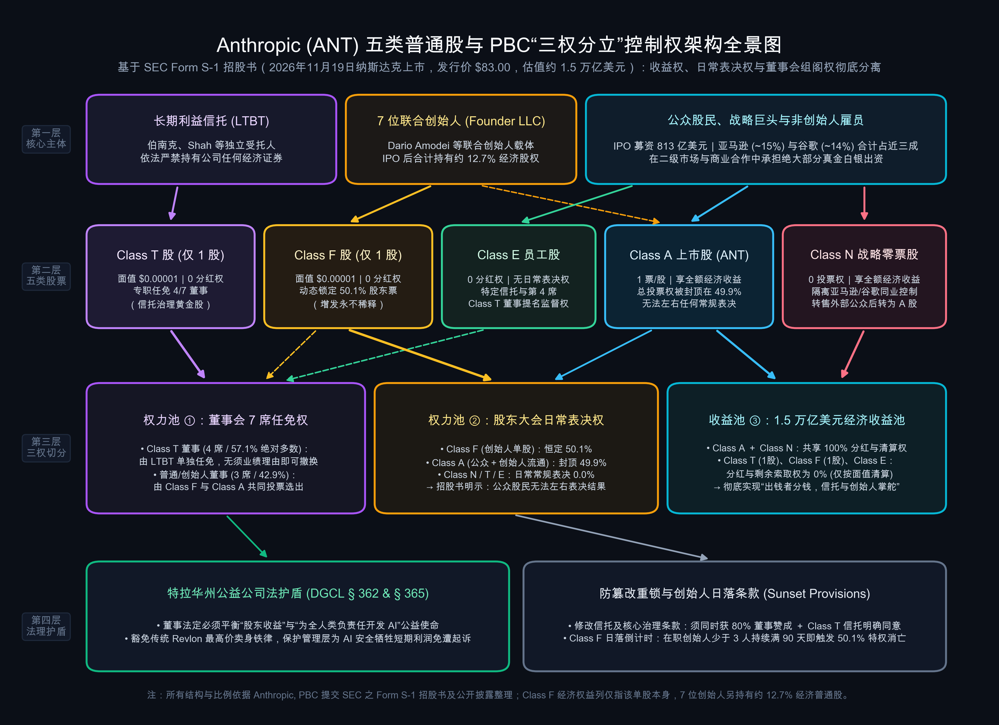
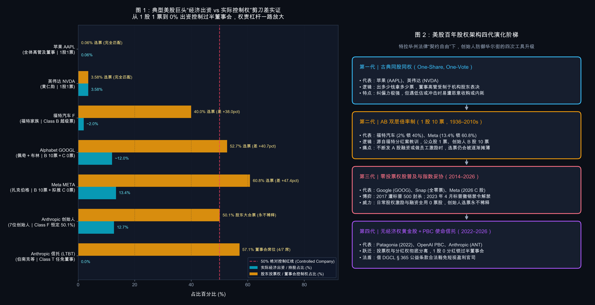

# 【制度深读 01】一股控盘万亿巨头：从 Anthropic 上市看透美股的“股权乐高魔术”

*《商业的游戏规则》第 01 篇 · 美股制度与权力故事深读*

> **摘要：** Anthropic 上市只用两张“一美分不到”的特殊股票便锁死 1.5 万亿美元 AI 巨头的最高控制权。本文借这一最新华尔街大事件，拆解美股五类股票的“三权分立”精妙设计、特拉华州公益公司法理豁免，以及美股百年四代股权架构的演化博弈。

---

## 引言：纳斯达克史上最奇特的敲钟

2026 年 11 月 19 日，大模型 Claude 的母公司 Anthropic 在纳斯达克正式挂牌敲钟，股票代码 `ANT` 。这场 IPO 创下了人类商业史上的又一个惊叹号：认购超额约 7 倍，发行价定在超越推介区间上限的 `$83.00` ，一举募资 **813 亿美元** ，完全稀释总市值直冲 **1.5 万亿美元** 。

然而，真正让华尔街公司治理律师和机构投资者倒吸一口凉气的，既不是它截至 2026 年 10 月末高达 810 亿美元的年化营收（ARR）规模，也不是它为早期股东带来的惊人账面暴利，而是摊在 SEC `Form S-1` 招股书首页的那套**堪称“股权乐高魔术”的治理架构** 。

在普通股民的直觉里，公司上市就是“谁出的钱多、谁占的股份大，谁就当老板”。但翻开 Anthropic 的上市文件，你会看到三件彻底颠覆常识的事：

* **出钱最多的金主没有日常投票权：** 亚马逊与谷歌这两大科技巨头，各自真金白银投入百亿美元级资金并贡献了 Anthropic 约 44% 的云市场营收，上市后分别握有公司约 **15%** 和 **13.7% ~ 14%** 的股权（按 `$83.00` 发行价计算，各自市值逾 **2,000 亿美元** ）。然而在常规股东表决中，它们手里的核心持股（`Class N`）**一票投票权都没有** ；
* **不拿一分钱的人控制着过半数董事会：** 一个由前美联储主席本·伯南克（Ben Bernanke）等外部学者与安全专家组成的独立信托，**依法严禁持有公司任何经济股份、一分钱分红都拿不到** ，但他们仅仅凭借手里**区区 1 股**面值 `$0.00001` 的股票，就直接握有任免公司 **7 个董事席位中 4 席（绝对多数）** 的生杀大权；
* **花 813 亿美元抢筹的华尔街机构与散户买了个寂寞：** 招股书白纸黑字地向公开市场买家发出直白警告——你们买到的 `Class A` 普通股，不管怎么投票，**通常都无法影响任何一项提交股东大会表决的事项结果** 。

为什么美国证券市场允许一家千亿、万亿级巨头在公开挂牌时，把股票切得比乐高积木还要碎？这究竟是创始人欺负小散户的“霸王条款”，还是前沿科技公司在华尔街资本猛兽面前为自己焊接的“制度防弹衣”？

要看懂这一幕，我们必须先把“股票”这两个字拆成最底层的法律零件。

---

## 一、 把“一股股票”拆成零件：为什么美股允许私人定制股权？

在我们的日常认知中，“一股股票”仿佛是一块不可分割的铁板——买下一股，就同时拿到了分红权、投票权和让管理层替你赚钱的权利。

但在现代美国公司法（尤其是全美逾六成世界五百强公司注册地——特拉华州）的法理世界里，**“股票”从来不是一块铁板，而是一束可以被任意拆解、重组、再定价的“权利契约束（Bundle of Rights）”** 。哪怕把同一家公司的普通股拆成三四五种，只要法律事先允许，每一张纸都可以只承载其中一两个零件：

1. **现金流索取权（Economic Rights）：** 公司赚了钱分红、或者未来清算变卖时，能按比例分走多少真金白银；
2. **日常议程表决权（General Voting Power）：** 对常规股东大会议案、合并重组或修改章程投赞成还是反对票；
3. **董事会组阁权（Board Appointment Rights）：** 决定谁能坐进董事局会议室，以及随时把不听话的董事踢出去的权力；
4. **信义效忠边界（Fiduciary Mandate）：** 虽写在公司章程而非股票背面，但它直接决定了董事会坐在椅子上时，心里究竟必须优先向谁负责。

### 1. 第一把法理钥匙：特拉华州 `DGCL § 151(a)` 的“契约自由哲学”

很多人会疑惑：监管机构难道不管管这种“出钱不给投票权、不给钱却能任免董事”的奇葩设计吗？

恰恰相反，美国企业法基石《特拉华州普通公司法》（DGCL）第 **151(a) 条** 明确授予公司几乎无限的股权自由裁量权——**只要在公司注册章程和招股书（Form S-1）中提前写得清清楚楚，公司完全可以发行一种或多种类别的股票，并在投票权（多票、少票、零票或特定条件投票权）、分红权和优先受偿权上做出任意差异化设定** 。

特拉华州立法者与华尔街背后的逻辑非常冷酷，也极其市场化：**法律只负责逼你把“霸王条款”用最大号字体印在招股书封面上，绝不替投资者决定什么价格才算公平。** 如果公众股民觉得没有投票权的股票不值钱，完全可以在 IPO 询价时只出半价甚至干脆不买；既然机构和散户在明知条款的前提下依然以 `$83.00` 抢购了 7 倍，那么愿打愿挨，契约即神圣有效。

### 2. 第二把法理钥匙：为了防止被股民告上法庭，先给自己穿上“PBC 公益公司”铠甲

光把投票权锁死还不够。在传统美国公司法下，即便创始人控制了绝对选票，只要公司是一家标准营利性公司（C-Corp），创始人与董事依然头悬一把利剑——**“股东利益最大化（Shareholder Primacy）”铁律** 。

这把铁剑立威于 **1919 年密歇根最高法院审理的著名《道奇诉福特汽车案》（Dodge v. Ford Motor Co.）** 。当年，汽车大王亨利·福特手握巨额现金，突然宣布取消特别分红，理由是要把钱留下来扩建工厂、给工人涨工资、并把汽车降价卖给更多普通美国老百姓，让工业发展的红利惠及社会。结果持有福特公司 10% 股份的道奇兄弟（他们自己也想拿分红去创办竞争对手品牌）一纸诉状将福特告上法庭。法院最终严厉判处福特败诉，留下了一句响彻美国商学院百年的名言：**“商业公司存在的首要目的，是为股东赚取利润；董事不得为了纯粹的社会慈善或消费者福祉而长期扣留股东的红利。”**

到了 **1986 年特拉华州《露华浓案》（Revlon, Inc. v. MacAndrews & Forbes）** ，这把剑更是被磨到了极致：一旦公司走到了出售控制权的十字路口，董事会连谈情怀的资格都会被剥夺，必须瞬间化身为冷血的**“拍卖师（Auctioneer）”** ——无论另一家买家有多么认同企业文化，只要竞争对手多出哪怕一美元，董事会就必须把公司卖给出价最高者，否则中小股东立刻可以发起集体诉讼要求董事个人赔钱。

对于前沿通用人工智能（AGI）实验室来说，这道法律紧箍咒是极其危险的：万一模型能力跨过某种安全红线，管理层决定“主动延迟发布半年做安全对齐”，哪怕直接让公司当季少赚上百亿美元，在传统公司法下，华尔街对冲基金完全可以以“董事违背股东利益最大化信义义务”为由把董事会告得焦头烂额。

于是， **2013 年特拉华州修订出台的《公益公司法案》（Public Benefit Corporation, `DGCL § 362 & § 365`）** 成了硅谷 AI 巨头的救命稻草。无论是此前刚刚完成重组改制的 **OpenAI Group PBC** ，还是此次直接以 `Anthropic, PBC` 身份敲钟的 Anthropic，都选择注册为特拉华州公益公司。根据 `DGCL § 365` 条款，PBC 公司的董事会被法律明确要求同时平衡三件事：
1. 股东的财务经济利益；
2. 受公司行为实质影响的各方利益相关者；
3. 章程中写明的具体公共利益目标——在 Anthropic 的章程里，这句话被定义为：**“为全人类的长远利益，负责任地开发和维护先进人工智能。”**

更关键的是 `§ 365(b)` 的“安全港免责条款”：只要董事会在做决定时做到了充分知情、无个人利益冲突且不构成资产浪费（Corporate Waste），哪怕为了 AI 安全踩下商业化刹车、或者拒绝了某个高溢价买家的并购要约，也受法定安全港的强力保护，免受传统 *Revlon* 最高价拍卖义务与短视盈利诉讼的追杀（2026 年 7 月特拉华州衡平法院在 *Drakes Landing* 案中亦首次正式确认了这一边界）。

---

## 二、 精密解剖 Anthropic 的五类股“三权分立”机器

有了特拉华州法律的“契约自由”和“公益公司护盾”作为地基，Anthropic 在 2026 年的 `Form S-1` 招股书里，搭建出了公开资本市场迄今为止最精密的一座**“三权分立”控制权宫殿** 。

不同于普通科技公司只用 A 类、B 类两张牌玩“1 票 vs 10 票”，Anthropic 一口气把普通股切成了 **A、N、T、F、E 五个类别** 。这套设计同时瞄准了三个防御目标：**防战略金主（亚马逊和谷歌）、防华尔街短视散户机构，甚至在某种程度上——防创始人自己未来变心。**

> **架构全景一句话读懂：**  
> 整个架构把“钱、常规表决、董事会席位”切成了三个互不干扰的池子——公众与巨头拿走 100% 的分红与增值收益，创始人靠 1 股 `Class F` 死锁 50.1% 股东会日常票，而由伯南克等人坐镇的独立信托则靠 1 股 `Class T` 牢牢掌握 7 席董事会中的 4 席任免权。

为了看清每一类股票究竟握有什么筹码，我们将 `Form S-1` 中的条款浓缩为下面这张权利切分清单：

| 股票类别 | 发行对象与数量 | 经济利益（分红与清算权） | 股东大会常规表决权 | 董事会席位控制权（共 7 席） | 核心制度设计意图 |
| :--- | :--- | :--- | :--- | :--- | :--- |
| **`Class A` 普通股** | 公开市场投资者与既有股东（纳斯达克代码 `ANT` ） | **完全享有** （按股数比例分配红利与剩余资产） | 1 股 1 票，但**总表决权被集体封顶在 49.9%** | 与 Class F 共同投票选举 3 席普通董事（实际上受制于 Class F 的 50.1% 多数票） | 让公开市场顺利交易、募资 813 亿美元，但不给外部市场任何颠覆权 |
| **`Class N` 普通股** | 战略商业伙伴（主要为亚马逊、谷歌转化股份） | **完全享有** （与 Class A 经济权益完全等同） | **0 票** （除特拉华州法律强制单独类别表决外） | **无投票权** ；只有向非关联第三方出售时，才自动 1:1 转为 Class A | **防金主控盘隔离墙：** 哪怕亚马逊和谷歌合计持有近 30% 股权，也绝不准插手董事会 |
| **`Class F` 普通股** | 7 位联合创始人控制的载体 `Founder LLC`（ **仅此 1 股** ） | **0 分红权** （清算仅按 `$0.00001` 面值退还） | 无论外部怎么增发融资，**恒定自动锁定 50.1% 股东大会总选票** | 凭 50.1% 绝对多数实际决定 3 席普通/创始人董事席位（Dario 等人在内） | **超越 AB 股的防稀释锚：** 哪怕创始人未来把 A 股卖掉一半，只要这 1 股还在，50.1% 选票纹丝不动 |
| **`Class T` 普通股** | 长期利益信托 `LTBT`（ **仅此 1 股** ） | **0 分红权** （受托人依法严禁持有公司证券） | **0 票** （不参与日常商业并购或普通议案投票） | **独家任免 4 席 `Class T` 董事（占 7 席董事会过半数），且无需业绩理由随时可撤换** | **AI 安全最终刹车片：** 吸取 2023 年 OpenAI 内部政变教训，用无利益冲突的外部贤达守住董事会半壁江山 |
| **`Class E` 普通股** | 非创始人普通员工 | **0 分红权** （仅面值清算） | **0 常规表决权** | 仅对信托规则修改及特定第 4 席 `Class T` 董事提名享有特殊制衡投票权 | 赋予核心一线研发工程师对安全信托的有限制衡与吹哨监督权 |

在这台精密机器中，最值得玩味的制度细节有三个：

### 1. 比“1 股 10 票”更狠的动态锁：`Class F` 永不稀释的 50.1%
传统的双层股权（比如 Meta 的 B 类股），靠的是“你 1 股 1 票、我 1 股 10 票”。这种算法有一个隐患：如果公司未来不断做百亿融资、或者高管大量套现卖股，A 类股越发越多，创始人的投票权比例就会被慢慢冲淡，迟早有一天要逼近 50% 的红线。

Anthropic 直接跳过固定倍率算术，发明了**“动态百分比锚定法”** ：7 位联合创始人把控制权全部装进一家叫 `Anthropic Founders, LLC` 的实体，只发行 **1 股 `Class F`** 。招股书直接写死：**在任何常规股东表决中，这一张 `Class F` 自动永远代表 50.1% 的总投票权** ，剩下全天下所有的 `Class A` 股票（哪怕再增发十亿股）只能去分那剩下的 49.9%。同时，亚马逊和谷歌拿到的巨额股份绝大多数被装进了零投票权的 `Class N` ，彻底断绝了云巨头靠股权挟持大模型公司转向自身商业利益的可能。

### 2. 吸取 OpenAI 政变教训的“4 vs 3 混合制衡董事局”
2023 年底，OpenAI 的非营利董事会曾上演过一次震惊全球的突袭——四名几乎没有商业经验的外部董事在周末突然开除了灵魂人物山姆·奥尔特曼，引发全体员工逼宫与微软强力干预，最终酿成混乱回炉与漫长的 PBC 改组（改组后由 OpenAI 基金会持有常规股权并直接任免 PBC 全体董事，微软持有约 27% 稀释后股权、估值约 1,350 亿美元）。

Anthropic 显然深刻吸取了前车之鉴，把自己的 **7 席董事会** 拆成了极其精妙的 **4 + 3 制衡格局** ：
* **4 席 `Class T` 董事（占 57.1% 绝对多数）：** 由 **长期利益信托（LTBT）** 独享任免权。为了让信托受托人绝对中立，章程不仅严禁受托人持有 Anthropic 的股票或拿分红，还专门挑了一批在宏观金融、国家安全与公共政策界声名显赫的大咖坐镇——包括担任主席的克林顿健康倡议组织 CEO Neil Buddy Shah、新美国安全中心 CEO Richard Fontaine、哈佛物理学家 Christopher Stubbs，以及 **2026 年 6 月重磅加入的前美联储主席、诺贝尔经济学奖得主本·伯南克（Ben Bernanke）** 。而他们指派进董事会的也不是书呆子，而是像 Netflix 联合创始人里德·黑斯廷斯（Reed Hastings）、诺华制药 CEO Vas Narasimhan 这样懂千亿商业运作的顶级实业派；
* **3 席普通/创始人董事（占 42.9%）：** 由创始人的 `Class F` 与公众股东共选，保证 Dario Amodei（CEO）与 Daniela Amodei（总裁）等核心管理层掌握日常业务推进话语权。

这种设计相当于在公司内部同时装上了大马力油门与独立刹车系统：**平时 50.1% 的 `Class F` 与 3 席管理层董事保证公司像硅谷猛兽一样全力商业冲刺（营收两年飙至 810 亿美元年化规模）；一旦管理层在安全底线上发疯越界，手握 4 席董事任免权的 LTBT 信托随时可以无条件撤换董事、按下红色急停按钮。**

### 3. 防篡改铁门与“少于 3 位创始人”的日落倒计时
Anthropic 的治理团队连“未来创始人和华尔街合谋拆掉安全锁”的后路都堵死了：如果想修改 LTBT 信托的核心权限，必须**同时获得 80% 全体董事赞成 ＋ `Class T` 信托本身点头同意**，哪怕 100% 股东赞成都拆不掉。

不过，创始人特权也并非世袭万年。招股书给 `Class F` 设下了一道明确的 **日落条款（Class F Sunset Time）** ：一旦 **7 位联合创始人中仍在公司任职的“持续创始人（Continuing Founders）”连续 90 天少于 3 人**，或者创始人实体主动注销解散，这股神奇的 50.1% 超级单股就会在过渡期后正式失效，投票权彻底回归公开市场的 `Class A` ，同时董事会将转向交错改选机制（Staggered Board）。

---

## 三、 纵览百年美股进化史：常见的四大股权门派与标普 500 的“投降往事”

Anthropic 的五类股并不是一天从石头缝里蹦出来的。把视野拉长到过去一百多年，美股市场围绕“**创始人想保控制权、华尔街想拿投票权**”展开的暗战，整整演化出了**四代股权结构门派** 。

> **百年演进图谱解读：**  
> 左图用真数还原了美股代表性巨头的“权责杠杆剪刀差”——从苹果高管 `0.06%` 出资对应 `0.06%` 选票的完全对等，到福特、Alphabet、Meta 动辄放大 4 倍以上的投票杠杆，再到 Anthropic 信托以 `0.0%` 经济出资掌控过半数董事会。右图梳理了这四代工具是如何在华尔街博弈中一步步升级迭代的。

为了方便随时对照，我们把美股市面上最常见（以及最新进化出）的四类股权门派整理如下：

| 演化世代与门派名称 | 经典代表公司 | 核心权利结构 | 显著优势 | 隐藏代价与潜在坑点 |
| :--- | :--- | :--- | :--- | :--- |
| **第一代：古典共和制** *(同股同权 1 股 1 票)* | 苹果 (`AAPL`) 英伟达 (`NVDA`) | 只设单一普通股，1 股 ＝ 1 票 ＝ 1 份红利；出多少钱拿多少票 | 权责高度对称，外部机构与独立董事纠偏力极强，常享治理溢价 | 遇到激进恶意收购或内部合规风波时，创始人几乎没有股权盾牌 |
| **第二代：AB 双层倍率制** *(超级投票权 1 股 10 票)* | 福特汽车 (`F`) Meta (`META`) | A 类公众股（1 票）vs B 类创始人股（10 票或按比例锁死） | 创始人即使只剩少数股权，也能抵御华尔街季度短视与恶意收购 | 不断发 A 股融资或发员工股权激励时，超级票比例仍会被逐渐摊薄 |
| **第三代：零票分红制** *(Class C/N 零投票权股)* | Alphabet (`GOOG/GOOGL`) Snap (`SNAP`) Meta (2026 拟推 C 股) | 专门拆出与 A 股同分红、但 **0 投票权** 的股票用于交易、融资与发奖金 | 发再多零票股也不稀释创始人选票，实现控制权的“永动机锁死” | 买单股东彻底沦为“财务哑巴”，曾引发全球指数公司长达六年的封杀 |
| **第四代：黄金股与使命信托** *(PBC ＋ 0 分红治理股)* | Patagonia (未上市) OpenAI Group PBC Anthropic (`ANT`) | 把“分红权”与“治理权”切给不同人；设 0 分红超级控制股 ＋ PBC 公益法盾 | 彻底免疫“股东至上主义”短视诉讼，保护高风险长期使命不被资本夺舍 | 极度依赖受托人良知；若“盈利股东”与“使命信托”撕裂，易陷入治理僵局 |

这四代演化背后，藏着两段精彩绝伦的商业拉锯史：

### 故事 A：从福特家族的百年防御，到“零投票权 C 类股”的发明
前面提到的 1919 年 *Dodge v. Ford* 案，把汽车大王亨利·福特彻底惹毛了。他一边咬牙借钱把道奇兄弟等所有小股东的股份全买断实现私有化，一边在后来重构股权时埋下伏笔：**1956 年福特汽车重新上市时，福特家族死死抓住了专门设计的 `Class B` 超级股票——直到今天，福特家族仅持有公司约 2% 的经济股份，却依然借此锁定了高达 40% 的固定投票权。**

这种“1 票 vs 10 票”的 AB 双层制在 2004 年谷歌（Google）上市、2012 年 Facebook（现 Meta）上市时被硅谷彻底发扬光大。但很快，谷歌的两位创始人佩奇和布林（合持约 **11% ~ 13%** 经济股权，控制约 **52.7%** 总投票权）发现了一个棘手难题：科技公司每年都要给数万名硅谷工程师发海量股权激励（SBC），还要拿股票去收购公司，发出来的全是 1 票权的 A 类股（`GOOGL`），照这么发下去，两位创始人的总投票权很快就会跌破 50%！

于是，**2014 年 4 月，谷歌想出了一个绝招——把一股拆成两股，送给老股东一种全新的、一分钱分红不少拿但投票权永远为 0 的 `Class C` 股票（代码 `GOOG`）** 。从此以后，发奖金、搞并购全部用 0 票权的 C 类股，两位创始人的选票比例像定海神针一样稳如泰山。2026 年 10 月，在同样面临 AI 基建巨额资本需求、且扎克伯格不愿放弃 60.8% 选票（仅持 13.4% 经济股）的情况下，Meta 董事会也如法炮制，宣布派发 0 票权的 C 类股股票股利。

### 故事 B：Snap 的极限试探与标普 500 指数的“六年封杀与妥协”
看到谷歌这么玩都没事，2017 年 3 月，阅后即焚软件 **Snap Inc. (`SNAP`)** 上市时干脆把步子迈到了极限：**IPO 公开发行的 `Class A` 股票整整一张投票权都不给，100% 零投票权！** 这是美国主要交易所历史上第一次有公司连“1 股 1 票”的门面都不装了，彻底激怒了华尔街养老金与被动指数巨头。

为了捍卫“股东民主”，**2017 年 7 月，标普道琼斯指数公司（S&P DJI）拍案而起，颁布了著名的“多类股禁令”** ：只要新上市公司敢搞同股不同权或零投票权结构，一律禁止纳入美股核心大盘基准 **标普 500 指数（S&P 500）** （此前已在指数里的谷歌、Meta、巴菲特伯克希尔等按老办法豁免）。

然而，资本市场的演化最终还是让规则低了头。随后的六年里，几乎所有高成长硅谷独角兽都铁了心要发 AB 股或零票股，标普指数公司惊恐地发现：如果死守这条道德禁令，标普 500 就会错过整个新一代美国科技龙头，失去代表美国经济的能力！终于，在经过数轮机构征询后，**2023 年 4 月 17 日，标普道琼斯指数公司正式宣布撤销实行了近六年的多类股禁令，重新允许所有多类股结构公司进入标普 500** 。从“拍案封杀”到“低头放行”，这场指数保卫战的落幕，才为今天 Anthropic 敢以五类股敲钟、并在未来满足盈利等财务条件后顺利纳入标普 500 等核心大盘指数扫清了制度性障碍。

### 故事 C：当极客把公司“捐给地球”——第四代使命黄金股诞生
在商业文明的另一端，2022 年 9 月，户外服装传奇品牌 **Patagonia** 的 83 岁创始人伊冯·乔伊纳德（Yvon Chouinard）做了一个震动全世界的决定：他把价值约 30 亿美元的公司股权全部捐了出去，但捐法无比精妙——
* 公司 **2% 拥有全部投票权的股票**，放进了守护公司价值观的 **Patagonia 使命信托（Purpose Trust）** ，确保永远不上市、不背叛环保初心；
* 公司 **98% 没有任何投票权的股票**，放进了专门做环保公益的非营利组织 **Holdfast Collective** ，公司每年赚来的约 1 亿美元超额利润全部分给它去对抗气候变化，“地球成了我们唯一的股东”。

而把 Patagonia 这种“投票与收益彻底分离”的非上市极客实验，第一次完整嫁接到纳斯达克万亿级公开上市公司身上的，正是 2026 年 11 月上市的 Anthropic。

---

## 四、 硬币的背面：买单的股民得到了什么、又失去了什么？

看完了这套令人拍案叫绝的股权乐高术，作为一个真金白银在二级市场做配置的投资者，最后必须保持一份冷峻的清醒：**当你按下买入键，买进像 Anthropic `ANT` 这样拥有五类股和公益保护伞的股票时，你的筹码到底换来了什么，又永久交出了什么？**

### 你买到的三大红利（为什么机构依然愿意 7 倍超额认购？）
华尔街机构并非喜欢被剥夺投票权，但在稀缺的代际 AI 巨头面前，顶级资金愿意接受一定的**“治理折价（Governance Discount）”**作为上车入场券——只要公司还处在高速复利增长期，这套架构在短期内反而提供了三层护城河：
1. **对冲“季度财报短视病”的保护期：** 一流硬科技与前沿 AI 的底层研发往往需要跨度五到十年的海量烧钱。超级投票权与 PBC 盾牌把短视的季度对冲基金挡在门外，让管理层敢于把百亿美元投向真正的长期技术壁垒；
2. **防止被产业巨头低价强行吞并：** 正因为 `Class N` 锁死了亚马逊和谷歌的投票权、`Class T` 锁死了董事会过半数席位，外部竞争对手根本不可能趁股价跌入低谷时在二级市场搞偷袭式恶意收购，保住了公司独立成长为数万亿级独立生态平台的可能性；
3. **防止“为短期冲刺商业化而自毁长城”：** 在强外部性行业里，一次毁灭性的 AI 安全或数据泄露灾难，足以让万亿估值一夜间清零。一个不拿分红、盯着安全底线的独立信托，在客观上充当了防止公司为了短期 KPI 飙车翻车的保险丝。

### 你必须默许的三大真实代价（绝不要抱有任何幻想）
反过来看，一旦未来业绩增速放缓，“治理折价”便会迅速放大，此时你必须承受三项无法逆转的代价：
1. **“用手投票”和“华尔街野蛮人救场”通道永久归零：** 如果未来你发现管理层开始变得官僚臃肿、乱花钱、或者战略持续犯错，在同股同权公司里，还有激进对冲基金递交举牌信、逼公司换帅削减开支分红；但在 Anthropic、Meta 或 Alphabet 这样的公司里，外部股东连 0.1% 的法律纠偏概率都没有——唯一能做的只有“用脚投票”卖出离场；
2. **失去“最高价被收购溢价”的潜在彩票：** 由于 `DGCL § 365` 豁免了传统 *Revlon* 最高价拍卖义务，即便将来某家巨头开出溢价 50% 的天价现金全盘收购要约，只要公益信托认为新买家“不够认同人类安全使命”，董事会就可以合法拒绝这笔交易，而且小股东告上特拉华州法院大概率也会败诉；
3. **史无前例的三方撕裂与“治理死锁”隐患：** 这是 Anthropic 五类股结构在人类历史上第一次接受公开市场检验的潜在盲区——目前它的收入正以每年数倍的速度狂奔，皆大欢喜；可一旦未来 AI 商业化增速放缓，或者在某一关键时刻，**代表安全刹车片的 `Class T` 信托（掌握 4 席董事）、代表业务扩张冲刺的 `Class F` 创始人（掌握 50.1% 股东会投票权）、以及手里握着 1.5 万亿美元市值定价权的华尔街 `Class A` 股东**三方意见发生激烈撕裂时，这台没有先例可循的三权分立机器会不会陷入难以调和的僵局，依然是一个悬在所有投资者头顶的长期看点。

---

## 结语

> **制度深读一句话：**  
> 在特拉华州公司法的“契约自由”下，股票早已不是一份铁板一块的所有权凭证，而是可随意拆装的权力积木：同股同权卖给你的是“主人翁票”，双层股卖给你的是“搭乘创始人顺风车的分润票”，而 Anthropic 的五类股与 PBC 护盾，则是公开向华尔街立下一份君子协定——“赚钱归你我共享，方向盘归创始人与安全信托共管。”

看懂美股的商业制度，从来不是为了去背诵晦涩的法条，而是为了在每一次按下买入键之前，看清自己手里的筹码究竟买到了哪几块积木。当一家公司把“不给投票权”明明白白印在招股书封面上时，市场给出的定价就已经包含了这份契约交换——你可以尽情拥抱前沿巨头狂奔的时代红利，但前提是，**先读懂桌面上写好的游戏规则** 。
