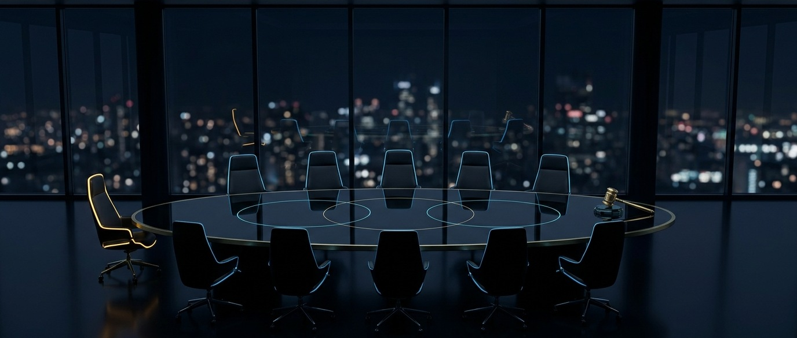
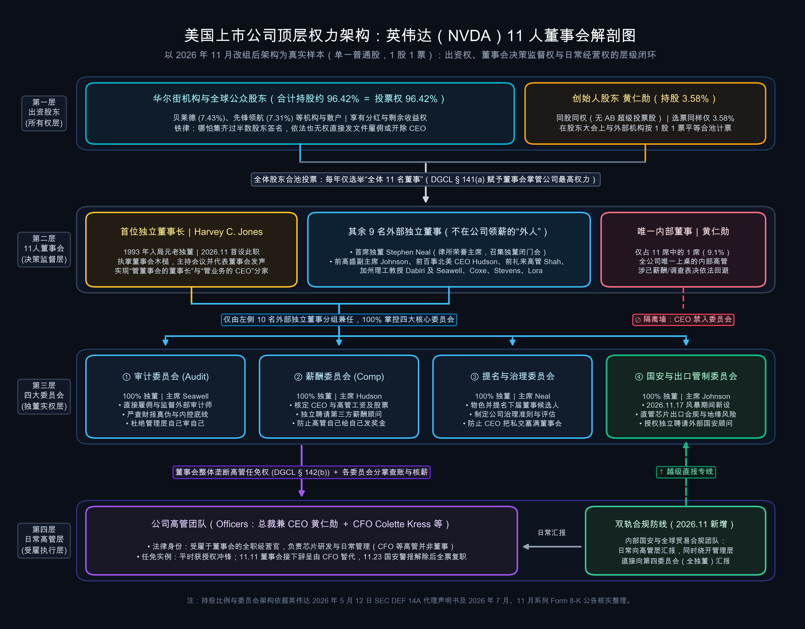
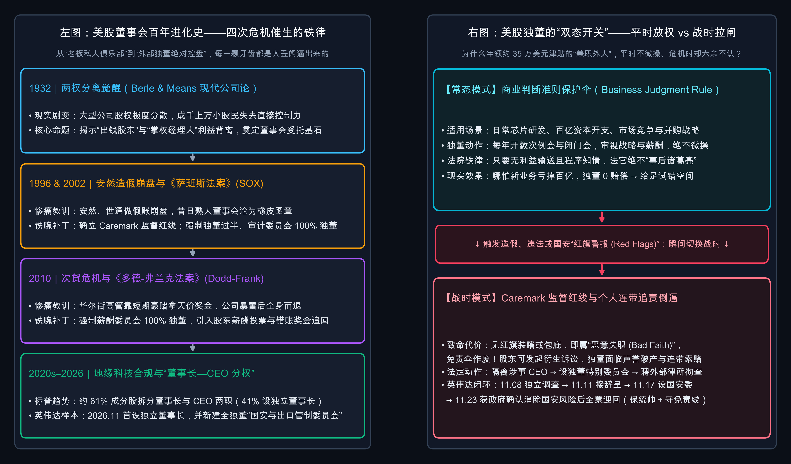

# 【制度深读 01】黄仁勋官复原职背后：借英伟达 11 人牌桌，一次看懂美国公司的“董事会”到底怎么运转

*《商业的游戏规则》第 01 篇 · 美股制度与权力故事深读*

> **摘要：** 11 天权力风暴落幕，黄仁勋重掌英伟达帅印，但顶层牌桌却永久多了一位“独立董事长”和一个直通外部董事的“国安委员会”。本文借英伟达真实的 11 人董事会切片，从零拆解美国上市公司“股东—董事会—四大委员会—CEO”的底层运转密码。

---

## 引言：大戏散场之后，顶楼悄悄多出的一把交椅

2026 年 11 月，全球算力霸主英伟达（NVIDIA）经历了一场足以载入商业史册的 11 天权力过山车：11 月 8 日，因涉外情报关注与个人私生活争议曝光，英伟达董事会宣布成立独立特别委员会启动调查；11 月 11 日，掌舵公司整整 33 年的联合创始人黄仁勋主动递交辞呈，辞去总裁、首席执行官（CEO）及董事职务。彼时，接掌局面的董事会展现出近乎冷酷的切割姿态——不仅当场接下辞呈、火速指派首席财务官（CFO）暂代帅印，新上任的董事长哈维·琼斯（Harvey C. Jones）更在电话会上公开表态，称黄仁勋系自愿离职，“董事会不打算让他复职”，并同步启动了永久继任者搜寻。

然而仅仅 11 天后的 11 月 23 日，随着美国政府高层向董事会正式输入“无国家安全风险”的评估意见，同一张牌桌上的董事们全票表决迎回黄仁勋官复原职。回归后的首个交易日，英伟达股价狂飙 **31.48%** （收于 `$165.05` ），单日市值暴增约 **9,500 亿美元** ，创下人类商业史上最大的单日市值增长纪录。

表面上看，一切似乎回到了原点。但翻开英伟达向美国证监会（SEC）提交的系列 Form 8-K 公告，顶楼会议室的权力格局其实已经永久改写：

* **多了一把从未有过的“头把交椅”：** 黄仁勋虽然拿回了总裁、CEO 和董事席位，但英伟达成立 33 年来首次设立的**“独立董事长（Independent Chair of the Board）”**一职并未随之撤销，依然由元老董事哈维·琼斯稳坐执槌；
* **多了一个绕开管理层的“合规专署”：** 就在风波期间的 11 月 17 日，董事会火速新建了一个常设的**“国家安全与出口管制监督委员会”** ，全员由外部独立董事组成，并硬性规定公司内部的国安与全球贸易合规团队直接向该委员会汇报。

把这 11 天的剧情连起来细想，一连串反直觉的疑问便会浮现出来：

* **黄仁勋是亲手创立英伟达的灵魂人物，为什么几百万买英伟达股票的股东不能直接投票挽留他，偏偏要由“董事会”说了算？**
* **这张牌桌旁坐着的究竟是一帮什么人？他们平时并不在英伟达打卡上班，凭什么掌管数万亿帝国的最高权柄？**
* **为什么英伟达过去三十多年居然一直“没有董事长”？这群与黄仁勋并肩作战数十年的老搭档，为何危机初起时铁面切割、放话不拟复职，11 天后又能全票改口？**

要解开这些谜团，我们不妨借着英伟达这次被彻底掀开引擎盖的 **11 人牌桌** ，把美国上市公司最核心的权力中枢——**“董事会（Board of Directors）”**拆到每一颗螺丝钉。

---

## 一、 三层权力隔离：为什么几百万股东不能直接雇佣或开除 CEO？

在日常商业语境里，人们很容易把“大股东”、“董事长”和“CEO（总经理）”混为一谈，默认谁创立了公司、谁名气最大，公司就归谁说了算。但在以特拉华州公司法为基石的现代美股世界里，一家上市公司的顶层架构被严格切割成了**三层彼此隔离的法律身份** ：

1. **第一层：股东（Stockholders）——只出钱、分红利，但绝不直接管事的“所有权人”；**
2. **第二层：董事（Directors）——受股东投票委托、坐镇顶楼掌管最高权柄的“受托监督官”；**
3. **第三层：高管（Officers，如 CEO、CFO）——受雇于董事会、天天在公司打卡领薪水的“全职打工人”。**

### 1. 一条铁律：DGCL § 141(a) 锁死的“董事会中心主义”

很多股民会觉得奇怪：既然我们买了股票，是公司的真正主人，遇到大事为什么不能直接发起公投决定 CEO 的去留？

答案写在《特拉华州普通公司法》（DGCL）最核心的基石条款——第 **141(a) 条** 与第 **142(b) 条** 里：法律明确规定，**“公司的业务与事务，由董事会掌管，或在董事会的指导下运作”** ；至于 CEO、CFO 等公司高管（Officers），其选拔、考核与免职权**由董事会依法垄断** 。哪怕你在二级市场上联合了持有 51% 股份的华尔街基金联名写信要求换掉某位高管，从法律程序上讲，这张联名信对高管本人也是无效的——股东手里的选票只能用来干一件事：**在股东大会（或章程允许的临时表决程序）上投票选举或撤换“董事”** ，再由坐进会议室的董事们举手决定谁当 CEO。

为什么要设计得这么绕？这要追溯到 **1932 年经济学家伯利与米恩斯（Berle & Means）在名著《现代公司与私有财产》中提出的世纪诊断——“所有权与控制权分离”** 。

看看英伟达 2026 年 5 月向 SEC 提交的股东代理声明书（DEF 14A）就能瞬间理解这种现实：英伟达采用最古典的**“单一普通股、1 股 1 票”**架构，没有任何 AB 股超级投票权防弹衣。在约 243.1 亿股总股本中，第一大股东贝莱德（BlackRock）持股 **7.43%** ，第二大股东先锋领航（Vanguard）持股 **7.31%** ，而联合创始人黄仁勋通过家族信托与基金会等合计实益持有约 8.71 亿股，占总股本与总投票权的比例完全相等，仅为 **3.58%** 。

试想一下，面对全球几百万名随时在买卖股票的散户和指数基金，怎么可能靠“全民公投”去决定下一代 AI 芯片投多少研发费、或者半夜紧急处理一场外交合规危机？因此，现代公司法做了一次干脆利落的权力让渡：**几百万分散股东每年只负责选出一个十人左右的“精英代议院”（董事会），然后把包括任免 CEO 在内的全部最高经营生杀权，统统交给这张牌桌。**

### 2. 两个颠覆直觉的冷知识：CFO 不是董事，英伟达以前甚至“没有董事长”

搞懂了“董事（Director）”与“高管（Officer）”的楚河汉界，再翻开英伟达的高层名单，你会看到两件完全颠覆日常商业直觉的事：

* **全公司数万名员工里，只有黄仁勋一人能坐上董事牌桌：** 人们常以为公司的副总裁、财务总监自然也是董事会成员。但在英伟达的 **11 人董事会** 中，只有黄仁勋一人兼具内部员工身份；就连掌管公司数千亿美元财务命脉、在黄仁勋离职那 11 天里临危受命担任临时 CEO 的首席财务官科莱特·克雷斯（Colette Kress），她的法律身份也仅仅是受雇于董事会的**高管（Officer）** ，平时在董事会上只有汇报工作的份，**一票表决权都没有** ；
* **美国公司完全可以不设“董事长”：** 在我们熟悉的商业语境里，“董事长”往往等同于公司至高无上的法定一把手；但在美国公司法里，**“董事长（Chair of the Board）”本质上只是“董事会会议的主持人”** ，并非法定必设职位。事实上，在 2026 年 11 月这场风波之前，英伟达在制度上**长期没有设立董事长一职** ——黄仁勋的头衔只是“总裁兼 CEO ＋ 普通董事”，而董事会日常议程审批与独立董事闭门会议，则交给一位名叫斯蒂芬·尼尔（Stephen C. Neal）的外部大律师以**“首席独立董事（Lead Independent Director）”**头衔来牵头。

直到这次危机爆发，英伟达董事会才正式把“主持董事会的木槌”单独拎出来，任命自 1993 年起便担任董事的元老哈维·琼斯为公司**史上首位独立董事长** 。即便 11 天后黄仁勋强势归来，这把新设的“独立董事长”交椅也保留了下来——这恰恰顺应了过去二十年华尔街最主流的分权浪潮：根据权威猎头与治理咨询机构 **Spencer Stuart 发布的《2026 美国董事会指数》** ，在标普 500 指数成分股中，已有约 **60% ~ 61%** 的大公司将“董事长”与“CEO”两职彻底拆分，其中 **41%** 的公司直接由外部独立董事出任独立董事长。

---

## 二、 掀开英伟达 11 人牌桌：10 个“外人”如何把 CEO 关在门外干活？

既然在纸面制度上，市值数万亿美元的英伟达归这 11 个人的董事会掌管，那么推开顶楼会议室的大门，这张椭圆形牌桌旁坐着的究竟是一帮什么人？

> **权力解剖图核心导读：**  
> 整个架构由上至下形成严密的四级闭环——顶层分散股东每年仅投票选出 11 名董事；董事会由 **10 名不在公司领工资的外部独立董事** 形成 10:1 绝对多数；而真正握有查账、定薪、换人与国安合规实权的四大常设委员会，更是 **100% 由独立董事把持** ，连黄仁勋本人都被严格挡在门外。

### 1. 为什么 11 个人里有 10 个都是“外人”？

翻开英伟达截至 2026 年 11 月的 11 人董事花名册，除了黄仁勋本人，其余 **10 席（占比高达 90.9%）清一色是外部独立董事（Independent Directors）** 。这份名单堪称半部美国商界与学界名人录：

* **金融与资本老将：** 2026 年 7 月新晋入局的前高盛集团副主席苏珊娜·诺拉·约翰逊（Suzanne Nora Johnson），以及早自 1993 年英伟达创立之初便投资陪跑的硅谷传奇风投人哈维·琼斯、坦奇·考克斯（Tench Coxe，前 Sutter Hill 董事总经理）、马克·史蒂文斯（Mark A. Stevens，前红杉资本合伙人）与布鲁克·西韦尔（A. Brooke Seawell，前新思科技 CFO）；
* **跨国实业高管：** 前百事可乐北美 CEO 兼 NFL 首席营销官唐·哈德森（Dawn Hudson）、前礼来制药首席信息与数字官阿尔蒂·沙阿（Aarti Shah）、前塔可钟国际总裁梅丽莎·洛拉（Melissa B. Lora）；
* **顶尖律政与科学泰斗：** 硅谷顶级律所 Cooley 荣誉主席斯蒂芬·尼尔（担任首席独立董事），以及加州理工学院航空与机械工程讲席教授、麦克阿瑟“天才奖”得主约翰·达比里（John O. Dabiri）。

为什么一家芯片巨头要把董事会 90% 的席位让给不在公司上班的“外人”？这不是黄仁勋个人高风亮节，而是**纳斯达克（Rule 5605）与纽交所（Rule 303A）的铁血上市门槛** 。

在 2001 年安然（Enron）与世通（WorldCom）惊天财务造假案之前，许多美国上市公司的董事会里塞满了 CEO 的下属、私人律师、关联供应商甚至亲友，出了假账集体装瞎。2002 年美国国会火速通过《萨班斯-奥克斯利法案》（SOX），两大交易所随即立下死规矩：**除单一股东或团体握有超过 50% 投票权的“受控公司”（如创始人凭超级投票股锁定过半表决权的 Meta）可获豁免外，所有美股上市公司的董事会必须由“独立董事”占绝对多数！** 所谓“独立”，不仅要求董事本人不能是公司雇员，还要求其在过去 **3 年内** 与公司没有任何重大商业利益往来、顾问费收入或直系亲属高管关联。

### 2. 真正的权力心脏：把 CEO 关在门外的“四大委员会”

读到这里，一个更现实的问题浮出水面：这 10 位独立董事平时各自在大学教书、管基金或做其他大公司的董事，一年只在英伟达开几次例会，怎么可能管得住日理万机的全职 CEO？

答案藏在美国公司治理最精妙的发明——**“委员会分权制（Board Committees）”**里。全体董事会就像议会大会，而真正动刀子干脏活、累活的权力，全部下沉到了几个全部由独立董事组成的**常设专门委员会** 。按照联邦证券法与交易所规则，核心委员会开会表决时，**身为内部人的黄仁勋连进屋投票的资格都没有** ：

| 委员会名称 | 英伟达独立性配置 | 现任主席与核心班底 | 握有哪些核心实权（CEO 禁入区） | 制度防线由来 |
| :--- | :--- | :--- | :--- | :--- |
| **审计委员会 (Audit)** | **100% 独立董事** （至少 1 名财务专家） | 主席：A. Brooke Seawell（前新思科技 CFO），含 Johnson、Jones 等 | **卡住账本命门：** 直接雇佣、付费并领导外部会计师事务所，独立审查财报真伪与内控漏洞，外部审计师对独董而非 CEO 负责 | 2002 年《萨班斯法案》与 SEC Rule 10A-3 强制立法 |
| **薪酬委员会 (Compensation)** | **100% 独立董事** （严审顾问独立性） | 主席：Dawn Hudson（前百事北美 CEO），含 Coxe、Stevens、Shah、Dabiri | **卡住钱包命门：** 核定 CEO 与全体高管的底薪、奖金及股票激励（RSU），有权独立聘请第三方薪酬顾问，防高管自肥 | 2010 年《多德-弗兰克法案》强化独立追回机制 |
| **提名与公司治理委员会 (NCGC)** | **100% 独立董事** （纳斯达克亦允许过半独董提名，头部公司均设全独董委员会） | 主席：Stephen C. Neal（首席独董），含 Jones、Stevens、Lora、Dabiri | **卡住人事命门：** 物色并筛选下一届董事候选人名单、制定公司治理准则并组织董事会年度履职评估，防 CEO 安插私党 | 2003 年纽交所与纳斯达克治理规则全面改革 |
| **国安与出口管制监督委员会** | **100% 独立董事** （2026.11 新设） | 主席：Suzanne Nora Johnson（前高盛副主席），含 Neal、Dabiri | **卡住地缘合规命门：** 直管芯片出口管制、国家安全与全球贸易风险，公司内部国安与贸易合规团队**越级向其直接汇报** | 2026 年 11 月 17 日英伟达董事会危机中火速创立 |

看懂了这张表，你就看懂了美股董事会是怎么干活的：
* **管账的不归 CEO 管：** 审计师拿谁的钱就听谁的话，法律强制把聘请普华永道等外部审计师的签字权收归**审计委员会** ，彻底斩断了管理层花钱买假账的利益链；
* **发钱的不归 CEO 管：** 黄仁勋一年拿多少股票激励，必须由没有利益关联的**薪酬委员会** 关起门来算，算完还要在股东大会上接受全体股东的“薪酬咨询投票（Say-on-Pay）”；
* **换人的不归 CEO 管：** 谁能进董事会当裁判，由**提名委员会** 独立物色，杜绝了“被监督者自己挑选监督者”的荒唐循环；
* **哪里冒烟就在哪里加装独立阀门：** 2026 年 11 月芯片出口管制与国安舆情刚一发酵，董事会立刻在三大传统标配之外焊上了第四个全独董机构——**国家安全与出口管制监督委员会** ，不仅请来前高盛副主席挂帅，还直接把内部合规部门的汇报线接到了独立董事桌前。

---

## 三、 年领 35 万美元津贴的“兼职外人”，为什么危机时刻六亲不认？

看清了这套分权严密的组织机器，一个更深层的人性谜题随之浮出水面：

根据英伟达 2026 年代理声明书披露，这 10 位非雇员独立董事每年从英伟达领取的总报酬大约在 **34 万 ~ 36.4 万美元** 之间（由约 **8.5 万美元** 的基础现金津贴加上约 **27.9 万美元** 的限制性股票组成，与标普 500 独立董事平均 **34.6 万美元** 的年薪水平几乎分毫不差）。对于身家早已数亿甚至数十亿美元的硅谷风投大佬、前华尔街投行高管来说，这点津贴不过是零花钱，而且哈维·琼斯、坦奇·考克斯等人更是和黄仁勋并肩作战了三十多年的老战友。

**既然黄仁勋是主动递交辞呈配合调查，这群三十年的老搭档为什么不替他挡一挡、劝他“先休假别辞职”，反而第一时间请外部律所彻查、果断接下辞呈，甚至公开释放“不拟复职”的切割信号？而短短 11 天后，他们又凭什么毫无心理负担地全票推翻前话？**

要解开这个谜团，必须看懂特拉华州法院给所有美股独立董事装上的**“双态法律开关”** 。

> **双态运行机制核心解读：**  
> 美股独立董事平时绝不插手具体业务，是因为有“商业判断准则（BJR）”免责保护伞护体；可一旦冒出违法或国安“红旗警报”，Caremark 监督判例就会瞬间激活个人连带追责倒计时——逼着老友秒变冷面调查官，直到外部警报彻底解除才能恢复常态。

### 1. 常态巡航模式：给足创始人试错自由的“商业判断准则（BJR）”

在风平浪静的日常经营中，特拉华州法院奉行一条极具智慧的黄金法则——**商业判断准则（Business Judgment Rule，简称 BJR）** 。

法官们的逻辑非常务实：法院里的法官既不会造 GPU 芯片，也不懂大模型算力集群，绝对不能用“事后诸葛亮”的眼光去惩罚企业家的商业冒险。只要董事会在做决策时满足三个前提——**没有个人利益冲突、事先充分听取了信息汇报、出于为公司好的善意（Good Faith）** ，那么哪怕董事会批准的某代芯片架构彻底流片失败、或者某笔百亿美元并购亏得血本无归，**任何小股东去法院起诉董事失职都会被直接驳回，独立董事个人承担 0 美元赔偿责任** 。

正是这把宽容的保护伞，解释了为什么平时英伟达的 10 位独立董事从不对黄仁勋指手画脚：一年开几次战略例会，把好薪酬和财报关，剩下的技术路线与生态冲锋全部放手交给最懂行的创始人去闯。

### 2. 战时拉闸模式：让独立董事瞬间冒冷汗的 Caremark 监督红线

然而，一旦问题从“商业赔赚”跨界到了**“违法违规、内控失灵或国家安全隐患”** ，头顶那把温柔的保护伞就会在一秒钟之内收起，切换成特拉华州公司法下最严厉的追责铁律——**Caremark 监督义务（源自 1996 年 *In re Caremark* 案及 2006 年特拉华州最高法院 *Stone v. Ritter* 案）** 。

这套判例给所有美股董事划下了两条不可逾越的监督高压线：**一是平时必须在公司内部建立起有效的合规与风险汇报机制** ，不能放任高管“裸奔”；**二是当公司内外冒出涉及高管行为失当、监管合规或国家安全的明确“红旗警报（Red Flags）”时，董事会必须彻查到底，绝不能视而不见** ：
* 如果董事们碍于三十年的私交情面，选择替老朋友捂盖子、不做独立调查、或者搞一场走过场的“假调查真洗白”，在法律上就会被直接定性为**“恶意失职（Bad Faith）”** ；
* 一旦落入“恶意失职”（属于违背忠实义务的范畴），不仅商业判断准则（BJR）保护伞彻底作废，连公司章程里的董事免责条款（DGCL § 102(b)(7)，依法严禁豁免忠实义务与恶意行为）乃至部分董责险（D&O Insurance）理赔都会面临失效风险——全天下任何一个持有哪怕几股英伟达股票的股东，都可以代表公司发起**股东衍生诉讼（Derivative Suit）** ，将这 10 位独立董事推上个人连带索赔的被告席，更会让他们在华尔街积累一生的职业声誉瞬间归零！

看懂了这把悬在每位独立董事脖子上的法律利剑，再回看 2026 年 11 月英伟达董事会那看似戏剧化的四步操作，你会发现每一步都是严丝合缝的**教科书级合规自保闭环** ：

1. **第一步（11 月 8 日，红旗拉响即隔离彻查）：** 涉外情报关注与个人行为争议一经曝光，董事会当天立刻成立完全由独立董事组成的**特别调查委员会** ，外聘独立律师事务所展开穿透核查，第一时间履行“见红旗必彻查”的法定监督责任；
2. **第二步（11 月 11—12 日，顺势切割锁死风险敞口）：** 当黄仁勋主动递交辞呈配合调查时，站在独立董事的立场上，在涉国安红旗尚未查清之前，最安全的法律动作就是立刻接下辞呈、由 CFO 暂代 CEO、立起独立董事长，并对外释放“不预设复职、启动继任搜寻”的绝对独立姿态——倘若此时含糊其辞说“只是暂时避风头过几天就回来”，一旦事后查出实质国安违规，整个董事会都会被扣上“合谋包庇”的罪名；
3. **第三步（11 月 17 日，补齐常态化监控系统）：** 宣布常设全独董的“国家安全与出口管制监督委员会”，让内部合规团队直通独董，向国会、监管机构与法院证明董事会已建立起长效风控体系；
4. **第四步（11 月 23 日，外部红旗解除后全票迎回）：** 当白宫与美国政府高层正式向董事会输入评估意见、确认黄仁勋回归**“不存在任何国家安全风险”** ，且内部核查确认公司机密未受损时，悬在独立董事头顶的“国安红旗”便获得了最高主权机关的官方销号。此时此刻，迎回那位能让公司市值一天涨回 **9,500 亿美元** 的灵魂人物，不仅不再违背监督红线，反而重新回到了“符合全体股东最大利益”的商业判断准则（BJR）轨道之上！

所谓“前倨后恭”的反转大戏，撕开表象看底层，其实是一群深谙美国公司法的顶级职业董事，在**“个人法律追责红线”**与**“万亿股东市值利益”**之间完成的一次精准走钢丝。

---

## 四、 投资者的透视镜：怎么看懂一家美股董事会的真实成色？

拆解完英伟达这张 11 人牌桌，最后落回我们自己的投资决策上。当我们审视一家美股上市公司时，并不需要去背诵每位董事的漂亮履历，只需在按下买入键之前，用三把尺子量一量这家公司的顶层刹车片到底灵不灵：

### 1. 第一把尺子：看“木槌”在谁手里——董事长与 CEO 是分是合？

在同股同权（1 股 1 票）的公司里，如果一位强势 CEO 同时兼任董事长（CEO Duality），就意味着“被监督的人同时握着召集和主持监督会议的木槌”。遇到顺风局时这能提升决策效率，但一旦管理层开始盲目扩张或隐瞒隐患，外部董事往往很难及时形成制衡合力。

因此，看一家美股公司的治理成色，先看它有没有设立**独立董事长（Independent Chair）** ，或者至少配有一位权限清晰、能随时撇开 CEO 单独召集外部董事开闭门会的**强力首席独立董事（Lead Independent Director）** 。英伟达在经历 2026 年 11 月风暴后选择保留哈维·琼斯的独立董事长席位，正是给这辆超音速算力赛车永久加装了一道物理分权锁。

### 2. 第二把尺子：看“独立”的真实含金量——法理独立不等于心理独立

交易所规则只审查“过去三年有没有金钱往来”，却审不出几十年的老交情。在华尔街实践中，如果一家公司的独立董事平均任期长达十五年以上、与创始人私交甚笃，或者多位董事在彼此的公司里交叉任职（你当我的薪酬委员、我当你的薪酬委员），这种牌桌就极易退化成一团和气的“老友俱乐部”。

真正硬核的董事会，往往具备两个特征：一是**持续引入毫无历史包袱的重量级新血** （例如英伟达在 2026 年 7 月引入前高盛副主席苏珊娜·约翰逊，入局仅四个月便在风暴中挑起新设国安委员会主席大梁）；二是**审计与薪酬两大命门委员会的主席具备过硬的财务或大企业操盘履历** ，敢于在股权激励稀释度与内控合规上唱黑脸。

### 3. 第三把尺子：看懂 9,500 亿美元反弹背后的“关键人暗礁（Key-Man Risk）”

最后，作为理性的投资者，决不能只为英伟达单日暴涨 **31.48%** 的狂欢鼓掌，而漏掉了这 **9,500 亿美元** 市值波动敲响的昂贵警钟。

一家制度成熟的现代公众公司，理想状态应当像今天的苹果（Apple）或微软（Microsoft）一样——哪怕核心统帅交班更替，依托深厚的职业经理人梯队与董事会治理体系，商业帝国依然能平稳运转，市值不会因一人进退而剧烈崩塌。而英伟达在 11 天里上演的暴跌与近万亿美元报复性反弹，恰恰用最真实的真金白银证明：**在当下的 AI 算力竞赛中，英伟达相当大一部分估值溢价，依然高度绑定在一位年过六旬创始人的技术直觉、客户号召力与大国政商周旋能力之上。**

当制度层面的“同股同权、随时可被董事会接下辞呈”撞上商业层面的“一人即生态、短期内无人可替”，这种张力既是英伟达过去三十年一路狂飙的魅力所在，也是每一位重仓持有者必须纳入长期视野的**“关键人风险”与接班人考题** 。

---

## 结语

> **制度深读一句话：**  
> 如果说“股票”决定了一家美国公司的财富如何分配，那么“董事会”就决定了最高权力如何被关进笼子——用 10 个不在公司领薪水的外人围住 1 个全职掌门，平时用“商业判断准则”给他放手试错的天空，战时用“个人连带追责红线”逼老朋友瞬间翻脸拉闸。

再回望 2026 年深秋硅谷那场惊心动魄的 11 天大戏，真正让一家数万亿美元巨头穿越风暴而不散架的，从来不只是某一个天才创始人的个人光环，更是水下那套历经百年商业丑闻锤炼而成的现代公司治理机器。黄仁勋回到了他熟悉的驾驶座，而顶楼会议室里新立起的独立董事长木槌与国安合规委员会，则静静记录着美股商业游戏规则的又一次冷酷进化。
