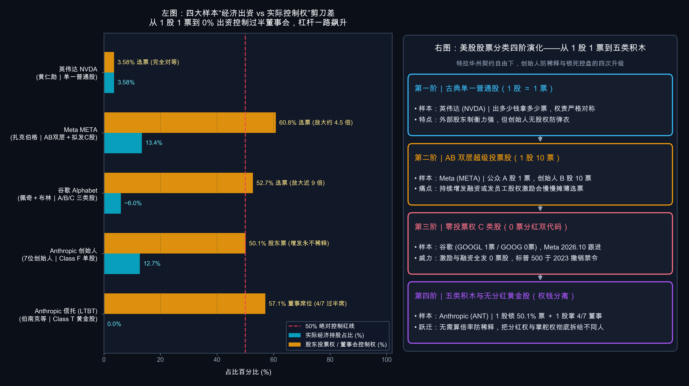
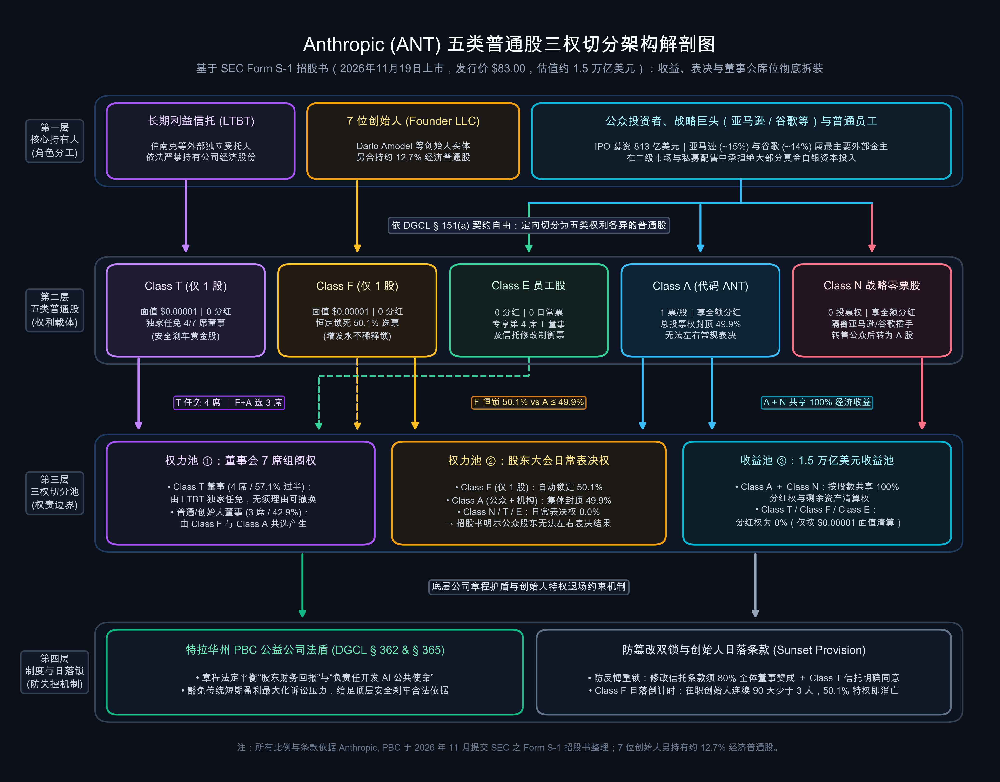

# 【制度深读 02】从谷歌双代码到 Anthropic“1 股控万亿”：一次看懂美股的“股权与股票分类”

*《商业的游戏规则》第 02 篇 · 美股制度与权力故事深读*

> **摘要：** 为什么在美股搜谷歌会同时跳出 GOOGL 和 GOOG 两个代码？为什么 Anthropic 上市仅凭两张“一美分不到”的股票就能锁死 1.5 万亿美元巨头的控制权？本文用三个标杆样本，从零拆解美股股票的底层零件与四阶演化密码。

---

## 引言：买美股时最容易看懵的两幕

打开任何一个美股行情软件，输入“谷歌（Alphabet）”，屏幕里总会同时蹦出两个代码——GOOGL 和 GOOG。两只股票背后的生意完全一模一样，连股价都几乎贴在一起，为什么非要分成两张牌？而在不远处的 Meta 身上，同样上演着一幕违背直觉的数字魔术：创始人扎克伯格手里的经济股权只有大约 **13.4%** ，却一人握着公司高达 **60.8%** 的总投票权，谁也撼动不了。

如果说这两件事只是开胃菜，那么 2026 年 11 月 19 日纳斯达克的敲钟仪式，则把这种制度魔术推向了极致。当天，AI 巨头 Anthropic（股票代码 ANT）以每股 `$83.00` 正式挂牌上市，募资 **813 亿美元** ，完全稀释估值直冲 **1.5 万亿美元** 。但真正让华尔街机构目瞪口呆的，是摊在 Form S-1 招股书里的五类股票设计：

* **出钱最多的金主没有日常投票权：** 亚马逊（持股约 **15%** ）与谷歌（持股约 **14%** ）这两大战略股东合计手握近三成股权，可在常规股东表决中，它们持有的 Class N 股票**一张投票权都没有** ；
* **不拿分红的人控制着过半数董事会：** 一个名为“长期利益信托（LTBT）”的外部机构依法严禁持有公司任何经济股份、一分钱分红都拿不到，但他们仅仅凭借手里**区区 1 股**面值 `$0.00001` 的 Class T 股票，就直接握有任免公司 **7 席董事会中 4 席（绝对多数）** 的生杀大权；
* **创始人只凭“1 张特殊选票”锁死股东大会：** 7 位联合创始人同样仅靠 **1 股**几乎无分红权的 Class F 股票，无论外部怎么增发融资，**永远自动锁定 50.1% 的股东大会总投票权** 。

在我们朴素的投资认知里，买卖股票天经地义地遵循“同股同权”——出一份钱、拿一份分红、配一票说话权。为什么到了美股市场，同一家公司的股票却能被切成两类、三类甚至五类，让出钱最多的人哑口无言、不拿钱的人反而坐在最高裁判席？

要看穿这套看似魔幻的规则，我们必须先把“一股股票”拆开成最底层的法律零件。

---

## 一、 把“一股股票”拆成三块积木：为什么美股不强制同股同权？

在大多数人的直觉里，“一股股票”就像一块出厂焊死的铁板——买下一股，分红和投票自然捆在一起。但在美国公司法核心发源地、全美超过六成五百强企业注册所在地——特拉华州的法律世界里，**“股票”从来不是一块铁板，而是一盒可以按合同自由拆装的“权利积木”** 。

通常情况下，一张标准的普通股背后至少藏着三块互相独立的权利零件：

1. **经济收益权（Economic Rights）：** 公司赚钱分红或者未来破产清算时，股东能按比例分走多少真金白银；
2. **股东会日常表决权（General Voting Power）：** 遇到增发新股、重大并购或修改章程时，手里攥着多少张赞成或反对票；
3. **董事会组阁权（Board Appointment Rights）：** 决定由谁去坐进最高决策室当董事，以及随时撤换特定董事席位的权力。

在传统规则下，这三块积木被死死粘在一起；但在特拉华州《普通公司法》（DGCL）的框架下，法律选择把这盒积木彻底松绑。

虽然特拉华州法律第 **212(a) 条** 把“1 股 1 票”设为默认出厂设置，但紧接着第 **151(a) 条** 便为企业开了一扇几乎无限宽广的后门——**只要事先白纸黑字写进公司注册章程（Certificate of Incorporation）并在 IPO 招股书（Form S-1）里如实披露，公司完全可以发行一种或多种类别的股票，让不同类别的股票拥有全额投票权、十倍百倍投票权、零投票权，甚至专门把分红权和投票权彻底劈给不同的人。**

这套冷峻规则背后的华尔街哲学非常直白：**法律的职责不是充当家长去规定“1 股必须配几票才算公平”，而是逼着公司把所有“不对等条款”用黑字印在招股书封面上；至于没有投票权的股票值多少钱、机构和散户愿不愿意买单，全权交给真金白银的市场自己去定价。** 只要在完全信息披露的前提下双方签字成交，契约即神圣有效。

---

## 二、 读懂全市场 99% 的美股股票：从 1 股 1 票到“谷歌双代码”的三阶进化

有了特拉华州“契约自由”这把钥匙，科技巨头在过去几十年里围绕“**既要华尔街的钱，又不愿交出公司控制权**”，一步步演进出了四代股权工具。其中，绝大多数买美股的人每天在行情软件里打交道的，正是前面这三阶常规玩法——只需看懂**英伟达、Meta、谷歌（Alphabet）** 这三家公司，全市场 99% 的股票分类就能一目了然。

> **演化图谱核心解读：**  
> 左图直白呈现了四阶典型巨头的“出资 vs 控制权剪刀差”：从英伟达 **3.58%** 出资对应 **3.58%** 选票的完全对等，到 Meta 与谷歌用少数股权撬动 4 到 9 倍投票权杠杆，再到 Anthropic 信托以 **0.0%** 经济持股掌控过半数董事会。右图梳理了这四阶工具如何层层升级破解控制权稀释难题。

### 1. 第一阶：古典单一普通股（1 股 1 票）——以英伟达为基准

以**英伟达（NVDA）** 为代表的一众古典派公司，只发行唯一一种普通股。每一股同时装着完整的分红权和 1 张投票权，出多少钱拿多少票。根据英伟达 2026 年 5 月股东代理声明书披露，联合创始人黄仁勋持有公司约 **3.58%** 的股份，他在股东大会上的投票权重同样不多不少正好 **3.58%** 。

这种结构的优势在于权责极度透明，外部机构投资者对董事会与管理层的约束力最强；但对创始人而言，一旦公司经过多轮融资、股本不断膨胀，创始人在法律意义上就没有了“股权防弹衣”，彻底置身于外部董事与公开市场的共同制衡之下。

### 2. 第二阶：AB 双层超级投票股（1 股 10 票）——以 Meta 为样本

为了既能在公开市场募资扩产、又不至于把方向盘拱手让给华尔街基金，硅谷创始人把目光投向了华尔街早年发明的 **“AB 双层股结构”**，其中最典型的代表便是 **Meta（META）** 。

在 Meta 的股权账本里，普通股被劈成了两半：
* **Class A 普通股：** 放在纳斯达克挂牌供公众与机构自由买卖，**每股 1 票** ；
* **Class B 超级投票股：** 不公开流通，几乎全部集中在创始人扎克伯格手中，**每股自带 10 票投票权** （一旦对外出售，便会自动 1:1 退化为只有 1 票的 Class A 股）。

凭着这 1 比 10 的倍率杠杆，截至 2026 年 4 月登记日，扎克伯格以仅约 **13% ~ 13.5%** （约 **13.4%** ）的经济股权，稳稳攥住了 Meta 高达 **60.8%** 的总投票权。无论华尔街怎么对季度利润指手画脚，投票箱里的绝对多数永远归创始人一人所有。

但 AB 双层股很快就暴露了一个隐蔽的数学死穴：**科技巨头每年都要向数万名工程师发放海量股票激励（SBC），同时还要动用股票做并购和再融资——这些发出去的几乎全都是 1 票的 Class A 股。** 年复一年增发下来，A 类股总盘子越滚越大，创始人手里的 B 类股就算一股不卖，总投票权占比也会被慢慢冲淡，早晚逼近 **50%** 的控制权危险线。

### 3. 第三阶：零投票权 C 类股与“双代码之谜”——以谷歌（Alphabet）为样本

**2014 年 4 月** ，为了破解这个控制权稀释难题，谷歌创始人拉里·佩奇（Larry Page）和谢尔盖·布林（Sergey Brin）拿出了一个堪称天才的解法，顺便也制造了美股看盘界面上最著名的“双代码奇观”：

当年谷歌单股股价一度突破 `$1,000` ，公司宣布进行一次特殊的“股票派息拆分”，原地凭空拆出一类全新的 **Class C 股** 。从此之后，同一家谷歌母公司 Alphabet 在纳斯达克同时挂着两个代码：
* **GOOGL（Class A 普通股）：** 享全额分红增值，**每股 1 票投票权** ；
* **GOOG（Class C 资本股）：** 享同等全额分红增值，但**永远 0 投票权** （除法律强制单独类别表决外）；
* 而两位创始人手里未上市的 **Class B 股** ，则依然保持 **每股 10 票** 的超级威力。

这一招到底有多管用？打开 Alphabet 2026 年股东代理声明书的数据令人叹为观止：十几年间，公司拿走 0 投票权的 Class C 股发员工奖金、做并购和回购，两位创始人自己也陆续减持变现了大量无票股份，导致他们俩合计持有的**经济股权一路下降到只剩约 6%** ；然而由于市场新增的流通股盘子里没有多出一张新选票，佩奇和布林凭借手里的 Class B 股，在 2026 年依然合计锁定了 **52.7%** 的过半数总投票权！

正因为“零投票权 C 类股”这套工具实在太好用，连手握 **60.8%** 选票的 Meta 也在 **2026 年 10 月** 正式批准了派发 **Class C 无投票权股票股利** （定于 2027 年 1 月正式生效），为后续斥巨资投建 AI 基础设施预留“既能发股融钱、又不稀释创始人表决权”的弹药库。

> **华尔街的妥协往事：标普 500 的六年封杀与解禁**  
> 无投票权股票曾一度惹怒华尔街养老金巨头。2017 年 7 月 31 日，**标普道琼斯指数公司（S&P DJI）拍案下达“多类股禁令”** ，规定凡新上市的多类股公司一律不准进入标普 500 指数（老成分股谷歌、Meta 按旧例豁免）。但随后几年几乎所有硅谷独角兽都铁了心搞多类股，指数公司惊觉再死守禁令标普 500 就要落伍，最终只得在 **2023 年 4 月 17 日正式撤销禁令** ，重新向所有多类股巨头敞开大盘基准大门。

---

## 三、 股权积木的终极形态：解剖 Anthropic 的“五类股”设计

看懂了谷歌与 Meta 如何用“1 票 A 股 ＋ 10 票 B 股 ＋ 0 票 C 股”守护控制权，再回过头看 2026 年 11 月上市的 **Anthropic（ANT）** ，你就会瞬间明白这台 **“五类股机器”** 到底高明在哪里——它干脆跳过了麻烦的十倍算术，直接用五种各司其职的股票，把“谁出钱分红、谁控制股东会、谁决定董事会”切成了三个互不干扰的池子。

> **终极架构一句话读懂：**  
> 公众股民与战略巨头拿走 **100%** 的经济分红与增值收益；7 位创始人凭 **1 股** Class F 锁死 **50.1%** 股东大会投票权；而由外部学者与前央行掌门坐镇的独立信托则凭 **1 股** Class T 独家任免 **7 席董事会中的 4 席（过半数）** 。

先把 Form S-1 招股书里五类股票的权利清单摊在桌面上，一目了然：

| 股票类别 | 发行对象与数量 | 经济利益（分红与清算） | 股东会日常表决权 | 董事会 7 席任免控制 | 核心设计用意 |
| :--- | :--- | :--- | :--- | :--- | :--- |
| Class A 普通股 | 公开市场投资者（代码 ANT） | **完全享有** （按股数比例分配红利） | 1 票/股，但总表决权被集体封顶在 **49.9%** | 参与选举 3 席普通董事（受制于 Class F 的多数票） | 对外募资 813 亿美元，但不给公开市场颠覆控制权 |
| Class N 战略股 | 亚马逊、谷歌及私募战略伙伴 | **完全享有** （与 Class A 经济权一致） | **0 票** （转售给外部公众后才 1:1 转为 A 股） | **无投票权** （不得插手公司董事席位分配） | 拿云巨头百亿资金与业务合作，但关上干预大门 |
| Class F 创始股 | 7 位创始人实体（ **仅此 1 股** ） | **0 分红权** （仅按面值清算；创始人另持约 **12.7%** 经济股） | 无论增发多少股票，**永远自动锁定 50.1% 总选票** | 凭 **50.1%** 多数选票实质锁定 3 席普通/创始人董事 | **替代 1 股 10 票的终极锁：** 增发融资再多也永不稀释 |
| Class T 信托股 | 长期利益信托 LTBT（ **仅此 1 股** ） | **0 分红权** （受托人依法严禁持股获利） | **0 票** （不参与日常商业并购或普通议案表决） | **独家任免 4 席 Class T 董事（占过半数）** | **顶层安全刹车片：** 把经济收益与最高督导彻底剥离 |
| Class E 员工股 | 非创始人普通员工 | **0 分红权** （仅按面值清算） | **0 日常表决权** | 仅对信托规则修改及特定第 4 席 Class T 董事享有监督票 | 赋予核心研发一线对安全信托的有限制衡监督权 |

在这五张精巧拼合的积木中，藏着硅谷工程师思维对华尔街规则的三次极限改造：

1. **用“动态百分比锁”直接终结稀释焦虑（Class F 永不稀释的 50.1%）：**  
   Meta 和谷歌还要绞尽脑汁用“10 倍票 ＋ 0 票 C 类股”来算股权比例防止跌破半数；Anthropic 直接在章程里写死规则——Founder LLC 手里这 **1 股**面值仅 `$0.00001` 的 Class F 股票，**永远自动代表 50.1% 的常规股东大会总表决权** 。不管以后为了融资再发多少亿股 Class A 上市股，所有 A 股股东加起来都只能去分享那剩下的 **49.9%** 。当然，这项特权也焊了一道**日落倒计时** ：只要 7 位联合创始人中仍在职的核心创始人连续 90 天少于 **3 人** ，Class F 的超级选票就会自动失效；
2. **给战略金主装上“静音键”（Class N 战略零票股）：**  
   亚马逊持股约 **15%** 、谷歌持股约 **14%** ，加上上市同期在私募配售中入局的一众巨头合计 **260 亿美元** 战略入股，拿到的几乎全是没有日常投票权的 Class N 股票。他们照样能按比例分走这 1.5 万亿美元巨兽未来的成长红利，但在董事会和高管换届桌上没有发声的选票——只有等它们把股票在市场上卖给无关联公众买家时，这部分股票才会自动变成普通的 Class A；
3. **把“分钱的归股民、踩刹车的归外部贤达”（Class T 黄金股）：**  
   仅仅为了防止 AI 大模型发展失控或短期盈利压力压垮安全底线，Anthropic 在注册为特拉华州公益公司（PBC，即依法允许董事平衡股东利润与“为全人类负责任开发先进 AI”安全使命）的基础上，把 **7 个董事席位中的 4 席** 交给了由前美联储主席本·伯南克（Ben Bernanke）等人坐镇的独立信托 LTBT 独家任免——而且铁律规定**受托人自己一分钱公司股票都不能买** ，从而与商业利益彻底绝缘。

---

## 四、 投资者的三把尺子：面对五花八门的股票代码，怎么选？

看完了从“1 股 1 票”到“五类股票”的拆装门道，真金白银在美股下单时，我们到底该如何看待这些不同花色的股票？以下三把尺子能帮你直接做出判断：

### 1. 第一把尺子（看盘实操）：同一个公司挂着 GOOGL 和 GOOG，我该买哪一个？

遇到 Alphabet 这种同时有 **GOOGL（1 票/股）** 和 **GOOG（0 票/股）** 双代码挂牌的公司时，许多投资人都会纠结到底选哪个。其实账本算得很清楚：
* **经济价值完全一模一样：** 两张股票享有完全相等的分红、回购和资产清算权，并且共同被纳入标普 500 等核心大盘指数；
* **日常投票影响趋近于零：** 正因为佩奇和布林手里死锁着 **52.7%** 的过半数选票，散户手里那几百股 GOOGL 的投票权在日常表决中根本无法翻盘，因此华尔街套利资金常年把两者的价差压在极微小的范围之内；
* **一条朴素的挑拣口诀：** 如果两只股票报价几乎平价（或价差微乎其微），优先买进 **有 1 票权的那一只（如 GOOGL）** 。因为多出来那 1 票虽然平时用不上，却等于白拿了一张“万一未来创始人交出超级选票或触发公司架构重组时”的免费治理看涨期权；反之，如果无票股因为短期抛压折价明显扩大，长线只图吃业绩成长的资金买折价的那一只反而更划算。

### 2. 第二把尺子：看懂“治理折价（Governance Discount）”的顺风红利与逆风代价

华尔街机构并非天生偏爱“没有投票权”，但在面对顶级稀缺巨头时，大资金往往愿意承受一定的**“治理折价”**作为上车代价——因为这是一笔清晰的风险交换：
* **顺风期的真实保护力：** 超级投票权与限制外部干预的设计，能帮需要五到十年重资产长周期投入的硬科技与前沿 AI 公司挡住短视对冲基金的季度逼宫，也能防止公司股价陷入低谷时被产业对手强行低价恶意并购；
* **逆风期的不可逆代价：** 一旦管理层未来开始变得傲慢官僚、乱铺摊子甚至持续犯错，在同股同权公司里（如英伟达），机构大股东还可以联手重组董事会逼宫纠偏；而在创始人锁定绝对选票的多类股公司里，外部股东连发起一场有实质约束力的董事会改选都做不到——唯一的纠错手段，只剩下**“用脚投票”割肉卖出** 。

### 3. 第三把尺子：看有没有焊上一道清晰的“日落条款（Sunset Provision）”

同样是把控制权锁死在创始人手里，华尔街老手在评估多类股风险时，最看重的分水岭在于公司章程里有没有写明 **“日落条款”——即超级特权何时归零退场** 。

健康的创业者保护契约，往往会在招股书里写清退场条件：例如 Meta 的 B 类股一旦对外转让或减持就会 **1:1 自动丧失超级投票权退化为普通 A 股** ；Anthropic 的 Class F 也设下了**“核心在职创始人少于 3 人且持续满 90 天”即刻剥夺 50.1% 特权** 的硬期限。这意味超级选票保护的是真正一线带队打仗的创始人本人；一旦创始人离场退位或核心团队散伙，控制权仍会按约定交还给全体公允出资的股东——如果遇到一家既剥夺公众投票权、又丝毫不设退场期限、试图让创始人特权世袭传代的公司，投资者就要格外多留一份戒心。

---

## 结语

> **制度深读一句话：**  
> 在美股“契约自由”的底层规则下，股票早已不是千篇一律的“同股同权”，而是被刻意分装的权利零件——英伟达卖给你的是权责对等的主人翁选票，谷歌与 Meta 卖给你的是“只享收益、让创始人专心掌舵”的分润船票，而 Anthropic 则更是将赚钱与踩刹车的权力切得一清二楚。

看懂一家美国公司的股票分类表，本质上是在读懂一笔写在交易之前的君子协定：华尔街从来不替买家包办“公不公平”，只负责把桌面上每一张牌的价码摊开摆平。真正成熟的投资，从来不是买入之后再去抱怨没有话语权，而是在按下买入键的那一刻，就清楚自己花钱买下的，究竟是驾驶室里的方向盘，还是头等舱里的那张分红船票。
