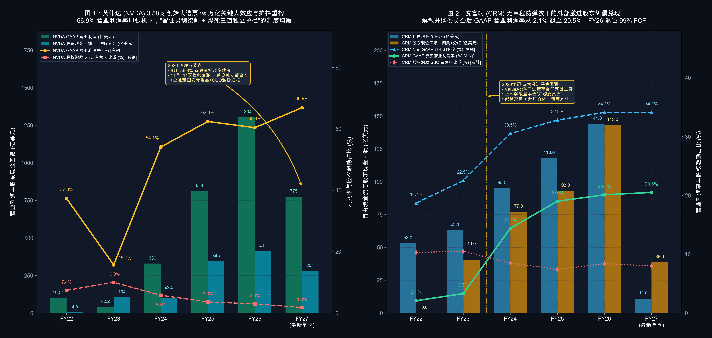

# 【治理与资本配置 02】董事会制衡、章程壁垒与激进股东（13D）提效纠偏（英伟达 NVDA 与 赛富时 CRM）

> **专栏定位：** 美股好公司的治理契约与资本配置审计显微镜  
> **解剖标的：** 英伟达 (NVIDIA, NVDA) 内部制衡与护栏重构主轴 ＋ 赛富时 (Salesforce, CRM) 外部激进股东提效镜像  
> **核心指标：** 董事会与专委会制衡架构、章程防弹衣壁垒、关键人隐性权力与继任缓冲、外部干预纠偏兑现度  
> **审计基准：** SEC EDGAR 原生底稿 (CIK: 0001045810 / 0001108524) ＋ DEF 14A / 10-K / 8-K / 13D 对账

> **摘要：** 拆解同股同权好公司的 4 大治理制衡指标（董事会与专委会架构、章程防弹衣壁垒、关键人隐性权力、外部干预纠偏兑现度），复盘英伟达（NVDA）11 天换帅复职背后的制度护栏重构与赛富时（CRM）激进股东逼宫解散并购委员会实战。

---

## 一、 董事会制衡与外部治理纠偏核心指标深度解剖

在第一讲中，我们剖析了以 Meta 为代表的“双层股权受控公司”——创始人凭借每股 10 票的特权股票垄断逾六成选票，从法律根源上阻断了外部股东的否决权。然而，在标普 500 与纳指 100 的优质龙头阵营中，绝大多数公司采用的都是 **100% 同股同权（1 股 1 票）** 契约，即便是掌舵二三十年的传奇创始人，个人持股与投票权占比往往也只有 **2% ~ 4%** 。这就引出了美股治理研究中最值得深思的两大现实命题：

* **第一，为什么同样只有 3% 选票，有的管理层一旦越过合规红线会被独立董事会果断问责，而一旦触发万亿市值的“关键人震荡”，董事会又不得不与创始人达成妥协、改用制度护栏替代简单换人？**
* **第二，如果一家同股同权的好公司没有突发合规丑闻，但管理层患上了“大公司帝国病”（热衷天价跨界并购、机构臃肿、期权稀释侵蚀利润），内部“老好人董事会”长期拉不下脸制止，外部华尔街力量又是如何破门而入、强行扭转资本配置方向的？**

要穿透同股同权巨头的真实权力边界，买方分析师必须跳出纸面上的“一股一票”，从 `DEF 14A` 代理委托书、公司章程细则（`Exhibit 3.1/3.2`）、重大人事与治理变动公告（`Form 8-K`）以及激进股东举牌文件（`Schedule 13D`）中，提取四个环环相扣的硬核审计维度：

| 分析维度 | 治理专属特异性指标 | 买方核心考核焦点 |
| :--- | :--- | :--- |
| **内部监督与权力切割** | **董事会领导层与专委会制衡架构 (Board Leadership & Committees)** | 审查独立董事长或首席独董实权、关键专委会（如并购/合规委员会）存废及越级直线汇报机制 |
| **制度护城河与防罢免墙** | **公司章程与细则“防弹衣”厚度 (Charter & Bylaw Defenses)** | 核查交错董事会、超多数决门槛、毒丸条款与特别会议召集权，评估外部股东改组董事会的难度 |
| **纸面选票外的隐性筹码** | **关键人隐性权力敞口与继任缓冲垫 (Key-Person Risk & Bench)** | 评估管理层扁平化集权度与二号人物（COO/总裁）接班梯队，量化“换帅即伤筋动骨”的隐性议价权 |
| **控制权市场与利润释放** | **外部激进干预（13D）与纠偏兑现度 (Activist Intervention & ROI)** | 追踪股东提案或激进基金介入后的董事会改组协议，验证营业利润率与自由现金流回馈的实质拐点 |

---

### 指标 1：董事会领导层与专委会制衡架构 (Board Leadership & Committees)

在美股同股同权公司中，外部股东日常并不直接参与经营，而是委托董事会（Board of Directors）行使对 CEO 的聘任、考核与监督权。判断一个董事会到底是“管理层的橡皮图章”还是“真正的制度刹车片”，不能只数独立董事的人头占比（标普 500 公司账面独董占比普遍在 80% 以上），而要看三项决定实权归属的组织设计：

1. **独立董事长 vs 首席独立董事 (Independent Chair vs. Lead Independent Director)：** 当创始人或强势 CEO 同时兼任董事长，甚至公司长期不设董事长时，董事会的会议议程往往由管理层主导。将董事长与 CEO 两职分离、设立具备独立定调权的**非执行独立董事长**，是强化监督的第一道防线；若两职合一，则必须核查 `DEF 14A` 中首席独立董事是否拥有“无需 CEO 同意即可独立召集独董闭门会议（Executive Sessions）及增改议程”的法定职权；
2. **功能性专委会的“加油门”与“踩刹车”效应：** 除法定三大委员会（审计、薪酬、提名与治理）外，公司额外设立的专项委员会往往暴露其治理导向。例如，部分热衷外延扩张的公司专门设立**董事会并购委员会（M&A Committee）**，在客观上容易演变为管理层频繁审批大额收购的绿色通道；反之，当公司遭遇地缘监管或商业准则危机时，新设完全由独立董事组成的**合规、风险或国家安全专委会**，则是将敏感决策权从管理层手中剥离的关键动作；
3. **合规与内审的“越级直线汇报权（Direct Reporting Line）”：** 如果公司的首席合规官（CCO）或内审负责人向 CEO 或受 CEO 节制的法务长汇报，内部调查就极易沦为形式；只有章程明确规定其**直接向董事会审计或治理委员会直线汇报（汇报线与薪酬考核完全独立于 CEO）**，内部防线才具备真正的牙齿。

---

### 指标 2：公司章程与细则“防弹衣”厚度 (Charter & Bylaw Defenses)

如果一家公司没有 AB 股超级投票权，管理层持股也只有区区 2% ~ 3%，为什么很多长期乱花钱的平庸 CEO 依然稳坐钓鱼台？秘密就藏在公司注册章程（Certificate of Incorporation）与公司细则（Bylaws）为在任管理层量身定做的**反收购与防罢免壁垒（Entrenchment Defenses）**中：

* **壁垒一：交错董事会 (Staggered / Classified Board)：** 将董事会成员分为三组（Class I / II / III），每年股东大会只改选其中 **1/3** 的董事（任期三年）。这意味着哪怕外部股东对管理层极度不满、拿到了 90% 的选票，也至少需要连续打赢**两届年度股东大会（耗时一年半以上）**才能赢得董事会多数席位；而实行**全员年度改选（Declassified / Annual Election）**的公司，外部股东在一次大会上即可彻底改组董事会；
* **壁垒二：超多数决条款 (Supermajority Voting Requirements)：** 章程规定凡涉及修改公司细则、罢免董事或批准并购重组，不能按常规的“过半数（> 50%）”通过，而必须获得全体流通股 **66.7% 甚至 80%** 的超高赞成票。在散户投票参与率较低的公众公司中，80% 的门槛几乎等同于赋予少数内部人一票否决权；
* **壁垒三：股东权利计划（毒丸条款 Poison Pill）与程序门槛：** 一旦外部投资人未经董事会同意在二级市场买入股份触及 **10% ~ 15%** 阈值，毒丸条款即允许其余老股东以半价折让大举认购新股，瞬间将收购方的持股比例摊薄腰斩；此外，剥夺股东书面同意权（Written Consent）或设定过高的特别股东大会召集门槛（如要求持股 > 25%），也会大幅抬高外部纠偏的时间成本。

买方审阅治理底稿时有一条清晰标尺：**章程防弹衣越薄（全员年度改选 ＋ 简单多数决 ＋ 多数票当选制 ＋ 10%~15% 特别会议召集权），管理层对股东诉求的敬畏心就越强。**

---

### 指标 3：关键人隐性权力敞口与继任缓冲垫 (Key-Person Risk & Bench)

在真实商业世界中，决定董事会与 CEO 博弈胜负的，除了纸面上的选票比例（显性控制权），还有一层教科书极少提及却足以左右万亿市值生死的筹码——**关键人隐性议价权（Implicit Bargaining Power via Key-Person Dependency）** 。

为什么同样是持股约 3% 的同股同权公司创始人，有的被董事会轻易边缘化，有的却在辞职后短短十余天内迫使董事会全票请回？核心差异取决于两个可客观核验的组织特征：
1. **组织扁平化集权度与“二号人物（#2 Bench）”完备性：** 翻开 `DEF 14A` 的高管名册（Named Executive Officers, NEOs）与薪酬表，核查公司是否设有职权完整的 **首席运营官（COO）或联席总裁** 作为成熟接班梯队。如果一家科技巨头采用极端的放射状扁平架构——数十位业务副总裁直接向创始人一人汇报，横向部门之间缺乏整合型二号统帅，那么创始人本人就成了整台商业机器不可替代的中央处理器；
2. **技术路线、客户生态与战略信用的个人绑定深度：** 当公司的底层技术代际演进、上下游数千亿美元产能锁单乃至国家级产业政策沟通高度系于创始人一身时，董事会一旦采取“一刀切换帅”的休克疗法，引发的市值蒸发幅度往往远超治理瑕疵本身的损失。面对此类高关键人敞口的好公司，成熟的董事会治理绝不是盲目挥刀自毁长城，而是通过**增设独立董事长与专职合规隔离墙**，对冲关键人单点失控风险。

---

### 指标 4：外部激进干预（13D）与纠偏兑现度 (Activist Intervention & ROI)

当一家商业模式原本极佳的白马龙头患上“大公司病”（如沉迷高溢价跨界并购、人员无度膨胀、股权激励失控吞噬真实利润），而内部董事会又因人情羁绊迟迟不作为时，美股独有的外部进化机制——**激进投资者（Activist Investors）与控制权市场**就会正式启动。

SEC 法定披露体系为买方跟踪这一外部纠偏过程提供了精确的路标：
* **从 `Schedule 13G` 到 `Schedule 13D` 的进攻号角：** 普通公募基金（如先锋、贝莱德）持股超 5% 但不谋求干预经营时，仅需提交简式被动持仓表 `Schedule 13G`；而一旦华尔街激进对冲基金（如 Elliott、ValueAct、Starboard、Trian）持股突破 5%（甚至在未满 5% 时主动公开白皮书），意图改组董事会、叫停并购或要求拆分的，必须在规定工作日内提交 **`Schedule 13D`** ，并在 `Item 4 (Purpose of Transaction)` 中详列改造纲领；
* **通用代理卡新规（Universal Proxy Card）下的选票威慑：** 自 SEC 实施通用代理卡规则后，股东在代理权争夺战（`DEFC14A`）中不再只能对“管理层整张名单”或“激进派整张名单”二选一，而是可以像点菜一样自由勾选双方最优秀的董事候选人。这一规则彻底打破了在任管理层的捆绑优势——在无防弹衣的同股同权公司里，管理层往往在正式投票前就会算清选票劣势，主动与激进基金签署 **合作协议（Cooperation Agreement，通过 `Form 8-K` 披露）** ，让渡董事会与薪酬委员会席位；
* **财务纠偏兑现度检验：** 治理变革绝不能只听口号，买方最终用纠偏前后 2 至 3 年的 **GAAP 营业利润率跃升幅度（bps）** 、**SBC 占营收比重压降幅度** 以及 **股东现金回馈占自由现金流比率（(回购＋分红) ÷ FCF）** 来核算治理重估的真实含金量。

---

## 二、 董事会制衡与治理纠偏核心指标全景速查对照表

下表汇总了买方审阅同股同权龙头公司内部董事会成色、章程壁垒与外部纠偏弹性的 4 大核心指标及通用判读标尺：

| 指标名称 | 标准计量符号 | 买方核心考核焦点 | 治理优秀基准线 (Benchmark) | 危险预警与失衡阈值 | 官方财报与 SEC 取数出处 |
| :--- | :--- | :--- | :--- | :--- | :--- |
| **1. 董事会与专委会制衡架构** | Board Chair & Committees | 独立董事长实权、敏感专委会设置与首席合规官越级直线汇报机制 | 设独立董事长（或强权首席独董），审计/薪酬/治理100%独立，合规直线汇报董事会 | CEO 长期一言堂，设扩张型并购委员会却无独立风险/合规制衡，内审汇报受制于 CEO | DEF 14A Board Structure 章节及 8-K 治理架构重组公告 |
| **2. 章程与细则“防弹衣”厚度** | Charter Defenses | 评估交错董事会、超多数决与毒丸条款对外部股东改组董事会的阻碍 | 全员年度改选（1年任期），简单多数决（> **50%** ），多数票当选制，无常设毒丸 | 设三年期交错董事会，修改章程需 ≥ **66.7% ~ 80%** 超多数决，剥夺股东特别会议权 | 10-K Exhibit 3.1 (章程) / 3.2 (细则) 及 DEF 14A 提案表 |
| **3. 关键人隐性权力与继任梯队** | Key-Person & #2 Bench | 穿透扁平集权度与 COO/总裁二号接班梯队，识别“不可撤换”隐性筹码 | 具备成熟的 COO/联席总裁二号运营梯队，核心技术与客户关系制度化沉淀 | 数十高管扁平直报创始人一人、无二号接班梯队，创始人突发变动即引发极端估值巨震 | DEF 14A Executive Officers 履历薪酬表及 10-K Item 1A |
| **4. 外部激进干预与纠偏兑现度** | 13D / Proposal & Margin Δ | 检验管理层对高票股东提案与 13D 激进诉求的响应及利润率兑现 | 积极采纳过半数股东提案，纠偏后 GAAP 营业利润率显著提升且现金回馈占 FCF ≥ **70%** | 无视连续高票股东提案，或耗费巨资打代理权争夺战死保低效并购与高额 SBC 稀释 | Schedule 13D、DEFC14A、8-K Item 1.01/5.07 及 10-K 损益表 |

---

## 三、 标杆实例深度实战：英伟达 (NVDA) 3.58% 同股同权、11 天换帅复职风暴与三道独立护栏重构 (FY2022 ~ FY2027 最新期)

英伟达（NVIDIA Corporation, NVDA.US）为现代公司治理提供了一堂无法在任何传统教科书上读到的实战大课。与 Meta 扎克伯格手握 60.8% 超级投票权截然不同，英伟达自上市以来始终保持 **100% 单一普通股（1 股 1 票）** 契约。根据 2026 年 `DEF 14A` 披露，联合创始人黄仁勋（Jensen Huang）合计持有约 8.71 亿股普通股，经济权益与投票权占比严格相等，均为 **3.58%** （控制权分离度为 **0.0%** ），远低于先锋领航与贝莱德各自逾 **7%** 的机构持仓。

在 2026 年短短半年间，英伟达先后经历了两次载入美股史册的治理大考：
* **第一场（2026 年 6 月 24 日年度股东大会）：** 针对股东提交的第 4 号提案《废除章程与细则中的超多数决门槛、统一改为简单多数决》，尽管董事会最初建议投反对票，但在 1 股 1 票的公平规则下，外部股东以 **86.8%** 的压倒性赞成票强制通过提案，成功拆除了遗留的章程防御墙；
* **第二场（2026 年 11 月 11 日至 23 日的“11 天换帅与复职风暴”）：** 因未披露个人关系触发商业行为准则及潜在外国情报安全敞口审查，独立董事会聘请外部律所调查后，于 11 月 11 日至 12 日（`Form 8-K`）接受黄仁勋辞去总裁、CEO 及董事职务，由 CFO Colette Kress 任临时 CEO，资深董事 Harvey C. Jones 出任公司史上**首位独立董事长** 。消息一出，英伟达市值急剧蒸发逾 **1 万亿美元** 。短短 11 天后，经美国政府高层介入确认无国家安全风险及董事会深入质询，董事会于 11 月 22 日至 23 日（`Form 8-K`）全票表决恢复黄仁勋总裁、CEO 及董事职务（单日股价飙升逾 30% 收复约 9,500 亿美元市值），但**永久保留了独立董事长职位，并同步增设了全独董国家安全专委会与越过 CEO 直线汇报的首席合规官（CCO）** （注：截至 2026 年 11 月末，内部独立专委会调查与美国参议院相关问询仍在按程序推进中）。

以下是英伟达自 FY2022 至 FY2027 第三季度（截至 2026 年 10 月 25 日，结合 2026 年 11 月治理 `Form 8-K`）的治理契约与经营回馈对账底表：

### 英伟达 6 周期治理制衡演进与资本回馈对账底表 (单位：亿美元，特殊标注除外)

| 核心治理与财务对账科目 | FY2022 (22/01止) | FY2023 (23/01止) | FY2024 (24/01止) | FY2025 (25/01止) | FY2026 (26/01止) | FY27 Q3 及最新治理 (26/10–11) | 穿透勾稽结论与买方视角 |
| :--- | :---: | :---: | :---: | :---: | :---: | :---: | :--- |
| **公司战略与治理演进里程碑** | **终止收购 Arm 交易 维持零回购攒现金** | **消费显卡去库寒冬 重启百亿股票回购** | **生成式 AI 全面爆发 1拆10拆股前夜** | **Blackwell 架构跨越 回购飙升至 337 亿** | **年营收突破两千亿 SBC 压降至 3.0%** | **6月 86.8% 拆超多数决 11月 换帅复职筑三道护栏** | 完整展现“3.58% 低投票权同股同权 ＋ 极端关键人隐性筹码 ＋ 独立董事会制度化妥协加固” |
| **普通股投票权结构与创始人持股 (%)** | **1股1票 (3.6%)** | **1股1票 (3.6%)** | **1股1票 (3.5%)** | **1股1票 (3.6%)** | **1股1票 (3.58%)** | **1股1票 (3.58%)** | 无任何超级投票权股票，前两大外部机构（先锋、贝莱德）各自持股均 > **7.0%** |
| **董事会独立董事席位 / 总席位 (独立占比)** | **12/13 (92.3%)** | **12/13 (92.3%)** | **11/12 (91.7%)** | **9/10 (90.0%)** | **9/10 (90.0%)** | **10/11 (90.9%)** | **【对应指标 1】** 除黄仁勋本人外全员均为独立董事，账面独立性常年维持在 **90% 以上** |
| **董事会领导层与专委会制衡形态** | **无董事长 / 设首席独董** | **无董事长 / 设首席独董** | **无董事长 / 设首席独董** | **无董事长 / 设首席独董** | **无董事长 / 设首席独董** | **首设永久独立董事长 ＋新设独董国安专委会** | **【对应指标 1】** 2026 年 11 月终结无董事长历史，Harvey Jones 任独立董事长，新设越级汇报 CCO |
| **章程防弹衣：改选周期与表决门槛** | **年度改选 / 含超多数决** | **年度改选 / 含超多数决** | **年度改选 / 含超多数决** | **年度改选 / 含超多数决** | **年度改选 / 含超多数决** | **年度改选 / 86.8% 票废除超多数决** | **【对应指标 2】** 2026 年 6 月股东大会高票通过简单多数决提案，拆除章程修改高门槛壁垒 |
| **高管组织架构与二号接班缓冲垫** | **扁平直报 / 无 COO** | **扁平直报 / 无 COO** | **扁平直报 / 无 COO** | **扁平直报 / 无 COO** | **扁平直报 / 无 COO** | **扁平直报 / 临时 CEO 仅过渡 11 天** | **【对应指标 3】关键人单点敞口极高：** 数十名副总裁扁平直报创始人，换帅即引发万亿市值海啸 |
| **营业总收入 (Total Revenue)** | **269.14** | **269.74** | **609.22** | **1,304.97** | **2,159.38** | **1,158.44 (单季)** | FY27 Q3 单季营收首破千亿美元（同比 +103.2%），数据中心营收占比高达 **92.9%** |
| **GAAP 合并营业利润 (Operating Income)** | **100.41** | **42.24** | **329.72** | **814.53** | **1,303.87** | **775.20 (单季)** | 单季 GAAP 营业利润达 775.20 亿美元，与 Non-GAAP 营业利润（778.8 亿）几乎零水分 |
| **GAAP 营业利润率 (Operating Margin %)** | **37.3%** | **15.7%** | **54.1%** | **62.4%** | **60.4%** | **66.9% (单季)** | **【对应指标 4】** 全栈算力壁垒驱动真实营业利润率站上 **66.9%** ，无需靠财务调整粉饰 |
| **股权激励费用 (SBC) 及占总营收比重** | **20.04 (7.4%)** | **27.09 (10.0%)** | **35.49 (5.8%)** | **47.40 (3.6%)** | **63.88 (3.0%)** | **20.90 (1.8%)** | SBC 占营收比摊薄至 **1.8%** ，且自 FY27 Q1 起主动在 Non-GAAP 中实扣 SBC 不再加回 |
| **自由现金流 (Free Cash Flow)** | **81.32** | **38.08** | **270.21** | **608.53** | **966.80** | **437.80 (单季)** | FY27 Q3 单季自由现金流高达 437.80 亿美元，期末现金及有价证券储备达 535.1 亿美元 |
| **普通股回购现金支出 (Share Repurchases)** | **0.00** | **100.39** | **95.33** | **337.06** | **400.86** | **221.00 (单季)** | 2026 年 9 月董事会新增 **1,500 亿美元** 回购授权，Q3 末剩余可用回购额度达 2,273 亿美元 |
| **现金股息支付总额 (Dividends Paid)** | **3.99** | **3.98** | **3.95** | **8.34** | **9.74** | **60.00 (单季)** | 随盈利体量跃升大幅提高季度现金分红（宣布下季每股派息 `$0.25` ） |
| **股东现金回馈总额及占 FCF 比重 (%)** | **3.99 (4.9%)** | **104.37 (274%)** | **99.28 (36.7%)** | **345.40 (56.8%)** | **410.60 (42.5%)** | **281.00 (64.2%)** | **【对应指标 4】** 单季向股东返还 **281.0 亿美元** （占当季 FCF 的 **64.2%** ），兼顾锁产与回报 |

---

### 核心看点 ①：6 月 86.8% 选票强拆“超多数决”与 11 月“拔剑问责”——1 股 1 票契约的真实威慑力

对比第一讲的 Meta 与本讲的英伟达，就能看清 **“有没有超级投票权”** 在危机时刻的制度分野：
* 在 Meta，外部独立股东连续多年以逾 **82%** 的真实赞成率要求废除双层股权，却因扎克伯格手握 60.8% 选票而沦为一纸空文；而在同股同权的英伟达，2026 年 6 月股东大会上，当外部股东提出废除章程“超多数决”壁垒时，即便董事会事先建议反对，**86.8% 的赞成票依然直接形成有效决议**，迫使董事会乖乖启动章程修订；
* 同样，正是因为黄仁勋只有 **3.58%** 的选票、且董事会 10 名外部成员全数为独立董事，当 2026 年 11 月初浮现违反商业行为准则与潜在外部情报接触风险时，独立董事会有底气第一时间聘请独立外部律所启动调查，并在 11 月 12 日做出连硅谷都为之震动的决定——**让亲手缔造四万亿算力帝国的创始人辞去 CEO 与董事职务** 。这证明在同股同权底盘上，独立董事会绝不是无牙老虎。

---

### 核心看点 ②：万亿市值的“关键人人质效应（Key-Person Hostage Effect）”——为什么纸面 3.58% 选票不等于可以被轻易替换？

如果故事停留在 11 月 12 日，那只是一场标准的合规问责。但随后 11 天的剧烈反转，暴露了科技白马股分析中最核心的**指标 3（关键人隐性权力敞口）：**
1. **极端扁平化架构下的“零二号人物缓冲”：** 与苹果（库克治下有成熟的运营官与硬件统帅梯队）或微软不同，黄仁勋在英伟达推行了长达数十年的放射状扁平管理——多达四五十名核心研发、架构与市场副总裁直接向他一人汇报，公司**长期不设 COO 或总裁二号接班人** 。从 Vera Rubin 机架演进路线、高达 **3,900 亿美元** 的上游晶圆与先进封装锁产谈判，到全球主权 AI 算力外交，全部高度浓缩在创始人一人身上；
2. **当“程序正义”撞上“股东财富毁灭”：** 董事会的本职信义义务（Fiduciary Duty）是维护全体股东的最大经济利益。当拿掉创始人的直接后果是**公司市值瞬间蒸发逾 1 万亿美元**、且白宫与国安高层明确介入确认不存在国家安全泄密风险并呼吁维持美国 AI 领军领导力时，死守“一刀切换帅”反而成了对中小股东财富的最大摧毁。这解释了为什么持股仅 3.58% 的灵魂创始人，在事实上拥有远超纸面选票的隐性否决权。

---

### 核心看点 ③：11 月 23 日 `Form 8-K` 的真正精髓——“保住超级发动机 ＋ 焊死三道独立刹车片”

很多市场评论把黄仁勋 11 天后复职简单解读为“董事会向强人彻底投降”，但如果仔细拆解 2026 年 11 月 23 日复职公告中的治理附带条款，买方看到的是一场教科书级的 **“制度风险对冲（Governance Ring-Fencing）”** ：
* **第一道护栏（终结无董事长历史）：** 英伟达过去三十余年从未设立董事会主席，仅靠首席独立董事协调；此次黄仁勋虽然官复原职出任总裁兼 CEO，但自 1993 年起担任董事的 **Harvey C. Jones 被永久留任为公司史上首位独立董事长**，实现了最高经营权与董事会领导权的制度性分离；
* **第二道护栏（切走地缘与国安敏感裁量权）：** 董事会专门新设完全由独立董事组成的 **“国家安全与出口管制委员会（National Security and Export Control Committee）”** ，将涉及主权算力、海外合作伙伴合规审查等高危地缘事项直接纳入独董专委会管辖；
* **第三道护栏（建立越过 CEO 的合规直线汇报）：** 内部独立专委会调查并未因复职而叫停，同时董事会启动招聘全新的 **首席合规官（CCO）** ，硬性规定该职位**直接向董事会提名与公司治理委员会汇报**，切断了行政管理层对合规监督的干预通道。

---

## 四、 标杆实例镜像对照：赛富时 (CRM) 无防弹衣章程、五大激进基金围猎与解散并购委员会提效镜像

如果说英伟达（NVDA）演绎的是“业绩如日中天、但因创始人高度不可替代而通过内部董事会重构合规护栏”的范式，那么全球企业级云软件霸主 **赛富时 (Salesforce, Inc., CRM.US)** ，则完美展示了同股同权好公司的另一面——**当持股仅 2.8% 的创始人患上“盲目天价并购与费用失控”的大公司病、而内部董事会又碍于情面长期装睡时，华尔街激进股东（Activist Investors）如何利用无防弹衣的章程破门而入，把一家真实利润率仅 2% 的臃肿巨头逼成 20%+ 利润率的分红回购机器！**

以下是英伟达与赛富时在 FY2022 至 FY2027 最新期的治理架构、外部干预与经营纠偏横向对照底表（赛富时财年截至每年 1 月 31 日，最新单季为截至 2026 年 7 月 31 日的 FY27 Q2）：

### 1. 两大同股同权创始人巨头 6 周期治理纠偏与财务兑现对照底表 (单位：亿美元，特殊标注除外)

| 核心对比科目 | 标的 | FY2022 | FY2023 | FY2024 | FY2025 | FY2026 | FY2027 最新单季 | 穿透勾稽结论与买方视角 |
| :--- | :--- | :---: | :---: | :---: | :---: | :---: | :---: | :--- |
| **创始人持股与投票权契约** *(NVDA: 黄仁勋 / CRM: 贝尼奥夫)* | **NVDA** CRM | **1股1票 (3.6%)** 1股1票 (3.0%) | **1股1票 (3.6%)** 1股1票 (2.9%) | **1股1票 (3.5%)** 1股1票 (2.8%) | **1股1票 (3.6%)** 1股1票 (2.8%) | **1股1票 (3.58%)** 1股1票 (2.8%) | **1股1票 (3.58%)** **1股1票 (2.8%)** | 双方均为 **100% 同股同权** 且创始人选票均在 **3% 左右** ，法律上均无抵抗机构股东联合表决的特权 |
| **董事会领导层与关键专委会演变** | **NVDA** CRM | **无董事长/首席独董** 两职合一/设并购委 | **无董事长/首席独董** 两职合一/设并购委 | **无董事长/首席独董** ValueAct进驻/**撤并购委** | **无董事长/首席独董** 激进派任**薪酬委主席** | **无董事长/首席独董** 两职合一/强首席独董 | **首设独立董事长+国安委** **薪酬委控盘+首席独董** | **【对应指标 1】** NVDA 增设独立董事长与国安合规防线；CRM **直接解散并购委员会** 并由激进派掌管薪酬委 |
| **章程防弹衣：改选周期与表决门槛** | **NVDA** CRM | **年选 / 含超多数决** 年选 / 简单多数决 | **年选 / 含超多数决** 年选 / 简单多数决 | **年选 / 含超多数决** 年选 / 简单多数决 | **年选 / 含超多数决** 年选 / 简单多数决 | **年选 / 含超多数决** 年选 / 简单多数决 | **86.8% 票废除超多数决** **年选 / 零防弹衣壁垒** | **【对应指标 2】** CRM 因无交错董事会与无特权股，2023 年面对激进基金提名威胁时毫无防守壁垒，迅速妥协 |
| **高管继任梯队与关键人缓冲垫** | **NVDA** CRM | **扁平直报 / 无COO** 联席CEO制 | **扁平直报 / 无COO** 联席CEO离任 | **扁平直报 / 无COO** 设专职总裁兼COO | **扁平直报 / 无COO** 设专职总裁兼COO | **扁平直报 / 无COO** 前首席独董转任COFO | **无COO (换帅震荡极大)** **成熟COFO二号梯队** | **【对应指标 3】** NVDA 高度依赖创始人单核驱动；CRM 由前首席独董 Robin Washington 转任总裁兼 COFO 稳固运营 |
| **营业总收入 (Total Revenue)** | **NVDA** CRM | **269.14** 264.92 | **269.74** 313.52 | **609.22** 348.57 | **1,304.97** 378.95 | **2,159.38** 415.25 | **1,158.44 (27Q3)** **113.45 (27Q2)** | FY22 时两家营收体量几乎完全相同（均约 265 亿美元）；此后 NVDA 乘算力爆发，CRM 转向精益复利 |
| **GAAP 合并营业利润 (Operating Income)** | **NVDA** CRM | **100.41** 5.48 | **42.24** 10.30 | **329.72** 50.11 | **814.53** 72.05 | **1,303.87** 83.31 | **775.20 (27Q3)** **23.25 (27Q2)** | **【对应指标 4】纠偏铁证：** CRM 在 FY22 营收 265 亿时真实营业利润仅 **5.48 亿美元** ，FY26 飙升 15 倍至 **83.31 亿** |
| **GAAP 真实营业利润率 (%)** | **NVDA** CRM | **37.3%** 2.1% | **15.7%** 3.3% | **54.1%** 14.4% | **62.4%** 19.0% | **60.4%** 20.1% | **66.9% (27Q3)** **20.5% (27Q2)** | **【对应指标 4】** 激进股东介入拆掉并购委并裁员后，CRM GAAP 营业利润率从 **2.1%** 跃升十倍站稳 **20.5%** |
| **Non-GAAP 营业利润率 (%)** | **NVDA** CRM | **47.2%** 18.7% | **21.0%** 22.5% | **61.0%** 30.5% | **66.3%** 32.8% | **63.8%** 34.1% | **67.2% (27Q3)** **34.1% (27Q2)** | CRM Non-GAAP 营业利润率从 18.7% 暴涨逾 1,500 bps 至 **34.1%** ，兑现激进白皮书全部效率目标 |
| **股权激励费用占总营收比重 (SBC %)** | **NVDA** CRM | **7.4%** 10.3% | **10.0%** 10.5% | **5.8%** 8.5% | **3.6%** 7.4% | **3.0%** 8.4% | **1.8% (27Q3)** **8.0% (27Q2)** | CRM 在 ValueAct 掌门进入董事会并接管薪酬委员会后，将原本超 10.5% 的 SBC 压制在 **7.4% ~ 8.4%** |
| **自由现金流 (Free Cash Flow)** | **NVDA** CRM | **81.32** 52.97 | **38.08** 63.11 | **270.21** 94.98 | **608.53** 118.00 | **966.80** 144.02 | **437.80 (27Q3)** **11.00 (27Q2淡季)** | CRM 停止无度费用扩张后，年度自由现金流从 53 亿美元一路翻近三倍冲上 **144.02 亿美元** |
| **股东现金回馈总额：回购＋分红 (亿美元)** | **NVDA** CRM | **3.99** 0.00 | **104.37** 40.00 | **99.28** 77.00 | **345.40** 93.00 | **410.60** 143.00 | **281.0 (27Q3)** **启动 250 亿 ASR** | **【对应指标 4】** CRM 从 FY22 **零回购零分红** ，蜕变为 FY26 返还 **143.0 亿美元（占 FCF 的 99.3%）** |

---

### 2. 核心走势对比图：英伟达内部护栏重构 vs 赛富时外部激进纠偏财务兑现 (FY22 ~ FY27)

> **图表买方核心解读：**  
> 左图展示【指标 1 & 3】英伟达在 **66.9%** 顶级营业利润率与 **1.8%** 极低 SBC 下，面对 2026 年合规震荡通过“留住灵魂创始人 ＋ 首设独立董事长与国安合规护栏”锁住万亿生产力。右图展示【指标 2 & 4】赛富时在 2023 年初遭五大激进基金围猎、解散并购委员会后，GAAP 营业利润率从 **2.1%** 飙至 **20.5%** ，FY26 将 **99.3%** 自由现金流（ **143 亿美元** ）悉数回馈股东。

---

### 3. 关键差异归因与买方深度复盘

#### 关键差异 ①：两种截然不同的治理病灶——“超级单核合规敞口” vs “温水煮青蛙的大公司帝国病”
把英伟达和赛富时放在一起对比，能帮投资者彻底理清美股优质白马股最常见的两类治理风险：
* **英伟达的烦恼是“人太强而制度护栏没跟上体量”：** 在经营效率和股东回报上，黄仁勋几乎无可挑剔——公司从不搞天价跨界乱并购（商誉及无形资产仅占总资产 8%），SBC 稀释压低至 1.8%，单季拿出 281 亿美元回购分红。它的治理短板在于公司市值从千亿跃升至四万亿美元后，依然沿用早期硅谷创业式的无董事长、高度个人集权模式，直到 2026 年 11 月这场痛彻心扉的 11 天震荡，才倒逼公司补齐独立董事长、国安出口管制专委会与越级合规官三块现代治理拼图；
* **赛富时的病灶则是典型的“创始人帝国建造症（Empire Building）”：** 在 2022 年之前，贝尼奥夫沉迷于靠不断发股并购做大营收规模（先后斥资数十亿至 277 亿美元鲸吞 MuleSoft、Tableau 与 Slack），员工总数从 3 万人急剧膨胀至近 8 万人，在旧金山大建豪华总部大厦。结果 FY2022 公司账面营收高达 264.92 亿美元，真实的 GAAP 营业利润却只有可怜的 **5.48 亿美元（利润率 2.1%）**，赚来的钱全被高额 SBC（10.3%）、并购摊销和臃肿行政费用吃光，外部股东不仅没有一分钱分红，还要承受持续的增发摊薄。

#### 关键差异 ②：为什么华尔街五大激进基金能不费一枪一弹“兵不血刃”拿下赛富时？
2022 年底至 2023 年初，随着赛富时股价腰斩，Elliott Management、ValueAct Capital、Starboard Value、Third Point 等五大华尔街著名激进基金罕见地同时大举建仓围猎。令人惊讶的是，一贯强势的创始人贝尼奥夫没有像迪士尼那样打一场耗资数千万美元的代理权投票持久战，而是在短短两个月内迅速低头求和。

答案全写在赛富时的 **【指标 2：章程防弹衣底牌】** 里：
1. **零投票权杠杆：** 贝尼奥夫手中只有约 **2.8%** 的单一普通股选票，没有任何 10 票权 B 类股护体；
2. **零章程防御墙：** 赛富时早已取消了交错董事会（全体董事每年改选）、实行简单多数决与多数票当选制，且恰逢 SEC **通用代理卡（Universal Proxy Card）** 新规全面生效。一旦 Elliott 提交董事提名进入正式股东大会投票，对高额并购和低利润率忍无可忍的先锋、贝莱德等大型机构股东几乎必然倒向激进派。在铁定的选票算术面前，管理层唯有主动交枪合作。

#### 关键差异 ③：拔掉“乱花钱插头”的教科书动作——解散并购委员会与激进派接管薪酬委员会
外部激进股东进入好公司后，究竟靠什么具体制度动作防止管理层“口头认错、过后复发”？赛富时 2023 至 2026 年的 `DEF 14A` 与 `10-K` 给出了三个刀刀见血的标本动作：
1. **直接解散董事会“并购委员会（M&A Committee）”：** 2023 年 3 月，赛富时正式宣布撤销董事会下设的并购委员会，从决策源头上拔掉了管理层动辄百亿跨界并购的审批快车道（此后直至 FY27 围绕 AI 数据底座补充收购 Informatica，也必须在严格守住 20%+ GAAP 利润率与 34% Non-GAAP 利润率的硬约束下审慎推进）；
2. **激进基金掌门进驻董事会并执掌“薪酬委员会主席”：** ValueAct 联席 CEO Mason Morfit 于 2023 年 3 月直接进入赛富时董事会，并在 2025 年 1 月正式出任 **董事会薪酬委员会主席**——直接把住了高管考核指标与 SBC 发放的水龙头！同时，前首席独立董事 Robin Washington 于 2025 年 3 月转任公司总裁兼首席运营与财务官（COFO），筑牢了二号位运营纪律；
3. **利润率暴涨十倍与 99% 现金流回馈：** 制度笼子一旦扎紧，原本被掩盖的 SaaS 印钞机潜能瞬间爆发——GAAP 真实营业利润率从 **2.1%** 飙升至 **20.5%** ，年度自由现金流冲上 **144.02 亿美元** ，FY2026 全年通过回购（127 亿）与分红（16 亿）向股东返还 **143.0 亿美元** （占自由现金流的 **99.3%** ），并在 FY2027 进一步落地 **250 亿美元加速股票回购（ASR）** 。

---

## 五、 实战对账自查表：买方机构 4 步穿透董事会制衡与治理纠偏排查卡

在评估任何一家同股同权的美股白马龙头时，建议按照以下 4 个步骤依次穿透其内外部制衡机制，并对照核查指示灯判断其治理韧性与潜在纠偏催化剂：

1. **第一步：查董事会架构，看“独立董事长实权与专委会导向”（对应指标 1）**  
   翻阅最新 `DEF 14A` 治理专章，确认公司是否设有独立的非执行董事长（若 CEO 兼任董事长，核实首席独立董事是否具备独立召集会议与定调议程的实权）；检查董事会下设专委会名单，确认首席合规官（CCO）与内审是否越过 CEO 直接向独董委员会汇报，警惕缺乏资本回报约束的常设“并购扩张委员会”。
2. **第二步：翻章程细则，测“反收购与防罢免防弹衣厚度”（对应指标 2）**  
   在 `10-K Exhibit 3.1/3.2` 或 `DEF 14A` 股东权利章节中，核查四项核心条款：董事是否每年全员改选（无三年期交错董事会）、修改章程是否实行简单多数决（无 66.7%/80% 超多数决门槛）、是否实行多数票当选制、以及持股 10% ~ 15% 股东是否有权召集特别会议。
3. **第三步：审高管梯队，量“关键人单点依赖与二号接班缓冲”（对应指标 3）**  
   对照 `DEF 14A` 核心高管（NEOs）职责分工与汇报结构，判断公司是拥有成熟 COO / 总裁二号运营梯队的制度化组织，还是数十名高管扁平直报创始人一人的“超级单核机器”。对于高关键人敞口标的，重点核查董事会是否已建立完善的合规与地缘风险隔离机制。
4. **第四步：跟 `13D` 与股东提案，验“外部纠偏响应与利润率拐点”（对应指标 4）**  
   当白马股因费用失控或盲目并购陷入估值折价时，密切监控 SEC 是否有知名激进基金（如 Elliott、ValueAct、Starboard）提交 `Schedule 13D` 或签署 `8-K` 董事会合作协议。一旦出现“激进派代表进入薪酬/治理委员会 ＋ 砍掉低效部门/并购委”，立即跟踪随后几个季度的 GAAP 营业利润率与净回购缩股拐点。

### 董事会制衡与外部治理纠偏买方核查指示灯

| 核查维度 | 🟢 绿灯安全区 (良性制衡标杆) | 🟡 黄灯观察区 (单核依赖/过渡态) | 🔴 红灯排雷区 (内部人筑墙僵化) |
| :--- | :--- | :--- | :--- |
| **1. 董事会与专委会架构** | 设独立董事长，核心监督专委会 100% 独立，CCO/内审越过 CEO 直线汇报 | CEO 兼任董事长但设强权首席独董，重大风险出现后能及时增设独立专委会补救 | 两职合一且独董多为超 15 年老友关系，内审合规受制于 CEO，专委会沦为扩张推手 |
| **2. 章程与细则防弹衣** | 全体董事每年改选，简单多数决（> **50%** ），多数票当选，无常设毒丸条款 | 虽保留个别历史程序门槛，但面对高票股东提案（> **70%** ）能顺应民意主动废除 | 三年期交错董事会 ＋ **80%** 超多数决门槛 ＋ 常设毒丸，彻底封死外部股东纠偏通道 |
| **3. 关键人敞口与接班垫** | 拥有经过验证的 COO/总裁二号接班梯队，战略与客户合作实现高度制度化沉淀 | 创始人技术与生态不可替代性强（单核驱动），但已配备独立董事长与合规护栏对冲 | 业务100%系于一人且无任何合规隔离墙，管理层更替或个人丑闻直接引爆生存危机 |
| **4. 外部干预与纠偏兑现** | 对股东诉求响应敏捷，激进基金介入后迅速控费缩股，GAAP 利润率与 FCF 强劲释放 | 面对外部股东批评启动温和改革，利润率与现金回馈比率处于爬坡验证期 | 动用大额公款打代理权消耗战死保低效帝国，GAAP 利润率长期低迷且 SBC 持续失血 |

---

## 六、 本讲买方总结与下讲预告

> **买方终极心法**  
> 在同股同权的美股好公司里，3% 的选票绝不意味着统一剧本：当创始人本身就是四万亿帝国的算力心脏（英伟达），最好的治理不是挥刀自宫，而是“留住灵魂统帅、焊死独立董事长与越级合规护栏”；而当创始人沉迷并购扩张患上大公司病（赛富时），没有章程防弹衣的 1 股 1 票契约就会召来华尔街激进猎手破门而入，拆掉并购委员会、接管薪酬水龙头，把被挥霍的十倍利润率重新夺回股东手中。

---

### 下讲预告：【治理与资本配置 03】高管薪酬函数解剖：`DEF 14A` 里的复利引擎与败家指挥棒（博通 AVGO / 微软 MSFT 与 波音 BA）

在阶段 A 的前两讲中，我们摸清了公司的“权力底牌”——投票权契约与内外部董事会制衡。但正如查理·芒格一生反复强调的那句格言：**“永远不要高估人类的道德自律，给我看他的激励机制，我就能告诉你最终的结果。”**

刚才在赛富时的案例里我们已经注意到一个耐人寻味的细节：激进基金 ValueAct 掌门人进入赛富时董事会后，最核心的一步棋就是亲自坐上了 **“董事会薪酬委员会主席”** 的交椅。为什么华尔街顶级聪明钱如此看重 `DEF 14A` 里的高管薪酬公式？

在下一讲 **【高管薪酬函数解剖：`DEF 14A` 里的复利引擎与败家指挥棒】** 中，我们将带您逐行拆解高管薪酬讨论与分析（CD&A）与 `Pay vs. Performance` 表：看懂 **博通（AVGO，陈福阳超级阶梯 PSU 对赌契约）与微软（MSFT）** 是如何把薪酬公式设计成推动万亿市值复利的核动力引擎的；同时复盘昔日航空双寡头垄断印钞机 **波音（BA）** 当年的考核公式是如何一步步诱导管理层削减工程安全投入、举债高位回购以套取短期奖金，最终把一门绝世好生意推进深渊的，敬请期待！
