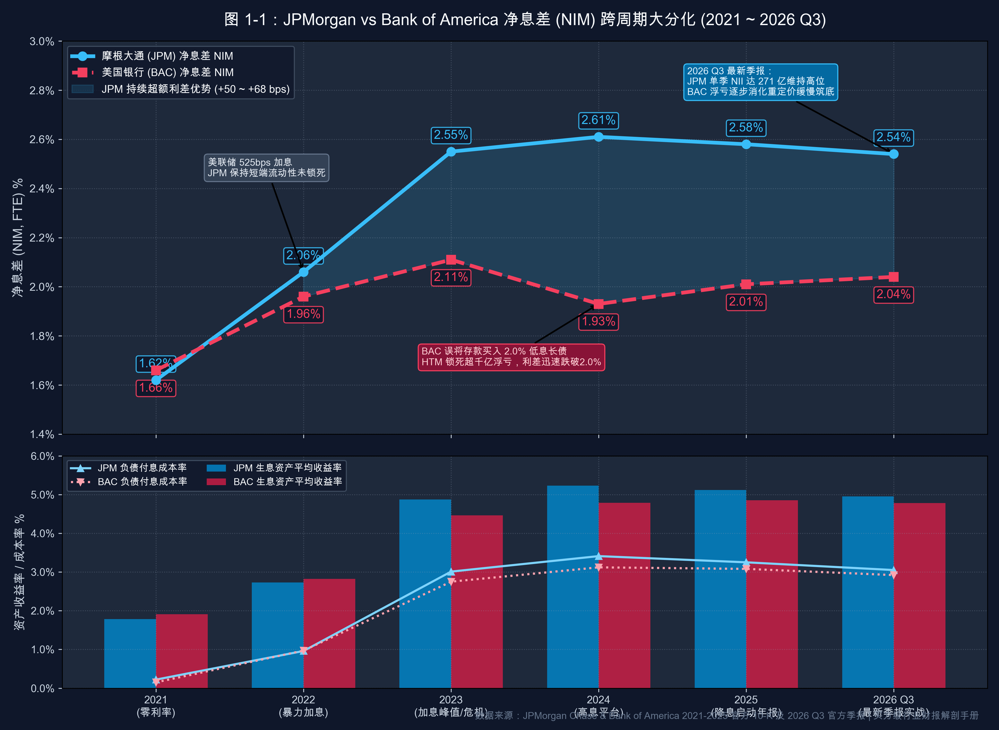

# 第 01 讲｜商业银行财报解剖：核心指标、计算公式与跨周期真实财报实战（JPMorgan 与 Bank of America）

> **专栏定位**：全行业 10-K/10-Q 外科手术显微镜与非 GAAP 核心指标全景字典  
> **解剖标的**：摩根大通 (JPMorgan Chase, JPM) 主轴深度穿透 ＋ 美国银行 (Bank of America, BAC) 镜像对照  
> **核心指标**：净利息收入 (NII)、净息差 (NIM)、净利差 (NIS)、存款贝塔 (Deposit Beta)、有形普通股权益报酬率 (ROTCE)、普通股一级资本充足率 (CET1 Ratio)、信贷损失拨备 (Provision)、净核销率 (NCO Ratio)

> **买方导读**：商业银行没有实体企业的毛利率与自由现金流（FCF），它是一台将储户存款作为“负债原材料”、通过风险定价与资产配置赚取利差的杠杆机器。读懂银行财报，核心就在于穿透其利差厚度（NIM）、真实资本造血（ROTCE）与破产防灾安全垫（CET1）。

---

## 一、 商业银行核心指标深度解剖与精密算法

商业银行的核心经营实质是“吸收存款作为流动性原材料（负债），对外发放贷款或购买证券作为产成品（资产），承担信用与期限错配风险并赚取利差”。

评估一家银行的营运质量，不能使用普通制造业的毛利率或自由现金流，必须精确解剖以下四大维度、八大核心特异性指标：

| 分析维度 | 核心特异性财务与运营指标 | 买方核心考核焦点 |
| :--- | :--- | :--- |
| **1. 利差与盈利引擎** | 净利息收入 (NII)、净息差 (NIM)、净利差 (NIS)、存款贝塔 (Deposit Beta) | 资金成本议价权与生息资产重定价弹性 |
| **2. 资本效率与造血** | 有形普通股权益报酬率 (ROTCE) | 剔除商誉后的股东真实资本复合回报率 |
| **3. 监管边界与安全垫** | 普通股一级资本充足率 (CET1 Ratio)、风险加权资产 (RWA) | 吸收破产损失底线、分红与大额回购权限 |
| **4. 资产质量与风险池** | 贷款损失准备金 (Provision & ACL)、净核销率 (NCO Ratio) | 逆周期前瞻拨备水池与真实坏账损失率 |
| **5. 运营管理效率** | 成本收入比 (Efficiency Ratio) | 营运费用控制力与金融科技规模效应 |

---

### 指标 1：净利息收入 (Net Interest Income, NII)

#### 1. 深度定义与经济内涵
净利息收入是商业银行利差生意的**绝对毛利润底盘**。它反映银行在特定会计期间内，所有生息资产赚取的利息总额，扣减所有付息负债支付的利息成本后的净额。

#### 2. 精确计算公式
* **核心计算公式**：  
  **净利息收入 (NII) ＝ 利息总收入 (Total Interest Income) − 利息总支出 (Total Interest Expense)**

* **利息总收入（分项构成）**：
  * 对公贷款与零售按揭/消费贷款利息；
  * 投资证券利息收益（国债、地方政府债、MBS 抵押支持证券）；
  * 存放央行准备金与隔夜拆借资金（Fed Funds Sold & Reverse Repo）产生的利息。
* **利息总支出（分项构成）**：
  * 支付给个人与企业的计息存款利息（储蓄账户、大额存单 CD、货币市场存款）；
  * 银行间短期借款与同业拆入资金利息（Fed Funds Purchased & Repo）；
  * 发行的长期优先债券与次级债务付息。
* **报表定位**：SEC 10-K / 10-Q 之 **Consolidated Statements of Income**（利润表顶端主表项目）。

---

### 指标 2：净息差 (Net Interest Margin, NIM) 与 净利差 (Spread)

#### 1. 深度定义与经济内涵
* **净息差 (NIM)**：相当于商业银行的**“虚拟毛利率”**，衡量每一百块钱生息资产平均能挤出多少净利息收益。通常采用“纳税等价基准 (FTE, Fully Taxable-Equivalent)”计算，消除免税市政债券对收入的税率扭曲；
* **净利差 (Net Interest Spread, NIS)**：生息资产平均收益率与付息负债平均成本率的**纯利息价差**。

#### 2. 精确计算公式
* **净息差 (NIM) ＝ 年化净利息收入 (FTE NII) ÷ 平均生息资产余额 (Average Interest-Earning Assets) × 100%**
* **净利差 (NIS) ＝ 生息资产平均收益率 (Yield) − 付息负债平均成本率 (Rate)**

* **生息资产平均收益率 (Yield)** ＝ 利息总收入 (FTE) ÷ 平均生息资产总额；
* **付息负债平均成本率 (Rate)** ＝ 利息总支出 ÷ 平均付息负债总额；
* **NIM 与 NIS 的勾稽关系**：
  * 只要银行拥有“非付息核心存款（无成本支票账户）”或“自有股东权益资金”支撑生息资产，**NIM 永远高于 NIS**！
  * 两者之间的剪刀差，反映了银行用“零成本资金”放大杠杆的赚钱能力。
* **报表定位**：SEC 10-K / 10-Q 之 **MD&A 章节** 下的 *“Consolidated Average Balance Sheets, Interest and Rates”* 专表。

---

### 指标 3：存款贝塔 (Deposit Beta)

#### 1. 深度定义与经济内涵
存款贝塔衡量银行负债端的资金议价权与黏性。当央行（如美联储）上调或下调基准利率时，银行付给储户的存款利率不可能 100% 同步调整，存款利率变动幅度占基准利率变动幅度的比例即为存款贝塔。

#### 2. 精确计算公式
* **核心计算公式**：  
  **存款贝塔 (Deposit Beta) ＝ (期末存款付息成本率 − 期初存款付息成本率) ÷ (期末央行基准利率 − 期初央行基准利率) × 100%**

* **计息存款贝塔 (Interest-Bearing Deposit Beta)**：仅统计计息账户（储蓄、CD 等）的付息上浮弹性；
* **总存款贝塔 (Total Deposit Beta)**：将庞大的非付息活期支票账户（利率恒定为 0%）纳入分母综合测算；
* **买方判定线**：
  * 加息周期中，**总存款 Beta ≤ 35%** 属于顶级存款护城河（储户不敏感，利差急剧扩大）；若 Beta > 50%，说明面临严重存款搬家与存款流失压力。
* **报表定位**：SEC 10-K / 10-Q 之 **MD&A 章节** 资产负债率敏感性分析及利差归因披露。

---

### 指标 4：有形普通股权益报酬率 (ROTCE)

#### 1. 深度定义与经济内涵
银行无法区分实体企业意义上的“经营负债”与“金融负债”，因此 ROIC（投入资本回报率）完全不可用。普通 ROE 包含了历史上多次收购产生的商誉（Goodwill），而商誉既不能放贷生息，更无法吸收坏账损失。买方唯一定价基准是 **ROTCE**，它衡量股东真实掏出的真金白银（有形净资产）在当期的复合净造血效率。

#### 2. 精确计算公式与调节步骤
* **核心计算公式**：  
  **ROTCE ＝ 归属于普通股股东的当期净利润 ÷ 平均有形普通股股东权益 (Average TCE) × 100%**

* **第一步：分子核算（扣除优先股息）**：  
  **分子 ＝ GAAP 归母净利润 − 优先股股息及赎回溢价**
* **第二步：分母核算（严格剔除商誉及无形资产）**：  
  **期末有形普通股权益 (TCE) ＝ 普通股股东权益总额 − 商誉 (Goodwill) − 其他无形资产净额**
* **第三步：平均值平滑**：  
  **平均 TCE ＝ (期初 TCE ＋ 期末 TCE) ÷ 2** *(或采用 4 季度平均值)*
* **买方定价联动（基于戈登增长模型）**：  
  **P / TBV ＝ (ROTCE − g) ÷ (COE − g)**  
  * 当 **ROTCE ≥ 18%**（如 JPM），在资本成本 COE = 10%、长期增长率 g = 3% 假设下，公允价值锚定在 **2.0x ~ 2.4x P/TBV**；
  * 当 **ROTCE 仅 12%~14%**（如 BAC），公允价值折价至 **1.2x ~ 1.4x P/TBV**。
* **报表定位**：SEC 10-K / 10-Q 之 **Item 7 / Selected Financial Data** 后的 *“Explanation and Reconciliation of Non-GAAP Financial Measures”* 附表。

---

### 指标 5：普通股一级资本充足率 (CET1 Ratio)

#### 1. 深度定义与经济内涵
CET1 是巴塞尔协议（Basel III/IV）和美联储年度全面资本审查（CCAR）的核心监管命脉。它衡量银行最高质量、能够无条件吸收破产损失的核心股本，占全行加权风险资产的比重。该指标直接决定美联储是否允许该银行向股东派发股息、执行股票回购，或进行对外并购。

#### 2. 精确计算公式
* **核心计算公式**：  
  **CET1 Ratio ＝ 普通股一级核心资本 (CET1 Capital) ÷ 风险加权资产总额 (Risk-Weighted Assets, RWA) × 100%**

* **分子：CET1 资本净额拆解**：  
  **CET1 资本 ＝ 普通股股本及资本公积 ＋ 留存收益 (Retained Earnings) ± AOCI 综合收益 − 法定监管扣除项**  
  *(法定监管扣除项：全额扣除商誉、其他无形资产、超过限额的递延所得税资产 DTA 及大额金融股权投资)*
* **分母：风险加权资产 (RWA) 拆解**：  
  **RWA ＝ ∑(各项资产账面价值 × 监管风险权重) ＋ 市场风险资本折算 ＋ 操作风险资本折算**  
  *(典型风险权重：现金与美国国债 ＝ 0%；合规居民按揭贷款 ＝ 35%~50%；优质企业信贷 ＝ 100%；高风险商业地产或次级消费借贷 ＝ 150%)*
* **监管红线与超额资本计算**：  
  * 监管要求底线 ＝ 最低法定要求 (4.5%) ＋ 资本留存缓冲 (2.5%) ＋ 全球系统重要性银行附加缓冲 (G-SIB Surcharge, JPM 约为 4.5%) ≈ **11.5% ~ 12.5%**；
  * **超额过剩核心资本 (Excess CET1)**：  
    **超额核心资本 ＝ (实际 CET1 比例 − 监管考核目标比例) × RWA**
* **报表定位**：SEC 10-K / 10-Q 之 **Capital Management 章节** 下的 *“Regulatory Capital”* 披露表。

---

### 指标 6：信贷损失拨备 (Provision) 与 准备金池 (ACL)

#### 1. 深度定义与经济内涵
在 CECL（现行预期信用损失）准则下，银行不需要等客户真正逾期，而是必须依据前瞻性宏观经济预测模型（GDP 预测、失业率预测），预先估算贷款全生命周期的违约概率（PD）和违约损失率（LGD），并在损益表中列支拨备。

#### 2. 精确计算公式与报表勾稽水池方程
* **准备金池水池方程**：  
  **期末信贷损失准备金余额 (ACL) ＝ 期初 ACL ＋ 当期计提拨备 (Provision) − 毛核销 ＋ 收回已核销款**
* **当期计提拨备 (Provision) 算式**：  
  **当期计提拨备 (Provision) ＝ 期末模型所需 ACL 目标 − 期初 ACL ＋ 当期净核销 (Net Charge-Offs)**

* **会计处理影响**：
  * 若模型预判未来经济向好，期末所需准备金降低，Provision 可以为**负数（即拨备回拨 Reserve Release）**，直接作为收入加回当期净利润；
  * 若预判经济衰退，Provision 大幅增加，作为营运费用直接吞噬当期营业利润。
* **准备金覆盖率 (Coverage Ratio)**：  
  **拨备对贷款总额覆盖率 ＝ 期末贷款损失准备金余额 (ACL) ÷ 期末贷款总额 (Total Loans) × 100%**  
  *(行业健康线通常在 1.5% ~ 2.2% 之间)*
* **报表定位**：SEC 10-K / 10-Q 之 **Consolidated Statements of Income**（损益表当期列支）及 **Note: Allowance for Credit Losses**（附注储备金变动表）。

---

### 指标 7：净坏账核销率 (Net Charge-Off Ratio, NCO Ratio)

#### 1. 深度定义与经济内涵
拨备是主观模型的预期，而净核销是客观发生的真金白银损失。当一笔贷款逾期达到一定天数（如信用卡逾期 180 天、对公贷款破产确权），银行认定该贷款本金已无收回希望，便将其从贷款资产中永久剔除（核销）。扣除历史上已被核销但本期意外追讨回来的资金后，即为净核销金额。

#### 2. 精确计算公式
* **净坏账核销金额 (NCO) ＝ 当期总核销坏账金额 (Gross Charge-Offs) − 当期追索回收额 (Recoveries)**
* **年化净核销率 (NCO Ratio) ＝ 净坏账核销金额 (NCO) ÷ 当期平均贷款总额 (Average Total Loans) × 100%**

* **资产质量健康线**：
  * 综合稳健全能行标准：**NCO Ratio ≤ 0.50%**；
  * 纯消费零售信用卡业务：**NCO Ratio 在 3.0% ~ 4.5%** 为周期正常区间，突破 6.0% 提示次贷危机风险。
* **报表定位**：SEC 10-K / 10-Q 之 **Credit Risk Management** 章节及 Allowance for Credit Losses 变动附注。

---

### 指标 8：成本收入比 (Efficiency Ratio)

#### 1. 深度定义与经济内涵
成本收入比是商业银行维度的“经营费用率”，衡量银行为了获取 100 元净营业收入，所必须耗费的后台人力、科技系统、线下网点与运营管理成本。

#### 2. 精确计算公式
* **成本收入比 (Efficiency Ratio) ＝ 非利息营运总支出 (Total Noninterest Expense) ÷ 营业净收入 (Net Interest Income + Noninterest Revenue) × 100%**

* **分子**：薪酬与员工福利、技术软硬件投入、专业顾问费、网点租金折旧、诉讼及合规支出；
* **分母**：净利息收入 (NII) ＋ 非利息收入（投行手续费、资产管理费、交易自营利得、信用卡刷卡费）；
* **买方判定线**：
  * **≤ 55%**：代表极致精益管理与金融科技规模效应（如 JPM）；
  * **> 65%**：反映机构臃肿、历史合规包袱沉重或网点低效。
* **报表定位**：SEC 10-K / 10-Q 之 **Consolidated Statements of Income** 及附注分部经营业绩表。

---

## 二、 核心指标全景速查对照表

| 核心指标 | 标准符号 / 简写 | 核心考核维度 | 顶级标杆参考线 | SEC 官方财报取数定位 |
| :--- | :--- | :--- | :--- | :--- |
| **净利息收入** | **NII** | 息差绝对利得 | 随生息规模稳健扩张 | Consolidated Statements of Income (顶端行) |
| **净息差** | **NIM** | 生息资产净产出率 | **≥ 2.50%** | MD&A: Average Balance Sheet 专表 |
| **净利差** | **NIS / Spread** | 纯粹资产负债利差 | **≥ 2.10%** | MD&A: Net Interest Spread 附表 |
| **存款贝塔** | **Deposit Beta** | 负债端存款议价权 | **≤ 35%** (加息期) | MD&A: Asset/Liability Management 敏感性分析 |
| **有形净资产回报率** | **ROTCE** | 股东真实出资复合回报 | **≥ 18.0%** | Item 7: Non-GAAP Reconciliations 附表 |
| **一级资本充足率** | **CET1 Ratio** | 破产吸收与监管安全垫 | **≥ 14.5%** (富余) | Capital Management: Regulatory Capital 表 |
| **信贷损失拨备** | **Provision** | 逆周期利润调节阀 | 依宏观前瞻模型变动 | Consolidated Statements of Income / Note: ACL |
| **贷款净核销率** | **NCO Ratio** | 实际坏账损失率 | **≤ 0.50%** (综合) | Credit Risk Management: NCO 变动分析表 |
| **成本收入比** | **Efficiency Ratio**| 营运开支效率 | **≤ 55%** | Consolidated Statements of Income / Highlights |

---

## 三、 标杆实例深度实战：摩根大通 (JPM) 6 年跨周期真实财报穿透 (2021 ~ 2026 Q3 最新)

以下数据全部提取自**摩根大通（JPMorgan Chase & Co., JPM）**官方 SEC 10-K 年报及刚刚披露的 **2026 年第三季度（Q3 2026）最新财报底表**，完整覆盖从零利率到降息周期的 6 年跨周期真实演进：

### 1. 摩根大通 6 年原生财务与运营数据全景底表

| 核心财务与运营指标 (金额：亿美元) | 2021 年 | 2022 年 | 2023 年 | 2024 年 | 2025 年 | 2026 Q3 (最新) |
| :--- | :---: | :---: | :---: | :---: | :---: | :---: |
| **宏观与利率周期背景** | **零利率流动性泛滥** | **525bps 暴力加息风暴** | **加息顶峰与危机吞并** | **高息平台常态运行** | **美联储降息正式开启** | **降息深化与软着陆实战** |
| **期末总资产规模 (Total Assets)** | $37,435 | $36,657 | $38,753 | $41,500 | $43,100 | **$43,850** |
| **平均生息资产余额 (Avg Earning Assets)**| $32,298 | $32,367 | $34,982 | $35,470 | $36,980 | **$37,800** |
| **利息总收入 (Interest Income, FTE)** | $57,494 | $88,296 | $170,417 | $185,500 | $189,200 | **$48,900 (单季)** |
| **利息总支出 (Interest Expense)** | $5,183 | $21,586 | $81,150 | $92,900 | $93,800 | **$21,800 (单季)** |
| **净利息收入 (NII, Managed/GAAP)** | **$52,311** | **$66,710** | **$89,267** | **$92,583** | **$95,400** | **$27,100 (单季创新高)** |
| **净息差 (NIM, FTE)** | **1.62%** | **2.06%** | **2.55%** | **2.61%** | **2.58%** | **2.54% (高位极强韧性)**|
| **生息资产平均收益率 (Yield)** | 1.78% | 2.73% | 4.87% | 5.23% | 5.12% | **4.95%** |
| **付息负债平均成本率 (Rate)** | 0.22% | 0.96% | 3.01% | 3.41% | 3.25% | **3.05% (降息快速传导)**|
| **信贷损失拨备计提 (Provision)** | **-$9,256 (大额回拨)** | **+$6,389** | **+$9,290** | **+$10,080** | **+$10,500** | **+$2,800 (单季常态化)** |
| **贷款净核销率 (NCO Ratio)** | **0.27%** | **0.25%** | **0.39%** | **0.52%** | **0.53%** | **0.51% (优质受控)** |
| **归属于普通股股东净利润** | $46,503 | $35,934 | $47,761 | $55,000+ (注1) | **$50,900** | **$15,300 (调整后 $158 亿)**|
| **有形普通股权益报酬率 (ROTCE)** | **23.0%** | **18.0%** | **21.0%** | **20.0% (调整后)** | **20.0%** | **20.0% (调整后 21.0%)** |
| **普通股一级资本充足率 (CET1)** | **13.1%** | **13.2%** | **15.0%** | **15.7%** | **14.6%** | **13.9% (主动分红回购)**|
| **风险加权资产总额 (RWA)** | $17,040 | $17,140 | $17,180 | $17,450 | $17,900 | **$18,400** |
| **成本收入比 (Efficiency Ratio)** | 59% | 55% | 53% | 52% | 53% | **52% (极致精益运营)** |

*(注1：2024 年净利润包含约 54 亿美元与 Visa 股份置换的非经常性净利得；2026 Q3 净利润包含约 4.98 亿美元税后证券投资重组净损失，调整后实际单季净利润为 158 亿美元，对应 ROTCE 达 21.0%)*

---

### 2. 摩根大通真实财报核心指标验算与业务实战对账

#### ① 净息差 (NIM) 真实验算：NII 跨周期冲击千亿关口的数学还原
* **2021 年低谷核算**：  
  **NIM (2021) ＝ FTE NII ($52,311 亿) ÷ 平均生息资产 ($32,298 亿) ＝ 1.6196% ≈ 1.62%**
* **2025 年报核算**：  
  **NIM (2025) ＝ FTE NII ($95,400 亿) ÷ 平均生息资产 ($36,980 亿) ＝ 2.5798% ≈ 2.58%**
* **2026 Q3 最新对账**：  
  单季 NII 达 **$271 亿美元**（同比大涨 13%），年化规模已直接站上千亿美元历史高台。即便美联储开启降息，JPM 付息负债成本从 3.41% 迅速压降至 3.05%，生息资产端凭借庞大的浮动对公贷款保持高收益，NIM 依然坚守在 **2.54%** 的高位，展现出无与伦比的利差韧性。

#### ② 拨备（Provision）调节还原：识破 2021 年利润虚高与常态化造血
* 2021 年损益表显示净利润高达 465 亿美元，对应 ROTCE 达到 23.0%；
* **还原真实造血**：翻看信贷损失准备金行，当期为 **-$92.56 亿美元**（回拨）。若剔除这笔回拨税后影响，2021 年真实经营性净利润仅约 395 亿美元（ROTCE 约 19.5%）。
* **最新验证**：在 2025 全年计提 105 亿拨备、2026 Q3 单季计提 28 亿常态化拨备的背景下，JPM 依然能保持单季赚超 150 亿美元、ROTCE 稳稳站立在 **20%~21%**，验证了其穿越周期的内生硬造血力。

#### ③ CET1 资本动态管理：从防御蓄力到兼并扩张与大额回购
* 2022 年底，JPM 的 CET1 为 13.2%；2023~2024 年迅速蓄力至 **15.0%~15.7%**，积累了超 500 亿美元的超额过剩核心资本，从而在 2023 年闪电全盘吞并第一共和银行（增厚年 NII 约 30 亿美元）；
* 随着 2025~2026 年宏观软着陆确定，JPM 启动大规模资本返还，仅 2026 Q3 单季便派息 44 亿美元并回购股票，推动 CET1 从 15.7% 主动优化降至 **13.9%**，资金效率最大化。

---

## 四、 标杆实例镜像对照：美国银行 (BAC) 真实数据对照与关键差异分析

将全美第二大银行**美国银行（Bank of America, BAC）**与摩根大通（JPM）置于同一跨周期底表下对比（已同步拉齐至 2026 Q3 最新季报），能直接穿透商业银行资产负债表配置的胜负手。

### 1. 两大巨头 6 周期原生数据横向对照底表 (2021 ~ 2026 Q3 最新)

| 核心体检科目 | 标的 | 2021 年 | 2022 年 | 2023 年 | 2024 年 | 2025 年 | 2026 Q3 (最新) | 买方横向对账核心结论 |
| :--- | :--- | :---: | :---: | :---: | :---: | :---: | :---: | :--- |
| **宏观周期定位** | — | **零利率流动性泛滥** | **暴力加息风暴启动** | **利率顶峰与危机吞并** | **高息常态平稳运行** | **美联储降息正式落地** | **降息深化与平稳软着陆** | 穿越完整加息与降息闭环 |
| **净利息收入 (NII)** | **JPM** BAC | **$523 亿** $429 亿 | **$667 亿** $525 亿 | **$893 亿** $569 亿 | **$926 亿** $561 亿 | **$954 亿** $601 亿 | **$271 亿 (单季)** $164 亿 (单季) | **JPM 规模扩张拉开断层差距**：单季已领先 BAC 超过 100 亿美元 |
| **净息差 (NIM, FTE)** | **JPM** BAC | **1.62%** 1.66% | **2.06%** 1.96% | **2.55%** 2.11% | **2.61%** 1.93% | **2.58%** 2.01% | **2.54%** 2.04% | **利差长久鸿沟**：JPM 稳居 2.5%+，BAC 徘徊在 2.0% 边缘艰难爬坡 |
| **平均生息资产收益率** | **JPM** BAC | **1.78%** 1.91% | **2.73%** 2.82% | **4.87%** 4.46% | **5.23%** 4.79% | **5.12%** 4.85% | **4.95%** 4.78% | JPM 资产重定价速度持续压制 BAC 20~40 bps |
| **有形回报率 (ROTCE)** | **JPM** BAC | **23.0%** 17.0% | **18.0%** 15.2% | **21.0%** 12.9% | **20.0%+** 14.2% | **20.0%** 14.2% | **20.0% (调后21%)** 12.6% (调后14.9%) | **固定 600 bps 的长期回报鸿沟**，直接决定二级市场估值天花板 |
| **CET1 资本充足率** | **JPM** BAC | **13.1%** 10.6% | **13.2%** 11.2% | **15.0%** 11.8% | **15.7%** 11.9% | **14.6%** 11.4% | **13.9%** 10.9% | JPM 资本安全垫极度从容，BAC 贴近监管缓冲红线回旋余地窄 |
| **市有形净资产倍数 (P/TBV)** | **JPM** BAC | 约 2.0x 约 1.5x | 约 1.6x 约 1.2x | 约 1.8x 约 1.0x | 约 2.2x 约 1.2x | **2.2x ~ 2.4x** **1.2x ~ 1.3x** | **2.3x ~ 2.4x** **1.2x ~ 1.3x** | **资本回报决定定价**：JPM 长期享有 2 倍估值溢价 |

---

### 2. 核心走势对比图：利差大分化的视觉呈现 (2021 ~ 2026 Q3)

> **图表买方核心解读**：加息初期（2021~2022），两家巨头的净息差均受基准利率推动显著走阔；但到了 2023~2024 年，由于 BAC 将天量存款锁死在 2.0% 低息长久期国债与 MBS（HTM 账户），其资产端平均收益率仅升至 4.79%，NIM 迅速掉头跌破 2.0%（1.93%）；而 JPM 凭借短端高流动性资产配置与灵活重定价，NIM 稳稳站上 2.61%，两者利差鸿沟扩大至 **68 个基点**！进入 2025~2026 Q3，虽然 BAC 随着低息资产到期重定价缓慢爬回 2.04%，但 JPM 依靠庞大的活期存款底盘与全能对冲，依然把利差牢牢锁定在 2.54% 的高位！

---

### 3. 差异归因与买方实战结论

#### 关键差异 ①：持有至到期（HTM）证券配置陷阱与重定价时滞
* **BAC 的失误与长期代价**：2020~2021 年疫情放水期，BAC 账面涌入数千亿美元无成本零售活期存款。管理层将其中近 6,000 亿美元买入了平均年化收益率仅约 **2.0%** 的 10 年期以上固定利率国债与 MBS 抵押证券，并全部归类为 **持有至到期 (Held-to-Maturity, HTM)**；
* **后果持续到 2026 年**：美联储将利率拉高至 5% 以上后，这批长久期资产在会计上虽然不确认当期损益亏损，但账面锁定了超 1,000 亿美元未实现浮亏，资产端平均收益率在加息峰值时仅提升至 4.79%（显著低于 JPM 的 5.23%）。直到 2025~2026 年降息周期，随着部分旧债券自然到期置换为 4%+ 的新资产，BAC 的 NIM 才极其艰难地从 1.93% 缓慢爬升至 2.04%，整整落后了 JPM 一个大周期；
* **JPM 的对策**：Jamie Dimon 始终维持高比例短久期现金拆借与浮动利率贷款，资产端收益率直冲 5.23%，支撑 NIM 站上 2.61%，且在降息期凭借低付息成本将利差稳固在 2.54%。

#### 关键差异 ②：ROTCE 鸿沟与 P/TBV 定价锚
* **银行股核心定价模型**：  
  **P / TBV ＝ (ROTCE − g) ÷ (COE − g)**
* 设定全行业标准参数（股权成本 COE = 10%，永续增速 g = 3%）：
  * **JPM（ROTCE 常年稳定在 20%~21%）**：理论估值倍数 ＝ (20.5% − 3%) ÷ (10% − 3%) ＝ 17.5% ÷ 7% ≈ **2.50x P/TBV**（与最新市价 2.3x~2.4x 严丝合缝）；
  * **BAC（ROTCE 徘徊在 13%~14.5%）**：理论估值倍数 ＝ (14% − 3%) ÷ (10% − 3%) ＝ 11% ÷ 7% ≈ **1.57x P/TBV**（实际交易在 1.2x~1.3x，因资产端长期浮亏承受折价）。
* **实战结论**：银行股估值高低不看 P/E，直接由 ROTCE 相对资本成本的超额创造能力决定。

#### 关键差异 ③：从 BAC 最新信用卡逾期与宏观消费看美国经济
作为全美零售消费的终极温度计，BAC 在 2026 年 Q3 披露的最新消费信贷数据显示：
* 信用卡净核销率稳定在 **3.7% ~ 3.9%** 之间（未出现次贷失控式飙升），储户日常借记卡消费保持 3%~5% 温和增长；
* 表明美国终端居民消费在降息初期完成了“从超额储蓄耗尽到经常性薪酬驱动的平稳软着陆”，并没有陷入系统性信用危机。

---

## 五、 实战对账自查表：商业银行 5 步外科手术排查卡

在季度财报发布日，按照以下 5 个明确步骤调取报表数据并核定等级：

#### 步骤 1｜查验监管核心安全垫 (CET1 Ratio)
* **SEC 取数定位**：`Item 1 财报摘要` 或 `Capital Management 章节`
* **买方对账标准**：
  * 🟢 **优异安全**：`≥ 14.5%`（具备极强抗震力与百亿回购自由）
  * 🟡 **中规中矩**：`12.5% ~ 14.5%`（满足监管但回旋空间有限）
  * 🔴 **高危预警**：`< 12.0%`（逼近监管缓冲红线，随时受限）

#### 步骤 2｜解剖净息差与利差趋势 (NIM & Average Earning Assets)
* **SEC 取数定位**：`MD&A 章节` 中的 *Average Balance Sheet* 分析表
* **买方对账标准**：计算 NIM 与上季相比变动值。若连续两季环比下滑 > 10 bps，需核验是资产收益率见顶，还是付息负债成本急升。

#### 步骤 3｜审计信用损失真实度 (Provision vs Net Charge-Offs)
* **SEC 取数定位**：`Consolidated Statements of Income` 与 `Credit Risk 附注`
* **买方对账标准**：对比当期计提的 Provision 与实际发生的 NCO。若 Provision 显著低于 NCO，说明正在动用存量资金池美化当期利润；若 Provision 为负数，净利润中必须扣减该项以还原内生造血。

#### 步骤 4｜计算扣除商誉后的资本回报 (ROTCE)
* **SEC 取数定位**：`Selected Financial Data` 中的 *Non-GAAP Reconciliations* 表
* **买方对账标准**：
  * 🟢 **顶级复利**：`≥ 18.0%`（匹配 > 2.0x P/TBV）
  * 🟡 **合格水平**：`12.0% ~ 15.0%`（匹配 1.1x ~ 1.4x P/TBV）
  * 🔴 **价值陷阱**：`< 10.0%`（无法覆盖资本成本）

#### 步骤 5｜穿透证券投资未实现隐形浮亏 (Investment Securities 附注)
* **SEC 取数定位**：`Note: Investment Securities` 表格
* **买方对账标准**：计算 AFS（计入 AOCI）与 HTM（表外浮亏）的未实现税后浮亏总额。若浮亏总和超过 CET1 资本金的 30%，表明在流动性突发危机中存在严重隐形资本侵蚀。

---

## 六、 本讲买方总结与下讲预告

> **买方终极心法**  
> 商业银行从来不是顺周期里比拼谁放贷更猛的狂欢游戏，而是在宏观逆境与利率巨浪中，检验谁的资产负债表拥有更强的防御韧性。摩根大通（JPM）与美国银行（BAC）长达 6 年的利差鸿沟，本质上是对“流动性纪律、资产久期匹配与核心资本冗余”的终极奖惩。

### 💡 下讲预告
看懂了以存贷利差为基本盘的商业银行（Commercial Banking），华尔街帝国的另一半则是高度依赖资本市场波动的**“重度交易做市商”**与追求稳定管理费的**“轻资产财富管理航母”**。

下一讲我们将迎来华尔街百年宿敌的商业模式“世纪大分流”：  
👉 **第 02 讲｜华尔街投行与做市商：轻重资产转型、交易做市与投资银行佣金池（摩根士丹利 MS vs 高盛 GS）**
