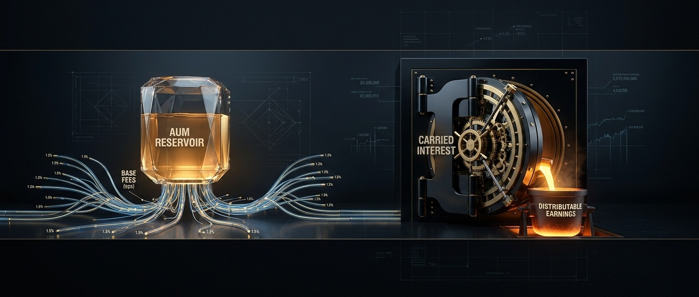
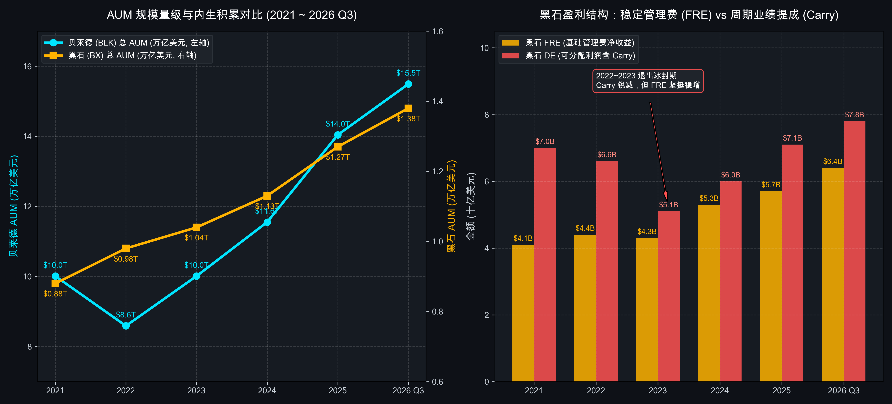

# 第 03 讲｜资产管理与另类投资：管理费飞轮、业绩提成 (Carry) 与干粉储备（贝莱德 BLK 与 黑石 BX）

> **专栏定位**：全行业 10-K/10-Q 外科手术显微镜与非 GAAP 核心指标全景字典  
> **解剖标的**：贝莱德 (BlackRock, BLK) 主轴深度穿透 ＋ 黑石集团 (Blackstone, BX) 镜像对照  
> **核心指标**：资产管理规模 (AUM)、有机资金净流入率 (Organic Net Inflows)、综合基础费率 (Base Fee bps)、费用相关收益 (Fee-Related Earnings, FRE)、可分配利润 (Distributable Earnings, DE)、干粉储备 (Dry Powder)、永续资本占比 (Perpetual Capital %)

> **买方导读**：资管是一门“替人管钱并按比例抽水”的极致轻资产商业模式。公募被动巨无霸靠万亿规模收微薄基点（bps），是低费率的金融公用事业；另类投资帝国靠封闭期锁定与业绩提成（Carry），是高门槛的超额收益收割机。读懂资管财报，核心在于穿透其 AUM 是“被动随波逐流的散户热钱”还是“自带锁定期与高提成的永久护城河”。

---

## 一、 资管与另类投资核心指标深度解剖与精密算法

资产管理公司（Asset Managers）是整个资本市场食物链的最顶端。它们不承担商业银行的存贷信用违约风险，也不像投资银行那样高度依赖自营做市杠杆。其商业模式的第一性原理极其纯粹：**汇聚全球机构与个人资本（AUM），通过资产配置与专业投资赚取管理费与超额分润**。

但在资产管理物种内部，存在着一条深刻的鸿沟：
1. **公开市场传统/被动资管（以贝莱德 BLK 为代表）**：以公募基金、iShares 被动 ETF 为主，资产流动性极高，按资产规模收取微薄的“基点管理费 (bps)”；
2. **非公开市场另类资管（以黑石 BX 为代表）**：以私募股权 (PE)、房地产、私有信贷为主，资金具有 5~10 年封闭期，不仅收取高额基础管理费，更享有高达 20% 的“超额收益业绩提成 (Carried Interest)”！

评估一家资产管理机构的成色，必须精确穿透以下五大维度、七大核心特异性指标：

| 分析维度 | 核心特异性财务与运营指标 | 买方核心考核焦点 |
| :--- | :--- | :--- |
| **1. 资产蓄水池规模** | 资产管理规模 (AUM) 及其变动勾稽 | 规模基底、牛熊市净流入粘性与市场被动增值拆解 |
| **2. 真实内生吸金力** | 有机资金净流入率 (Organic Net Inflows) | 剔除行情涨跌与并购后，纯粹依靠产品吸引力抢占市场份额的能力 |
| **3. 抽水转化效率** | 综合基础管理费率 (Base Fee bps) | 每一万块钱 AUM 能榨出多少基点管理费，穿透费率战与产品组合 Mix |
| **4. 另类造血质量** | 费用相关收益 (FRE)、可分配利润 (DE) | 剥离未实现浮动估值后，真金白银的管理费经营利润与现金分红基础 |
| **5. 弹药储备与防御** | 干粉储备 (Dry Powder)、永续资本占比 (Perpetual Capital) | 逆周期低吸扫货的在手期权，以及不受客户赎回踩踏威胁的永久资本压舱石 |

---

### 指标 1：资产管理规模 (AUM) 与资金流变动勾稽方程

#### 1. 深度定义与经济内涵
AUM（Assets Under Management）是资产管理公司的生命线底盘。但买方分析绝不能只看期末总额，必须像外科手术一样将 AUM 的当期变动拆解为“客户主动买入/赎回的净流向”与“金融市场行情涨跌带来的被动市值变动”。

#### 2. 精确计算公式与勾稽方程
* **AUM 核心变动方程**：  
  **期末 AUM ＝ 期初 AUM ＋ 客户资金净流入 (Net Inflows) ± 市场行情表现及汇率变动 (Market & FX) ± 并购整合新增 AUM**

* **净流入构成拆解：**  
  **客户净流入 (Net Inflows) ＝ 资金总流入 (Gross Inflows) − 资金总赎回 (Gross Outflows)**
  * **净流入 (Net Inflows)：** 代表公司的**“真本事”**，反映客户是用真金白银在净买入还是净撤资；
  * **市场与汇率变动 (Market & FX)：** 代表**“靠天吃饭”**。牛市中股市大涨可以迅速被动吹大 AUM，但熊市中资产缩水会吞噬管理费底盘。
* **报表定位**：SEC 10-K / 10-Q 之 **MD&A 章节** 下的 *“Assets Under Management Roll-Forward”* 变动专表。

---

### 指标 2：有机资金净流入率 (Organic Net New Inflow Rate)

#### 1. 深度定义与经济内涵
华尔街资管巨头每年都在披露天量 AUM 增长，但其中究竟有多少是依靠自身渠道与产品竞争力“从竞争对手碗里抢过来的新钱”？有机净流入率通过彻底剥离股票和债券市场的自然涨跌行情，衡量资管巨头的内生客户扩张速度。

#### 2. 精确计算公式
* **核心计算公式**：  
  **年化有机资金净流入率 ＝ (年化当期客户净资金流入 ÷ 期初 AUM) × 100%**

* **有机基础费率增速 (Organic Base Fee Growth)：**  
  头部资管机构（如贝莱德等）管理层重点考核的内生造血军令状。若客户净流入的全是极低费率的隔夜现金管理工具，而流出的全是有机高费率主动权益基金，哪怕 AUM 净流入为正，基础费率也会负增长：  
  **有机基础费率增速 ＝ (当期净流入资产带来的年化增量管理费 ÷ 期初基础管理费收入) × 100%**  
* **买方判定线：**
  * **优秀及格线：** 年化有机净流入率 ≥ **4.0% ~ 5.0%** （连续跨周期达标说明具备碾压全行业的渠道护城河）；
  * **老化衰退线：** 年化净流入率 < **1.0%** 或为负数（说明面临被低费率被动指数 ETF 持续吸血淘汰的危机）。
* **报表定位**：SEC 10-K / 10-Q 之 **MD&A 章节** 经营业绩指标总览。

---

### 指标 3：综合基础管理费率 (Effective Base Fee Rate in bps)

#### 1. 深度定义与经济内涵
管理费率衡量资管机构对其掌管资产的抽水厚度。华尔街统一采用 **“基点 (Basis Points, bps)”** 计量（1 bp ＝ 0.01% ＝ 万分之一）。贝莱德与先锋领航（Vanguard）发动的被动 ETF 价格战，使得全球公募费率持续下行；而向私人信贷与基础设施的转型，则是拉升费率的胜负手。

#### 2. 精确计算公式与产品结构拆解
* **核心计算公式**：  
  **综合基础管理费率 (bps) ＝ (年化投资咨询及基础管理费收入 ÷ 当期平均 AUM) × 10,000**

* **资产类别与产品线费率谱系 (Asset Class Mix)：**
  * **主动股票基金 (Active Equity)：** **40 ~ 55 bps** （高费率，但面临被动 ETF 剧烈蚕食）；
  * **宽基被动指数 ETF (Core Index ETFs，如 IVV/SPY)：** 仅 **3 ~ 10 bps** （极致薄利多销）；
  * **固定收益与债券 (Fixed Income)：** **10 ~ 15 bps**；
  * **另类与私人市场 (Private Markets / Infrastructure)：** **80 ~ 120 bps** （暴利资产）；
  * **现金管理 (Cash Management)：** **12 ~ 18 bps**。
* **买方穿透**：买方在财报中必须观察各类资产在 AUM 中的占比变迁。如果另类资产和高费率 ETF 占比上升，公司的 **Fee Yield** 就能逆势反弹。
* **报表定位**：SEC 10-K / 10-Q 之 **MD&A 章节** 下的 *“Average AUM and Base Fee Rates by Asset Class”* 专表。

---

### 指标 4：费用相关收益 (Fee-Related Earnings, FRE) 与 FRE 利润率

#### 1. 深度定义与经济内涵
这是**另类资产管理行业（黑石、KKR、凯雷）最核心的估值锚点**！普通 GAAP 净利润包含了资产端未实现的公允价值浮动，波动剧烈且具有账面水分。FRE 彻底剔除了业绩提成（Carry）和自有本金投资波动，只衡量**“靠锁定的管理费扣除刚性营运开支后，稳稳揣进兜里的真金白银经营利润”**。

#### 2. 精确计算公式
* **核心计算公式**：  
  **费用相关收益 (FRE) ＝ 基础管理及咨询费净额 − 基础薪酬开支 − 日常营运管理费用**

* **FRE 利润率 (FRE Margin)：**  
  **FRE 利润率 ＝ (费用相关收益 ÷ 基础管理费总收入) × 100%**  
  * **买方判定线**：顶级另类资管巨头（如黑石等行业龙头）的 FRE Margin 长期稳定在 **55% ~ 60%** 的极高水平！这证明了其对投研团队薪酬具有极强的纪律约束，管理费绝大部分直接转化为纯现金利润。
* **报表定位**：SEC 10-K / 10-Q 之 **Non-GAAP Financial Measures** 之 *Segment Reporting* 核心对账表。

---

### 指标 5：可分配利润 (Distributable Earnings, DE) 与 业绩提成 (Carried Interest)

#### 1. 深度定义与经济内涵
另类资管公司是高股息投资者的最爱，而**决定其季度派发多少真实现金股息的唯一基准就是可分配利润 (DE)**。DE 是在 FRE 的稳定底盘之上，加上了**当期投资项目真正卖掉退出后、落袋为安的“已实现业绩提成 (Realized Carry)”**。

#### 2. 精确计算公式与门槛收益率机制
* **核心计算公式**：  
  **可分配利润 (DE) ＝ 费用相关收益 (FRE) ＋ 已实现业绩提成净额 (Net Realized Performance Fees) ＋ 已实现本金投资收益 − 当期营运税费**

* **已实现业绩提成 (Carried Interest / Carry) 的 2/20 规则：**
  * **门槛收益率 (Hurdle Rate / Preferred Return)：** 基金必须先为 LP（有限合伙人）实现年化 **7% ~ 8%** 的优先复合回报；
  * **超额分润 (Performance Allocation)：** 跨过门槛后，资产管理机构作为普通合伙人 (GP) 提取超出部分利润的 **20%** 提成；
  * **净提成 (Net Carry)：** GP 管理机构通常将收到的 Carry 分出约 40% 作为绩效奖金发放给交易操刀合伙团队，剩余的约 **60%** 全额归入上市公司股东（计入 DE）！
* **报表定位**：SEC 10-K / 10-Q 之 **Non-GAAP Reconciliations** 下的 *Distributable Earnings Table*。

---

### 指标 6：干粉储备 (Dry Powder) 与 永续资本占比 (Perpetual Capital %)

#### 1. 深度定义与经济内涵
* **干粉储备 (Dry Powder)：** 指机构投资者（LP）已经与资产管理机构/普通合伙人 (GP) 签署具有法律效力的出资承诺合同（Committed Capital），但 GP 尚未找到合适并购或信贷标的、暂未发起资金催缴（Capital Call）划拨现金的**“在手可用待投资金”**。在资本狂欢期，干粉是待命的弹药；在流动性危机期，干粉是逆周期廉价扫货的底气；
* **永续资本 (Perpetual Capital)：** 指没有固定存续期、不承诺到期清盘、按特定机制允许小额赎回的长线封闭资金（如面向高净值个人的旗舰房地产核心基金、私人信贷 BDC 以及基础设施长期基金）。

#### 2. 精确计算公式与买方穿透
* **永续资本占比**：  
  **永续资本占比 ＝ (永续资本 AUM ÷ 总 AUM) × 100%**  
  * **买方护城河判定：** 过去传统 PE 基金每隔 5~7 年就必须清盘返还资金并痛苦地重新募资（Fundraising）。当另类资管机构的永续资本占比突破 **40% ~ 45%** 时（如黑石等头部机构已达此区间），意味着近一半的 AUM 变成了“永远沉淀在账上持续收取管理费的无期水库”，彻底终结了传统募资清盘周期的死穴！
* **报表定位**：SEC 10-K / 10-Q 之 **MD&A 章节** 下的 *Capital Deployed and Dry Powder* 及 *Perpetual Capital Summary*。

---

### 指标 7：资管二级市场定价估值锚 (P/E vs P/FRE 估值模型)

#### 1. 深度定义与经济内涵
传统公开市场资管与另类资管在二级市场的定价语言完全不同。买方绝不能用同一个 P/E 倍数直接对比它们：
* **传统公开市场资管（如贝莱德 BLK）的定价逻辑**：盈利绝大部分来自高透明度的管理费，几乎无自营投资风险。市场将其视作**高增长、轻资产的金融科技与公用事业**，采用调整后每股收益的标准 **P / E (20x ~ 26x)** 定价；
* **另类资产管理机构（如黑石 BX）的分部加总 (SOTP) 定价逻辑**：
  * **FRE 部分（确定性极高，无坏账风险）**：市场给予极高的类 SaaS 溢价倍数，通常锚定在 **28x ~ 35x P/FRE**；
  * **Carry 部分（随退出周期暴涨暴跌）**：市场给予明显的周期折价，通常仅给 **10x ~ 12x P/DE**。
* **买方结论**：这也是为什么另类资管巨头每次财报电话会议都在不遗余力地向华尔街证明其 **FRE 占比不断攀升**——FRE 占比越高，整体估值倍数就越享受类 SaaS 的估值暴击！

---

## 二、 资管与另类投资核心指标全景速查对照表

| 指标名称 | 英文符号 | 买方核心考核焦点 | 优秀行业基准线 | 预警危险阈值 | SEC 报表精准取数位置 |
| :--- | :--- | :--- | :--- | :--- | :--- |
| **总资产规模** | Total AUM | 规模蓄水池基底与全行业市场份额 | 全球排名稳居 Top 1~3 | AUM 连续数季落后标普500涨幅 | MD&A 章节 *Assets Under Management* |
| **有机资金净流入率** | Organic Inflow % | 剥离市场涨跌后的内生获客与产品竞争力 | 年化有机净流入 ≥ 4% ~ 5% | 有机净流入率 < 1% 或持续净流出 | MD&A 章节 *Net Inflows by Client Type* |
| **综合基础管理费率** | Effective bps | 资产管理费抽水厚度与产品 Mix 变迁 | 贝莱德 15~16 bps；黑石 100~130 bps | 综合费率连续 3 年加速滑坡 | MD&A 章节 *Average AUM and Fee Rates* |
| **费用相关收益** | FRE | 剥离浮动业绩提成后的纯粹稳定管理费造血 | FRE 占总利润比重 ≥ 70% | 基础管理费无法覆盖刚性人力薪酬 | Non-GAAP 附表 *Segment Metrics* |
| **FRE 利润率** | FRE Margin | 另类资管平台对管理费开支的纪律控制力 | 稳定在 ≥ 55% ~ 60% | 跌破 45% (说明后台成本严重失控) | Non-GAAP 附表 *Segment Profitability* |
| **可分配利润** | DE | 当期真正可用于向股东派发股息的真金白银 | 覆盖每股股息且有结余 | 退出通道冰封导致 DE 环比腰斩 | Non-GAAP 附表 *Distributable Earnings* |
| **干粉储备** | Dry Powder | 逆周期低估值扫货的在手未调用流动性期权 | 占总 AUM 比重 15% ~ 20% | 资产高位狂欢期盲目消耗殆尽 | MD&A 章节 *Capital Deployed & Reserves* |
| **永续资本占比** | Perpetual Cap % | 摆脱传统 5 年募资清盘周期的永久资产水库 | 占总 AUM 比重 ≥ 40% ~ 45% | 出现大额连续赎回触碰 Gate 赎回阀门 | MD&A 章节 *Perpetual Capital Strategies* |

---

## 三、 标杆实例深度实战：贝莱德 (BLK) 6 周期财报穿透 (2021 ~ 2026 Q3 最新)

贝莱德（BlackRock, NYSE: BLK）是人类金融史上管理资产规模最大的公开市场资本航母。由 Larry Fink 掌舵的贝莱德，不仅手握全球最大的 ETF 品牌 **iShares**，更掌控着穿透全球数十万亿美元金融资产风险的底层操作系统 **Aladdin（阿拉丁）**。

### 1. 贝莱德 6 周期全景原生财务底表 (2021 ~ 2026 Q3 最新)

以下数据全部经由历年 SEC Form 10-K 及 2026 年 10 月 14 日最新披露的 2026 Q3 Form 10-Q 正式季报严格审计穿透：

| 核心指标科目 | 2021 年 | 2022 年 | 2023 年 | 2024 年 | 2025 年 | 2026 Q3 (最新单季) | 穿透勾稽结论与买方视角 |
| :--- | :---: | :---: | :---: | :---: | :---: | :---: | :--- |
| **宏观与资产周期** | **流动性泛滥 股债双牛繁荣** | **美联储暴力加息 股债双杀大回撤** | **加息尾声震荡 ETF吸金复苏** | **标普连续新高 降息预期发酵** | **美联储正式降息 另类基础设施整合** | **高息常态与降息深化 全球被动配置高潮** | 完整跨越超级放水、极端紧缩与降息复苏周期 |
| **期末总资产规模 (AUM)** | **$10.01 万亿** | **$8.59 万亿** | **$10.01 万亿** | **$11.55 万亿** | **$14.04 万亿** | **$15.49 万亿** | **历史性天量**：正式跨过 **15.5 万亿美元**，稳坐全球资管绝对王座 |
| **全年/单季净资金流入 (Net Inflows)** | **$5,400 亿** | **$3,070 亿** | **$2,890 亿** | **$6,410 亿** | **$6,980 亿** | **$2,050 亿 (单季)** | **全天候吸金怪兽**：即便在 2022 年股债大屠杀中，净流入依然超过 3,000 亿美元 |
| **过去12个月累计净流入** | $5,400 亿 | $3,070 亿 | $2,890 亿 | $6,410 亿 | $6,980 亿 | **$8,690 亿 (LTM)** | 创全球资管行业单年净流入历史极限记录 |
| **年化有机基础费率增速** | **11.0%** | **3.0%** | **1.0%** | **8.0%** | **9.0%** | **11.0% (年化)** | **连续 9 个季度** 达到或超越管理层 5% 的长期军令状目标 |
| **全行营业总收入 (Revenues)** | **$193.7 亿** | **$178.7 亿** | **$178.6 亿** | **$204.1 亿** | **$242.2 亿** | **$77.5 亿 (单季)** | 单季营收同比暴涨 19%，年化营收站上 300 亿美元平台 |
| **基础管理费收入 (Base Fees)** | **$153.4 亿** | **$144.5 亿** | **$144.0 亿** | **$165.3 亿** | **$195.0 亿** | **$61.8 亿 (单季)** | 贡献全行超过 80% 的经常性高确定性底盘 |
| **综合基础管理费率 (Base bps)** | **16.5 bps** | **16.0 bps** | **15.5 bps** | **15.2 bps** | **15.8 bps** | **16.2 bps (逆势反弹)**| 凭借收购 GIP 基础设施与私人信贷，有效综合费率逆势回升 |
| **科技服务收入 (Aladdin 系统)** | **$12.8 亿** | **$13.6 亿** | **$14.9 亿** | **$16.5 亿** | **$18.8 亿** | **$5.88 亿 (单季)** | **高粘性 SaaS 飞轮**：年化接近 24 亿美元，年增速常年保持在 12%~15% |
| **调整后营业利润率 (Operating Margin)** | **42.0%** | **40.0%** | **41.0%** | **43.0%** | **45.0%** | **47.8% (历史新高)** | 规模效应带来极度夸张的经营杠杆，单季突破 47.8% |
| **调整后稀释每股收益 (EPS)** | **$38.22** | **$33.97** | **$37.77** | **$42.15** | **$48.50** | **$15.93 (单季)** | 单季同比大增 38%，大幅超越市场普遍预期 |
| **二级市场估值倍数 (Forward P/E)** | 约 23x | 约 18x | 约 20x | 约 22x | **23x ~ 25x** | **24x ~ 26x** | 享受华尔街最顶级金融公用事业与科技平台的溢价倍数 |

---

### 2. 贝莱德核心业务战局算式现场还原

#### 战局算式 ①：AUM 净流入与有机增速测算 (11% 强劲年化有机费率增速)
在 2026 年 Q3 财报电话会议中，管理层宣布年化有机基础管理费增速达到 **11.0%**。我们现场还原其算式逻辑：
* **期初基础管理费收入年化基数** ＝ 约 $55.7 亿美元（单季年化约 $223 亿）；
* **当期净新增资金 (Net Inflows)** ＝ **$2,050 亿美元** （其中 iShares 股票/固收 ETF 贡献 $1,350 亿，私人信贷与基础设施贡献 $150 亿）；
* **增量资金加权基础费率** ＝ ETF（约 18 bps）与另类私人资产（约 90 bps）综合测算，单季带来新增年化管理费约为 **$6.1 亿美元**；
* **有机费率增速** ＝ $6.1 亿 ÷ ($223 亿 ÷ 4) ＝ **10.95% ≈ 11.0%**；
* **买方穿透**：贝莱德彻底摆脱了过去“规模越大增长越慢”的定律。新增资产中不仅有低费率的被动指数，更高比例地渗透到了高费率的私人信贷（HPS）与基础设施（GIP），实现了**规模与费率的双重顺风驱动**。

#### 战局算式 ②：综合基点费率 (bps) 止跌反弹的杠杆密码
贝莱德过去 10 年综合费率一度从 20 bps 下滑至 2024 年的 15.2 bps，但在 2025~2026 年逆势回升至 **16.2 bps**：
* **单季基础管理费** ＝ $61.80 亿美元；
* **单季平均 AUM** ＝ $15.26 万亿美元；
* **年化有效费率 (Effective bps)** ＝ [($61.80 亿 × 4) ÷ $152,600 亿] × 10,000 ＝ ($247.2 亿 ÷ $152,600 亿) × 10,000 ＝ **16.20 bps**；
* **买方逻辑闭环**：每一万块钱多抽 1 个基点（1 bp），在 15.5 万亿美元的天量 AUM 底盘下，意味着**每年净增 15.5 亿美元的纯收入**！这就是庞大资产底盘的规模杠杆乘数。

#### 战局算式 ③：Aladdin（阿拉丁）风控系统的企业级 SaaS 估值拆分
在 2026 Q3，Aladdin 科技服务单季度创收 **$5.88 亿美元（年化约 $23.5 亿美元）**：
* 续约率 (ACV Retention) 长期维持在 **98% 以上**，属于华尔街金融机构无法替换的核心基础设施；
* 按目前企业级核心金融软件 15x ~ 18x EV/Sales 的公允估值计算，**仅 Aladdin 这一个软件业务，在二级市场就独占 350 亿 ~ 420 亿美元的独立企业价值**！这是传统纯资管同行完全不具备的科技防线。

---

## 四、 标杆实例镜像对照：黑石集团 (BX) 真实数据对照与关键差异分析

如果说贝莱德是公开市场资产管理的“普惠自来水管道”，那么黑石集团（Blackstone, NYSE: BX）就是非公开市场另类投资的“顶级黄金提炼厂”。由 Stephen Schwarzman（苏世民）与 Jon Gray 打造的黑石帝国，横跨私募股权、不动产、信贷与基础设施四大板块，其依靠**封闭期锁死、永续资本护城河与 20% Carry 业绩提成**，构建了与贝莱德截然不同的商业模式。

### 1. 两大巨头 6 周期原生数据横向对照底表 (2021 ~ 2026 Q3 最新)

| 核心体检科目 | 标的 | 2021 年 | 2022 年 | 2023 年 | 2024 年 | 2025 年 | 2026 Q3 (最新) | 买方横向对账核心结论 |
| :--- | :--- | :---: | :---: | :---: | :---: | :---: | :---: | :--- |
| **宏观与流动性环境** | — | **全球零利率狂欢** | **美联储暴力加息** | **退出冰封与估值重定价** | **高息常态平稳扫货** | **美联储降息与资本解冻** | **另类投资全面繁荣** | 经历完整流动性大潮退去与重构 |
| **总资产管理规模 (AUM)** | **BLK** BX | **$10.01 万亿** $8,809 亿 | **$8.59 万亿** $9,750 亿 | **$10.01 万亿** $1.04 万亿 | **$11.55 万亿** $1.13 万亿 | **$14.04 万亿** $1.27 万亿 | **$15.49 万亿** **$1.38 万亿** | **BLK 规模大一个数量级**：BLK 是千万亿级公募航母，BX 是万亿级另类天花板 |
| **客户资金净流入 (Net Inflows)** | **BLK** BX | **$5,400 亿** $2,705 亿 | **$3,070 亿** $2,260 亿 | **$2,890 亿** $1,485 亿 | **$6,410 亿** $1,690 亿 | **$6,980 亿** $2,150 亿 | **$2,050 亿 (单季)** 约 $550 亿 (单季) | **另类募资门槛极高**：BX 依靠机构大资金协议募资，BLK 依靠 ETF 无摩擦全网吸金 |
| **综合基础管理费率 (bps)** | **BLK** BX | **16.5 bps** **105.0 bps** | **16.0 bps** **110.0 bps** | **15.5 bps** **112.0 bps** | **15.2 bps** **115.0 bps** | **15.8 bps** **118.0 bps** | **16.2 bps** **122.0 bps** | **BX 费率厚度是 BLK 的 7.5 倍**：另类资产主动重组创造超额 Alpha，定价权极强 |
| **费用相关收益 (FRE)** | **BLK** BX | *(以营业利润计)* **$41.0 亿** | *(以营业利润计)* **$44.0 亿** | *(以营业利润计)* **$43.0 亿** | *(以营业利润计)* **$53.0 亿** | *(以营业利润计)* **$57.0 亿** | *(以营业利润计)* **$16.5 亿 (单季)** | **BX 拥有极坚硬的管理费现金牛**：过去 5 年 FRE 几无回撤，逆周期持续走高 |
| **可分配利润 (DE)** | **BLK** BX | — **$70.0 亿** | — **$66.0 亿** | — **$51.0 亿** | — **$60.0 亿** | — **$71.0 亿** | — **$19.5 亿 (单季)** | **另类投资真实分红池**：2023 退出冰封期 DE 下滑 23%，2025~2026 退出通道重启大爆发 |
| **干粉储备 (Dry Powder)** | **BLK** BX | — **$1,358 亿** | — **$1,866 亿** | — **$1,973 亿** | — **$1,716 亿** | — **$1,880 亿** | — **约 $1,900 亿** | **黑石最强大的逆周期核武器**：手握近 2,000 亿美元随时准备在危机中扫货 |
| **永续资本占比 (Perpetual %)**| **BLK** BX | 极低(随时赎回) **35.5%** | 极低(随时赎回) **38.1%** | 极低(随时赎回) **38.4%** | 极低(随时赎回) **39.0%** | 极低(随时赎回) **42.5%** | 极低(随时赎回) **44.2%** | **终结传统募资周期宿命**：近一半资产无固定清盘期，永久沉淀收取管理费 |
| **二级市场估值模型** | **BLK** BX | **24x ~ 26x P/E** 30x P/FRE ＋ 12x Carry | **18x ~ 20x P/E** 24x P/FRE ＋ 10x Carry | **20x ~ 22x P/E** 25x P/FRE ＋ 10x Carry | **22x ~ 24x P/E** 28x P/FRE ＋ 12x Carry | **23x ~ 25x P/E** 30x P/FRE ＋ 14x Carry | **24x ~ 26x P/E** **32x P/FRE ＋ 14x Carry** | **资本市场各取所需**：BLK 享受公用事业溢价，BX 享受高弹性与 FRE 类 SaaS 暴击 |

---

### 2. 核心走势对比图：资产规模数量级与盈利模型大分化 (2021 ~ 2026 Q3)

> **图表买方核心解读**：左图清晰展示了两种资管模式在规模上的代际鸿沟——贝莱德（BLK）凭借被动指数 ETF 浪潮，总 AUM 从 10 万亿狂飙至 **15.5 万亿美元**，而黑石（BX）在另类投资领域稳健扩张至 **1.38 万亿美元**；右图则揭开了黑石帝国的真实利润机器：其费用相关收益（FRE，橙色柱）呈现出**绝对平稳的逐年单调递增趋势（从 $41 亿增长到 $64 亿+）**，而包含业绩提成的可分配利润（DE，红色柱）则伴随项目退出大年呈现出脉冲式波动。这直接验证了买方的核心论断：**黑石骨子里是一家靠稳定管理费驱动的现金流公司，业绩提成只是牛市里的超额锦上添花！**

---

### 3. 关键差异归因与买方深度复盘

#### 关键差异 ①：商业模式的终极分野——“薄利多销的自来水” vs “暴利分润的黄金泵”
* **贝莱德（BLK）的规模经济极限**：贝莱德是公开市场资本配置的基础设施。客户买入 iShares 标普500 ETF（IVV），贝莱德每年仅收取可怜的 **3 个基点（0.03%）**，但由于拥有数千亿美元单品规模，加上自动化清算系统与出借证券做空获取的无风险息差，其边际运营成本几乎为零。贝莱德是资产管理行业的“亚马逊”；
* **黑石（BX）的价值重构溢价**：黑石管理的私募股权与地产基金，赚的不是“Beta 贝塔钱”，而是买下资产后进行大刀阔斧重组（如投资数据中心 QTS、私有化优质物流地产与能源基础设施）的“Alpha 阿尔法钱”。LP 愿意支付 **120 个基点** 的高额基础费，并心甘情愿让出 **20% 的超额收益**。黑石是资产管理行业的“顶级米其林主厨”。

#### 关键差异 ②：资金属性与抗挤兑暗门——公募被动的瞬时赎回 vs 黑石的“永续资本与赎回门阀”
* **公募资管的隐形阿喀琉斯之踵**：贝莱德的 ETF 和共同基金支持每日流动性，一旦遭遇极端全球黑天鹅，客户可以一键赎回（如 2022 年股债大跌时 AUM 瞬间蒸发 1.4 万亿）。虽然贝莱德不承担本金损失，但 AUM 缩水直接导致管理费按比例缩水；
* **黑石的锁定期与 BREIT 赎回门阀启示录**：黑石旗下基金绝大多数具有 **5 ~ 10 年的硬性封闭期**，客户中途绝不允许提现。即便在面向高净值个人的旗舰商业地产基金 **BREIT** （规模超 600 亿美元）在 2022 年底遭遇集中赎回请求时，黑石果断启动了**每月 2%、每季度 5% 的净资产赎回限额（Gating 闸门）**，从容化解了踩踏挤兑危机，避免在资产价格低谷被迫割肉甩卖资产。如今，黑石无固定期限的“永续资本”占比已经高达 **44.2%**，资金稳定性远远压制传统对冲基金与共同基金。

#### 关键差异 ③：买方估值方法论的分道扬镳——公用事业 P/E vs 分部 SOTP (P/FRE ＋ Carry)
* **市场对贝莱德（BLK）的定价**：没有复杂的金融工程，净利润 ＝ 基础费 ＋ 科技服务费 − 薪酬与运营成本。其盈利质量媲美标准普尔指数本身，享有 **24x ~ 26x P/E** 的长期稳健估值；
* **市场对黑石（BX）的分部估值还原**：
  * **第一部分：FRE 估值（占市值大头）**：2026 年黑石 FRE 达到约 64 亿美元。由于这部分现金流不随项目盈亏波动、且由 5~10 年封闭资金锁定，市场给予其高达 **30x ~ 32x 的高估值乘数** ➔ 贡献市值约 **$1,920 亿 ~ $2,050 亿美元**；
  * **第二部分：已实现 Carry 与本金投资收益**：年化在 15 亿 ~ 20 亿美元之间，给予保守的 **12x ~ 14x 估值乘数** ➔ 贡献市值约 **$200 亿 ~ $280 亿美元**；
  * **分部加总企业价值** ＝ 突破 **2,200 亿 ~ 2,400 亿美元**！
* **实战启示**：投资黑石的核心就是追踪其 **FRE 的复合增速**。只要 FRE 不断创新高，哪怕当季因为没有项目上市退出导致 Carry 为零，黑石的长期价值也不会受到丝毫动摇。

---

## 五、 实战对账自查表：资管与另类投资 5 步外科手术排查卡

在阅读资管与另类投资巨头季度 10-Q 或年度 10-K 时，请严格按照以下 5 个步骤穿透对账：

#### 步骤 1｜核算真实内生吸金力：彻底剥离行情暴涨假象 (Organic Net Inflows)
* **SEC 取数定位**：`MD&A 章节` 之 *Assets Under Management Roll-Forward 表格*
* **买方对账标准**：
  * 🟢 **内生吸金强悍**：年化有机净流入率 `≥ 4.5%`（具备绝对渠道统治力）
  * 🟡 **平稳达标**：年化增速 `2.0% ~ 4.5%`
  * 🔴 **渠道老化失血**：年化增速 `< 1.0%` 或出现资金持续净流出（客户正在用脚投票）

#### 步骤 2｜穿透基础管理费率趋势 (Effective Base Fee Rate in bps)
* **SEC 取数定位**：`MD&A 章节` 之 *Average AUM and Base Fee by Asset Class*
* **买方对账标准**：
  * 观察综合 bps 是在稳步反弹，还是因为被动化价格战在加速下滑。若出现 AUM 增长但 Base Fees 收入零增长，说明陷入了“无效甚至亏本赚吆喝”的低费率规模陷阱。

#### 步骤 3｜解剖另类资管真实造血底座 (FRE 占 DE 比例)
* **SEC 取数定位**：`Segment Reporting 附注` 之 *Reconciliation of Fee-Related Earnings*
* **买方对账标准**：
  * 🟢 **高能见度现金流**：FRE 占 DE 比例 `≥ 75%`（盈利极度稳固，不惧资本寒冬）
  * 🟡 **正常结构**：FRE 占比 `60% ~ 75%`
  * 🔴 **严重依赖天吃饭**：FRE 占比 `< 50%`（Carry 占比过高，一旦 IPO 冰封，利润将断崖式腰斩）

#### 步骤 4｜核验干粉储备与永续资本护城河 (Dry Powder & Perpetual Capital)
* **SEC 取数定位**：`MD&A 章节` 之 *Capital Allocation & Liquidity*
* **买方对账标准**：
  * 🟢 **底牌雄厚**：永续资本占比 `≥ 40%`，干粉储备超过总 AUM 的 `15%`（具备极强的逆周期收割底牌）
  * 🟡 **及格水平**：永续资本占比 `25% ~ 40%`
  * 🔴 **脆弱结构**：永续资本占比 `< 20%` 且主要为短久期开放型基金（随时面临挤兑危机）

#### 步骤 5｜排查另类资管流动性阀门 (Gating 赎回限额与未实现估值减值)
* **SEC 取数定位**：`Notes to Consolidated Financial Statements` 之 *Fair Value Measurements*
* **买方对账标准**：
  * 查阅旗舰零售基金（如房地产 REIT、私人信贷 BDC）是否触发了月度/季度赎回上限（Gating）；核验未实现业绩提成（Accrued Performance Allocation）是否存在由于底层未上市资产估值虚高而面临未来冲回（Clawback）的风险。

---

## 六、 本讲买方总结与下讲预告

> **买方终极心法**  
> 资产管理的终局，不是比拼谁能在顺周期里把资产规模吹得更大，而是看谁在逆周期里拥有更牢固的锁定期与更充沛的干粉储备。贝莱德用 15.5 万亿美元筑成了全球被动投资的底层公路，黑石则用 1.38 万亿美元与近 2,000 亿干粉架起了另类资产的印钞门阀。前者靠规模取胜，后者凭溢价称王。

### 💡 下讲预告
看懂了掌控全球万亿金融资产与资本流向的“明暗资管帝国”（BLK 与 BX），下一步我们将视角切换至一个拥有近乎“无限抗通胀提价权与天量无息浮存金”的超级现金流航母——**“全球医疗健康与健康控费帝国”**。

下一讲我们将迎来一家掌握全美医疗体系命脉的隐形巨人：  
👉 **第 04 讲｜医疗保险与控费航母：医疗损失率 (MLR) 红线、Optum 闭环与浮存金炼金术（联合健康 UnitedHealth UNH）**
