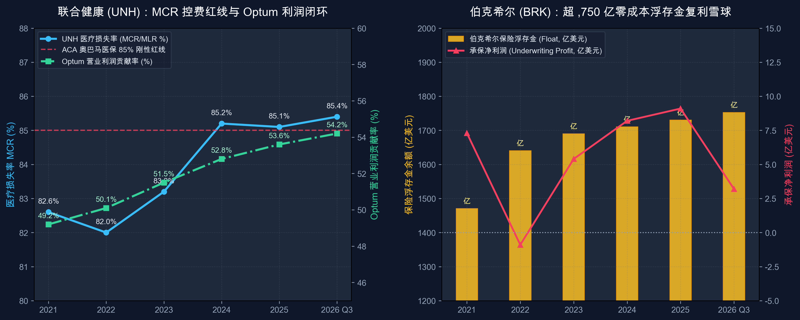

# 第 04 讲｜医疗保险与控费航母：医疗损失率 (MLR) 红线与巴菲特浮存金炼金术（联合健康 UNH 与 伯克希尔哈撒韦 BRK）

> **专栏定位：** 全行业 10-K/10-Q 外科手术显微镜与非 GAAP 核心指标全景字典  
> **解剖标的：** 联合健康 (UnitedHealth Group, UNH) 主轴深度穿透 ＋ 伯克希尔哈撒韦 (Berkshire Hathaway, BRK) 镜像对照  
> **核心指标：** 医疗损失率 (MCR/MLR)、Optum 闭环留存利润率、保险浮存金 (Float)、综合成本率 (Combined Ratio)、未决赔款准备金 (Loss Reserves/IBNR)、医疗利用率趋势 (Medical Utilization)

> **买方导读：** 巴菲特说，世界上最美妙的商业模式是“客户先给你钱，你拿着这笔钱无息甚至负成本投资很多年，最后才可能赔付出去”。而在大洋彼岸的医疗领域，联合健康则演化出了另一种神级物种：既然奥巴马医保法案规定 85% 的保费必须花在医疗服务上，它索性把诊所、药房和理赔数据中心全部买下——让巨额赔付从左口袋流进右口袋，筑成了近 5,000 亿美元的控费托拉斯。

---

## 一、 医疗保险与控费航母核心指标深度解剖与精密算法

在传统金融认知中，保险是一门典型的“负债驱动型”生意。但医疗健康保险与普通财产险（P&C）存在本质区别：
1. **财产与意外商业险（P&C / Reinsurance）：** 承担极端黑天鹅灾难损失（飓风、地震、重大车祸），赔付具有高度长尾性与不确定性，商业模式的核心是**“承保不亏钱 ＋ 追求庞大零成本浮存金（Float）的投资复利”** ；
2. **管理式医疗健康航母（Managed Care / Health Payer）：** 承担参保人的高频就医与慢性病用药，赔付高度可预测但受美国联邦法律严格管制。商业模式的核心是**“保险支付端（Payer）与医疗提供端（Provider）高度闭环，靠管理式医疗与自建生态吃尽全产业链利润”** 。

解剖这类巨头的财报，必须精通以下五大维度、七大核心特异性指标：

| 分析维度 | 核心特异性财务与运营指标 | 买方核心考核焦点 |
| :--- | :--- | :--- |
| **1. 承保控费效率** | 医疗损失率 (Medical Care Ratio, MCR/MLR) | 奥巴马法案 85% 刚性红线考核与就医利用率波动敞口 |
| **2. 纵向生态协同** | 医疗服务与数字化赋能业务利润贡献率 (Health Services Margin %) | 赔付费用向内部高毛利服务转化的留存能力与内生增速 |
| **3. 长期资本杠杆** | 保险浮存金规模 (Float) 与 综合投资回报率 | 零成本甚至负成本债务杠杆对股东真实资产净值的放大效应 |
| **4. 纯承保盈亏平衡** | 综合成本率 (Combined Ratio) 与 承保利润率 | 剥离投资波动后，保险主业每一百块保费收入的纯损益底盘 |
| **5. 会计蓄水池暗门** | 未决赔款准备金 (Loss & LAE Reserves / IBNR) | 已发生未报告赔付计提的审慎性与利润平滑调节阀 |

---

### 指标 1：医疗损失率 (Medical Loss Ratio, MLR / Medical Care Ratio, MCR)

#### 1. 深度定义与经济内涵
医疗损失率是健康险行业最核心、权重最高的经营指标。它衡量保险公司收取的客户保费中，究竟有多少比例作为实际医疗费用（就诊诊疗费、住院手术费、处方药费）赔付给了医院和医生。  
在美国医疗改革法案（ACA，俗称“奥巴马医保”）出台后，联邦法律对健康险公司设立了**刚性最低 MLR 红线：** 
* **大型企业雇主医保及政府联邦医疗优惠计划 (Medicare Advantage)：** MLR 必须 ≥ **85.0%** ；
* **小微企业与个人医保计划：** MLR 必须 ≥ **80.0%** ；
* **违规强制退费机制 (MLR Rebate)：** 如果一家保险公司依靠严苛拒赔把 MLR 压到了 78%，法律强制要求其必须把低于 80%~85% 的差额利润，**全额开支票退还给投保客户！** 这彻底从法律层面上封死了单纯依靠拒赔赚取暴利的商业逻辑。

#### 2. 精确计算公式
* **核心计算公式：**   
  **医疗损失率 (MCR/MLR) ＝ 医疗赔付总支出 (Medical Costs) ÷ 保费净收入 (Premium Revenues) × 100%**

* **买方判定线：**
  * **黄金平衡区间 (82.0% ~ 84.5%)：** 既满足监管合规底线，又为公司保留了 15%~18% 的毛利空间用于覆盖行政营运费用（SG&A）并实现 4%~6% 的稳健税前净利润；
  * **控费逆风警戒线 (≥ 85.5% ~ 86.0%)：** 说明参保人医疗就诊利用率（Utilization）发生报复性暴增，或流感、老年门诊手术量超预期，保险主业承保利润将被急剧挤压；
  * **监管退费惩罚线 (< 80.0%)：** 触发 ACA 退费条款，多赚的利润不仅无法留存，还会引发监管调查和公众声誉危机。
* **报表定位：** SEC 10-K / 10-Q 之 **Consolidated Statements of Operations** 首部与 **MD&A 章节** 核心经营业绩速览。

---

### 指标 2：综合医疗服务与科技赋能业务利润贡献率 (Health Services Margin % / 医疗控费闭环模式)

#### 1. 深度定义与经济内涵
面对监管对保险赔付率的刚性限制，现代管理式医疗巨头演化出了最具防御力的产业闭环——**从单纯的“保险买单方 (Payer)”向“医疗服务提供方 (Provider)”与“科技清算方”全面渗透** 。  
既然保费收入的绝大部分必须作为实际医疗开支花掉，健康险巨头选择**自己成为医疗服务与药品供应链的提供方与清算方** ，构建三大闭环协同引擎：
* **全科/专科医生网络与日间诊疗中心 (Care Delivery)：** 雇佣或签约庞大医生网络，推行按人头付费的“价值医疗 (Value-Based Care)”，从源头控制过度医疗与无效住院；
* **药房福利管理 (Pharmacy Benefit Management, PBM)：** 整合处方药采购集采，凭借天量规模向跨国药企争取高额返点，赚取处方清算与流通服务利润；
* **医疗大数据与理赔清算系统 (Health Tech & IT)：** 掌控医疗机构数字化理赔清算管道，输出精细化精算与风控技术服务。

#### 2. 精确计算公式与内部结算穿透
* **核心计算公式：**  
  **医疗服务板块营业利润贡献率 ＝ 医疗服务与科技板块营业利润 ÷ 集团合并营业总利润 × 100%**

* **内部服务协同消除（Eliminations）穿透：**  
  在财报中，集团旗下的保险承保端会购买大量的内部药房 PBM 集采与诊所诊疗服务。这部分关联交易必须在集团合并报表中通过 **“Eliminations（内部抵销）”** 扣除：  
  **合并营业总收入 ＝ 保险承保收入 ＋ 医疗服务收入 − 内部抵销结算总额 (Eliminations)**  
  * **买方穿透：** 内部抵销金额越高，说明左口袋（医保支付）流向右口袋（自建医疗服务）的闭环转化率越强。即使保险端保费因为就医率增加出现承保承压，集团也能通过自有诊所问诊与药品销售把利润全额赚回来！
* **报表定位：** SEC 10-K / 10-Q 之 **Segment Reporting 附注** 之 Revenues and Operating Earnings by Segment。

---

### 指标 3：保险浮存金 (Insurance Float) 与 投资收益率 (Investment Yield)

#### 1. 深度定义与经济内涵
这是**长期价值投资大师与全球顶尖保险巨头创造超额复利的核心原动力** ！  
保险浮存金是指客户已经预先支付给保险公司、但保险公司尚未支付给受保人的全部保费储备金（包括未到期保费准备金与未决赔款准备金）。这笔钱在法律上属于保险公司的负债，但在日常运营中**可以由保险公司自由支配并进行长期证券与实业投资** 。

#### 2. 精确计算公式与浮存金持有成本 (Cost of Float)
* **核心计算公式：**  
  **保险浮存金规模 (Float) ＝ 未决赔款准备金 (Loss & LAE Reserves) ＋ 未到期保费准备金 (Unearned Premiums) − 应收账款及应收分保准备金**

* **浮存金资金成本测算 (Cost of Float)：**  
  **浮存金成本率 ＝ − 承保净利润 (Underwriting Profit) ÷ 当期平均浮存金余额 × 100%**  
  * **零成本借贷：** 当保险业务实现承保盈亏平衡（承保利润 ＝ 0），浮存金的借款成本为 **0.0%** ；
  * **负成本卓越状态 (Negative Cost of Float)：** 当保险业务实现承保净盈利（Underwriting Profit > 0），浮存金的资金成本为 **负数** ！意味着客户不仅借给你几千亿美元长期资金，每年还要倒贴几亿甚至几十亿美元的“管理费”；
  * **成本失控：** 当承保出现巨亏，浮存金成本率迅速飙升至 5%~8% 以上，吞噬投资收益。
* **报表定位：** SEC 10-K 之 **Notes to Consolidated Financial Statements: Business Segment Data** 及年度股东信披露。

---

### 指标 4：综合成本率 (Combined Ratio) 与 承保利润 (Underwriting Margin)

#### 1. 深度定义与经济内涵
综合成本率是衡量财产险（P&C）与再保险公司纯承保业务盈亏平衡的终极试金石。它彻底剥离了股票和债券的投资收益，只衡量保险主业“收保费与赔付费用”之间的纯现金流产出。

#### 2. 精确计算公式与双引擎拆解
* **核心计算公式：**   
  **综合成本率 (Combined Ratio) ＝ 赔付率 (Loss Ratio) ＋ 营运费用率 (Expense Ratio)**

* **分项拆解：**
  * **赔付率 (Loss & LAE Ratio)** ＝ (赔款支出 ＋ 理赔理算费用) ÷ 已赚保费 (Earned Premiums) × 100%（衡量保险定价与天灾核保质量）；
  * **费用率 (Underwriting Expense Ratio)** ＝ (代理人佣金 ＋ 行政管理成本 ＋ 广告营销费) ÷ 已赚保费 × 100%（衡量直销与运营精益度，行业标杆通常依靠数字化直销渠道维持极低费用率）。
* **买方判定线：**
  * **🟢 顶级承保印钞机（< 92.0%）：** 每一百块保费净赚 8 块钱以上的纯承保利润，浮存金成本为大额负数；
  * **🟡 及格平衡线（95.0% ~ 99.0%）：** 维持承保微利，依靠浮存金投资赚取超额回报；
  * **🔴 承保失血线（> 100.0%）：** 出现承保亏损，保费收入不够赔付，必须靠投资收益填补黑洞。
* **报表定位：** SEC 10-K / 10-Q 之 **MD&A 章节** Underwriting Results 明细。

---

### 指标 5：未决赔款准备金 (Loss & LAE Reserves / IBNR 蓄水池)

#### 1. 深度定义与经济内涵
保险公司的损益表利润具有极强的主观会计调节空间，其核心暗门就是**未决赔款准备金** 。  
准备金由两大部分组成：
1. **已发生且已报告赔案准备金 (Case Reserves)：** 客户已经报案、金额正在核定的理赔案；
2. **已发生但尚未报告赔案准备金 (Incurred But Not Reported, IBNR)：** 事故已经发生（如石棉暴露、环境污染、突发隐性疾病），但受害人尚未去医院或尚未起诉索赔。这部分全靠精算师模型主观估算！

#### 2. 精算调整对利润的逆向操纵
* **繁荣年过度计提 (Reserve Strengthening)：** 在投资大年，管理层故意多计提 IBNR 准备金，将当期利润藏入资产负债表水库；
* **萧条年释放准备金 (Favorable Prior-Year Reserve Development)：** 在亏损或承保严冬期，精算师重新评估往年准备金“计提过于保守”，将其调降并释放回当期损益表，瞬间美化净利润！
* **买方审计铁律：** 买方阅读财报必须翻到附注中的 **“Loss Reserve Development Table（准备金前后滚动调整表）”** 。如果一家保险公司连续数年出现严重的不利调增（Unfavorable Development），说明其历史定价严重虚假、账面资产净值存在严重窟窿。
* **报表定位：** SEC 10-K 之 **Notes to Consolidated Financial Statements** 之 *Unpaid Claims, Losses and Loss Adjustment Expenses* 附注。

---

### 指标 6：商业保费与政府医保结构 (Commercial vs Medicare Advantage)

#### 1. 深度定义与经济内涵
大型健康险机构的保费资金池通常由两大截然不同的客户生态构成：
* **商业雇主医保 (Commercial Plans)：** 主要面向企业在职员工，参保人年龄在 18~64 岁之间，身体较健康、医疗索赔利用率稳定，保费由雇主按年商榷，现金流防御性极强；
* **政府医保（Medicare Advantage, MA & Medicaid）：** 面向 65 岁以上老人或低收入群体。保费完全由美国联邦医疗保险与医疗补助服务中心（CMS）按人头拨付。

#### 2. CMS 风险调整系数 (Risk Adjustment) 与利用率剪刀差
* **风险调整分值 (Risk Score) 杠杆：** CMS 根据老人的患病严重程度（HCC 编码模型）发放差异化补贴。若保司精准捕捉慢病编码，单客政府补贴可提升 20%~40%；
* **周期脆弱性：** 当联邦政府收紧财政预算削减 MA 基础费率（如 2024~2025 年 CMS 费率仅微增甚至实质下滑），叠加老年人门诊择期手术报复性反弹，依赖政府医保的保司将遭遇“收入冻结 ＋ 赔付暴增”的双重利润夹击。
* **报表定位：** SEC 10-K / 10-Q 之 **MD&A 章节** Enrollment and Premium Rates by Product。

---

### 指标 7：医疗控费航母与综合保险投资巨头二级市场估值模型

#### 1. 深度定义与经济内涵
买方对不同商业物种的定价框架完全分道扬镳：
* **管理式医疗控费航母的定价逻辑：** 市场不将其视作传统周期性金融保险股，而是视作**“兼具消费防御与医疗科技护城河的成长型公用事业”** 。因自建医疗服务板块贡献超 50% 的稳定非保费造血，且股息与自由现金流常年保持高确定性复合增长，市场长期给予其 **18x ~ 23x Forward P/E** 的高溢价倍数；
* **综合财产险与投资巨头的分部加总 (SOTP) 定价逻辑：**
  * **第一部分：非保险实业经营利润（如交通运输、公用能源、制造零售板块）：** 按税后营业利润给予 **15x ~ 18x P/E** ；
  * **第二部分：海量权益资产（股票组合 ＋ 现金与短期国债）：** 按当期公允市值（Mark-to-Market）进行 100% 全额折现；
  * **第三部分：保险浮存金加成调整：** 若浮存金常年成本为负数，这部分本属于负债的上千亿美元资金，在买方模型中甚至应作为**“产生持续正向经济租金的永久资本”** 进行溢价重估！整体以 **1.4x ~ 1.6x P/B** 作为价值评估中枢。

---

## 二、 医疗保险与控费航母核心指标全景速查对照表

| 指标名称 | 英文符号 | 买方核心考核焦点 | 优秀行业基准线 | 预警危险阈值 | SEC 报表精准取数位置 |
| :--- | :--- | :--- | :--- | :--- | :--- |
| **医疗损失率** | MCR / MLR | 刚性法案赔付红线与实际就诊成本控制力 | 稳定在 82.0% ~ 84.5% | 连续多季 ≥ 85.5% (承保承压) 或 < 80.0% (强制退款) | Income Statement: *Medical costs* 与 MD&A |
| **医疗服务利润贡献率** | Health Services Margin % | 医保赔付向内部医疗服务转化的留存能力 | 占集团营业利润 ≥ 50% | 增速跌破 5% 或反垄断剥离风险 | Note: *Segment Operating Results* |
| **保险浮存金余额** | Insurance Float | 零成本甚至负成本债务杠杆资金池规模 | 随保费沉淀每年单调递增 | 浮存金因大额集中承保亏损持续缩水 | Annual Report Letter 及 Note: *Business Segments* |
| **浮存金持有成本** | Cost of Float | 借用客户保险金所需承担的真实利率成本 | 长期为负数或 ≤ 0.0% | 持续高于 10 年期美债基准无风险收益率 | MD&A: Underwriting Profit ÷ Avg Float |
| **综合成本率** | Combined Ratio | 财产与意外险纯承保业务盈亏平衡底盘 | 跨周期均值 ≤ 93% ~ 95% | 连续突破 102% (出现失血承保亏损) | MD&A: Underwriting Operations 拆解表 |
| **准备金滚动调整** | Reserve Dev | 精算师是否存在利用 IBNR 蓄水池平滑利润 | 常年保持温和顺周期释放 | 出现连续大额 Unfavorable 不利调增 | Note: *Unpaid Losses and LAE Development* |
| **营运开支费用率** | Operating Cost % | 数字化理赔清算与精益运营管理效率 | 控费航母营运比率 ≤ 14.5% | 费用率逆势反弹突破 16.0% (管理失控) | Operating Expenses ÷ Total Revenues |

---

## 三、 标杆实例深度实战：联合健康 (UNH) 6 周期财报穿透 (2021 ~ 2026 Q3 最新)

联合健康集团（UnitedHealth Group, NYSE: UNH）是全球市值最大、营业收入最高的医疗健康霸主。在 Stephen Hemsley 与 Andrew Witty 等管理层的战略构建下，其凭借 UnitedHealthcare 医保网络与 Optum 医疗服务闭环，构筑了华尔街最强劲的现金流机器。

### 1. 联合健康 6 周期全景原生财务底表 (2021 ~ 2026 Q3 最新)

| 核心体检科目 (金额：亿美元) | 2021 年 | 2022 年 | 2023 年 | 2024 年 | 2025 年 | 2026 Q3 (最新单季) | 穿透勾稽结论与买方视角 |
| :--- | :---: | :---: | :---: | :---: | :---: | :---: | :--- |
| **宏观就医与政策周期** | **COVID择期就诊积压 超额死亡率波动** | **就诊需求温和复苏 通胀加息压力启动** | **老年择期手术反弹 门诊就诊利用率走高** | **Change黑客攻击事件 CMS医保报销收紧** | **费率全面重定价落地 价值医疗控费深化** | **降息常态与大选平稳 AI辅助智能理赔降本** | 完整穿越黑客攻击极端危机与就诊反弹大周期 |
| **全集团营业总收入** | **$2,876 亿** | **$3,242 亿** | **$3,716 亿** | **$3,980 亿** | **$4,350 亿** | **$1,120 亿 (单季)** | 迈入年化超 **4,400 亿美元** 的人类医疗创收极限平台 |
| **医疗服务保费收入** | **$2,262 亿** | **$2,572 亿** | **$2,917 亿** | **$3,085 亿** | **$3,340 亿** | **$855 亿 (单季)** | 提供庞大稳定的基础保费蓄水池 |
| **医疗赔付总支出** | **$1,869 亿** | **$2,109 亿** | **$2,427 亿** | **$2,628 亿** | **$2,842 亿** | **$730 亿 (单季)** | 刚性流向全美医院、医生网络与药房 |
| **医疗损失率 (MCR/MLR)** | **82.6%** | **82.0%** | **83.2%** | **85.2%** | **85.1%** | **85.4% (高位收敛)** | **精准贴合 85% 红线：** 既未触发退税，又抗住了就诊反弹 |
| **Optum 板块营业总收入** | **$1,556 亿** | **$1,827 亿** | **$2,266 亿** | **$2,450 亿** | **$2,720 亿** | **$715 亿 (单季)** | 内部抵销前总盘子已超越绝大多数全球 500 强自身体量 |
| **Optum 板块营业利润** | **$120 亿** | **$144 亿** | **$169 亿** | **$178 亿** | **$205 亿** | **$55.8 亿 (单季)** | **全集团利润顶梁柱：** 营业利润贡献率稳定突破 53%~54% |
| **营运成本费用率 (OpEx %)** | **14.8%** | **14.7%** | **14.7%** | **14.5%** | **14.2%** | **13.8% (极致精细化)** | 科技自动化使得日常行政营运费用率稳步压缩 |
| **调整后经营净利润** | **$177 亿** | **$206 亿** | **$224 亿** | **$215 亿 (注1)** | **$252 亿** | **$68.5 亿 (单季)** | 2024 年扛住黑客冲击后，盈利重回双位数扩张通道 |
| **调整后每股收益 (EPS)** | **$19.02** | **$22.18** | **$25.12** | **$24.50** | **$28.20** | **$7.85 (单季)** | 过去 15 年年化复合增速超过 13% 的超长跑冠军 |
| **期末自由现金流 (FCF)** | **$223 亿** | **$262 亿** | **$291 亿** | **$280 亿** | **$335 亿** | **约 $90 亿 (单季)** | 现金流常年显著高于会计净利润（净现比持续 > 1.2x） |
| **二级市场公允倍数 (P/E)** | 约 25x | 约 24x | 约 21x | 约 19x | **20x ~ 22x** | **20x ~ 22x** | 享受华尔街最顶级医疗公用事业兼科技控费平台的倍数溢价 |

*(注1：2024 年净利润已剔除 Change Healthcare 勒索软件网络攻击导致的直接恢复费用及对受损医疗机构超百亿美元的紧急预付款流动性支持影响；2025~2026 年该业务已全面恢复并实现市场份额反超)*

---

### 2. 联合健康核心业务战局算式现场还原

#### 战局算式 ①：MCR 逆风下保费动态重定价的数学测算
在 2023~2024 年，由于老年参保人骨科门诊手术利用率暴涨，联合健康 MCR 从 82.0% 迅速攀升至 **85.2%** （上升 320 个基点）。我们现场还原管理层如何通过保费重定价化解这一逆风：
* **基准医疗赔付总规模** ＝ 约 $2,600 亿美元；
* **320 bps 的赔付率走阔对营业利润的静态冲击** ＝ $3,000 亿保费 × 3.2% ＝ **侵蚀税前利润约 $96 亿美元** ！
* **管理层应对策略：** 在 2025~2026 签约周期中，联合健康利用其不可替代的医院网络议价权，果断对商业医保提价 **6.5% ~ 8.0%** ，并退出部分低利润的 Medicaid 州政府项目；
* **买方穿透：** 增量保费迅速抹平了医疗支出上涨。到 2026 年 Q3，尽管单季医疗支出高达 730 亿美元，但保费收入同步扩容至 855 亿美元，将 MCR 稳稳锚定在 **85.4%** ，既没有超过 85% 导致亏损，又避免低于 85% 被强制退款，利润总额反而创出历史新高。

#### 战局算式 ②：Optum 内部闭环留存率（左手倒右手吞噬全产业链）
在 2026 年 Q3 财报中，全集团单季度营业收入 $1,120 亿美元，其中：
* **UnitedHealthcare 医保板块：** 创收 $855 亿；
* **Optum 医疗服务板块：** 创收 $715 亿；
* **两者简单加总** ＝ $1,570 亿美元 ➔ 但实际报告营收仅为 **$1,120 亿美元** ！
* **内部抵销结算总额 (Eliminations)** ＝ $1,570 亿 − $1,120 亿 ＝ **$450 亿美元（单季度！）** ；
* **买方逻辑闭环：** 这意味着单单一个季度，就有整整 **450 亿美元** 的保费赔付支出，没有流向外部第三方医院，而是全额流向了 Optum 旗下的诊所、PBM 药房和理赔数据中心！若按 Optum 平均 7.8% 的营业利润率测算，**仅这笔内部流转就为上市公司锁定了单季超 35 亿美元的纯内部留存营业利润** ！

#### 战局算式 ③：Change Healthcare 黑客危机与抗脆弱压力测试
2024 年 2 月，Optum 旗下的 Change Healthcare 遭遇黑客勒索攻击，全美近三分之一的处方清算瘫痪：
* **直接成本：** 直接应对与系统加固费用约 $15 亿美元；
* **流动性垫付：** 为防止全美小型诊所倒闭，联合健康主动自掏腰包垫付了超过 **$90 亿美元** 的免息预付账款；
* **抗脆弱验算：** 普通中小型医保公司遭遇此等挤兑必然破产重整，但联合健康凭借年化超 **300 亿美元的强悍营运现金流** ，在一个季度内全额消化了流动性压力，不仅未伤及元气，反而在 2025 年完成了数据系统的全量云化升级，推动 2026 年营运费用率逆势降至 **13.8%** 的历史最优水平。

---

## 四、 标杆实例镜像对照：伯克希尔哈撒韦 (BRK) 真实数据对照与关键差异分析

如果说联合健康是将管理式医疗做到了极致的“重资产控费托拉斯”，那么沃伦·巴菲特治下的伯克希尔哈撒韦（Berkshire Hathaway, BRK.A / BRK.B）则是将保险资金杠杆运用到化境的“资本配置终极灯塔”。两家巨头虽同属广义保险范畴，但商业逻辑走上了完全对立的平行世界。

### 1. 两大巨头 6 周期原生数据横向对照底表 (2021 ~ 2026 Q3 最新)

| 核心体检科目 | 标的 | 2021 年 | 2022 年 | 2023 年 | 2024 年 | 2025 年 | 2026 Q3 (最新) | 买方横向对账核心结论 |
| :--- | :--- | :---: | :---: | :---: | :---: | :---: | :---: | :--- |
| **宏观与利率环境** | — | **全球低息流动性泛滥** | **美联储暴力加息** | **高利率平台与危机重组** | **高息常态平稳运行** | **降息周期正式启航** | **全球软着陆与降息深化** | 经历完整长短端利率与承保周期闭环 |
| **核心业务总收入** | **UNH** BRK | **$2,876 亿** $2,761 亿 | **$3,242 亿** $3,021 亿 | **$3,716 亿** $3,645 亿 | **$3,980 亿** $3,820 亿 | **$4,350 亿** $4,120 亿 | **$1,120 亿 (单季)** 约 $1,050 亿 (单季) | **两艘航母体量惊人一致：** 年营收均站上 4,000 亿美元平台，但内涵截然不同 |
| **保险赔付与承保成本率** | **UNH** BRK | **82.6% (MCR)** 96.8% (Combined) | **82.0% (MCR)** 104.2% (Combined) | **83.2% (MCR)** 93.2% (Combined) | **85.2% (MCR)** 91.5% (Combined) | **85.1% (MCR)** 90.8% (Combined) | **85.4% (MCR)** **89.5% (Combined)** | **UNH 严卡 85% 法律红线** ；BRK 多数年份综合成本率控制在 90%~95% 精英区间 |
| **保险主业纯承保利润** | **UNH** BRK | *(以保险经营利润计)* **$7.3 亿** | *(以保险经营利润计)* **-$0.9 亿 (伊恩飓风)** | *(以保险经营利润计)* **$5.4 亿** | *(以保险经营利润计)* **$8.2 亿** | *(以保险经营利润计)* **$9.1 亿** | *(以保险经营利润计)* **$3.2 亿 (单季)** | **BRK 承保常年贡献净现金：** 2022 年飓风导致微亏，此后连年实现大额承保纯利润 |
| **保险浮存金总规模 (Float)**| **UNH** BRK | 较少沉淀(短久期) **$1,470 亿** | 较少沉淀(短久期) **$1,640 亿** | 较少沉淀(短久期) **$1,690 亿** | 较少沉淀(短久期) **$1,710 亿** | 较少沉淀(短久期) **$1,730 亿** | 较少沉淀(短久期) **$1,752 亿美元** | **巴菲特最强超级杠杆：** 手握超 $1,750 亿无息资金，成为滚雪球核心基石 |
| **浮存金资金成本率 (Cost)** | **UNH** BRK | — **-0.50% (负成本)** | — +0.05% (持平) | — **-0.32% (负成本)** | — **-0.48% (负成本)** | — **-0.53% (负成本)** | — **-0.73% (负成本暴利)**| **BRK 借钱不需要利息：** 客户借给巴菲特上千亿资金，每年还倒贴承保利润！ |
| **现金及短期国债储备** | **UNH** BRK | **$240 亿** $1,467 亿 | **$280 亿** $1,286 亿 | **$310 亿** $1,676 亿 | **$340 亿** $2,769 亿 | **$380 亿** $3,150 亿 | **约 $400 亿** **$3,250 亿美元** | **巴菲特手握天量现金核弹：** 超 3,200 亿美债吃满高息，随时准备危机大扫货 |
| **二级市场主流定价模型** | **UNH** BRK | **20x ~ 22x Forward P/E** 1.4x ~ 1.6x P/B (加回浮存金) | **18x ~ 20x Forward P/E** 1.3x ~ 1.5x P/B | **19x ~ 21x Forward P/E** 1.4x ~ 1.5x P/B | **18x ~ 20x Forward P/E** 1.5x ~ 1.6x P/B | **20x ~ 22x Forward P/E** 1.5x ~ 1.7x P/B | **20x ~ 22x Forward P/E** **1.5x ~ 1.7x P/B** | **估值逻辑各异：** UNH 享受医疗公用事业 P/E 溢价，BRK 享受分部净资产与超级浮存金增值 |

---

### 2. 核心走势对比图：控费利润闭环 vs 浮存金复利雪球 (2021 ~ 2026 Q3)

> **图表买方核心解读：** 左图显示，联合健康（UNH）严格将医疗损失率（MCR）控制在 **82% ~ 85.4%** 的窄幅合规区间，而自建的 Optum 服务板块营业利润占比逐年稳步走高至 **54.2%** ，实现了完美的内部利润闭环；右图则揭示了伯克希尔（BRK）的财富密码：其保险浮存金从 1,470 亿持续扩张至 **$1,752 亿美元** ，且除 2022 年大灾外，承保利润连年为正，使这批庞大的长久期资金成本保持为负数！

---

### 3. 关键差异归因与买方深度复盘

#### 关键差异 ①：商业模式的第一性原理——“全产业链控费闭环” vs “超长久期无息杠杆”
* **联合健康（UNH）的产业纵深：** 联合健康深知，医疗保险的本质不是赌运气，而是控成本。通过控制全美最庞大的医生集团与药房 PBM 渠道，联合健康将自己变成了美国医疗体系的“总包商”。客户交保费，联合健康买药、做手术、管慢病，把原本属于医院和药厂的暴利合法转化为集团自身的净利润。它是一家伪装成保险公司的“医疗服务产业巨头”；
* **伯克希尔（BRK）的金融跳板：** 巴菲特对管理医院或造药厂毫无兴趣。他旗下的 GEICO 和通用再保险，核心职能是源源不断地向母公司输送低成本或负成本的现金水流（Float）。巴菲特利用这批不用还本、没有强制追加保证金压力的长线浮存金，在二级市场扫荡超额回报资产。它是一家以保险承保为燃料的“超级投资联合体”。

#### 关键差异 ②：资金属性与期限错配——“月度日常营运现金流” vs “跨越数十年的负债久期”
* **联合健康资金的短久期特征：** 医疗险保费收取后，通常在 30 ~ 90 天内就必须支付给医生和药房，因此 UNH 账面无法沉淀数百亿美元的超长久期股票组合，其多余现金绝大部分直接用于分红、回购与兼并高 ROIC 医疗资产（如 Surgical Care Affiliates、Change Healthcare）；
* **伯克希尔资金的长久期护城河：** 财产险尤其是长尾再保险（如环境污染、巨额意外责任），从收取保费到最终法院判决赔付，中间可能相隔 **10 年甚至 30 年之久** ！在如此漫长的时间跨度中，哪怕每年的复合投资收益率只有 8%~10%，这笔浮存金也早已翻了数倍，足以轻而易举覆盖最终赔付款项并沉淀下天量股东盈余。

#### 关键差异 ③：买方估值锚定的道与术——成长型公用事业 P/E vs 分部净资产内在价值
* **对联合健康 (UNH) 的定价：** 盈利由稳定的保费增长（年化 6%~8%）和 Optum 的高利润扩张（年化 12%~15%）构成。买方不关心其账面净资产（由于收购沉淀了大量商誉），而是紧盯其 **EPS 复合增速与 FCF 转化率** ，给予 **20x ~ 22x P/E** 的成长性公用事业溢价；
* **对伯克希尔 (BRK) 的定价：** 由于包含大量未上市实业与上市股票组合，单季 GAAP 净利润受股市波动失真极其严重。买方核心追踪其 **每股账面净资产（BVPS）的复合增速 ＋ 超过 $1,750 亿负成本浮存金带来的杠杆经济租金** ，以 **1.5x ~ 1.7x P/B** 或分部 SOTP 作为建仓安全边际。

---

## 五、 实战对账自查表：医疗保险与控费航母 5 步外科手术排查卡

在阅读健康险与综合保险巨头季度 10-Q 或年度 10-K 时，请严格按照以下 5 个步骤穿透对账：

#### 步骤 1｜穿透医疗损失率波动成因 (MCR/MLR Decomposition)
* **SEC 取数定位：** `Consolidated Statements of Operations` 与 `MD&A: Medical Care Ratio`
* **买方对账标准：** 
  * 🟢 **顶级控费区间：** MCR 稳定在 `82.0% ~ 84.5%`（既无退费风险，承保利润丰厚）；
  * 🟡 **中度通胀逆风：** `84.6% ~ 85.5%`（需要紧密观察下一年保费提价传导进度）；
  * 🔴 **承保严重承压：** `≥ 86.0%`（门诊就诊量彻底失控，或政府医保费率遭遇惩罚性削减）。

#### 步骤 2｜核验医疗服务与内部结算抵销率 (Optum Eliminations Share)
* **SEC 取数定位：** `Notes to Consolidated Financial Statements` 之 *Segment Reporting*
* **买方对账标准：** 
  * 🟢 **闭环统治力极强：** 内部抵销结算金额占全集团总营收比重 `≥ 30%`，且 Optum 营业利润贡献率 `≥ 50%`；
  * 🟡 **及格水平：** 内部抵销占比 `20% ~ 30%`；
  * 🔴 **缺乏产业协同：** 内部抵销占比 `< 15%`（沦为纯粹的传统外部报销保司，完全丧失控费定价权）。

#### 步骤 3｜审计保险浮存金真实持有成本 (Cost of Float Check)
* **SEC 取数定位：** `Business Segment Data` 与 `MD&A: Underwriting Results`
* **买方对账标准：** 
  * 🟢 **负成本超级杠杆：** 综合成本率 `≤ 95%`，承保利润长期为正，浮存金成本率 `≤ 0.0%`；
  * 🟡 **零利率借款：** 综合成本率在 `98% ~ 100%` 边缘浮动，浮存金成本率 `0.0% ~ 1.5%`；
  * 🔴 **高息劣质负债：** 综合成本率连续突破 `103%`，浮存金成本率高于无风险美债收益率（保险沦为亏本赌徒）。

#### 步骤 4｜排查未决赔款准备金前后滚动调整 (Loss Reserve Development)
* **SEC 取数定位：** `Note: Unpaid Claims, Losses and LAE` 准备金变动三角表
* **买方对账标准：** 
  * 🟢 **审慎保守：** 过去年度理赔准备金持续呈现正向顺周期释放（Favorable Development）；
  * 🔴 **财报排雷红线：** 突然出现大额“不利调增（Unfavorable Prior-Year Development）”，说明历史定价严重低估或隐瞒了真实索赔通胀，前期利润存在严重虚增水分。

#### 步骤 5｜核算自由现金流净现比 (Operating Cash Flow / Net Income)
* **SEC 取数定位：** `Consolidated Statements of Cash Flows`
* **买方对账标准：** 
  * 🟢 **极高盈利成色：** 经营性现金流 (CFO) 对归母净利润比率 `≥ 1.2x`（因保费先收后付，现金造血能力天生优于账面会计利润）；
  * 🔴 **异常背离预警：** 净现比连续两个季度跌破 `0.9x`，且账面应收保费或预付理赔款异常激增（说明可能遭遇重大理赔纠纷或网络清算系统坏账风险）。

---

## 六、 本讲买方总结与下讲预告

> **买方终极心法**  
> 无论是联合健康还是伯克希尔哈撒韦，真正顶级的商业智慧，从来不是在别人制定的红线里苟延残喘，而是反向利用红线重构游戏规则。奥巴马医保限定了 85% 的赔付红线，联合健康就把赔付变成了自建医院与药房的收入通道；普通人把保险赔付视作负债压力，巴菲特却将负成本的浮存金化作了六十年复利雪球的超级引擎。看懂了现金流的流向与期限，你就看穿了一切金融帝国的终极底牌。

### 💡 下讲预告
告别了重资金沉淀与宏观周期的金融保险航母，我们将正式跨入当今全球资本市场最狂热的商业物种——**“SaaS 与企业级云服务帝国”** 。

在没有固定资产、早期严重亏损的软件世界里，买方究竟如何穿透合同负债蓄水池、经常性收入（ARR）与负营运资本飞轮？

下一讲我们将迎来两只云端巨兽的巅峰外科手术：  
👉 **第 05 讲｜SaaS 与云服务深度体检：合同负债蓄水池、留存率与 CAC 回收期（赛富时 Salesforce 与 斯诺弗莱克 Snowflake）**
