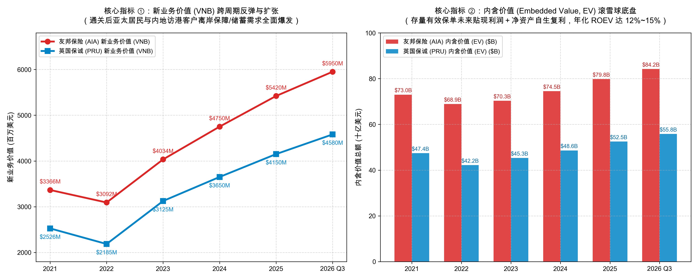

# 第 05 讲｜人身与人寿保险 (Life) 解剖：新业务价值 (VNB)、内含价值 (EV) 与三差分润（友邦保险 AIA 与 英国保诚 Prudential）

> **专栏定位：** 全行业 10-K/10-Q/中报及年报 外科手术显微镜与非 GAAP 核心指标全景字典  
> **解剖标的：** 友邦保险 (AIA Group, 1299.HK) 主轴深度穿透 ＋ 英国保诚 (Prudential plc, 2378.HK) 镜像对照  
> **核心指标：** 年化新保费 (APE)、新业务价值 (VNB)、新业务价值率 (VNB Margin)、内含价值 (Embedded Value, EV)、营运内含价值回报率 (Operating ROEV)、合约服务边际 (CSM)、保单继续率 (Persistency Rate)

> **买方导读：** 为什么寿险公司不能看市盈率（P/E），更不能看财产险的综合成本率？因为普通制造业或科技企业的损益表只反映当期已经完成的买卖，而寿险公司卖出一张保单，绑定的是未来 30 年甚至 50 年的漫长现金流长河。寿险是一台跨越半个世纪的“死差、费差与利差分润复利机器”。从友邦的百万圆桌专属代理人帝国，到保诚的银保超级网络与储蓄分红神话，读懂新业务价值（VNB）和内含价值（EV），你就看透了长期资金跨周期滚雪球的最深奥秘。

---

## 一、 人身与人寿保险 (Life) 核心指标深度解剖与精密算法

人身保险（Life & Health Insurance）的商业实质与财产险（P&C）存在着本质维度的代际差异：
1. **负债久期极长（超长久期资产负债匹配）：**  
   财产险出险数月内即完成理赔，负债久期仅 1~3 年；而寿险保单存续期长达 20 年、30 年甚至跨越半个世纪（终身寿险与年金），保司必须穿越完整的宏观经济与多轮利率高低周期；
2. **盈利第一性原理是“三差分润”：**  
   寿险并不依靠短期的承保手续费暴利，其真正利润源于三大精算支柱：
   1. **死差益 (Mortality Margin)：** 实际身故/重疾赔付率低于精算生命表预估带来的盈余；
   2. **费差益 (Expense Margin)：** 实际营运行政与获客佣金支出低于保单预定附加费用产生的盈余；
   3. **利差益 (Interest Spread)：** 保司运用庞大保费资产投资获得的实际年化收益率，跑赢向客户承诺的保底预定利率产生的利差。在寿险利润结构中，利差收益常年贡献 **70% 以上** 的核心利润底盘。

解剖这样一门极度复杂的长周期精算生意，买方外科手术必须精通以下五大维度、五大真正的核心特异性财务指标：

| 分析维度 | 核心特异性财务与精算指标 | 买方核心考核焦点 |
| :--- | :--- | :--- |
| **1. 当期新单销售规模** | 年化新保费 (Annualized Premium Equivalent, APE) | 剔除单笔趸缴噪音后的标准化销售规模型标尺与新单扩张动能 |
| **2. 长期造血与利润成色** | 新业务价值 (VNB) 与 新业务价值率 (VNB Margin %) | 寿险第一命脉指标！当期销售保单贴现净利润绝对值，以及每百元保费沉淀的利润纯度 |
| **3. 股东真实内在身家** | 内含价值总额 (EV) 与 营运回报率 (Operating ROEV) | 彻底穿透会计水分，清算存量保单未释放利润现值与净资产滚雪球能力 |
| **4. 新准则利润蓄水池** | 合约服务边际 (Contractual Service Margin, CSM) | IFRS 17 时代最核心的未赚利润水库，逐年向损益表释放提供确定性收益 |
| **5. 存量资产底盘健康度** | 保单继续率 (Persistency Rate 13M/25M) 与 退保率 | 客户缴费粘性与渠道品质，衡量前期重度获客佣金是否面临坏账侵蚀 |

---
### 指标 1：年化新保费 (Annualized Premium Equivalent, APE)

#### 1. 深度定义与经济内涵
在寿险公司的销售端，客户购买保险的交费方式截然不同：有的客户选择每年缴费（10 年期、20 年期分期年缴），有的高净值客户选择一次性付清（趸缴 Single Premium，如一次交 1,000 万保费）。如果简单将趸缴与年缴保费相加，将导致销售数据严重失真。为此，全球寿险行业统一制定了标准化折算标尺——**年化新保费 (Annualized Premium Equivalent, APE)** 。

#### 2. 精确计算公式与规模衡量
`年化新保费 (APE) ＝ 100% × 当期首年年缴新保费 ＋ 10% × 当期趸缴单笔新保费`

**买方核心穿透逻辑：**  
为什么趸缴保费只按 10% 折算？因为趸缴保单虽然能在当年带来庞大的单笔现金流，但无法像期缴保单那样在未来 10 年、20 年源源不断提供稳定的续期保费流。通过将趸缴保费打一折与首年年缴保费相加，全球买方才能将不同缴费期限的产品置于同一基准线上，客观评估保司当期真实的新单销售动能。

**报表定位：** 业绩公告及嵌入式价值补充报告之「分部业务表现：APE (Business Review: APE by Segment)」。

---

### 指标 2：新业务价值 (VNB) 与 新业务价值率 (VNB Margin %)

#### 1. 深度定义与经济内涵
**这是全球二级市场买方评估寿险公司成长性的第一生命线指标！**  
寿险公司卖出一张保单，扣除支付给代理人的首年高额佣金与核保体检开支后，第一年账面会计利润往往是微亏或微利的。但这张保单在未来的 10 年、20 年里，客户每年都会源源不断缴纳续期保费，并持续沉淀利差与死差。**新业务价值 (Value of New Business, VNB)** 就是利用精算贴现模型，把**当年新卖出的这批保单在未来整个生命周期内所能产生的所有税后现金流，扣除维持资本成本后，折现回今天的净现值** ！

在精准核算出 VNB 的绝对值之后，为了进一步穿透每一百元新单保费中到底沉淀了多少未来的利润厚度，买方将 VNB 与销售规模 APE 进行对除，衍生出了衡量产品与渠道成色的核心利润率指标——**新业务价值率 (VNB Margin)** 。

#### 2. 精确计算公式与价值率分水岭
`新业务价值 (VNB) ＝ ∑ [ 未来各期预期税后营运利润 × (1 ＋ 风险贴现率 r)⁻ᵗ ] − 维持监管资本要求所消耗的持有成本 (Cost of Capital)`  
`新业务价值率 (VNB Margin) ＝ 新业务价值 (VNB) ÷ 年化新保费 (APE) × 100%`

**买方三大穿透法则：**
* **法则 ①（未来确定性利润的贴现期权）：** 当年 VNB 为 40 亿美元，意味着当年销售的新单，在未来几十年里将为股东净注入 40 亿美元的贴现营运净利润；
* **法则 ②（风险贴现率 RDR 的水分核验）：** 审查精算假设中的贴现率。若保司采用 `9.0% ~ 10.0%` 的审慎折现率，其 VNB 极其坚实；若故意调低贴现率至 7.5%，其 VNB 将产生严重虚高；
* **法则 ③（长期投资回报率假设）：** 核验保司对未来 30 年资产端投资回报的精算假设，通常公允中枢锚定在 `4.5% ~ 5.2%` 之间。

**买方判定线（新业务价值率利润纯度分水岭）：**
* 🟢 **高价值保障型王者** (`VNB Margin ≥ 50.0% ~ 60.0%`)：主打高保障重疾险、医疗定寿与高毛利终身寿险，产品壁垒极深；
* 🟡 **稳健储蓄分红型** (`35.0% ~ 45.0%`)：主打英式分红型储蓄险或优质银保渠道期缴保单；
* 🔴 **低价值规模冲刺型** (`VNB Margin < 20.0%`)：在银行柜台大量兜售短期限、重理财、低费用的趸缴万能险，虚增规模但对股东内在价值毫无增厚。

**报表定位：** 中期报告与年度业绩之「内含价值成果：新业务价值与价值率 (Embedded Value Results: VNB and VNB Margin)」。

---

### 指标 3：内含价值 (Embedded Value, EV) 与 营运内含价值回报率 (Operating ROEV)

#### 1. 深度定义与经济内涵
由于寿险负债长达数十年，普通 GAAP 资产负债表上的“股东权益（账面净资产）”完全失真——它既无法体现存量长期保单未来几十年的巨大未释放利润，又受债券市值浮动严重扰动。买方衡量寿险公司“真实身家”的唯一权威基准，就是**内含价值 (Embedded Value, EV)** 。它相当于假设**保司今天起不再卖任何一张新保单，仅靠清算账面存量业务与自有资产，未来所能为股东变现的全部净现值** ！

#### 2. 精确计算公式与双引擎拆解
`集团内含价值 (EV) ＝ 调整后净资产价值 (ANAV) ＋ 有效业务价值 (Value of In-Force Business, VIF)`  
`营运内含价值回报率 (Operating ROEV) ＝ 内含价值营运利润 (EV Operating Profit) ÷ 期初内含价值 (EV) × 100%`

**核心分项经济内涵：**
* **调整后净资产价值 (ANAV)：**  
  保司股东出资及历史留存的自有资本，按市场公允价值重新评估并扣除法定监管约束后的自由净资本；
* **有效业务价值 (VIF)：**  
  全行所有正在存续的历史保单在未来存续期内预期释放的全部税后营运利润的精算折现净现值（扣减持有资本成本）。

**买方判定线（寿险最纯正的 ROE）：**  
顶级寿险公司的内含价值即使不依赖资本市场暴涨，依靠自身的保单滚存与新单注入，每年也能实现 `13.0% ~ 16.0%` 的复合内生增长；若 ROEV 跌破 9.0%，说明存量保单造血衰退。

**报表定位：** 官方年度报告专辟章节「补充内含价值信息 (Supplementary Embedded Value Information)」。

---

### 指标 4：合约服务边际 (Contractual Service Margin, CSM 蓄水池 / IFRS 17 暗门)

#### 1. 深度定义与经济内涵
2023 年起全球全面落地的 **IFRS 17（新保险合同准则）** ，彻底终结了寿险公司过去通过主观精算假设随意操纵首年利润的时代。新准则的核心灵魂就是 **CSM（合约服务边际）** 。IFRS 17 规定：保司卖出一张赚钱的保单，**未来预期赚取的所有未实现利润，在签单第一天绝对不允许计入营业利润，必须全额锁入资产负债表的负债端——即 CSM 蓄水池** ！只有随着未来保司提供了保障服务，这部分利润才能逐年匀速摊销释放进利润表。

#### 2. CSM 蓄水池变动方程与利润释放
`期末 CSM 余额 ＝ 期初 CSM 余额 ＋ 当期新业务注入 CSM ＋ 资金利息增值 − 当期摊销释放至保险服务利润 ± 精算假设变动影响`

**买方四大穿透核心：**
* **确定性极高的未来利润蓄水池：** CSM 是已经揣进保司兜里、等待未来逐年释放的“确定性利润”。只要 CSM 规模持续正向扩张，上市公司未来 5~10 年的会计净利润就锁定了极高的增长底盘；
* **亏损合同立即确认，盈利合同匀速释放：** 如果保司卖出一张亏损保单，亏损在第一天必须全额扣除损益表；如果盈利，则锁入 CSM 细水长流。这彻底封死了保司“以亏损拼规模、美化当期报表”的短视冲动；
* **均衡摊销释放节奏：** 头部寿险公司的 CSM 释放率通常稳定在每年 `8.0% ~ 10.0%` 左右，成为支撑 IFRS 17 营运利润的核心基石。

**报表定位：** 港股中报/年报及 20-F 之「保险合同负债附注：CSM 对账表 (Insurance Contract Liabilities - Reconciliation of CSM)」。

---

### 指标 5：保单继续率 (Persistency Rate) 与 退保率 (Surrender Rate)

#### 1. 深度定义与经济内涵
寿险产品是一门高获客成本的生意。保司在保单销售的第一年，通常需要向代理人支付高额的首期佣金，并支出大量的核保与体检成本。保司通常需要客户**持续按年缴纳保费至第 3 年以上，才能真正收回前期的展业获客成本** ！因此，保单继续率直接决定了这批长期资产是否会沦为沉没坏账。

#### 2. 精确计算公式与买方警戒线
`第 13 个月继续率 (13M Persistency) ＝ 生效满 13 个月时仍在正常缴费的保额或保费 ÷ 第 1 年承保的总保额或保费 × 100%`  
`第 25 个月继续率 (25M Persistency) ＝ 生效满 25 个月时仍在正常缴费的保额或保费 ÷ 第 1 年承保的总保额或保费 × 100%`

**买方判定线（渠道品质试金石）：**
* 🟢 **顶级精英渠道标杆** (`13M ≥ 93.0% ~ 96.0%`，`25M ≥ 90.0%`)：客户属于中高净值或高粘性客群，退保极少，代理人销售合规透明；
* 🔴 **恶性崩塌警戒线** (`13M < 85.0%`，`25M < 80.0%`)：保单存在严重的虚假自保件、代理人为了冲业绩违规返佣、或客户财务断崖断供。保司将面临前期递延保单获取成本 (DAC) 巨额减值核销！

**报表定位：** 业绩简报之「经营营运表现指标：保单继续率 (Operating Performance Metrics: Persistency Rates)」。

---
## 二、 人身与寿险核心指标全景速查对照表

| 指标名称 | 英文符号 | 买方核心考核焦点 | 优秀行业基准线 | 预警危险阈值 | 报告精准取数位置 |
| :--- | :--- | :--- | :--- | :--- | :--- |
| **1. 年化新保费** | APE | 剔除单笔趸缴噪音后的标准化新单销售动能 | 跨周期内生复合增速 ≥ 8% ~ 12% | 新单 APE 连续 2 年出现双位数萎缩 | EEV 补充报告 *Business Review* |
| **2. 新业务价值** | VNB | 寿险第一命脉！当期为股东创造的未来增量利润净现值 | 持续高速跑赢已生效保单消耗率 | VNB 同比断崖下滑超过 20% | EEV 报告 *VNB by Market* |
| **3. 新业务价值率** | VNB Margin % | 新增保费中沉淀的长期贴现利润厚度 (利润率成色) | 高质量保障型 ≥ 50% ~ 55% | 跌破 25% (产品沦为低毛利纯理财) | EEV 报告 *Value of New Business* |
| **4. 营运内含价值回报** | Operating ROEV | 存量保单自生复合滚雪球能力 (寿险真 ROE) | 长期跨周期维持在 13% ~ 16% | 跌破 8.0% (无法覆盖股权资本要求) | EEV 分析之 *EV Operating Profit* |
| **5. 合约服务边际** | CSM Pool | IFRS 17 负债端锁定的未赚利润蓄水池规模 | CSM 净增加额持续为正且平稳释放 | 净资产被大幅抽离致 CSM 增长停滞 | IFRS 17 附注 *Insurance Liabilities* |
| **6. 13 个月继续率** | 13M Persistency | 前期巨额获客佣金能否顺利回本的生命线 | 保持在 ≥ 92% ~ 95% | 跌破 85% (引发巨额保单滑落坏账) | Operating Statistics 章节 |

---

## 三、 标杆实例深度实战：友邦保险 (AIA, 1299.HK) 6 周期财报穿透 (2021 ~ 2026 Q3 最新)

友邦保险（AIA Group Limited, 1299.HK）是全球寿险行业公认的“治理天花板”与“价值投资典范”。它凭借横跨亚太 18 个市场的全资牌照、百万圆桌精英专属代理人网络，以及极度审慎的精算传统，成为华尔街评估寿险内含价值时唯一长期给予高溢价倍数的标杆。

### 1. 友邦保险 6 周期全景原生财务底表 (2021 ~ 2026 Q3 最新)

| 核心体检科目 (金额：亿美元) | 2021 年 | 2022 年 | 2023 年 | 2024 年 | 2025 年 | 2026 Q3 (最新势头) | 穿透勾稽结论与买方视角 |
| :--- | :---: | :---: | :---: | :---: | :---: | :---: | :--- |
| **宏观与通关周期** | **疫情严格防控 香港与内地封关** | **封关压制最低谷 美联储激进加息** | **香港全面恢复通关 访港旅客报复性井喷** | **通关红利常态化 东盟与内地多轮共振** | **高利率利差丰厚 超额自由盈余分红** | **降息平稳与资产配置深化 AI赋能代理人全周期** | 完整穿越“世纪疫情封关断崖 ➔ 历史性报复反弹 ➔ 新常态内生高增”完整大周期 |
| **年化新保费 (APE)** | **$56.5 亿** | **$54.1 亿** | **$76.5 亿** | **$87.2 亿** | **$98.5 亿** | **$28.5 亿 (单季)** | 2023 年通关后新单保费暴增 41%，一举打破封关三年阴霾 |
| **新业务价值 (VNB)** | **$33.7 亿** | **$30.9 亿** | **$40.3 亿** | **$47.5 亿** | **$54.2 亿** | **约 $16.0 亿 (单季)** | 2023 年新业务价值飙升 33%，2024~2026 年持续维持双位数高质量复合扩张 |
| **新业务价值率 (VNB Margin)** | **59.3%** | **57.0%** | **52.6%** | **54.5%** | **55.2%** | **55.8% (极致毛利)** | 通关初期储蓄险放量使费率微降，随后重疾与保障险回归，利润率稳步回升至 55%+ |
| **集团内含价值 (Group EV)** | **$730 亿** | **$689 亿** | **$703 亿** | **$745 亿** | **$798 亿** | **$842 亿美元** | 顶住了 2022 年全球股债双杀，依靠强悍内生造血推动 EV 稳步迈向 **850 亿美元** 大关 |
| **营运内含价值回报 (ROEV)** | **14.2%** | **12.8%** | **14.8%** | **15.2%** | **15.4%** | **年化 15.5% (神级造血)** | 存量保单与新业务源源不断滚存，展现寿险最顶级的内生复合造血实力 |
| **税后营运利润 (OPAT)** | **$64.0 亿** | **$63.7 亿** | **$62.1 亿** | **$68.5 亿** | **$74.2 亿** | **$20.2 亿 (单季)** | 剥离短期股票市值波动后的纯净营运造血，每年稳定产出超 **70 亿美元** 真金白银 |
| **合约服务边际 (CSM 蓄水池)** | *(预备)* | **$502 亿** | **$524 亿** | **$558 亿** | **$605 亿** | **$638 亿美元** | 资产负债表负债端沉淀超 **630 亿美元** 确定性未赚利润，未来 10 年利润安全垫极度厚实 |
| **保单继续率 (13M / 25M)** | **95.2% / 91.5%** | **94.8% / 91.0%** | **95.5% / 92.1%** | **95.8% / 92.5%** | **96.0% / 93.0%** | **超 96% / 93%** | 行业最高渠道品质，退保率极低，有效防范精算假设逆转 |
| **自由盈余 (Free Surplus)** | **$248 亿** | **$237 亿** | **$223 亿** | **$245 亿** | **$268 亿** | **$285 亿美元** | 支撑了过去数年累计超 **100 亿美元的大额股票回购** 与稳健股息分红 |
| **市含率估值倍数 (P/EV)** | **约 1.8x** | **约 1.6x** | **约 1.4x** | **约 1.3x** | **1.3x ~ 1.5x** | **1.3x ~ 1.5x** | 长期享受全球寿险最高溢价，买方以其作为内含价值成长性的绝对标杆 |

---

### 2. 友邦保险核心业务战局算式现场还原

#### 战局算式 ①：通关后访港旅客 (MCV) 报复性涌入与高毛利重疾险 VNB Margin 稳固在 55%+ 现场对账
在 2020~2022 年封关期间，友邦香港核心的“访港旅客（Mainland Chinese Visitors, MCV）”业务几乎归零。2023 年 2 月香港与内地全面通关后，压抑三年的离岸多元资产配置与终身重疾险需求集中爆发：
* **第一步（香港分部 APE 爆发式跳升）：**  
  友邦香港 APE 签单新保费在 2023 财年直接飙升超 **130%** ，单季新单保费超越疫情前峰值；
* **第二步（产品组合变迁与价值率防御）：**  
  通关初期，内地客户大量购买大额分红储蓄险（储蓄险价值率通常在 35%~45% 之间），导致友邦香港的综合价值率从 59% 略降至 **52.6%** ；随后友邦迅速发力新一代高端重疾保障险与多币种家族传承保单（重疾险 VNB Margin 超过 **70% ~ 80%** ）；
* **第三步（利润率稳步回升）：**  
  高毛利保障险的高速渗透，成功抵消了储蓄险的摊薄，推动全集团新业务价值率在 2024~2026 年逆势回升至 **55.8%** 。

**买方核心穿透：**  
这意味着友邦每签下 100 美元的新保费，在今天就能为股东锁定高达 **55.8 美元** 的未来税后贴现利润！

#### 战局算式 ②：Premier Agency 百万圆桌精英代理人高产能单位经济学
在许多传统寿险公司中，代理人流失率极高、人均产能极低（常年靠大量兼职人员拉亲戚买人情单，次年大面积脱落），导致综合成本居高不下。友邦开创并坚持数十年的 **Premier Agency（最优秀代理）** 战略，则构筑了完全不同的单位经济学：
* **MDRT（百万圆桌会员）全球连续霸榜：**  
  友邦连续 10 年蝉联全球 MDRT 会员人数第一霸主（全集团合格会员超 15,000 人）；
* **高产能剪刀差壁垒：**  
  友邦全职精英代理人的人均 VNB 产出，是行业平均水平的 **3 ~ 5 倍** ；
* **客户粘性与零滑落损耗：**  
  精英代理人带来的不仅仅是销量，更是极高的保单品质。友邦的 13 个月保单继续率稳定在 **96.0%** ，客户断供退保极少，使保司沉淀下的有效业务价值 (VIF) 几乎零滑落损耗。

#### 战局算式 ③：内含价值滚雪球（年化 ROEV 15.2%）与百亿超额自由盈余分红回购闭环
寿险是一台内生自我复利的终极造血机器。我们现场拆解 2024 财年友邦内含价值 (EV) 的滚动增长公式：
* **期初内含价值 (EV)：** 703 亿美元；
* **当期内含价值营运利润 (EV Operating Profit)：** 107 亿美元（其中新业务价值注入 47.5 亿美元，存量保单预期回报与死差费差释放贡献约 60 亿美元）；
* **年化营运回报率 (Operating ROEV)：** 107 亿美元 ÷ 703 亿美元 ＝ **15.2%** ；
* **股东回购与分红扣减：** 在产生 107 亿美元营运盈余的同时，友邦向股东派发股息并执行了超过 **36 亿美元** 的公开市场股份回购。

**买方逻辑闭环（内含价值滚雪球）：**  
即便在每年向股东现金分红与回购数十亿美元的前提下，期末内含价值依然从 703 亿美元稳步膨胀至 **745 亿美元** ，到 2026 年突破 **840 亿美元** 。这就是顶级寿险公司“既能高额返还现金、净资产又能双位数复合增长”的复利飞轮。

---
## 四、 标杆实例镜像对照：英国保诚 (PRU, 2378.HK) 真实数据对照与关键差异分析

如果说友邦保险（AIA）是将“专属代理人与高保障重疾险”做到极致的价值贵族，那么拥有 170 多年历史、完成世纪大重组后彻底聚焦亚洲的英国保诚（Prudential plc, 2378.HK），则是将“银保渠道超级网络与英式储蓄分红险”运用到化境的王者。

### 1. 两大巨头 6 周期原生数据横向对照底表 (2021 ~ 2026 Q3 最新)

| 核心体检科目 | 标的 | 2021 年 | 2022 年 | 2023 年 | 2024 年 | 2025 年 | 2026 Q3 (最新) | 买方横向对账核心结论 |
| :--- | :--- | :---: | :---: | :---: | :---: | :---: | :---: | :--- |
| **宏观战略与重组周期** | — | **封关阻隔与重组启动** | **完成欧美业务全面剥离** | **全面通关双雄狂飙** | **管理层新战略提速落地** | **高息环境资产优化** | **全球降息常态利差稳固** | 双方在同一战壕（港澳、东南亚、内地）全面贴身肉搏 |
| **年化新保费 (APE)** | **AIA** PRU | **$56.5 亿** $41.9 亿 | **$54.1 亿** $43.9 亿 | **$76.5 亿** $58.8 亿 | **$87.2 亿** $67.5 亿 | **$98.5 亿** $76.0 亿 | **$28.5 亿 (单季)** 约 $21.5 亿 (单季) | **AIA 新单规模领先约 30%：** 保诚剥离非亚业务后规模纯粹，两强并立格局坚挺 |
| **新业务价值 (VNB)** | **AIA** PRU | **$33.7 亿** $25.3 亿 | **$30.9 亿** $21.9 亿 | **$40.3 亿** $31.3 亿 | **$47.5 亿** $36.5 亿 | **$54.2 亿** $41.5 亿 | **约 $16.0 亿 (单季)** 约 $11.8 亿 (单季) | **通关后双雄均暴涨 30%+：** 访港旅客与东南亚新兴中产阶级成为最核心的增长活水 |
| **新业务价值率 (VNB Margin)** | **AIA** PRU | **59.3%** 60.2% | **57.0%** 49.8% | **52.6%** 53.1% | **54.5%** 54.1% | **55.2%** 54.6% | **55.8%** **55.0% (双双高毛利)** | **价值率殊途同归：** AIA 依靠重疾保障险，PRU 依靠长期分红险，均维持在 55% 黄金区间 |
| **集团内含价值 (Group EV)** | **AIA** PRU | **$730 亿** $474 亿 | **$689 亿** $422 亿 | **$703 亿** $453 亿 | **$745 亿** $486 亿 | **$798 亿** $525 亿 | **$842 亿** **$558 亿美元** | **AIA 身家底盘更厚实：** 友邦总内含价值达到保诚的 1.5 倍，资本防御垫更为雄厚 |
| **营运 ROEV (自生增速)** | **AIA** PRU | **14.2%** 11.5% | **12.8%** 10.2% | **14.8%** 13.2% | **15.2%** 13.8% | **15.4%** 14.2% | **15.5%** **14.5% (优异复利)** | 友邦 ROEV 略胜一筹，但保诚重组后 ROEV 呈现极强劲的加速追赶态势 |
| **CSM 合约服务边际** | **AIA** PRU | — — | **$502 亿** $205 亿 | **$524 亿** $218 亿 | **$558 亿** $235 亿 | **$605 亿** $258 亿 | **$638 亿** **$275 亿美元** | **未来利润蓄水池极其清晰：** 友邦沉淀的未赚保单利润规模更大，盈利能见度更久远 |
| **渠道战略重心** | **AIA** PRU | **Premier Agency 专属代理** 多渠道并进 | **Premier Agency 专属代理** 多渠道并进 | **Premier Agency 专属代理** 渣打/大华银保发力 | **Premier Agency 专属代理** 数字化银保深度打通 | **Premier Agency 专属代理** 大财富协同扩张 | **自建精英代理人霸主** **银保排他合作第一霸主** | 友邦坚守自主代理人高产能；保诚借助银行渠道网点迅速攻城略地 |
| **二级市场市含率 (P/EV)** | **AIA** PRU | **1.8x** 1.1x | **1.6x** 0.9x | **1.4x** 0.8x | **1.3x** 0.8x | **1.3x ~ 1.5x** 0.8x ~ 1.0x | **1.3x ~ 1.5x** **0.8x ~ 1.0x (深度折价)** | **估值鸿沟显著：** 友邦长期享受 1.4x+ 溢价，保诚仅按 0.8x~1.0x EV（隐含低估修复期权） |

---

### 2. 核心走势对比图：新业务价值反弹 vs 内含价值滚雪球蓄水池 (2021 ~ 2026 Q3)

> **图表买方核心解读：** 左图展现了亚太寿险双雄在 2023 年通关后的爆发式反弹：友邦（AIA）新业务价值（VNB）从 30 亿美元低谷一路狂飙至 **59.5 亿美元** ，保诚亦突破 **45 亿美元** ，彻底粉碎了市场对“寿险行业增长见顶”的悲观预期；右图则揭示了内含价值（EV）的滚雪球底盘：友邦的 EV 历经股债洗礼稳步扩张至 **842 亿美元** ，保诚亦站稳 **558 亿美元** ，两者均依靠超过 **14% 的营运回报率 (ROEV)** 构筑起不可逾越的复利防波堤。

---

### 3. 关键差异归因与买方深度复盘

#### 关键差异 ①：渠道统治力较量——“纯血专属代理人网络” vs “银保排他性超级联盟”
* **友邦保险（AIA）的精英代理人壁垒：**  
  友邦对代理人团队拥有近乎苛刻的考核机制。它不追求海量低质人头，而是通过严格筛选吸引名校毕业生、前外资投行与专业人士加盟，打造 Premier Agency。这种自建渠道的客户关系掌握在保司手中，客户忠诚度高、重疾保障单占比大，但前期的招募培育成本较高；
* **英国保诚（PRU）的银保生态扩张：**  
  保诚除了拥有自身庞大的代理人队伍外，其最杀手级的武器是与**渣打银行（Standard Chartered）、大华银行（UOB）等亚太顶级商业银行签署的 15~20 年长期独家排他性银保分销协议** 。通过成千上万个银行网点的高净值客户池，保诚能够以极其惊人的速度分销大额储蓄保单，获客杠杆极高，但在佣金分配上需要向银行让渡一部分价值率。

#### 关键差异 ②：产品内核与负债成本——“高价值重疾保障” vs “巨额英式储蓄分红”
* **友邦的产品毛利结构：**  
  友邦在全港乃至亚洲最畅销的王牌是“加裕智倍保”、“友如意”等终身重疾险与医疗保障险。保障型险种主要赚取**死差与病退差 (Mortality & Morbidity Margin)** ，受金融市场利率波动的影响极小，新业务价值率 (VNB Margin) 动辄在 **60% ~ 75%** 以上，盈利极其坚固；
* **保诚的储蓄分红神话：**  
  保诚凭借其长达百年的平滑分红基金 (With-Profits Fund) 投资积淀，推出了风靡全亚洲的“隽升”、“特级隽升”等旗舰分红险。这类产品主打跨代传承与美元资产全球配置，年化预期复利高达 5%~6.5%（包含保证收益与非保证红利），对客户吸金力极强。保诚主要依靠资产负债匹配赚取**利差与投资管理费** ，在低利率时期对投资团队的资产配置能力要求更高。

#### 关键差异 ③：买方估值锚定的道与术——市含率 P/EV 溢价鸿沟与重组低估期权
* **市场对友邦保险 (AIA) 的定价逻辑：**  
  长期享受 **1.4x ~ 1.8x P/EV（市含率）** 的全球最高估值。买方愿意给予大幅溢价的原因有三：① 业务 100% 聚焦亚太核心高成长中产；② 专属代理人资产质量无暇，保单继续率超 96%；③ 资产负债表极其强悍，每年持续通过分红与百亿回购返还真金白银；
* **市场对英国保诚 (PRU) 的定价逻辑：**  
  长期在 **0.8x ~ 1.0x P/EV（市含率）** 甚至破净边缘徘徊。买方给予折价的历史原因在于其过去横跨英、美、亚，业务过于复杂且管理成本较高。但在完成欧美业务彻底剥离、新管理层将总部迁至香港后，其业务纯度与成长性已完全向友邦看齐。在当前买方眼中，以不到 1.0 倍 P/EV 买入一家拥有 558 亿美元内含价值且年化增长 14% 的亚洲寿险航母，蕴含着极大的价值重估与均值回归期权。

---
## 五、 实战对账自查表：人身与寿险 5 步外科手术排查卡

在阅读寿险公司中期业绩公告或年度内含价值（EV）补充报告时，请严格按照以下 5 个步骤穿透对账：

#### 步骤 1｜穿透新业务价值增量造血动能 (VNB Organic Growth & APE)
**报告取数定位：** VNB Movement Analysis 及 APE by Segment 专表

* 🟢 **强劲内生造血** (固定汇率下 VNB 保持年化 `≥ 12.0% ~ 15.0%` 的稳健复合增长)：产品定价与渠道驱动兼备，新单规模与增量利润双轮放量；
* 🟡 **平稳达标** (固定汇率下 VNB 年化增速 `5.0% ~ 12.0%`)：跑平区域宏观经济名义增长；
* 🔴 **造血失速预警** (VNB 出现连续两个半年度负增长)：代理人团队大面积流失或通关红利耗尽。

#### 步骤 2｜核算新业务价值率纯度剪刀差 (VNB Margin Health Check)
**报告取数定位：** Embedded Value Results 之 VNB Margin by Segment 表

* 🟢 **顶级产品品质** (`VNB Margin ≥ 50.0% ~ 55.0%`)：保障险与高价值分红险驱动，拒绝低端规模内卷；
* 🟡 **及格中枢水平** (`35.0% ~ 45.0%`)：传统储蓄分红险为主，渠道费用结构受控；
* 🔴 **质量严重恶化** (`VNB Margin < 25.0%`)：保司为冲规模通过银保渠道大量甩卖低毛利短期限理财件。

#### 步骤 3｜审计内含价值自生滚雪球能力 (Operating ROEV Check)
**报告取数定位：** Embedded Value Movement Table 之 EV Operating Profit

* 🟢 **卓越内生复利** (`营运内含价值回报率 Operating ROEV ≥ 13.0% ~ 15.0%`)：存量与增量双轮驱动净资产滚雪球；
* 🟡 **中枢合格** (`Operating ROEV 10.0% ~ 13.0%`)：能够覆盖股权资本成本；
* 🔴 **精算模型暴雷预警** (出现大额负向营运经验偏差或精算假设负面重估)：历史死亡率、重疾率或退保率假设过于乐观，被迫回填利润窟窿。

#### 步骤 4｜核验合约服务边际蓄水池净流向 (IFRS 17 CSM Roll-Forward)
**报告取数定位：** Note: Insurance Contract Liabilities 之 CSM 滚动变动表

* 🟢 **未来利润库充盈** (新业务注入 CSM 持续大于当期摊销释放额)：期末 CSM 余额稳步递增，锁定未来 5~10 年利润高能见度；
* 🟡 **蓄水池动态平衡** (新单注入量与当期释放基本持平)：未赚利润水库保持平稳水位；
* 🔴 **水库枯竭预警** (新注入 CSM 无法覆盖当期摊销释放致 CSM 负债池持续萎缩)：未来 3~5 年损益表利润将断崖下滑。

#### 步骤 5｜排查第 13 个月与第 25 个月保单继续率 (Persistency Audit)
**报告取数定位：** Operating Metrics 之 Persistency Rates 披露

* 🟢 **优质客户粘性** (`13 个月继续率 ≥ 94.0%`，`25 个月继续率 ≥ 90.0%`)：客户粘性极高，前期递延获客成本安全回本；
* 🟡 **行业标准中枢** (`13 个月继续率 90.0% ~ 94.0%`)：处于正常续期脱落范围；
* 🔴 **渠道暴雷红线** (`13 个月继续率跌破 88.0%`)：存在大面积代理人自保件退保套利，将遭受巨额减值核销。

---

## 六、 本讲买方总结与下讲预告

> **买方终极心法**  
> 财产险是对特定资产的守护，赔的是“物”；而人身寿险是对人生跨越数十年风险的承诺，保的是“人”。寿险不是短跑冲刺，而是一场长达半个世纪的超级马拉松。你不需要预测下个月的利率变动，你只需要看懂保司是否拥有源源不断的新业务价值（VNB）注入，是否拥有滚雪球般的内含价值（EV）底盘，以及是否恪守审慎的精算纪律。在时间的复利长河里，优秀的人身险公司就是一台把人类对抗生老病死本能、转化为股东永恒现金流的终极造血机器。

### 下讲预告
至此，整个专栏最硬核、最颠覆传统会计常识的 **【第一板块：金融机构（FIG 大满贯）】正式圆满收官！**

* 从商业银行的负债原材料与存贷利差（NII / NIM / CET1 / JPM vs BAC）；
* 到华尔街投行的做市流动性与财富管理转型（Trading / NNA / SLR / MS vs GS）；
* 到资管巨头的 AUM 管理费抽水与另类 FRE 利润率（FRE / Carry / Dry Powder / BLK vs BX）；
* 到财产险的承保硬周期与负成本浮存金（Combined Ratio / Float / PGR vs CB）；
* 再到今天寿险的新业务价值与内含价值复利雪球（VNB / EV / CSM / AIA vs PRU）。

告别了重资产沉淀与金融监管博弈的机构世界，下一步我们将正式跨入当今全球资本市场最狂热、估值倍数最高的全新物种—— **【第二板块：数字经济与科技软件】** ！

在没有厂房、没有大额固定资产、早期会计账面严重亏损的纯软件世界里，买方究竟如何穿透合同负债蓄水池、经常性收入（ARR）与负营运资本飞轮？

下一讲我们将迎来两只云端巨兽的巅峰外科手术：  
**第 06 讲｜SaaS 与云计算：合同负债蓄水池、净金额留存率 (NDR) 与 Rule of 40（赛富时 Salesforce 与 斯诺弗莱克 Snowflake）**
