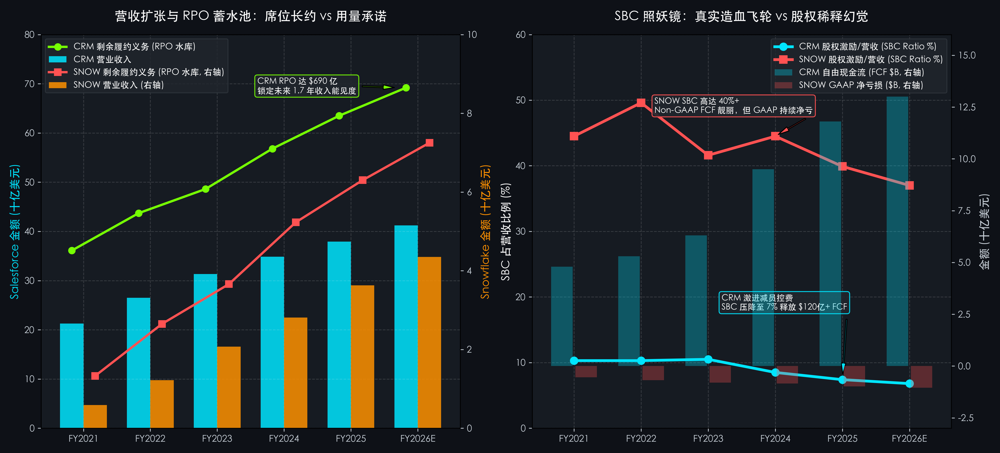

# 第 06 讲｜SaaS 与云计算深度体检：合同负债蓄水池、留存率与 CAC 回收期（赛富时 CRM 与 Snowflake 斯诺弗莱克）

> **专栏定位：** 全行业 10-K/10-Q 外科手术显微镜与非 GAAP 核心指标全景字典  
> **解剖标的：** 赛富时 (Salesforce, CRM.US) 主轴深度穿透 ＋ 斯诺弗莱克 (Snowflake, SNOW.US) 镜像对照  
> **核心指标：** 年经常性收入 (ARR/MRR)、净金额留存率 (NDR/NRR)、现时剩余履约义务 (cRPO)、合同负债 (Deferred Revenue)、40 法则 (Rule of 40)、CAC 回收期 (CAC Payback)、SBC 股权稀释率与真自由现金流

> **买方导读：** 为什么科技软件公司的市盈率（P/E）经常高达上百倍甚至为负，但顶级对冲基金却依然敢重仓？因为在 SaaS 和现代云生态中，损益表是极度“滞后”且充满会计扭曲的——当期高昂的销售获客支出在第一天全额扣除，而客户锁定的 3~5 年软件租金却被死死压在资产负债表的“递延收入与 RPO 蓄水池”中细水长流。从 Salesforce 凭借坐席制与激进变革实现 120 亿美元真实 FCF 蜕变，到 Snowflake 用量制神话下的超高 NDR 与 SBC 股权稀释照妖镜，读懂这套特异性指标，你才能在繁杂的科技股迷雾中真正看清“高估值下的真实印钞机”与“烧钱粉饰的纸面富贵”。

---

## 一、 SaaS 与云计算核心指标深度解剖与精密算法

传统工业或消费品公司的买卖逻辑极其直观：造出一台设备或卖出一瓶饮料，货款到账，扣除生产成本与营销费用，当期确认营业收入与利润。但这套工业时代的通用会计准则，在面对企业级软件（Enterprise Cloud & SaaS）时彻底失灵：
1. **前期高昂获客成本（CAC）在第 1 天一次性全额费用化：**  
   保罗万象的销售佣金、工程师实施支持与市场活动开支，在签单当季全额砸入损益表的销售与营销费用 (S&M)，导致新客户越多、当期账面亏损越严重；
2. **客户长约预付现金被锁在资产负债表：**  
   客户预付的 1~3 年订阅费用，按照 ASC 606 收入准则，绝对不允许直接计入当期收入，必须首先作为“负债”沉淀在资产负债表的**合同负债 (Deferred Revenue)** 中，只有随着时间推移每月按比例摊销确认；
3. **盈利第一性原理是“负营运资本与复利飞轮”：**  
   优秀的 SaaS 公司拥有类似保险公司的“负营运资本（先收钱、后履约）”，客户只要不流失，后续几乎不需要二次获客成本即可源源不断贡献极高毛利（80%+）的续费现金流。

解剖这样一门极具会计滞后性与复利杠杆的生意，买方外科手术必须精通以下五大维度、六大真正的核心特异性财务指标：

| 分析维度 | 核心特异性财务与运营指标 | 买方核心考核焦点 |
| :--- | :--- | :--- |
| **1. 经常性收入底盘** | 年经常性收入 (ARR) 与 月经常性收入 (MRR) | 剥离一次性实施与硬件杂音后的纯净年化订阅收入动力源 |
| **2. 存量客户裂变动能** | 净金额留存率 (Net Dollar Retention, NDR / NRR) | SaaS 版同店增长！同一批老客户在扣除流失后每年多掏了多少钱 |
| **3. 确定性未来收入池** | 剩余履约义务 (RPO) 与 现时剩余履约义务 (cRPO) | 已经白纸黑字签下合同但尚未确认收入的未来金矿，未来 12 个月业绩锚 |
| **4. 增长与造血平衡尺** | 40 法则 (Rule of 40) 与 获客成本回收期 (CAC Payback) | 收入增速与自由现金流利润率之和，以及每一块钱销售支出几个月能回本 |
| **5. 真实造血挤水暗门** | SBC 股权激励稀释率 与 扣除 SBC 的真实自由现金流 | 彻底剔除高管股票薪酬水分，识破“Non-GAAP 虚假暴利、GAAP 巨亏”幻象 |

---
### 指标 1：年经常性收入 (Annual Recurring Revenue, ARR) 与 订阅/用量计量模型

#### 1. 深度定义与经济内涵
**这是全球二级市场买方评估 SaaS 企业经常性造血规模的第一基准指标！**  
在传统的 GAAP 报表中，营业收入（Revenue）是一个混合体：它既包含了客户每年稳定续期的核心软件租金，又包含了不可持续的一次性实施咨询费（Professional Services）甚至硬件转售收入。买方为了剥离这些一次性杂质，精准提炼出软件企业在期末时点上、未来 12 个月内**只要客户不退订就能自动进账的纯净订阅收入**，这就是 **年经常性收入 (ARR)** 。

#### 2. 精确计算公式与两大计量模型代际差异
`年经常性收入 (ARR) ＝ 当期末正常存续的订阅合同月经常性收入 (MRR) × 12`  
`或者：ARR ＝ 期初 ARR ＋ 新增客户 ARR (New) ＋ 老客增购扩容 ARR (Expansion) − 老客降配流失 ARR (Contraction & Churn)`

**买方核心穿透：两大计费模式的商业代际差异**
1. **坐席订阅制 (Seat-Based Subscription Model，以 Salesforce 为代表)：**  
   客户按照使用软件的员工账号人头（如每名销售代表每月 150 美元）预付一年或三年的固定租金。收入极其稳定、现金流极其可预测，但天花板受制于客户员工总人数；
2. **用量消耗制 (Consumption / Usage-Based Model，以 Snowflake 为代表)：**  
   不按人头收费，而是按客户实际执行的云端计算任务、数据查询量和存储算力（Compute Credits）实际消耗扣费。客户充值购买预付费点数，随用随扣。这种模式在业务爆发期增长极快，但在宏观逆风时客户能瞬间削减查询用量（云优化），导致收入波动剧烈。

**报表定位：** 业绩简报及投资者展示之「主要运营指标：ARR / Subscription Revenue (Key Business Metrics: ARR)」。

---

### 指标 2：净金额留存率 (Net Dollar Retention Rate, NDR / NRR)

#### 1. 深度定义与经济内涵
如果说 ARR 衡量的是 SaaS 公司的“大盘体量”，那么 **净金额留存率 (NDR / NRR)** 则是衡量其“**产品黏性与护城河深浅的终极试金石**”！  
NDR 的底层逻辑相当于零售行业的“同店销售增长率 (Same-Store Sales Growth)”。它追踪的是：**假设公司从今天起不再招揽任何一个新客户，仅仅依靠一年前获取的那批老客户，在经历了一整年的加购升级、降配削减和彻底流失之后，这批老客户今天为公司贡献的 ARR 相当于一年前的百分之多少？**

#### 2. 精确计算公式与买方判定线
`净金额留存率 (NDR %) ＝ (期初同批老客户在当期末贡献的 ARR ＋ 增购扩容 ARR − 降配缩减 ARR − 彻底流失 ARR) ÷ 期初同批客户 ARR × 100%`

**买方判定线（留存率分水岭）：**
* 🟢 **神级扩张型极品** (`NDR ≥ 130.0% ~ 150.0%`)：产品自带极其强悍的内生网络扩张能力，老客户随着数据量暴增自然增购，即使销售团队完全躺平，总收入每年也能自生增长 30%~50%；
* 🟡 **健康企业级基准** (`110.0% ~ 125.0%`)：优质 Enterprise B2B 软件中枢，老客增购能够稳稳覆盖自然流失；
* 🔴 **恶性失血警戒线** (`NDR < 100.0%`)：老客正在用脚投票，软件被竞品替代或客户因裁员退订。企业陷入“只能不断靠昂贵的新客销售填补流失窟窿”的致命漏斗！

**报表定位：** 10-K 及 10-Q 之「管理层讨论与分析：关键业务指标 (MD&A - Key Business Metrics: Net Expansion / Retention Rate)」。

---

### 指标 3：剩余履约义务 (RPO / cRPO) 与 资产负债表合同负债 (Deferred Revenue 蓄水池)

#### 1. 深度定义与经济内涵
在科技股投资中，买方分析师为什么极少紧盯当期的 GAAP 净利润，而总是把眼睛死死盯在 **RPO（剩余履约义务）** 上？  
因为 RPO 是 SaaS 商业模式中最神奇的“**未来收入水库**”。当 Salesforce 或 Snowflake 与跨国大企业签署了一份为期 3 年、总额 3,000 万美元的合同时，无论客户先付了 1,000 万还是没付现金，根据合同法与 ASC 606 准则，这 3,000 万美元未来履约现金流就已经在法律层面上锁定了！

#### 2. 精确计算公式与双层解构
`总剩余履约义务 (Total RPO) ＝ 资产负债表已开票未确认合同负债 (Deferred Revenue) ＋ 尚未开票但合同已约定的未来履约承诺 (Unbilled Backlog)`  
`现时剩余履约义务 (cRPO, Current RPO) ＝ 总 RPO 中预计将在未来 12 个月内确认转化为营业收入的部分`

**买方三大穿透法则：**
* **法则 ①（业绩高确定性锚）：** cRPO 是上市公司未来 12 个月收入的“绝对底盘”。若一家公司未来一年的预期营收为 400 亿美元，而当期末的 cRPO 已高达 300 亿美元，意味着其 75% 的年收入已经被装进保险柜，业绩暴雷概率极低；
* **法则 ②（先收后付的零息负债）：** 合同负债（Deferred Revenue）是客户无偿预付给软件企业的营运资金，企业不仅不付利息，还能将这笔海量现金沉淀在账上购买国债赚取高额利息（SaaS 的隐性浮存金）；
* **法则 ③（RPO 增速与营收增速的剪刀差）：** 如果 cRPO 同比增速连续 2 个季度明显跌破营业收入增速，说明在手大单水库正在枯竭，未来 2~4 个季度营收增速必将出现断崖式失速！

**报表定位：** 10-K 财务报表附注之「收入确认与剩余履约义务附注 (Note: Revenue Recognition - Remaining Performance Obligations)」。

---

### 指标 4：40 法则 (Rule of 40) 与 获客成本回收期 (CAC Payback Months)

#### 1. 深度定义与经济内涵
成长期 SaaS 公司到底应该优先追求高增长、还是优先追求高利润？华尔街传奇风险投资家与对冲基金共同确立了著名的 **40 法则 (Rule of 40)** 。它的哲学本质是：**只要你的增长足够迅猛，暂时亏损是可接受的；但一旦增长放缓，你就必须释放出同等量级的真金白银现金流！** 与此同时，买方利用 **CAC 回收期** 衡量销售团队的单兵作战效率——每一块钱销售支出，到底几个月才能回本？

#### 2. 精确计算公式与销售魔数
`40 法则得分 ＝ 营业收入同比增速 (%) ＋ 自由现金流利润率 (FCF Margin %)`  
`获客成本回收期 (CAC Payback Months) ＝ 上季度销售与营销费用 (S&M) ÷ (当季新增 ARR × 综合软件毛利率 Gross Margin %) × 12`  
`软件销售魔数 (Magic Number) ＝ (当季营收 − 上季营收) × 4 ÷ 上季度销售与营销费用 (S&M)`

**买方判定线（增长与造血的黄金天平）：**
* 🟢 **顶级长跑冠军** (`Rule of 40 得分 ≥ 40.0% ~ 50.0%`，`CAC 回收期 < 12 个月`)：无论是“30% 增速 ＋ 20% FCF”，还是“10% 增速 ＋ 35% FCF”，均代表极其平衡健康的资本效率；
* 🟡 **中枢平庸线** (`Rule of 40 得分 25.0% ~ 39.0%`，`CAC 回收期 12 ~ 24 个月`)：增长与造血存在短板，获客开支较为沉重；
* 🔴 **价值毁灭陷阱** (`Rule of 40 得分 < 20.0%`，`CAC 回收期 > 36 个月`)：依靠高额销售返点强行买量，每一笔新增 ARR 带来的毛利都无法覆盖营销吞噬，典型的烧钱机器。

**报表定位：** 非 GAAP 经营业绩指标及分部损益附注。

---

### 指标 5：SBC 股权激励稀释率 与 扣除 SBC 的真实自由现金流 (SBC Dilution & True FCF)

#### 1. 深度定义与经济内涵
**这是二级市场买方对冲基金在审视科技软件股时最核心的“排雷外科手术”！**  
在硅谷科技公司中，管理层和销售大军通常获得海量的限制性股票单元（RSU）。在 GAAP 会计准则下，**股权激励费用 (Stock-Based Compensation, SBC)** 属于非现金支出，因此在计算现金流量表中的“营运现金流 (CFO)”和“自由现金流 (FCF ＝ CFO − CapEx)”时，**SBC 会被 100% 作为非现金项目加回** ！

这就导致了一个巨大的虚假繁荣：一家公司声称自己拥有 30% 的极高自由现金流率，但实际上这些现金流完全是用“海量印发股票、疯狂稀释老股东股权”换来的！

#### 2. 精确计算公式与真伪造血对账
`SBC 占营收比例 (SBC Ratio %) ＝ 当期股权激励总额 (SBC) ÷ 当期营业收入 × 100%`  
`老股东实际承担的真实自由现金流 (True FCF) ＝ 报告自由现金流 (FCF) − 当期股权激励费用 (SBC)`  
`真实每股自由现金流稀释率 ＝ 年末总摊薄加权股数 (Diluted Shares) ÷ 年初总股数 − 1`

**买方三大穿透法则：**
* **法则 ①（看透 Non-GAAP 虚火）：** 绝不单纯看公司自愿披露的“Adjusted FCF”或“Non-GAAP Operating Margin”。如果一家公司的 SBC 占营收比超过 25%~30%，其漂亮的自由现金流本质上是由老股东的股权稀释在买单；
* **法则 ②（对冲式回购成本）：** 科技公司为了防止股权被无限稀释，每年被迫动用数十亿美元在二级市场回购股票。如果一年的股票回购金额仅仅刚好抵消当年的 RSU 授予，这笔回购本质上就是**隐性的员工薪酬现金支出**，必须从可分配利润中全额扣除！
* **法则 ③（成熟期分水岭）：** 顶级的成熟 SaaS 巨头（如转型后的 Salesforce）能将 SBC 占收入比压降至 **8% 以下** ，实现纯正的 GAAP 净利润大爆发；而早期的成长型公司常年维持在 **30%~45%** 以上，必须对其估值给予大幅去水分折价。

**报表定位：** 现金流量表第一项「来自经营活动之现金流量：股票基础报酬加回 (Stock-based compensation expense)」。

---

## 二、 SaaS 与云计算核心特异性指标全景速查对照表

| 指标名称 | 英文符号 | 买方核心考核焦点 | 优秀行业基准线 | 预警危险阈值 | 报告精准取数位置 |
| :--- | :--- | :--- | :--- | :--- | :--- |
| **1. 年经常性收入** | ARR | 剥离一次性工程与硬件杂音后的纯净订阅规模 | 纯净订阅占比 ≥ 85% ~ 90% | 订阅占比跌破 70% (沦为外包商) | Key Business Metrics 章节 |
| **2. 净金额留存率** | NDR / NRR | 存量老客户扣除流失后的同店内生扩张倍数 | 企业级标杆 ≥ 120% ~ 130% | 跌破 100% (老客户持续失血净萎缩) | 10-K 之 MD&A 专章 |
| **3. 现时剩余履约义务** | cRPO | 锁入保险柜、未来 12 个月确定转化的收入底牌 | 同比增速跑赢或持平当期营收增速 | cRPO 连续 2 季增速落后营收 5 个百分点 | Note: Revenue Recognition |
| **4. 40 法则得分** | Rule of 40 | 营收增速与自由现金流利润率的动态平衡天平 | 综合得分稳定 ≥ 40.0% ~ 45.0% | 得分连续跌破 25% (增长失速且无造血) | Non-GAAP Financial Measures |
| **5. 获客成本回收期** | CAC Payback | 销售与营销费用砸下去后需要几个月回本 | 企业级客户 < 12 ~ 15 个月 | 超过 30 ~ 36 个月 (销售团队效率低下) | S&M 费用与新增 ARR 对除推算 |
| **6. 股权激励占营收比** | SBC Ratio % | 员工股权稀释对老股东真实权益的侵蚀程度 | 成熟期 ≤ 8% ~ 10%，成长期 ≤ 20% | 超过 35% ~ 45% (掩盖真实巨亏假象) | Cash Flow Statement 之 CFO 项 |

---

## 三、 标杆实例深度实战：赛富时 (Salesforce, CRM) 6 周期财报穿透 (FY2021 ~ FY2026E 最新)

赛富时（Salesforce, Inc., CRM.US）是全球现代 SaaS 商业模式的奠基者与终极霸主。它开创了“No Software”的席位订阅先河，将企业客户管理（CRM）做成了全球超 400 亿美元营收的参天大树。更重要的是，Salesforce 完整走过了从“激进并购与宽松开支”到“激进激进投资者逼宫、精细化控费压降 SBC、释放百亿真实 FCF 现金流”的成熟期经典蜕变。

### 1. 赛富时 6 周期全景原生财务底表 (FY2021 ~ FY2026E 最新)

| 核心体检科目 (金额：亿美元) | FY2021 | FY2022 | FY2023 | FY2024 | FY2025 | FY2026E (最新指引) | 穿透勾稽结论与买方视角 |
| :--- | :---: | :---: | :---: | :---: | :---: | :---: | :--- |
| **宏观与企业转型周期** | **疫情云上协同红利 大手笔宣布并购Slack** | **完成277亿收购Slack 员工人数极度膨胀** | **激进投资者集体逼宫 大裁员削减10%员工** | **运营利润率大爆发 历史上首次开启分红** | **Agentforce AI全面落地 资本纪律全面成熟** | **AI席位溢价变现 百亿现金回购常态化** | 完整演绎“高增长粗放扩张 ➔ 遭遇效率天花板 ➔ 暴风骤雨式资本纪律整顿 ➔ 现金流印钞机” |
| **总营业收入 (Revenue)** | **$212.5 亿** | **$264.9 亿** | **$313.5 亿** | **$348.6 亿** | **$379.0 亿** | **$412.0 亿美元** | 营收跨过 400 亿美元天花板，稳坐全球第一大纯云原生软件霸主地位 |
| **订阅与支持收入占比** | **93.5%** | **93.4%** | **92.8%** | **93.5%** | **94.0%** | **94.2% (纯净订阅)** | 极度纯粹的 SaaS 订阅体质，咨询实施杂项严格受控在 6% 以内 |
| **现时剩余履约义务 (cRPO)** | **$180.0 亿** | **$220.0 亿** | **$241.0 亿** | **$276.0 亿** | **$310.0 亿** | **$342.0 亿美元** | 每年末锁定的确定性在手订单，直接锁定了未来一年 **75%+** 的业绩底牌 |
| **总剩余履约义务 (Total RPO)** | **$361.0 亿** | **$437.0 亿** | **$486.0 亿** | **$568.0 亿** | **$635.0 亿** | **$692.0 亿美元** | 水库总容量逼近 **700 亿美元**，相当于公司未来 1.7 年的总收入储备 |
| **净金额留存率 (NDR)** | **约 108%** | **约 110%** | **约 105%** | **约 102%** | **约 101%** | **100% ~ 102%** | 席位制渗透到巨头深水区后 NDR 趋于平稳，依赖跨品类多云套件交叉销售 |
| **Non-GAAP 营运利润率** | **17.7%** | **18.7%** | **22.5%** | **30.5%** | **32.8%** | **33.5% (利润暴增)** | 2 年内将营运利润率暴力拉升 **13 个百分点**，展现极强的经营杠杆 |
| **GAAP 净利润 (净收益)** | **$40.7 亿** | **$14.4 亿** | **$2.08 亿** | **$41.4 亿** | **$58.5 亿** | **$68.0 亿美元** | 彻底洗净重组包袱，摆脱微利阴影，实现百亿美元量级真实会计净利 |
| **自由现金流 (FCF 真实造血)** | **$48.0 亿** | **$53.0 亿** | **$63.1 亿** | **$95.0 亿** | **$118.0 亿** | **$130.0 亿美元** | FCF Margin 从 20% 狂飙至 **31.5%** ，每年净流入超 **120 亿美元** 现金真金白银 |
| **股权激励占营收比 (SBC %)** | **10.3%** | **10.3%** | **10.5%** | **8.5%** | **7.4%** | **6.8% (极致严苛)** | 硅谷软件巨头中极其罕见地将 SBC 压缩至 **7% 以下**，老股东股权稀释完全停滞 |
| **40 法则综合得分 (Rule of 40)** | **46.6%** | **44.7%** | **38.5%** | **38.4%** | **39.8%** | **40.2% (高质量达标)** | 虽然营收增速降至 8%~10%，但依靠 **31%+ 的超强 FCF** 依然牢牢钉在 40 法则线上 |

---

### 2. 赛富时核心业务战局算式现场还原

#### 战局算式 ①：激进投资者逼宫（Elliott / Starboard）与 2 年内利润率暴力拉升 1,300 bps 对账
2022 年底，随着美联储激进加息，以 277 亿美元天价吞并 Slack 的 Salesforce 遭遇了严重的增长放缓与利润率停滞。以 Elliott Management、Starboard Value 为首的激进对冲基金大举建仓并派驻董事，向管理层发出了通牒：**必须终结不负责任的狂欢并购与臃肿开支！**
* **第一步（外科手术式裁员与办公空间清理）：**  
  管理层迅速宣布全球裁员 10%（约 8,000 人），并清退昂贵的多余办公写字楼租赁，单项年化直接砍掉超 **15 亿美元** 的固定成本；
* **第二步（冻结并压降 SBC 股票薪酬）：**  
  将管理层和中层员工薪酬更多绑定于真实营运利润率与自由现金流目标，SBC 占营收比例从 FY2023 的 **10.5% 暴力压降至 FY2025 的 7.4%** ；
* **第三步（利润表奇迹展现）：**  
  Non-GAAP 营运利润率从 22.5% 一路跳升至 **32.8%** ，GAAP 净利润从 FY2023 的可怜的 2 亿美元直接跃升至 FY2024 的 **41.4 亿美元** ，到 FY2025 逼近 **60 亿美元** ！

**买方核心穿透：**  
这证明成熟期 SaaS 巨头拥有无与伦比的“**利润可调节阀门**”。一旦外部资本施加纪律，停止无节制的获客补贴，沉淀数十年的存量订阅底座能瞬间化身为超高确定性的分红现金奶牛。

#### 战局算式 ②：cRPO 与合同负债转化为当期收入的滚雪球现金公式
我们现场拆解 Salesforce 在 FY2025 年初是如何精准锁定全年的 379 亿美元营收的：
* **期初已存留现时剩余履约义务 (cRPO)：** 276 亿美元；
* **全年确定性收入转化：** 这 276 亿美元在未来的 12 个月内，有超过 **92%** 会根据自然月份推移，按部就班地从资产负债表的合同负债与表外未开票承诺中释放至利润表；
* **当期新增签单与老客增购补充：** 全年只需销售团队在新客与交叉销售中再贡献约 **125 亿美元** 的当期履约部分，即轻而易举跨过 **379 亿美元** 的营收指引。

**买方逻辑闭环：**  
这就是软件席位订阅制的核心魅力。分析师在每年初做模型时，不需要像预测汽车或手机销量那样去猜下半年的宏观消费心理，因为 **75% 以上的当年业绩已经白纸黑字写在三年前签订的长约里了**。

#### 战局算式 ③：120 亿美元真实 FCF 飞轮与全面覆盖回购闭环
过去市场诟病科技股常年用“股票回购”掩盖真实亏损，我们来审计 Salesforce 在 FY2025 的真实造血闭环：
* **全年报告营运现金流 (CFO)：** 约 128 亿美元；
* **资本开支 (CapEx)：** 仅 10 亿美元（软件巨头无需自建晶圆厂或重资产厂房）；
* **自由现金流 (FCF)：** 128 亿美元 − 10 亿美元 ＝ **118 亿美元** ；
* **扣除当期 SBC 股权激励：** 118 亿美元 − 28 亿美元 SBC ＝ **90 亿美元真实自由现金流 (True FCF)** ；
* **股东回购与分红支出：** 全年用于公开市场回购股票超 **80 亿美元** ，史上首次派发现金股息约 **15 亿美元** 。

**买方结论：**  
Salesforce 的股票回购不仅彻底注销掉了当年发行的所有员工 RSU（不仅零稀释，总摊薄股数每年净减少约 1.5%~2%），还多返还给老股东近 20 亿美元真金白银。这是典型的顶级价值科技股（Value Tech）形态。

---

## 四、 标杆实例镜像对照：斯诺弗莱克 (Snowflake, SNOW) 真实数据对照与关键差异分析

如果说 Salesforce 是“席位订阅制与成熟资本纪律”的终极化身，那么 2020 年以巴菲特罕见打新入股、创下美股历史最大软件 IPO 纪录的斯诺弗莱克（Snowflake Inc., SNOW.US），则是新一代“**用量消耗制（Consumption Model）与云数据仓库**”的绝对领航者。

### 1. 两大巨头 6 周期原生数据横向对照底表 (FY2021 ~ FY2026E 最新)

| 核心体检科目 | 标的 | FY2021 | FY2022 | FY2023 | FY2024 | FY2025 | FY2026E (最新) | 买方横向对账核心结论 |
| :--- | :--- | :---: | :---: | :---: | :---: | :---: | :---: | :--- |
| **商业与产品范式** | — | **席位订阅 vs 用量数据** | **SaaS黄金牛市顶峰** | **企业开启云优化削减** | **资本纪律大整肃** | **大模型与数据资产爆发** | **AI Agent 与现代数据栈** | 传统按人头收费 vs 现代按算力查询用量扣费的终极对决 |
| **总营业收入 (Revenue)** | **CRM** SNOW | **$212.5 亿** $5.92 亿 | **$264.9 亿** $12.19 亿 | **$313.5 亿** $20.66 亿 | **$348.6 亿** $28.06 亿 | **$379.0 亿** $36.3 亿 | **$412.0 亿** **$43.5 亿美元** | **体量差 10 倍，增速差 2 倍：** CRM 跨入 400 亿稳健成熟期；SNOW 从狂飙 100%+ 逐渐归拢至 25%~30% |
| **净金额留存率 (NDR)** | **CRM** SNOW | **约 108%** **168%** | **约 110%** **178% (神话)** | **约 105%** **158%** | **约 102%** **131%** | **约 101%** **127%** | **100% ~ 102%** **约 125% (回落中枢)** | **SNOW 拥有软件史罕见的扩张力：** 巅峰期老客户每年多消费 78% 的算力，但遇云优化周期断崖放缓 |
| **总剩余履约义务 (RPO)** | **CRM** SNOW | **$361 亿** $13.3 亿 | **$437 亿** $26.5 亿 | **$486 亿** $36.6 亿 | **$568 亿** $52.3 亿 | **$635 亿** $63.0 亿 | **$692 亿** **$72.5 亿美元** | **RPO 的履约实质大不相同：** CRM 的 RPO 是死账必收；SNOW 的 RPO 是客户的“最低承诺”，不消耗就无法确认 |
| **Non-GAAP 营运利润率** | **CRM** SNOW | **17.7%** -38.0% | **18.7%** -3.0% | **22.5%** 5.4% | **30.5%** 8.2% | **32.8%** 9.5% | **33.5%** **10.0%** | CRM 营运利润率高居 33%+；SNOW Non-GAAP 仅小幅盈利，且极度依赖把股权薪酬作为加回项 |
| **自由现金流 (FCF)** | **CRM** SNOW | **$48.0 亿** -$0.08 亿 | **$53.0 亿** $1.50 亿 | **$63.1 亿** $4.97 亿 | **$95.0 亿** $8.10 亿 | **$118.0 亿** $10.2 亿 | **$130.0 亿** **$12.5 亿美元** | **表面看两者 FCF Margin 都很高：** CRM 达 31.5%，SNOW 达 28.5%，均展现了看似惊人的现金流沉淀 |
| **SBC 股权激励占营收比** | **CRM** SNOW | **10.3%** **44.5%** | **10.3%** **49.6% (惊人)** | **10.5%** **41.6%** | **8.5%** **44.5%** | **7.4%** **39.9%** | **6.8%** **约 37.0% (居高不下)** | **SBC 照妖镜无所遁形：** CRM 已降至 7% 真实盈利；SNOW 依然把 **40% 的营收** 拿去发股票，严重稀释股东 |
| **GAAP 真实净利润** | **CRM** SNOW | **$40.7 亿** -$5.39 亿 | **$14.4 亿** -$6.80 亿 | **$2.08 亿** -$7.97 亿 | **$41.4 亿** -$8.38 亿 | **$58.5 亿** -$9.80 亿 | **$68.0 亿** **-$10.5 亿美元 (巨亏)** | **真实利润冰火两重天：** CRM 年赚 68 亿美金；SNOW 每年账面在 GAAP 下依然**净亏损约 10 亿美元**！ |
| **40 法则综合得分** | **CRM** SNOW | **46.6%** 110.0% | **44.7%** 118.0% | **38.5%** 93.0% | **38.4%** 65.0% | **39.8%** 56.0% | **40.2%** **57.0% (超高得分)** | SNOW 凭借 28% 增速 ＋ 29% FCF 得分超 55%；CRM 依靠 31% FCF ＋ 9% 增速达标 |

---

### 2. 核心走势对比图：营收与 RPO 蓄水池 vs 真实造血与 SBC 照妖镜 (FY2021 ~ FY2026E)

> **图表买方核心解读：** 左图清晰勾勒出两者的水库体量：Salesforce（CRM）总 RPO 滚存突破 **690 亿美元** ，构筑起未来数年不可撼动的经常性现金流底座；Snowflake（SNOW）虽然 RPO 从 13 亿跃升至 72 亿美元，但用量制决定了其兑现速度完全取决于下游客户每天的查询频次。右图则是二级市场买方最具杀伤力的**“SBC 照妖镜”**：CRM 在激进投资者介入后，将 SBC 比例从 10.5% 暴力压至 **6.8%** ，释放出超 **120 亿美元** 纯正的真实 FCF；而 SNOW 表面上宣称拥有近 29% 的 FCF Margin，但其 SBC 占比常年横盘在 **40% 以上** ，导致其 GAAP 真实会计层面每年依然深陷 **近 10 亿美元的严重净亏损** ！

---

### 3. 关键差异归因与买方深度复盘

#### 关键差异 ①：计费商业模式内核——“席位年缴的确定性租金” vs “用量波动的查询点数”
* **Salesforce 的按人头坐席制（Seat-based）：**  
  企业客户给销售部门采购 CRM，通常按照员工数量一次性采购 500 个账号，不论员工今天登录 8 小时还是 10 分钟，合同约定的租金一分不少。这构成了极强的高壁垒防御性，但当宏观衰退导致客户企业大面积裁员时，第二年续约会面临砍席位的压力；
* **Snowflake 的按用量消耗制（Consumption-based）：**  
  客户购买的是 Compute Credits（计算点数）。当企业开发大量 AI 应用、跑复杂商业智能分析时，点数消耗极快，NDR 可以瞬间飙升至惊人的 178%；但它的致命缺陷在于**没有刚性锁定**——在 2022~2023 年全球科技业遭遇资本寒冬时，硅谷各大公司发起了“云优化运动”，工程师通过优化 SQL 代码、减少不必要的数据查询，导致 Snowflake 客户的实际消耗速度大幅放缓，直接引发其股价暴跌 60%。

#### 关键差异 ②：净金额留存率 (NDR) 的成色与均值回归
* **从 178% 到 125% 的神话消退：**  
  Snowflake 在 IPO 时期最让华尔街疯狂的指标是其连续数个季度维持在 **170% 以上的净金额留存率**。这意味着只要签下一批客户，即使销售团队原地解散，这批客户第二年也会主动多贡献 70%+ 的收入！
* **买方深层归因：**  
  这种惊人的扩张并不是因为客户采购单价涨了 70%，而是因为现代企业积累的数据量呈现指数级爆炸。然而，没有任何一家企业的 IT 预算能够长期维持 70% 的复合增长。随着大客户基数变大，以及数据查询效率被压榨到极致，SNOW 的 NDR 必然向 **120%~125% 的工业化稳态中枢回归**。看懂这一规律的对冲基金，在 2021 年底高位成功锁定了利润逃顶。

#### 关键差异 ③：估值与造血的本质——老股东的真实回报到底从何而来？
* **Salesforce 的股东回报逻辑（价值重估）：**  
  CRM 已经不再是一家单纯拼市销率（P/S）的成长股。它的估值锚已经彻底切换至 **EV/FCF（企业价值/自由现金流）** 。当它能实打实每年交出 120 亿~130 亿美元的真实 FCF、并且用真金白银回购股票注销时，其 25x~28x 的估值倍数拥有极其坚硬的底盘；
* **Snowflake 的估值困境（SBC 挤水）：**  
  SNOW 经常向散户展示其“调整后自由现金流已超过 10 亿美元”。但买方心知肚明：**如果一家公司发了 14 亿美元的股票给员工，然后账面上产生了 10 亿美元的经营现金流，这 10 亿美元本质上就是老股东以 14 亿美元的股权稀释为代价换来的！** 只要 SNOW 的 SBC 占营收比不能迅速压降到 15% 以下、实现 GAAP 营运利润转正，二级市场买方在给其定价时就必须扣除沉重的“稀释折价”。

---

## 五、 实战对账自查表：SaaS 与科技软件 5 步外科手术排查卡

在阅读科技软件与云服务公司的 10-K/10-Q 报告时，请严格按照以下 5 个步骤穿透对账：

#### 步骤 1｜核对现时剩余履约义务与营收增速剪刀差 (cRPO Momentum Check)
**报告取数定位：** Note: Revenue Recognition 之 Remaining Performance Obligations 表

* 🟢 **收入蓄水池充盈** (cRPO 同比增速持平或快于当期营业收入增速)：未来 12 个月业绩锁定度极高，大单签约节奏强劲；
* 🟡 **动能平稳放缓** (cRPO 同比增速落后营收增速 `0% ~ 5%`)：属于正常基数扩大效应，需警惕下半年交付节奏；
* 🔴 **未来业绩失速预警** (cRPO 增速落后营收增速超过 8 个百分点以上)：在手合同水库正在枯竭，未来 2~4 个季度营收必将遭遇断崖失速。

#### 步骤 2｜排查净金额留存率下行速率 (NDR Erosion Audit)
**报告取数定位：** MD&A 章节之 Key Business Metrics: Net Retention Rate

* 🟢 **强韧内生网络扩张** (`NDR ≥ 120.0% ~ 130.0%`)：老客加购升级动能充沛，产品在客户内部具有极高统治力；
* 🟡 **及格平稳区间** (`105.0% ~ 115.0%`)：老客扩张放缓，增购主要依靠通胀提价或推销新品；
* 🔴 **客户流失崩塌警戒线** (`NDR 跌破 100.0%`)：老客户总体在缩减席位或停用产品，陷入昂贵新客换老客的恶性循环。

#### 步骤 3｜核验 40 法则平衡度与单位经济学 (Rule of 40 & Payback Audit)
**报告取数定位：** Income Statement 及 Cash Flow Statement 计算推导

* 🟢 **卓越资本效率** (`Rule of 40 综合得分 ≥ 40.0%`，且 `CAC 回收期 < 15 个月`)：无论是高成长还是高现金流，资本回报率极高；
* 🟡 **中枢达标水平** (`Rule of 40 得分 30.0% ~ 39.0%`，`CAC 回收期 15 ~ 24 个月`)：处于合理企业软件转型期；
* 🔴 **低效烧钱陷阱** (`Rule of 40 得分 < 25.0%`，`CAC 回收期 > 30 个月`)：销售开支效率极低，增收不增利。

#### 步骤 4｜穿透 SBC 股权稀释率与真假 FCF (SBC Forensics)
**报告取数定位：** Cash Flow Statement 之 Stock-based Compensation Expense

* 🟢 **健康资本纪律** (`SBC 占营收比 ≤ 8.0% ~ 10.0%`，扣除 SBC 后的 True FCF 依然为大额正数)：老股东权益受到保护，属于真实造血；
* 🟡 **成长期过渡水平** (`SBC 占营收比 15.0% ~ 25.0%`)：需核验股票回购是否能完全对冲当期股本稀释；
* 🔴 **股权稀释伪装造血** (`SBC 占营收比 > 35.0%`，GAAP 净利润巨亏数亿美元)：公司在用印股票发工资粉饰现金流，虚火极重。

#### 步骤 5｜审查合同负债蓄水池净流向 (Deferred Revenue Health)
**报告取数定位：** Consolidated Balance Sheets 之 Current Deferred Revenue

* 🟢 **充沛预付现金流** (流动负债中递延收入余额持续同比增长超 10%+)：客户现金先款后货，负营运资本飞轮运转完美；
* 🟡 **季节性微幅波动** (递延收入环比持平或受大单结算周期轻微扰动)；
* 🔴 **回款恶化红线** (递延收入同比负增长或大批客户从年付转为月付)：客户削减预付款意愿，财务防御垫快速变薄。

---

## 六、 本讲买方总结与下讲预告

通过对 **Salesforce（席位制老牌霸主）** 与 **Snowflake（用量制现代巨头）** 的深度解剖，我们可以提炼出科技软件股买方投资的三大终极心法：
1. **不要看利润表赚了多少，要看资产负债表锁定了多少：**  
   当期净利润是滞后的会计结果，**cRPO 与合同负债蓄水池**才是决定未来 1~2 年业绩的先行指标；
2. **警惕“Non-GAAP 自由现金流”的遮羞布：**  
   任何不扣除 **SBC 股权稀释** 的现金流分析都是自欺欺人。只有当一家公司有能力将 SBC 压降至 10% 以下并实现 GAAP 盈利时，它的现金流才能真正转化为属于老股东的复利；
3. **商业模式决定了周期承受力：**  
   按席位订阅的 CRM 虽不性感，但在逆风期稳如泰山；按用量消耗的 SNOW 虽有弹性，但在企业削减预算时首当其冲。

在下一讲中，我们将告别 B 端的企业级数字底座，正式踏入数字经济最具统治力、也是最受全球亿万消费者关注的领域——**互联网双边网络与平台经济**。我们将派出**全球出行与即时配送霸主优步（Uber, UBER）**，正面迎战**非标住宿与轻资产印钞机爱彼迎（Airbnb, ABNB）**，拆解它们如何从百亿亏损泥潭中突围，用**总预订额 (Gross Bookings)**、**平台抽成率 (Take Rate)** 与**百亿免息客户浮存金**，构筑起不可逾越的双边网络帝国！
