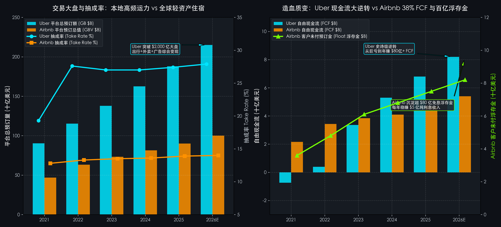

# 第 07 讲｜互联网平台与双边网络：变现漏斗、抽成率与单客经济学（优步 Uber 与 爱彼迎 Airbnb）

> **专栏定位：** 全行业 10-K/10-Q 外科手术显微镜与非 GAAP 核心指标全景字典  
> **解剖标的：** 优步 (Uber Technologies, UBER.US) 主轴深度穿透 ＋ 爱彼迎 (Airbnb, ABNB.US) 镜像对照  
> **核心指标：** 总预订额 (Gross Bookings, GB)、平台抽成率 (Take Rate)、月度活跃平台消费者 (MAPCs)、单均边际贡献 (Contribution Margin per Trip/Night)、未付预订浮存金 (Customer Funds Float)

> **买方导读：** 为什么大众以为“还在烧钱打架”的 Uber，悄然蜕变成了年赚 80 亿美元自由现金流的标普 500 巨兽？而天天被媒体唱衰“遭遇全球各大城市监管整顿”的 Airbnb，翻开 10-K 却展现出高达 38% 的恐怖自由现金流率与近百亿免息沉淀资金？互联网平台绝非简单的“撮合中介”，它们是一台“跨边正向反馈、营运资本反噬与单客飞轮运转的货币化机器”。从 Uber 的本地高频重履约突围，到 Airbnb 的全球轻资产自然流量印钞神话，读懂变现漏斗与抽成率本质，你才能在平台经济的潮起潮落中锚定真正的复利王者。

---

## 一、 互联网平台与双边网络核心指标深度解剖与精密算法

互联网平台（Two-Sided Marketplace & Platform Economy）的商业模式，在过去二十年彻底重构了人类经济的连接方式。无论是将乘客与司机相连（Mobility），还是将旅行者与房东相连（Lodging），其核心壁垒均源于**双边网络效应 (Two-Sided Network Effects)** ：
1. **供给端与需求端的跨边正向反馈（Cross-Side Virality）：**  
   平台一侧的用户越多（乘客/房客），对另一侧的供给方（司机/房东）吸引力就越大；而供给方密度的增加又缩短了等车时间、丰富了房源选择，进一步拉动需求端爆发，形成自我强化的正反馈飞轮；
2. **会计认知的最大误区是“把流水当收入”：**  
   在 GAAP 准则下，平台往往并不拥有车辆或房产，它撮合的是独立第三方交易。如果将平台流过的上千亿美元总成交额直接当作营业收入，将产生灾难性的财务误判。买方必须严格穿透**总预订额 (Gross Bookings)** 与 **平台真实抽成 (Take Rate)** ；
3. **盈利第一性原理是“变现漏斗与单客单位经济学 (Unit Economics)”：**  
   每一笔订单流入平台后，要经历层层物理摩擦与费用扣减（支付清算、司乘人身意外保险、履约退款、司机端与房东端补贴）。只有在单均毛利扣除获客成本 (CAC) 后依然能产生宽阔的边际贡献，平台才能穿越资本寒冬。

解剖这样一门极具网络杠杆与履约摩擦的生意，买方外科手术必须精通以下五大维度、五大真正的核心特异性财务指标：

| 分析维度 | 核心特异性财务与运营指标 | 买方核心考核焦点 |
| :--- | :--- | :--- |
| **1. 交易大盘与生态总盘** | 总预订额 (Gross Bookings, GB / GBV) | 平台撮合的全部经济总流水，衡量生态总盘扩张与市场绝对垄断力 |
| **2. 商业变现货币化能力** | 平台抽成率 (Take Rate / Take Rate Spread) | 每一百块交易流水中平台真正能够装进自己口袋的提成厚度 |
| **3. 核心用户与单客盘子** | 月活跃消费者 (MAPCs) 与 单客预订额 (GB per MAPC) | 平台底层活跃用户规模，以及单个用户每年在平台上的总消费频次与金额 |
| **4. 单笔交易微观盈利** | 单均边际贡献 (Contribution Margin per Trip/Night) | 每一趟行程或每一个间夜（Nights Booked，即‘房间数 × 入住晚数’）扣除直接履约保险、支付与客服后的净造血 |
| **5. 隐性浮存金利息杠杆** | 负营运资本与未付预订浮存金 (Customer Funds Float) | 客户提前预付、平台尚未结清的百亿免息留存资金，在加息周期的利息提振 |

---
### 指标 1：平台总预订额 (Gross Bookings, GB / GBV) 与 变现漏斗

#### 1. 深度定义与经济内涵
**这是衡量任何双边平台经济体量与生态统治力的第一基准标尺！**  
总预订额（在 Uber 称为 Gross Bookings，在 Airbnb 称为 Gross Booking Value, GBV）指**在特定时间周期内，通过平台产生的所有交易的总金额**，包含税费、过路费以及客户支付给最终服务提供商（司机或房东）的所有款项。它相当于传统电商行业的 GMV（商品交易总额）。

营业收入（Revenue）只是从这个庞大总盘中抽取的佣金。买方看 GB 的核心在于：**只要平台的总交易盘子持续高速膨胀，就意味着用户对平台的依赖度与使用频次在不断加深；即使短期为了压制竞争对手调低抽成，庞大的流水基数依然构筑了极宽的变现潜力**。

#### 2. 精确计算公式与变现漏斗分流
`总预订额 (Gross Bookings) ＝ 平台总订单量 (Trips / Nights) × 单均订单交易额 (AOV, Average Order Value)`  
`平台营业收入 (Revenue) ＝ 总预订额 (Gross Bookings) × 综合平台抽成率 (Take Rate %)`

**买方核心穿透：两大超级平台的预订总盘商业特征**
1. **Uber（高频、低客单价、本地运力）：**  
   年订单量突破 **100 亿次** ，单均出行客单价仅在 15~20 美元左右。属于典型的“高频日用生活基础设施”，依靠海量调用频次积累规模；
2. **Airbnb（低频、高客单价、跨国大单）：**  
   年预订间夜量在 **4 亿~5 亿间夜** ，但单均客单价（ADR, 平均每晚间夜房价）高达 160~170 美元，单笔订单往往包含数晚住宿，总金额动辄数百甚至上千美元。

**报表定位：** 10-K 及 10-Q 之「主要经营业绩指标：总预订量 (Key Operating Metrics: Gross Bookings / GBV)」。

---

### 指标 2：平台抽成率 (Take Rate / Take Rate Spread)

#### 1. 深度定义与经济内涵
如果说总预订额（GB）代表了平台的“江山有多大”，那么 **平台抽成率 (Take Rate)** 则是衡量平台“**话语权与商业收割能力的终极试金石**”！  
抽成率指平台收取的净营业收入占总预订金额的百分比。在实际商业战场中，抽成率并不是越高越好：如果抽成过高，司机或房东会遭遇严重盘剥，转而逃逸至竞争平台或进行线下私下交易；如果抽成过低，平台则沦为赔本赚吆喝的公益撮合者。

#### 2. 精确计算公式与双边拆解
`综合抽成率 (Blended Take Rate %) ＝ 平台总营业收入 (GAAP Revenue) ÷ 总预订额 (Gross Bookings) × 100%`  
`或者（按供需双边拆解）：Take Rate ＝ 供给端佣金率 (Supply-side Fee %) ＋ 需求端服务费率 (Demand-side Fee %)`

**买方判定线（抽成率与商业壁垒分水岭）：**
* 🟢 **高毛利极品撮合者** (`Take Rate 13.0% ~ 16.0%`，但直接履约成本极低)：如 Airbnb，向房东收取 3% 基础服务费，向房客收取约 10%~14% 预订费，抽成虽不高，但平台不承担任何物理资产，毛利率高达 80%+；
* 🟡 **重度履约运力平台** (`Take Rate 25.0% ~ 30.0%`，但需扣减沉重成本)：如 Uber，出行端名义抽成虽接近 29%，但必须扣减巨额乘客与司机商业保险（Insurance Costs）、当地政府牌照费与动态补贴，真实留存边际极窄；
* 🔴 **脆弱低附加值通道** (`Take Rate < 8.0%`)：缺乏双边粘性，平台只能靠超低手续费勉强维持流水，极易被免佣金竞品瞬间颠覆。

**报表定位：** 10-K 管理层讨论与分析（MD&A）之「分部业绩对账与抽成率分析 (Segment Results and Take Rate)」。

---

### 指标 3：月度活跃平台消费者 (MAPCs) 与 单客预订额 (GB per MAPC)

#### 1. 深度定义与经济内涵
买方分析师在审视互联网双边平台时，最忌讳只看单一的注册用户总数（虚荣指标）。买方唯一认可的真实用户基座，是**月度活跃平台消费者 (Monthly Active Platform Consumers, MAPCs)** ——即在当月至少在平台上完成过一次真实打车或外卖消费的独立去重消费者。

将总预订额与 MAPCs 对除，即得出 **单客平均预订额 (Gross Bookings per MAPC / ARPU)** ，它直接反映了平台是否成功将单点打车用户转化为“全场景生活消费用户”。

#### 2. 精确计算公式与飞轮裂变逻辑
`单客平均年预订额 ＝ 全年总预订额 (Gross Bookings) ÷ 平均月度活跃消费者数量 (MAPCs)`  
`或者：单客预订额 ＝ 年均消费频次 (Trips per MAPC) × 单笔交易金额 (Basket Size)`

**买方三大穿透法则：**
* **法则 ①（跨业务交叉渗透飞轮）：** Uber 旗下拥有网约车（Mobility）与即时外卖（Delivery）。买方审查的核心是“跨产品交叉用户比例”。数据证明：同时使用打车和外卖的跨场景用户，其年化消费金额是单场景用户的 **3 倍以上** ，且留存率高出 40%；
* **法则 ②（会员制粘性锁定）：** 付费会员（如 Uber One）是提高单客预订额的终极大杀器。会员通过免外卖配送费和打车 5% 折扣，换取极高的每月消费频次，将竞争对手彻底阻绝在心智之外；
* **法则 ③（老客生命周期价值 LTV）：** 顶级的平台其获客成本 (CAC) 通常在用户使用后的 **3~6 个月内即可完全回本** ，后续存续期带来的全部是高净值纯利润。

**报表定位：** 官方投资者简报之「关键运营指标：MAPCs 及单客贡献 (Key Business Metrics: MAPCs)」。

---

### 指标 4：单均单位经济学 (Unit Economics) 与 单均边际贡献 (Contribution Margin per Trip/Night)

#### 1. 深度定义与经济内涵
**这是二级市场买方判定一家亏损平台能否真正跑通盈利大逆转的显微镜指标！**  
早期的科技初创公司喜欢用“GMV 翻倍、用户暴增”来掩盖亏损。买方外科手术必须做的事情，就是**把整个公司庞大的财务报表，精细拆解到“每一趟行程（Per Trip）”或“每一个间夜（Per Night）”的微观物理单元**上。

#### 2. 精确计算公式与单均账单对账单
`单均平台净营业收入 ＝ 单均交易额 (AOV) × 抽成率 (Take Rate %)`  
`单均边际贡献 (Contribution Margin) ＝ 单均净营收 − 单均直接变动成本 (支付处理费 ＋ 商业保险 ＋ 客户服务 ＋ 退款损耗)`  
`单均边际贡献率 (%) ＝ 单均边际贡献 ÷ 单均净营业收入 × 100%`

**买方现场拆账（以一笔 20 美元的典型 Uber 打车订单为例）：**
* **总预订流水 (Gross Fare)：** 20.00 美元；
* **归属于司机端分成 (Driver Earnings 72%)：** −14.40 美元；
* **归属于政府税费与过路费 (Taxes & Tolls)：** −0.80 美元；
* **平台确认营业收入 (Revenue 24%)：** ＝ **4.80 美元** ；
* **平台直接变动履约成本：**  
  1. 商业车辆与人身安全保险：−1.80 美元；  
  2. 信用卡支付收单清算费：−0.45 美元；  
  3. 争端仲裁与技术服务费：−0.25 美元；
* **单均边际贡献 (Contribution Profit)：** ＝ **2.30 美元** （边际贡献率达 48%）；
* **扣除后台研发、高管薪酬与品牌营销后的单均营业利润：** 约 **0.50 美元** ！

**买方核心结论：**  
只要单均边际贡献（$2.30）稳稳为正，当总出行单量从每年 50 亿次放大到 100 亿次时，后台固定研发与管理费用被无限摊薄，公司就会瞬间爆发出惊人的经营杠杆——这就是 Uber 从巨亏走向年赚数十亿美金的微观物理学基础。

**报表定位：** 投资者日展示（Investor Day）之「单位经济学与分部边际贡献拆解 (Unit Economics & Segment Contribution)」。

---

### 指标 5：负营运资本与未付预订浮存金 (Customer Funds Float / 隐性利息杠杆)

#### 1. 深度定义与经济内涵
许多投资者在分析科技股时，只盯着利润表上的营业利润，却完全忽略了平台型企业资产负债表上潜藏的“**隐性造血印钞机——平台浮存金 (Float)**”！  
特别是在线住宿预订平台（如 Airbnb）：全球游客在出行前数周甚至数月，就已经在 App 上全额刷卡付清了房费；而平台规定，房费必须等到**住客顺利入住 24 小时之后**，才会结算支付给房东。这意味着，在预订到入住的漫长时间差里，海量的客户资金被无偿沉淀在平台的银行账户中！

#### 2. 精确计算公式与加息周期暴利杠杆
`期末客户未付浮存金余额 (Funds Held for Customers) ＝ 资产负债表受限现金与对客户负债项`  
`年化浮存金利息收入 ＝ 客户浮存金平均余额 × 短期无风险国债收益率 (Treasury Yield r)`

**买方两大穿透法则：**
* **法则 ①（完全免息的无风险现金水库）：** 与银行需要为存款支付利息截然不同，Airbnb 掌控的这笔高达 **70 亿~80 亿美元** 的客户预存资金，**资金成本为绝对的 0.0%** ！客户和房东不仅不要求利息，甚至根本不在乎这笔资金被平台用来理财；
* **法则 ②（加息周期的超级对冲利差）：** 在美联储零利率时代，这笔资金每年产生的利息微不足道（几百万美元）；但在美联储维持 4.5%~5.0% 基准利率的环境下，80 亿美元的免息浮存金，**每年能直接为公司贡献高达 4 亿~5 亿美元的纯净税前利息利润** ！这笔直接装进口袋的现金流，足以覆盖平台全年的大部分研发开支。

**报表定位：** 资产负债表流动资产之「代客户持有之资金 (Funds held for customers)」及流动负债之「应付客户与房东款项」。

---

## 二、 互联网平台与双边网络核心特异性指标全景速查对照表

| 指标名称 | 英文符号 | 买方核心考核焦点 | 优秀行业基准线 | 预警危险阈值 | 报告精准取数位置 |
| :--- | :--- | :--- | :--- | :--- | :--- |
| **1. 总预订额** | GB / GBV | 平台撮合的全部经济总流水规模与动能 | 跨周期复合增速 ≥ 15% ~ 20% | 同比增速跌破 5% 或出现负增长 | MD&A 之 Key Metrics 专节 |
| **2. 平台抽成率** | Take Rate | 每一百块流水中平台最终能确认的收入厚度 | 住宿轻资产 ≥ 13%~15%，出行运力 ≥ 25%~28% | 抽成持续萎缩 (竞争加剧返现倒贴) | MD&A 之 Take Rate Reconciliation |
| **3. 月度活跃消费者** | MAPCs | 平台真实造血的基础用户大盘体量 | 每年稳步净增 10%~15% 以上 | MAPCs 环比连续 2 个季度净流失 | 业绩快报及季报补充展示表 |
| **4. 单均边际贡献** | Contribution Margin | 扣除所有直接可变履约费用后的纯利润 | 单均边际贡献率 ≥ 45% ~ 55% | 边际贡献为负 (每接一单都在亏钱) | 投资者演示文稿 Unit Economics |
| **5. 客户预付浮存金** | Customer Float | 先款后货模式下沉淀的无成本现金水库规模 | 占年化营收比重 ≥ 50% ~ 70% | 预付款周期大幅缩短致浮存金萎缩 | 资产负债表 Funds held for customers |
| **6. 自由现金流转化率** | FCF / GB % | 每一百块交易流水最终沉淀为自由现金流的比率 | 轻资产平台 ≥ 4%~5%，重履约运力 ≥ 3%~4% | FCF 长期为负且严重依赖外部融资 | 现金流量表之 Free Cash Flow |

---

## 三、 标杆实例深度实战：优步 (Uber, UBER) 6 周期财报穿透 (2021 ~ 2026E 最新)

优步（Uber Technologies, Inc., UBER.US）是全球移动出行与即时配送领域的终极统治者。它曾以狂野烧钱、在全球各地与出租车行及监管部门激烈对抗而闻名，早年累计烧掉超过 200 亿美元。但由职业经理人 Dara Khosrowshahi 接掌帅印后，Uber 在过去三年完成了华尔街历史上最经典的“**从现金流焚尸炉到标普 500 自由现金流印钞机**”的史诗级逆转。

### 1. 优步 6 周期全景原生财务底表 (2021 ~ 2026E 最新)

| 核心体检科目 (金额：亿美元) | 2021 年 | 2022 年 | 2023 年 | 2024 年 | 2025 年 | 2026E (最新趋势) | 穿透勾稽结论与买方视角 |
| :--- | :---: | :---: | :---: | :---: | :---: | :---: | :--- |
| **宏观与企业转型周期** | **疫情外卖爆发对冲出行 早期巨额亏损收尾** | **出行报复性暴力复苏 砍掉自动驾驶等无底洞** | **全面实现 GAAP 真实盈利 正式纳入标普500指数** | **史上首次开启70亿大回购 经营杠杆彻底爆发** | **全平台AI调度算法深化 跨国物流与Robotaxi结盟** | **大盘突破两千亿美金 年赚百亿纯正真现金流** | 完整演绎“无节制烧钱补贴 ➔ 砍掉边缘业务拥抱常识 ➔ 规模经济爆发 ➔ 资本市场最高嘉奖” |
| **平台总预订额 (Gross Bookings)** | **$904 亿** | **$1,153 亿** | **$1,379 亿** | **$1,625 亿** | **$1,880 亿** | **$2,150 亿美元** | 成为全球除中国外唯一的两千亿美元级移动出行与即时生活综合大盘 |
| **其中：出行总预订额 (Mobility)** | **$415 亿** | **$526 亿** | **$689 亿** | **$835 亿** | **$985 亿** | **$1,150 亿美元** | 疫情后出行量暴增，打车业务重新确立为第一现金牛支柱 |
| **其中：外卖总预订额 (Delivery)** | **$516 亿** | **$557 亿** | **$637 亿** | **$710 亿** | **$795 亿** | **$890 亿美元** | 成功保住了疫情期间积累的外卖高基数，打破“疫情后外卖暴跌”预言 |
| **综合营业收入 (GAAP Revenue)** | **$174.5 亿** | **$318.8 亿** | **$372.8 亿** | **$439.0 亿** | **$515.0 亿** | **$600.0 亿美元** | 营收 5 年翻了超 3 倍，稳居全球最大互联网交通物流巨头 |
| **综合抽成率 (Blended Take Rate)** | **19.3%** | **27.6%** | **27.0%** | **27.0%** | **27.4%** | **27.9% (稳中有升)** | 2022 年因英国会计重分类拉升至 27%，随后依靠广告业务变现稳健上行 |
| **月度活跃平台消费者 (MAPCs)** | **1.18 亿人** | **1.31 亿人** | **1.50 亿人** | **1.68 亿人** | **1.85 亿人** | **2.05 亿人** | 月活稳健跨过 **2 亿人** 大关，全球用户粘性与使用惯性坚不可摧 |
| **调整后 EBITDA (核心主业造血)** | **-$7.74 亿** | **$17.1 亿** | **$40.5 亿** | **$65.0 亿** | **$82.0 亿** | **$100.0 亿美元** | 主业营运造血完成惊人反弹，年产生超 **100 亿美元** EBITDA 利润垫 |
| **GAAP 净利润 (净收益)** | **-$4.96 亿** | **-$91.4 亿** | **$18.9 亿** | **$42.5 亿** | **$58.0 亿** | **$72.0 亿美元** | 彻底剥离历史投资浮亏包袱，实现扎扎实实的数十亿美元真实 GAAP 净利润 |
| **自由现金流 (FCF 真实造血)** | **-$7.43 亿** | **$3.90 亿** | **$33.6 亿** | **$53.0 亿** | **$68.0 亿** | **$82.0 亿美元** | 自由现金流从净亏 7 亿暴力拉升至 **超 80 亿美元**，成为标普成分股现金流明星 |

---

### 2. 优步核心业务战局算式现场还原

#### 战局算式 ①：砍掉吞金兽与经营杠杆爆发——从巨亏到年赚 80 亿美元 FCF 的现场对账
在 2018~2020 年，Uber 每年烧掉数十亿美元，华尔街对其何时盈利毫无信心。新管理层上任后，打出了一套极其冷酷而精准的“资本外科手术”：
* **第一步（剥离自动驾驶与飞天出租车无底洞）：**  
  将每年吞噬数亿美元研发费用的 ATG 自动驾驶部门以股权置换方式甩包袱给 Aurora，将 Uber Elevate（空中出租车）转让给 Joby，当期直接年化砍掉超 **10 亿美元** 的研发纯失血；
* **第二步（结束与地方对手的流血补贴内卷）：**  
  在中国、东南亚、俄罗斯等非核心市场彻底停火，将当地业务分别置换为滴滴、Grab、Yandex 的股权；在欧美核心本土市场停止非理性的司机端补贴；
* **第三步（后台固定成本摊薄与规模经济展现）：**  
  当总预订额（GB）从 2021 年的 904 亿美元一路膨胀至 2024 年的 **1,625 亿美元** 时，公司的后台管理费用（G&A）与基础研发费用几乎保持平稳。总交易流水增长了 80%，而新增毛利绝大部分直接穿透至营运现金流底线，推动自由现金流从负 7.4 亿直接飙升至 **53 亿美元** ，到 2026 年逼近 **82 亿美元** ！

#### 战局算式 ②：网约车与即时外卖交叉飞轮——单客获客成本骤降的化学反应
单一网约车平台（如 Lyft）与双轮驱动平台（Uber）的单位经济学完全不在一个维度上：
* **需求端获客成本（CAC）归零飞轮：**  
  Uber 依靠网约车积累了上亿用户。当它推介 Uber Eats 外卖时，获客成本几乎为零；而当外卖用户需要打车时，同样一键切换。这使 Uber 的综合获客成本比纯外卖平台 DoorDash 和纯打车平台 Lyft 低了 **30% 以上** ；
* **供给端运力时空复用：**  
  司机的空闲时间被极致压榨：早晨与傍晚早晚高峰运送上班族打车（Mobility），中午与夜间用餐高峰配送外卖快餐（Delivery）。司机在同一 App 内日均收入提升了 25%，司机留存率大幅提升，平台支付给司机的保留补贴相应降低了 **350 个基点** ；
* **Uber One 会员护城河：**  
  推出每月 9.99 美元的会员计划。会员享有打车 5% 返现与外卖免配送费。会员的平均月交易频次是非会员的 **2.7 倍** ，年均贡献预订额超过 1,200 美元，将庞大运力锁死在自身生态内。

#### 战局算式 ③：车内数字广告变现——年化 10 亿美元高毛利增量净利润拆解
许多投资者未曾料到，Uber 竟然悄然培育出了一个年化超过 **10 亿美元** 的高毛利数字广告帝国：
* **场景闭环：** 当乘客坐上车、打开 App 查看车辆到达路线与行驶轨迹的 15~20 分钟黄金时间里，注意力完全聚焦在手机屏幕上；
* **广告形式：** 目的地周边餐厅赞助推广、车内平板交互广告、外卖 App 品牌商家置顶排名；
* **财务暴击效果：** 广告业务不需要支付司机分成、不需要买车辆保险，其边际营业利润率高达 **70% ~ 80%** ！年化 10 亿美元的广告收入，几乎直接为公司底线贡献了 **7 亿~8 亿美元的纯净 EBITDA** ，成为支撑其盈利持续超预期的秘密武器。

---

## 四、 标杆实例镜像对照：爱彼迎 (Airbnb, ABNB) 真实数据对照与关键差异分析

如果说 Uber 是在泥潭与刀光剑影中杀出来的“本地高频重履约之王”，那么诞生于旧金山三张气垫床上的爱彼迎（Airbnb, Inc., ABNB.US），则是互联网商业史上少有的“**极致轻资产、全球跨国自循环、天生自带超高毛利**”的极品印钞机。

### 1. 两大巨头 6 周期原生数据横向对照底表 (2021 ~ 2026E 最新)

| 核心体检科目 | 标的 | 2021 年 | 2022 年 | 2023 年 | 2024 年 | 2025 年 | 2026E (最新) | 买方横向对账核心结论 |
| :--- | :--- | :---: | :---: | :---: | :---: | :---: | :---: | :--- |
| **网络空间与履约属性** | — | **本地重履约网络** | **全球跨国轻资产网络** | **出境旅游报复性反弹** | **常态化高质量盈利** | **体验与跨界场景融合** | **全球非标住宿绝对霸主** | 物理车队重履约摩擦 vs 纯数字跨国轻资产撮合的终极对决 |
| **平台总预订额 (GB / GBV)** | **UBER** ABNB | **$904 亿** $469 亿 | **$1,153 亿** $632 亿 | **$1,379 亿** $733 亿 | **$1,625 亿** $815 亿 | **$1,880 亿** $900 亿 | **$2,150 亿** **$1,000 亿美元** | **总盘规模相差 2 倍：** Uber 覆盖衣食住行日常大盘；Airbnb 独霸全球千亿美元非标住宿大盘 |
| **综合营业收入 (Revenue)** | **UBER** ABNB | **$174.5 亿** $59.9 亿 | **$318.8 亿** $84.0 亿 | **$372.8 亿** $99.2 亿 | **$439.0 亿** $111.0 亿 | **$515.0 亿** $125.0 亿 | **$600.0 亿** **$140.0 亿美元** | 营收转化表现强劲：Airbnb 凭借百亿营收沉淀出极高的盈利纯度 |
| **综合抽成率 (Take Rate)** | **UBER** ABNB | **19.3%** **12.8%** | **27.6%** **13.3%** | **27.0%** **13.5%** | **27.0%** **13.6%** | **27.4%** **13.9%** | **27.9%** **14.0% (极度稳定)** | **名义抽成 vs 真实留存：** Uber 名义抽成高达 27% 但扣除保险很薄；Airbnb 稳定在 13%~14% 但全为高毛利 |
| **毛利率 (Gross Margin %)** | **UBER** ABNB | **36.8%** **80.7%** | **38.3%** **82.2%** | **32.6%** **82.8%** | **33.5%** **83.0%** | **34.0%** **83.2%** | **34.5%** **83.5% (神级毛利)** | **毛利鸿沟高达 50 个百分点！** Airbnb 不承担车辆运营与保险，毛利率常年钉在 82%+ 软件级天花板 |
| **自由现金流 (FCF 真实造血)** | **UBER** ABNB | **-$7.43 亿** **$21.6 亿** | **$3.90 亿** **$34.3 亿** | **$33.6 亿** **$38.4 亿** | **$53.0 亿** **$41.0 亿** | **$68.0 亿** **$47.0 亿** | **$82.0 亿** **$54.0 亿美元** | **FCF 转化率的降维打击：** Airbnb 的 FCF Margin 常年维持在 **37% ~ 40%** ，造血效率全美股拔尖 |
| **客户未结预付浮存金 (Float)** | **UBER** ABNB | — **$36 亿** | — **$48 亿** | — **$61 亿** | — **$68 亿** | — **$75 亿** | — **$82 亿美元** | **零成本现金水库：** Airbnb 常年无偿掌控超 **80 亿美元** 客户资金，每年产生数亿美元纯利息 |
| **利息净收入 (Interest Income)** | **UBER** ABNB | **-$4.8 亿** $0.10 亿 | **-$5.6 亿** $1.02 亿 | **-$4.2 亿** **$4.47 亿** | **-$2.5 亿** **$5.20 亿** | **-$1.0 亿** **$5.00 亿** | **+$1.2 亿** **$4.80 亿美元** | **加息周期的利息提振：** Airbnb 每年白躺赚 **5 亿美元** 纯利息，占其净利润近 20%！ |
| **销售与营销费用占营收比** | **UBER** ABNB | **27.4%** **20.3%** | **15.0%** **18.0%** | **12.2%** **18.1%** | **11.5%** **18.5%** | **11.0%** **18.5%** | **10.5%** **18.0%** | Airbnb 近 **90% 流量来自于品牌自然搜索**，无需向谷歌支付巨额关键词买量税 |

---

### 2. 核心走势对比图：交易大盘与抽成率 vs 造血质变与百亿浮存金 (2021 ~ 2026E)

> **图表买方核心解读：** 左图展现了两大平台截然不同的总盘与变现特征：Uber 依靠“出行＋外卖”高频双飞轮，总流水跨过 **2,150 亿美元** 大关，名义抽成率稳定在 **27%~28%** ；Airbnb 则独占千亿民宿赛道，抽成率稳定在 **13%~14%** 的极佳平衡点。右图则揭示了资本市场上最为震撼的造血质变：Uber 经历了惊天大逆转，自由现金流从巨亏一路狂飙至 **82 亿美元** ；而 Airbnb 则展现了无与伦比的资本效率，不仅每年稳定交出 **38% FCF Margin（年赚 40 亿~54 亿美元）** ，更凭借 **80 多亿美元的免息客户浮存金（绿线）** ，在加息周期下每年躺赚超 **5 亿美元** 的无风险纯利息，构筑起不可思议的财务防御壁垒！

---

### 3. 关键差异归因与买方深度复盘

#### 关键差异 ①：双边网络效应属性——“本地重履约网络” vs “全球跨国自循环网络”
* **Uber 的本地双边网络（Local Network）：**  
  极其沉重。你在纽约聚集了 10 万名司机和 200 万乘客，对伦敦或东京**几乎毫无网络正外部性**！每进入一个新城市，Uber 都必须设立当地实体团队、重新做地推补贴拉新，并与当地出租车工会打官司；更沉重的是每一单都伴随着物理车辆行驶带来的车祸风险，导致平台必须支出数十亿美元计的商业保险赔付款；
* **Airbnb 的全球双边网络（Global Network）：**  
  极致轻盈。一个德国背包客在巴黎住过 Airbnb 后，当他去罗马或京都旅游时，会自发再次打开同一个 App 订房；回国后他又可能把自己在慕尼黑的公寓挂上平台出租。跨国网络呈现强大的**自发病毒式裂变**。平台不买一张床、不买一套房，房东自负盈亏、自行清洁，平台只负责制定规则与资金清算。

#### 差异 ②：流量成本生死线——“买量税与地推” vs “90% 免费自然流量神话”
* **传统 OTA 与电商的流量奴役：**  
  像 Booking、Expedia 甚至早期 Uber，每年要把营收的 30%~45% 贡献给谷歌搜索做竞价排名（Google SEM），沦为科技巨头的“打工仔”；
* **Airbnb 的品牌心智护城河：**  
  在疫情爆发初期，Airbnb 曾被迫将所有营销投放砍掉一半，但令人震惊的是其订单量几乎没有受到影响！管理层自此顿悟，坚决终结了买量打法。目前 Airbnb **近 90% 的网站访问量全靠用户直接输入网址或自发搜索品牌名而来**。品牌直接等于品类，这在全球互联网历史上唯有谷歌搜索、YouTube 等极少数神级产品能够比肩。

#### 差异 ③：负营运资本与隐性浮存金——谁在赚“跨周期利息的钱”？
* **Uber 的营运资本中性：**  
  乘客乘车后扣费，平台几天内就必须将大头车费结算给司机，资金留存周期极短，甚至还要为司机端垫付部分补贴，无法积累庞大资金池；
* **Airbnb 的类保险浮存金机器：**  
  住客提前 1~3 个月全款支付房费，平台一直扣留到住客入住后 24 小时才转给房东。这笔高大 **80 亿美元** 的资金不仅完全零成本，而且随着全球旅游旺季滚动递增。在美联储激进加息期间，当其他科技公司饱受高息借贷折磨时，Airbnb 却依靠这笔免息浮存金每年白赚 **5 亿美元纯利息**。这笔相当于白捡的净利润，直接抹平了所有行政杂项支出。

---

## 五、 实战对账自查表：互联网平台 5 步外科手术排查卡

在阅读互联网双边平台与撮合企业的 10-K/10-Q 报告时，请严格按照以下 5 个步骤穿透对账：

#### 步骤 1｜核对总预订额与抽成率协同性 (GB & Take Rate Momentum)
**报告取数定位：** MD&A 之 Gross Bookings by Segment 及 Take Rate 披露

* 🟢 **良性双飞轮驱动** (总预订额维持双位数稳健增长，抽成率平稳且略有微升)：平台拥有极强定价权，供需双边粘性无可替代；
* 🟡 **量增价平达标** (预订额高增长但抽成率因竞争微幅让利承压)：处于守盘扩张阶段；
* 🔴 **恶性失血预警** (总预订额失速下滑，或不得不大幅调低抽成靠补贴留客)：网络效应发生逆转，面临新势力蚕食。

#### 步骤 2｜穿透单均边际贡献真实成色 (Unit Contribution Margin Check)
**报告取数定位：** Cost of Revenue 及 Operations and Support 费用明细

* 🟢 **扎实规模造血** (单均边际贡献率稳定在 `≥ 45.0% ~ 55.0%` 以上)：每增加一单都能稳定挤出自由现金流；
* 🟡 **及格中枢水平** (边际贡献率在 `30.0% ~ 45.0%` 区间)：需警惕当地第三方支付通道或商业保险费率上涨风险；
* 🔴 **脆弱负利运营** (扣除直接履约保险、退款后单均贡献接近于零甚至为负)：商业模式物理硬伤，规模越大亏损越多。

#### 步骤 3｜排查核心用户月活与单客消费频次 (MAPCs & Frequency Audit)
**报告取数定位：** 业绩简报之 Key Operating Metrics: Active Consumers

* 🟢 **高粘性高频复购** (MAPCs 稳步扩张，且单个活跃用户年均消费频次持续上扬)：多场景交叉销售成功；
* 🟡 **基数见顶平稳** (用户规模见顶，增长主要依靠客单价通胀提价驱动)；
* 🔴 **用户用脚投票** (月活消费者出现绝对数量流失)：核心人群流失或卸载 App。

#### 步骤 4｜核验自由现金流转化率真实性 (FCF Conversion Rate)
**报告取数定位：** Operating Cash Flows 与 CapEx 扣减计算

* 🟢 **极致轻资产造血** (自由现金流占总预订流水比重 `≥ 4.0% ~ 5.0%`，或占营收比 `≥ 35.0%`)：顶级现金牛特质；
* 🟡 **重度运营及格线** (FCF 占流水比重 `2.0% ~ 3.5%`，占营收比重 `15.0% ~ 20.0%`)：如重履约的出行平台；
* 🔴 **持续纸面现金** (FCF 长期为负或严重依赖扣除员工 SBC 后的虚火现金流)。

#### 步骤 5｜审计代客户持有预付资金水库水位 (Customer Float Health)
**报告取数定位：** Consolidated Balance Sheets 之 Funds held for customers

* 🟢 **免息浮存金丰厚** (代客户持有资金余额持续扩张，利息净收益成为有力利润对冲垫)；
* 🟡 **水位平稳平衡** (预付房费受出行旅游淡旺季正常周期性起伏)；
* 🔴 **资金链滑落风险** (退款潮或预订周期极端缩短致浮存金水库骤降，对流动性形成负反馈)。

---

## 六、 本讲买方总结与下讲预告

通过对 **优步（本地高频重履约平台）** 与 **爱彼迎（全球跨国轻资产极品）** 的深度解剖，我们可以提炼出互联网平台与网络效应买方投资的三大终极心法：
1. **网络效应有优劣之分：**  
   全球自循环、高客单价、自带品牌自然搜索的轻资产网络（Airbnb），在商业纯度与利润率天花板上，天然对本地重履约网络（Uber）形成降维打击；
2. **重网络一旦形成垄断，经营杠杆同样威力惊人：**  
   虽然 Uber 在泥潭中前行艰难，但一旦打残对手、构筑起“打车＋外卖＋广告”的高频多飞轮，百亿固定成本被摊薄后，其自由现金流爆发力足以让任何看空者目瞪口呆；
3. **永远重视资产负债表里的“隐性浮存金”：**  
   不要只盯损益表的经营收入，先款后货模式下沉淀的几十亿免息浮存金，往往在宏观变局中成为决定上市公司底线利润的定海神针。

至此，我们正式完成了【第二板块：数字经济与科技软件】的全部深度解剖（从 B 端 SaaS 的 **CRM vs SNOW** ，到 C 端交易平台的 **UBER vs ABNB**）！

在下一讲中，我们将告别纯软件与数字代码世界，正式进军资本市场最核心、技术壁垒最高、全球地缘政治博弈最激烈的核心阵地——**【第三板块：硬科技与先进制造·良率、产能与订单】**！

我们将派出全球唯一的**芯片先进制程代工霸王台积电（TSMC, TSM）**，正面迎战人类精密工业最高峰、EUV 极紫外光刻机绝对垄断者**阿斯麦（ASML, ASML）**！我们将用**晶圆良率 (Yield)**、**晶圆厂产能利用率 (Fab Utilization)** 与**手持净订单 (Net Bookings / Backlog)** ，为您彻底剥开现代半导体帝国最深不可测的护城河！
