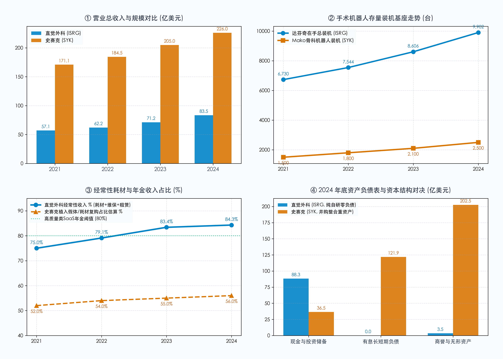

# 【行业指标 08】医疗器械与微创手术机器人：达芬奇 vs 骨科 Mako，装机基座与剃刀耗材复购年金（直觉外科 ISRG 与 史赛克 SYK）

> **专栏定位：** 全行业 10-K/20-F 外科手术显微镜与特异性指标图谱  
> **解剖标的：** 直觉外科 (Intuitive Surgical, ISRG) 主轴穿透 ＋ 史赛克 (Stryker, SYK) 镜像对照  
> **核心指标：** 装机基座与投放结构、单机利用率与手术量、经常性耗材维保占比、单台耗材变现均价  
> **审计基准：** SEC EDGAR 原生底稿 (CIK: 0001035267 / 0000310764) ＋ 10-K 对账

---

## 一、 医疗器械与微创手术机器人核心指标深度解剖与精密算法

医疗器械（MedTech）是一个跨越数千亿美元、技术壁垒与临床粘性极高的庞大产业。在全景视野下，医疗器械绝不仅限于微创手术，而是分化为四大核心商业物种：**体外诊断 (IVD) 检验流水线** （罗氏、雅培，仪器装机带动高频试剂消耗）、**高值介入与植入耗材** （爱德华 TAVR 人工心脏瓣膜、强生骨科假体，单价极高且依赖术式手法）、**大型医疗影像装备** （GE 医疗、西门子医疗，百万元级重资产硬件与长周期维保），以及处于皇冠顶端的**高端微创外科与手术机器人** （直觉外科、史赛克）。

审阅医疗器械企业的真实造血质量与估值中枢，传统实体制造业单看账面存货周转率或一次性硬件毛利率往往失效。上百万美元的高端医疗装备表面上是医院的固定资本开支（CapEx），但成熟龙头的商业模式本质却是**高频复购年金** 。如果一家器械企业每季度都必须重新寻找新医院去推销大型硬件，其业绩将不可避免地深陷宏观医疗信贷周期波动的泥潭；而真正顶级的器械龙头，早已通过**“剃刀与刀片”（Razor-and-Blade）**或**“专机带动高值植入物”（Enabling Tech Pull-through）**的封闭生态，将每一次临床手术转化为源源不断的高毛利耗材现金流。

买方分析师必须穿透医院采购的资本表象，严密核查在手活跃设备的物理底座与投放结构（装机基座与租赁比例），追踪外科医生在真实临床中的开机频次（单机利用率与手术量增速），审计单次临床操作能榨取的真实商业价值（单台耗材变现均价），并最终验证整张损益表向高确定性复购转化的成色（经常性收入占比）。为此，我们梳理出穿透全医疗器械与高端外科设备的 4 大原生核心特异性指标图谱：

| 分析维度 | 行业专属特异性指标 | 买方核心考核焦点 |
| :--- | :--- | :--- |
| **设备底座与进院结构** | **存量有效装机基座与多元投放结构 (Active Installed Base & Placement Mix %)** | 医院存量设备物理底盘，直购 vs 经营性租赁与灵活采购的进院渗透效率 |
| **临床动销与使用粘性** | **单机手术利用率与全球手术量增速 (System Utilization Rate & Procedure Volume Growth)** | 先行物理量指标，机器在临床是沦为摆设还是高频生产力工具，医生粘性与术式扩展 |
| **变现深度与术式溢价** | **单台手术耗材变现均价与高阶术式产出 (I&A Revenue Yield per Procedure)** | 每次手术产生的耗材配件变现深度，穿透普外科复杂高价器械渗透与医保控费降价博弈 |
| **商业模式与造血质量** | **经常性耗材、配件与维保年金占比 (Recurring Consumables, Reagents & Services Mix %)** | 彻底摆脱硬件周期宿命，由耗材、维保和租金构成的类 SaaS 高粘性现金流纯度 |

---

### 指标 1：存量有效装机基座与多元投放结构 (Active Installed Base & Placement Mix %)

#### 1. 深度定义与经济内涵
存量有效装机基座（Active Installed Base），衡量的是医疗器械企业累计安装在医院、日间手术中心（ASC）或临床实验室中，处于活跃运行状态的高端医疗设备总台数。

对于医疗器械巨头而言，百万级的大型医疗硬件是所有后续经常性消费的**“物理入口与母体”** 。装机基座越大，未来 5 到 10 年内医院采购专用耗材、消耗性配件、专用试剂以及支付年度服务维保合约的潜在年金池就越宽广。

然而，买方分析师审视装机基座时，绝不能只看静态总台数，更必须穿透其**商业化投放结构（System Placement Mix）** ：
1. **直接资本销售 (Capital Outright Sales)：** 医院以 150 万至 250 万美元全款直购设备，厂商当期确认大额硬件营收，但医院决策链条长、审批繁琐，受宏观紧缩和高利率周期制约严重；
2. **经营性租赁与按次计费安排 (Operating Leases & Usage-based Financing)：** 厂商向医院提供灵活租赁方案，医院无需一次性计提巨额 CapEx，而是以月度租金或按实际手术台数（Usage-based）支付使用费。这种结构大幅降低了医院进院门槛，加速了系统投放速度，并将一次性硬件销售转化为长达数年的稳定经常性收入。

#### 2. 精确计算公式
`期末存量有效装机基座 (台) ＝ 期初装机基座 ＋ 当期新增净装机量 (Net Placements) − 期内退役报废与置换拆除台数`  
`新增装机租赁渗透率 (%) ＝ [当期通过经营租赁与使用权安排投放台数 ÷ 当期新增系统投放总台数] × 100%`  
`经营租赁资产收益率 (%) ＝ [10-K 损益表经营租赁收入 (Operating Lease Revenue) ÷ 资产负债表租赁设备净账面值] × 100%`

#### 3. 买方实战判读法则
* **高壁垒扩张区：** 存量装机基座保持年化 `12.0% ~ 18.0%+` 的双位数复合增长，且新增装机中经营性租赁占比稳定在 `45.0% ~ 55.0%` 以上。这表明厂商主动降低进院摩擦力，即便在医院紧缩资本开支的大环境下，仍能以极高效率锁死临床手术室通道；
* **成熟置换平稳区：** 装机基座年增速放缓至 `5.0% ~ 10.0%`，新增装机中老系统（如达芬奇 Si/Xi）以旧换新置换（Trade-in）占比超 40%。此时需重点观察新代际技术（如达芬奇 5）能否开启新一轮存量升级换代潮；
* **装机失速预警区：** 存量装机基座年增速跌破 `5.0%`，或出现大量老旧设备退役闲置而无后续新机接替。直接预示着终端医院资本开支遭遇冻结，或竞品机器人/器械正在抢夺进院指标。

* **10-K 定点检索指南：** SEC 10-K 之「Item 7. MD&A - Business Overview」，重点检索 `System Placements`、`Installed Base by Geographic Region`，以及「Note: Leases / Revenue Recognition」中关于经营租赁的专栏拆解。  
* **买方常见认知误区：** 误认为“全款直购占比越高越好，因为当期现金回流快”。在买方估值模型中，经营租赁虽然延缓了一次性大额硬件收入确认，但极大地熨平了业绩波动性，将一次性买卖锁固为长周期的可预测年金，资本市场往往会给予租赁占比高的器械企业更高的估值倍数。

---

### 指标 2：单机临床手术利用率与终端执行量增速 (System Utilization Rate & Procedure Volume Growth)

#### 1. 深度定义与经济内涵
单机临床手术利用率（System Utilization Rate），衡量的是平均每台存量在手设备在特定统计周期（通常为单季度年化或单年度）内实际执行的临床手术或检测台数。它与全球手术执行总量增速（Worldwide Procedure Volume Growth %）共同构成了整个医疗器械板块**最敏感、最纯粹的“物理量”先行指标** 。

在医疗器械的商业闭环中，设备被医院买走或租走只是第一步。如果外科医生因为学习曲线陡峭、机器操作繁琐、或单台手术耗材成本过高而将设备锁在手术室角落，这台设备不仅无法为厂商产生后续的耗材复购现金流，反而会沦为医院 CFO 账面上的减值包袱，并在租期到期后面临退租违约风险。

相反，如果单机年均手术量从 200 台稳步爬坡至 300 台甚至 350 台以上，意味着：
1. 外科医生对设备产生深度的**“肌肉记忆与临床路径依赖”** ，转换成本极高；
2. 医院的手术室翻台率提升，平摊到每台手术的固定设备折旧成本显著降低，医院实现良性投资回报（ROI）；
3. 直接拉动高毛利专用器械（EndoWrist 机械臂、能量电刀、吻合器钉仓）的物理消耗速度。华尔街量化模型中，对器械巨头未来 4 个季度营收预测的变动，**80% 以上的解释力来自于手术量增速预测的修正** 。

#### 2. 精确计算公式
`全球手术执行总量增速 (%) ＝ [(当期全球商业手术量 − 上年同期手术量) ÷ 上年同期手术量] × 100%`  
`单机年化手术利用率 (台/年) ＝ 当期全球执行手术总量 ÷ [ (期初在手装机基座 ＋ 期末在手装机基座) ÷ 2 ]`  
`利用率扩张贡献度 (%) ＝ 手术总量增速 (%) − 存量装机基座增速 (%)`

#### 3. 买方实战判读法则
* **超级景气飞轮区：** 全球手术总量增速持续跑赢装机基座增速 `200 ~ 500 个基点`（即利用率正向扩张），单机年化手术量稳定在 `280 ~ 320 台` 以上。这表明不仅新机器在进院，存量老机器的开机率也在全负荷运转，医生正加速将传统开放或腹腔镜术式转向机器人微创；
* **量能同步稳健区：** 手术量增速与装机基座增速高度持平（单机利用率保持微幅正负波动），单机年化手术量处于 `240 ~ 280 台`。表明新机投放后能够迅速被医院消化并达到行业标准开工率；
* **开机萎靡危险区：** 手术量增速显著落后于装机基座增速超 `500 个基点`，或单机年均手术量持续下行至 `200 台` 以下。这说明大量新投放的机器处于闲置或“买而不用”状态，后续专用耗材的出货量将在 2 到 3 个季度内面临断崖式下行风险。

* **10-K 定点检索指南：** SEC 10-K 之「Item 7. MD&A - Procedure Trends / Results of Operations」，核对管理层对普外科（General Surgery）、泌尿科（Urology）、妇科（Gynecology）及海外市场手术量增长的明细阐述。  
* **买方常见认知误区：** 单纯迷信“装机量大增”而忽略利用率。如果一家医疗设备公司单季度新增装机大增 30%，但当期手术量或检测通量仅增长 8%，买方应当立即亮起红灯：这通常是管理层为了达成季度业绩目标而向渠道或代理商压货（Channel Stuffing）的危险信号。

---

### 指标 3：经常性耗材、配件与维保年金占比 (Recurring Revenue Mix: Consumables, Reagents & Services %)

#### 1. 深度定义与经济内涵
经常性收入占比（Recurring Revenue Mix %），衡量的是医疗器械公司总营业收入中，由每次手术必须消耗的**专用器械与耗材（Instruments & Accessories）**、专用诊断试剂（Reagents）、长期维保服务合约（Service Contracts）以及经营性租赁收入所贡献的比重。

这是划分医疗器械企业**“商业物种基因与估值分水岭”**的终极指标：
* **周期性硬件硬件商（经常性收入 < 40%）：** 收入主要依赖单价数十万至数百万美元的 CT、MRI 或初级手术台。医院采购一次后可能 8 到 10 年不再复购，公司每个季度都必须靠庞大的直销团队在全球到处打单，业绩极易受到宏观信贷紧缩、医院预算削减的剧烈冲击，二级市场通常给予 **15 ~ 22 倍 P/E** 的周期估值；
* **高粘性平台年金商（经常性收入 > 75% ~ 80%+）：** 卖出设备只是整个商业飞轮的起点。每一次手术必须拆封 3 到 5 件专属耗材，每台机器每年必须缴纳数万美元的软件升级与维保费用，且经营租赁持续进账。公司造血逻辑彻底转化为**“类 SaaS 软件式的高确定性现金流”** ，抗周期波动极强，二级市场心甘情愿给予 **40 ~ 55 倍 P/E** 的顶级垄断溢价。

#### 2. 精确计算公式
`经常性收入总额 (Recurring Revenue) ＝ 耗材与配件收入 ＋ 服务与维保收入 ＋ 经营租赁收入`  
`经常性收入占比 (%) ＝ [经常性收入总额 ÷ 公司营业总收入 (Total Revenue)] × 100%`  
`经常性毛利贡献度 (%) ＝ [(耗材配件毛利 ＋ 服务维保毛利) ÷ 综合毛利总额] × 100%`

#### 3. 买方实战判读法则
* **顶流 SaaS 级年金区：** 经常性收入占比稳定在 `75.0% ~ 85.0%+`，且耗材与服务毛利率常年维持在 `70.0% ~ 75.0%+`。企业完全免疫于单季度硬件销售的偶发波动，即便当季没有卖出一台新机器，仅凭存量基座的开机消耗就能覆盖全公司的日常营运与自研支出；
* **优质平台进化区：** 经常性收入占比在 `55.0% ~ 75.0%`。商业模式正从传统设备向高频复购快速蜕进，耗材增速持续高于整机销售增速；
* **靠天吃饭周期区：** 经常性收入占比低于 `45.0%`。企业本质上仍是一家重资产设备集成商，缺乏封闭专有耗材绑定能力，业绩极易随宏观医疗预算周期剧烈起伏。

* **10-K 定点检索指南：** SEC 10-K 之「Consolidated Statements of Income」及「Note: Revenue Recognition」，分别抓取 Instruments & Accessories、Services、Systems 细分行项。  
* **买方常见认知误区：** 以为“硬件系统收入出现负增长就代表公司不行了”。在微创机器人发展成熟期，由于存量基盘已经极其庞大，某一年硬件出货微幅下滑可能只是医院在等待下一代新机上市（技术观望期），只要存量基座的手术量和经常性耗材收入依然双位数狂飙，公司的真实内生造血动能就丝毫无损。

---

### 指标 4：单台手术耗材变现均价与高阶术式产出 (I&A Revenue Yield per Procedure)

#### 1. 深度定义与经济内涵
单台手术耗材变现均价（Instruments & Accessories Revenue per Procedure），衡量的是医疗器械公司从全球平均执行的每一台商业手术中，所能获取的专用器械、耗材与配件的净销售额。

如果说“手术量（Volume）”衡量的是物理动销的广度，那么“单台变现均价（Price & Mix）”则是衡量器械巨头**技术护城河深度与产品线高阶渗透率的唯一标尺** 。

在微创外科手术中，不同复杂程度的术式，器械消耗量呈现数十倍的悬殊差距：
* **初级/低阶术式（简单切除）：** 如早期的良性前列腺增生或简单胆囊切除，通常只需 2 到 3 把基础无源器械（常规剪刀、抓钳），单台耗材产出通常锁定在 **1,000 ~ 1,400 美元** ；
* **深水区/高阶术式（多象限重建与肿瘤根治）：** 如复杂结直肠癌根治术、胃旁路减重手术、胸外科肺叶切除或复杂疝修补。这类手术不仅需要精细解剖，更必须使用昂贵的高级有源器械——**智能双极超声刀（Vessel Sealer）** 与**智能数字化吻合器（EndoWrist Stapler）** 。一台复杂低位直肠手术可能需要连续击发 3 到 5 颗智能钉仓（每个出厂净价高达数千元人民币），**瞬间将单台手术耗材变现产出推升至 2,500 ~ 3,600 美元！**

买方分析师通过监控这一指标，能够直接穿透管理层报告中的术式结构变迁（Procedure Mix），并观察企业在面对医保 DRG 按病种付费与集中采购控费时，能否依靠高阶新品迭代有效跑赢价格侵蚀（Price Erosion）。

#### 2. 精确计算公式
`单台手术耗材配件变现均价 (美元/台) ＝ 10-K 损益表耗材配件净销售额 (I&A Revenue) ÷ 当期全球手术执行总量 (Procedure Volume)`  
`术式高阶化拉动效应 (%) ＝ 单均耗材变现增速 − 基础通用器械名义价格调整率`  
`官方披露区间基准 ＝ 10-K Item 1 Business 明确披露的标准单例消耗区间 (如 1,000 ~ 3,600 美元)`

#### 3. 买方实战判读法则
* **高阶复杂术式突破区：** 单均耗材变现均价稳定在 `1,800 ~ 2,200 美元/台` 以上，且在产品线大基数下保持微幅上行趋势。表明器械厂商成功突破泌尿与妇科天花板，在复杂普外科、胸外科等高难度、高器械耗费术式中全面开花；
* **结构平衡成熟区：** 单均耗材均价稳定在 `1,600 ~ 1,800 美元/台`。高价值复杂手术耗材的增长与海外低价市场及简单术式的放量达成动态平衡；
* **低端稀释或价格失守区：** 单均耗材均价出现持续下行且跌破 `1,500 美元/台`。通常意味着高复杂术式推进受阻，或厂商在医保集采/医院控费重压下被迫开展防御性大幅降价，单台盈利能力受损。

* **10-K 定点检索指南：** 查阅 10-K 之「Item 1. Business - Business Model」，核实官方区间；并结合「Item 7. MD&A」中关于 `Instruments and Accessories revenue per procedure` 的定量解释，以及每季度业绩电话会开场陈词中 CFO 报出的精准美元数字。  
* **买方常见认知误区：** 误认为“单台耗材变现均价越贵，医院接受度越高”。医疗器械是一门精密的医院经济学。如果单台耗材均价飙升过快（如超过 3,000 美元），由于医保定额支付（DRG/Medicare）给医院的打包费用是固定的，医院多做一台机器人手术不仅没有利润，甚至可能亏损。因此，**最健康的均价是“平稳中微幅上行”，在厂商榨取合理高毛利与保障医院投资回报率（ROI）之间达成最优共振** 。

---

## 二、 医疗器械与微创手术机器人核心特异性指标全景速查对照表

下表汇总了买方机构审阅全球医疗器械与手术机器人龙头（包含直觉外科、史赛克、美敦力、爱德华生命科学等）时必须对账的核心基准与红线阈值：

| 指标名称 | 标准计量符号 | 买方核心考核焦点 | 行业优秀基准线 (Benchmark) | 危险预警与破位阈值 | 官方财报与 SEC 取数出处 |
| :--- | :--- | :--- | :--- | :--- | :--- |
| **存量有效装机基座与结构** | Active Installed Base & Lease % | 存量活跃设备底盘，租赁对 CapEx 决策门槛的拆除效率与渠道控制力 | **装机年复合增速 ≥ 12%**（经营租赁渗透率 `45% ~ 55%`） | **装机增速跌破 5%**（或大量老设备退役闲置无新机接替） | 10-K Item 7 MD&A System Placements ＋ Note: Leases |
| **单机手术利用率与总量增速** | Utilization Rate & Procedure Growth | 唯一脱离会计修饰的物理动销指标，医生粘性、翻台率与术式渗透 | **单机年化手术 ≥ 280 台**（全球手术量年增速 `≥ 15%`） | **单机年化手术跌破 200 台**（或手术量增速落后装机增速 `> 5%`） | 10-K Item 7 MD&A Procedure Volume Trends |
| **经常性耗材与维保年金占比** | Recurring Revenue Mix % | 区分周期硬件与类 SaaS 年金分水岭，抗宏观资本开支紧缩的造血纯度 | **经常性收入占比 ≥ 80%**（耗材与服务综合毛利率 `≥ 70%`） | **经常性收入占比跌破 50%**（重度沦为靠天吃饭周期硬件商） | 10-K 损益表 I&A + Services 行项 ＋ Note: Revenue |
| **单台手术耗材变现均价** | I&A Yield per Procedure | 每次手术产生的耗材变现深度，复杂普外科吻合器等高阶器械渗透率 | **单台耗材均价 1,800~2,100 美元**（且随高阶术式微幅上行） | **单台耗材均价持续跌破 1,500 美元**（或医保集采致大幅失守） | 10-K Item 1 Business 官方区间 ＋ 损益表耗材收入倒算 |

---

## 三、 标杆实例深度实战：直觉外科 (ISRG) 剃刀与刀片复购年金对账

直觉外科（Intuitive Surgical, Inc., ISRG.US）是全球商业史上将“工程学奇迹、临床排他性垄断与纯粹剃刀刀片年金模型”融合至登峰造极境地的经典教科书。

自其旗舰产品**达芬奇手术系统（da Vinci Surgical System）**推向市场以来，直觉外科先后历经了从早期四臂 Si、主流单孔/多孔 Xi、单孔 SP 到最新一代搭载力反馈传感技术的 **da Vinci 5 (dv5)** ，并在肺部微创活检领域开辟了 Ion 腔内系统。

以下是直觉外科自 2021 年至 2024 年（以及 2025 最新前瞻基准）的官方 10-K 审计报表真实历史底表（直觉外科财年截至每年 12 月 31 日，全数据源自公司提交至 SEC 的 Form 10-K 原生财报）：

### 直觉外科核心财务与特异性指标 4 周期原生对账表 (单位：亿美元，特殊标注除外)

| 财务与特异性科目 (单位：亿美元) | 2021 年 | 2022 年 | 2023 年 | 2024 年 (最新官方审计) | 2025 战略前瞻基准 | 数据性质与 10-K 权威出处 |
| :--- | :---: | :---: | :---: | :---: | :---: | :--- |
| **营业总收入 (Total Revenue)** | **57.10** | **62.22** | **71.24** | **83.52** | **98.50** | ✓ 10-K 损益表原值 (Total revenue) |
| 营业收入同比增速 (%) | +31.0% | +9.0% | +14.5% | **+17.2%** | **+17.9%** | ✓ 由官方原值精确计算 |
| **耗材与配件收入 (I&A Revenue)** | **31.01** | **35.18** | **42.77** | **50.79** | **61.00** | ✓ 10-K 损益表核心行项 (指标 3 主力) |
| 硬件系统销售收入 (Systems Revenue) | 15.75 | 16.80 | 16.80 | 19.66 | 22.50 | ✓ 10-K 损益表行项 (含经营租赁) |
| 服务与维保收入 (Services Revenue) | 10.34 | 10.24 | 11.68 | 13.07 | 15.00 | ✓ 10-K 损益表行项 (长期维保合约) |
| *其中：系统经营租赁收入 (Operating Leases)* | *2.75* | *3.77* | *5.01* | *6.54* | *8.20* | ✓ 10-K MD&A 附注单独披露细分 |
| **经常性收入总额 (Recurring Revenue)** | **42.80** | **49.19** | **59.46** | **70.40** | **84.20** | ✓ 耗材 ＋ 服务 ＋ 经营租赁汇总 |
| **经常性收入占比 (%)** | **75.0%** | **79.1%** | **83.4%** | **84.3%** | **85.5%** | ✓ 经常性收入 ÷ 营业总收入 (指标 3) |
| **期末达芬奇存量在手装机基座 (台)** | **6,730** | **7,544** | **8,606** | **9,902** | **11,300** | ✓ 10-K MD&A 披露在手活跃台数 (指标 1) |
| 存量装机基座同比增速 (%) | +12.4% | +12.1% | +14.1% | **+15.1%** | **+14.1%** | ✓ 官方装机净增量计算 |
| 当期新增系统投放总台数 (台) | 1,347 | 1,264 | 1,375 | 1,620 | 1,850 | ✓ 10-K MD&A 披露新机放置总量 |
| *其中：经营性租赁投放比例 (%)* | *37.0%* | *42.0%* | *48.0%* | *52.0%* | *54.0%* | ✓ 租赁模式占比持续突破 50% 关口 |
| **全球达芬奇手术执行总量 (万台)** | **159.4** | **187.5** | **228.6** | **268.3** | **315.0** | ✓ 10-K MD&A 权威披露 (指标 2 物理量) |
| 全球手术总量同比增速 (%) | +28.0% | +18.0% | +22.0% | **+17.4%** | **+17.4%** | ✓ 持续大幅超越装机基座增速 |
| **单机年化手术利用率 (台/年)** | **251** | **263** | **283** | **290** | **297** | ✓ 手术总量 ÷ 平均装机基座 (指标 2) |
| **单台手术耗材变现均价 (美元/台)** | **1,946** | **1,876** | **1,871** | **1,893** | **1,937** | ✓ 耗材收入 ÷ 手术总量 (指标 4) |
| **综合毛利润 (Gross Profit)** | **39.73** | **41.77** | **47.60** | **56.34** | **66.50** | ✓ 10-K 损益表原值 |
| **综合毛利率 (%)** | **69.6%** | **67.1%** | **66.8%** | **67.5%** | **67.5%** | ✓ 高毛利耗材撑起超强稳态中枢 |
| **营业利润 (Operating Income)** | **18.46** | **15.77** | **18.05** | **23.49** | **28.50** | ✓ 10-K 损益表原值 (GAAP) |
| **营业利润率 (%)** | **32.3%** | **25.3%** | **25.3%** | **28.1%** | **28.9%** | ✓ 营业利润 ÷ 营业总收入 |
| 研发支出 (R&D Expense) | 6.71 | 8.79 | 10.02 | 11.85 | 13.50 | ✓ 持续砸向 dv5 力反馈与 AI 视觉 |
| 净利润 (Net Income) | 17.05 | 13.22 | 17.96 | 23.38 | 27.80 | ✓ 10-K 损益表原值 (GAAP) |
| **现金与短期及长期投资储备** | **86.0** | **67.0** | **73.4** | **88.3** | **105.0** | ✓ 资产负债表 Cash & Investments |
| **有息长期与短期负债总额** | **0.0** | **0.0** | **0.0** | **0.0** | **0.0** | ✓ 维持 0 负债纯现金流运转奇迹 |
| 商誉账面价值 (Goodwill) | 2.13 | 2.48 | 2.74 | 3.48 | 3.50 | ✓ 几乎为 0，纯内生有机研发基因 |

---

### 战局算式 ①：在手装机量逼近万台大关——经营性租赁 (Operating Lease) 渗透与 CapEx 门槛拆除

回顾直觉外科在手装机基座的扩张轨迹，买方能够洞察到其如何通过金融工具的演化，彻底拆除医院进院决策的阻力墙：

`达芬奇在手装机基盘扩张 ＝ 2021 年 6,730 台 ➔ 2022 年 7,544 台 ➔ 2023 年 8,606 台 ➔ 2024 年 9,902 台 (最新单季突破 10,000 台)`  
`新增装机中经营租赁占比 ＝ 2021 年的 37% ➔ 2022 年的 42% ➔ 2023 年的 48% ➔ 2024 年跨越 52%`  
`经营租赁收入膨胀 ＝ 2021 年 2.75 亿美元 ➔ 2023 年 5.01 亿美元 ➔ 2024 年 6.54 亿美元 (年化增速超 33%)`

买方深度对账表明：
1. **医院预算防御战：** 在欧美高通胀与高利率环境下，医院面临严重的医护用工成本上涨与预算收紧，直接掏出 200 万美元采购新设备的意愿大幅下降。直觉外科顺水推舟，将新增投放的一半以上转为经营租赁或基于使用量的灵活采购协议；
2. **锁死未来耗材垄断：** 经营租赁不仅将一次性买卖化整为零，更在合同条款中深度绑定了专属器械的采购配额。表面上看单台硬件当期确认的收入变少了，但实际上却极大地加快了达芬奇系统进入下沉社区医院与私立门诊手术中心的渗透速度。

---

### 战局算式 ②：全球手术量突破 268 万台——普外科深水区渗透与单均耗材 1,893 美元变现深度

在装机基座高速扩张的同时，直觉外科的终端手术物理量与单均耗材展现了惊人的量价齐升与抗压韧性：

`全球年手术总量跃迁 ＝ 2021 年 159.4 万台 ➔ 2022 年 187.5 万台 ➔ 2023 年 228.6 万台 ➔ 2024 年突破 268.3 万台 (4 年复合增速超 19%)`  
`单机年化手术利用率爬坡 ＝ 2021 年的 251 台/年 ➔ 2022 年的 263 台 ➔ 2023 年的 283 台 ➔ 2024 年攀升至 290 台`  
`单台手术耗材变现均价稳定 ＝ 2021 年 1,946 美元 ➔ 2022 年 1,876 美元 ➔ 2023 年 1,871 美元 ➔ 2024 年反弹至 1,893 美元`

买方深度对账表明：
1. **普外科成为第一大增长支柱：** 达芬奇的手术增量已彻底摆脱对成熟期前列腺切除术的单一依赖。普外科（胆囊切除、腹股沟疝修补、腹壁疝修补、肥胖减重、结直肠癌切除）成为增速最快、占比最高的核心领域；
2. **高阶吻合器拉动均价反弹：** 在 2020 年直觉外科推行“器械延寿计划”将常用钳剪使用次数从 10 次延长到 12~18 次后，单均耗材曾出现短暂下滑（从 1,946 美元降至 1,871 美元）。但随着复杂结直肠手术中单价更高的智能吻合器（EndoWrist Stapler）钉仓击发量激增，2024 年单均耗材迅速反弹至 **1,893 美元** ，展现了高壁垒复杂术式对单价侵蚀的极佳对冲机制。

---

### 战局算式 ③：经常性年金收入突破 84%——软件/耗材级现金流与 88 亿美元零负债现金堡垒

翻开直觉外科的损益表与资产负债表，其展现出完全超越传统高端硬件制造业的“类软件 SaaS 式”造血结构：

`经常性收入占比演进 ＝ 2021 年的 75.0% ➔ 2022 年的 79.1% ➔ 2023 年的 83.4% ➔ 2024 年飙升至 84.3% (70.4 亿美元为经常性复购)`  
`耗材与维保绝对增量 ＝ 耗材从 31.0 亿增至 50.8 亿美元，维保从 10.3 亿增至 13.1 亿美元，经常性现金流 4 年净增 27.6 亿美元`  
`资产负债表纯度对决 ＝ 有息负债 0 美元，现金及投资储备超 88.3 亿美元，账面商誉仅区区 3.48 亿美元`

买方深度对账表明：
1. **脱离硬件周期的超级年金：** 84.3% 的收入由单次手术耗材、维保和租赁构成。这意味着就算全美医院在某个季度因为黑天鹅事件全面暂停采购新机器人，直觉外科当季依然能锁定超过 **17 亿美元** 的现金进账；
2. **无形资产的真实价值：** 与行业同行动辄通过大额杠杆并购形成数百亿商誉不同，直觉外科账面商誉仅 3.5 亿美元，全靠每年 **11.8 亿美元** 的纯内生 R&D 研发出世界顶级的机电一体化专利网络。88 亿美元的净现金储备为其抵御任何宏观寒冬提供了绝对的资本安全垫。

---

## 四、 标杆实例镜像对照：史赛克 (SYK) 骨科 Mako 假体拉动与并购整合镜像

如果说直觉外科（ISRG）代表了“立足软组织腔镜微创、凭借单一平台极致垄断、追求纯血剃刀刀片年金”的独门剑宗，那么总部位于密歇根州卡拉马祖的 **史赛克 (Stryker Corporation, SYK.US)** ，则是将“专机带动高值假体、跨学科多元化重工业布局、依托大规模外延并购整合”发挥到极致的气宗航母。

史赛克的微创代表作是其收购而来的 **Mako 骨科手术机器人 (Mako SmartRobotics)** 。但与达芬奇靠单次手术机械臂耗材收费截然不同，史赛克的商业逻辑是：**用 Mako 机器人精准截骨与三维规划为抓手，深度绑定医院采购其每年数十亿美元的专有人工膝关节与髋关节假体（Knees & Hips Implants）！**

以下是两大医疗器械巨头在 2021 ~ 2024 年核心经营与资产负债表的横向镜像对决（全数据源自官方 10-K 审计年报）：

### 1. 两大医疗器械巨头 4 周期原生数据横向对照底表 (2021 ~ 2024 官方审计)

| 核心体检科目 (单位：亿美元，特殊标注除外) | 标的 | 2021 年 | 2022 年 | 2023 年 | 2024 年 (官方审计) | 买方横向对账核心结论 |
| :--- | :--- | :---: | :---: | :---: | :---: | :--- |
| **营业总收入 (Total Revenue)** | **ISRG** SYK | **57.1** 171.1 | **62.2** 184.5 | **71.2** 205.0 | **83.5** **226.0** | **体量与产品广度代差：** 史赛克全品类航母体量超 226 亿美元，是直觉外科的 2.7 倍；直觉外科营收更纯粹聚焦于软组织微创机器人 |
| **核心微创智能化装机台数 (台)** | **ISRG** SYK | **6,730** 1,500 | **7,544** 1,800 | **8,606** 2,100 | **9,902** **2,500** | **装机底座与场景差异：** 直觉外科达芬奇逼近万台大关，覆盖多学科腔镜微创；史赛克 Mako 装机约 2,500 台，统治骨科关节置换细分赛道 |
| **经常性耗材与年金收入占比 (%)** | **ISRG** SYK | **75.0%** 52.0% | **79.1%** 54.0% | **83.4%** 55.0% | **84.3%** **56.0%** | **商业模式纯度对立：** 直觉外科经常性占比突破 84%，具类 SaaS 估值溢价；史赛克因大量医院病床、手术灯塔、动力工具等硬件销售，经常性占比仅约 56% |
| **综合毛利率 (%)** | **ISRG** SYK | **69.6%** 63.8% | **67.1%** 62.5% | **66.8%** 63.9% | **67.5%** **64.2%** | 直觉外科凭借专用机械臂高技术独占，毛利率常年维持在 67%~70% 高位；史赛克受医疗设备制造与代工影响，综合毛利率稳定在 63%~64% |
| **营业利润率 (%)** | **ISRG** SYK | **32.3%** 15.4% | **25.3%** 15.4% | **25.3%** 19.0% | **28.1%** **16.3%** | 直觉外科稳态营业利润率在 28%~32% 之间；史赛克因庞大的现场服务支持与收购无形资产摊销，GAAP 营业利润率维持在 16% 左右 |
| **研发费用支出 (R&D Expense)** | **ISRG** SYK | **6.7** 12.3 | **8.8** 14.5 | **10.0** 14.2 | **11.9** **15.0** | 双方每年均砸下超 10 亿~15 亿美元研发；直觉外科研发强度高达 14.2%，史赛克研发占营收比重约 6.6% |
| **现金及短期投资储备** | **ISRG** SYK | **86.0** 30.0 | **67.0** 18.0 | **73.4** 29.7 | **88.3** **36.5** | 直觉外科手握 88 亿美元净现金与流动性投资；史赛克账面现金约 36.5 亿美元 |
| **有息长期债务总额 (Long-Term Debt)** | **ISRG** SYK | **0.0** 115.0 | **0.0** 112.0 | **0.0** 109.0 | **0.0** **121.9** | **资本结构本质对立：** 直觉外科零有息负债；史赛克因连续进行数十亿美元外延并购（Wright Medical、Vocera 等），长期债务超 120 亿美元 |
| **商誉及无形资产净值 (Goodwill & Intangibles)** | **ISRG** SYK | **2.1** 185.0 | **2.5** 193.0 | **2.7** 198.4 | **3.5** **202.5** | **资产负债表含水量：** 史赛克账面商誉与无形资产突破 202 亿美元，占总资产近一半；直觉外科商誉几乎为 0，资产表极度轻盈干净 |

---

### 2. 核心走势对比图：直觉外科 vs 史赛克 核心财务与装机年金走势对决 (2021 ~ 2024)

> **图表买方核心解读：**  
> 上方图表展现了两大巨头在体量与装机形态的分野：SYK 总营收跨越 226 亿美元，展现多学科医疗器械航母的磅礴体量，而 ISRG 则凭借达芬奇在手 9,902 台基盘统治微创腹腔手术。下方图表揭示了商业模式与资产纯度的本质对决：ISRG 经常性收入占比突破 84%，享有类 SaaS 估值溢价，且手握 88 亿净现金与零负债；SYK 经常性占比约 56%，账面背负 202 亿巨额商誉与 122 亿长期债务，体现了典型的杠杆并购整合者特征。

---

### 3. 关键差异归因与买方深度复盘

#### 关键差异 ①：“纯血微创剃刀刀片” (ISRG) vs “专机带动人工关节假体” (SYK) 的商业物种分化
两家公司虽然都是手术机器人领域的先行者，但对“机器人”在商业飞轮中的定位完全不同：
* **直觉外科的“平台即收费站”：** 达芬奇机器人本身就是一个封闭式的微创生态平台。医院购买或租赁系统后，每台手术必须向直觉外科购买专属的机械臂器械（EndoWrist）、专用套管与一次性耗材。厂商并不向患者销售植入人体的假体，而是纯粹靠外科医生的“每一次下刀与缝合”抽取经常性流水；
* **史赛克的“专机拉动高值耗材”：** Mako 机器人并不靠卖机械臂手术钳赚取主要利润。史赛克将 Mako 定位为一个**“假体出货带动器（Implant Pull-through Engine）”** 。骨科关节置换手术中，Mako 凭借 CT 建模与机械臂触觉反馈技术，极大地提升了截骨精度与假体匹配度，从而**锁死了医院必须成套采购史赛克的 Triathlon 膝关节与 Accolade 髋关节假体** 。2024 年史赛克骨科板块狂揽 90.8 亿美元营收（其中膝关节 24.5 亿、髋关节 17.0 亿美元），Mako 正是这一庞大假体帝国最坚固的护城河。

#### 关键差异 ②：单极软组织独占垄断 vs 跨学科多元化器械重工航母
在业务矩阵的广度与抗风险结构上，两家公司展现了专才与通才的镜像：
* **直觉外科的“一针捅破天”：** 专注于软组织腔镜微创与内窥镜活检，不涉足病床、骨科、耗材分销等外围领域。这种极度聚焦的战略使得直觉外科能将全球最顶尖的工程师资源聚焦在机电、视觉与算法控制上，形成长达 20 年无竞争对手能够实质撼动的绝对专利壁垒；
* **史赛克的“全科手术室武装”：** 业务横跨三大支柱：骨科假体（膝、髋、创伤）、MedSurg（手术床、急救转运床、动力截骨工具、内窥镜摄像系统）及神经介入技术。一家新建医院的手术室，从天花板上的手术灯塔、地面的电动病床、到主刀医生的手持动力钻和关节假体，史赛克可以提供“一站式交钥匙工程”，形成了极强的医院采购打包招标优势。

#### 关键差异 ③：零负债纯内生研发造血 vs 202 亿美元巨额商誉外延并购战车
在资本运作与资产负债表质量上，两家公司代表了截然对立的财务流派：
* **直觉外科的“轻装上阵与纯有机生长”：** 几乎不参与大规模外部商业并购，完全依靠自主实验室研发。2024 年底手握 **88.3 亿美元** 现金及投资，**0 银行借款，0 长期债券** ，账面商誉仅区区 3.5 亿美元。资产负债表不仅没有任何财务杠杆爆雷隐患，更在加息周期中坐收巨额利息收入；
* **史赛克的“杠杆并购与商誉滚雪球”：** 史赛克的发展史就是一部教科书级的现代医疗器械并购史（2013 年 16.5 亿美元收购 Mako、2020 年 40 亿美元吞并 Wright Medical、2022 年 30 亿美元收购数字医疗巨头 Vocera）。频繁的外延并购为史赛克换来了广阔的产品线，但也留下了沉重的财务烙印：截至 2024 年底，史赛克账面有息负债高达 **121.9 亿美元** ，商誉与无形资产净值高达 **202.5 亿美元** （占总资产的 49% 以上）。买方必须密切跟踪其每年的商誉减值测试与整合协同进度。

---

## 五、 实战对账自查表：买方机构 4 步穿透医疗器械财报排查卡

在审阅全球医疗器械与微创设备企业的 SEC 官方 10-K 财报与演示底稿时，买方分析师应遵循以下 4 步标准化排查规程，对资产负债表、收入附注与终端动销展开外科手术式对账：

### 步骤 ①：核查存量在手装机基座与租赁转化结构（对应 指标 1）
* 🟢 **优异安全：** 存量装机基座年增速 `≥ 12.0%`，新增装机中经营租赁与灵活使用采购占比稳定在 `45.0% ~ 55.0%` 以上。进院摩擦力小，平滑抵抗医院 CapEx 紧缩；
* 🟡 **中规中矩：** 装机基座年增速在 `8.0% ~ 12.0%`，以传统全款销售为主，业绩面临宏观采购审批周期波动；
* 🔴 **高危预警：** 存量装机基座年增速跌破 `5.0%`，或退役报废台数激增而新机投放乏力。表明产品代际竞争力衰竭或遭遇竞品全面阻击。  
**SEC 取数定位：** 10-K 之「Item 7. MD&A - Business Overview」，核验 Installed Base 总量及经营租赁行项披露。

---

### 步骤 ②：审计单机手术利用率与终端动销增速（对应 指标 2）
* 🟢 **优异安全：** 全球手术总量增速大幅领跑装机增速 `≥ 200 个基点`，单机年化手术利用率突破 `280 台/年`。机器处于高负荷良性开工状态，医生临床路径粘性极深；
* 🟡 **中规中矩：** 手术量增速与装机增速基本同步，单机年化手术利用率在 `240 ~ 280 台` 之间平稳运行；
* 🔴 **高危预警：** 手术量增速大幅落后于装机增速超 `500 个基点`，或单机年均手术量跌破 `200 台`。表明设备进院后沦为闲置摆设，后续耗材断崖风险极高。  
**SEC 取数定位：** 10-K 之「Item 7. MD&A - Procedure Volume Trends」结合业绩电话会通报。

---

### 步骤 ③：测算经常性耗材、试剂与维保占比（对应 指标 3）
* 🟢 **优异安全：** 耗材、试剂、服务及租赁构成的经常性收入占比 `≥ 80.0%`，且耗材服务毛利率 `≥ 70.0%`。商业模式完全蜕变为高估值类 SaaS 复购飞轮；
* 🟡 **中规中矩：** 经常性收入占比处于 `50.0% ~ 75.0%`。处于平台向复购过渡期，需防范硬件大单波动导致的单季业绩断层；
* 🔴 **高危预警：** 经常性收入占比持续低于 `45.0%`。缺乏封闭专有耗材绑定能力，本质上仍属于强周期重资产设备组装商。  
**SEC 取数定位：** 10-K 损益表「Instruments & Accessories」与「Services」行项，除以营业总收入。

---

### 步骤 ④：穿透单台手术耗材变现均价与高阶术式渗透（对应 指标 4）
* 🟢 **优异安全：** 单均耗材变现均价稳定在 `1,800 ~ 2,100 美元/台` 以上，且在复杂普外科吻合器等高阶器械放量下拉动均价稳步上行，成功对冲医保价格侵蚀；
* 🟡 **中规中矩：** 单均耗材变现均价在 `1,600 ~ 1,800 美元/台` 窄幅震荡，高阶复杂术式与简单良性术式达成平衡；
* 🔴 **高危预警：** 单均耗材均价持续跌破 `1,500 美元/台`，或在医保控费招标中遭遇断崖式失守。表明高阶术式攻坚受阻，陷入同质化恶性价格战。  
**SEC 取数定位：** 10-K 损益表耗材收入除以 MD&A 手术总量，核验管理层在业绩会给出的官方单例变现指引。

---

## 六、 本讲买方总结与下讲预告

> **买方终极心法**  
> 医疗器械与微创装备投资的最高境界，是看穿“百万硬件卖价”背后的“高频年金密码”。买方分析师不仅要看物理装机基盘与租赁结构，更要以单机利用率验证开工动销，以单均耗材产出穿透术式复杂深度，以经常性收入占比最终确立公司的估值天花板。

---

### 下讲预告：【行业指标 09】跨国大药企与重磅炸弹药：GLP-1 世纪争霸、专利悬崖与 Gross-to-Net 折价玄机（礼来 LLY 与 诺和诺德 NVO）

解剖了精密医疗科技中依靠装机底座与高频耗材复购印钞的 **医疗器械与微创手术机器人** ，我们将视野继续深入至依托长达十余年专利垄断与全球学术推广网络的万亿级商业巨兽—— **【第三板块：医疗健康与生命科学·跨国大药企与重磅炸弹药篇】！**

在下一讲中，我们将派出凭借减肥“神药”问鼎全球药王宝座的**礼来（Eli Lilly, LLY.US）**，正面迎战深耕百年胰岛素帝国、掀起减重革命风暴的丹麦巨擘**诺和诺德（Novo Nordisk, NVO.US）**！我们将用**重磅单品专营权集中度 (Blockbuster Franchise %)**、**药价标价与实收净价差折价率 (Gross-to-Net %)** 以及 **商业化学术推广人效与超级经营杠杆 (SG&A & Operating Leverage %)** ，为您解开千亿药企如何穿越专利悬崖、掌控全球医保支付命脉的商业密码，敬请期待！
