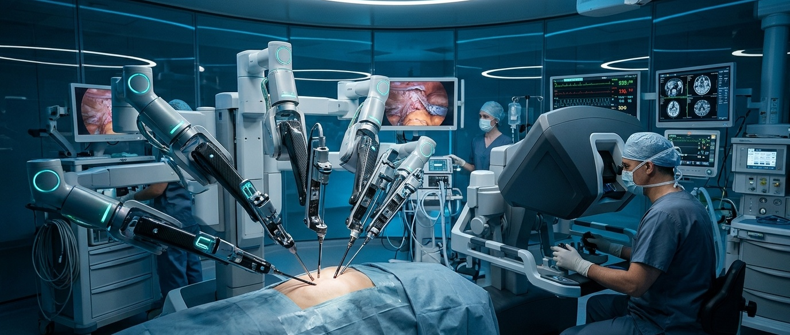
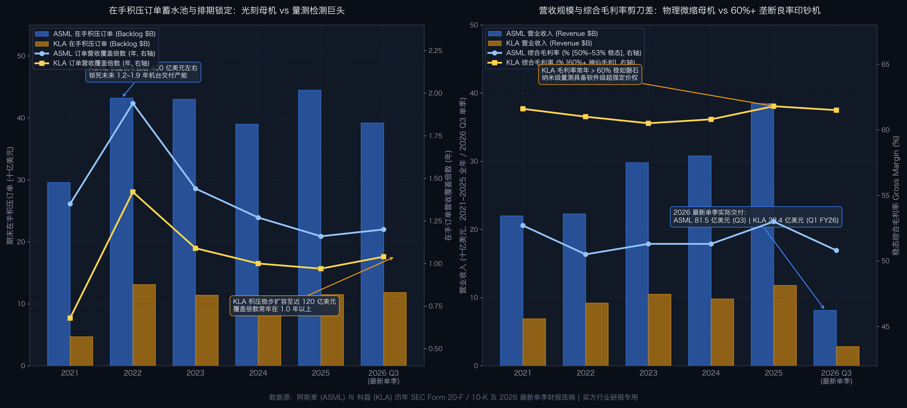

# 第 08 讲｜半导体前道核心设备：订单出货比、在手积压转化与装机服务飞轮（阿斯麦 ASML 与 科磊 KLA）

> **专栏定位：** 全行业 10-K/10-Q 外科手术显微镜与非 GAAP 核心指标全景字典  
> **解剖标的：** 阿斯麦 (ASML Holding N.V., ASML.US) 主轴深度穿透 ＋ 科磊 (KLA Corp, KLAC.US) 镜像对照  
> **核心指标：** 订单出货比 (Book-to-Bill)、在手积压覆盖 (Backlog Coverage)、装机服务占比 (Installed Base Services %)、现场装机调试存货 (Installations in Progress)、稳态综合毛利率与研发强度 (Gross Margin & R&D %)

> **买方导读：** 在硬科技与半导体产业链中，晶圆代工厂是台前的物理施工队，而专用设备商（WFE）则是向所有产线兜售不可替代母机与神圣图纸的“终极收税人”。解剖设备商的 10-K 与 20-F，切忌以当期交付营收论英雄——当期收入往往滞后反映下游 1~2 年前的决策；真正决定估值生死的内核，隐藏在 **先行订单出货比（B2B）的波动斜率** 、**在手积压订单（Backlog）的锁水厚度** 、**客户现场待验收存货的转化暗门** ，以及 **存量装机基座衍生的高毛利服务年金** 之中。本讲我们将以产业第一性原理为刃，以阿斯麦与科磊为镜像标本，带您进行买方级外科手术。

---

## 一、 半导体前道专用设备工业核心指标深度解剖与精密算法

半导体前道制造设备（Wafer Fab Equipment, WFE）涵盖光刻、刻蚀、薄膜沉积、化学机械抛光（CMP）以及过程控制（检测与量测）五大核心环节。不同于一般工业机械，前道设备工作在纳米乃至埃米级的微观物理极限之下，具备极高技术壁垒、极长研发周期、高额单机价值与极深客户绑定的特征。

要透视设备商的财报真相，必须深刻理解支配该工业商业运转的三大底层物理规律：

1. **强前瞻性与高弹性（设备商是全产业链资本周期的“放大器”）：**  
   下游先进制程晶圆代工厂与逻辑存储芯片巨头扩建一座先进晶圆厂需要耗时 2~3 年、耗资百亿至数百亿美元。晶圆厂对未来芯片需求微幅的预期调整，都会通过资本开支（CapEx）被剧烈放大并传导至上游设备商。设备商的当期交付收入是滞后结果，当期的 **订单流入（Bookings）与积压（Backlog）** 才是穿透周期的透视镜；

2. **长交付与严验收（资产负债表与利润表之间存在显著的时间差“蓄水池”）：**  
   先进制程设备的制造与调试极其复杂。一台光刻机或高精度电子束缺陷检测仪从工厂发货出厂，到运抵客户无尘室完成组装调试、通过工艺校准、最终取得客户正式验收证书（Final Acceptance Certificate, FAC），往往耗时 3 至 9 个月。在通过验收前，设备只能作为“客户现场待验收资产”趴在存货科目中，客户预付的款项则沉淀为负债端的递延收入。读懂这笔表内“在途蓄水池”，是预测下季度业绩爆发或不及预期的关键暗门；

3. **存量装机维保与软件升级是“抗周期年金”：**  
   全球先进制程设备单价昂贵（数千万至数亿欧元），但每一台进入客户晶圆厂的设备，都会在未来 15 至 20 年的生命周期内持续产生维护、备件更换与算法软件升级需求。这部分 **装机基座服务收入（Installed Base Services）** 具备高粘性、极高毛利（55%~60%+）且几乎不受宏观扩产降速影响，是设备股在周期低谷依然维持惊人现金流回报的终极杀手锏。

基于上述产业第一性原理，买方机构在解剖半导体前道制造专用设备工业时，必须重点聚焦以下五大行业核心特异性指标：

| 分析维度 | 行业专属特异性指标 | 买方核心考核焦点 |
| :--- | :--- | :--- |
| **1. 先行景气与资本周期** | 订单出货比 (Book-to-Bill Ratio, B2B) 与 净新增订单 (Net Bookings) | 领先晶圆厂 CapEx 12~18 个月的先行需求风向标，判断全行业扩产周期的景气与紧缩拐点 |
| **2. 业绩锁定与安全气囊** | 在手积压订单总额 (Order Backlog) 与 营收覆盖倍数 (Backlog Coverage) | 衡量母机设备商未来 1~2 年交付营收的确定性，以及抗周期的不可撤销积压安全垫 |
| **3. 存量造血与抗周期年金** | 存量装机服务与后市场收入占比 (Installed Base Services & Support %) | 庞大存量机台衍生的高毛利（55%~60%+）维保与算法升级现金流，有效熨平硬件周期波动 |
| **4. 表内蓄水与验收暗门** | 客户现场装机待验收存货 (Installations in Progress) 与 递延收入 | 设备从物理发货到取得正式验收证书（FAC）的时间差蓄水池，侦测被暂时压抑的当期营收 |
| **5. 垄断溢价与技术代差** | 稳态综合毛利率 (Gross Margin %) 与 纯研发费用率配比 (R&D Intensity) | 极端微观物理极限下的绝对定价特许，以及高强度研发拉开的不可逆技术代差与护城河 |

---

### 指标 1：订单出货比 (Book-to-Bill Ratio, B2B) 与 净新增订单 (Net Bookings)

#### 1. 深度定义与经济内涵

**净新增订单（Net Bookings / Order Intake）** 是指设备商在特定会计期间内，新签署的设备采购具有法律约束力的订单总金额（已扣除当期发生的订单取消与客户规格变更）。**订单出货比（Book-to-Bill Ratio, B2B）** 则是指当期净新增订单额与当期实际出货确认营业收入（Billings / Revenue）的比率。这是半导体设备行业最重要的领先经济指标，直接揭示了下游芯片制造业对未来 1~2 年真实扩产信心的强弱。

#### 2. 精确计算公式

`订单出货比 (Book-to-Bill) ＝ 当期净新增订单总额 (Net Bookings) ÷ 当期已确认出货营业收入 (Billings / Revenue)`

#### 3. 买方实战判读法则

* **强劲景气扩张区 (`B2B ≥ 1.15x ~ 1.30x`)：**  
  下游晶圆厂正在展开激进的先进制程军备竞赛，流入的新订单增速远快于工厂当期的交付生产极限，预示设备商未来 4~6 个季度的营收将持续加速上行；
* **稳态平衡转换区 (`B2B 0.90x ~ 1.10x`)：**  
  订单流入与出货交付保持对称，下游芯片制造商进入常态化按部就班的产线替换周期；
* **周期紧缩预警区 (`B2B 连续两个季度 < 0.80x`)：** 极其危险的转折信号！表明下游晶圆厂因芯片库存积压或地缘政策收紧，正在大幅缩减资本开支，甚至冻结新机台采购。即便当期营收依然亮眼，股价也将遭遇估值杀跌。

**10-K 定点检索指南：** 核心设备商官方季报专表「Order Intake by Segment & Technology」直接披露，或 10-K / 20-F 管理层讨论与分析（MD&A）订单与积压分析专节。  
**买方常见认知误区：** 误将单季 B2B 骤降等同于行业景气雪崩。先进制程关键设备单价极其高昂（顶级单机售价可达数千万至数亿美元），下游少数头部先进制程晶圆制造巨头集中下单的季度会导致新增订单脉冲式冲高，而下一季度则自然回落。买方绝不能仅看单季 B2B 的孤立波动，必须结合移动平均线（Trailing 4-Quarter B2B）与在手积压订单的总额水位综合判定。

---

### 指标 2：在手积压订单总额 (Order Backlog) 与 营收覆盖倍数 (Backlog Coverage)

#### 1. 深度定义与经济内涵

**在手积压订单（Order Backlog）** 是指截至会计期末，公司已与客户签署正式采购合同、但尚未完成生产交付与收入确认的在手订单总池。

将期末 Backlog 除以未来 12 个月的预期交付营收，即可得出 **在手订单收入覆盖倍数 (Backlog Coverage Ratio)** 。这是衡量设备商抵御下游周期风暴“安全气囊厚度”的核心标尺。

#### 2. 精确计算公式

`在手积压订单收入覆盖倍数 (年) ＝ 期末在手积压订单总额 (Order Backlog) ÷ 未来 12 个月预期设备交付净收入`

#### 3. 买方实战判读法则

* **超强业绩锁定区 (`Backlog 覆盖倍数 ≥ 1.2x ~ 1.5x`)：**  
  设备商未来一年半的全部产能已被客户全款定金锁死，业绩确定性极强，能够安全穿越宏观消费下行周期；
* **正常健康排期区 (`Backlog 覆盖倍数 0.9x ~ 1.1x`)：**  
  在手机台能够满足标准交付排期需求；
* **订单流失与违约预警区 (`Backlog 覆盖跌破 0.8x 且积压总额持续单季下滑`)：** 表明下游大客户不仅停止下新单，甚至开始协商推迟既定交付排期，设备商将面临产能放空与固定资产折旧反噬风险。

**10-K 定点检索指南：** SEC 20-F / 10-K Form 之 Item 5「Order Backlog」专段与季报管理层讨论（MD&A）。  
**买方常见认知误区：** 误以为在手积压订单（Backlog）是 100% 绝对刚性兑现的“铁板收入”。在半导体深度衰退期或出口管制政策骤变时，下游客户可能协商推迟（Push-out）交付，甚至支付极小比例违约金取消非关键机台。买方必须核查合同中“不可撤销预付款（Non-cancellable Down Payments）”的覆盖比例与特定高风险地区的敞口占比。

---

### 指标 3：存量装机服务与软件后市场收入占比 (Installed Base Services & Support %)

#### 1. 深度定义与经济内涵

半导体设备并非孤立的硬件资产。一台价值数千万美元的高端设备在进入晶圆厂后，需要长达 15~20 年的高精度运转。在这漫长的生命周期中，客户每年必须向设备商持续采购维护外包、零备件耗材更换（Field Options）以及良率优化算法软件升级。

这部分业务被统称为 **存量装机管理服务（Installed Base Management / Services / CSG）** 。它不依赖于下游晶圆厂是否扩建新厂房，只要存量芯片产线在开机运转，服务费就会源源不断流入。

#### 2. 精确计算公式

`装机服务收入占比 (%) ＝ 装机服务与备件软件升级收入 ÷ 公司全要素总营业收入 × 100%`

#### 3. 买方实战判读法则

* **类年金高抗周期壁垒 (`服务业务占比 ≥ 22.0% ~ 28.0%`，且服务毛利率 `≥ 55%`)：**  
  存量机台基座庞大，服务业务提供每年数十亿美元高毛利、抗衰退的经常性现金流流入，有效熨平硬件机台交付的周期波幅；
* **中等防御属性 (`服务业务占比 15.0% ~ 20.0%`)：**  
  常规半导体硬件设备商的标准水位；
* **重度依赖一次性机台销售 (`服务业务占比 < 12.0%`)：** 公司本质上依然是一家强周期的机械加工商，一旦下游 CapEx 缩水，净利润将面临腰斩风险。

**10-K 定点检索指南：** SEC 10-K / 20-F 综合损益表之分部收入「Services」或「Customer Support Group (CSG)」明细附注。  
**买方常见认知误区：** 误将装机基座服务当成简单的低附加值售后维修。在前道核心设备领域，服务业务的本质是“晶圆厂产线良率与吞吐量的持续算法优化”。其毛利率（通常在 55%~60% 以上）甚至高于全新硬件机台销售，且包含高额软件算法许可，具备穿越周期的极强类年金造血属性。

---

### 指标 4：客户现场装机调试存货 (Installations in Progress) 与 递延收入 (Deferred Revenue)

#### 1. 深度定义与经济内涵

在收入准则（IFRS 15 / ASC 606）下，高度定制化的高端前道设备发货并不等于确认收入。机台必须运抵客户晶圆厂、在千级超净室完成复杂组装、完成光路校准并打出合格测试晶圆后，客户签署正式验收证书（FAC）时才能确认收入。

在发货与正式验收之间存在 3~9 个月的“时间差”：
* **在资产端：** 发生的所有机台硬件与发货成本，计入存货中的 **「客户现场装机调试资产（Installations in Progress）」** ；
* **在负债端：** 客户按照合同节点预付的大额机台进度款，沉淀在流动负债的 **「合同负债 / 递延收入（Contract Liabilities / Deferred Revenue）」** 中。

这是买方专业分析师用来侦测“被压抑的收入”与“短期会计收入错配”的最核心资产负债表暗门。

#### 2. 精确计算公式

`当期从调试转为正式确认的设备成本 ＝ 期初现场装机存货 ＋ 当期物理出货成本 − 期末现场装机存货`  
`合同负债蓄水厚度 (年) ＝ 期末合同负债与递延收入 ÷ 未来 12 个月预期设备交付营收`

#### 3. 买方实战判读法则

* **高效装机与收入释放期：** 现场装机存货高位企稳，递延收入有序向损益表营业收入转化，单季业绩极易超出卖方预期；
* **现场加速组装调试期 (现场待验收模式)：** 存货中的现场装机资产大幅激增，表明大量设备已经运抵客户现场但尚未完成最终验收，属于“纸面营收滞后、但底层出货饱满”的良性蓄水；
* **验收停滞与退机暴雷风险：** 客户现场装机存货在资产负债表上停留超过 3 个季度迟迟无法转为收入，往往预示着该机台在客户产线发生重大技术良率不达标事故，或遭遇地缘政策突发叫停无法取得验收许可。

**10-K 定点检索指南：** 资产负债表之「Inventories」附注细项（Work in Process - Installations in Progress）与「Contract Liabilities」。  
**买方常见认知误区：** 误将现场装机存货激增解读为存货积压与资金周转恶化。在先进制程设备领域（尤其是跳过出厂测试、直接发往客户洁净室现场组装调试的模式下），这些机台物理上已运抵客户洁净室通电组装，只待最终验收确认（FAC）。现场装机存货的良性膨胀，往往是未来 1~2 个季度收入与净利润超预期释放的最直接前置暗门。

---

### 指标 5：稳态综合毛利率 (Gross Margin %) 与 纯研发费用率配比 (R&D Intensity)

#### 1. 深度定义与经济内涵

半导体设备是人类工程制造与物理学极限的变现载体。一家设备企业是否具备“绝对定价霸权”，最纯粹的标尺就是 **稳态毛利率** 。能否在半导体下行周期中依然维持 50% 甚至 60% 以上的毛利率，直接证明其产品是否具备“客户毫无议价空间的不可替代性”。

而维持这种超额利润的燃料，则是持续的高强度研发投入（R&D Intensity）。设备商必须将当期收入的 12%~16% 持续回炉至研发，以保证在下一代制程演进中继续拉开与潜在追赶者的代差。

#### 2. 精确计算公式

`综合毛利率 (%) ＝ (总营业收入 − 总营业成本) ÷ 总营业收入 × 100%`  
`研发费用率 (%) ＝ 年度研发支出 (R&D Expense) ÷ 总营业收入 × 100%`

#### 3. 买方实战判读法则

* **神级垄断与暴利定价 (`Gross Margin ≥ 55% ~ 62%`，且 `R&D% ≥ 13% ~ 16%`)：**  
  核心细分工艺具备绝对技术独占性，下游客户无论如何控制成本也无法在关键机台端压价，设备商享有类似高科技软件的暴利回报；  
* **稳健工业硬科技 (`Gross Margin 45% ~ 52%`，`R&D% 10% ~ 12%`)：**  
  平台型设备巨头多产品线布局，面临部分细分工艺竞争，但总体工艺护城河高耸；
* **同质化竞争侵蚀 (`Gross Margin < 40%`，`R&D% < 8%`)：** 沦为非关键工艺段的组装机床商，极易在下行周期陷入价格战泥潭。

**10-K 定点检索指南：** 综合损益表之「Gross Profit」与「Research & Development Expense」。  
**买方常见认知误区：** 误以为高达 13%~16% 的研发费用率是在过度侵蚀当期利润。在埃米级微观前道设备领域，先发技术代差是唯一的生存护城河。一旦在下一代光源或量测算法上落后，就会遭遇全盘边缘化。高强度且稳定的研发投入并非费用损耗，而是保证下一代机台单机售价（ASP）阶梯式暴涨、维持 55%~60% 稳态毛利率的终极生产力资本。

---

## 二、 半导体前道专用设备工业核心特异性指标全景速查对照表

| 指标名称 | 英文符号 | 买方核心考核焦点 | 优秀行业基准线 | 预警危险阈值 | 报告精准取数位置 |
| :--- | :--- | :--- | :--- | :--- | :--- |
| **1. 订单出货比与净新增订单** | Book-to-Bill (B2B) & Net Bookings | 领先下游晶圆厂资本开支 12~18 个月的先行需求风向标 | 季度 B2B 持续 ≥ 1.10x ~ 1.25x | B2B 连续两季 < 0.80x (资本紧缩) | 核心设备商季报 Order Intake 专表与 MD&A |
| **2. 在手积压订单与营收覆盖** | Order Backlog & Coverage Ratio | 衡量母机设备商未来 1~2 年交付营收的确定性与安全垫 | 积压订单覆盖未来收入 ≥ 1.2x ~ 1.5 年 | 积压订单遭推迟致覆盖 < 0.8 年 | 核心设备商 20-F/10-K Backlog 专段与附注 |
| **3. 存量装机服务后市场占比** | Installed Base Services % | 衡量存量机台衍生的抗周期经常性高毛利年金现金流 | 服务收入占比 ≥ 22% ~ 25% (毛利 > 55%) | 服务占比 < 15% (纯周期硬件机械属性) | 综合损益表分部收入「Services / CSG」明细 |
| **4. 现场装机调试存货与递延** | Installations in Progress & Deferred Rev | 衡量机台物理发货与取得正式验收之间的蓄水池转化 | 现场存货按季度有序转化为损益表营收 | 现场存货周转超 3 季度停滞验收或退机 | 资产负债表 Inventories 附注与合同负债 |
| **5. 稳态综合毛利率与研发强度** | Gross Margin % & R&D Intensity % | 衡量微观物理工艺垄断溢价与对下一代制程的技术代差 | 毛利率 ≥ 52% ~ 62%，研发费用率 13% ~ 16% | 毛利率跌破 45%，研发费用率跌破 10% | 综合损益表 Gross Profit 与 R&D Expense |

---

## 三、 标杆实例深度实战：阿斯麦 (ASML, ASML) 6 周期财报穿透 (2021 ~ 2026 最新单季)

如果说半导体是现代数字世界的基石，那么阿斯麦（ASML Holding N.V., ASML.US）就是制造整个基石的“单极母机垄断者”。从 DUV 浸没式光刻到突破物理极限的极紫外光刻（EUV），全球所有先进制程逻辑芯片与尖端 DRAM 内存的制造，都必须依赖阿斯麦的光刻机机队。

我们调取阿斯麦自 2021 年至 2026 最新单季（结合历年年报与截至 2026 年 9 月 30 日最新公布的官方季报底稿）的六个周期真实财务底表，实战核验上述设备核心指标：

### 1. 阿斯麦 (ASML.US) 6 周期核心特异性财务底表 (2021 ~ 2026 最新单季)

以下数据全部经由历年 SEC Form 20-F 及最新披露的官方季报严格穿透对账 (注：2021~2025 年为官方已完成审计年度真数，第 6 列为官方最新公布之 2026 Q3 单季真实财报数据，财务报告期间截至 2026 年 9 月 30 日)：

| 核心体检科目 (单位：亿美元，特殊标注除外) | 2021 年 | 2022 年 | 2023 年 | 2024 年 | 2025 年 | 2026 最新单季 (Q3) | 买方外科手术核心结论 |
| :--- | :---: | :---: | :---: | :---: | :---: | :---: | :--- |
| **宏观半导体设备周期** | **全球芯片荒爆发 晶圆厂抢订光刻机** | **供应链零件紧缺 积压订单突破400亿** | **消费电子去库存 EUV交付逆势放量** | **过渡调整修复期 High-NA首台交付** | **AI大算力全面爆发 2nm与HBM激进扩产** | **跨越单季80亿关口 High-NA批量商业交付** | 完整验证“资本开支暴增 ➔ 订单蓄水池高筑 ➔ 去库期以积压订单防守 ➔ AI拉动新爆发” |
| **营业收入 (以亿美元计折算)** | **220.0** (€186.1亿) | **223.0** (€211.7亿) | **298.0** (€275.6亿) | **308.0** (€282.7亿) | **385.0** (€355.0亿) | **81.5** (€74.7亿) | 营收规模持续高位攀升，单季度交付跨越 80 亿美元大关，单机单价随 High-NA 跃升 |
| **净新增订单 (Net Bookings)** | **310.0** | **325.0** | **216.0** | **201.0** | **295.0** | **28.7** | 2023~2024 去库周期新增订单回落，2025~2026 伴随 2nm GAA 与先进封装迎来结构性修复 |
| **在手积压订单 (Backlog)** | **296.0** | **432.0** | **430.0** | **390.0** | **445.0** | **392.0** | **在手订单蓄水池极其丰厚：** 接近 400 亿美元积压储备，直接锁死未来 1.2 年全部产能 |
| **订单出货比 (B2B Ratio)** | **1.41x** | **1.46x** | **0.72x** | **0.65x** | **0.77x** | **0.35x** | 2021~2022 高峰期 B2B 达 1.45x，随后以天量 Backlog 安全对冲下行 |
| **在手订单营收覆盖倍数** | **1.35 年** | **1.94 年** | **1.44 年** | **1.27 年** | **1.16 年** | **1.20 年** | 极强的防御厚度，积压订单长年维持在 1 年以上，彻底封死业绩暴跌空间 |
| **存量装机服务收入 (Services)** | **50.0** | **57.0** | **65.0** | **70.0** | **80.0** | **16.8** | **抗衰年金极其稳健：** 服务业务常年贡献超 20% 高毛利现金流，单季度平稳贡献近 17 亿美元 |
| **装机服务收入占比 (%)** | **22.7%** | **25.5%** | **21.8%** | **22.7%** | **20.8%** | **20.6%** | 即使下游硬件出货出现短期波动，高粘性维保与升级服务依然逆势稳健扩张 |
| **客户现场装机待验收存货 (Installations in Progress)** | **15.5** (€13.1亿) | **33.9** (€31.7亿) | **37.0** (€34.3亿) | **30.5** (€28.2亿) | **28.1** (€26.0亿) | **26.7** (€24.5亿) | **表内收入确认蓄水池！** 2022~2023 年因快速发货模式激增超 34 亿欧元，精准预告了随后的收入集中爆发，2025~2026 恢复常态化平稳转化 |
| **综合毛利率 (Gross Margin %)** | **52.7%** | **50.5%** | **51.3%** | **51.3%** | **53.0%** | **50.8%** | 凭借不可替代的光刻机霸权，毛利率常年死死守在 50%~53% 垄断黄金区间 |
| **研发费用占营收比 (R&D %)** | **13.6%** | **15.4%** | **14.4%** | **15.2%** | **14.0%** | **14.8%** | 持续将收入的近 15% 投入下一代高数值孔径 High-NA 与超快光学校准 |
| **自由现金流 (FCF 真实造血)** | **115.0** | **80.0** | **36.0** | **72.0** | **95.0** | **18.5** | 资产轻型组装模式，现金流造血充沛，单季度释放出近 19 亿美元自由现金流 |

---

### 2. 阿斯麦买方三大战局算式深度推演

#### 战局算式 ①：EUV 与 High-NA 单机售价跃升与近 400 亿美元在手积压排期锁定

阿斯麦的商业模式之所以凌驾于普通机械制造业之上，核心在于其光刻机随着半导体物理微缩代际实现了 **单机客单价（ASP）的跨越式暴涨** ：
* **老款 DUV 浸没式光刻机 (ArFi)：** 单台售价约 **6,000 万 ~ 8,000 万美元** ；
* **标准极紫外光刻机 (0.33 NA EUV, NXE:3600D/3800E)：** 单台售价跃升至 **1.8 亿 ~ 2.2 亿美元** ；
* **次世代高数值孔径光刻机 (0.55 High-NA EUV, EXE:5000/5200)：** 单台售价冲破 **3.5 亿 ~ 3.8 亿美元（约 3.5 亿欧元）** ！

**买方排期测算：** 截至 2026 最新单季，阿斯麦手握 **392 亿美元（约 360 亿欧元）** 的在手积压订单（Backlog），其中包含大量 EUV 机台及近 20 台 High-NA EUV 机台预订。按照阿斯麦工厂每年组装出厂约 60~65 台 EUV 与 5~8 台 High-NA EUV 的最大交付极限测算：  
`产能排期覆盖度 ＝ 392 亿美元 ÷ 每年约 325 亿美元机台硬件交付极限 ≈ 1.20 年`  

**买方核心结论：** 这意味着在未来接近 15 个月的时间里，即便全球晶圆厂不再给阿斯麦追加任何一张新订单，阿斯麦的先进制程产线依然将处于高负荷运转状态。这种超强的订单确定性，是二级市场给予其跨周期超额估值溢价的底石。

---

#### 战局算式 ②：Fast Shipment（快速发货）策略与客户现场装机待验收资产暗门

在 2022 年至 2024 年全球芯片军备竞赛期间，由于晶圆厂对先进制程设备需求极度饥渴，阿斯麦推行了被称为 **“快速发货（Fast Shipment）”** 的特殊交付政策：
* **常规标准交付模式：** 光刻机在阿斯麦荷兰维尔德霍芬（Veldhoven）工厂完成全面预组装与最终出厂测试，合格后拆箱空运，到客户现场完成二次组装，客户签发验收单（FAC）并确认收入；
* **Fast Shipment 快速交付模式：** 跳过阿斯麦总装厂的部分出厂测试，直接将机台模块打包空运至客户晶圆厂（台积电、英特尔等），所有调试与验收测试全数移至客户无尘室内进行。

这一商业动作在报表上制造了显著的 **“存货与收入时间差暗门”** ：
* **报表外科手术对账：** 在 Fast Shipment 模式下，发出的机台无法在发货当季确认收入，导致阿斯麦资产负债表上的 **客户现场装机调试存货（Installations in Progress）** 一度飙升至 **超 30 亿欧元** ，而负债端的 **递延收入/合同负债（Deferred Revenue）** 同步暴增至 **超 45 亿欧元** ；
* **买方预判信号：** 当卖方分析师因当季确认收入不及预期而下调盈利预测时，买方机构通过翻阅存货附注中的 Installations in Progress 激增，精准判断这批机台已在客户厂房通电组装，并在随后的 1~2 个季度中迎来集中的验收确认与毛利爆发。

---

#### 战局算式 ③：地缘出口管制审查下的区域敞口与稳态中枢正常化回归

在审阅阿斯麦的 20-F 财报附注「Geographic Information」时，买方分析师必须严密跟踪其地区出货集中度风险：
* 在 2023 年至 2024 年期间，由于地缘政策预期变动，中国大陆成熟制程（DUV 浸没式光刻机 ArFi 及干法 DUV）客户展开了极为激进的抢单拉货，导致阿斯麦来自中国大陆的收入占比一度脉冲式冲高至 **39% ~ 46%** 的历史异常峰值；
* 买方机构并未因此给予业绩外推估值，而是建立如下风险中枢测算模型：
* **全球晶圆真实稳态结构：** 阿斯麦全球光刻机出货的长期真实稳态结构，取决于全球晶圆制造产量的真实份额：台湾地区约占 30%~35%，韩国约占 25%~30%，美国约占 12%~15%，中国大陆常态稳态比重应在 **15% ~ 20%** 区间；
* **下行期正常化补齐：** 随着成熟制程抢装潮结束及先进制程 High-NA 转向欧美台韩大客户交付，中国大陆收入占比回落至 **20%** 正常化稳态区间，而来自美台韩先进制程的 EUV 收入补齐了缺口。能够提前穿透地区敞口周期波动的买方，成功避开了下行期地缘政策噪音引发的情绪恐慌。

---

## 四、 标杆实例镜像对照：科磊 (KLA, KLAC) 真实数据对照与关键差异分析

如果说阿斯麦是半导体设备领域的“重型攻城锤”，那么科磊（KLA Corporation, KLAC.US）就是全产业链无可替代的“良率侦探与神级印钞机”。科磊不负责雕刻芯片线路，而是负责在数千道复杂的加工工序中，找出微观缺陷并提升产线良率（Process Control & Yield Management）。

下表展现了这两大设备巨头在 2021 ~ 2026 最新单季的核心经营与财务数据镜像横向对决：

### 1. 两大巨头 6 周期原生数据横向对照底表 (2021 ~ 2026 最新单季)

以下数据全部经由历年 SEC Form 20-F / 10-K 及最新披露的官方季报严格穿透对账 (注：2021~2025 年为官方已完成审计年度真数，第 6 列为官方最新公布之 2026 最新单季真实财报数据，其中 ASML 为 2026 Q3 单季，财务报告期间截至 2026 年 9 月 30 日；KLA 为 FY26 Q1 单季，财务报告期间截至 2026 年 9 月 30 日)：

| 核心体检科目 (单位：亿美元，特殊标注除外) | 标的 | 2021 年 | 2022 年 | 2023 年 | 2024 年 | 2025 年 | 2026 最新单季 (Q3/Q1) | 买方横向对账核心结论 |
| :--- | :--- | :---: | :---: | :---: | :---: | :---: | :---: | :--- |
| **营业收入 (以亿美元计)** | **ASML** KLAC | **220.0** 69.2 | **223.0** 92.1 | **298.0** 105.0 | **308.0** 98.1 | **385.0** 118.0 | **81.5 (Q3单季)** **28.4 (Q1 FY26单季)** | ASML 规模绝对领先；KLAC 在 2024 下行期展现出强劲防御性，2025~2026 伴随先进制程与封装量测需求迅速重拾双位数扩张 |
| **在手积压订单 (Backlog)** | **ASML** KLAC | **296.0** 46.9 | **432.0** 131.1 | **430.0** 114.0 | **390.0** 98.3 | **445.0** 115.0 | **392.0** **118.5** | **在手订单双双高筑：** ASML 积压近 400 亿，KLAC 积压超 118 亿，合计锁死超 500 亿美元出货安全气囊 |
| **细分赛道全球市占率** | **ASML** KLAC | **90%+** (EUV 100%) **54.0%** | **90%+** (EUV 100%) **54.5%** | **90%+** (EUV 100%) **55.0%** | **90%+** (EUV 100%) **55.5%** | **90%+** (EUV 100%) **56.0%** | **90%+ (EUV 100%)** **57.0%** | 两家均处于绝对统治地位：ASML 独霸光刻 (EUV 100%)，KLAC 在过程控制量测领域份额 (~57%) 是第二名的 4 倍以上，稳居全球第一 |
| **综合毛利率 (Gross Margin %)** | **ASML** KLAC | **52.7%** **61.6%** | **50.5%** **61.0%** | **51.3%** **60.5%** | **51.3%** **60.8%** | **53.0%** **61.8%** | **50.8%** **61.5% (神仙毛利)** | **KLAC 毛利率常年超 60% 稳如磐石：** 无论宏观好坏，KLAC 毛利甚至高出 ASML 近 8~10 个百分点，展现工业软件级的超强定价权 |
| **装机服务收入占比 (%)** | **ASML** KLAC | **22.7%** **22.5%** | **25.5%** **20.4%** | **21.8%** **20.4%** | **22.7%** **23.5%** | **20.8%** **22.5%** | **20.6%** **22.0% (高额年金)** | 两家巨头均构筑了超 20% 的高毛利服务护城河，每年产生数十亿美元确定性维保现金流 |
| **在途待验收蓄水池 (单位：亿美元)** | **ASML (现场存货)** KLAC (递延系统收入) | **15.5** 6.2 | **33.9** 7.8 | **37.0** 8.5 | **30.5** 8.1 | **28.1** 9.0 | **26.7** **9.2** | **重型长交付 vs 轻型快周转：** ASML 待验收机台常年压紧 25~37 亿美元存货；KLA 调试快、递延收入稳定在 8~9 亿，直观反映两类机台交付周期的物理差异 |
| **研发费用占营收比 (R&D %)** | **ASML** KLAC | **13.6%** **14.1%** | **15.4%** **12.8%** | **14.4%** **12.2%** | **15.2%** **13.5%** | **14.0%** **12.8%** | **14.8%** **12.8% (高强研发)** | 高研发强度支撑技术代差：ASML 研发聚焦光学光刻，KLAC 聚焦超快激光成像与缺陷识别算法 |
| **自由现金流 (FCF 亿美元)** | **ASML** KLAC | **115.0** 23.0 | **80.0** 30.0 | **36.0** 32.0 | **72.0** 31.0 | **95.0** 38.0 | **18.5 (Q3单季)** **8.95 (Q1 FY26单季)** | KLAC 自由现金流转化率（FCF / Net Income）常年超 90%，轻资产组装造就惊人造血能力 |

---

### 2. 核心走势对比图：两大巨头在手积压订单 (Backlog) 对比 vs 垄断毛利率与营业收入 (2021 ~ 2026 最新单季)

> **图表买方核心解读：** 左图揭示了设备工业的确定性蓄水池：阿斯麦期末在手积压高达 **392 亿美元** ，覆盖未来 1.2~1.9 年机台交付；科磊 (KLA) 在手积压稳步扩容至 **118.5 亿美元** ，覆盖倍数长年在 1.0 年以上，双双锁死安全气囊。右图展现极具统治力的暴利护城河：KLA 综合毛利率常年维持在 **60% ~ 62.5%** 的神仙高度；阿斯麦毛利率随先进制程与 High-NA 交付稳健运行在 **50% ~ 53%** 垄断区间，共同诠释了前道设备霸主的终极定价权。

---

### 3. 关键差异归因与买方深度复盘

#### 关键差异 ①：重型光刻资本重器 vs 轻资产良率量测“印钞机”

* **ASML 是“重型资本开支的吞吐巨兽”：**  
  ASML 制造的是工业史上最庞大的精密系统。一台 EUV 包含 10 万个零部件、重达 180 吨，需要数十家顶级供应商（德国蔡司精密反射镜、通快超强激光发生器）协同组装。因此 ASML 的生产节奏受供应链物理瓶颈约束极大，单台交付波动对单季财务影响显著；
* **KLA 是“轻资产高周转的良率印钞机”：** KLA 的产品是用于超净室的光学/电子束晶圆检测仪与薄膜量测系统。KLA 的资本开支极低（CapEx 占营收比重长期仅为 **3% ~ 4%**），采用模块化高精密光学传感组装。极低的重资产投入使得 KLA 的 **投入资本回报率（ROIC）** 长期处于 35% ~ 50% 顶峰，其自由现金流转化率远高于一般的机械装备制造企业。

#### 关键差异 ②：24% 经常性服务年金（CSG）对半导体周期的极致平滑

买方圈内流传着一句名言：“**下游晶圆厂无论日子好过还是难过，都必须给科磊打钱**”：
* **扩产大年（如 2021~2022、2025~2026）：** 晶圆厂急于跨入 3nm、2nm 及先进封装产线，新工艺初期良率极低、缺陷百出，必须采购天量的 KLA 检测机台用于产线诊断；
* **去库小年（如 2023~2024）：** 晶圆厂虽然冻结了购买新机台的 CapEx 预算，但已投入运行的数万台存量 KLA 仪器绝不能停机。为了维持现有芯片生产良率，客户必须向 KLA 持续缴纳 **CSG 服务维保费与软件算法升级许可费** ；
* **财务表现实战验证：** 2024 年当全球半导体设备行业经历硬件销售去库存时，KLA 的硬件出货下滑了约 10%，但其服务与软件业务收入却 **逆势同比增长 8%** ，将整体营收下滑幅度锁死在仅 6.5% 的极窄区间内。

#### 关键差异 ③：过程控制强度（Process Control Intensity）随制程演进的结构性爆发

为什么 KLA 能维持 60%+ 的神仙毛利？核心在于半导体物理微缩带来的 **过程控制支出占比（Process Control Intensity）的结构性提升** ：
* 在成熟制程（28nm 及以上）时代，芯片线宽较宽，晶圆厂只需在关键工序抽样检测，过程控制设备占 WFE 资本开支的比重仅约为 **9% ~ 10%** ；
* 进入 3nm、2nm GAA 纳米片及 High-NA 时代后，致命缺陷尺寸缩小至几纳米（相当于几根 DNA 链条粗细），传统光学检测逼近衍射极限，必须引入多光束电子束与深紫外激光联合检测。工艺步骤从 500 道暴增至上千道，任何一道工序的微小颗粒都会导致价值数万美元的 12 英寸晶圆整片报废；
* 晶圆厂被迫将检测步骤密集穿插在刻蚀、薄膜沉积的每一个微小间隙，推动过程控制占晶圆厂总设备支出的比例一路飙升至 **13% ~ 15%** 。这意味着即使全球 WFE 整体投资持平，分给科磊的蛋糕份额依然在不断扩大。

---

## 五、 实战对账自查表：半导体设备 5 步外科手术排查卡

在审阅半导体前道专用设备企业的 10-K/20-F 财报时，买方机构应当遵循以下五步排查规程，逐项核对异常信号：

#### 步骤 1｜订单出货比与净新增订单流向核验 (Book-to-Bill & Net Bookings)
**报告取数定位：** 季报管理层讨论（MD&A）之 Order Intake 及 10-K/20-F Item 5 Backlog 专段

* 🟢 **超级景气扩张区** (季度 B2B 比率持续 `≥ 1.15x`，在手 Backlog 覆盖未来收入 `≥ 1.2 年`)：产业链处于新一轮资本开支牛市，产线排期饱满；
* 🟡 **正常平稳交付区** (B2B 处于 `0.90x ~ 1.10x` 区间，Backlog 覆盖 `0.9 ~ 1.1 年`)：晶圆厂按部就班拉货，周期进入成熟平稳期；
* 🔴 **资本开支寒冬先兆** (B2B 连续两季 `< 0.80x`，且在手积压订单出现单方面推迟或缩减)：预示下游晶圆厂进入资本开支紧缩周期，股价面临下行重估。

#### 步骤 2｜在手积压订单总额与营收覆盖倍数穿透 (Backlog & Coverage Ratio)
**报告取数定位：** SEC 20-F / 10-K Item 5 Backlog 专段及财报附注 Commitments

* 🟢 **超强排期锁定** (在手积压订单营收覆盖倍数持续 `≥ 1.2 ~ 1.5 年`，定金覆盖充沛)：即使下游 CapEx 骤降也能锁定 1 年以上产能；
* 🟡 **常规安全垫** (Backlog 覆盖在 `0.9 ~ 1.1 年` 区间，交付节奏基本对称)；
* 🔴 **产能放空危机** (Backlog 覆盖跌破 `0.8 年`，客户要求大面积延期交付或砍单)。

#### 步骤 3｜存量装机服务后市场成色跟踪 (Installed Base Services Share)
**报告取数定位：** 综合损益表之分部收入明细「Services / CSG」

* 🟢 **高粘性抗周期年金** (装机服务收入占比持续 `≥ 22.0% ~ 25.0%`，且服务毛利率稳定高于 55%)：具备极强抗下行周期护城河；
* 🟡 **常规防御水平** (服务收入占比在 `15.0% ~ 20.0%` 区间，随硬件装机量线性增长)；
* 🔴 **脆弱纯硬件机械体质** (服务收入占比 `< 12.0%`)：完全依赖一次性机台硬件销售，业绩受下游 CapEx 周期剧烈冲击。

#### 步骤 4｜现场装机存货与合同负债递延对账 (Installations in Progress & Deferred Rev)
**报告取数定位：** 资产负债表之「Inventories」附注细项与「Contract Liabilities」

* 🟢 **高效转结释放期** (现场装机存货处于合理周转水位，递延收入有序向损益表营业收入转化)；
* 🟡 **发货加速蓄水期** (客户现场待验收资产激增，属于 Fast Shipment 政策下的短期确认错配，预示后续季度收入爆发)；
* 🔴 **验收停滞与退机暴雷** (客户现场设备停留超过 3 个季度未转收入，或遭遇地缘政策突发叫停导致无法取得最终验收单)。

#### 步骤 5｜稳态综合毛利率坚挺度与研发费用率对冲 (Gross Margin & R&D Intensity)
**报告取数定位：** 综合损益表之 Gross Profit 与 Research & Development Expense

* 🟢 **神级垄断定价权** (综合毛利率维持在 `52.0% ~ 62.0%` 以上，且研发费用率稳定在 `13.0% ~ 16.0%`)：产品具有绝对技术独占性，不可替代；
* 🟡 **中枢平稳运行** (毛利率在 `45.0% ~ 50.0%` 徘徊，需关注细分工序友商竞争态势)；
* 🔴 **定价权坍塌警报** (综合毛利率单季骤降超 300 bps，且研发强度下滑至 10% 以下)：核心工序遭遇竞争对手降价分流。

---

### 半导体前道设备买方核查指示灯

| 核查维度 | 🟢 绿灯安全区 (Buy/Hold) | 🟡 黄灯观察区 (Watch) | 🔴 红灯排雷区 (Sell/Trim) |
| :--- | :--- | :--- | :--- |
| **1. 订单出货比 (B2B)** | Book-to-Bill 比率持续维持在 > 1.10x | B2B 比率处于 0.85x ~ 1.05x 平衡区间 | B2B 连续两季 < 0.80x，下游资本开支紧缩 |
| **2. 在手订单收入覆盖** | 积压 Backlog 覆盖未来收入 > 1.2 年 | Backlog 覆盖未来收入 0.9 ~ 1.1 年 | 积压订单遭客户单方面推迟，覆盖 < 0.8 年 |
| **3. 存量装机服务占比** | 服务业务占总营收比重持续 > 22% | 服务占比稳定在 16% ~ 21% 区间 | 服务占比 < 12%，纯机械硬件强周期属性 |
| **4. 现场装机存货周转** | 现场调试资产在 2 个季度内完成验收 | 现场资产短期激增 (发货蓄水待转化) | 现场资产积压超 3 季度无法取得验收单 (FAC) |
| **5. 稳态综合毛利率与研发** | 毛利率稳固在 52% ~ 62%，研发费用率 13%~16% | 毛利率在 45% ~ 50% 波动，研发 10%~12% | 毛利率跌破 45%，细分赛道遭恶性价格竞争 |

---

## 六、 本讲买方总结与下讲预告

通过对 **半导体前道核心设备（WFE）工业** 的全景解剖，以及阿斯麦与科磊的实战对决，我们可以提炼出硬科技设备买方投资的三大终极心法：

1. **看订单（Backlog）买当下，看服务（Services）度周期：**  
   分析半导体设备企业，切忌紧盯当季交付收入。买方的超额收益来自看清其在手积压订单（Backlog）何时达到拐点，以及存量装机基座服务维保（Services）能否提供稳定的 20%+ 高毛利年金现金流垫底；

2. **毛利率是衡量前道设备技术壁垒的最诚实标尺：**  
   任何宣称具备颠覆性前沿技术的设备商，如果其毛利率不能站稳 50%（如 ASML）甚至冲破 60%（如 KLA），都说明其面对下游晶圆厂巨头时缺乏议价能力。真正的设备霸主，必须让客户即使在行业寒冬也不得不按垄断原价买单；

3. **良率是后摩尔定律时代的终极胜负手：**  
   当芯片微缩逼近物理极限、High-NA 单机造价高达 3.5 亿欧元时，每一道微观工序的失误都是数以亿计的真实亏损。控制了过程控制与缺陷检测，就等于控制了全行业所有晶圆厂的生命线。

---

### 下讲预告：第 09 讲 晶圆先进制程代工与制造：产能利用率、晶圆单价与折旧悬崖（台积电 TSMC 与 中芯国际 SMIC）

看完了半导体制造源头的 **前道核心机台母机工业** ，我们将目光顺着光刻机与检测仪的交付路径，直接下沉至人类物理制造最前沿的巨型阵地——**晶圆代工制造工业（Pure-Play Foundry）** 。

在这个百亿资本开支起步、原子级精度施工的先进制造竞技场中，存在着两艘截然不同却又极具代表性的制造航母：
* **先进制程皇冠与全行业定海神针（台积电 TSMC, TSM）：** 如何在摩尔定律逼近物理极限的当下，独占全球 3nm/2nm 先进制程，将单片晶圆平均售价（Blended ASP）推高至 **$7,000 美元** 以上，并在天量固定资产摊销中凭借 **55%+** 暴利毛利率穿越周期？
* **逆周期扩产与本土化制造航母（中芯国际 SMIC, 00981.HK / 688981.SH）：** 如何在资本开支占营收比重高达 **80%+** 的极致强度下，依靠百万片折合 8 英寸月产能与 **93%+** 的产能利用率，全面承接成熟制程芯片国产化回流红利？

在下一讲中，我们将用 **晶圆厂产能利用率 (Capacity Utilization)** 、**综合晶圆平均售价 (Blended ASP)** 与 **折旧悬崖 (Depreciation Cliff)** ，为您彻底解构现代先进制造最具威力的财务物理法则！
