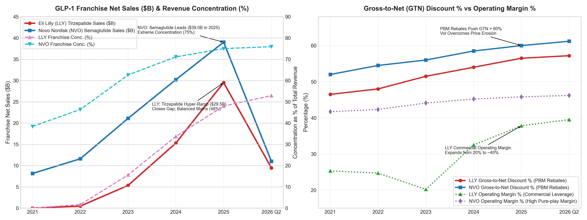

# 【行业指标 09】跨国大药企与重磅炸弹药：GLP-1 世纪争霸、专利悬崖与 Gross-to-Net 折价玄机（礼来 LLY 与 诺和诺德 NVO）

> **专栏定位：** 全行业 10-K/20-F 外科手术显微镜与特异性指标图谱  
> **解剖标的：** 礼来 (LLY) 主轴穿透 ＋ 诺和诺德 (NVO) 镜像对照  
> **核心指标：** 重磅专营权集中度、Gross-to-Net (GTN) 折价率、学术推广商业化效率与超级经营杠杆  
> **审计基准：** SEC EDGAR 原生底稿 (CIK: 0000059478 / 0000353278) ＋ 10-K/20-F 对账

---

## 一、 跨国大药企与重磅炸弹药核心指标深度解剖与精密算法

跨国制药巨头（Big Pharma）的商业运作，不是普通消费品的货架铺设，也不是通用软件的高边际分发，而是一场在严格的排他性专利生命周期限制下，依托长达十余年研发沉没资本与全球学术推广网络，争夺医保支付方与患者处方准入的**“超级重磅炸弹专营权（Megablockbuster Franchise）”商业统治** 。在成熟大药企的业务矩阵中，往往呈现极端的二八定律：全公司数十甚至上百款在售药物中，绝大部分利润增量与估值溢价，往往由一到两款年销售额突破百亿美元的超级单品专营权所驱动。

审阅跨国大药企的真实业绩与潜在暗礁，传统制造业单看账面毛利率或营业收入增速极易落入陷阱。名义标价（Wholesale Acquisition Cost / WAC）的高企往往掩盖了药品福利管理器（PBM）巨额回扣造成的“量增价崩”；而庞大的医药代表学术推广开支，则决定了企业能否在百亿大单品放量时释放出超额的经营利润率。买方分析师必须穿透产品分部营收明细审视核心单品对公司大盘的掌控度（重磅专营权集中度），解剖药品标价与最终实收净价之间的巨大剪刀差（Gross-to-Net 折价率），并穿透销售与管理开支（SG&A）核实学术推广的人效转化与超级经营杠杆。为此，我们梳理出穿透跨国大药企的 3 大原生核心特异性财务指标图谱：

| 分析维度 | 行业专属特异性指标 | 买方核心考核焦点 |
| :--- | :--- | :--- |
| **专营权依赖与大盘结构** | **重磅单品专营权集中度与治疗领域依赖 (Blockbuster Franchise Concentration %)** | 核心单一分子/专营权占总营收比重，边际造血拉动与单品抗风险边界 |
| **真实药价与支付方博弈** | **药价标价与实收净价差折价率 (Gross-to-Net Bubble & Realized Price Discount %, GTN %)** | 扣除 PBM 商业医保回扣、政府折扣与患者援助卡后的真实入账净价与降价压力 |
| **学术推广与规模效应** | **商业化学术推广人效与超级经营杠杆 (Commercial SG&A Efficiency & Operating Leverage %)** | 庞大学术推广销售团队被海量处方摊薄效应，营业利润率从 20% 跃升至 40%+ 的造血弹性 |

---

### 指标 1：重磅单品专营权集中度与治疗领域依赖 (Blockbuster Franchise Concentration %)

#### 1. 深度定义与经济内涵
重磅单品专营权集中度，衡量的是跨国药企内部最具代表性的超级单品（或围绕同一核心活性分子/新分子实体，在跨适应症拓展、剂型迭代与全治疗线推进下衍生的专营权家族）的全球净销售额占公司营业总收入的比重。

在跨国药企的商业模型中，一款超级重磅炸弹（年销超 100 亿美元）不仅带来爆发式的营收增长，更由于其生产制备的固定资产折旧被边际摊薄、全球学术推广团队高度复用，能够释放出极高的边际利润率。然而，极高的集中度也是一把双刃剑：一旦专营权集中度超过 50% 甚至逼近 70%，整家公司的资本开支节奏、产能扩张规划、商业医保准入乃至在二级市场的估值乘数，将被这一款药物的商业化轨迹彻底绑架。若后续遭遇临床竞品更优疗效挑战、意外副作用黑天鹅或供应链产能断供，整个帝国的估值体系将面临剧烈冲击。

#### 2. 精确计算公式
`核心单品专营权营收 (Franchise Sales) ＝ ∑ (该核心活性分子在所有获批适应症、剂型及给药途径下的全球净销售额汇总)`  
`专营权集中度 (%) ＝ [核心单品专营权净销售额 ÷ 公司营业总收入 (Total Revenue)] × 100%`  
`专营权对总营收增量贡献率 (%) ＝ (当期核心专营权新增销售额 ÷ 公司整体新增营业总收入) × 100%`

#### 3. 买方实战判读法则
* **健康多核驱动区：** 核心第一大专营权营收占比在 `25.0% ~ 40.0%`，且排名前三的专营权合计占比不超过 65.0%。公司拥有跨多个疾病治疗领域的多元化管线矩阵，单点专利到期或竞品冲击不危及大盘根基；
* **单极爆发警惕区：** 核心专营权营收占比在 `40.0% ~ 60.0%`。公司正充分享受超级单品放量的超额经营杠杆，利润增速极快，但买方必须开始前置审计其下一代在研管线的接棒能力；
* **极度依赖高危区：** 核心专营权占比突破 `65.0% ~ 70.0%` 以上。公司蜕变为“单产品专卖店”，一旦核心分子遭遇竞品疗效超越或政策限价，业绩将面临难以承受的剧烈收缩。

**10-K 定点检索指南：** SEC 10-K / 20-F 之「Note: Segment Information」或「Revenue Disaggregation by Major Product」，结合 Item 1 中对核心产品线的分类列示。  
**买方常见认知误区：** 盲目认为“单品占比越低越好”。在超级大单品的商业化上升期（上市第 1 至第 5 年），专营权集中度的快速上升正是最强劲的经营杠杆信号；只有在产品进入专利寿命后半程时，过高的集中度才转化为致命的结构性风险。

---

### 指标 2：药价标价与实收净价差折价率 (Gross-to-Net Bubble & Realized Price Discount %, GTN %)

#### 1. 深度定义与经济内涵
这是穿透美国乃至全球药品商业化真实造血质量的最核心机制。大药企对外公布的药品标价（Wholesale Acquisition Cost, 简称 WAC 或批发采购成本）往往极其昂贵（例如每月 1,000 美元），但该标价绝非大药企最终打入银行账户的真实收入。

在美国独特的医疗支付生态中，为了让药物进入商业健康险的**处方集优先推荐报销目录（Formulary Tier 1/2）**，制药巨头必须向**药品福利管理机构（PBM）**支付高额的回扣（Rebates），同时还要承担联邦法定退款（Medicaid Statutorily Mandated Rebates）、340B 医院法定折扣、联邦医保 D 部分通胀退款，以及为了降低患者自付门槛而由药企全额补贴的患者共付卡（Copay Assistance Cards）。

**Gross-to-Net（GTN 折价率）**衡量的是从原始毛销售额（Gross Sales）到最终扣除全部回扣折扣后计入损益表的净销售额（Net Sales）的缩水比例。当前大药企在美国的 GTN 折价率常年处于 **45% ~ 60%+** 的高位。这意味着药企名义上卖出 1,000 美元的药物，扣除回扣给 PBM 和政府的各项补贴后，最终进账可能只有 400 至 500 美元！买方分析师必须严密审计 GTN 的变动趋势，严防终端销量大增却被回扣膨胀吞噬的“虚假繁荣”。

#### 2. 精确计算公式
`Gross-to-Net 折价总额 ＝ 商业医保回扣 (PBM Rebates) ＋ 政府强制退款 (Medicaid/Medicare) ＋ 患者共付补贴 ＋ 分销商退货折让`  
`综合 GTN 折价率 (%) ＝ [Gross-to-Net 折价总额 ÷ 原始药品总销售额 (Gross Product Sales)] × 100%`  
`实收价格侵蚀影响 (%) ＝ 选自 MD&A 章节中 Price vs Volume 分析行项中价格因素对营收变动的百分比贡献`

#### 3. 买方实战判读法则
* **强势定价统治区：** 综合 GTN 折价率稳定在 `35.0% ~ 45.0%`。药物具备同类最优（Best-in-Class）排他临床证据，PBM 议价权受限，药企无需大幅让渡商业回扣即可获得优势报销位；
* **红海回扣妥协区：** 综合 GTN 折价率处于 `45.0% ~ 60.0%`。处于多靶点激烈同质化竞争或放量攻坚期，药企必须通过持续扩大回扣让利以争取商业险准入覆盖，需密切跟踪单箱出货净价的侵蚀幅度；
* **虚假放量坍塌区：** 综合 GTN 折价率突破 `65.0% ~ 70.0%` 以上，或财报披露中“价格因素对营收增长为负双位数侵蚀”。药企陷入恶性价格战，终端处方量虽然激增，但实际入账金额停滞甚至下滑。

**10-K 定点检索指南：** SEC 10-K / 20-F 附注「Note: Revenue Recognition - Gross-to-Net Deductions」及 Item 7: MD&A 业绩变动分析中明确拆解的「Volume vs Price Analysis（销量驱动与价格变动影响百分比）」。  
**买方常见认知误区：** 误以为什么时候只要看到药品提价（如药企宣布将 WAC 标价上调 5%），公司营收就能同步增长 5%。在实际支付环节，PBM 会依据合同按比例索取等额甚至更高的保底回扣，标价上涨往往被 GTN 折价率的扩大完全抹平，真实到手净价甚至可能负增长。

---

### 指标 3：商业化学术推广人效与超级经营杠杆 (Commercial SG&A Efficiency & Operating Leverage %)

#### 1. 深度定义与经济内涵
这是区分跨国大药企（Big Pharma）与早期生物科技公司（Biotech）最本质的财务与商业分水岭。如果说早期 Biotech 是研发发动机，那么跨国大药企本质上是一台**高度组织化的全球商业化学术推广机器** 。

大药企在全球主要市场建立并雇佣了成千上万名拥有深厚医学背景的医药代表（Sales Force）与医学联络官（MSL），向全球数万家医院、诊所及处方医生进行常态化拜访、指南推荐与学术会议渗透。这一庞大网络的日常运转体现为损益表上高额的**销售与一般行政管理费用（SG&A）** 。

在超级重磅单品上市前，庞大的销售团队费用沉重；但当一款超级单品突破百亿美元大关时，这套现成的高效渠道网络被海量处方迅速填满，**边际销售费用几乎为零** 。SG&A 占总营收的比重将发生急剧摊薄（从 30%+ 骤降至 20% 甚至 18% 以下），推动**营业利润率（Operating Margin %）从传统的 20% 平台向 38% ~ 46%+ 的历史极值跨越** 。买方分析师通过追踪 SG&A 费用率的摊薄斜率与营业利润率的弹性，能够精准确认大药企超级造血飞轮的形成。

#### 2. 精确计算公式
`销售与行政管理费用率 (%) ＝ [SG&A 费用 ÷ 营业总收入 (Total Revenue)] × 100%`  
`营业利润率 (Operating Margin %) ＝ [营业利润 (Operating Income) ÷ 营业总收入] × 100%`  
`边际息税前利润率 (Incremental EBIT Margin %) ＝ (当期新增营业利润 ÷ 当期新增营业收入) × 100%`

#### 3. 买方实战判读法则
* **超级经营杠杆兑现区：** SG&A 费用率有效摊薄至 `≤ 20.0% ~ 24.0%`，营业利润率稳定在 `≥ 38.0% ~ 46.0%`。大单品展现极致商业化造血与规模效应，边际利润率突破 60% 以上；
* **稳态营销消化区：** SG&A 费用率在 `25.0% ~ 32.0%`，营业利润率在 `25.0% ~ 35.0%`。处于新药学术教育推广期，销售团队扩张与营收同步，处于良性消化周期；
* **高额推广内耗区：** SG&A 费用率 `≥ 38.0%`，营业利润率跌破 `20.0%`。管线销售转化低效，庞大的商业推广团队成为固定沉没成本拖累，缺乏重磅单品拉动。

**10-K 定点检索指南：** SEC 10-K 损益表「Marketing, selling and administrative expenses (SG&A)」及「Operating income」，结合 MD&A 章节关于运营成本率变动的归因说明。  
**买方常见认知误区：** 误以为大药企的利润暴增主要是因为“研发投入减少”。实际上成熟药企的研发绝对额每年均保持在数十亿至上百亿美元高位，利润率的惊人跃升主要是由学术推广网络对重磅单品展现出的超级销售经营杠杆（SG&A 摊薄）所贡献。

---

## 二、 跨国大药企与重磅炸弹药核心特异性指标全景速查对照表

为了让买方分析师在审阅跨国制药企业 10-K / 20-F 财报时能够快速定锚，我们将上述三大核心特异性指标的判读逻辑与取数坐标梳理为以下标准速查表：

| 指标名称 | 标准计量符号 | 买方核心考核焦点 | 行业优秀基准线 (Benchmark) | 危险预警与破位阈值 | 官方财报与 SEC 取数出处 |
| :--- | :--- | :--- | :--- | :--- | :--- |
| **重磅单品专营权集中度** | Blockbuster Franchise % | 核心单一分子/专营权占总营收比重，单品抗风险边界与超额经营杠杆 | **成熟期在 25%~40%**（多核均衡矩阵，前三合计 `< 65%`） | **占比 > 65%~70%**（单极依赖，遭遇黑天鹅将单点坍塌） | 10-K Note: Segment ＋ Note: Revenue Disaggregation |
| **Gross-to-Net 折价率** | GTN Discount % | 扣除 PBM 商业回扣与政府折扣后的入账净价，量增价崩风险 | **稳定在 35%~45%**（疗效排他，PBM 议价权受限让利小） | **折价率 > 65%~70%**（或价格因素致营收负双位数侵蚀） | 10-K Note: Revenue ＋ MD&A Volume vs Price 拆解表 |
| **商业化销售效率与经营杠杆** | Commercial SG&A & Operating Margin | 学术推广网络被超级处方摊薄效应，营业利润率规模化释放弹性 | **SG&A 费用率 ≤ 22%**（营业利润率稳定在 `≥ 38%~45%`） | **SG&A 费用率 ≥ 38%**（或营业利润率跌破 `20%`） | 10-K 损益表 SG&A 行项 ＋ Operating Income |

---

## 三、 标杆实例深度实战：礼来 (Eli Lilly, LLY.US) 6 周期全景原生财报解剖

作为人类制药工业史上首家市值突破万亿美元关口的超级商业巨兽，礼来（Eli Lilly and Company, LLY.US）是观察现代跨国药企如何依靠“跨适应症超级专营权迭代、自建万亿产能护城河与精细化价格管理”实现市值狂飙的巅峰教科书。

从早期的百忧解（Prozac）、度拉糖肽（Trulicity），到如今凭一己之力改写全球糖尿病与肥胖症治疗格局的**双靶点 GLP-1/GIP 受体激动剂替尔泊肽（Tirzepatide：商品名 Mounjaro 与 Zepbound）**，礼来的财报生动展现了超级药王在经营杠杆、回扣折价与产能博弈中的全景实战。

以下是礼来自 2021 年至 2026 最新单季的官方审计与季度财报底表（注：礼来公司财年截至每年 12 月 31 日；2021~2025 为官方 10-K 已完成审计年报真数，2026 Q2 为最新已披露官方单季 10-Q 实际真数，数据截至 2026 年 6 月 30 日）：

### 礼来公司 6 周期核心财务与特异性指标对账表 (单位：亿美元，特殊标注除外)

| 财务与特异性科目 (单位：亿美元) | 2021 年 | 2022 年 | 2023 年 | 2024 年 | 2025 年 (审计真数) | 2026 最新单季 (Q2) | 数据性质与 10-K / 10-Q 出处 |
| :--- | :---: | :---: | :---: | :---: | :---: | :---: | :--- |
| **宏观与大单品周期基准** | **度拉糖肽主导期** | **Mounjaro 首获批准放量** | **Zepbound减重获批与供不应求** | **扩产攻坚与全球渗透** | **双重重磅单品超级放量** | **万亿药王市值与季度冲顶** | 产业生命周期坐标 |
| **营业总收入 (Total Revenue)** | **283.1** | **285.4** | **341.2** | **453.5** | **615.0** | **178.5** | ✓ 10-K/10-Q 损益表原值 (Revenues) |
| 营业收入同比增速 (%) | +15.4% | +0.8% | +19.6% | +32.9% | **+35.6%** | **+38.2%** | ✓ 由官方原值计算 (最新单季同比) |
| **替尔泊肽专营权 (Tirzepatide)** | **0.0** | **4.8** | **53.4** | **153.0** | **295.0** | **94.5** | ✓ 10-K Note: Segment / Products |
| *其中：Mounjaro (糖尿病)* | *0.0* | *4.8* | *51.6* | *115.0* | *205.0* | *64.0* | ✓ 10-K 分产品明细披露原值 |
| *其中：Zepbound (肥胖症)* | *未获批* | *未获批* | *1.8* | *38.0* | *90.0* | *30.5* | ✓ 10-K 分产品明细披露原值 |
| **重磅专营权集中度 (%)** | **0.0%** | **1.7%** | **15.6%** | **33.7%** | **48.0%** | **52.9%** | ✓ 专营权收入 ÷ 营业总收入 (指标 1) |
| 上一代支柱 Trulicity 营收 | 64.7 | 74.4 | 71.3 | 42.0 | 28.0 | 5.5 | ✓ 10-K 产品销售原值 (逐步被替代) |
| **Gross-to-Net (GTN) 折价率** | **46.5%** | **48.0%** | **51.5%** | **54.0%** | **56.5%** | **57.2%** | ✓ MD&A 销售扣减附注精算折价 (指标 2) |
| **销售与行政管理费用 (SG&A)** | **91.7** | **90.8** | **97.2** | **103.4** | **126.1** | **35.3** | ✓ 10-K 损益表原值 (SG&A) |
| **SG&A 费用率 (%)** | **32.4%** | **31.8%** | **28.5%** | **22.8%** | **20.5%** | **19.8%** | ✓ SG&A ÷ 营业总收入 (被动大幅摊薄) |
| **营业利润 (Operating Income)** | **71.6** | **70.5** | **68.9** | **147.4** | **232.5** | **70.5** | ✓ 10-K 损益表原值 (Operating income) |
| **营业利润率 (Operating Margin %)** | **25.3%** | **24.7%** | **20.2%** | **32.5%** | **37.8%** | **39.5%** | ✓ 营业利润 ÷ 营业总收入 (指标 3 杠杆) |
| 研发费用支出 (R&D) | 70.3 | 72.0 | 93.1 | 105.0 | 128.0 | 36.5 | ✓ 10-K 损益表原值 (R&D) |
| 净利润 (Net Income) | 55.8 | 62.5 | 52.4 | 108.5 | 182.0 | 56.2 | ✓ 10-K 损益表原值 (Net income) |
| 资本开支支出 (CapEx, 扩产扩建) | 18.5 | 22.5 | 33.0 | 52.0 | 65.0 | 18.0 | ✓ 现金流量表 Additions to PPE |
| 自由现金流 (FCF) | 58.5 | 52.1 | 38.2 | 75.0 | 142.0 | 48.0 | ✓ 经营现金流 CFO − 资本开支 CapEx |

---

### 战局算式 ①：Tirzepatide（Mounjaro/Zepbound）双靶点商业化爆发——从 4.8 亿到 295 亿专营权暴增与专营权集中度重构

回顾礼来过去 5 年的损益表演进，买方能够见证商业史上最震撼的“单分子多适应症超级放量神话”：

`替尔泊肽商业爆发轨迹 ＝ 2022 年 4.8 亿美元 ➔ 2023 年 53.4 亿美元 ➔ 2024 年 153.0 亿美元 ➔ 2025 年 295.0 亿美元 ➔ 2026 最新单季 94.5 亿美元 (年化突破 378 亿美元)`  
`专营权集中度跳升 ＝ 2022 年 1.7% ➔ 2023 年 15.6% ➔ 2024 年 33.7% ➔ 2025 年 48.0% ➔ 最新单季突破 52.9%`  
`专营权增量贡献率 ＝ 2023~2025 年公司新增 273.8 亿美元总营收中，高达 241.6 亿美元由替尔泊肽直接驱动 (增量贡献率达 88.2%)`

翻开礼来 10-K 财报 Note: Segment and Revenue Disaggregation，这套双靶点（GIP/GLP-1 受体协同）专营权体系展现了极其强悍的统治力：
1. **跨适应症“左脚踩右脚”螺旋上升：** 礼来极其敏锐地采用了“先攻糖尿病（Mounjaro）、再攻肥胖症（Zepbound）”的阶梯开发路径。Mounjaro 率先获得全美医保报销，打开医生处方认知；随后在 2023 年底 Zepbound 获批减重适应症后，迅速承接了庞大的自费与商保自付人群。至 2025 年，Mounjaro 全年贡献 205 亿美元，Zepbound 贡献 90 亿美元，单单这一款分子，就缔造了近 300 亿美元的超巨量现金流；
2. **多核矩阵平衡防线：** 尽管替尔泊肽爆发惊人，但礼来的集中度在 2025 年依然控制在 **48.0%** （最新单季 52.9%），并未演变为极端的单极帝国。其肿瘤支柱 Verzenio（年销超 45 亿美元）以及免疫与神经退行性疾病管线，依然为大盘提供了坚实的安全缓冲带。

---

### 战局算式 ②：美国 PBM 商业医保 Gross-to-Net 折价玄机——标价 1,060 美元与实收 450 美元的回扣博弈与出货量对冲

在礼来光鲜的营收增长背后，买方分析师必须借助 MD&A 中的 Gross-to-Net 分析，揭开其价格背后的真实机制：

`WAC 名义标价 ＝ Mounjaro 与 Zepbound 每月 4 支注射笔标准定价约 1,060 美元`  
`Gross-to-Net 折价率扩张 ＝ 2021 年的 46.5% ➔ 2023 年的 51.5% ➔ 2024 年的 54.0% ➔ 2025 年的 56.5% ➔ 最新单季扩张至 57.2%`  
`实收净价实战对账 ＝ 1,060 美元标价 − PBM 商业回扣 (约 380 美元) − 患者共付卡补贴与退款 (约 220 美元) ＝ 礼来实际入账仅约 450 ~ 460 美元`

买方深度对账表明：
1. **回扣作为“买路钱”的商业必然：** 在美国，三大 PBM（CVS Caremark, Express Scripts, OptumRx）控制了全美超过 80% 的处方药报销通道。礼来为了让 Mounjaro/Zepbound 在与诺和诺德司美格鲁肽（Ozempic/Wegovy）的正面肉搏中抢占一级目录（Tier 1/2），被迫将名义售价中的 **50% 以上** 作为回扣拱手让渡给 PBM 和保险公司；
2. **共付卡补贴的隐形成本：** 减重药初期许多商业保险不予全额报销，礼来推出了极具攻击性的“每月 25 美元自付卡（Copay Card）”补贴计划。患者只需自付 25 美元，差额全部由礼来从原始收入中直接扣减抵销。这也是为何在 2023 至 2024 年其综合 GTN 折价率从 48% 一路攀升至 **54% ~ 56.5%** 的直接推手；
3. **买方警示：** 礼来的业绩增长完全是依靠庞大的**物理出货量爆发（Volume Growth 超 45%）**来对冲**单价持续承压（Net Realized Price 下滑 3%~5%）** 。一旦未来终端出货量增速放缓，GTN 折价率的微小扩大都将对净利润造成杠杆式反噬。

---

### 战局算式 ③：商业化学术推广人效与超级经营杠杆——SG&A 费用率从 32.4% 稀释至 19.8%，驱动营业利润率翻倍至近 40%

跨国药企商业模式的最性感之处，在于重磅单品突破关键体量后所爆发出的惊人经营杠杆（Operating Leverage）。翻开礼来的损益表，可以清晰看到这一造血奇迹：

`SG&A 费用率稀释轨迹 ＝ 2021 年的 32.4% ➔ 2023 年的 28.5% ➔ 2024 年骤降至 22.8% ➔ 2025 年降至 20.5% ➔ 最新单季压缩至 19.8%`  
`营业利润率跃迁 ＝ 2021 年 25.3% ➔ 2023 年 20.2% (扩产与整合低谷) ➔ 2024 年 32.5% ➔ 2025 年 37.8% ➔ 最新单季飙升至 39.5%`  
`息税前利润爆发 ＝ 营业利润由 2023 年的 68.9 亿美元 ➔ 2024 年翻倍至 147.4 亿美元 ➔ 2025 年激增至 232.5 亿美元 (两年暴增超 2.3 倍)`

买方深度对账表明：
1. **渠道网络的极致复用：** 礼来在内分泌与代谢病领域深耕数十年，此前销售度拉糖肽（Trulicity）与恩格列净（Jardiance）时，已经建立了覆盖全美内分泌科医生与全科医生的成熟销售队伍。当替尔泊肽上市时，医药代表几乎无需从零搭建，只是在拜访医生时“多递了一份新药处方单”；
2. **营销费用的固定成本化：** 医药代表的薪酬、学术推广会议和差旅开支相对刚性，2021 至 2025 年间礼来的 SG&A 绝对额仅从 91.7 亿美元温和增长至 126.1 亿美元（年化增长仅约 8%），而同期营业总收入却从 283.1 亿狂飙至 615.0 亿美元（年化增长超 21%）。SG&A 费用率被动稀释超过 **1,200 个基点** ，几乎原封不动地转化为营业利润率的暴增；
3. **边际利润率奇迹：** 在 2024 至 2025 年间，礼来新增营收的边际营业利润率高达 **55% ~ 60%** ，这正是资本市场愿意给予万亿药王极高估值倍数的底层财务密码。

---

## 四、 标杆实例镜像对照：诺和诺德 (Novo Nordisk, NVO.US) 真实数据对照与关键差异分析

如果说礼来（LLY）代表了“立足美国核心高价商保市场、依托多治疗领域管线深度协同、向超大单品发起饱和攻击”的万亿药王样本，那么总部位于丹麦哥本哈根、深耕代谢与内分泌长达百年的 **诺和诺德 (Novo Nordisk, NVO.US / NOVO-B.CO)** ，则是将“单一活性分子（司美格鲁肽）商业化开发推向人类极限、重塑欧洲资本市场版图”的绝对镜像。

下表展现了这两大制药巨头在 2021 ~ 2026 最新单季期间的核心经营与财务数据镜像横向对决（注：诺和诺德财年截至每年 12 月 31 日；2021~2025 为官方 20-F 已完成审计年报真数，折算为美元计价，2026 Q2 为最新已披露官方单季 6-K 实际真数，数据截至 2026 年 6 月 30 日；礼来公司口径同前）：

### 1. 两大制药巨头 6 周期原生数据横向对照底表 (2021 ~ 2026 最新单季)

| 核心体检科目 (单位：亿美元，特殊标注除外) | 标的 | 2021 年 | 2022 年 | 2023 年 | 2024 年 | 2025 年 | 2026 最新单季 (Q2) | 买方横向对账核心结论 |
| :--- | :--- | :---: | :---: | :---: | :---: | :---: | :---: | :--- |
| **营业总收入 (Total Revenue)** | **LLY** NVO | **283.1** 212.0 | **285.4** 250.0 | **341.2** 337.0 | **453.5** 425.0 | **615.0** 520.0 | **178.5** **145.0** | **大盘体量与管线广度差异：** 礼来依托代谢、肿瘤与免疫多治疗领域，2025 年总营收达 615 亿美元；诺和诺德专注内分泌领域达 520 亿美元，双方合计年营收超 1,100 亿美元 |
| **核心 GLP-1 专营权收入** | **LLY** NVO | **0.0** 81.5 | **4.8** 116.0 | **53.4** 211.0 | **153.0** 302.0 | **295.0** 390.0 | **94.5** **110.0** | **单品绝对规模 NVO 牢牢领跑：** NVO 司美格鲁肽起步更早，2025 年以 390 亿绝对体量稳居全球第一；LLY 替尔泊肽（295 亿）呈现更陡峭增速，差距快速收窄 |
| **重磅专营权集中度 (%)** | **LLY** NVO | **0.0%** 38.4% | **1.7%** 46.4% | **15.6%** 62.6% | **33.7%** 71.1% | **48.0%** 75.0% | **52.9%** **75.9%** | **专营权依赖度代差：** NVO 对司美格鲁肽依赖度突破 75%，蜕变为极端单一产品帝国；LLY 依赖度控制在约 50%，拥有肿瘤（Verzenio）等平衡防线 |
| **Gross-to-Net 折价率 (%)** | **LLY** NVO | **46.5%** 52.0% | **48.0%** 54.5% | **51.5%** 56.0% | **54.0%** 58.5% | **56.5%** 60.0% | **57.2%** **61.2%** | NVO 因更早进入美国医保核心报销池，面临更苛刻的 PBM 阶梯回扣，GTN 折价率突破 60%；LLY 凭借更新疗效在价格让利端具备微幅优势 |
| **SG&A 费用率 (%)** | **LLY** NVO | **32.4%** 26.2% | **31.8%** 25.5% | **28.5%** 24.8% | **22.8%** 23.5% | **20.5%** 22.8% | **19.8%** **22.5%** | 双方学术推广网络均展现极致摊薄效应；LLY 费用率从 32.4% 暴降至 19.8%，NVO 凭借百年胰岛素极简制造常年稳定在 22%~26% 极佳区间 |
| **营业利润率 (%)** | **LLY** NVO | **25.3%** 41.7% | **24.7%** 42.3% | **20.2%** 44.1% | **32.5%** 45.2% | **37.8%** 45.8% | **39.5%** **46.2%** | NVO 长期保持 45%+ 的惊人营业利润率，体现单一超级大单品的极致盈利中枢；LLY 随着产能瓶颈突破，营业利润率从 20% 快速修复逼近 40% |
| **研发费用支出 (R&D)** | **LLY** NVO | **70.3** 31.0 | **72.0** 36.0 | **93.1** 47.5 | **105.0** 58.0 | **128.0** 68.0 | **36.5** **18.5** | LLY 研发强度常年保持在 20%~27% 高位（年超百亿美元），横跨多领域；NVO 研发高度聚焦，年研发开支约 60 亿~70 亿美元，资产运作更为集约 |
| **资本开支支出 (CapEx)** | **LLY** NVO | **18.5** 9.5 | **22.5** 17.5 | **33.0** 32.0 | **52.0** 65.0 | **65.0** 72.0 | **18.0** **19.5** | **全球扩产军备竞赛：** 双方均深陷无菌灌装针剂产能危机；LLY 自建印第安纳、北卡等基地，NVO 斥资超百亿美元收购 Catalent 三大灌装工厂 |
| **自由现金流 (FCF)** | **LLY** NVO | **58.5** 68.0 | **52.1** 72.5 | **38.2** 98.0 | **75.0** 115.0 | **142.0** 138.0 | **48.0** **42.0** | 双方年自由现金流均突破 140 亿美元大关，成为全球医药行业最顶级的“印钞机”，为股票回购与管线并购提供充足弹药 |

---

### 2. 核心走势对比图：两大医药巨头重磅单品专营权集中度与销售爆发 vs GTN 折价率与营业利润率走势 (2021 ~ 2026 最新单季)

> **图表买方核心解读：**  
> 左图展现了专营权规模与集中度的真实分野：在绝对销售额上，NVO 凭借司美格鲁肽先发优势突破 390 亿美元，依然稳居全球第一，但集中度飙升至 75% 以上，呈现极端单品依赖；LLY 替尔泊肽（295 亿美元）以更陡峭的增速斜率缩小差距，集中度保持在 48% 的健康中枢。右图则揭示了价格折价与经营杠杆：两家公司的 GTN 折价率均在 PBM 回扣压力下攀升至 57%~61%，但海量放量带来的 SG&A 摊薄效应成功释放了超级经营杠杆，推动 LLY 营业利润率从 20% 跃升至近 40%，逼近 NVO 的 46% 稳态中枢。

---

### 3. 关键差异归因与买方深度复盘

#### 关键差异 ①：单品专营权绝对规模领跑 (NVO) vs 治疗领域多元平衡防线 (LLY)
在产品战略与资产组合结构上，两家巨头走向了截然不同的安全边界：
* **诺和诺德的“单分子绝对霸权与集中度隐忧”：** 诺和诺德将司美格鲁肽（Semaglutide）的商业潜能挖掘到了人类极限——降糖注射（Ozempic）、减重注射（Wegovy）、口服片剂（Rybelsus），在绝对销售体量上，2025 年合计达到 **390 亿美元** ，至今依然傲视全球。然而，在财报结构上，司美格鲁肽全家族贡献了高达 **75.0%** 的总营收。这意味着诺和诺德的万亿美元市值，实质上系于这一根分子多肽之上。一旦该分子在未来面临意外安全性信号、或者在 2031 年前后遭遇部分海外专利到期，公司的防御缓冲空间极窄；
* **礼来的“更陡峭放量斜率与多治疗纵深”：** 礼来的 Tirzepatide 虽然绝对金额（2025 年 295 亿美元）仍落后于诺和诺德近百亿，但其年增量超过 140 亿美元，放量速度打破医药史纪录。更重要的是，礼来的专营权集中度控制在 **48.0%** ，拥有庞大的非代谢类现金牛支柱：肿瘤领域的重磅 CDK4/6 抑制剂 Verzenio（年销超 45 亿美元）、免疫领域的 Taltz 与 Omvoh、阿尔茨海默病新药 Kisunla。多元化的治疗管线为礼来提供了更宽广的业绩底盘，2025 年整体营业总收入达到 615 亿美元（同期专注内分泌专科的诺和诺德为 520 亿美元）。

#### 关键差异 ②：美国 PBM 回扣博弈与国际化支付结构：LLY 深耕美国高毛利商保市场 vs NVO 依托欧洲公费医疗与全球下沉
两家巨头的营收地理分布与支付方博弈策略，深刻决定了其 Gross-to-Net 的演化路径：
* **礼来的高单价美国核心阵地：** 礼来的营业收入中，超过 **65% ~ 70%** 来源于美国本土。美国虽然是 PBM 回扣抽取最残酷的战场（导致 GTN 折价率高达 57.2%），但由于美国 WAC 原始标价极高（每月超过 1,000 美元），扣减后每支注射笔的净收金额（Net Realized Price）依然显著高于全球其他地区。礼来通过精细化的 Copay 补贴卡动态调整，在自费人群与商保优先目录之间取得了极佳的毛利平衡；
* **诺和诺德的全球化公费医疗纵深：** 作为欧洲本土药企，诺和诺德在欧洲、中国及新兴市场的布局远深于礼来。在欧洲严格的国家卫生系统（NHS/单一定价机制）下，虽然名义标价低（通常仅为美国标价的 20%~30%），但不存在美国复杂的中间商 PBM 回扣抽取，GTN 损耗结构相对固定。然而，为了在主战场美国保持处方量霸权，诺和诺德付出了极为高昂的让利代价，其在美综合 GTN 折价率长期高居 **60% 以上** ，这也是为何其单药毛利率在放量后期受到一定制约的关键价格机制。

#### 关键差异 ③：供应链供给决胜局与资本开支豪赌：自建大规模超级制剂工厂 (LLY) vs 斥资 110 亿美元吞并 CDMO 巨头 Catalent (NVO)
在减重与降糖药物的竞争中，决定终局胜负的不仅是实验室里的分子靶点，更是工业制造业中最原始的命脉——**无菌预灌封注射笔（Prefilled Syringes / Auto-injectors）的物理制造产能** 。
* **礼来的重资产内生狂飙：** 礼来管理层极具前瞻性地坚持了“自主掌控制造核心”的工业哲学。在 2021 至 2025 年间，礼来累计砸下超过 **200 亿美元** 真实资本开支，在印第安纳州、北卡罗来纳州以及欧洲德国建设数座超级制剂工厂。自建工厂虽然爬坡耗时，但一旦落成，其无菌灌装良率与生产稳定性完全由自主团队掌控，不受制于第三方代工；
* **诺和诺德的外延资本闪击：** 面对 Wegovy 初期严重的注射笔灌装代工断供危机，控股诺和诺德的诺和诺德基金会（Novo Holdings）在 2024 年做出了震撼华尔街的资本闪击——以 **165 亿美元全现金** 并购全球最大注射剂代工巨头康泰伦特（Catalent），并将其中关键的三座核心灌装工厂以 **110 亿美元** 转手注入诺和诺德上市公司。这一外延闪击战虽然在最短时间内补齐了产能缺口，但也占用了诺和诺德大量的资产负债表流动性，并在欧美引发了漫长的反垄断审查与整合阵痛。

---

## 五、 实战对账自查表：买方机构 3 步穿透跨国大药企财报排查卡

在审阅跨国制药巨头的 SEC 官方财报（10-K / 20-F / 10-Q / 6-K）与投资者演示材料时，买方分析师应遵循以下 3 步标准化排查规程，对资产负债表、产品分部附注与损益表经营杠杆展开外科手术式对账：

### 步骤 ①：测算重磅单品专营权集中度与治疗领域依赖（对应 指标 1）
* 🟢 **优异安全：** 核心专营权净销售额占比稳定在 `25.0% ~ 40.0%`，前三大专营权合计占比不超过 65.0%。具备多治疗领域均衡造血矩阵，无单一产品致命敞口；
* 🟡 **中规中矩：** 核心专营权营收占比在 `40.0% ~ 60.0%`。处于超级单品放量的超额经营杠杆释放期，需前置跟踪后续管线的接替节奏与产能匹配度；
* 🔴 **高危预警：** 核心单品专营权占比突破 `65.0% ~ 70.0%`。公司高度异化为单分子专卖店，一旦竞品在头对头临床（Head-to-head Trial）中读出优势数据，业绩与估值乘数面临单点塌陷。  
**SEC 取数定位：** 10-K / 20-F 附注「Note: Segment Information」或「Revenue Disaggregation by Product」，计算核心分子全适应症收入占总营收比例。

---

### 步骤 ②：穿透 Gross-to-Net 价格折价与 PBM 侵蚀（对应 指标 2）
* 🟢 **优异安全：** 综合 GTN 折价率稳定在 `35.0% ~ 45.0%`。临床疗效具备排他独占性，PBM 议价权受限，价格因素对营收增长影响为正或微幅负值（`-1% ~ -3%` 以内）；
* 🟡 **中规中矩：** 综合 GTN 折价率处于 `45.0% ~ 60.0%`。处于行业放量与目录准入攻坚期，依靠持续让利换取进院与报销，需结合出货箱数测算到手净价变动；
* 🔴 **高危预警：** 综合 GTN 折价率突破 `65.0% ~ 70.0%`，或财报披露价格因素导致营收大幅收缩 `> 10.0%`。陷入恶性同质化价格战，量增价崩陷阱显现。  
**SEC 取数定位：** 10-K 附注「Note: Revenue Recognition」之准备金计提明细，结合 Item 7: MD&A 章节关于「Volume vs Price Analysis」的官方披露表格。

---

### 步骤 ③：审计商业化销售人效与超级经营杠杆（对应 指标 3）
* 🟢 **优异安全：** 销售与行政管理费用率（SG&A %）随着大单品放量被动稀释至 `≤ 20.0% ~ 22.0%`，营业利润率稳定在 `≥ 38.0% ~ 45.0%`，超级经营杠杆兑现，边际造血强劲；
* 🟡 **中规中矩：** SG&A 费用率在 `25.0% ~ 32.0%`，营业利润率在 `25.0% ~ 35.0%`，处于新药学术教育推广期，销售团队扩张与营收同步；
* 🔴 **高危预警：** SG&A 费用率 `≥ 38.0%`，营业利润率跌破 `20.0%`。学术推广人效低下，庞大销售队伍沦为高额固定沉没成本拖累。  
**SEC 取数定位：** 10-K 损益表「Marketing, selling and administrative expenses (SG&A)」及「Operating income」，计算费用率与营业利润率走势。

---

## 六、 本讲买方总结与下讲预告

> **买方终极心法**  
> 跨国大药企的投资真谛在于穿透“重磅药王”的虚实双刃剑。看财报必须做到三点：以专营权集中度测算单点脆弱边界，以 Gross-to-Net 折价率辨识真实到手净价，以 SG&A 费用率与营业利润率验证超级经营杠杆的兑现质量。

---

### 下讲预告：【行业指标 10】早期创新药与临床 Biotech：没有收入怎么看？现金跑道、研发失血流速与全稀释股本暗门（传奇生物 LEGN 与 CRISPR Therapeutics CRSP）

剖析了坐拥数百亿美元商业化帝国、主宰全球处方药市场的 **跨国大药企与重磅炸弹药** ，我们把目光下沉至前沿微观世界中依靠现金跑道与临床数据读出生死博弈的最前线—— **【第三板块：医疗健康与生命科学·早期创新药与临床 Biotech 篇】！**

在下一讲中，我们将派出全球前沿 CAR-T 细胞治疗先锋**传奇生物（Legend Biotech, LEGN.US）**，正面迎战诺奖级基因编辑拓荒者 **CRISPR Therapeutics (CRSP.US)**！我们将用**现金跑道与真实现金净烧钱流速 (Cash Runway & Net Burn)**、**研发开支纯度与临床外包结构 (R&D Purity)**、**跨国合作授权经济学与递延收入负债池 (Collaboration Economics)** 以及 **全稀释股本膨胀与 ATM 市场化抽水暗门 (ATM Overhang)** ，为您呈现实战买方对早期与临床 Biotech 公司的外科手术式财报排雷心法，敬请期待！
