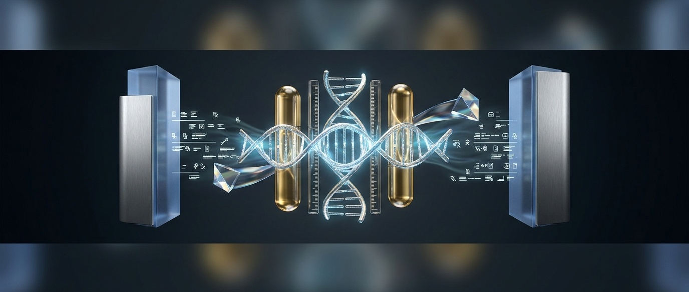
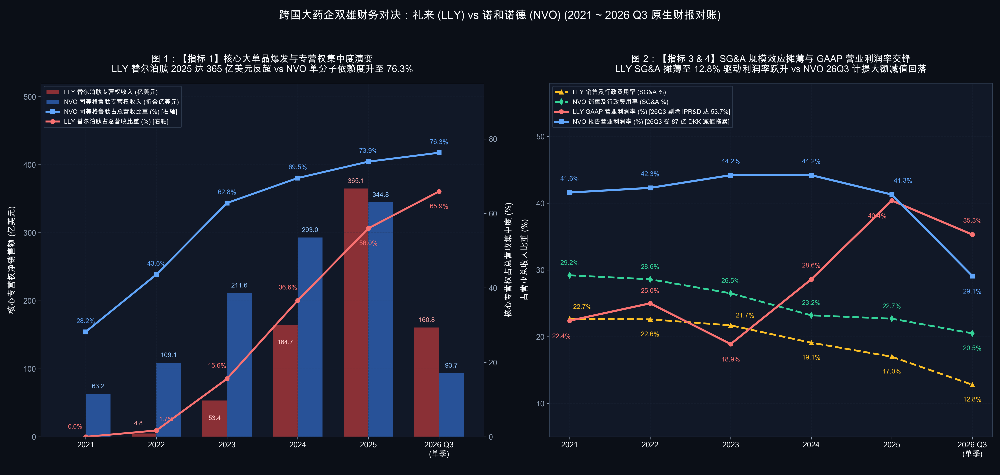

# 【行业指标 09】跨国大药企财报解剖：重磅单品集中度、量价返利折价、销售经营杠杆与管线并购暗门（礼来 LLY 与 诺和诺德 NVO）

> **专栏定位：** 全行业 10-K/20-F 财报解剖与特异性指标图谱  
> **解剖标的：** 礼来 (Eli Lilly, LLY) 主轴穿透 ＋ 诺和诺德 (Novo Nordisk, NVO) 镜像对照  
> **核心指标：** 核心单品专营权集中度与专利悬崖、处方量价拆分与医保返利折价、高毛利与销售研发经营杠杆、外延管线引进与产能资本开支  
> **审计基准：** SEC EDGAR 原生底稿 (CIK: 0000059478 / 0000353278) ＋ 10-K/20-F/10-Q/6-K 对账

> **摘要：** 拆解跨国大药企 4 大核心财报指标（重磅单品集中度与专利悬崖、处方量价与医保返利折价、销售研发经营杠杆、外购管线与扩产开支），结合礼来（LLY）与诺和诺德（NVO）最新财报对账，看透万亿药企的增长与排雷密码。

---

## 一、 跨国大药企核心指标深度解剖

与依靠工程技术渐进迭代、产品生命周期绵长的医疗器械行业截然不同，成熟商业化大药企（Big Pharma）运行的是一套**“受排他性专利保护期（通常 10~15 年）严格倒计时的脉冲式商业模型”** 。一款创新药在经历漫长的临床试验获批上市后，由于受化合物专利保护、没有同分子仿制药竞争，往往能享有高达 80% 以上的惊人毛利率；但一旦核心专利到期（Loss of Exclusivity, 简称 LOE），廉价的化学仿制药或生物类似药涌入市场，原研药的销售额通常会在一两年内暴跌 70% ~ 90%，这就是医药行业特有的**“专利悬崖（Patent Cliff）”** 。

因此，审阅一家跨国大药企的财报，核心是看它如何在这场与专利倒计时的赛跑中维持增长与造血。买方分析师主要围绕四个通用财务维度展开核查：一是看**产品收入结构**，评估公司对单一重磅药的依赖度以及老药专利到期的拖累；二是看**营收增长的“量价拆分”与医保返利折价**，甄别处方放量背后真实的到手净价变化；三是看**毛利率与销售、研发费用率的结构变化**，检验大单品放量能否摊薄庞大的全球学术推广网络；四是看**外延管线引进费用、研发减值与产能资本开支**，看清药企为填补未来管线缺口与扩充产能所付出的真实代价。

| 分析维度 | 行业专属特异性指标 | 买方核心考核焦点 |
| :--- | :--- | :--- |
| **产品结构与专利周期** | **核心单品/专营权集中度与专利悬崖 (Franchise Concentration & LOE %)** | 第一大单品/活性分子家族占总营收比重，以及专利到期老药的衰退幅度与新药接棒能力 |
| **处方放量与真实净价** | **营收增长的“量价拆分”与医保返利折价 (Volume vs. Realized Price & GTN %)** | 穿透名义药价与医保/PBM 返利后的实收净价变动，排查“处方大增但净价跳水”的隐忧 |
| **渠道摊薄与经营杠杆** | **高毛利护城河与“销售 vs 研发”经营杠杆 (Gross Margin, SG&A & R&D %)** | 观察重磅新药放量能否大幅摊薄全球学术推广费用率（SG&A %），释放超额营业利润率 |
| **管线补血与扩产重担** | **外延管线引进（IPR&D）、减值与扩产资本开支 (External BD, Impairments & CapEx)** | 审计收购外部临床管线的一次性费用/减值对表观利润的冲击，以及生物制剂扩产的资金消耗 |

---

### 指标 1：核心单品/专营权集中度与专利悬崖 (Franchise Concentration & LOE %)

在成熟大药企的营收结构中，往往存在显著的“二八定律”：尽管公司账面上拥有数十款在售药物，但绝大部分营收增量与利润贡献，通常高度集中在一两款年销售额突破百亿美元的**“重磅炸弹药（Blockbuster）”**或围绕同一核心活性分子（跨不同适应症、剂型与商品名）构建的**专营权家族（Franchise）**之上。

在财报分部与分产品收入附注（Revenue Disaggregation by Product）中核算核心专营权占总营收的比重，并结合年报中的专利到期日程表（Patent Expirations），需要重点把握两层逻辑：
* **上升期的经营杠杆引擎：** 当一款突破性新药处于上市后的前五年黄金放量期、距离专利到期尚有十年以上时，专营权占比的快速上升代表着极强的临床统治力，能带动全公司业绩加速增长；
* **成熟期的单点脆弱性与专利悬崖：** 一旦单一分子专营权占总营收比重突破 **60%** ，整家公司的命运就被绑定在单一靶点上；若此时竞品读出更优的头对头临床数据，且公司在肿瘤、免疫、神经等其他治疗领域缺乏体量相当的第二支柱分担风险，估值就会面临剧烈重估。同时，若未来 3 年内即将失去专利保护（LOE）的老药合计占总营收比重超过 **30%** ，公司就将直面严峻的专利断崖考验。

---

### 指标 2：营收增长的“量价拆分”与医保返利折价 (Volume vs. Realized Price & GTN %)

初看药企财报的读者最容易掉入的陷阱，是把药品的“公开标价（List Price / WAC）”当成药企的实际收入。事实上，无论是在美国的商业医保体系，还是在欧洲、中国的国家医保谈判体系中，药企为了换取药品进入医保报销目录或处方集优先推荐层级（Formulary Tier），都必须向药品福利管理机构（PBM）、保险公司、政府医保基金及医院让渡巨额的商业返利、法定折扣与患者共付补贴。

从按标价计算的原始毛销售额（Gross Sales），扣除各类返利与折扣后，最终真正计入利润表的净销售额（Net Sales），中间被扣掉的比例就叫做 **Gross-to-Net（简称 GTN 返利折价率）** 。在竞争激烈的慢病与专科药领域，综合 GTN 折价率往往高达 **50% ~ 60%** ——即标价 1,000 美元的药品，药企实际到手净价只有 400 多美元。

为了看清药品销售的真实成色，买方在审阅财报时重点对账两个官方披露口径：
1. **营收变动的“量价拆分”（Volume vs. Realized Price）：** 在美股药企年报的 MD&A 章节中，公司会明确将营收增速拆解为：
   `营收同比增速 (%) ＝ 处方出货量变动 (Volume %) ＋ 实收净价变动 (Realized Price %) ＋ 汇率变动 (FX %)`
   只有当 **处方出货量（Volume）** 保持强劲增长，且扣除医保返利后的 **实收净价（Realized Price）** 降幅温和可控时，增长才是健康的；反之，若为了保住市场份额被迫大幅提高返利，就会出现“处方量微增、实收净价暴跌”的局面；
2. **毛销到净销调节表（Gross-to-Net Reconciliation）：** 部分跨国药企（如采用 IFRS 准则的欧洲药企）会在收入附注中直接披露原始毛销售额与各项医保返利扣减额，可直接算出 GTN 折价率的变化趋势。

---

### 指标 3：高毛利护城河与“销售 vs 研发”经营杠杆 (Gross Margin, SG&A & R&D %)

专利期内创新药的直接生产成本（化学合成、生物发酵与制剂灌装）占售价比例极低，因此跨国大药企的**综合毛利率普遍高达 75% ~ 85%** 。真正决定药企最终营业利润率高低的，是毛利下方的两项核心期间费用：
* **内生研发费用率（R&D %）：** 为了在现有药品专利到期前孵化出下一代接班管线，大药企必须常年将总营收的 **15% ~ 25%** 投入到临床前研究与全球 I ~ III 期临床试验中，这是维持药企长期生命力的刚性投入；
* **销售及行政管理费用率（SG&A %）：** 跨国药企在全球雇佣了庞大的医药代表与医学联络官团队，负责向医院和医生进行学术推广与临床教育。在缺乏重磅新药时，这套全球商业化网络的运转成本极其沉重（SG&A 费率往往在 **25% ~ 30%** 以上）；但一旦公司跑出年销百亿美元级的超级大单品，原有的科室销售网络被海量处方迅速填满，无需成比例扩招销售人员，**SG&A 费用率就会被大幅摊薄至 20% 甚至 15% 以下**，从而推动营业利润率向 **35% ~ 45%** 跃升。

---

### 指标 4：外延管线引进（IPR&D）、减值与扩产资本开支 (External BD, Impairments & CapEx)

单靠药企内部实验室的自研，往往难以保证每一代产品都能无缝衔接。因此，跨国大药企普遍扮演着医药界的“资本枢纽”——利用充沛的现金流，持续从中小型生物科技公司（Biotech）手中买断或授权引进（License-in）处于临床阶段的潜力新药。同时，复杂的生物制剂与多肽注射剂对无菌灌装产线有着极高的物理产能要求。

这在药企的利润表与现金流量表上形成了两个必须穿透的科目：
1. **外延管线引进费用与研发减值（Acquired IPR&D & Impairments）：** 在美国通用会计准则（US GAAP）下，药企收购外部尚未获批的临床期在研管线或支付首付款时，不能资本化为无形资产，而必须**在当期利润表上全额费用化，单独列示为“收购在研研发费用（Acquired In-Process R&D, 简称 Acquired IPR&D）”** ；而在国际财务报告准则（IFRS）下，外购管线会先资本化为无形资产，一旦后续临床试验失败，则在当期集中计提大额**无形资产减值（Impairment Losses）** 。穿透这两项，才能区分药企某季度的利润下滑究竟是主业恶化，还是因为掏钱买了新管线；
2. **扩产资本开支（Manufacturing CapEx）：** 化学小分子药通常是轻资产生产，但生物大分子与多肽注射笔（如预灌封注射器、无菌冻干产线）建设周期长达 3 ~ 5 年、投资动辄数十亿美元。核查固定资产资本开支（CapEx）与自由现金流的匹配度，能看清药企是否存在产能瓶颈或重资产扩产压力。

---

## 二、 跨国大药企核心特异性指标全景速查对照表

下表汇总了买方机构审阅全球成熟商业化药企财报时重点对账的 4 大核心指标与通用参考标尺：

| 指标名称 | 标准计量符号 | 买方核心考核焦点 | 行业优秀基准线 (Benchmark) | 危险预警与破位阈值 | 官方财报与 SEC 取数出处 |
| :--- | :--- | :--- | :--- | :--- | :--- |
| **1. 核心单品集中度与专利悬崖** | Franchise Concentration & LOE % | 核心单品/分子家族占总营收比重，评估单点依赖风险与新老管线交替能力 | 第一大专营权占比 **20% ~ 40%** （多治疗领域均衡驱动，无近期专利断崖） | 单一专营权占比 > **60%** （单分子极端依赖），或 3 年内专利到期产品占比 > **30%** | 10-K/20-F 分部及分产品收入附注 (Revenue by Product) 及专利到期表 |
| **2. 处方量价拆分与返利折价** | Volume vs. Price & GTN % | 穿透医保与 PBM 返利折价，核查增长是否由真实处方销量驱动 | 处方销量增速 ≥ **15%** ，且实收净价降幅可控（ `5%` 以内）或 GTN 折价率 < **50%** | 处方销量增速 < **5%** ，或实收净价年降 > **10%** （GTN 折价率 > **60%** 陷入价格战） | 10-K Item 7 MD&A 量价变动表 (Volume vs. Price) 或 20-F Note 2.1 GTN 调节表 |
| **3. 高毛利与销售/研发经营杠杆** | Gross Margin, SG&A & R&D % | 检验专利药高毛利成色，观察大单品放量对全球学术推广费率的摊薄效应 | 毛利率 ≥ **80%** ，R&D 费率 **15% ~ 20%** ，SG&A 费率摊薄至 ≤ **20%** （营业利润率 ≥ **35%** ） | 毛利率 < **70%** ，或 SG&A 费率 > **30%** 且常态营业利润率 < **20%** （销售网络低效沉重） | 10-K/20-F 合并损益表各成本费用行项占总营收百分比 |
| **4. 外延管线引进、减值与扩产** | Acquired IPR&D, Impairment & CapEx | 区分外购临床管线费用/减值与常态经营利润，评估制剂扩产的现金流消耗 | **自研管线转化顺畅**，外延减值可控，经营现金流充沛覆盖扩产 CapEx 与分红 | **内生管线枯竭**，频繁爆发数十亿美元管线减值，或激进举债并购导致自由现金流长期为负 | 10-K 损益表 Acquired IPR&D 行项、20-F 无形资产减值附注及现金流量表 CapEx |

---

## 三、 标杆实例深度实战：礼来 (LLY) 6 周期全景原生财报解剖 (2021 ~ 最新单季实战)

作为人类制药工业史上首家市值突破万亿美元的医药巨头，礼来（Eli Lilly and Company, LLY.US）完整演绎了跨国大药企如何顺利跨越老药专利周期、依靠突破性双靶点新药释放超级经营杠杆，并利用丰沛现金流大举扫货下一代外部管线的全过程。

在 2021 至 2022 年，礼来曾面临老一代肿瘤药（如 Alimta 培美曲塞）专利到期仿制药冲击、新冠中和抗体退潮以及上一代降糖药度拉糖肽（Trulicity）增长见顶的转型压力。但随着全球首款 **GIP/GLP-1 双受体激动剂替尔泊肽（Tirzepatide，降糖商品名 Mounjaro、减重商品名 Zepbound）** 相继在 2022 年 5 月与 2023 年 11 月获批上市，礼来的营收规模在短短三年内翻了一倍以上。

以下是礼来（LLY）的 6 周期官方原生财报底表（数据全部源自公司提交至 SEC 的 Form 10-K 年报与 Form 10-Q 季报）：

### 礼来公司 6 周期核心财务与经营对账底表 (单位：亿美元，特殊标注除外)

| 核心财务与经营科目 | 2021 年 | 2022 年 | 2023 年 | 2024 年 | 2025 年 | 2026 最新单季 (Q3) | 穿透勾稽结论与买方视角 |
| :--- | :---: | :---: | :---: | :---: | :---: | :---: | :--- |
| **宏观与行业创新周期** | **老药度拉糖肽挑大梁 新冠抗体阶段性贡献** | **老药专利到期与抗体退坡 Mounjaro 5月获批上市** | **Mounjaro 首迎完整放量年 Zepbound 11月获批减重** | **双靶点产能扩建爬坡 全年总营收突破 450 亿** | **替尔泊肽狂揽 365 亿美元 全年总营收跨越 650 亿** | **单季营收达 244 亿美元 前三季度营收超去年全年** | 完整印证“新老管线交替、处方放量对冲返利降价、SG&A 摊薄至 12.8%” |
| **营业总收入 (Total Revenue)** | **283.18** | **285.41** | **341.24** | **450.43** | **651.79** | **243.97 (单季)** | 2026 前三季度累计营收已达 **671.70 亿美元** （YoY +46%），超越 2025 全年 |
| 营业收入同比增速 (%) | +15.4% | +0.8% | +19.6% | **+32.0%** | **+44.7%** | **+38.6%** | 在超 650 亿美元体量上，2026Q3 单季依然保持 38.6% 的高速增长 |
| **▸ 1. 第一大专营权：替尔泊肽总额 (Tirzepatide)** | **0.00** | **4.83** | **53.39** | **164.66** | **365.07** | **160.75 (单季)** | **【对应指标 1】** 由下述 Mounjaro 与 Zepbound 合计构成；2026 前三季度达 **437.68 亿** |
| *　↳ 专营权内含：Mounjaro (糖尿病)* | *0.00* | *4.83* | *51.63* | *115.40* | *229.65* | *107.23 (单季)* | **归属于替尔泊肽专营权的子项：** Q3 单季破百亿美元（美国 50.0 亿，海外 57.3 亿） |
| *　↳ 专营权内含：Zepbound (肥胖症)* | *0.00* | *0.00* | *1.76* | *49.26* | *135.42* | *53.52 (单季)* | **归属于替尔泊肽专营权的子项：** 2023 年底获批，2026Q3 单季达 53.52 亿美元（+49%） |
| **第一大专营权占总营收比重 (%)** | **0.0%** | **1.7%** | **15.6%** | **36.6%** | **56.0%** | **65.9%** | **【对应指标 1】** 四年时间从 0 跃升至占公司总营收约六成，成为核心增长引擎 |
| ▸ 2. 肿瘤核心支柱：乳腺癌靶向药 Verzenio | 13.50 | 24.84 | 38.63 | 53.07 | 57.23 | 15.11 (单季) | **【对应指标 1】** 肿瘤核心支柱年销超 57 亿美元，与免疫、神经管线共同提供多元支撑 |
| ▸ 3. 上一代降糖老药：度拉糖肽 Trulicity | 64.72 | 74.40 | 71.33 | 52.54 | 42.76 | 9.04 (单季) | **【对应指标 1】** 曾占营收 26% 的老一代单品平稳退居二线（Q3 占比仅 3.7%），实现丝滑接棒 |
| **内生处方出货量增速 (Volume %)** | **+16%** | **+10%** | **+16%** | **+27%** | **+50%** | **+53% (单季)** | **【对应指标 2】** 官方 MD&A 量价拆解：2025 与 2026Q3 全球处方出货量分别暴增 50% 与 53% |
| **实收净价变动 (Realized Price %)** | **-1%** | **-6%** | **+4%** | **+5%** | **-6%** | **-15% (单季)** | **【对应指标 2】** 2026Q3 因扩大医保准入与海外进医保（中国 NRDL 等），实收净价同比下调 15% |
| **综合毛利润 (Gross Margin $)** | **210.06** | **219.12** | **270.42** | **366.25** | **541.27** | **204.64 (单季)** | 单季毛利润突破 204 亿美元（前三季度累计毛利润达 563.92 亿美元） |
| **综合毛利率 (Gross Margin %)** | **74.2%** | **76.8%** | **79.2%** | **81.3%** | **83.0%** | **83.9%** | **【对应指标 3】** 高毛利新药放量改善产品结构，综合毛利率从 74.2% 一路攀升至 **83.9%** |
| 销售及行政管理费用 (SG&A Expense) | 64.32 | 64.40 | 74.04 | 85.94 | 110.94 | 31.25 (单季) | Q3 单季 SG&A 支出 31.25 亿美元（YoY +14.0%），远低于 38.6% 的营收增速 |
| **销售及行政管理费用率 (SG&A %)** | **22.7%** | **22.6%** | **21.7%** | **19.1%** | **17.0%** | **12.8%** | **【对应指标 3】极致经营杠杆：** 随大单品突破百亿，SG&A 费率从 22.7% 骤降至 **12.8%** |
| 内生研发费用支出 (R&D Expense) | 69.31 | 71.91 | 93.13 | 109.91 | 133.37 | 42.47 (单季) | 2025 全年自研投入达 133.37 亿美元，2026 前三季度自研投入达 115.76 亿美元 |
| **内生研发费用率 (R&D %)** | **24.5%** | **25.2%** | **27.3%** | **24.4%** | **20.5%** | **17.4%** | **【对应指标 3】** 保持每年超百亿美元的高强度内生研发，全力推进口服小分子与三靶点管线 |
| **外延管线引进与重组减值 (IPR&D + Special)** | **12.86** | **11.53** | **38.68** | **41.41** | **33.94** | **44.84 (单季)** | **【对应指标 4】** Q3 单季一次性费用化外购在研管线（Acquired IPR&D）高达 **41.81 亿美元** |
| **GAAP 营业利润 (Operating Income)** | **63.57** | **71.27** | **64.58** | **128.99** | **263.02** | **86.08 (单季)** | **【对应指标 4】** Q3 扣除 44.84 亿外购管线与重组后营业利润为 86.08 亿（剔除后核心营业利润达 **130.92 亿** ） |
| **GAAP 营业利润率 (%)** | **22.4%** | **25.0%** | **18.9%** | **28.6%** | **40.4%** | **35.3% (核心53.7%)** | **【对应指标 3 & 4】** 2025 年 GAAP 营业利润率突破 **40.4%** ；26Q3 剔除外购管线费用后高达 **53.7%** |
| 归母净利润 (GAAP Net Income) | 55.82 | 62.45 | 52.40 | 105.90 | 206.40 | 64.51 (单季) | 2025 年归母净利翻倍至 206.40 亿美元；2026 前三季度归母净利已达 **209.42 亿美元** |
| 经营活动现金流净额 (Operating Cash Flow) | 72.61 | 70.84 | 42.40 | 88.18 | 168.13 | 274.20 (前三季) | 2026 前三季度经营活动现金流净额高达 **274.20 亿美元** （同比翻倍） |
| **扩产资本开支 (CapEx - 购建厂房设备)** | **13.10** | **18.54** | **34.48** | **50.58** | **78.41** | **84.37 (前三季)** | **【对应指标 4】** 为扩建全球无菌注射笔与原料药工厂，近三年累计砸下逾 **213 亿美元** CapEx |

---

### 核心看点 ①：丝滑跨越专利周期——双靶点新药接棒老药，完成主业引擎换代

看懂礼来财报的第一条主线，是观察它如何在短短三年内完成了新老主力管线的无痛交接。在 2022 年前后，礼来一度面临上一代降糖药度拉糖肽（Trulicity）增长见顶、老牌肿瘤化疗药（Alimta）专利到期遭遇仿制药冲击的青黄不接期，当年总营收增速几乎陷入停滞。

然而，礼来凭借替尔泊肽（Tirzepatide）“同一活性分子、双适应症分进合击”的商业化策略——先以 **Mounjaro** 切入二型糖尿病处方市场，再以 **Zepbound** 打开肥胖症体重管理市场——迅速建立起全新的增长极。当老一代度拉糖肽的营收占比自然退居二线时，替尔泊肽专营权与乳腺癌靶向药 Verzenio 不仅全额填补了老药衰退的缺口，更推动公司整体营收规模在三年内翻了一倍以上，堪称大药企跨越专利周期的教科书样本。

---

### 核心看点 ②：穿透 MD&A 量价拆分——为什么“实收净价下调 15%”，营收与毛利反而加速爆发？

对照表格中 2025 年与 2026Q3 的量价拆分行项可以看到一个极其鲜明的现象：礼来的实收净价（Realized Price）在 2026Q3 同比下调了 `-15%`，但全球处方出货量（Volume）却逆势暴增 `+53%`，带动单季营收依然大涨近四成。

为什么药卖得越火，平均实收净价反而越低？这正是跨国药企在产能释放后，通过**“主动让渡医保返利（GTN）换取全球处方覆盖”**的典型商业打法：
* **在美国本土市场：** 随着无菌注射笔产能瓶颈缓解，为了让 Zepbound 和 Mounjaro 进入更多商业保险与联邦医保（Medicare）的报销目录，并向自费患者推广门槛更低的单剂量小瓶装（Vials），礼来主动提高了商业返利折扣率，用温和的净价让利撬动了庞大的新增处方群；
* **在国际市场：** 礼来在 2025 至 2026 年推动 Mounjaro 正式纳入包括中国国家医保目录（NRDL）在内的多个国家公费医保体系。虽然进入国家医保意味着显著的谈判降价，但却彻底打开了全球基层医院的处方天花板，推动 Mounjaro 海外单季收入首次超越美国本土。由于专利药的直接生产成本极低（综合毛利率高达 **83.9%** ），这种“以价换量”策略带来了极为丰厚的毛利总额增量。

---

### 核心看点 ③：渠道费率摊薄与外购管线排雷——还原被“买管线费用”掩盖的 53.7% 核心营业利润率

礼来的损益表还集中展示了成熟大药企在重磅药放量期的两项关键财务特征：
1. **既有学术推广网络的极致摊薄（指标 3）：** 礼来深耕内分泌与代谢领域数十年，原本为了销售胰岛素和度拉糖肽就已经建成了覆盖全球内分泌科与全科医生的成熟推广团队。当替尔泊肽上市后，这套现成的全球渠道被百亿美元级的新增处方迅速填满，无需成比例扩招销售代表，使得销售及行政管理费用率（SG&A %）从 2021 年的 `22.7%` 一路压缩至 2026Q3 的 **`12.8%`** ；
2. **穿透外购管线费用（Acquired IPR&D）看真实造血（指标 4）：** 初看 2026Q3 财报，礼来的 GAAP 营业利润率似乎从 2025 全年的 `40.4%` 回落到了 `35.3%`。但向下穿透损益表就会发现，这是因为礼来在当季集中完成了对多家外部生物科技公司与临床期管线的收购及授权，按美国 GAAP 准则在当季一次性费用化了高达 **41.81 亿美元的“收购在研研发费用（Acquired IPR&D）”** 。如果还原这笔为了布局未来十年管线而主动支出的外延买断费用，礼来当季的核心主业营业利润率实际上高达 **`53.7%`** 。

---

## 四、 标杆实例镜像对照：诺和诺德 (NVO) 单极帝国依赖、价格承压与管线减值镜像

如果说礼来（LLY）代表了“双靶点后来居上、多治疗领域均衡支撑、自主扩建产能”的进攻型样本，那么深耕糖尿病与代谢领域百年的丹麦制药巨头 **诺和诺德 (Novo Nordisk A/S, NVO.US)** ，则是代表“单一活性分子（司美格鲁肽）先发垄断、极高单品集中度、在头对头竞争与价格博弈中迎来增速换挡”的经典镜像。

以下是两大制药巨头的 6 周期官方财报横向对比底表（数据全部源自礼来 SEC Form 10-K/10-Q 与诺和诺德 SEC Form 20-F/6-K 原生披露；注：诺和诺德原生报表以丹麦克朗 DKK 计价，表中百分比指标均为原生比率，绝对金额按年报官方年均汇率折算为亿美元并在括号内标注原生 DKK 数值）：

### 1. 两大跨国药企 6 周期原生数据横向对照底表 (单位：亿美元，特殊标注除外)

| 核心对比科目 | 标的 | 2021 年 | 2022 年 | 2023 年 | 2024 年 | 2025 年 | 2026 最新单季 (Q3) | 穿透勾稽结论与买方视角 |
| :--- | :--- | :---: | :---: | :---: | :---: | :---: | :--- | :--- |
| **营业总收入 (Total Revenue / Net Sales)** *(NVO 括号内为原生亿丹麦克朗 DKK)* | **LLY** NVO | **283.18** 223.8 (1,408亿) | **285.41** 249.9 (1,770亿) | **341.24** 337.1 (2,323亿) | **450.43** 421.5 (2,904亿) | **651.79** 466.9 (3,091亿) | **243.97 (单季)** **122.8 (792亿DKK)** | **增长斜率分化：** 2023 年 NVO 凭先发优势一度将总营收追平至与 LLY 仅差 4 亿美元；随后 LLY 加速爆发，2025 年重新拉开 185 亿美元差距，26Q3 单季已是 NVO 的 **2.0 倍** |
| **营业收入同比增速 (%)** *(NVO 按固定汇率 CER 增速)* | **LLY** NVO | **+15.4%** +14.0% | **+0.8%** +16.0% | **+19.6%** +36.0% | **+32.0%** +26.0% | **+44.7%** +10.0% | **+38.6% (单季)** **+4.0% (单季CER)** | **增速换挡：** LLY 在 2025 与 2026Q3 维持 +45% / +39% 高增；NVO 因注射版竞品分流与美国降价，2025 增速放缓至 +10%，26Q3 单季 CER 增速降至 **+4%** |
| **核心 GLP-1 专营权净销售额** *(LLY: 替尔泊肽 Mounjaro+Zepbound)* *(NVO: 司美格鲁肽 Ozempic+Wegovy+口服)* | **LLY** NVO | **0.00** 63.2 (397亿) | **4.83** 109.1 (772亿) | **53.39** 211.6 (1,458亿) | **164.66** 293.0 (2,018亿) | **365.07** 344.8 (2,283亿) | **160.75 (单季)** **93.7 (604亿DKK)** | **【对应指标 1】王座易主：** NVO 司美格鲁肽曾领跑全球，但 2025 年 LLY 替尔泊肽（365.1 亿美元）正式反超 NVO 司美格鲁肽（344.8 亿美元） |
| **核心单品专营权占总营收比重 (%)** | **LLY** NVO | **0.0%** 28.2% | **1.7%** 43.6% | **15.6%** 62.8% | **36.6%** 69.5% | **56.0%** 73.9% | **65.9% (单季)** **76.3% (单季)** | **【对应指标 1】单极依赖度预警：** NVO 对单一分子司美格鲁肽的依赖度高达 **73.9% ~ 76.3%** ，缺乏非代谢第二支柱；LLY 另有肿瘤、免疫等近三成营收缓冲 |
| **处方量价拆分与 GTN 返利折价** *(LLY 10-K: 销量增速 % / 实收净价变动 %)* *(NVO 20-F Note 2.1: 综合 GTN 返利折价率)* | **LLY** NVO | **+16% / -1%** GTN 58.6% | **+10% / -6%** GTN 61.2% | **+16% / +4%** GTN 61.8% | **+27% / +5%** GTN 57.3% | **+50% / -6%** GTN 57.6% | **+53% / -15%** **美国净价承压** | **【对应指标 2】** NVO 20-F 披露其原始毛销中有 **57.6%~61.8%** 被医保与 PBM 返利扣减（2025 毛销 7,294 亿 DKK，返利扣减 4,204 亿，净销 3,091 亿） |
| **综合毛利率 (Gross Margin %)** | **LLY** NVO | **74.2%** 83.2% | **76.8%** 83.9% | **79.2%** 84.6% | **81.3%** 84.7% | **83.0%** 81.0% | **83.9% (单季)** **77.0% (调后82.1%)** | **【对应指标 3】毛利率剪刀差反转：** LLY 随高毛利新药放量升至 **83.9%** ；NVO 因扩产折旧、价格下调及 26Q3 计提产线减值，毛利率回落至 77.0% |
| **销售及行政管理费用率 (SG&A %)** | **LLY** NVO | **22.7%** 29.2% | **22.6%** 28.6% | **21.7%** 26.5% | **19.1%** 23.2% | **17.0%** 22.7% | **12.8% (单季)** **20.5% (单季)** | **【对应指标 3】规模效应比拼：** 两家均展现了显著的渠道费用摊薄，其中 LLY 凭借营收翻倍将 SG&A 费率压缩至极致的 **12.8%** |
| **内生研发费用率 (R&D %)** | **LLY** NVO | **24.5%** 12.6% | **25.2%** 13.6% | **27.3%** 14.0% | **24.4%** 16.6% | **20.5%** 16.8% | **17.4% (单季)** **25.1% (调后19.3%)** | **【对应指标 3】研发广度差异：** LLY 每年投入超百亿美元布局多领域；NVO 26Q3 研发含临床管线减值，剔除后常态研发费率为 19.3% |
| **外延管线引进 (IPR&D) 与重大资产减值** *(LLY: 外购管线 IPR&D + 减值重组)* *(NVO: 无形资产与产线减值，括号内为原生 DKK)* | **LLY** NVO | **12.86** 0.9 (5.7亿) | **11.53** 1.1 (7.6亿) | **38.68** 2.0 (14.1亿) | **41.41** 13.8 (95.1亿) | **33.94** 4.2 (27.6亿) | **44.84 (单季)** **13.5 (87.1亿DKK)** | **【对应指标 4】会计准则与减值排雷：** LLY 按美股准则将外购临床管线当期费用化（26Q3 达 41.8 亿美元）；NVO 在 2024 与 26Q3 分别因临床失败等计提 **13.8 亿与 13.5 亿美元** 减值 |
| **GAAP 报告营业利润率 (%)** | **LLY** NVO | **22.4%** 41.6% | **25.0%** 42.3% | **18.9%** 44.2% | **28.6%** 44.2% | **40.4%** 41.3% | **35.3% (核心53.7%)** **29.1% (调后40.1%)** | **【对应指标 3 & 4】** NVO 常态保持 41%~44% 高营业利润率，但 26Q3 受 13.5 亿美元减值拖累降至 29.1%；LLY 核心主业利润率已突破 50% |
| **扩产资本开支 (PP&E CapEx)** *(NVO 括号内为原生亿 DKK)* | **LLY** NVO | **13.10** 10.1 (63亿) | **18.54** 17.2 (121亿) | **34.48** 37.5 (258亿) | **50.58** 68.5 (472亿) | **78.41** 90.8 (601亿) | **84.37 (前三季)** **57.7 (前三季372亿)** | **【对应指标 4】全球产能军备竞赛：** 双方每年均投入 70~90 亿美元扩建原料药与注射笔产线；NVO 2024 年另斥资 117 亿美元（822 亿 DKK）收购 Catalent 三座工厂 |

---

### 2. 核心走势对比图：礼来 vs 诺和诺德原生财报核心指标走势对决 (2021 ~ 2026 Q3)

> **图表买方核心解读：**  
> 左图展示【指标 1】核心专营权规模与集中度：礼来替尔泊肽在 2025 年以 **365.1 亿美元** 反超诺和诺德司美格鲁肽（344.8 亿美元），而诺和诺德对单一分子的依赖度已升至 **76.3%** 。右图展示【指标 3 & 4】费用摊薄与营业利润率：礼来凭借营收爆发将 SG&A 费率摊薄至 **12.8%** ，推动营业利润率大幅跃升；诺和诺德 2026Q3 则因计提 **13.5 亿美元** （87.1 亿丹麦克朗）减值导致报告营业利润率回落至 **29.1%** 。

---

### 3. 关键差异归因与买方深度复盘

#### 关键差异 ①：产品矩阵与单点风险——“双靶点反超 + 多科室防线” vs “76% 单一分子高度依赖”
对比两家公司的分产品收入结构（指标 1），能清晰看到新药临床代差与产品矩阵广度如何改写行业竞争格局：
* **诺和诺德的单分子极致开发与增长瓶颈：** 诺和诺德是 GLP-1 赛道的拓荒者，将司美格鲁肽（Semaglutide）单一分子开发出了降糖注射剂 **Ozempic** 、减重注射剂 **Wegovy** 以及口服片剂（2026 年升级为 **Ozempic Pill** 与 **Wegovy Pill** ）。然而，诺和诺德超过 **76%** 的营业收入系于司美格鲁肽一身，传统胰岛素业务仅占约 15%，且几乎没有肿瘤、免疫等跨科室大单品。当礼来的双靶点药物展现出更高的减重幅度后，诺和诺德的注射版产品在欧美市场增长趋缓，不得不高度依赖 2026 年初新上市的口服减肥药 **Wegovy Pill** 来托底整体营收正增长；
* **礼来的代际反超与多支柱协同：** 礼来虽然起步稍晚，但替尔泊肽在 2025 年即实现对司美格鲁肽家族的正面反超，并在 2026Q3 将单季专营权销售额差距拉大至 **160.8 亿美元 vs 93.7 亿美元** 。同时，礼来在肿瘤、自免、心血管与神经科学领域拥有深厚的在售产品群，抗单点风险能力更为均衡。

#### 关键差异 ②：近六成的 Gross-to-Net 返利深水区——医保控费与价格战如何体现在报表上？
诺和诺德在 20-F 年报附注中披露的《毛销到净销调节表》，为读者提供了一个极其直观的窗口，得以看清美国药品流通背后的真实返利规模（指标 2）：
* **过半毛销售额被返利吞噬：** 在 2025 年，诺和诺德按出厂标价计算的全球原始毛销售额超过 1,100 亿美元（7,294 亿丹麦克朗），但最终确认进利润表的净销售额只有 466.9 亿美元（3,091 亿丹麦克朗）——中间高达 **57.6%** 的差额，全部作为美国商业医保与联邦医保返利、批发商扣款及政府医疗补助返利被直接扣减；
* **高基数降价与增量期降价的境遇分野：** 面对激烈的市场竞争与患者自费负担，诺和诺德与礼来在 2025 至 2026 年均主动下调了美国自费渠道价格并加大了医保返利折让。区别在于，礼来正处于全球装机与处方渗透的陡峭爬坡期，超五成的处方出货量增长轻松覆盖了降价影响；而处于高基数平台的诺和诺德，在净价下调与竞品分流双重作用下，营收增速便出现了明显换挡。

#### 关键差异 ③：外延管线会计处理与产能扩张——“费用化 IPR&D + 自建工厂” vs “资本化减值爆雷 + 并购代工厂”
穿透指标 4（外延管线引进、减值与扩产 CapEx），可以清楚看到美股（US GAAP）与欧股（IFRS）药企在财务表现上的重要差异：
1. **外延研发失败在利润表上的不同爆发时点：** 礼来遵循美国 GAAP 准则，在引进外部临床期新药时，直接将首付款计入当期损益表的 `Acquired IPR&D`，平时看着拉低了当期表观利润，但资产负债表上不留无形资产减值隐患；而诺和诺德遵循国际 IFRS 准则，外购管线先资本化为无形资产，一旦后续临床受挫就会集中爆雷——例如 **2024 年因高血压管线 ocedurenone 临床失败计提 13.8 亿美元** （95.1 亿 DKK）减值，**2026Q3 又因心血管管线 ziltivekimab 研发受挫及产线重组计提 13.5 亿美元** （87.1 亿 DKK）减值，直接导致当季报告营业利润率跌至 **`29.1%`** ；
2. **自建产能 vs 百亿美元并购代工厂：** 为了解决全球无菌注射笔的产能紧缺，礼来选择以内生自建为主，近三年累计投入超 **210 亿美元** 资本开支扩建自有工厂，充沛的经营现金流依然远超资本开支；而诺和诺德除了每年高强度的自建资本开支外，还在 2024 年斥资 **117 亿美元** （822 亿 DKK）收购了代工巨头 Catalent 旗下的三座灌装工厂，不仅导致当年自由现金流一度转负，也带来了后续产线折旧与整合成本的上升。

---

## 五、 实战对账自查表：买方机构 4 步穿透跨国大药企财报排查卡

在审阅任何一家成熟商业化药企的年报（10-K / 20-F）与季报时，建议按照以下 4 个步骤依次核查，并对照下方的买方核查指示灯评估其商业成色：

1. **第一步：查分产品收入表，算核心专营权占比与专利到期敞口（对应指标 1）**  
   打开分部及分产品收入附注（Revenue by Product），将第一大核心单品（或同一活性分子在不同适应症下的全部商品名）收入加总，计算其占总营收的比重；同时查阅年报中的专利到期日程表（Patent Expirations），核查未来 3 年内即将失去专利保护（LOE）的老药占总营收的比例，以及新一代商业化产品能否补上缺口。
2. **第二步：拆 MD&A 营收变动归因，看“处方销量 vs 实收净价”（对应指标 2）**  
   在管理层讨论与分析（MD&A）的营收变动拆解表中，核对营收增长到底来自处方出货量（Volume）的真实扩张，还是单纯靠提价维持；重点观察扣除医保与 PBM 返利后的实收净价（Realized Price）变动幅度，或在收入附注中核查 Gross-to-Net 返利折价率是否持续恶化。
3. **第三步：比毛利与期间费用率，验“销售网络摊薄与内生研发强度”（对应指标 3）**  
   在合并损益表中核算综合毛利率、销售及行政管理费用率（SG&A %）与内生研发费用率（R&D %）。检验随着新药放量，公司的 SG&A 销售费率是否呈现显著的规模摊薄效应，同时内生研发费率是否保持在 15% ~ 20% 的健康水位。
4. **第四步：透外购管线费用、资产减值与扩产资本开支（对应指标 4）**  
   核查损益表中的“收购在研研发费用（Acquired IPR&D）”或无形资产减值损失（Impairment Losses），将一次性外延买管线支出与常态主业营业利润区分开来；同时结合现金流量表，对比经营活动现金流（CFO）与购建固定资产资本开支（CapEx），确认产能扩建是否健康的由内生现金流支撑。

### 跨国大药企买方核查指示灯

| 核查维度 | 🟢 绿灯安全区 (优秀标杆) | 🟡 黄灯观察区 (稳健常规) | 🔴 红灯排雷区 (高危预警) |
| :--- | :--- | :--- | :--- |
| **1. 单品集中度与专利周期** | 第一大专营权占比 **20% ~ 40%** ，多治疗领域均衡，新药顺利接棒老药 | 第一大专营权占比 **40% ~ 60%** （处于重磅新药高速放量期，需跟踪后续管线） | 单一专营权占比 > **60%** （单分子极端依赖），或 3 年内专利到期产品占比 > **30%** |
| **2. 处方量价拆分与返利** | 处方销量增速 ≥ **15%** ，且实收净价降幅可控（ `5%` 以内）或 GTN < **50%** | 处方销量增速 **5% ~ 15%** ，为换取医保准入导致实收净价年降 **5% ~ 10%** | 处方销量增速 < **5%** ，或实收净价暴跌 > **10%** （GTN > **60%** 且销量无法弥补降价） |
| **3. 毛利与销售/研发杠杆** | 毛利率 ≥ **80%** ，研发费率 **15% ~ 20%** ，SG&A 随放量摊薄至 ≤ **20%** （营业利润率 ≥ **35%** ） | 毛利率 **70% ~ 80%** ，SG&A 费率在 **20% ~ 30%** ，常态营业利润率 **25% ~ 35%** | 毛利率 < **70%** ，或 SG&A > **30%** 、常态营业利润率 < **20%** （销售网络沉重低效） |
| **4. 外延管线与扩产资本开支** | 自研转化顺畅，外购管线与扩产 CapEx 均由充沛经营现金流轻松覆盖 | 外购管线费用（IPR&D）或扩产 CapEx 阶段性占营收 **5% ~ 15%** ，短期拉低表观利润 | 内生管线枯竭，高溢价举债并购后频繁爆发数十亿美元管线减值，自由现金流转负 |

---

## 六、 本讲买方总结与下讲预告

> **买方终极心法**  
> 审阅跨国大药企财报的核心，是看清专利倒计时下的四重平衡：一查分产品结构看大单品成色与专利悬崖，二拆量价归因看扣除医保返利后的真实净价，三算销售费率摊薄看学术推广网络的经营杠杆，四辨外购管线费用（IPR&D）与研发减值，穿透表观利润波动看清真实主业造血。

---

### 下讲预告：【行业指标 10】早期创新药与临床 Biotech：没有产品收入怎么看？现金跑道、研发纯度与授权分成暗门（传奇生物 LEGN 与 CRISPR Therapeutics CRSP）

解剖了坐拥数百亿美元营收、依靠全球商业化网络和重磅大单品印钞的 **跨国成熟大药企** ，我们将视野推向医药产业链最前端、也是无数重磅新药诞生的摇篮——尚处于临床试验阶段或商业化初期的 **【早期创新药与临床 Biotech 篇】！**

当一家生物科技公司还没有稳定的药品销售收入、利润表常年亏损时，买方该如何给它做财务体检？在下一讲中，我们将派出凭 CAR-T 细胞疗法走向全球商业化的**传奇生物（Legend Biotech, LEGN.US）**，正面迎战诺奖级基因编辑先锋 **CRISPR Therapeutics (CRSP.US)** ！我们将运用财报原生披露的 **现金跑道与净烧钱率 (Cash Runway & Net Burn)** 、**研发开支结构与管理费用占比 (R&D vs. G&A Mix)** 、**大药企合作授权首付款与分成会计勾稽 (Collaboration Revenue & Profit Split)** 以及 **全稀释股本与增发摊薄暗门 (Dilution & ATM Overhang)** ，为您揭开临床期创新药企的生存与排雷密码，敬请期待！
