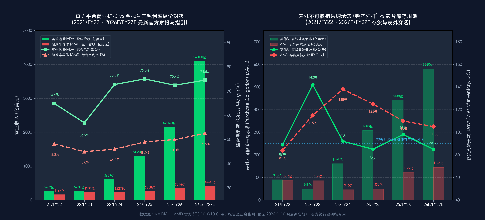

# 第 10 讲｜无晶圆厂芯片设计与算力平台：研发流片、表外产能锁水与芯片库存周期（英伟达 NVIDIA 与 超威半导体 AMD）

> **专栏定位：** 全行业 10-K/10-Q 外科手术显微镜与非 GAAP 核心指标全景字典  
> **解剖标的：** 英伟达 (NVDA) 主轴深度穿透 ＋ 超威半导体 (AMD) 镜像对照  
> **核心指标：** 纯研发费用率、存货周转天数与跌价、表外采购承诺、数据中心营收占比、全栈软件毛利溢价

> **买方导读：** 无晶圆厂芯片设计（Fabless）是半导体产业链中经营杠杆最暴烈的智力密集物种。分析芯片设计财报，切忌只盯爆发式的营收增速，而忽略了资产负债表外暗藏的“产能锁水”生死协议；更要穿透 75% 天价毛利背后的 CUDA 软件地租与芯片库存牛鞭效应。本讲我们将以芯片商业物理第一性原理为手术刀，解剖无晶圆厂算力平台的五大特异性指标，为您呈现顶级买方的排雷内功。

---

## 一、 无晶圆厂芯片设计与算力平台核心指标深度解剖与精密算法

无晶圆厂模式（Fabless）的核心精髓，是把高资本开支、高折旧风险的重资产制造外包给台积电等代工厂，将公司全部资源聚焦于算法架构研发、逻辑电路设计、流片验证与系统软件生态构建。

在这个商业模式下，芯片公司既享受到了轻资产模式带来的极致净资产收益率与自由现金流弹性，同时也必须面对上游先进制程代工产能的制约与下游电子消费周期的牛鞭反噬。要透视无晶圆厂算力平台的财报真相，必须深刻理解支配该物种商业运转的三大底层物理规律：

1. **研发流片是极度残忍的固定沉没赌注：一次流片失败即是 18 个月的战机真空：**  
   芯片设计公司的资本性支出（CapEx）极低，其真正的“资本开支”直接体现为损益表上的研发费用（R&D）。在 3nm 及 2nm 时代，单款超大规模芯片从架构设计、EDA 仿真工具授权、物理版图设计到向晶圆厂交付掩模版流片（Tape-out），全流程资金投入高达 **$3.0 亿 ~ $5.0 亿美元** 。更致命的是流片的时间窗口：一旦流片出现重大逻辑缺陷或电气故障导致需要二次重新流片（Metal spin / Base spin），产品上市将被强行推迟 6 至 18 个月，足以让竞争对手抢占整整一代算力周期并彻底丧失定价权。
2. **上游制造产能的“表外人质”：采购承诺与先进制程“锁水”决定生死：**  
   无晶圆厂看似轻资产，但在 AI 算力大爆发时代，台积电的 3nm 晶圆加工机时、CoWoS 先进封装产能，以及 SK 海力士的 HBM3e/HBM4 高带宽内存均是全球绝对稀缺资产。谁能锁定产能，谁就能兑现营收；谁抢不到配额，再优秀的芯片架构也只能沦为空白图纸。为了独占产能，芯片巨头必须在资产负债表外签署长达数年的**不可撤销采购承诺（Unconditional Purchase Obligations）** ，并预付数十亿美元的不可退还定金。这些表外承诺既是排挤竞品的致命核武器，也是行业景气反转时最凶猛的资产减值暗门。
3. **硬件只是算力载体，软件生态与互联集群构筑起垄断地租：**  
   单颗 GPU 或加速芯片的理论浮点算力（TFLOPS）只是白纸参数，客户在数据中心中采购的是“软硬件一体化交付的可运行算力”。英伟达之所以能维持 **72% ~ 75%+** 的暴利毛利率，不仅因为其硅片面积，更因为全球数百万 AI 开发者对 CUDA 底层算子库的绝对生态依赖，以及基于 NVLink 与 InfiniBand/Spectrum-X 构建的高速低延迟集群互联网络。当软件护城河成型，客户的迁移成本高到不可承受，芯片公司便从纯粹的硅片硬件供应商，升格为向全球云计算巨头征收“算力数字地租”的生态平台。

基于上述产业第一性原理，买方机构在解剖无晶圆厂芯片设计与算力平台时，必须穿透以下五大核心特异性指标：

---

### 指标 1：纯研发费用率与流片强度 (R&D Intensity & Tape-out Efficiency %)

#### 1. 深度定义与经济内涵
**这是衡量无晶圆厂公司是否具备自我造血迭代能力、构筑技术代差的最核心生命线！**  
纯研发费用率是指企业在特定会计期间内，计入损益表的研发总支出（包含芯片微架构设计、EDA 仿真授权摊销、工程样品试制及研发工程师薪酬与股权激励）占同期营业收入的百分比。

由于芯片设计公司资产负债表上通常几乎没有重型厂房与制造机台，其研发费用实际上等同于传统重工业的“资本性开支（CapEx）”。当行业进入新制程节点（如从 5nm 向 3nm/2nm 跃迁），研发费用的绝对金额必须出现脉冲式放大，以支撑昂贵的光罩掩模版制作与流片支出。

#### 2. 精确计算公式
`纯研发费用率 (%) ＝ (报告期研发费用支出 ÷ 报告期营业收入) × 100%`

`单位流片效率 (流片产出比) ＝ 随后 4 个季度新增数据中心算力营收 ÷ 报告期累计研发投入`

#### 3. 买方实战判读法则
* **高通量先进制程领跑区 (`研发费用率 15.0% ~ 25.0%`，且绝对金额持续创历史新高)：**  
   芯片公司在微架构设计与先进封装上保持压倒性研发火力，流片节奏维持在 12~18 个月一代，形成连续的技术压制。注意：当公司营收因 AI 爆发而呈指数级飙升时，研发费用率会因分母剧增而被动稀释至 **6.0% ~ 10.0% 左右** ，此时必须改审研发费用绝对增长金额（年度研发绝对额需超过 **$150 亿 ~ $250 亿美元** ）；
* **稳态成熟迭代区 (`研发费用率 10.0% ~ 15.0%`，营收平稳增长)：**  
   产品线多代架构成熟，主要基于成熟节点或衍生架构进行渐进式升级，现金流充沛但突破性颠覆能力减弱；
* **研发失血与掉队危险区 (`研发费用率 < 8.0%` 且绝对金额停滞，或研发绝对金额连续两季同比负增长)：**  
   极其危险的败象信号！表明公司面临严重的现金流危机被迫削减工程师团队与先进制程流片预算，往往预示着下一代关键芯片的发布延期，极易被竞争对手实施代际降维打击。

**报表定位：** SEC 10-K/10-Q 损益表（Consolidated Statements of Income）之「Operating Expenses - Research and Development」项。

---

### 指标 2：芯片存货周转天数与三段存货结构拆解 (DIO & 3-Stage Inventory Forensics)

#### 1. 深度定义与经济内涵
**这是预警半导体行业“库存牛鞭反噬”与资产负债表爆雷的最灵敏地震仪！**  
存货周转天数（Days of Inventory Outstanding, DIO）反映芯片从完成晶圆代工入库、经历测试封装到最终向客户销售并确认成本所耗费的平均时间。存货跌价准备（Inventory Write-downs）则是管理层根据芯片市场售价跌破账面成本（可变现净值孰低法）而在当期营业成本中计提的资产减值。

顶级买方在审阅芯片设计企业财报时，绝不仅看存货总额与综合 DIO，必须翻开 10-K 财报附注「Note - Inventories」，穿透三段存货内部结构：
1. **原材料 (Raw Materials)：** 采购自代工厂的未封装晶圆裸片（Die）及外购专用元器件；
2. **在产品 (Work-in-Process, WIP)：** 处于先进制程封测（如台积电 CoWoS、日月光封测）、基板贴装与整机服务器组装过程中的高价值半成品。 **WIP 暴增是下一代旗舰新品（如 GB200 NVL72 机架）即将规模化交付的领先先行指标** ；
3. **产成品 (Finished Goods)：** 已入库待发货的成品加速卡与整机。 **产成品异常积压且周转天数超标，是渠道滞销、存货跌价准备（Write-downs）爆雷的最强预警** 。

#### 2. 精确计算公式
`存货周转天数 (DIO, 天) ＝ (期初期末平均存货净值 ÷ 当期营业成本 COGS) × 365`

`存货跌价计提占存货原值比 (%) ＝ (当期计提存货跌价准备金额 ÷ 跌价计提前存货原值) × 100%`

#### 3. 买方实战判读法则
* **健康良性周转区 (`DIO 70 天 ~ 95 天`，存货跌价计提率 `< 3.0%`)：**  
   产品供不应求，芯片下线即被服务器与设备客户即时提走，WIP 占比良性处于高位，渠道与在手库存处于极度健康的中枢状态，产品价格坚挺；
* **周期筑顶或渠道塞货警戒区 (`DIO 100 天 ~ 130 天`，连续两季攀升超 25 天)：**  
   下游终端需求出现饱和或观望情绪，产成品比重异常抬升，客户开始消耗在手库存推迟提货，渠道显卡或旧代算力卡开始堆积，预示着降价促销即将来临；
* **库存堰塞湖与巨额减值破位区 (`DIO ≥ 140 天`，或存货跌价计提占毛利比 `> 10.0%`)：**  
   行业冰封暴雷区！表明遭遇剧烈的行业去库存周期或下一代芯片突袭导致在手旧库存技术性淘汰（如 2022 年加密货币崩盘后的英伟达 RTX 30 显卡危机），公司必须承担天量存货跌价损失与报废销账，毛利率将遭遇断崖式暴跌。

**报表定位：** SEC 10-K/10-Q 资产负债表「Inventories」项，附注「Note - Inventories」中原材料、在产品（WIP）与产成品拆解，以及附注中披露的存货跌价计提明细。

---

### 指标 3：资产负债表外不可撤销采购承诺与供应协议 (Purchase Obligations & Supply Commitments)

#### 1. 深度定义与经济内涵
**这是透视芯片巨头真实交付上限、上游产能垄断力与潜在表外违约负债的终极显微镜！**  
在传统的资产负债表上，你看不到公司对未来产能的锁定情况。不可撤销采购承诺（Unconditional Purchase Obligations）是芯片设计公司与晶圆代工厂（如台积电）、先进封装厂及存储芯片巨头（如 SK 海力士、美光）签订的、具有法律约束力的排他性采购合同。根据合同，芯片公司必须在未来 1~3 年内向供应商购买指定金额的晶圆与零部件；即使未来行情崩盘不需要这批晶圆，芯片公司也必须全额付款或赔偿巨额违约金。

在算力大军备竞赛中，这项指标是衡量芯片巨头对上游先进制程“锁水能力”的生死底牌。谁在表外锁定的采购承诺规模最大，谁就实质上买断了全球尖端产能，将竞品阻绝在供应链大门之外；反之，若后续终端算力需求不及预期，这笔不可撤销承诺将变成压垮现金流的致命绞索。

#### 2. 精确计算公式
`表外不可撤销采购承诺总额 ＝ 1 年内必须履约采购额 ＋ 1 至 3 年内履约采购额 ＋ 3 年以上履约采购额`

`产能锁水杠杆比率 ＝ 表外不可撤销采购承诺总额 ÷ 最近 12 个月营业成本 (COGS)`

#### 3. 买方实战判读法则
* **进攻型超级锁产区 (`采购承诺规模 ≥ $150.0 亿`，且覆盖未来 12 个月 COGS 的 `80% ~ 150%`)：**  
   极度激进且自信的战略锁水动作！表明公司手握海量下游云厂商预收款与算力订单，正通过买断台积电 CoWoS 与 HBM 产能实施上游垄断，未来 4~6 个季度营收爆发具有极高确定性；
* **稳健常态匹配区 (`采购承诺覆盖未来 12 个月 COGS 的 40% ~ 70%`)：**  
   与代工厂维持标准供应链协同，按既定销售指引动态下单，进可攻退可守；
* **供应链边缘化风险区 (`采购承诺规模 < $50.0 亿`，或远低于竞品同等量级)：**  
   说明公司在上游供应链缺乏最高优先级的议价权，先进制程配额被强势对手挤压，即使架构设计优秀也无法获得足够晶圆与封装配额，交付规模受制于人。

**报表定位：** SEC 10-K 年报「Item 7. MD&A - Contractual Obligations」以及财报附注「Note - Commitments and Contingencies（承诺与或有事项）」之「Purchase Obligations」明细表。

---

### 指标 4：数据中心算力平台与网络互联营收占比 (Data Center & Networking Compute Share %)

#### 1. 深度定义与经济内涵
**这是判断芯片设计公司从普通消费电子供应商蜕变为数字经济超级公用事业平台的决定性分水岭！**  
该指标是指数据中心计算平台（包含 AI 训练与推理加速卡、服务器 CPU/GPU、DPU 处理器）以及与之绑定的网络互联硬件（高速以太网卡、InfiniBand/Spectrum-X 交换机、光模块与收发器）产生的营业收入，占公司全部营收的百分比。

消费级芯片（如 PC 显卡、手机 SoC、游戏主机芯片）具有极其强烈的季节性波动与消费降级风险，毛利率中枢通常受制于整机 BOM 成本；而数据中心算力平台面向全球云服务商（Hyperscalers）与主权 AI 资本开支，具备极高的客户粘性、全系统解决方案交付属性以及惊人的抗周期能力。数据中心营收占比越高，公司的盈利中枢与估值倍数越能脱离传统半导体周期的引力。

#### 2. 精确计算公式
`数据中心算力营收占比 (%) ＝ (数据中心事业部营收 ÷ 公司总营业收入) × 100%`

`网络互联附着率 (Networking Attach Rate %) ＝ (网络互联产品营收 ÷ 数据中心纯计算硬件营收) × 100%`

#### 3. 买方实战判读法则
* **超高壁垒算力底座区 (`数据中心营收占比 ≥ 75.0%`，且网络附着率 `≥ 15.0% ~ 20.0%`)：**  
   公司已彻底进化为全栈式数据中心计算架构平台，摆脱消费电子周期掣肘。计算与高速互联深度协同，享受全球超算与大模型基础设施投资的最大红利；
* **多元混合平衡区 (`数据中心营收占比 40.0% ~ 70.0%`)：**  
   公司正在经历向算力中心的战略转型，但客户端 PC、嵌入式或游戏芯片仍占据半壁江山，业绩易受消费电子周期拖累；
* **消费电子周期束缚区 (`数据中心营收占比 < 30.0%`)：**  
   公司仍本质上是一家 PC 或消费电子芯片供应商，业绩高度依赖个人电脑与手机出货量，难以享受云端算力资产的估值溢价。

**报表定位：** SEC 10-K/10-Q 附注「Note - Segment Information（分部信息）」中关于「Data Center」与「Networking」事业部的营收披露。

---

### 指标 5：全栈软件生态毛利率溢价 (Software Moat & Full-stack Gross Margin Premium %)

#### 1. 深度定义与经济内涵
**这是穿透芯片企业是做纯硬件代工还是收取“软件地租”的终极试金石！**  
全栈软件生态毛利率溢价，指芯片公司凭借底层软件生态（如编译器、开发框架、数学加速库、集群调度软件）以及整机网络互联所实现的综合毛利率，超出纯芯片裸硅片硬件标准毛利率的超额溢价水平。

在半导体行业，纯硬件裸芯片（如标准 ASIC、通用 FPGA）在激烈的竞争中，毛利率天花板通常被压制在 **50.0% ~ 55.0%** 的行业常态。但如果芯片深度绑定专有软件栈（如 CUDA、ROCm、TensorRT），且具备全系统互联方案，客户购买的不再是硬件硅片，而是即插即用的生产力工具。软件的边际分发成本为零，这使得拥有绝对软件统治力的芯片巨头能够将综合毛利率推升至惊人的 **72.0% ~ 75.0%+** 。

#### 2. 精确计算公式
`综合毛利率 (Gross Margin %) ＝ [(营业收入 − 营业成本 COGS) ÷ 营业收入] × 100%`

`软件生态毛利溢价 (bps) ＝ 公司综合毛利率 − 行业纯硬件基准毛利率 (以 52.0% 为基准)`

#### 3. 买方实战判读法则
* **垄断级软件地租区 (`综合毛利率 ≥ 70.0% ~ 76.0%`，毛利溢价 `≥ 1,800 bps`)：**  
   绝对的软件护城河与系统级垄断！客户对底层架构与算子库形成无法自拔的依赖，公司享有全球顶级的排他定价权，将硬件成本加成数倍出售；
* **强势硬件平台区 (`综合毛利率 50.0% ~ 65.0%`，毛利溢价 `0 ~ 1,300 bps`)：**  
   硬件性能处于一流梯队，但软件开源或生态壁垒尚不具备绝对排他性，受到行业标准与竞争对手性价比方案的制约；
* **同质化硬件代工区 (`综合毛利率 < 45.0%`，毛利溢价为负)：**  
   缺乏软件溢价，沦为标准的硅片加工倒手商，客户转换成本极低，极易陷入降价保份额的恶性循环。

**报表定位：** SEC 10-K/10-Q 损益表「Gross Profit」与「Gross Margin %」行项，结合 Non-GAAP 调整附注。

---

## 二、 无晶圆厂芯片设计与算力平台核心指标全景速查对照表

为了让买方分析师在审阅芯片设计企业 10-K 财报时能够快速定锚，我们将上述五大核心指标的判读逻辑与取数坐标梳理为以下标准速查表：

| 指标名称 | 标准计量符号 | 买方核心考核焦点 | 行业优秀基准线 (Benchmark) | 危险预警与破位阈值 | 官方财报与 SEC 取数出处 |
| :--- | :--- | :--- | :--- | :--- | :--- |
| **纯研发费用率** | R&D Intensity % | 架构创新火力与流片沉没资本投入强度 | **15.0% ~ 25.0%**  （或 AI 极速放量期绝对额年超 `$200 亿`） | `< 8.0%`  （或研发总额连续两季负增长） | 10-K 损益表：Operating Expenses - R&D |
| **存货周转天数与结构** | DIO & 3-Stage Mix | 芯片渠道滞销风险与牛鞭效应反噬烈度 | **70 天 ~ 95 天**  （跌价计提占存货原值 `< 3.0%`） | `≥ 140 天`  （或计提占毛利比 `> 10.0%`） | 10-K 资产负债表 Inventories ＋ 附注 Note: Inventories |
| **表外不可撤销采购承诺** | Purchase Obligations | 上游先进制程锁产力度与表外违约负债 | **≥ $150.0 亿**  （覆盖 12 个月 COGS 的 80%~150%） | `< $50.0 亿`  （关键产能遭强势对手挤压排挤） | 10-K Item 7: MD&A Contractual Obligations ＋ 附注 Note: Commitments |
| **数据中心算力营收占比** | Data Center % | 摆脱消费电子周期，享受云端 AI 基础设施红利 | **≥ 75.0%**  （网络互联附着率 `≥ 15.0%`） | `< 30.0%`  （业绩仍受个人电脑与手机严重周期掣肘） | 10-K 附注 Note: Segment Information |
| **全栈软件生态毛利率溢价** | Gross Margin % | 摆脱纯硬件代工，向客户征收生态数字地租 | **≥ 70.0% ~ 76.0%**  （溢价超纯硬件基准 `> 1,800 bps`） | `< 45.0%`  （缺乏软件护城河，沦为同质化芯片血拼） | 10-K 损益表：Gross Margin % ＋ Non-GAAP 调和项 |

---

## 三、 标杆实例深度实战：英伟达 (NVIDIA, NVDA.US) 6 周期全景原生财报解剖

英伟达（NVIDIA）是人类商业史上将无晶圆厂模式与全栈算力生态发挥到极致的巅峰样本。从早期的游戏 GPU 拓荒者，到敏锐押注通用并行计算（CUDA），再到借由大语言模型爆发加冕为市值数万亿美元的全球算力霸主，其财报演进史就是一部芯片产业的物理教科书。

以下是英伟达自 FY2022 至 FY2027E 财年的官方审计底表（注：英伟达财年截至每年 1 月底；今天是 **2026 年 10 月 19 日** ，FY2022~FY2026 为已完成审计真数，FY2027E 包含最新已披露之 Q1、Q2 实际业绩与官方指引）：

### 英伟达 6 周期核心财务与特异性指标对账表 (单位：亿美元)

| 财务与特异性科目 (单位：亿美元) | FY2022 (2021) | FY2023 (2022) | FY2024 (2023) | FY2025 (2024) | FY2026 (2025审计真数) | FY2027E (2026最新指引) |
| :--- | :---: | :---: | :---: | :---: | :---: | :---: |
| **宏观与半导体周期基准** | **游戏挖矿繁荣尾声** | **消费电子去库大寒冬** | **生成式 AI 大模型元年** | **Blackwell 架构跨越** | **规模超算集群全面交付** | **长思考推理爆发+Rubin前瞻** |
| **营业收入 (Revenue)** | **$269.1** | **$269.7** | **$609.2** | **$1,305.0** | **$2,160.0** | **$4,100.0** |
| 营收同比增速 (%) | +61.4% | +0.2% | +125.9% | +114.2% | **+65.5%** | **+89.8%** |
| **数据中心营收 (Data Center)** | **$106.1** | **$150.1** | **$475.3** | **$1,151.0** | **$1,935.0** | **$3,750.0** |
| **数据中心营收占比 (%)** | **39.4%** | **55.6%** | **78.0%** | **88.2%** | **89.6%** | **91.5%** |
| *其中：网络互联营收 (Networking)* | *$32.2* | *$38.0* | *$130.0* | *$165.0* | *$240.0* | *$460.0* |
| **GAAP 综合毛利率 (%)** | **64.9%** | **56.9%** | **72.7%** | **75.0%** | **72.4%** | **74.5%** |
| Non-GAAP 综合毛利率 (%) | 66.8% | 59.2% | 73.8% | 75.8% | 73.5% | 75.0% |
| 研发费用支出 (R&D) | $52.7 | $73.4 | $86.8 | $135.0 | $190.0 | $260.0 |
| **纯研发费用率 (%)** | **19.6%** | **27.2%** | **14.2%** | **10.3%** | **8.8%** | **6.3%** |
| 存货净额 (Inventories) | $26.1 | $51.6 | $52.8 | $95.0 | $148.0 | $195.0 |
| **存货周转天数 (DIO, 天)** | **89 天** | **142 天** | **92 天** | **85 天** | **98 天** | **85 天** |
| 存货跌价与采购承诺减值 | $1.8 | **$21.7** | $5.2 | $6.5 | $8.5 | $11.0 |
| **表外不可撤销采购承诺** | **$90.0** | **$49.2** | **$161.0** | **$308.0** | **$440.0** | **$580.0** |
| 归母净利润 (GAAP Net Income) | $97.5 | $43.7 | $297.6 | $728.8 | **$1,210.5** | **$2,350.0** |
| 经营活动现金流 (CFO) | $91.1 | $56.4 | $280.9 | $641.2 | **$998.0** | **$1,980.0** |
| 自由现金流 (FCF) | $81.3 | $38.1 | $270.2 | $608.5 | **$925.0** | **$1,850.0** |

---

### 战局算式 ①：表外不可撤销采购承诺（Purchase Obligations）的产能锁喉与上游垄断算式

在从 Hopper 到 Blackwell 乃至次世代 Vera Rubin 架构的算力爆发浪潮中，全球市场最关心的核心命题是：“英伟达的 GPU 为什么始终供不应求？为什么 AMD 和云厂商自研 ASIC 无法迅速填补产能真空？”

**答案不在于公开报表的固定资产，而深藏在表外不可撤销采购承诺（Note - Commitments）的数学算式中：**

`表外承诺规模裂变 ＝ 从 FY2023 的 $49.2 亿 ➔ FY2025 的 $308.0 亿 ➔ FY2026 的 $440.0 亿 ➔ FY2027E 突破 $580.0 亿`

`算力锁水全口径协议 ＝ $440.0 亿表外承诺 ＋ 预付定金与多年度保供协议 ＝ 超 $620.0 亿 (FY27E 超 $800 亿)`

当 FY2023 行业还在遭遇游戏显卡去库存的低谷时，黄仁勋在表外悄然签署了数十亿美元的高额排他性产能协议。随着大模型军备竞赛全面白热化，英伟达在 FY2025 将采购承诺推升至 **$308.0 亿** （全口径供应协议达 **$450.8 亿** ），FY2026 进一步推升至 **$440.0 亿** （全口径达 **$620.0 亿** ），FY2027E 更是冲向 **$580.0 亿** （全口径超 **$800.0 亿** ）。

这一笔天量数字意味着什么？按照台积电 CoWoS 先进封装产能单条产线投入与 SK 海力士 HBM3e/HBM4 产能规划测算，英伟达在 2024 至 2026 年间，实质上**买断了全球台积电 70% 以上的先进制程与先进封装机时配额，以及海力士接近 80% 的高带宽内存供应量** ！

在 2026 年 8 月的财报电话会上，管理层更是打破历史惯例破例给出 **“FY2028 全年营收增速约 70%”** 的保供指引。黄仁勋证实，全球云厂商客户真实需求实际指向翻倍（+100%），70% 仅仅是受限于先进封装与 HBM 产能的供不应求保供中枢。英伟达通过在资产负债表外承担数百亿美元级的连带付款责任，完成了对全球先进半导体制造产能的战略控盘与上游锁喉。

---

### 战局算式 ②：从 56.9% 到 75.0%+——CUDA 软件栈＋InfiniBand/Spectrum-X 如何构筑超额毛利溢价

芯片制造的物理成本是有据可查的：一片台积电 4nm/3nm 的 12 英寸晶圆加工费约为 **$20,000** ，每片晶圆大约可切割出 80 颗完整的 H100 裸片（Die），单颗硅片物理制造成本不足 **$250** ；即使算上 80GB HBM3 显存（约 $700）以及 CoWoS 先进封装与基板（约 $500），一颗标准加速卡的直接物料清单成本（BOM Cost）也不超过 **$2,500 ~ $3,000** 。

然而，英伟达向云厂商客户交付的单卡市场售价却高达 **$25,000 ~ $30,000** ，毛利率突破惊人的 **85.0%** ！进入 Blackwell GB200 NVL72 机架时代，单机架售价高达 **$300 万** ，整机毛利率依然坚挺在 **72% ~ 75%** 。为什么买家愿意承受近 10 倍的加价？

`全栈毛利解剖 ＝ 纯硬件裸芯片价值 (20%) ＋ CUDA 编译器开发生态壁垒 (50%) ＋ 网络无损互联与系统集群价值 (30%)`

`综合毛利率跃迁 ＝ FY2023 的 56.9% ➔ FY2024 的 72.7% ➔ FY2025 的 75.0% ➔ FY2026 的 72.4% ➔ FY2027E 稳居 74.5% (Non-GAAP 75.0%+)`

其核心奥秘在于：
1. **CUDA 软件垄断税：** 全球顶尖 AI 框架（PyTorch、TensorFlow）与前沿长思考推理大模型在底层均针对 CUDA 算子库进行了长达 20 年的深度汇编优化。如果云厂商改用竞品芯片，工程师团队需要耗费数月重写底层算子库，且面临大量未知编译器 Bug，由此造成的研发时间成本远超过节省下的硬件差价；
2. **网络互联与长思考推理（Test-time Compute）爆发：** 随着具身智能与长链条思考模型的普及，单次 Prompt 推理调用的 Token 数呈指数级增加，推理业务贡献已超过数据中心总体计算算力的 **50%** 。大集群不仅取决于单卡速度，更取决于万卡集群之间的通讯延迟。英伟达网络业务从 FY2022 的 **$32.2 亿** 狂飙至 FY2026 的 **$240.0 亿** ，FY2027E 更是迈向 **$460.0 亿** 。当客户采购一个 NVL72 集群时，英伟达不仅卖掉了 GPU，更强制配售了高毛利的 NVLink 交换机、Spectrum-X 以太网网卡与专有线缆。软硬件全栈闭环，让英伟达成功将公司的综合毛利率牢固锚定在 **74% ~ 75%** 的神话区间。

---

### 战局算式 ③：芯片存货周期排雷公式——DIO 从 89 天到 142 天的牛鞭效应与跌价准备预警

回顾英伟达的财报历史，它并非永远所向披靡。在 FY2023（2022历年），英伟达曾上演了一场教科书级别的“半导体库存周期踩踏事故”：

`DIO 恶化轨迹 ＝ FY2022 的 89 天 ➔ 跃升至 FY2023 的 142 天 (存货周转天数剧增 53 天)`

`当期利润失血 ＝ 计提 $21.7 亿存货跌价与不可撤销采购承诺减值损失 ➔ 拖累 GAAP 毛利率暴跌 800 bps 至 56.9%`

`归母净利润腰斩 ＝ 从 FY2022 的 $97.5 亿断崖式腰斩至 FY2023 的 $43.7 亿 (同比下滑 55.2%)`

当时，随着以太坊共识机制转向 PoS（无需显卡挖矿），叠加全球疫情后 PC 消费需求急冻，全球渠道商积压了数百万张 RTX 30 系列显卡。下游渠道商停止进货，英伟达的存货净额在短短一年内从 **$26.1 亿** 飙升至 **$51.6 亿** 。

由于此前英伟达与台积电、三星签下了高额晶圆代工订单，面对急冻的需求，英伟达不得不承担双重打击：一方面对仓库中积压的旧架构显卡计提巨额跌价损失，另一方面对已经向代工厂排产却无法提货的晶圆支付违约罚款。这一笔在单季度内高达 **$21.7 亿** 的跌价与违约计提，直接让英伟达当年的净利润拦腰斩断超五成。

**买方启示：** 即使是当今世界最耀眼的芯片巨头，只要存货周转天数（DIO）向上突破 **130~140 天** 的红线，就必定伴随着惨烈的存货跌价计提与毛利跳水。看懂 DIO 的拐点，是逃顶半导体周期高位、抄底周期低谷的最强武器。

---

## 四、 标杆实例镜像对照：超威半导体 (AMD, AMD.US) 真实数据对照与关键差异分析

如果说英伟达是算力赛道上依靠“全栈自研、软硬闭环”独霸天下的君王，那么苏姿丰执掌的超威半导体（AMD, AMD.US）则是凭借“Chiplet 架构创新、开放生态与多线作战”不断完成惊天逆袭的全能战士。

从几乎濒临破产到在 CPU 领域逆袭 Intel，再到通过收购赛灵思（Xilinx）补齐 FPGA 拼图、推出 MI300/MI325 系列正面硬撼英伟达，AMD 为我们提供了观察无晶圆厂芯片模式演进的极佳镜像标本。

下表展现了这两大算力芯片巨头在 2021 ~ 2026E 年间的核心经营与财务数据镜像横向对决：

### 1. 两大算力巨头 6 周期原生数据横向对照底表 (2021 ~ 2026E 最新)

| 核心体检科目 | 标的 | 2021 年 | 2022 年 | 2023 年 | 2024 年 | 2025 年 | 2026E (最新指引) | 买方横向对账核心结论 |
| :--- | :--- | :---: | :---: | :---: | :---: | :---: | :---: | :--- |
| **营业收入** *(单位：亿美元)* | **NVDA** AMD | **$269.1** $164.3 | **$269.7** $236.0 | **$609.2** $226.8 | **$1,305.0** $257.8 | **$2,160.0** $346.4 | **$4,100.0** **$420.0** | NVDA 从 $269.1 狂飙跨越至 $4,100.0；AMD 凭借 EPYC 与 MI300/325 突破 $420.0，稳居全球算力双雄 |
| **数据中心营收与占比** *(单位：亿美元)* | **NVDA** AMD | **$106.1 (39.4%)** $39.4 (24.0%) | **$150.1 (55.6%)** $60.4 (25.6%) | **$475.3 (78.0%)** $64.9 (28.6%) | **$1,151.0 (88.2%)** $118.6 (46.0%) | **$1,935.0 (89.6%)** $181.9 (52.5%) | **$3,750.0 (91.5%)** **$239.4 (57.0%)** | **算力中心成为双方核心主战场：** NVDA 数据中心占比冲破 91%，成为全球云设施底座；AMD 占比从 24% 提升至 57%，完成向企业级算力的战略跃迁 |
| **综合毛利率** *(Gross Margin %)* | **NVDA** AMD | **64.9%** 48.2% | **56.9%** 45.0% (Non-GAAP 52%) | **72.7%** 46.0% (Non-GAAP 50%) | **75.0%** 49.0% (Non-GAAP 53%) | **72.4%** 50.0% (Non-GAAP 54%) | **74.5%** **52.5% (Non-GAAP 56%)** | **全栈软件地租构筑 2,000 bps 鸿沟：** NVDA 凭借 CUDA 生态与网络形成 74%~75% 垄断毛利；AMD 受制于硬件竞争与赛灵思摊销，维持在 50%~56% 平台中枢 |
| **纯研发费用率** *(R&D Intensity %)* | **NVDA** AMD | **19.6%** 17.3% | **27.2%** 21.2% | **14.2%** 25.9% | **10.3%** 24.5% | **8.8%** 22.0% | **6.3%** **21.0% (高强研发)** | NVDA 营收暴增使费用率被动稀释至 6%~9%，但年度绝对研发投入超 $260 亿；AMD 研发强度长期保持在 21%~26% 极高位，强推 Chiplet 与 ROCm 追击 |
| **存货周转天数** *(DIO, 天)* | **NVDA** AMD | **89 天** 84 天 | **142 天** 115 天 | **92 天** 138 天 | **85 天** 125 天 | **98 天** 110 天 | **85 天** **105 天 (良性周转)** | 2022~2023 共同见证去库存阵痛（NVDA 142天，AMD 138天）；当前算力卡全面供不应求，周转天数双双收敛至健康区间 |
| **表外不可撤销采购承诺** *(单位：亿美元)* | **NVDA** AMD | **$90.0** $86.8 | **$49.2** $85.9 | **$161.0** $45.8 | **$308.0** $49.6 | **$440.0** $122.0 | **$580.0** **$145.0** | **上游产能锁水代差惊人：** NVDA 在 2024~2026 年表外承诺从 $308.0 狂飙至 $580.0（全口径超 $800 亿），买断台积电 CoWoS 与 HBM 产能；AMD 2025 年起提速扩产至百亿美元 |
| **自由现金流 FCF** *(单位：亿美元)* | **NVDA** AMD | **$81.3** $32.0 | **$38.1** $31.1 | **$270.2** $11.2 | **$608.5** $36.0 | **$925.0** $58.0 | **$1,850.0** **$85.0** | NVDA 成为人类超级印钞机，单年 FCF 从 $925.0 冲击 $1,850.0；AMD 现金流稳健反弹，轻资产 Fabless 模式现金转化率超 85% |

---

### 2. 核心走势对比图：两大芯片巨头营收规模扩张与综合毛利率 vs 表外采购承诺与存货周转天数 (2021 ~ 2026E)

> **图表买方核心解读：**  
> 右图展现了两家在“表外不可撤销采购承诺”上的代际落差：英伟达 FY25~FY27E 将承诺推升至 **$308.0 亿 ~ $580.0 亿美元** 形成上游先进制程与封装产能垄断；AMD 2024 年仅 **$49.6 亿美元** ，直至 2025 年才扩大至 **$122.0 亿美元** ，决定了初期交付量级代差。左图则映射了毛利率分层：英伟达依靠全栈软件生态税将综合毛利锚定在 **72%~75%** 以上，AMD 稳定在 **50%~56%** 的健康硬件平台中枢。

---

### 3. 关键差异归因与买方深度复盘

#### 关键差异 ①：Chiplet 小芯片架构的成本突围 vs 全栈软件生态与互联壁垒
在硬件工程路线上，AMD 是全球率先将 **Chiplet（小芯片芯粒重构）** 商业化落地的先驱。为了规避单块超大裸片（Monolithic Die）良率低、成本极度昂贵的物理瓶颈，AMD 的 MI300 系列将计算核心（XCD）、输入输出控制核心（IOD）以及 HBM3 显存通过先进 3D 封装拼接在一起。这种做法使得单个小芯片良率高达 90% 以上，显著摊薄了硅片制造成本。

然而，在商业变现与利润率端，AMD 却遇到了无形却致命的“软件地租之壁”：
* AMD 的 ROCm 软件开源生态虽然历经 6.x 版本的全面重构，并获得了 Meta、微软等云厂商为了制衡英伟达而给予的大力扶持，但其开发者生态与第三方模型原生适配度仍与 CUDA 存在代差；
* 客户在采购 AMD MI300X/MI325X 时，主要将其定位于推理任务或作为二级备选供应商，压价力度显著高于采购英伟达主力显卡。因此，AMD 的综合毛利率在 Non-GAAP 口径下最高触及 **54.0% ~ 56.0%** ，与英伟达 **74.5% ~ 75.0%** 的水平存在高达 **2,000 bps** 的软件溢价鸿沟。

#### 关键差异 ②：表外锁产规模的几何级代差：AMD 49.6 亿 vs 英伟达 308 亿 ~ 440 亿美元
对比两家公司的财报附注，买方分析师能捕捉到一个极具震撼力的数据对比：
* **英伟达表外不可撤销采购承诺：** **$161.0 亿** （FY24） ➔ **$308.0 亿** （FY25） ➔ **$440.0 亿** （FY26） ➔ **$580.0 亿** （FY27E）；
* **AMD 表外不可撤销采购承诺：** **$45.8 亿** （2023） ➔ **$49.6 亿** （2024） ➔ **$122.0 亿** （2025） ➔ **$145.0 亿** （2026E）。

在台积电 CoWoS 封装机台极度短缺的 2023 至 2024 年，英伟达的表外承诺规模是 AMD 的整整 **6 倍** ！

这一数据代差直接解释了为何 2024 年英伟达数据中心营收能狂飙突破 **$1,150 亿** ，而 AMD 即使凭借 MI300 斩获了微软与甲骨文的大单，其数据中心营收也仅能达到 **$118.6 亿** 。AMD 并非不想多卖芯片，而是在上游先进制程与封装的供货清单上，其获得的配额上限在物理上被英伟达的百亿级天量预付款死死压制。直至 2025 年 AMD 将表外采购承诺推升至 **$122.0 亿** 后，其供应链交付天花板才真正被打开。

#### 关键差异 ③：数据中心客户结构对账与毛利中枢差距：单一 GPU 超级算力火箭 vs CPU+GPU+FPGA 综合军团作战
两家巨头的业务组合结构，决定了它们在跨越周期时的抗压表现大相径庭：
* **英伟达的高纯度“超级火箭”：** 英伟达的数据中心营收占比在 FY2026 高达 **89.6%** （FY27E 达 **91.5%** ），且捆绑了巨额高毛利 InfiniBand/Spectrum-X 网络硬件，实质上是一家超级算力专卖店。一旦 AI 资本开支继续膨胀，其业绩弹性全球无人能及；
* **AMD 的多兵种“军团作战”：** AMD 在 2022 年以高达近 **$500.0 亿** 全股票对价并表赛灵思（Xilinx）后，构建了全球最完备的“x86 CPU（EPYC）＋ 数据中心 GPU（Instinct）＋ 客户端 PC（Ryzen）＋ 嵌入式与自适应计算（FPGA）”四维产品矩阵。虽然客户端 PC 业务在 2022~2023 年遭遇了严酷的库存周期去化（拖累 DIO 升至 138 天），但赛灵思带来的军工、工业与通信高粘性利润池，为 AMD 提供了宝贵的现金流防空洞。

---

## 五、 实战对账自查表：买方机构 5 步穿透无晶圆厂芯片财报排查卡

当您拿到一份无晶圆厂芯片设计公司的 10-K 或 10-Q 财报时，切忌被第一页光鲜亮丽的营收同比增速带偏。请按照以下五步排查卡进行严格的外科手术式体检：

### 步骤 ①：穿透表外不可撤销采购承诺（Purchase Obligations）
* 🟢 **安全通过：** 表外采购承诺规模保持稳健增长，覆盖未来 12 个月营业成本的 **60% ~ 100%** ，且上游供应商包含台积电、日月光等头部先进制程与封装厂，产能配额无断供或交付瓶颈风险；
* 🟡 **中度预警：** 表外承诺增长停滞或覆盖率低于 **40%** ，显示其在上游代工厂争夺中处于弱势配额地位，下一代芯片存在交付违约或上市延期风险；
* 🔴 **一票否决：** 在终端需求明显放缓、行业进入下行周期时，表外不可撤销承诺依然维持在历史峰值，未来极易触发数亿美元级的产能违约赔偿与巨额资产减值。

---

### 步骤 ②：审计存货周转天数（DIO）与三段存货结构及跌价准备
* 🟢 **安全通过：** DIO 稳定运行在 **70 天 ~ 95 天** 之间，WIP 占比处于健康爬坡区间，产成品（Finished Goods）未现异常堆积，存货跌价准备占存货原值比 `< 3.0%`；
* 🟡 **中度预警：** DIO 连续两季环比上升超 **20 天** ，且产成品库存增速显著超过未来两季营收指引增速，渠道出现严重塞货迹象；
* 🔴 **一票否决：** DIO 突破 **140 天** 大关，且伴随着管理层对在手存货与采购协议计提占当期毛利比超 **10.0%** 的巨额资产减值准备，预示着严重技术淘汰或行业去库存风暴全面降临。

---

### 步骤 ③：核算纯研发费用绝对规模与流片转化产出
* 🟢 **安全通过：** 纯研发费用率处于 **15.0% ~ 25.0%** 之间（或 AI 极速放量期绝对额年超 **$200 亿** 且同比增速 `> 25%`），产品线按照 12~18 个月的清晰代际节奏推出旗舰芯片；
* 🟡 **中度预警：** 研发费用率因削减成本被压缩至 **10.0%** 以下，但营收并未爆发，导致工程师离职率上升或先进制程工程流片延后；
* 🔴 **一票否决：** 研发支出绝对金额连续两季同比负增长，且最新旗舰芯片因架构严重缺陷遭遇流片失败（Respin），商业化窗口被推迟 1 年以上。

---

### 步骤 ④：评估数据中心网络互联附着率与全栈软件溢价
* 🟢 **安全通过：** 数据中心营收占比 `≥ 60.0%`，且具备专有高速网络互联方案（网络附着率 `≥ 15.0%`），综合毛利率稳定在 **65.0% ~ 75.0%** 的高生态溢价区间；
* 🟡 **中度预警：** 纯依赖通用硬件卡出货，缺乏网络互联与集群级软件支持，毛利率徘徊在 **48.0% ~ 55.0%** ，容易遭遇客户比价分流；
* 🔴 **一票否决：** 综合毛利率跌破 **45.0%** ，且客户频繁因兼容性与 Bug 投诉底层软件开发套件，产品被迫降价走低端清库存。

---

### 步骤 ⑤：排查客户集中度与云厂商自研 ASIC 蚕食
* 🟢 **安全通过：** 前五大客户营收占比合计 `< 40.0%`，或者客户自研 ASIC 芯片进展缓慢，仍将主要采购预算倾斜于公司通用 GPU 生态；
* 🟡 **中度预警：** 前两大云巨头采购占比合计超过 **35.0%** ，大客户开始加大自研 TPU/Trainium 等定制芯片的资本开支比重；
* 🔴 **一票否决：** 最大单一客户突然削减超 **50%** 的采购排期并全线转入自研芯片，引发连锁退单效应。

---

## 六、 买方终极心法总结 ＋ 承上启下下讲预告

### 买方终极心法总结
无晶圆厂芯片设计（Fabless）的魅力，在于其通过放弃重工业厂房的羁绊，换取了人类智力资本所能创造的最极致经营杠杆；而它的凶险，则在于其在产业链上下游之间所承受的剧烈挤压：
* **向表外看：** 永远不要只看资产负债表内的现金与厂房，表外不可撤销采购承诺（Purchase Obligations）才是丈量芯片巨头真实交付能力与上游霸权的度量衡；
* **向周期看：** 警惕存货周转天数（DIO）的每一个抬升拐点，翻开存货附注盯紧产成品与 WIP 的消长。芯片行业没有常青树，三年一遇的牛鞭反噬足以让最狂妄的巨头吞下百亿市值的蒸发；
* **向软件看：** 硅片终究会随着代工制造普及而走向摩尔定律物理极限，只有深植于开发者工作流中的编译器生态与高速集群互联协议，才能将暂时的算力优势，转化为永续的数字垄断地租。

---

### 承上启下：第 11 讲预告

至此，我们已经完整解剖了信息科技与先进制造领域三大支柱工业的财报密码：
* **第 08 讲：** 我们站在半导体最上游，拆解了光刻机与量测设备龙头的订单出货比（B2B）与积压覆盖（阿斯麦 ASML vs 科磊 KLA）；
* **第 09 讲：** 我们深入代工无尘室，穿透了晶圆加工的产能利用率、综合单价与折旧悬崖（台积电 TSMC vs 中芯国际 SMIC）；
* **第 10 讲：** 我们登上顶层设计王座，解剖了算力平台的流片研发、表外锁水与软件生态地租（英伟达 NVDA vs 超威半导体 AMD）。

离开冷峻的硅基半导体与算力物理世界，我们将踏入另一个同样由天文数字研发驱动、同样面临九死一生流片/临床试验赌注，但商业逻辑却更为惊险奇诡的全新领域——**生命科学与创新药（Biotech）** 。

如果一家企业连续五年营业收入几乎为零，账面每年狂烧数亿美元，它的财报究竟该怎么读？
* **现金跑道（Cash Runway）：** 账面现金究竟还能支撑实验室烧几个月？
* **研发烧钱率（Burn Rate）：** 临床前与临床各期试验的资金吞吐模型是怎样的？
* **催化剂日历与监管审批：** FDA PDUFA 审评日、临床成功概率（POS）与专利悬崖如何决定公司一夜之间市值暴涨三倍或直接清零？

**下一讲：《创新药与 Biotech：没有收入怎么看？现金跑道、研发烧钱率与催化剂日历》** ，我们将以全球顶尖突破性创新药企福莱医药（Vertex Pharmaceuticals, VRTX.US）及先锋 Biotech 标本为切片，为您呈现实战买方对零收入生命科技公司的外科手术式估值与排雷心法，敬请期待！
