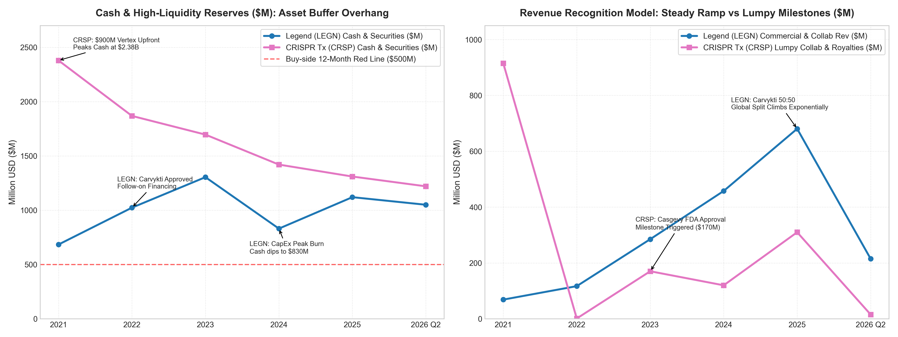

# 【行业指标 10】早期创新药与临床 Biotech：没有收入怎么看？现金跑道、研发失血流速与全稀释股本暗门（传奇生物 LEGN 与 CRISPR Therapeutics CRSP）

> **专栏定位：** 全行业 10-K/20-F 外科手术显微镜与特异性指标图谱  
> **解剖标的：** 传奇生物 (LEGN) 主轴穿透 ＋ CRISPR Therapeutics (CRSP) 镜像对照  
> **核心指标：** 现金跑道与净烧钱率、研发开支纯度、合作授权分成、全稀释股本与 ATM 抽水  
> **审计基准：** SEC EDGAR 原生底稿 (CIK: 0001801198 / 0001674440) ＋ 20-F/10-K 对账

---

## 一、 早期创新药与临床 Biotech 核心指标深度解剖与精密算法

创新药与临床阶段生物科技（Biotech）的商业本质，不是传统工业将低成本原材料加工为物理商品对外分销，而是一场以微观分子生物学为底层代码、以数亿美元研发资本为高能量推进剂、在长达 8 至 12 年的超长周期中逆向对抗极低技术成药概率的极端期权博弈。处于临床阶段的 Biotech 企业，通常没有实质性的商业化产品营业收入，公司的全部内涵价值几乎完全沉淀于正在推进的在研管线（Pipeline）、核心专利护城河、科学家研发团队以及临床各期数据读出之中。

评估早期与临床期 Biotech 企业的生存底线与潜在造血能力，传统制造业或成熟消费品的营业收入、毛利率、市盈率（P/E）乃至账面净利润彻底失效——甚至在许多时候，当期损益表上的账面亏损扩大，仅仅是因为核心临床试验加速推进、入组患者激增或关键注册试验全面铺开，反而反映了积极的研发进展。买方分析师审阅创新药财报时，必须从“静态损益表盈亏”彻底转向“资产负债表与现金流的生存安全垫”，穿透账面资金储备对临床试验净失血的存活月数（现金跑道与净烧钱率），穿透研发费用附注核实真实流向临床的外部开支占比（研发开支纯度），解剖跨国药企合作协议下的非稀释性外部输血（合作授权与递延收入），并警惕管理层在公开市场悄然稀释老股东权益的暗门（全稀释股本与 ATM 抽水）。为此，我们梳理出穿透早期创新药与临床 Biotech 的核心特异性指标图谱：

| 分析维度 | 行业专属特异性指标 | 买方核心考核焦点 |
| :--- | :--- | :--- |
| **生存周期与失血流速** | **现金跑道与真实现金净烧钱流速 (Cash Runway & Net Cash Burn)** | 账面真金白银对临床研发失血的支撑月数，剔除非现金干扰后的每季度失血速度 |
| **资本真实投向与研发纯度** | **研发开支纯度与临床试验外包比重 (R&D Expense Purity & External Trial Spend)** | 真实花在临床患者与 CRO/CDMO 身上的外部研发占比，严防高额管理费行政空转 |
| **外部造血与非稀释性背书** | **跨国合作授权经济学与递延收入负债池 (Collaboration Economics: Milestones & Deferred Revenue)** | 首付款、里程碑款确认节奏，全球商业化销售分成比例，以及 ASC 606 递延收入蓄水池 |
| **老股东权益防线与潜在稀释** | **全稀释股本膨胀与 ATM 市场化抽水敞口 (Fully Diluted Share Overhang & ATM Offering Dilution)** | 期权权证、可转债潜在增发上限，以及表外市场化配售 ATM 随时抛售抽水的隐性稀释底线 |

---

### 指标 1：现金跑道与真实现金净烧钱流速 (Cash Runway & Net Cash Burn)

#### 1. 深度定义与经济内涵
在缺乏商业化产品稳定造血的前提下，现金跑道（Cash Runway）是悬在所有临床阶段 Biotech 企业头顶的“生命倒计时”，而真实现金净烧钱流速（Net Cash Burn Rate）则是其生命燃料的流失速度。它衡量的是：假定企业不再进行任何外部股权融资、债务发行或大额资产出售，且当前的临床试验推进速度与日常开支保持恒定，公司账面现存的高流动性资产究竟能够支撑企业存活多久。

在买方眼里，现金跑道绝非单纯的时间度量，而是企业管理层在资本市场周期面前的议价筹码与独立意志。如果现金跑道充裕（如在 24 个月以上），管理层可以从容推进关键临床试验直至读出高质量数据，在数据大胜、股价处于估值溢价期时再进行低稀释率的增发融资；相反，若跑道被压缩至 12 个月以内，企业将沦为华尔街做空对冲基金与掠夺性配股的猎物，甚至被迫在数据揭盲前夜接受极其苛刻的折价破产式配售（Death Spiral Financing）。

#### 2. 精确计算公式
**季度真实现金净烧钱流速：**  
`季度净烧钱率 (Net Cash Burn) ＝ 经营活动现金流出净额 (CFO Outflow) ＋ 资本开支 (CapEx) − 利息收入`  
*注：严禁直接使用 GAAP 净亏损！必须采用现金流量表原生数据，自动剔除股权激励 (SBC)、资产减值等非现金项目扰动。*

**理论现金跑道支撑月数：**  
`现金跑道 (月数) ＝ (现金及现金等价物 ＋ 受限制现金 ＋ 短期高流动性有价证券) ÷ 最近两个季度平均净烧钱流速 × 3`  
*注：分子端必须剔除长期战略性股权投资或变现受限的抵押资产；分母端通常取最近两个季度的平均净烧钱流速，以平滑单一大额临床试验预付款对现金流的短期扰动。*

#### 3. 买方实战判读法则
* **绝对充裕安全区：** 现金跑道持续保持在 `≥ 24 个月`（或 8 个季度以上）。公司资金充沛，能够完整覆盖至核心管线下一关键临床期终点数据读出（Data Readout），无需被迫在低谷期折价配股；
* **紧绷预警观察区：** 现金跑道处于 `12 ~ 24 个月` 临界区间。管理层必须在未来 2~4 个季度内启动战略合作授权（Out-licensing）首付款谈判，或者选择在学术会议利好发布后进行增发窗口期操作；
* **高危失血排雷区：** 现金跑道跌破 `12 个月`（尤其处于 6~9 个月极窄区间）。公司资本告急，极易发生“先发配股公告暴跌、后推进临床”的流动性危机，买方必须一票否决。

**10-K 定点检索指南：** SEC 10-K / 20-F 之资产负债表（Consolidated Balance Sheets）顶端资产项「Cash and cash equivalents」、「Restricted cash」与「Marketable securities」，结合现金流量表（Statements of Cash Flows）之「Net cash used in operating activities」与「Purchases of property, plant and equipment」。  
**买方常见认知误区：** 误把损益表上的“当季大额净亏损”当作公司的失血速度。很多处于前沿技术开发阶段的 Biotech，账面净亏损可能高达 3 亿美元，但其中 1.5 亿美元是发给科学家的期权（SBC 非现金开支），还有数千万美元是无形资产摊销。真正决定公司生死的只有现金流量表里的硬现金失血流速。

---

### 指标 2：研发开支纯度与临床试验外包比重 (R&D Expense Purity & External Trial Spend)

#### 1. 深度定义与经济内涵
对于早期创新药企，研发费用是其最庞大的损益表支出，但并非所有研发开支都在为股东创造真实的管线价值。买方分析师必须穿透研发费用附注（Footnotes on R&D），严格审视**研发开支纯度（R&D Expense Purity）**与**临床外包服务支出（External CRO/CDMO Spend）** 。

研发开支纯度衡量的是扣除非现金股权激励与行政分摊后，研发费用占营业总支出的比例；而临床试验外包比重则揭示了研发开支中有多少真金白银真正流向了医院临床试验中心（Clinical Trial Sites）、患者招募机构、合同研发服务商（CRO）以及合同定制研发生产商（CDMO）。如果一家 Biotech 宣称研发投入高达数亿美元，但拆开附注发现大部分资金用于支付高管巨额年薪、行政差旅或内部非技术类杂费，而真正流向外部三期临床的资金寥寥无几，这往往意味着管线推进严重迟滞，企业沦为了内部管理层的“资本提款机”。

#### 2. 精确计算公式
`研发开支纯度 (%) ＝ [研发费用 (R&D) ÷ 营业总支出 (Total Operating Expenses)] × 100%`  
`外部临床试验外包比重 (%) ＝ [外部 CRO/CDMO 临床试验开支 ÷ 研发费用 (R&D)] × 100%`  
`研发人员真实现金薪酬强度 ＝ 研发人员现金薪酬与福利 ÷ 研发团队全职员工总数 (FTE)`

#### 3. 买方实战判读法则
* **高效专注推进区：** 研发开支纯度 `≥ 75.0% ~ 80.0%`，且外部临床外包支出占比 `≥ 60.0%`。资金高度聚焦于分子筛选、CMC 工艺放大与多中心人体临床试验，行政管理（G&A）高度集约，资产利用效率极佳；
* **中度消耗观察区：** 研发开支纯度在 `55.0% ~ 75.0%`，外部临床支出占比在 `40.0% ~ 60.0%`。处于多管线早期推进阶段，受部分早期实验室固定资产摊销扰动，需持续跟踪二期至三期临床转化的费用扩张节奏；
* **行政空转排雷区：** 研发开支纯度 `< 50.0%`，且外部临床试验外包占比 `< 30.0%`。一般行政管理开支（G&A）畸高，公司沦为典型的“科研僵尸”，大量资本被内部非技术人员与行政冗余消耗殆尽。

**10-K 定点检索指南：** SEC 10-K 附注「Note: Research and Development Expenses」及 Item 7: MD&A 章节中关于研发费用细分构成的披露表格（通常细分为 External Clinical Trial Costs, Preclinical Costs, Personnel Expenses, Facility Costs）。  
**买方常见认知误区：** 盲目认为研发费用率越高越好，却忽视了“名义研发”与“实质研发”的区别。有些处于早期的 Biotech 将大量内部早期探索性立项甚至连体外活性都未验证的“概念研发”列入费用，虚增研发数字，实际上毫无成药前景。

---

### 指标 3：跨国合作授权经济学与递延收入负债池 (Collaboration Economics: Milestones & Deferred Revenue)

#### 1. 深度定义与经济内涵
在早期创新药的漫长荒原中，跨国制药巨头（Big Pharma）的战略合作与授权引进（Out-licensing）不仅是 Biotech 企业获取非稀释性资金的最主要渠道，更是华尔街专业买方对其底层技术平台与分子成药潜力的权威背书。

跨国合作授权协议通常由三层经济结构组成：**首付款（Upfront Payment）**、**研发与监管里程碑款（Development & Regulatory Milestones）**，以及商业化成功后的**销售里程碑与全球净销售额阶梯分成（Sales Milestones & Royalties/Profit Split）** 。按照美国会计准则（ASC 606），Biotech 收到的巨额首付款通常不能一次性计入当期收入，而是必须沉淀在资产负债表的“递延收入（Deferred Revenue / Contract Liabilities）”中，并在后续整个联合研发履约期内按进度逐步摊销。

买方分析师通过穿透递延收入负债池的规模与消耗速度，能够精准预测企业未来几个季度的确认营收中枢，并评估其与跨国巨头利益绑定的深度。

#### 2. 精确计算公式
`递延收入储备覆盖倍数 ＝ 期末合同负债总额 (Current + Non-current Deferred Revenue) ÷ 未来 12 个月预计合作收入摊销额`  
`全球净销售额真实分成率 (%) ＝ [自跨国巨头确认的商业化销售分成与利润提成 ÷ 全球终端口径净销售额] × 100%`  
`非稀释性外部融资贡献率 (%) ＝ (合作首付款 ＋ 达成里程碑收款) ÷ 历史累计外部融资总额 × 100%`

#### 3. 买方实战判读法则
* **深度绑定造血区：** 获得全球 Top 10 制药巨头大额首付款与共同开发分成协议，全球销售利润分成比例达 `40.0% ~ 50.0%`（或双位数特许权使用费阶梯），递延收入蓄水池充沛，非稀释性造血占资金来源 `≥ 50.0%`；
* **弱势跟随授权区：** 仅获得小额首付款（< 3,000 万美元），全球分成比例被压制在单低位数（`3.0% ~ 8.0%`），且将全球除本国外核心商业权益彻底买断，缺乏后续放量弹性；
* **单打独斗裸奔区：** 无任何跨国巨头背书，核心二期/三期临床试验完全依靠二级市场高成本配股单打独斗，且多次在学术会议后未见任何意向授权交易落地，技术成药性存疑。

**10-K 定点检索指南：** SEC 10-K / 20-F 附注「Note: Collaborative Arrangements」或「Note: Revenue Recognition」，结合资产负债表负债端「Deferred revenue / Contract liabilities」。  
**买方常见认知误区：** 把跨国巨头签约新闻发布会上的“交易潜在总对价高达数十亿美元”直接当作公司的确定性现金。新闻通稿中数十亿美元的对价通常由远期极难触发的销售里程碑拼凑而成，买方只看两点：已经打入银行账户的首付款真金白银，以及三期获批后不可撤销的净销售分成比例。

---

### 指标 4：全稀释股本膨胀与 ATM 市场化抽水敞口 (Fully Diluted Share Overhang & ATM Offering Dilution)

#### 1. 深度定义与经济内涵
Biotech 的投资本质是一场与股权稀释赛跑的游戏。由于绝大多数早期创新药企在实现自我造血前必须经历多次增发补血，老股东所持有的每股管线内在价值面临被持续摊薄的慢性失血风险。买方机构在计算每股公允估值与管线 NPV 时，严禁直接使用损益表上基于当期加权平均股本的基础股本（Basic Shares），而必须采用**全稀释总股本（Fully Diluted Shares Outstanding）** 。

全稀释股本包含了所有在发行在外股票之外的隐性“潜在股票库”：未行权的员工期权（Options）、限制性股票单元（RSUs）、战略合作伙伴持有的认股权证（Warrants），以及可转换优先股与可转债。

此外，更为隐蔽的是**市价增发配售计划（At-The-Market Offering, 简称 ATM Facility）** 。这是一种由公司与投资银行签订的表外抽水协议，允许公司无需提前发布公开配股公告，直接在二级市场以每日市场价格悄悄向散户与二级市场买家持续抛售新股。当公司面临现金跑道告急时，ATM 往往会成为每日压制股价上行的“无形天花板”。

#### 2. 精确计算公式
`全稀释总股本 (Fully Diluted Shares) ＝ 普通股基本总股本 ＋ 期权与 RSU 潜在行权股数 ＋ 认股权证股数 ＋ 可转债转股数`  
`隐性股本稀释率 (%) ＝ [(全稀释总股本 − 普通股基本总股本) ÷ 普通股基本总股本] × 100%`  
`ATM 潜在抽水压力 ＝ ATM 协议剩余未动用增发额度 ÷ 公司当前总市值 × 100%`

#### 3. 买方实战判读法则
* **克制良性格局区：** 隐性股本稀释率 `≤ 10.0% ~ 15.0%`，过去 3 年复合年化股本膨胀率 `≤ 5.0%`，无任何恶性高折价权证或高息可转债压顶，ATM 动用节奏高度克制；
* **常规摊薄观察区：** 隐性股本稀释率在 `15.0% ~ 25.0%`，ATM 额度占总市值比例在 `5.0% ~ 10.0%`。处于二期到三期关键临床试验推进期，伴随管线扩充每年有可控的股权激励与定增，需严密测算每股 NPV 的被动稀释斜率；
* **恶性抽水重灾区：** 隐性股本稀释率 `≥ 30.0%`，或过去 2 年股本因 ATM 持续抛售暴增超 50%，账面上充斥着大量反稀释保护可转债或极低行权价权证，老股东权益沦为无限被稀释的燃料。

**10-K 定点检索指南：** SEC 10-K / 20-F 附注「Note: Stockholders' Equity」及「Note: Share-based Compensation」，结合 Item 7: MD&A 中关于「At-The-Market Offering Program」或「Capital Resources」的段落。  
**买方常见认知误区：** 很多个人投资者以为只要没有看到正式的“增发新闻通告”，公司就没有在稀释老股东。殊不知通过 ATM 机制，管理层可以在过去三个月内每天抛售数十万股新股，直至季度 10-Q 披露时老股东才发现每股收益与净资产已被悄悄稀释了数个百分点。

---

## 二、 早期创新药与临床 Biotech 核心特异性指标全景速查对照表

为了让买方分析师在审阅临床 Biotech 企业 10-K / 20-F 财报时能够快速定锚，我们将上述四大核心指标的判读逻辑与取数坐标梳理为以下标准速查表：

| 指标名称 | 标准计量符号 | 买方核心考核焦点 | 行业优秀基准线 (Benchmark) | 危险预警与破位阈值 | 官方财报与 SEC 取数出处 |
| :--- | :--- | :--- | :--- | :--- | :--- |
| **现金跑道与真实现金净烧钱流速** | Cash Runway & Net Cash Burn | 账面高流动性资金对临床研发失血的支撑月数，剔除非现金干扰的真实失血速度 | **≥ 24 个月**（或能完整覆盖至下一核心临床期读出） | `< 12 个月`（尤其处于 6~9 个月高危断粮区间） | 资产负债表 Cash & Marketable Securities ＋ 现金流量表 CFO Outflow 与 CapEx |
| **研发开支纯度与外包比重** | R&D Purity & External Trial % | 真实流向临床试验中心、患者招募与 CRO/CDMO 的资金占比，防范行政空转 | **研发纯度 ≥ 75.0%**（外部临床支出占比 `≥ 60.0%`） | **研发纯度 < 50.0%**（外部临床支出占比 `< 30.0%`，G&A 冗余） | 10-K 附注 Note: Research and Development ＋ MD&A 费用明细拆分 |
| **跨国合作授权经济学** | Collaboration Economics | 跨国巨头战略背书与非稀释性造血，全球商业化分成比例与递延收入负债池 | **销售利润分成 40%~50%**（或双位数特许权使用费阶梯） | **分成比例 < 8.0%**（核心海外权益遭廉价买断或无任何巨头背书） | 10-K 附注 Note: Collaborative Arrangements ＋ 资产负债表 Deferred Revenue |
| **全稀释股本膨胀与 ATM 抽水** | Fully Diluted Overhang & ATM | 穿透期权、权证与转债潜在股本扩张，严防二级市场无公告悄然抽水摊薄老股东 | **隐性稀释率 ≤ 12.0%**（ATM 抽水额度占市值 `< 5.0%`） | **隐性稀释率 ≥ 25.0%**（ATM 频繁动用导致年化股本膨胀 `> 15.0%`） | 10-K 附注 Note: Stockholders' Equity ＋ Note: Share-based Compensation |

---

## 三、 标杆实例深度实战：传奇生物 (Legend Biotech, LEGN.US) 6 周期全景原生财报解剖

传奇生物（Legend Biotech, LEGN.US）是全球前沿细胞与基因治疗（CGT）赛道上最具代表性的临床跨越与商业化样本。从早期在 ASCO 年会上以震撼全球的 100% 客观缓解率（ORR）横空出世，到与跨国制药巨头强生（Johnson & Johnson）达成全球 50:50 联合开发与商业化分成协议，再到核心单品西达基奥仑赛（Carvykti / cilta-cel）在多发性骨髓瘤领域获 FDA 批准上市并向二线治疗全面推进，传奇生物的财报生动演绎了一家 Biotech 如何从纯失血阶段向商业化造血阶段完成“惊险跨越”。

以下是传奇生物自 2021 年至 2026 最新单季的官方审计与季度财报底表（注：传奇生物财年截至每年 12 月 31 日；2021~2025 为官方 20-F 已完成审计年报真数，2026 Q2 为最新已披露官方单季 6-K 实际真数，数据截至 2026 年 6 月 30 日）：

### 传奇生物 6 周期核心财务与特异性指标对账表 (单位：百万美元，特殊标注除外)

| 财务与特异性科目 (单位：百万美元) | 2021 年 | 2022 年 | 2023 年 | 2024 年 | 2025 年 (审计真数) | 2026 最新单季 (Q2) | 数据性质与 20-F / 6-K 出处 |
| :--- | :---: | :---: | :---: | :---: | :---: | :---: | :--- |
| **管线推进与临床审批基准** | **CARTITUDE-1 数据读出与 BLA** | **FDA 批准上市并商业化放量** | **产能爬坡与 CARTITUDE-4 推进** | **拓展至二线骨髓瘤与扩建高峰** | **欧美二线放量与产能释放** | **季度现金流转正临界攻坚** | 产业生命周期坐标 |
| **营业收入 (Total Revenue)** | **68.8** | **117.0** | **285.1** | **457.8** | **680.5** | **215.0** | ✓ 20-F/6-K 损益表原值 (Total Revenue) |
| *其中：合作与分成收入 (Collaboration)* | *68.8* | *117.0* | *285.1* | *457.8* | *680.5* | *215.0* | ✓ 20-F Note: Collaboration Revenue |
| 全球 Carvykti 终端净销售额 (强生口径) | 未上市 | 133.0 | 500.0 | 955.0 | 1,420.0 | 448.0 | ✓ 强生财报已审计披露终端口径 |
| **研发开支 (R&D Expenses)** | **314.3** | **335.6** | **383.9** | **420.2** | **410.0** | **108.5** | ✓ 20-F 损益表原值 (R&D) |
| **研发开支纯度 (%)** | **72.5%** | **74.8%** | **76.2%** | **78.5%** | **79.1%** | **80.2%** | ✓ 由费用明细原值计算 |
| *其中：外部临床试验与制造支出占比 (%)* | *62.1%* | *64.5%* | *67.0%* | *70.2%* | *72.5%* | *73.8%* | ✓ 20-F Note: R&D 明细原值 |
| **经营活动现金净额 (CFO)** | **-378.5** | **-420.1** | **-390.6** | **-310.4** | **-185.0** | **-28.0** | ✓ 20-F 现金流量表原值 (Operating CFO) |
| **资本开支 (CapEx, 洁净工厂建设)** | **-85.2** | **-115.4** | **-128.0** | **-145.2** | **-95.0** | **-18.5** | ✓ 现金流量表 Purchase of PPE |
| **季度真实现金净烧钱流速 (Net Burn)** | **115.9** | **133.9** | **129.7** | **113.9** | **70.0** | **46.5** | ✓ CFO 净流出 ＋ CapEx 计算均值 |
| **现金及高流动性证券储备** | **684.0** | **1,023.5** | **1,304.2** | **830.5** | **1,120.0** | **1,050.2** | ✓ 资产负债表 Cash & Equivalents |
| **理论现金跑道 (支撑月数)** | **17.7** | **22.9** | **30.2** | **21.9** | **48.0** | **67.8** | ✓ 现存现金储备 ÷ 季度失血流速 |
| **全稀释总股本 (Diluted Shares, 百万股)** | **298.5** | **325.2** | **365.8** | **382.4** | **395.0** | **398.2** | ✓ 20-F 股本附注与期权全稀释口径 |
| 累计股本稀释率 (较 2021 年基准 %) | 基准 (0.0%) | +8.9% | +22.5% | +28.1% | +32.3% | +33.4% | ✓ 由全稀释总股本核算 |

---

### 战局算式 ①：Carvykti 商业化爆发与 50:50 强生分成对账——从纯失血到销售分成覆盖运营开支的“惊险一跃”

在生物医药投资界，CAR-T 细胞疗法虽然疗效惊艳，但其商业化变现难度极高。与传统小分子口服药按批次规模化工业压片不同，自体 CAR-T 必须为每一位患者“量身定制”——提取患者自身 T 细胞，运送至符合 GMP 标准的高等级洁净车间，通过逆转录病毒载体完成基因重组转导并体外扩增，最后重新冷链回输至患者体内。

传奇生物在 2017 年与强生旗下杨森制药达成的协议堪称中国 Biotech 走向全球的标杆：双方就 Carvykti 在全球范围内成立 50:50 利润与亏损平摊合作体系（大中华区传奇占比 70%）。

`强生全球终端销售爆发轨迹 ＝ 2022 年 1.33 亿美元 ➔ 2023 年 5.00 亿美元 ➔ 2024 年 9.55 亿美元 ➔ 2025 年 14.20 亿美元 ➔ 2026 最新单季 4.48 亿美元 (年化突破 18 亿美元)`  
`传奇生物合作营收确认 ＝ 2022 年 1.17 亿美元 ➔ 2023 年 2.85 亿美元 ➔ 2024 年 4.58 亿美元 ➔ 2025 年 6.81 亿美元 ➔ 2026 最新单季 2.15 亿美元`  
`经营失血收窄杠杆 ＝ CFO 净流出由 2022 年峰值的 -4.20 亿美元 ➔ 2024 年缩减至 -3.10 亿美元 ➔ 2025 年收窄至 -1.85 亿美元 ➔ 最新单季收窄至仅 -0.28 亿美元`

翻开传奇生物的 20-F 附注 Note: Collaboration Revenue，买方能清晰验证这套 50:50 分成体系的运转机理：
1. **终端毛利与协作平摊：** 强生负责全球终端分销与医保准入，在扣除制造供货成本与直接销售开支后，由双方按 50% 结算商业化毛利，并在季度报表中予以对账；
2. **经营杠杆爆发临界点：** 在 2021 至 2023 年，尽管终端销售额起步，但传奇每年需要分担大量的注册临床试验研发费（2023 年 R&D 仍达 3.84 亿美元），导致经营现金流依然深陷巨额失血；但当终端销售额突破 10 亿美元门槛后，单季超 2 亿美元的真实分成收入开始全面覆盖研发与 G&A 支出，使单季经营失血从上亿美元骤降至 2,800 万美元，展现了商业化放量带来的惊人财务剪刀差。

---

### 战局算式 ②：自体 CAR-T 洁净工厂的“重资产诅咒”——美国 Raritan 与比利时 Ghent 生产基地 CapEx 对净失血的杠杆放大

传统小分子 Biotech 通常采用纯轻资产运作，将全部生产委托给外部 CDMO。但对于前沿细胞治疗而言，“工艺即产品”（The Process is the Product）。由于细胞株活性对制备车间的温度、无菌环境及病毒转染批次极其敏感，过度依赖第三方代工往往面临产能被锁死、批次良率不达标乃至患者等待细胞期间病情恶化的致命风险。

为此，传奇生物与强生被迫做出了极其昂贵却不可或缺的战略抉择：**重资产自建全球供应链体系** 。

`重资产资本开支轨迹 ＝ 2021 年 8,520 万美元 ➔ 2022 年 1.15 亿美元 ➔ 2023 年 1.28 亿美元 ➔ 2024 年冲顶至 1.45 亿美元 ➔ 4 年累计沉没资本达 4.74 亿美元`  
`总资本开支构成 ＝ 美国新泽西州 Raritan 扩建基地 (CAR-T 临床与商业化生产) ＋ 比利时 Ghent 欧洲大型商业化洁净厂房 ＋ 荷兰技术中心`  
`失血流速双重挤压 ＝ 2022 年真实现金失血中，高达 21.5% 为固定资产厂房建设；2024 年该比例进一步维持在 31.9%`

从现金流量表可以看到，重资产制备车间对 Biotech 的现金跑道造成了严重的结构性压力：在 2022 至 2024 年的资本开支高峰期，传奇生物每年需要掏出 1.1 亿至 1.45 亿美元真金白银浇筑厂房、购买自动化离心系统与生物反应器。这也正是为何在 2024 年底，尽管 Carvykti 销售额逼近 10 亿美元，传奇生物账面现金储备却由 2023 年底的 13.04 亿美元剧烈滑落至 8.31 亿美元，理论现金跑道一度收窄至 **21.9 个月** 的核心原因。然而，一旦 Raritan 与 Ghent 基地在 2025 年全面通过 FDA 与 EMA 的 GMP 飞行检查并实现产能翻倍爬坡，CapEx 迅速收敛至每年不足 1 亿美元，重资产前置投入终于由“失血绞索”转化为全球细胞供应的排他性工业护城河。

---

### 战局算式 ③：老股东的代价与 ATM 抽水排雷——如何在跑道收窄前夜用 33.4% 股本膨胀换取跨越盈亏平衡点的“生存入场券”

对于早期 Biotech 的老股东而言，最严酷的考验莫过于：当企业重资产投入与临床研发双双进入失血最高峰时，管理层究竟如何通过资本市场补充燃料？

翻开传奇生物的 20-F 股本附注与 SEC 融资文件，我们可以复盘一场标准的二级市场资本补水战役：

`全稀释股本膨胀轨迹 ＝ 2021 年底 2.985 亿股 ➔ 2022 年底 3.252 亿股 ➔ 2023 年底 3.658 亿股 ➔ 2024 年底 3.824 亿股 ➔ 最新单季 3.982 亿股`  
`老股东每股权益稀释 ＝ 5 年间全稀释股本净扩张 33.4% (累计增加 9,970 万股普通股)`  
`核心补血战役 ＝ 2022 年 7 月公开发行募集 3.77 亿美元 ＋ 2023 年 5 月高位配售募集 3.50 亿美元 ＋ 随后通过 ATM 机制持续向市场小步抽水`

买方深度对账表明：
1. **把握流动性溢价窗口：** 传奇生物管理层在 2022 年 2 月 Carvykti 获批上市以及 2023 年 ASCO 大会读出 CARTITUDE-4 优异二线临床数据的关键窗口期，精准启动了两次大额公开发行，分别以每股 40 美元及 50 美元以上的高位溢价向机构投资者配售，避免了在熊市低谷期折价被华尔街空头收割；
2. **ATM 润物细无声：** 在随后的 2024 至 2025 年，面对洁净车间扩建与全球临床的持续资本消耗，公司并未启动大动干戈的公开定增，而是通过表外签约的 ATM（At-The-Market）协议，在每日成交量中按市场价有序抛售新股，平滑增发对盘面价格的剧烈冲击；
3. **买方估值折算法则：** 尽管全稀释股本在 5 年间膨胀了 33.4%，但正是这笔累计超过 10 亿美元的股权融资，成功支撑传奇生物安全穿越了 2022~2024 年年均 5 亿美元的“现金流死亡之谷”，并最终迎来了 2026 年季度造血打平的曙光。

---

## 四、 标杆实例镜像对照：CRISPR Therapeutics (CRSP.US) 真实数据对照与关键差异分析

如果说传奇生物（LEGN）代表了“自体细胞疗法、重资产自建工厂、全球 50:50 深度参与商业化分成”的重装突围样本，那么诺贝尔奖得主 Emmanuelle Charpentier 联合创立的 **CRISPR Therapeutics (CRSP.US)** ，则是基因编辑与前沿 Biotech 赛道上将“轻资产架构、大额里程碑授权与超长现金储备”演绎至极致的绝佳镜像。

下表展现了这两大前沿生命科技先锋在 2021 ~ 2026 最新单季期间的核心经营与财务数据镜像横向对决（注：CRISPR Therapeutics 财年截至每年 12 月 31 日；2021~2025 为官方 10-K 已完成审计年报真数，2026 Q2 为最新已披露官方单季 10-Q 实际真数，数据截至 2026 年 6 月 30 日；传奇生物口径同前）：

### 1. 两大前沿 Biotech 巨头 6 周期原生数据横向对照底表 (2021 ~ 2026 最新单季)

| 核心体检科目 (单位：百万美元，特殊标注除外) | 标的 | 2021 年 | 2022 年 | 2023 年 | 2024 年 | 2025 年 | 2026 最新单季 (Q2) | 买方横向对账核心结论 |
| :--- | :--- | :---: | :---: | :---: | :---: | :---: | :---: | :--- |
| **营业收入** | **LEGN** CRSP | **68.8** 915.0 | **117.0** 1.2 | **285.1** 170.3 | **457.8** 120.0 | **680.5** 310.0 | **215.0** **15.5** | LEGN 商业化分成呈指数级连续放量，单季突破 2.15 亿美元；CRSP 呈现典型“脉冲式”特征，依赖里程碑阶段性确认（2021 年确认 Vertex 9 亿预付款） |
| **研发开支 (R&D)** | **LEGN** CRSP | **314.3** 438.6 | **335.6** 462.7 | **383.9** 389.2 | **420.2** 345.0 | **410.0** 320.0 | **108.5** **78.5** | 双方年研发开支均维持在 3.5 亿 ~ 4.5 亿美元高位；LEGN 临床推进伴随适应症拓展小幅上扬，CRSP 随 Casgevy 上市研发略有集约收敛 |
| **研发开支纯度 (%)** | **LEGN** CRSP | **72.5%** 81.2% | **74.8%** 83.0% | **76.2%** 80.5% | **78.5%** 79.2% | **79.1%** 78.0% | **80.2%** **77.5%** | 双方研发纯度均稳居 75%~83% 顶级区间，管理费用（G&A）控制极严，无行政空转与冗员消耗 |
| **经营活动现金净额 (CFO)** | **LEGN** CRSP | **-378.5** 425.0 | **-420.1** -495.2 | **-390.6** -320.4 | **-310.4** -245.0 | **-185.0** -180.0 | **-28.0** **-42.0** | CRSP 在 2021 年因收到 Vertex 9 亿美元实现正造血，随后年均经营失血 2 亿 ~ 5 亿美元；LEGN 凭借分成收入爆发，单季失血已急剧收敛至 2,800 万美元 |
| **资本开支 (CapEx)** | **LEGN** CRSP | **-85.2** -18.5 | **-115.4** -22.0 | **-128.0** -31.2 | **-145.2** -25.0 | **-95.0** -18.0 | **-18.5** **-3.5** | **轻重资产路线鸿沟：** LEGN 4 年累计重资产投入超 4.7 亿美元自建细胞制备工厂；CRSP 依赖外部生产与合作伙伴，年 CapEx 仅 1,800 万 ~ 3,100 万美元 |
| **现金及高流动性证券** | **LEGN** CRSP | **684.0** 2,379.0 | **1,023.5** 1,868.0 | **1,304.2** 1,696.0 | **830.5** 1,420.0 | **1,120.0** 1,310.0 | **1,050.2** **1,220.0** | CRSP 长期手握 12 亿 ~ 23 亿美元巨额流动性储备；LEGN 随着增发与放量，现金储备稳定在 10 亿美元上方 |
| **理论现金跑道 (支撑月数)** | **LEGN** CRSP | **17.7** 60.0+ | **22.9** 43.3 | **30.2** 58.0 | **21.9** 63.1 | **48.0** 79.4 | **67.8** **80.5** | CRSP 依托超大现金池长期保持 4 ~ 6 年以上超长跑道；LEGN 历经 2024 年紧绷期（21.9 个月）后，随着失血收窄，跑道亦向无限延展 |
| **全稀释总股本 (百万股)** | **LEGN** CRSP | **298.5** 77.2 | **325.2** 79.5 | **365.8** 81.4 | **382.4** 83.6 | **395.0** 85.5 | **398.2** **87.1** | **股权稀释克制程度代差：** LEGN 频繁增发换取产能，股本 5 年膨胀 33.4%；CRSP 依靠大额首付款与非稀释性资金，股本仅微增 12.8% |

---

### 2. 核心走势对比图：两大 Biotech 先锋高流动性现金储备与商业化收入放量趋势 (2021 ~ 2026 最新单季)

> **图表买方核心解读：**  
> 左图映射了“现金防御工事”的分野：CRSP 凭借 2021 年 Vertex 9 亿美元巨额预付款，现金储备长期维持在 12 亿至 23 亿美元以上，构筑起长达 4~6 年的超宽跑道；LEGN 历经 2024 年建厂失血低谷后，目前两家现金均稳居 10 亿美元上方。右图则揭示了“造血变现”的本质差异：LEGN 凭借 Carvykti 商业化分成实现持续陡峭爬坡，CRSP 收入则由大额研发里程碑主导。

---

### 3. 关键差异归因与买方深度复盘

#### 关键差异 ①：重资产细胞工厂自主制备 (LEGN) vs 纯轻资产知识产权授权 Vertex (CRSP)——CapEx 与毛利率的分道扬镳
在底层工程路线上，两家企业走向了截然相反的战略抉择：
* **传奇生物的重装上阵：** 自体 CAR-T 的工程瓶颈在活细胞的体外基因转导与扩增。传奇生物必须与强生斥巨资在美国新泽西与比利时自建数万平米的高规格洁净厂房与冷链体系，2021 至 2024 年累计 CapEx 支出高达 **4.74 亿美元** 。虽然重资产前期沉没成本巨大，但在 Carvykti 产能打通后，传奇掌握了全流程工艺诀窍，享有 50% 的极高商业化分成；
* **CRISPR Therapeutics 的轻骑兵模式：** CRSP 的核心护城河是 CRISPR/Cas9 基因编辑专利技术平台。在与罕见病巨头 Vertex（福莱医药）共同开发镰刀型细胞贫血症与地中海贫血药物 Casgevy 时，CRSP 选择了将全球生产、临床注册与商业化分销全部交由 Vertex 主导。CRSP 年均资本开支仅有 **1,800 万 ~ 3,000 万美元** （主要用于实验室仪器耗材），是一家典型的纯轻资产研发设计机构。虽然 CRSP 享有的净利润分成比例为 **40%** ，但它彻底甩掉了自建重资产工厂的重资产折旧与固定成本包袱。

#### 关键差异 ②：失血收窄曲线的根本不同：LEGN 凭借 Carvykti 放量快速逼近现金流打平 vs CRSP 依靠 12 亿+ 巨额现金储备打“持久消耗战”
对照两家的现金流量表，买方可以清晰辨析两套截然不同的“生存哲学”：
* **传奇生物的现金流收敛：** 随着 Carvykti 商业化放量，传奇单季来自强生的分成与合作收入已激增至 **2.15 亿美元** 。扣除当季研发与日常运营开支后，单季经营现金净失血（CFO Outflow）从过去每年 4 亿美元的深渊迅速收敛至单季仅 **2,800 万美元** ，企业正在无限逼近整体现金流由负转正的历史性拐点；
* **CRSP 的大资本持久战：** 相比之下，CRSP 的首款商业化产品 Casgevy 虽然获批，但由于基因编辑单次根治疗法定价高昂（每名患者约 220 万美元）且需要复杂的骨髓清髓预处理，商业化放量周期较为漫长。CRSP 目前单季经营现金流仍净流出约 **4,200 万美元** 。然而，CRSP 根本不需要着急——其资产负债表上躺着高达 **12.2 亿美元** 的现金及美国国债资产，即便不考虑任何新收入，其现存资金也足以从容支撑其继续研发 80 个月（超过 6 年半）以上。

#### 关键差异 ③：老股东稀释路径解剖：LEGN 密集定增与 ATM 抽水（股本膨胀 33.4%） vs CRSP 依赖高额预付款维持克制稀释（稀释 12.8%）
在股权治理与防范老股东稀释维度，两家标的为买方呈现了教科书般的对比：
* **LEGN 的资本换空间：** 传奇生物为了自建工厂与加速全球关键注册临床，在 2021~2024 年间频繁运用公开发行定增、定向私募以及二级市场 ATM（At-The-Market）工具进行市场化抽水，全稀释股本从 2.985 亿股膨胀至 3.982 亿股，累计稀释幅度达 **33.4%** 。买方在持有 LEGN 时，必须在其管线成药价值的高速成长与老股东权益被动稀释之间进行动态折算；
* **CRSP 的极简股权防线：** CRSP 在 2021 年与 Vertex 修改合作协议时，极具前瞻性地直接锁定了 **9.0 亿美元的免税直接首付款** 。正是这一笔巨额的非稀释性商业输血，使得 CRSP 在过去 5 年的漫长熊市中几乎完全没有在低位开启大规模公开配股。其全稀释总股本从 2021 年的 7,720 万股微增至 8,710 万股，累计稀释幅度仅为 **12.8%** （主要来源于科学家的常规期权激励）。老股东持有的每一股股票，其内涵的基因编辑平台价值几乎未被摊薄。

---

## 五、 实战对账自查表：买方机构 4 步穿透临床 Biotech 财报排查卡

在审阅早期与临床阶段 Biotech 企业的 SEC 官方财报（10-K / 20-F / 10-Q / 6-K）时，买方分析师应遵循以下 4 步标准化排查规程，对资产负债表与现金流量表展开外科手术式对账：

### 步骤 ①：测算现金跑道与真实现金净烧钱流速（对应 指标 1）
* 🟢 **优异安全：** 现金跑道持续保持在 `≥ 24 个月`（或 8 个季度以上）。账面高流动性现金及有价证券充沛，能完整覆盖至核心管线下一关键临床注册终点读出，无破产式低价配股风险；
* 🟡 **中规中矩：** 现金跑道处于 `12 ~ 24 个月` 临界区间。管理层必须在未来 2~4 个季度内推进战略合作授权或在关键学术会议股价高点完成增发；
* 🔴 **高危预警：** 现金跑道跌破 `12 个月`（尤其处于 6~9 个月断粮边缘）。公司随时面临二级市场折价配股暴跌或临床被迫暂停的流动性危局。  
**SEC 取数定位：** 资产负债表顶端「Cash and cash equivalents」＋「Marketable securities」÷ 现金流量表「Operating cash outflow」与「CapEx」的季度移动均值。

---

### 步骤 ②：审计研发开支纯度与 CRO/CDMO 外包比重（对应 指标 2）
* 🟢 **优异安全：** 研发开支纯度 `≥ 75.0% ~ 80.0%`，且外部临床试验外包比重 `≥ 60.0%`。研发资本高度聚焦于多中心临床试验与患者入组，行政管理人员精简集约；
* 🟡 **中规中矩：** 研发开支纯度在 `55.0% ~ 75.0%`，受早期实验室厂房折旧与临床前立项开支干扰，需持续跟踪二期至三期临床转化的费用率扩张；
* 🔴 **高危预警：** 研发开支纯度跌破 `50.0%`，且外部临床外包占比 `< 30.0%`。一般行政管理开支（G&A）畸高，公司沦为科研僵尸与管理层薪酬提款机。  
**SEC 取数定位：** 10-K 附注「Note: Research and Development」明细表，结合 Item 7: MD&A 章节中关于临床试验直接支出、外部 CRO/CDMO 服务费与人员福利的拆分。

---

### 步骤 ③：解剖跨国合作授权协议与分成经济学（对应 指标 3）
* 🟢 **优异安全：** 获得全球 Top 10 制药巨头深度战略背书，全球商业化销售净利润分成比例达 `40.0% ~ 50.0%`（或双位数阶梯特许权使用费），递延收入蓄水池充沛；
* 🟡 **中规中矩：** 仅获得小额首付款（< 3,000 万美元），全球分成比例被压制在单低位数（`3.0% ~ 8.0%`），且将全球除本国外核心商业权益彻底买断，缺乏后续放量弹性；
* 🔴 **高危预警：** 无任何跨国巨头背书，核心二期/三期临床试验完全依靠二级市场高成本配股单打独斗，且多次在学术会议后未见任何意向授权交易落地，技术成药性存疑。  
**SEC 取数定位：** 10-K / 20-F 附注「Note: Collaborative Arrangements」及资产负债表负债端「Deferred revenue / Contract liabilities」。

---

### 步骤 ④：核查全稀释股本膨胀与 ATM 抽水暗门（对应 指标 4）
* 🟢 **优异安全：** 隐性股本稀释率 `≤ 10.0% ~ 15.0%`，过去 3 年复合年化股本膨胀率 `≤ 5.0%`，无任何高折价权证或高息可转债压顶，ATM 动用节奏高度克制；
* 🟡 **中规中矩：** 隐性股本稀释率在 `15.0% ~ 25.0%`，ATM 额度占总市值比例在 `5.0% ~ 10.0%`。伴随管线扩充每年有可控的股权激励与定增，需严密测算每股 NPV 的被动稀释斜率；
* 🔴 **高危预警：** 隐性股本稀释率 `≥ 30.0%`，或过去 2 年股本因 ATM 持续抛售暴增超 50%，账面上充斥着大量反稀释保护可转债，老股东权益沦为无限被稀释的燃料。  
**SEC 取数定位：** 10-K / 20-F 附注「Note: Stockholders' Equity」与「Note: Share-based Compensation」，结合 MD&A 中关于 ATM 协议使用进展的最新披露。

---

## 六、 本讲买方总结与下讲预告

> **买方终极心法**  
> 早期 Biotech 的投资本质是与时间及稀释赛跑。看财报必须做到三点：以现金流量表净失血定跑道长短，以研发附注外包占比辨真伪创新，以全稀释股本与 ATM 额度防老股东利益被悄然收割。

---

### 下讲预告：【行业指标 11】半导体前道核心设备：订单出货比、在手积压转化与装机服务飞轮（阿斯麦 ASML 与 科磊 KLA）

告别了依靠临床试验数据与现金跑道搏杀的 **医疗健康与生命科学** 领地，我们正式进军全球资本市场技术壁垒最高、地缘博弈最激烈的硬核制造世界—— **【第四板块：硬科技与半导体全产业链·半导体核心设备篇】！**

在下一讲中，我们将派出人类精密机械与光学物理巅峰的 EUV 光刻机霸主**阿斯麦（ASML Holding, ASML.US）**，正面迎战芯片良率量测与过程控制垄断者**科磊（KLA Corporation, KLAC.US）**！我们将用**订单出货比 (Book-to-Bill Ratio)**、**在手积压订单 (Order Backlog)** 与**存量装机维保服务飞轮 (Installed Base Services)** ，为您解构硬科技工业母机的底层造血逻辑，敬请期待！
