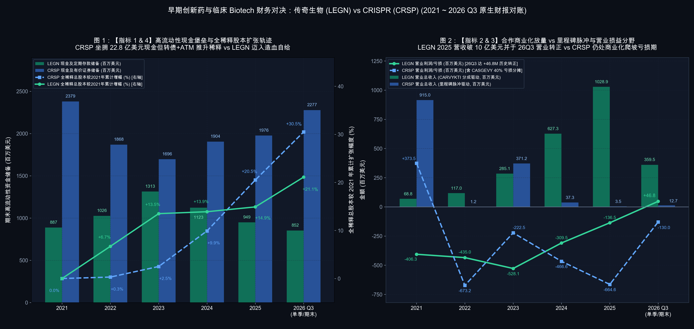

# 【行业指标 10】早期创新药与临床 Biotech 财报解剖：现金跑道、研发纯度、合作分成与股本稀释暗门（传奇生物 LEGN 与 CRISPR Therapeutics CRSP）

> **专栏定位：** 全行业 10-K/20-F 财报解剖与特异性指标图谱  
> **解剖标的：** 传奇生物 (Legend Biotech, LEGN) 主轴穿透 ＋ CRISPR Therapeutics (CRSP) 镜像对照  
> **核心指标：** 现金跑道与净烧钱流速、研发投入纯度与行政纪律、商业化合作分成与亏损挂账、全稀释股本膨胀与增发抽水暗门  
> **审计基准：** SEC EDGAR 原生底稿 (CIK: 0001801198 / 0001674416) ＋ 20-F/6-K/10-K/10-Q 对账

> **摘要：** 拆解早期与转化期 Biotech 4 大核心财报指标（现金跑道、研发纯度、合作分成与全稀释股本），结合传奇生物（LEGN）与 CRISPR（CRSP）最新财报对账，看透未盈利药企如何跨越临床死生之谷与防范股权抽水。

---

## 一、 早期与转化期 Biotech 核心指标深度解剖

在生物医药产业链中，处于临床研发期或首款核心单品刚步入商业化爬坡期的生物科技公司（Biotech），与拥有成熟全球销售网络和稳态现金流的跨国大药企（Big Pharma）遵循截然不同的商业逻辑。对于尚未建立稳定正向自由现金流的 Biotech 而言，市盈率（P/E）、稳态净利率或股息率等传统估值标尺完全失效——在长达数年的临床 I/II/III 期验证与商业化产线建设期内，持续的研发与临床入组投入必然导致利润表长期处于亏损状态。

但这绝不意味着 Biotech 是一座无法用财报量化的“黑盒赌场”。恰恰相反，早期与转化期创新药企的经营本质是**一场“以账面现金储备置换临床数据读出（Data Readout）、推动管线跨越商业化盈亏平衡奇点”的精密资本转化过程** 。买方分析师审阅财报时，主要围绕四个通用财务维度展开核查：一是看**流动性储备与净烧钱流速**，核算现金跑道能否完整覆盖下一个关键临床催化节点；二是看**研发投入纯度与管理费用纪律**，检验融资弹药是否真正投向临床试验与工艺开发；三是看**与跨国大药企的合作授权与分成契约**，甄别顶线收入是可持续的商业化分成，还是脉冲式里程碑或前期亏损挂账；四是看**潜在稀释证券与二级市场增发协议**，排查因会计“反稀释”规则掩盖的股权摊薄风险。

| 分析维度 | 行业专属特异性指标 | 买方核心考核焦点 |
| :--- | :--- | :--- |
| **流动性与生存倒计时** | **现金跑道与真实现金净烧钱流速 (Cash Runway & Net Cash Burn)** | 账面高流动性资金能否覆盖未来 24 个月以上净失血，避免在临床数据揭晓前落入折价融资陷阱 |
| **资源投放与费用纪律** | **核心研发投入纯度与行政费用纪律 (R&D Expense Purity & G&A Discipline)** | 甄别宝贵的融投资金是注入临床入组与 CMC 工艺验证，还是被臃肿的高管薪酬与行政内耗蚕食 |
| **巨头背书与商业造血** | **商业化合作分成与授权造血结构 (Collaboration Economics & Profit/Loss Split)** | 区分脉冲式里程碑与经常性商业分成，穿透联合商业化爬坡期的净亏损分摊与表外递延成本挂账 |
| **股东权益与抽水暗门** | **全稀释股本膨胀与增发抽水敞口 (Fully Diluted Share Overhang & Equity Financing)** | 还原反稀释剔除的期权、受限股、可转债转股及 ATM 随时增发额度，评估老股东每股权益留存率 |

---

### 指标 1：现金跑道与真实现金净烧钱流速 (Cash Runway & Net Cash Burn)

对于尚未实现内生正向造血的 Biotech 而言，资产负债表上的现金及短期投资不是留存收益，而是维持临床试验运转的“生命氧气瓶”。评估其生存安全垫的首要标尺是**静态现金跑道（Cash Runway，以月数计量）** ：

`年度真实现金净烧钱额 (Net Cash Burn) ＝ |经营活动现金流净流出| ＋ 购建固定资产与合作产线资本开支 (CapEx)`  
`静态现金跑道 (月数) ＝ 期末高流动性资金储备 (现金 + 定期存款 + 短期国债及有价证券) ÷ 年度净烧钱额 × 12`

在生物医药研发与资本市场规律中，审阅现金跑道需要重点把握两层行业机制：
* **注册临床周期与“12 个月融资折价墙”：** 一项关键的 II/III 期注册临床试验，从患者入组、给药随访、数据锁库读出到递交上市申请（BLA/NDA），通常耗时 18 至 24 个月以上，且一旦启动便无法随意暂停。在华尔街机构博弈中，一旦一家 Biotech 的现金跑道跌破 **12 个月** 且尚未读出关键临床数据，二级市场做空机构便会提前押注其“断粮再融资”，迫使管理层在股价低谷进行大幅折价配售（甚至附带高比例认股权证），或者在极度不利的条款下贱卖核心管线；
* **临床阶段跃迁与重资产建厂的烧钱加速效应：** 静态现金跑道不能简单线性外推。当核心管线从临床 I 期迈入全球多中心 III 期临床（患者样本量扩大十倍），或针对自体细胞疗法、生物制剂启动商业化 GMP 产线建设时，外包临床试验费（CRO）与资本开支（CapEx）会呈阶梯式跃升。只有当静态现金跑道维持在 **24 个月** 以上，或者核心商业化单品已驱动经营现金流转正时，药企才掌握研发推进与商业谈判的主动权。

---

### 指标 2：核心研发投入纯度与行政费用纪律 (R&D Expense Purity & G&A Discipline)

摸清资金储备厚度后，必须进一步审计每一分融资款的去向。在尚未大规模自建商业化销售团队之前，Biotech 损益表上的营业支出主要由**研发费用（R&D Expenses，含临床合作研发分摊）**与**一般及行政管理费用（General & Administrative, G&A）**构成：

`核心研发投入纯度 (%) ＝ 核心研发及临床合作投入 ÷ (核心研发及临床合作投入 ＋ 行政管理费用 G&A) × 100%`

研发投入纯度是检验 Biotech 管理层资本配置诚意与公司治理成色的试金石：
* **高纯度临床转化型：** 优秀的 Biotech 会将绝大部分资源集中投向靶点筛选、外包临床试验（CRO）、药学工艺开发（CMC）与临床批样品制备。其核心研发投入纯度常年锁定在 **75% ~ 85%** 以上，总部行政、法务与高管日常开支保持高度克制；
* **行政臃肿失血型：** 若一家尚无商业化产品上市的临床期药企，其 G&A 行政管理费用占研管总支出的比重长期超过 **30% 乃至 40%** （即研发纯度跌破 **60%** ），往往说明融投资金正被高昂的高管固定年薪、豪华办公场地与行政内耗大量侵蚀，管线临床转化效率大打折扣。

---

### 指标 3：商业化合作分成与授权造血结构 (Collaboration Economics & Profit/Loss Split)

面对全球多中心 III 期临床与全球商业化准入的高昂门槛，中小型 Biotech 通常会与跨国大药企（MNC）签署外部合作协议。在财报的收入与合作附注（Collaboration Arrangements Footnote）中，必须严格区分两种截然不同的商业合作范式与会计核算逻辑：
1. **传统外部授权模式（Out-licensing，适用 ASC 606 / IFRS 15 收入准则）：** Biotech 将管线海外或全球权益买断授权给大药企，主要收取签约首付款（Upfront）、研发及监管里程碑（Milestones），并在产品上市后按净销售额提取单一至低双位数百分比（通常 `5% ~ 15%`）的特许权使用费（Royalties）。首付款与里程碑具有强烈的**“脉冲式波动”**特征，达成节点时单季确认数亿美元、次年可能归零，绝不能当作经常性造血估值；
2. **联合开发与商业化损益分成模式（Co-development & Profit/Loss Share，常适用 ASC 808 合作准则）：** 实力雄厚的 Biotech 会选择保留核心管线 **40% ~ 50%** 的全球商业化权益，与大药企共同分担研发建厂投入、按比例共享商业化净销售额或营业损益。

在审阅联合商业化协议时，买方必须穿透两个关键的财务暗门：一是**商业化爬坡期的净亏损分摊（Collaboration Expense）** ——复杂的细胞与基因疗法在上市初期受制于认证治疗中心（ATC）准入、患者清髓预处理及自体制备周期，前期商业化运营成本往往远超初期销售回款，导致 Biotech 不仅在营收端确认 0 分成，还必须在费用端按 40% 或 50% 比例分摊巨额商业化净亏损；二是**合作方垫资负债与表外递延挂账成本（Deferred Collaboration Costs）** ——大药企在建设期或亏损期替 Biotech 先行垫付的超额成本，会在表内形成计息预支款负债，或在表外形成数亿美元的递延亏损挂账。未来即使新药实现单季商业化盈利，也必须优先用分成利润填平历史挂账，之后才会有真实自由现金流回流。

---

### 指标 4：全稀释股本膨胀与增发抽水暗门 (Fully Diluted Share Overhang & Equity Financing)

在 Biotech 领域，“核心管线研发成功、公司市值大幅增长，但早期二级市场股东每股收益却严重缩水”的案例屡见不鲜。其根源在于亏损药企独特的**会计反稀释盲区与持续股权融资机制** 。

根据通用会计准则（US GAAP 与 IFRS），当公司处于净亏损状态时，在计算基本与稀释每股亏损（Basic & Diluted Net Loss Per Share）时，所有未行权股票期权（Stock Options）、未归属受限股票单元（RSUs）、认股权证（Warrants）以及可转换优先票据（Convertible Senior Notes）都会因为“计入分母会摊薄每股亏损（Anti-dilutive，反稀释）”而被全部剔除在表内分母之外。因此，买方必须翻阅每股亏损附注，手工还原全口径稀释股本：

`全口径稀释总股本 ＝ 期末已发行普通股 ＋ 未行权期权 ＋ 未归属 RSU ＋ 权证 ＋ 可转债最大转股数`  
`潜在稀释敞口率 (%) ＝ 潜在稀释证券股数合计 ÷ 期末已发行普通股数 × 100%`

在此基础上，还需结合股东权益变动表与融资附注，评估管理层的二级市场抽水纪律：
* **催化剂驱动的溢价定增 vs 常态化 ATM 抽水：** 具备良好资本纪律的管理层，通常只在读出突破性临床数据、股价处于历史高位时进行高溢价定向增发（Follow-on Offering），年均普通股扩张率控制在 **5%** 以内；而部分公司常年挂着数亿美元额度的“场内市价随时增发协议（At-The-Market, ATM Offering）”，在二级市场持续挂单抛售新股，叠加高比例股权激励与低转股价可转债，导致潜在稀释敞口突破 **20%** ，严重侵蚀老股东权益。

---

## 二、 早期与转化期 Biotech 核心特异性指标全景速查对照表

下表汇总了买方机构审阅早期与商业化转化期创新药企财报时重点对账的 4 大核心指标与通用参考标尺：

| 指标名称 | 标准计量符号 | 买方核心考核焦点 | 行业优秀基准线 (Benchmark) | 危险预警与破位阈值 | 官方财报与 SEC 取数出处 |
| :--- | :--- | :--- | :--- | :--- | :--- |
| **1. 现金跑道与净烧钱流速** | Cash Runway & Net Burn | 期末高流动性资金对比年度真实失血速度，核算能否覆盖下一个关键临床催化节点 | 静态现金跑道 ≥ **24 个月** ，或商业化单品已驱动经营现金流与营业利润双转正 | 静态现金跑道 < **12 个月** 且无商业化造血（随时被迫折价配售或贱卖核心管线） | 资产负债表现金及有价证券、现金流量表经营净流出与资本开支 CapEx |
| **2. 研发纯度与行政费用纪律** | R&D Expense Purity | 穿透研发支出与管理费用比重，甄别融投资金是注入核心试验还是被行政高管内耗侵蚀 | 核心研发投入纯度 ≥ **75%** ，管理开支高度克制且随规模平稳摊薄 | 核心研发投入纯度 < **60%** （G&A 费率失控，高管薪酬与行政内耗大量蚕食现金） | 合并损益表研发费用 (R&D) 与行政管理费用 (G&A) 行项明细 |
| **3. 合作分成与商业造血** | Collaboration Profit/Loss Split | 核心疗法全球权益保留比例，商业化销售分成放量成色与表外历史亏损挂账 | 握有核心产品 **40% ~ 50%** 全球分成权，分成毛利超 **50%** 且历史垫款清偿完毕 | 缺乏跨国大药企合作背书，或商业化阶段仍需分摊大额亏损且表外递延挂账失控 | 收入与合作协议附注 (Collaboration Footnote) 及分部收益表 |
| **4. 全稀释股本与增发抽水** | Fully Diluted Overhang & ATM | 审计反稀释期权、受限股、可转债潜在转股与 ATM 额度对老股东权益的侵蚀 | 潜在稀释敞口率 ≤ **10%** ，年均普通股扩张率 ≤ **5%** ，无激进二级市场抽水 | 潜在稀释敞口率 > **20%** ，或年均普通股扩张 > **15%** （常年靠 ATM 持续抛售稀释） | 每股净亏损附注 (Net Loss Per Share Footnote) 及股东权益变动表 |

---

## 三、 标杆实例深度实战：传奇生物 (LEGN) 6 周期全景原生财报解剖 (2021 ~ 最新单季实战)

作为全球自体 BCMA CAR-T 细胞疗法的代表性药企，传奇生物（Legend Biotech, NASDAQ: LEGN，SEC CIK: 0001801198）完整展现了一家临床期 Biotech 如何跨越早期巨额研发亏损与细胞工厂重资产扩建期、依托与跨国药企巨头强生（Johnson & Johnson 旗下杨森制药）的全球 50/50 权益共享协议实现商业化放量，并在 2026 年迈过营业利润转正拐点的全过程。

在 2021 至 2023 年期间，传奇生物曾同时面临全球多中心临床试验推进、美国新泽西 Raritan 与比利时 Ghent 双基地细胞制备中心扩建，以及向强生支取高息预支款垫付资本开支的资金压力。随着核心产品 **CARVYKTI（西达基奥仑赛，Cilta-cel）** 在 2024 年获批多发性骨髓瘤二线及以上适应症（CARTITUDE-4）并完成欧美产能爬坡，终端销售额与合作分成收入实现快速跃升。

以下是传奇生物（LEGN）的 6 周期官方原生财报底表（数据全部源自公司提交至 SEC 的 Form 20-F 年报与 Form 6-K 季报；注：公司美股 1 份 ADS 代表 2 股普通股，表中股本统一按财报原件的百万普通股列示）：

### 传奇生物 6 周期核心财务与经营对账底表 (单位：百万美元，特殊标注除外)

| 核心财务与经营科目 | 2021 年 | 2022 年 | 2023 年 | 2024 年 | 2025 年 | 2026 最新单季 (Q3) | 穿透勾稽结论与买方视角 |
| :--- | :---: | :---: | :---: | :---: | :---: | :---: | :--- |
| **宏观与行业创新周期** | **临床试验全球推进 细胞疗法产线筹备** | **CARVYKTI 获批上市 初登商业化放量舞台** | **二线适应症数据读出 欧美双基地产能扩建** | **二线骨髓瘤获批放量 年销售分成逼近 5 亿** | **全年总营收突破 10 亿 单品终端销售逼近 19 亿** | **单季营业利润历史转正 前三季总营收超 10.5 亿** | 完整印证“合作造血放量、研发纯度保持 75% 以上、清偿合作负债、实现内生自给” |
| **营业总收入 (Total Revenue)** | **68.8** | **117.0** | **285.1** | **627.3** | **1,028.9** | **359.5 (单季)** | 2026 前三季度累计营业收入达 **1,052.1 百万美元** ，已超越 2025 全年总营收 |
| 营业收入同比增速 (%) | +82.5% | +70.1% | +143.7% | **+120.0%** | **+64.0%** | **+47.8% (前三季)** | 随二线适应症渗透与细胞制备产能释放，总营收在 2025 年突破 10 亿美元关口 |
| **▸ 1. 强生合作商业化分成收入 (Collaboration Rev)** | **0.0** | **66.7** | **249.8** | **482.6** | **944.8** | **353.2 (单季)** | **【对应指标 3】** CARVYKTI 50% 商业化净销售分成；2026 前三季度累计达 **977.7 百万美元** |
| *　↳ 合作内含：CARVYKTI 全球终端净销售额 (约 2×分成)* | *0.0* | *~133.4* | *~499.6* | *~965.2* | *~1,889.6* | *~710.0 (单季)* | **归属于上方合作分成对应的终端总盘：** 2026 前三季度全球终端净销售逼近 **19.6 亿美元** |
| ▸ 2. 授权首付款及里程碑收入 (License & Milestones) | 68.8 | 50.3 | 35.3 | 144.7 | 84.1 | 6.3 (单季) | **【对应指标 3】** 脉冲式里程碑与外部授权确认（含强生里程碑及诺华 DLL3 授权首付款） |
| 合作及授权营业成本 (Cost of Revenue) | 0.0 | 65.4 | 144.2 | 234.6 | 408.1 | 147.6 (单季) | 包含 CARVYKTI 自体细胞制备、慢病毒载体、质控放行分摊及外包技术服务成本 |
| **合作商业化分成毛利率 (Collaboration Margin %)** | **N/A** | **2.0%** | **42.3%** | **55.2%** | **58.0%** | **58.4% (单季)** | **【对应指标 3】规模效应质变：** 随产能利用率提升，合作毛利率从上市初的 2.0% 跃升至 **58.4%** |
| **核心研发费用支出 (R&D Expenses)** | **313.3** | **335.6** | **382.2** | **413.5** | **414.7** | **95.3 (单季)** | 2026 前三季度研发投入 277.0 百万美元，持续推进前线骨髓瘤、实体瘤及体内 CAR-T |
| 行政管理费用支出 (Administrative, G&A) | 47.0 | 80.6 | 106.8 | 136.8 | 135.8 | 14.8 (单季) | 2026Q3 单季行政管理开支压降至 14.8 百万美元（前三季度 87.8 百万美元），费用管控严格 |
| **核心研发投入纯度 (`R&D ÷ (R&D + G&A)`)** | **87.0%** | **80.6%** | **78.2%** | **75.1%** | **75.3%** | **86.6% (单季)** | **【对应指标 2】** 常年维持在 **75% ~ 87%** 高纯度区间，2026 前三季度研发纯度为 **75.9%** |
| 销售及分销费用支出 (Selling & Distribution) | 102.5 | 93.4 | 94.2 | 147.5 | 205.8 | 55.0 (单季) | 全球血液肿瘤中心进院准入与学术推广分摊，2026 前三季度累计支出 168.5 百万美元 |
| **报告营业利润 / 亏损 (Operating Income / Loss)** | **-406.3** | **-435.0** | **-528.1** | **-309.5** | **-136.5** | **+46.8 (单季)** | **【对应指标 3】跨越盈利奇点：** 2026Q3 单季实现营业利润 **+46.8 百万美元** （前三季累计 **+54.7** ） |
| 期间归母净利润 / 亏损 (Net Income / Loss) | -403.6 | -446.3 | -518.3 | -177.0 | -296.8 | +51.7 (单季) | 2026 前三季度归母净利润转正至 **+30.6 百万美元** （经调整净利润达 **+108.4 百万美元** ） |
| 经营活动现金流净额 (Operating Cash Flow) | -198.5 | -201.3 | -393.3 | -144.0 | -100.2 | -141.9 (前三季) | 2026 前三季度营运资本变动前核心经营现金流已转正至 **+119.2 百万美元** |
| 产线及合作资产资本开支 (CapEx) | -43.9 | -35.7 | -118.9 | -69.0 | -67.4 | -67.2 (前三季) | 包含自有研发产线购建（-20.6）与支付给强生合作产线的扩产资本开支（-46.6） |
| **年度真实现金净烧钱额 (Net Cash Burn)** | **242.4** | **237.0** | **512.2** | **213.0** | **167.6** | **营业已转正 (9M: 209.1)** | **【对应指标 1】** `|经营流出| + CapEx`：从 2023 年建厂峰值 5.12 亿美元稳步收窄，核心主业实现自给 |
| **期末高流动性资金储备 (Cash & Time Deposits)** | **887.1** | **1,025.6** | **1,313.1** | **1,122.6** | **948.6** | **852.5 (期末)** | **【对应指标 1】** 期末现金及等价物 460.7 百万 ＋ 定期存款 391.8 百万，资金池充裕 |
| **理论静态现金跑道 (Cash Runway, 月)** | **43.9 个月** | **51.9 个月** | **30.8 个月** | **63.2 个月** | **67.9 个月** | **造血自给 (约37个月)** | **【对应指标 1】** 历史跑道始终保持在 **30 个月** 以上，目前已迈入内生盈利造血阶段 |
| **强生合作计息预支款负债 (Collab Prepayment)** | **0.0** | **260.7** | **282.1** | **298.8** | **319.1** | **44.1 (期末)** | **【对应指标 3】清偿高息合作债：** 2026 前三季度用分成利润冲抵及现金主动偿还 **285.4 百万美元** |
| **期末已发行普通股本 (Issued Shares, 百万股)** | **308.5** | **330.1** | **363.8** | **367.3** | **369.9** | **387.9** | **【对应指标 4】** 五年普通股年均复合扩张率仅 **4.9%** ；2026 年 6 月定增募资净额 2.12 亿美元 |
| *　↳ 股本外含：潜在稀释股本 (期权 + RSU + 权证)* | *22.1* | *22.6* | *11.3* | *9.2* | *10.1* | *12.4* | **归属于全稀释股本的潜在增量：** 2026Q3 扭亏后首次正式计入稀释加权平均股本分母 |
| **全口径稀释总股本及潜在稀释敞口率** | **330.6 (7.2%)** | **352.7 (6.8%)** | **375.1 (3.1%)** | **376.5 (2.5%)** | **380.0 (2.7%)** | **400.3 (3.2%)** | **【对应指标 4】极低稀释敞口：** 潜在稀释敞口率仅 **3.2%** ，无任何可转债或 ATM 抛售压顶 |

---

### 核心看点 ①：商业化合作分成跨越盈亏奇点——自体细胞制备规模效应如何将毛利率从 2.0% 拉升至 58.4%？

审阅传奇生物财报的核心主线，是观察其如何突破自体细胞疗法“高制备成本、低早期毛利”的行业瓶颈。与小分子化学药或标准化单抗不同，自体 CAR-T 疗法必须经历“单采患者外周血 T 细胞—冷链运送至中心工厂—慢病毒载体转导与体外扩增—严格质检放行—回输患者体内”的定制化流程（Vein-to-Vein）。在 2022 年获批初期，欧美洁净室产线与质控人员属于高额刚性固定成本，导致当年 6,670 万美元的合作分成收入几乎被 6,540 万美元的营业成本全部吞噬，合作分成毛利率仅为 **2.0%** 。

随着 CARVYKTI 在 2024 年获批二线多发性骨髓瘤适应症，目标患者群大幅拓宽，叠加新泽西 Raritan 与比利时 Ghent 基地自动化产能扩建完成，**单批次制备成功率的提升与海量商业化订单迅速摊薄了厂房折旧与固定人工** 。合作商业化分成毛利率从 2022 年的 `2.0%` 阶梯式跃升至 2025 年的 `58.0%` 与 2026Q3 的 **`58.4%`** 。单季超过 **2 亿美元** 的合作毛利贡献，不仅全额覆盖了当季研发与销售分摊费用，更推动公司在 2026Q3 历史性录得 **+4,680 万美元** 的营业利润与 **+5,170 万美元** 的净利润，正式走出长达十年的研发亏损期。

---

### 核心看点 ②：穿透现金流与合作负债暗门——用分成利润与现金一次性削减 2.85 亿美元强生高息垫款

如果仅看传奇生物 2026 年前三季度合并现金流量表的表面数字，经营活动现金流净额为 `-1.419 亿美元`、期末资金储备较年初回落约 9,600 万美元，初看者容易误以为公司仍在持续失血。但向下穿透 Form 6-K 附注 7（合作预付款与应付款项）及现金流调节表，就能看清真实的资金流向：
1. **营运资本变动前核心经营现金流已转正至 +1.192 亿美元：** 前三季度经营现金流表观为负，主要是由于 CARVYKTI 销售规模快速扩张以及与强生集中结算合作款项，导致营运资本发生阶段性变动；
2. **主动出清高息历史合作负债：** 在 2022 至 2023 年研发与建厂高峰期，传奇生物曾根据合作协议向强生支取了 2.50 亿美元本金的计息预支垫款（年化利率高达 `SOFR + 7.60%`），连同累计利息到 2025 年底滚存至 **3.191 亿美元** 。进入 2026 年前三季度，凭借商业化盈利分成，公司以 **1.961 亿美元** 账面合作利润直接冲抵负债，并动用 **8,930 万美元** 现金主动偿还，一举削减了 **2.854 亿美元** 的高息合作负债，使期末余额降至仅剩 **4,410 万美元** 。在卸下这一历史包袱后，未来的商业化分成将直接转化为自由现金流净流入。

---

### 核心看点 ③：坚守 75% 以上研发纯度与 3.2% 极低稀释——克制的股权融资纪律

在研发资源配置与股本管理上，传奇生物同样展现了严谨的财务纪律：
* **高纯度研发投入与行政费用压降（指标 2）：** 2021 至 2026Q3 期间，公司核心研发支出占研管费用之和的比重始终保持在 **75.1% ~ 87.0%** 的绿灯区间。在 2026Q3 单季，公司将行政管理费用（G&A）压降至 1,480 万美元，带动单季核心研发纯度升至 **`86.6%`** ，确保资金集中投向一线骨髓瘤临床、实体瘤及体内（In vivo）CAR-T 管线；
* **低稀释敞口保护股东权益（指标 4）：** 从 2021 年末的 3.085 亿股到 2026Q3 末的 3.879 亿股，五年间普通股年均复合扩张率仅为 **`4.9%`** ，而同期年度营收规模增长了约 15 倍。截至 2026Q3，公司实现季度盈利后首次在每股收益附注中计入全部稀释性期权与受限股，潜在稀释敞口率仅为 **`3.2%`** ，且账面无任何可转债或 ATM 随时增发协议压顶。

---

## 四、 标杆实例镜像对照：CRISPR Therapeutics (CRSP) 巨额现金堡垒、商业化爬坡净亏损与可转债稀释镜像

如果说传奇生物（LEGN）代表了“商业化快速放量、跨越盈利奇点、内生造血去杠杆”的转化期样本，那么诺奖级基因编辑先驱 **CRISPR Therapeutics (NASDAQ: CRSP，SEC CIK: 0001674416)** ，则是代表“坐拥巨额现金堡垒、首款商业化疗法处于漫长爬坡亏损期、频繁动用 ATM 增发与可转债补充弹药”的典型对照样本。

CRISPR 与福泰制药（Vertex Pharmaceuticals）联合开发的全球首款 CRISPR/Cas9 基因编辑疗法 **CASGEVY（Exa-cel）** 已于 2023 年底获批治疗镰状细胞病（SCD）与输血依赖性 β-地中海贫血（TDT）。根据修订后的联合开发协议（JDA），福泰制药主导全球商业化并享有 **60%** 权益，CRSP 享有 **40%** 权益。以下是两家创新药企的 6 周期官方原生财报横向对比底表（数据全部源自双方历年提交至 SEC 的 Form 20-F/6-K 与 Form 10-K/10-Q 原件）：

### 1. 两大创新药企 6 周期原生数据横向对照底表 (单位：百万美元，特殊标注除外)

| 核心对比科目 | 标的 | 2021 年 | 2022 年 | 2023 年 | 2024 年 | 2025 年 | 2026 最新单季 (Q3) | 穿透勾稽结论与买方视角 |
| :--- | :--- | :---: | :---: | :---: | :---: | :---: | :---: | :--- |
| **营业总收入 (Total Revenue)** | **LEGN** CRSP | **68.8** 915.0 | **117.0** 1.2 | **285.1** 371.2 | **627.3** 37.3 | **1,028.9** 3.5 | **359.5 (单季)** **12.7 (单季)** | **营收形态分野：** LEGN 随商业化分成指数级放量（2025 年破 10 亿美元）；CRSP 呈现典型里程碑脉冲（2021 年收福泰 9 亿首付，此后大幅回落） |
| **商业化合作分成 vs 合作净亏损分摊** *(LEGN: 50% 商业化净销售分成收入)* *(CRSP: 40% 商业化运营净亏损分摊)* | **LEGN** CRSP | **0.0** -101.2 | **+66.7** -110.3 | **+249.8** -130.3 | **+482.6** -120.7 | **+944.8** -213.5 | **+353.2 (单季)** **-41.3 (单季)** | **【对应指标 3】分成与亏损的镜像：** LEGN 在顶线确认高毛利分成收入；CRSP 在 ASC 808 准则下按 40% 分摊 CASGEVY 商业化爬坡净亏损（2025 年达 2.14 亿） |
| **合作方计息预支负债 vs 表外递延挂账** *(LEGN: 强生合作计息预支款负债)* *(CRSP: 表外递延合作成本挂账)* | **LEGN** CRSP | **0.0** 0.0 | **260.7** 25.9 | **282.1** 112.2 | **298.8** 221.8 | **319.1** 221.8 | **44.1 (期末)** **221.8 (期末)** | **【对应指标 3】历史包袱对比：** LEGN 在 2026 年用分成利润及现金清偿 2.85 亿负债；CRSP 表外仍挂账 **2.218 亿美元** 递延亏损，待未来盈利优先扣回 |
| **核心研发及临床合作总投入** | **LEGN** CRSP | **313.3** 441.7 | **335.6** 571.9 | **382.2** 517.6 | **413.5** 430.9 | **414.7** 594.5 | **95.3 (单季)** **124.8 (单季)** | **【对应指标 2】** 双方均保持每年 4~6 亿美元高强度研发投入；CRSP 研发总额包含自研 R&D、福泰合作分摊及对 Sirius 的外延 IPR&D |
| **行政管理费用支出 (G&A)** | **LEGN** CRSP | **47.0** 99.7 | **80.6** 102.5 | **106.8** 76.2 | **136.8** 73.0 | **135.8** 73.5 | **14.8 (单季)** **17.9 (单季)** | **【对应指标 2】** CRSP 自 2023 年起主动压降总部开支，稳定在约 7,300 万美元/年；LEGN 2026Q3 单季行政开支压降至 1,480 万美元 |
| **核心研发投入纯度 (%)** | **LEGN** CRSP | **87.0%** 81.6% | **80.6%** 84.8% | **78.2%** 87.2% | **75.1%** 85.5% | **75.3%** 89.0% | **86.6% (单季)** **87.5% (单季)** | **【对应指标 2】高纯度研发标杆：** 两家公司核心研发投入纯度均常年企稳于 **75% ~ 89%** 的绿灯安全区，资金高度聚焦于管线推进 |
| **报告营业利润 / 亏损 (Operating Income)** | **LEGN** CRSP | **-406.3** +373.5 | **-435.0** -673.2 | **-528.1** -222.5 | **-309.5** -466.6 | **-136.5** -664.6 | **+46.8 (单季)** **-130.0 (单季)** | **【对应指标 3】损益拐点分野：** LEGN 亏损逐年收窄并于 **2026 年跨越盈利奇点** ；CRSP 除 2021 年巨额首付外，常年营业亏损 4.5~6.7 亿美元 |
| **年度真实现金净烧钱额 (Net Cash Burn)** | **LEGN** CRSP | **242.4** 净流入 | **237.0** 532.9 | **512.2** 269.9 | **213.0** 144.7 | **167.6** 345.9 | **营业已转正** **9M: 283.7 (年化~378)** | **【对应指标 1】** CRSP 自 2024 年后自有固定资产 CapEx 降至不足 200 万/年，现金消耗主要来自体内管线研发与 CASGEVY 亏损分摊 |
| **期末高流动性资金储备与静态跑道** | **LEGN** CRSP | **887.1 (44月)** 2,379.1 (充裕) | **1,025.6 (52月)** 1,868.4 (42月) | **1,313.1 (31月)** 1,695.7 (75月) | **1,122.6 (63月)** 1,903.8 (158月) | **948.6 (68月)** 1,975.8 (69月) | **852.5 (造血自给)** **2,276.6 (约 72 个月)** | **【对应指标 1】两种生存底气：** LEGN 迈入商业造血自给；CRSP 坐拥 **22.8 亿美元** 现金及国债堡垒，静态现金跑道长达 **6 年** |
| **期末已发行普通股本 (百万股)** | **LEGN** CRSP | **308.5** 77.0 | **330.1** 78.5 | **363.8** 80.0 | **367.3** 85.7 | **369.9** 95.9 | **387.9 (+25.8%)** **96.9 (+25.8%)** | **【对应指标 4】** CRSP 在 2024~2025 年通过定增与 ATM 市价增发募资约 7 亿美元，普通股累计增幅与 LEGN 均为 25.8% |
| **全稀释总股本及潜在稀释敞口率** | **LEGN** CRSP | **330.6 (7.2%)** 86.8 (12.7%) | **352.7 (6.8%)** 87.1 (10.9%) | **375.1 (3.1%)** 89.0 (11.2%) | **376.5 (2.5%)** 95.4 (11.3%) | **380.0 (2.7%)** 104.6 (9.1%) | **400.3 (3.2%)** **113.3 (17.0%)** | **【对应指标 4】潜在稀释暗门：** CRSP 2026 年发行 6 亿美元可转债（新增 784 万股潜在转股）＋ 5.57 亿 ATM 剩余额度，潜在稀释率升至 **17.0%** |

---

### 2. 核心走势对比图：传奇生物 vs CRISPR 原生财报核心指标走势对决 (2021 ~ 2026 Q3)

> **图表买方核心解读：**  
> 左图展示【指标 1 & 4】现金储备与全稀释股本扩张轨迹：CRSP 坐拥 **22.8 亿美元** 现金堡垒，但可转债与 ATM 增发推升其全稀释股本较 2021 年累计扩张 **+30.5%** ；LEGN 则凭商业造血迈入内生自给。右图展示【指标 2 & 3】合作分成与营业损益分野：LEGN 商业化分成突破 **10 亿美元** 驱动 2026Q3 营业利润转正；CRSP 则因分摊 CASGEVY 商业化爬坡亏损，常年处于营业亏损状态。

---

### 3. 关键差异归因与买方深度复盘

#### 关键差异 ①：同为首创细胞与基因疗法，“50/50 商业化分成放量”与“40/60 合作净亏损挂账”的会计镜像
同样拿到了划时代疗法的 FDA 批文并与跨国药企巨头深度绑定，两家公司的损益表却走出了截然相反的轨迹，核心原因在于**适应症患者转化速度与合作协议的会计结算机制（指标 3）** ：
* **传奇生物的顶线分成爆发：** CARVYKTI 靶向多发性骨髓瘤（血液肿瘤第二大常见病种），自 2024 年推进至二线治疗后，临床需求快速释放。按照与强生 50/50 的合作协议，传奇生物将自身享有的 50% 净销售额直接确认为顶线**合作收入（Collaboration Revenue）** ，2025 年达 **9.45 亿美元** 、2026 前三季度达 **9.78 亿美元** ，商业化规模效应已完全覆盖研发与销售开支；
* **CRISPR 的商业化亏损分摊与表外挂账：** CASGEVY 针对镰状细胞病与地中海贫血，患者必须经历漫长的造血干细胞动员采集、体外 CRISPR 基因编辑、住院大剂量清髓化疗预处理及干细胞回输植活，从患者入组采集到最终回输确认收入往往耗时数月之久。在 ASC 808（合作安排）准则下，当 CASGEVY 处于商业化前期投入大于销售回款的净亏损期时，CRSP 在营收端确认 **0 美元** 的产品销售分成，反而必须在营业费用端按 40% 比例单列一项**“合作费用净额（Collaboration expense, net）”** ——2024 年亏损分摊 **1.21 亿美元** ，2025 年脱离年度 1.10 亿美元成本分摊上限保护后扩大至 **2.14 亿美元** ，2026 前三季度继续分摊 **1.28 亿美元** 。同时，截至 2026Q3 末，CRSP 表外仍挂着 **2.218 亿美元** 的历史递延合作成本（Deferred collaboration costs），未来 CASGEVY 实现商业化盈利后必须优先扣还福泰制药的这部分垫款。

#### 关键差异 ②：“内生造血去杠杆” vs “22.8 亿美元现金堡垒 + 利息收入反哺研发”
在流动性管理与研发纪律上，两家公司分别演绎了商业化转化期与平台研发期 Biotech 的典型范式（指标 1 & 2）：
* **传奇生物以造血替代融资：** 随着 CARVYKTI 毛利释放，公司年度真实现金净烧钱额从 2023 年建厂高峰的 **5.12 亿美元** 收窄至 2025 年的 **1.68 亿美元** ，并在 2026 年实现营运资本变动前经营现金流转正与营业利润转正，顺势清偿了 2.85 亿美元强生计息预支款；
* **CRISPR 以巨额现金池赚取利息补贴研发：** 面对体外基因编辑慢节奏的商业化爬坡，CRSP 自 2021 年收回福泰 **9.00 亿美元** 合作首付款后，常年将账面现金及有价证券维持在 **17.0 亿 ~ 23.8 亿美元** 之间，并在完成自研基地建设后将 2024 至 2026 年的自有固定资产 CapEx 压缩至每年不足 **200 万美元** 。凭借高达 **22.77 亿美元** 的现金及美国国债储备，CRSP 在高利率周期中每年仅利息净收入就高达 **7,180 万 ~ 1.04 亿美元** （2026 前三季度亦录得 **5,390 万美元** ），直接对冲了约 **15%** 的研发烧钱消耗，静态现金跑道长达 **72 个月（6 年）** ，为其体内（In vivo）心血管基因编辑管线（CTX310/CTX320）与 siRNA 合作管线提供了充足的容错空间。

#### 关键差异 ③：表面现金充裕背后的“ATM 抽水机”与“6 亿美元可转债潜在稀释”
既然 CRSP 在 2023 年底握有 16.96 亿美元现金，为何在连续三年每年烧掉 1.4 亿 ~ 3.5 亿美元之后，2026Q3 末的账面资金反而逆势增长至 **22.77 亿美元** ？穿透**指标 4（全稀释股本膨胀与增发抽水）**即可看清背后的股权代价：
1. **高频动用定增与 ATM 市价增发：** CRSP 管理层奉行“逢市场窗口即融资囤粮”的策略——2024 年 2 月通过定向增发募资 **2.80 亿美元** ；2025 年通过 ATM 市价增发协议在二级市场直接卖出 **680.5 万股** 普通股，净募资 **4.01 亿美元** ，同时向合作伙伴 Sirius 定向增发 **184.4 万股** 抵付首付款；截至 2026Q3 末，其 ATM 协议下仍留有高达 **5.57 亿美元** 的剩余可随时抛售额度；
2. **6 亿美元可转债推升潜在稀释敞口率至 17.0%：** 2026 年 3 月，CRSP 进一步发行了 **6.00 亿美元** 于 2031 年到期的可转换优先票据（票面利率 2.50%，初始转股价约 76.53 美元/股）。由于公司处于亏损状态，这笔可转债对应的 **784 万股** 潜在转股股数与 **863 万股** 未行权期权及 RSU（合计 **1,647 万股** ）在计算 GAAP 每股亏损时被全部隐藏。加回这部分潜在筹码后，CRSP 的全口径稀释总股本已从 2021 年的 8,680 万股膨胀至 2026Q3 的 **1.133 亿股** （累计扩张 **`+30.5%`** ，潜在稀释敞口率达 **`17.0%`** ），显著高于传奇生物 **`3.2%`** 的潜在稀释水平。

---

## 五、 实战对账自查表：买方机构 4 步穿透早期与转化期 Biotech 财报排查卡

在审阅任何一家未盈利创新药企或商业化转化期 Biotech 的年报（10-K / 20-F）与季报时，建议按照以下 4 个步骤依次核查，并对照下方的买方核查指示灯评估其生存底线与股东回报成色：

1. **第一步：查资产负债表与现金流，测算“真实现金跑道与净烧钱流速”（对应指标 1）**  
   将资产负债表流动资产中的现金及现金等价物、定期存款与短期有价证券相加得出高流动性资金池；再去现金流量表抓取经营活动现金流净流出与购建固定资产/合作资产资本开支（CapEx）之和，算出年度真实现金净烧钱额。核实静态现金跑道是否大于 24 个月，能否完整覆盖下一个关键临床数据读出节点而不必中途折价融资。
2. **第二步：穿透合并损益表，核验“核心研发投入纯度与行政开支纪律”（对应指标 2）**  
   提取研发费用支出（含临床合作分摊与外延 IPR&D）与一般及行政管理费用（G&A），计算研发投入占两者之和的比重。排查是否存在产品尚未获批、但总部行政开支与高管薪酬占比超过 30%（研发纯度低于 70%）的治理隐患。
3. **第三步：深挖收入与合作附注，厘清“商业化分成成色与表外挂账”（对应指标 3）**  
   翻阅合作协议附注（Collaboration Footnote），严格区分一次性首付款/里程碑脉冲与可持续的商业化销售分成。若采用联合商业化损益分摊模式（如 ASC 808），务必核查费用端的合作净亏损分摊金额，并检索是否存在表外递延合作成本挂账（Deferred Collaboration Costs）或合作方计息预支款负债。
4. **第四步：核对每股亏损附注，还原“全稀释股本与二级市场抽水敞口”（对应指标 4）**  
   翻到每股净亏损附注（Net Loss Per Share Footnote），将因“反稀释（Anti-dilutive）”被剔除的未行权期权、未归属 RSU、认股权证及可转债潜在转股数全数加回期末已发行普通股，计算潜在稀释敞口率；同时在股东权益附注中搜索 `At-The-Market (ATM)` 协议，摸清剩余可随时在二级市场抛售增发的额度。

### 早期与转化期 Biotech 买方核查指示灯

| 核查维度 | 🟢 绿灯安全区 (优秀标杆) | 🟡 黄灯观察区 (稳健常规) | 🔴 红灯排雷区 (高危预警) |
| :--- | :--- | :--- | :--- |
| **1. 现金跑道与造血拐点** | 静态现金跑道 ≥ **24 个月** ，或商业化单品已驱动经营现金流与营业利润双转正 | 现金跑道 **12 ~ 24 个月** ，核心管线临床读出前存在一定再融资窗口压力 | 现金跑道 < **12 个月** 且无商业化造血，随时面临折价配售或管线贱卖 |
| **2. 研发纯度与行政纪律** | 研发占核心研管支出比重 ≥ **75%** ，行政开支高度克制且随规模摊薄 | 核心研发投入纯度 **60% ~ 75%** ，总部行政管理开支与高管激励偏高 | 核心研发投入纯度 < **60%** （融资现金被臃肿的行政架构与高管薪酬大量吞噬） |
| **3. 合作分成与商业造血** | 保留 **40% ~ 50%** 全球商业化权益，分成毛利率超 **50%** 且历史垫款清偿 | 营收高度依赖阶段性里程碑脉冲，或商业化爬坡期仍需分摊大额合作亏损 | 缺乏跨国大药企合作背书，或合作净亏损与表外递延挂账长期失控扩大 |
| **4. 股本稀释与增发抽水** | 潜在稀释敞口率 ≤ **10%** ，年均普通股扩张 ≤ **5%** ，无激进二级市场抽水 | 潜在稀释敞口率 **10% ~ 20%** ，通过可转债或定增适度逆周期储备过冬资金 | 潜在稀释敞口率 > **20%** 或年均股本扩张 > **15%** ，常年依赖 ATM 抛售稀释 |

---

## 六、 本讲买方总结与下讲预告

> **买方终极心法**  
> 审阅早期与转化期 Biotech 财报，本质上是一场“时间、转化与筹码”的三维算账：现金跑道决定了它能否活着看到临床底牌，合作商业化分成与挂账决定了底牌能否兑现为内生盈利拐点，而全稀释股本与 ATM 纪律则决定了这场胜利最终属于二级市场股东还是被股权增发稀释殆尽。

---

### 下讲预告：【行业指标 11】半导体前道核心设备：订单出货比、在手积压转化与装机服务飞轮（阿斯麦 ASML 与 科磊 KLA）

在完成了医疗健康板块三大核心物种（第 08 讲医疗器械与耗材平台、第 09 讲跨国大药企与重磅炸弹药、第 10 讲早期创新药与临床 Biotech）的完整财报解剖后，我们将正式进入硬科技制造皇冠上的明珠——**【半导体前道核心设备篇】！**

作为现代芯片工业的超级母机，半导体前道设备商既是全产业链微观物理壁垒最高、垄断定价权最强的环节，也是下游晶圆厂资本开支周期的“先行风向标”。在下一讲中，我们将派出独霸全球极紫外光刻机（EUV）的荷兰巨头**阿斯麦（ASML Holding N.V.）**，正面迎战全球半导体过程控制与良率量测龙头**科磊（KLA Corporation, KLAC.US）**！我们将运用财报原生披露的 **订单出货比 (Book-to-Bill Ratio, B2B)** 、**在手积压订单覆盖倍数 (Backlog Coverage)** 、**存量装机服务占比 (Installed Base Services %)** 以及 **客户现场装机待验收存货暗门 (Installations in Progress)** ，为您揭开前道设备寡头如何锁定跨周期业绩的财报密码，敬请期待！
