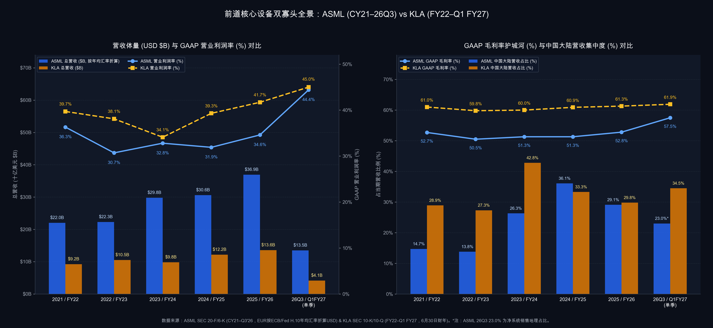

# 【行业指标 11】半导体前道核心设备财报解剖：在手订单、装机服务、毛利杠杆、长周期存货与客户地缘敞口（阿斯麦 ASML 与 科磊 KLA）

> **专栏定位：** 全行业 10-K/20-F 财报解剖与特异性指标图谱  
> **解剖标的：** 阿斯麦 (ASML Holding, ASML) 主轴穿透 ＋ 科磊 (KLA Corporation, KLAC) 镜像对照  
> **核心指标：** 在手订单覆盖与预付锁单、存量装机基数与经常性服务占比、技术代际毛利壁垒与经营杠杆、长周期存货三级结构与现金流转化、大客户集中度与地缘管制敞口  
> **审计基准：** SEC EDGAR 原生底稿 (CIK: 0000937966 / 0000319201) ＋ 20-F/6-K/10-K/10-Q 对账

> **摘要：** 拆解半导体前道设备 5 大核心财报指标（在手订单与预付锁单、装机服务、毛利杠杆、长周期存货与客户地缘敞口），结合阿斯麦（ASML）与科磊（KLA）最新财报对账，看透晶圆厂扩产周期的排雷密码。

---

## 一、 半导体前道设备核心指标深度解剖

在半导体制造产业链中，前道晶圆制造设备（Wafer Fab Equipment，简称 WFE，涵盖光刻、刻蚀、薄膜沉积、过程控制量测、离子注入与清洗等核心环节）是决定芯片物理微缩极限的“工业母机”。与消费电子或通用机械追求高周转走量截然不同，前道核心设备商运行着一套**“长研发周期、长交付时滞、高技术垄断溢价与强客户粘性”**的资本品商业模型。一台先进制程核心机台往往需要五年以上底层研发、集成上万个精密光学或腔体组件，从晶圆厂下达采购订单、设备商排产组装、无尘室现场装机调试到最终通过客户验收确认收入，通常跨越 12 至 18 个月以上。

因此，审阅一家前道半导体设备商的财报，绝不能只看当期利润表上的表观营收增速或静态市盈率，而必须沿着五个相互独立的财务维度穿透长周期时滞：一是看**在手订单覆盖与合同负债锁单**，穿透未来一至两年的产能排期能见度与客户预付定金力度；二是看**存量装机基数与经常性服务占比**，核算下游晶圆厂削减扩产开支时的盈利安全垫；三是看**毛利率壁垒与研发、销售管理费率结构**，衡量技术不可替代性与景气放量期的经营杠杆弹性；四是看**长周期存货三级结构与自由现金流转化率**，区分“手持大单的主动备货”与“下游砍单导致的产成品积压”；五是看**大客户集中度与地缘管制敞口**，评估单一晶圆厂推迟接机的波动风险并剥离制裁前抢跑囤货的高基数水分。

| 分析维度 | 行业专属特异性指标 | 买方核心考核焦点 |
| :--- | :--- | :--- |
| **远期能见度与预付锁单** | **在手订单覆盖与合同负债锁单 (RPO Coverage & Contract Liabilities %)** | 核算期末在手履约义务可支撑年数，并穿透非流动合同负债验证客户真金白银锁单冷暖 |
| **存量粘性与抗周期底垫** | **存量装机基数与经常性服务占比 (Installed Base & Recurring Services %)** | 检验驻厂维保、耗材备件与软件升级收入占总营收权重，衡量新机冻单期的业绩抗跌下限 |
| **技术溢价与规模杠杆** | **技术代际毛利壁垒与研发经营杠杆 (Gross Margin Moat & OpEx Leverage)** | 审计技术垄断换取的高毛利稳态中枢，以及营收放量对刚性研发与管理费率的摊薄弹性 |
| **存货真伪与造血质量** | **长周期存货三级结构与现金流转化 (Inventory Anatomy, DIO & FCF Conversion)** | 拆解原料/在制品/服务备件与产成品比重，核验预付款对存货的覆盖度及净利润现金转化率 |
| **客户依赖与地缘抢跑** | **大客户集中度与地缘管制敞口 (Customer Concentration & Geo Exposure %)** | 排查前几大晶圆厂资本开支摇摆冲击，剥离受限区域赶在管制收紧前抢跑拉货的透支基数 |

---

### 指标 1：在手订单覆盖与合同负债锁单 (RPO Coverage & Contract Liabilities %)

由于核心机台装配调试与下游晶圆厂无尘室建设之间存在长达一年以上的交付周期，设备商当期确认的营业收入本质上是**“一年前行业景气度的后视镜”** 。真正决定未来 4 至 8 个季度产能排期与议价话语权的，是财报收入附注中的剩余履约义务（Remaining Performance Obligations, 简称 RPO）与资产负债表上的合同负债（Contract Liabilities）：

`在手订单覆盖倍数 ＝ 期末剩余履约义务 (RPO) ÷ 年度营业总收入`  
`客户预付锁单率 (%) ＝ 期末合同负债合计 (流动 ＋ 非流动) ÷ 年度营业总收入 × 100%`

在审阅前道设备商的订单蓄水池时，需要重点把握两层验证机制：
* **RPO 覆盖倍数决定业绩安全期：** 具备强独占壁垒的前道设备龙头，期末 RPO 覆盖倍数通常保持在 **`1.0 倍`** 以上（即不签新单也能满负荷交付一年以上）；若覆盖倍数跌破 **`0.5 倍`** ，则意味着在手积压订单缓冲趋于枯竭，后续营收极易随下游砍单而失速；
* **非流动合同负债验真跨年度锁单：** 当次世代核心机台供不应求时，下游晶圆厂为了锁定一年甚至两年后的机台交期，必须提前缴纳高比例的不可撤销定金，在资产负债表上形成庞大的流动与非流动合同负债（或递延系统收入）。即便部分厂商不在季报中披露高频新增订单，只要季报资产负债表中的**非流动合同负债**持续大幅净流入，就证明头部客户仍在用真金白银锁定远期产能；反之，若合同负债连续多个季度净流出，说明公司正处于“吃老本式交付”阶段。

---

### 指标 2：存量装机基数与经常性服务占比 (Installed Base & Recurring Services %)

前道设备商业模式中最具防御价值的护城河，是机台出厂交验之后长达 10 至 15 年的后市场存量生意。行业内有一句经典铁律：**新机销售看晶圆厂“建不建新厂”，装机服务看现有晶圆厂“开不开工、升不升级工艺”** 。

当全球逻辑或存储芯片陷入资本开支下行周期时，晶圆厂可以推迟新厂土建、冻结新机采购，但只要已投产的无尘室产线还在运转，光刻光源与刻蚀腔体耗材更换、精密光学与检测备件维保、驻厂工程师支持以及提升单机晶圆吞吐量的软件现场升级包（Field Options）就一刻不能停。

成熟前道设备龙头的经常性服务与升级收入占总营收比重通常稳定在 **`20% ~ 30%`** 区间，且在下行周期展现出显著的逆周期平滑效应（硬件收入下滑时，服务收入依然保持正增长，占比被动抬升）。一旦某家设备商的服务业务收入占总营收长期低于 **`15%`** ，或者连续两个季度出现同比负增长，往往说明下游晶圆厂不仅停止扩产，甚至已经开始大面积下调现有产线稼动率（Utilization）或关停产线，是半导体全行业深度衰退的硬信号。

---

### 指标 3：技术代际毛利壁垒与研发经营杠杆 (Gross Margin Moat & OpEx Leverage)

在前道核心设备领域，毛利率绝非简单的生产降本结果，而是**底层物理极限与软件算法壁垒的货币化标尺** 。同时，为了在每两三年一次的制程微缩（如环绕栅极晶体管、背面供电、高数值孔径光刻与三维堆叠检测）中保持代际领先，设备商每年必须维持极高强度的刚性研发投入。

审阅前道设备商的损益表结构，核心在于把握“毛利分层”与“期间费用杠杆”两条主线：
* **软件算法密度决定的毛利率分层：** 越是偏向光学/电子束缺陷检测、良率算法与数据库授权的设备品类，物理硬件物料成本越轻、软件附加值越高，综合毛利率能够常年稳居 **`60%`** 以上且几乎免疫同业价格战；而需要整合上万个高精密光学镜头、特种机械模组与复杂真空光源的重型机台，受供应链硬件成本及新一代机台量产初期折旧摊薄影响，综合毛利率常态维持在 **`50% ~ 55%`** 区间，随着成熟机型与高毛利软件升级包放量才向更高水位跃升。若一家前道设备商的毛利率跌破 **`45%`** ，通常意味着产品陷入同质化价格战或丧失代际定价权；
* **高研发壁垒与大客户管理杠杆：** 一流设备龙头常年将总营收的 **`10% ~ 15%`** 投入内生研发；但由于下游客户高度集中于全球少数几家超大型晶圆代工与存储巨头，无需维持庞大的大众营销网络，其销售及行政管理费用率（SG&A %）通常可控制在 **`10%`** 以内（头部垄断者甚至可压低至 **`5%`** 以下）。当行业步入扩产放量期，研发与管理费率被迅速摊薄，常态营业利润率可站稳 **`30% ~ 40%`** 以上。但需格外警惕跨界并购低毛利非核心业务（如平板显示或普通印制电路板设备）引发的大额商誉及无形资产减值。

---

### 指标 4：长周期存货三级结构与现金流转化 (Inventory Anatomy, DIO & FCF Conversion)

前道设备商普遍具有**“固定资产较轻（厂房设备资本开支 CapEx 常年仅占营收 `3% ~ 8%` ）、但供应链存货极重”**的资产负债表特征。由于精密光学部件、激光光源与定制机械腔体的供应链备货周期长达半年至一年，设备商的平均存货周转天数（DIO）常年高达 **`180 ~ 240 天`** ：

`平均存货周转天数 (DIO) ＝ [(期初存货净额 ＋ 期末存货净额) ÷ 2] ÷ 年度营业成本 × 365`  
`自由现金流转化率 (%) ＝ (经营活动现金流净额 OCF － 资本开支 CapEx) ÷ GAAP 净利润 × 100%`

初看设备商财报的读者最容易看到存货金额创新高或周转天数超过 200 天就误判为“库存积压爆雷”。买方在排雷时必须穿透存货附注（Inventory Footnote）与现金流量表做双重交叉核验：
* **拆解三级存货结构与客户预付款覆盖度：** 将期末存货拆分为**原材料（Raw Materials）** 、**在制品（Work-in-Process）** 、**驻厂服务备件（Service Parts）** 与**产成品（Finished Goods）** 。只要原材料、在制品与服务备件合计占比超过 **`80%`** （即滞留仓库的完工产成品占比低于 **`20%`** ），且资产负债表上有充足的客户合同负债（预收定金）提供无息资金浮存，高 DIO 就是手持大单的主动扩产备货；
* **核验自由现金流转化成色：** 凭借轻资本开支与客户预付款机制，健康前道设备商的常态自由现金流转化率应维持在 **`85%`** 以上。唯有当**产成品**库存增速远超在制品、存货跌价准备激增，且自由现金流转化率连续两年跌破 **`70%`** 时，才构成客户延迟提货验收或实质砍单的危险实锤。

---

### 指标 5：大客户集中度与地缘管制敞口 (Customer Concentration & Geo Exposure %)

前道核心设备的下游买方高度集中于全球屈指可数的先进逻辑代工厂与存储芯片巨头，同时又处于国际科技出口管制博弈的最前线。因此，订单与收入的**“客户集中度”与“地缘区域成色”**直接决定了业绩增长的可持续性：

* **头部大客户资本开支摇摆敞口：** 在年报大客户附注中，前道设备商单一占比超过 `10%` 的大客户收入合计往往占总营收的 **`40% ~ 60%`** 以上。当大客户合计占比突破 **`60%`** 时，尽管销售费用率极省，但只要其中一家晶圆厂因新建洁净室延期或良率爬坡放缓而推迟半年提货，设备商就会面临显著的季度交付断档；
* **地缘抢跑拉货（Pull-forward）基数剥离：** 在地理分部附注中，必须严密监控受出口管制影响的敏感区域收入占比。当单一受限区域营收占比在短期内飙升至 **`35%`** 以上时，往往包含大量下游晶圆厂赶在管制收紧前集中透支的成熟制程囤货需求。买方在构建估值模型时，绝不能将抢跑高峰期的超额收入作永续外推，必须将敏感区域占比强行回调至 **`15% ~ 25%`** 的长期常态中枢，检验先进节点需求是否足以填补退坡缺口。

---

## 二、 半导体前道设备核心特异性指标全景速查对照表

下表汇总了买方机构审阅全球前道半导体设备商财报时重点对账的 5 大核心指标与通用参考标尺：

| 指标名称 | 标准计量符号 | 买方核心考核焦点 | 行业优秀基准线 (Benchmark) | 危险预警与破位阈值 | 官方财报与 SEC 取数出处 |
| :--- | :--- | :--- | :--- | :--- | :--- |
| **1. 在手订单覆盖与预付锁单** | RPO Coverage & Contract Liab % | 核算在手履约合同保障年数，透过非流动合同负债检验客户真金白银锁单需求 | RPO 覆盖 ≥ **`1.0 倍`** ，合同负债稳定充沛且非流动长期定金持续净流入 | RPO 覆盖 < **`0.5 倍`** ，且合同负债与客户预付款连续多个季度净流出（消耗老本） | 10-K/20-F 收入附注 (RPO) 及资产负债表流动/非流动合同负债行项 |
| **2. 存量装机基数与服务占比** | Installed Base & Services Mix % | 评估存量机台维保备件与软件产能升级对新机扩产周期波动的缓冲能力 | 经常性服务占总营收 **`20% ~ 30%`** ，服务分部毛利率稳健且在下行期保持正增长 | 经常性服务占比 < **`15%`** ，或服务收入连续 **2 个季度** 以上同比负增长（晶圆厂降稼动率） | 合并损益表设备销售 (Product) 与服务收入 (Service/IBM) 分拆行项 |
| **3. 技术毛利壁垒与经营杠杆** | Gross Margin, R&D & SG&A % | 量化光刻与检测不可替代定价权，检验放量期对研发管理费用的摊薄弹性及并购减值纪律 | 综合毛利率 **`50% ~ 60%+`** ，R&D 费率 **`10% ~ 15%`** ，SG&A ≤ **`10%`** ，常态营业利润率 ≥ **`30%`** | 毛利率跌破 **`45%`** 陷入同质化降价，或因跨界低毛利并购频繁爆发大额商誉减值 | 合并损益表毛利、研发、销售管理费用及商誉/无形资产减值行项 |
| **4. 长周期存货结构与现金转化** | Inventory Anatomy, DIO & FCF/NI | 拆解原料/在制/备件与产成品结构区分良性备货与滞销，检验账面利润的自由现金流成色 | 产成品占净存货 ≤ **`20%`** ，常态 DIO **`180 ~ 240 天`** ，自由现金流转化率 ≥ **`85%`** | 产成品占比 > **`30%`** 且跌价准备激增，DIO 失控拉长且 FCF 转化率连续两年 < **`70%`** | 存货附注（原料/在制/备件/成品明细）及现金流量表 OCF 与 CapEx |
| **5. 大客户集中度与地缘敞口** | Customer Conc & Geo Exposure % | 剥离制裁前抢跑囤货水分，核算超大晶圆厂客户扩产节奏摆动对盈利底座的冲击 | 单一受限区域占比处于 **`15% ~ 25%`** 常态中枢，大客户扩产多元且先进节点接棒充分 | 单一受限区域占比 > **`35%`** 面临陡峭退坡，或前几大客户占比 > **`60%`** 且出现接机推迟 | 10-K/20-F 地理分部收入附注及主要客户集中度 (>10%) 附注 |

---

## 三、 标杆实例深度实战：阿斯麦 (ASML) 6 周期全景原生财报解剖 (2021 ~ 最新单季实战)

作为全球前道光刻机的绝对物理垄断者，**阿斯麦（ASML Holding N.V., NASDAQ: ASML，SEC CIK: 0000937966）** 完整展现了半导体核心设备领域最具代表性的跨周期运行机制：客户跨年度重金预付锁单、百亿欧元级长周期原材料与在制品备货、2026 年取消季度订单披露后如何通过资产负债表“非流动合同负债”反向透视需求，以及交机放量期惊人的利润杠杆与自由现金流兑现。

在 2021 至 2025 年间，阿斯麦先后经历了全球缺芯扩产热潮、2023 年高压产能扩建与自由现金流阶段性筑底、2024 年中国大陆成熟制程 DUV 抢跑备货冲顶（占总营收达 `36.1%` ），再到 2026 年随 AI 算力芯片（2nm GAA 先进逻辑与 HBM 高带宽内存）推动新一代高数值孔径极紫外光刻机（High-NA EUV，EXE 系列）进入商业确认，带动 2026Q3 单季营收同比增长 **`+55.2%`** 、营业利润率跃升至 **`44.4%`** 。

以下是阿斯麦（ASML）的 6 周期官方原生财报底表（数据全部源自公司提交至 SEC 的 Form 20-F 年报与 Form 6-K 季报）：

### 阿斯麦 (ASML) 6 周期核心财务与经营对账底表 (单位：百万欧元，特殊标注除外)

| 核心财务与经营科目 | 2021 年 | 2022 年 | 2023 年 | 2024 年 | 2025 年 | 2026 最新单季 (Q3) | 穿透勾稽结论与买方视角 |
| :--- | :---: | :---: | :---: | :---: | :---: | :---: | :--- |
| **宏观与行业创新周期** | **缺芯扩产全面启动 EUV 年确认 42 台** | **预付款暴增锁交期 年末 RPO 破 454 亿** | **高压扩产建厂周期 FCF 阶段性下探** | **中国 DUV 抢跑冲顶 DIO 拉长至 262 天** | **EUV 与服务齐放量 Q4 订单爆发 132 亿** | **AI 与先进节点共振 单季净利近 50 亿** | 完整印证“长期定金蓄水、无息覆盖百亿备货、交机放量期现金流与利润率双爆发” |
| **营业总收入 (Total Net Sales)** | **18,611.0** | **21,173.4** | **27,558.5** | **28,262.9** | **32,667.3** | **11,662.0 (单季)** | 2026 前三季度累计营收达 **29,755.4** 百万欧元，公司预期全年达 **440~450 亿欧元** |
| 营业收入同比增速 (%) | +33.1% | +13.8% | +30.2% | +2.6% | +15.6% | **+55.2% (单季)** | 对比 2025Q3 单季 7,516.0 百万欧元实现超五成高速跃升 |
| **▸ 1. 净系统设备销售收入** | **13,652.8** | **15,430.3** | **21,938.6** | **21,768.7** | **24,474.3** | **8,373.2 (单季)** | 2026Q3 单季光刻机确认销售 121 台（113 新机 + 8 二手），前三季度累计 **21,217.3** |
| *　↳ 系统内含：EUV 光刻机销售额* | *6,284.0 (42台)* | *7,045.3 (40台)* | *9,124.0 (53台)* | *8,321.4 (44台)* | *11,602.7 (48台)* | *~4,100 (含 1台High-NA)* | **归属于净系统销售的核心子项：** 2025 年确认 4 台 High-NA，26Q3 EUV 占系统营收 **49%** |
| **▸ 2. 装机管理与升级服务收入 (IBM)** | **4,958.2** | **5,743.1** | **5,619.9** | **6,494.2** | **8,193.0** | **3,288.8 (单季)** | **【对应指标 2】** 2026 前三季度累计达 **8,538.1** 百万欧元，管理层预期全年同比暴增 **+50%** |
| **经常性服务营收占比 / 服务分部毛利率** | **26.6% / 53.2%** | **27.1% / 49.7%** | **20.4% / 41.8%** | **23.0% / 48.2%** | **25.1% / 50.9%** | **28.2% / 年报分拆** | **【对应指标 2】** 随 EUV 软件提效升级包渗透，服务分部毛利率重返 **50.9%** 比肩整机 |
| **综合毛利润 (Gross Profit)** | **9,809.0** | **10,700.1** | **14,136.1** | **14,492.0** | **17,258.0** | **6,699.8 (单季)** | 2026 前三季度累计综合毛利润达 **16,380.3** 百万欧元 |
| **综合毛利率 (Gross Margin %)** | **52.7%** | **50.5%** | **51.3%** | **51.3%** | **52.8%** | **57.5% (单季)** | **【对应指标 3】** 2026Q3 随高阶机台与升级选项集中交付跃升（前三季度累计毛利率 `55.0%` ） |
| 研发费用支出 (R&D) 及研发费用率 | 2,547.0 (13.7%) | 3,253.5 (15.4%) | 3,980.6 (14.4%) | 4,303.7 (15.2%) | 4,698.8 (14.4%) | **1,174.4 (10.1%)** | **【对应指标 3】规模摊薄效应：** 26Q3 单季研发费率降至 10.1%（前三季度累计 `12.2%` ） |
| 销售管理费用 (SG&A) 及费用率 | 725.6 (3.9%) | 945.9 (4.5%) | 1,113.2 (4.0%) | 1,165.7 (4.1%) | 1,257.8 (3.9%) | **352.6 (3.0%)** | **【对应指标 3】大客户极简渠道：** 前四大客户贡献逾六成营收，SG&A 常年锁在 **3.0%~4.5%** |
| **报告营业利润 (Operating Income)** | **6,750.1** | **6,500.7** | **9,042.3** | **9,022.6** | **11,301.4** | **5,172.8 (单季)** | 2026 前三季度累计营业利润达 **11,786.8** 百万欧元，已超越 2025 全年营业利润总额 |
| **报告营业利润率 (%)** | **36.3%** | **30.7%** | **32.8%** | **31.9%** | **34.6%** | **44.4% (单季)** | **【对应指标 3】** 2026 前三季度累计营业利润率达 **39.6%** ，26Q3 单季冲上 **44.4%** 峰值 |
| 归母净利润 (GAAP Net Income) | 5,883.2 | 5,624.2 | 7,839.0 | 7,571.6 | 9,609.4 | 4,960.4 (单季) | 2026Q3 归母净利含 **5.097 亿欧元** 股权投资公允价值收益；前三季度累计净利 **10,634.7** |
| **年末在手履约义务 RPO (亿欧元 / 覆盖倍数)** | **289.0 (1.55x)** | **454.0 (2.14x)** | **450.0 (1.63x)** | **433.0 (1.53x)** | **465.0 (1.42x)** | **2026 起停季报** | **【对应指标 1】** 2021~2025 全年净新增预订额分别为 262 / 307 / 200 / 189 / 280 亿欧元 |
| **期末合同负债合计 (及占营收比)** | **11,160.9 (60.0%)** | **17,750.9 (83.8%)** | **16,266.5 (59.0%)** | **18,196.2 (64.4%)** | **19,372.6 (59.3%)** | **非流动 9,300.6 (流动未单拆)** | **【对应指标 1】真金白银锁单：** 非流动合同负债从 25 末 3,366.3 激增 176% 至 **9,300.6** |
| **期末存货净额 / 平均周转天数 (DIO)** | **5,179.2 / 202天** | **7,199.7 / 216天** | **8,850.7 / 218天** | **10,891.5 / 262天** | **11,429.3 / 264天** | **11,907.3 / 215天** | **【对应指标 4】客户定金覆盖 1.69 倍存货：** 25 末原料与在制品占原值 **83%** ，产成品仅占 17% |
| 经营活动现金流 OCF / 资本开支 CapEx | 10,845.8 / 940.3 | 8,486.8 / 1,319.3 | 5,443.4 / 2,196.2 | 11,166.2 / 2,083.1 | 12,658.5 / 1,631.2 | 11,797.6 / 447.2 | 2023 年产能扩建期 CapEx 占营收升至 8.0%，2025 年回落至 5.0%；前三季累计 OCF 11,315.0 |
| **自由现金流 FCF (及净利润转化率)** | **9,905.5 (168.4%)** | **7,167.5 (127.4%)** | **3,247.2 (41.4%)** | **9,083.1 (120.0%)** | **11,027.3 (114.8%)** | **11,350.4 (228.8%)** | **【对应指标 4】** 26Q3 单季 FCF 反超 2025 全年；2026 前三季度累计 FCF 达 **10,059.5** |
| 期末现金及短投 / 总有息债务 | 7,590.3 / 4,584.1 | 7,376.0 / 4,260.4 | 7,010.1 / 4,631.6 | 12,741.3 / 4,687.6 | 13,321.9 / 4,390.9 | 12,735.1 / 长债 1,963.0 (短债未单拆) | 2025 年末手握 **89.3 亿欧元** 净现金缓冲垫，简明季报将短期债务合并计入流动负债 |
| **中国大陆营收占比 / >10% 客户集中度** | **14.7% / 67.2%(2家)** | **13.8% / 55.8%(2家)** | **26.3% / 53.9%(2家)** | **36.1% / 53.8%(4家)** | **29.1% / 61.2%(4家)** | **23.0% (净系统) / 年报披露** | **【对应指标 5】地缘退坡消化：** 中国大陆自 2024 峰顶回落，2026 全年指引回归 **约 20%** |

---

### 核心看点 ①：2026 年停披季度新增订单后，如何用“非流动合同负债”验真跨年锁单？

阿斯麦自 2026 年起正式停止在季报中披露季度净新增订单（Net Bookings）与季末积压订单余额，曾让不少依赖高频订单数据做波段博弈的投资者感到盲人摸象。但只要深挖 **指标 1（合同负债锁单蓄水池）** 就会发现，客户有没有掏出真金白银锁定未来两年的光刻机产能，在资产负债表上一览无余：

1. **非流动合同负债单季暴增逾 57 亿欧元：** 资产负债表中的“非流动合同负债”核算的是客户为了锁定 **12 个月以后才交付** 的远期机台（如 High-NA EUV 及 2nm 节点浸没式光刻机）而预先支付的长期定金。这一科目在 2025 年底与 2026Q2 末尚处于三十余亿欧元水位，而在 2026Q3 单季一举跃升至 **`93.01 亿欧元`** ；
2. **驱动单季自由现金流井喷：** 正是下游晶圆代工与存储巨头在第三季度集中打入的这笔跨年度锁单预付款，叠加当季 121 台光刻机的顺畅交付回款，直接推动公司单季自由现金流创下超越 2025 全年的历史纪录。这证明在季报订单静默期，资产负债表远比口头指引更加诚实。

---

### 核心看点 ②：穿透百亿存货迷雾——“客户无息定金 1.69 倍覆盖存货”的负营运资金飞轮

在 2023 至 2025 年期间，阿斯麦账面存货突破百亿欧元、平均存货周转天数（DIO）拉长至 **`262 ~ 264 天`** ，且 2023 年自由现金流一度因扩建产能而出现阶段性回落，市场曾一度担忧其面临库存积压与减值风险。但穿透 **指标 4（存货三级结构与现金转化）** 即可看清前道垄断者的真实账本：

* **超八成存货为原料与在制品，且由客户定金全额买单：** 翻阅 20-F 年报存货附注，公司期末存货总原值中 **83% 为长周期光学与光源原材料及正在装配调试的在制品** ，完工未发的产成品占比不足两成。更重要的是，将合同负债与存货净额对账可以看到，2025 年末公司账面合同负债相当于净存货的 **`1.69 倍`** （多出近 80 亿欧元无息浮存资金）——这意味着阿斯麦根本不需要动用自身股东本金去垫付漫长的供应链备货，而是完全拿着下游客户的预付定金在运转；
* **装机升级服务（IBM）重返 50% 以上高毛利：** 当新机进入集中交付期，公司不仅在 2026Q3 将 DIO 迅速压缩近 50 天，同时依托全球庞大的存量 EUV 机台基数，通过推送提升晶圆曝光吞吐量的软件与现场升级选项，推动装机服务分部毛利率重回 **`50.9%`** ，与新机销售共同构成了极强的双轮造血引擎。

---

### 核心看点 ③：极简大客户费率结构下的两重买方风控提醒

由于全球有能力采购上亿欧元先进光刻机的核心客户高度集中于前四大晶圆制造巨头，阿斯麦无需供养庞大的销售团队，其 SG&A 销售管理费率常年压低在 **`3.0% ~ 4.5%`** 的极简水平。但在 2026Q3 创纪录的盈利表现背后，买方必须保持两份清醒：
* **剔除非经常性股权投资重估收益：** 当季归母净利润中包含了一笔逾 5 亿欧元的供应链股权投资公允价值变动收益，评估常态化经营盈利时应以营业利润为准；
* **警惕 61.2% 大客户集中度与峰值研发摊薄（指标 3 & 5）：** 前四大客户包揽逾六成收入意味着，一旦任一头部代工厂因无尘室建设延期或良率切换节奏微调而推迟半年接机，就会立即引发类似 2024 年（全年营收仅微增 `2.6%` ）的阶段性业绩平台期。

---

## 四、 标杆实例镜像对照：科磊 (KLA) 60%+ 算法毛利城墙、杠杆回购与地缘高基数镜像

如果说阿斯麦（ASML）代表了“重型光学机械集成、巨额客户定金无息覆盖备货、单机交付脉冲强烈”的光刻物理霸主，那么全球半导体过程控制与良率量测绝对龙头 **科磊 (KLA Corporation, NASDAQ: KLAC，SEC CIK: 0000319201)** ，则是代表“超高软件算法毛利壁垒（常年 `60% ~ 62%` ）、极轻资产稳定现金转化、主动维持净债务实施杠杆回购，以及直面更陡峭中国区高基数退坡考卷”的经典镜像样本。

需要说明的是，科磊采用**截至每年 6 月 30 日的会计财年** （`FY22` 至 `FY26` 对应 2021 年 7 月至 2026 年 6 月），其最新披露的 **`Q1 FY27` 季报截止日为 `2026 年 9 月 30 日`** ，与阿斯麦 `2026Q3` 严格对齐于 2026 年 9 月末同一产业时点。以下是两大前道设备霸主的 6 周期官方原生财报横向对比底表（数据全部源自双方提交至 SEC 的 Form 20-F/6-K 与 Form 10-K/10-Q 原件；阿斯麦欧元营收及自由现金流按对应年度欧洲央行/美联储官方年均汇率折算为亿美元，并在括号内标注原生亿欧元数值）：

### 1. 两大前道设备巨头 6 周期原生数据横向对照底表 (单位：亿美元，特殊标注除外)

| 核心对比科目 | 标的 | CY21 / FY22 | CY22 / FY23 | CY23 / FY24 | CY24 / FY25 | CY25 / FY26 | 26Q3 / Q1 FY27 | 穿透勾稽结论与买方视角 |
| :--- | :--- | :---: | :---: | :---: | :---: | :---: | :---: | :--- |
| **营业总收入 (Total Revenue)** *(ASML 括号内为原生亿欧元)* | **ASML** KLA | **220.1 (186.1€)** 92.1 | **223.0 (211.7€)** 105.0 | **298.0 (275.6€)** 98.1 | **305.9 (282.6€)** 121.6 | **369.1 (326.7€)** 135.8 | **134.9 (116.6€)** **41.4 (单季)** | **营收体量格局：** ASML 营收规模约为 KLA 的 2.5~3.0 倍；2026 年 9 月单季双方双双创下历史单季营收新高 |
| **营业收入同比增速 (%)** | **ASML** KLA | **+33.1%** +33.1% | **+13.8%** +13.9% | **+30.2%** -6.5% | **+2.6%** +23.9% | **+15.6%** +11.7% | **+55.2% (单季)** **+28.9% (单季)** | **周期相位差：** KLA 在 FY24 率先反映存储去库下修（-6.5%），次年即恢复 +23.9% 高增；ASML 则于 2024 年短暂休整 |
| **年末 RPO 余额与覆盖倍数** *(ASML: 亿欧元；KLA: 亿美元)* | **ASML** KLA | **289€ (1.55x)** 131.1 (1.42x) | **454€ (2.14x)** 114.0 (1.09x) | **450€ (1.63x)** 98.3 (1.00x) | **433€ (1.53x)** 78.6 (0.65x) | **465€ (1.42x)** 125.7 (0.93x) | **停季报** **未单季量化** | **【对应指标 1】在手订单修复：** KLA RPO 在 FY25 触底 `0.65x` 后于 FY26 强势反弹至 **125.7 亿美元** （`0.93x` ） |
| **合同负债占年化营收比重 (%)** | **ASML** KLA | **60.0%** 10.9% | **83.8%** 11.9% | **59.0%** 18.2% | **64.4%** 14.1% | **59.3%** 13.1% | **非流动 93.0 亿€** **10.3% (17.1 亿)** | **【对应指标 1】预付锁单深度：** ASML 合同负债占营收六至八成（覆盖 `1.69x` 存货），KLA 常态占 10%~18%（覆盖 `0.42x` 存货） |
| **经常性服务营收占比 (%)** *(ASML: IBM；KLA: Service)* | **ASML** KLA | **26.6%** 20.7% | **27.1%** 20.2% | **20.4%** 23.7% | **23.0%** 22.1% | **25.1%** 23.0% | **28.2% (单季)** **20.6% (单季)** | **【对应指标 2】逆周期缓冲垫：** FY24 KLA 硬件萎缩时服务逆势增长 +10% 托底；双方服务占比均常年稳居 **20%~28%** |
| **综合毛利率 (Gross Margin %)** | **ASML** KLA | **52.7%** 61.0% | **50.5%** 59.8% | **51.3%** 60.0% | **51.3%** 60.9% | **52.8%** 61.3% | **57.5% (单季)** **61.9% (单季)** | **【对应指标 3】8~10pp 算法溢价：** KLA 常年钉死在 **59.8%~61.9%** 顶级毛利箱体；ASML 于 26Q3 跃升至 **57.5%** |
| **研发费用率 (R&D %)** | **ASML** KLA | **13.7%** 12.0% | **15.4%** 12.4% | **14.4%** 13.0% | **15.2%** 11.2% | **14.4%** 11.3% | **10.1% (单季)** **9.6% (单季)** | **【对应指标 3】同步研发摊薄：** 常态研发强度均在 11%~15%，2026 年 9 月单季放量期双双阶段性摊薄至 **10%** 附近 |
| **销售及管理费用率 (SG&A %)** | **ASML** KLA | **3.9%** 9.3% | **4.5%** 9.4% | **4.0%** 9.9% | **4.1%** 8.5% | **3.9%** 8.3% | **3.0% (单季)** **7.3% (单季)** | **【对应指标 3】客户颗粒度差异：** ASML 高度集中于四大客户使 SG&A 仅 **3%~4.5%** ；KLA 站点定制更广故在 **7.3%~9.9%** |
| **报告营业利润率 (%)** | **ASML** KLA | **36.3%** 39.7% | **30.7%** 38.1% | **32.8%** 34.1% | **31.9%** 39.3% | **34.6%** 41.7% | **44.4% (单季)** **45.0% (单季)** | **【对应指标 3】盈利杠杆共振：** KLA FY24/25 含合计 **5.29 亿** 跨界商誉减值（剔除后 37.1%/41.2%）；最新单季双双破 **44%** |
| **平均存货周转天数 (DIO)** | **ASML** KLA | **202 天** 189 天 | **216 天** 217 天 | **218 天** 275 天 | **262 天** 240 天 | **264 天** 238 天 | **215 天** **224 天** | **【对应指标 4】良性存货结构：** KLA 期末 40.9 亿存货中含 **6.4 亿服务备件** 、产成品仅占 **6%** ；双方 DIO 均自高点回落 |
| **自由现金流 FCF 及转化率** *(ASML 按年均汇率折算亿美元)* | **ASML** KLA | **117.2 (168%)** 30.1 (90.5%) | **75.5 (127%)** 33.3 (98.3%) | **35.1 (41%)** 30.3 (110%) | **98.3 (120%)** 37.5 (92.2%) | **124.6 (115%)** 37.7 (78.0%) | **131.3 (229%)** **13.4 (86.3%)** | **【对应指标 4】现金创造力：** KLA 资本开支常年低于营收 3%，现金转化极稳；ASML 在交付兑现期呈现爆发式脉冲 |
| **期末现金 / 总有息债务** *(ASML: 亿欧元；KLA: 亿美元)* | **ASML** KLA | **75.9€ / 45.8€** 27.1 / 66.6 | **73.8€ / 42.6€** 32.4 / 58.9 | **70.1€ / 46.3€** 45.0 / 66.3 | **127.4€ / 46.9€** 44.9 / 58.8 | **133.2€ / 43.9€** 49.0 / 58.9 | **127.4€ / 长债19.6€** **47.4 / 57.2** | **资本结构分野：** ASML 坐拥 **89.3 亿欧元** 净现金；KLA 主动维持约 **9.8 亿美元净债务** 实施激进股票回购 |
| **中国大陆营收占比 (%)** | **ASML** KLA | **14.7%** 28.9% | **13.8%** 27.3% | **26.3%** 42.8% | **36.1%** 33.3% | **29.1%** 29.8% | **23.0% (净系统)** **34.5% (14.3 亿)** | **【对应指标 5】地缘退坡考卷：** KLA FY24 曾冲上 **42.8%** ，Q1 FY27 再次回弹至 **34.5%** ，指引 CY27 回落至低 20% 区间 |

---

### 2. 核心走势对比图：ASML vs KLA 原生财报核心指标走势对决 (CY21/FY22 ~ 2026Q3/Q1 FY27)

> **图表买方核心解读：**  
> 左图展示【指标 3】营收规模与营业利润率：ASML 体量超 KLA 的 2.5 倍，2026 年 9 月单季双方均释放出 44.4% 与 45.0% 峰值利润率。右图展示【指标 3 & 5】毛利壁垒与区域集中度：KLA 常年稳守 60%~62% 毛利率，但 Q1 FY27 中国大陆仍占 34.5%，面临比 ASML（23.0%）更陡峭的退坡考卷。

---

### 3. 关键差异归因与买方深度复盘

#### 关键差异 ①：同为卡脖子垄断，“51%~57% 光刻系统毛利”与“60%~62% 过程控制软件级毛利”的物理分野
对比两家寡头跨越六个周期的毛利率曲线（指标 3），可以清晰看懂“重型精密硬件集成”与“高权重算法软件授权”在损益表上的定价差异：
* **科磊（KLA）几乎无周期波动的 60%+ 毛利城墙：** 无论是半导体顺风期还是 `FY24` 营收下滑的去库存寒冬，KLA 的综合毛利率始终钉死在 **`59.8% ~ 61.9%`** 的极窄区间。原因在于过程控制设备卖的不仅是光学传感器，更是底层缺陷特征数据库与高速图像识别算法；随着晶圆厂切入 3D GAA 与 HBM 堆叠，工艺步骤与检测采样点成倍增加，客户对良率检测工具不存在压价空间；
* **阿斯麦（ASML）受代际机型爬坡与供应链成本牵制的弹性：** 光刻机必须采购蔡司超精密光学系统、大功率激光光源及数万个德国机械组件，硬件物料与现场装机人工占比较重，且在 2024 至 2025 年初代 High-NA 机型小批量投产初期承受了较高的制造折旧摊薄，使常态毛利率处在 `50.5% ~ 52.8%` ，直到 2026Q3 高毛利机型与软件升级包集中放量才跳升至 **`57.5%`** 。

#### 关键差异 ②：“89 亿欧元净现金 + 客户定金浮存” vs “10 亿美元净债务杠杆回购 + 5.29 亿跨界并购减值”
穿透资产负债表与现金流（指标 1、3、4），两家公司在营运资金占用与资本配置上展现出截然不同的财务性格：
* **阿斯麦的负营运资金与纵向供应链深耕：** 由于单台光刻机造价高昂、交期漫长，阿斯麦要求客户提前一至两年打入大额预付款（合同负债常年高达营收的 `60% ~ 84%` ，在 2025 年末超额覆盖了 `1.69 倍` 存货），并在账面常年储备近 **90 亿欧元净现金** ，专注纵向参股扶持蔡司等核心光刻供应链，从不盲目跨界并购；
* **科磊的自筹备货、杠杆回购与 Orbotech 跨界警钟：** 过程控制机台单价与交期相对较短，客户预付款仅覆盖约四成存货（合同负债占营收 `10% ~ 18%` ），但 KLA 凭借仅 `6%` 产成品占比的极佳存货管理与低于 `3%` 的轻资本开支，常年维持高现金转化率，并通过主动举债（维持约 **`9.8 亿美元净债务`** ）将自由现金流全数投入股票回购以增厚每股收益（2026 年 6 月完成 10 股拆 1 股）。然而，KLA 早年跨界并购的 **Orbotech（PCB 与平板显示检测业务）** 却在 `FY24` 与 `FY25` 连续两年触发合计 **`5.29 亿美元` 商誉及无形资产减值** ，给买方留下了深刻教训：高毛利半导体设备巨头一旦跨入低壁垒、强周期的面板与电路板相邻赛道，极易稀释整体资本回报率。

#### 关键差异 ③：2027 年的共同考卷——警惕“45% 峰值利润率线性外推”与 KLA 更陡峭的地缘基数退坡
站在 2026 年末的景气高点审视未来（指标 3 & 5），买方切忌被单季暴增的业绩冲昏头脑，必须重点防范两项均值回归风险：
* **切勿将单季 10% 研发费率下的 45% 营业利润率当作永续常态：** 双方在 2026 年 9 月单季双双录得 **`44.4%` 与 `45.0%`** 的历史峰值营业利润率，很大程度上得益于单季分母端营收跳增将研发费用率临时压低至 `10.1%` 与 `9.6%` ；长期来看，下一代光刻与检测研发投入依然刚性，估值模型必须回归 `33% ~ 40%` 的常态利润率中枢；
* **KLA 面临比 ASML 更陡峭的受限区域正常化斜率：** 阿斯麦的中国大陆收入占比已从 2024 年的 `36.1%` 稳步消化至 2026Q3 净系统销售的 **`23.0%`** （全年指引约 `20%` ）；而 KLA 在 `Q1 FY27` 的中国大陆营收占比再次反弹至 **`34.5%`** （单季 `14.26 亿美元` ），同时管理层明确指引 2027 自然年将回落至 **`low-20s%`（低 20% 区间）** 。这意味着 KLA 在未来四个季度内必须消化超过 10 个百分点的成熟制程高毛利收入退坡，能否由欧美及台韩先进制程需求全额填平，是检验其增长成色的关键试金石。

---

## 五、 实战对账自查表：买方机构 5 步穿透半导体前道设备财报排查卡

在审阅任何一家半导体前道核心设备商的年报（10-K / 20-F）与季报时，建议按照以下 5 个步骤依次核查，并对照下方的买方核查指示灯评估其护城河成色与周期位置：

1. **第一步：查收入附注与资产负债表，算“在手订单覆盖倍数与预付锁单厚度”（对应指标 1）**  
   打开年报收入附注提取期末剩余履约义务（RPO）除以年度总营收得出订单覆盖倍数；再去季报资产负债表核对流动与非流动合同负债（客户预付定金）是否持续净流入，确认远期产能锁单温度。
2. **第二步：拆损益表收入分项，核验“存量装机服务与升级收入安全垫”（对应指标 2）**  
   在合并损益表中将新机系统销售（Product / System）与存量装机服务（Service / IBM）拆开，计算经常性服务占总营收比重及同比增速，检验在新机扩产放缓期能否依靠驻厂维保与软件升级托底盈利。
3. **第三步：比毛利与研发管理费率，判“技术代际溢价、经营杠杆与并购减值”（对应指标 3）**  
   核算综合毛利率、研发费用率（R&D %）与销售管理费用率（SG&A %），检验毛利率是否稳居高壁垒区间、放量期费用率是否顺畅摊薄；同时检索损益表是否存在因跨界并购非核心业务引发的商誉及无形资产减值损失。
4. **第四步：透存货附注与现金流量表，验“三级存货结构与自由现金流转化率”（对应指标 4）**  
   翻到存货附注（Inventory Footnote），将原材料、在制品、服务备件与完工产成品拆开计算占比，并用期末合同负债对比存货净额评估客户定金覆盖度；再结合现金流量表算出自由现金流（OCF 减 CapEx）占净利润的比例，排除纸面富贵与砍单积压。
5. **第五步：核对地理与大客户附注，剥离“地缘抢跑高基数与单一大客户波动”（对应指标 5）**  
   在分部与客户附注中提取单一受限敏感区域营收占比及前几大（>10%）客户合计占比，在估值模型中强制剥离抢跑囤货的高峰期超额收入，校验先进节点需求能否独立支撑业绩增长。

### 半导体前道设备买方核查指示灯

| 核查维度 | 🟢 绿灯安全区 (优秀标杆) | 🟡 黄灯观察区 (稳健常规) | 🔴 红灯排雷区 (高危预警) |
| :--- | :--- | :--- | :--- |
| **1. 在手订单与预付锁单** | RPO 覆盖 ≥ **`1.0 倍`** ，合同负债充沛且非流动长期定金持续净流入 | RPO 覆盖 **`0.5 ~ 1.0 倍`** ，客户下单节奏放缓但短单与服务保持衔接 | RPO 覆盖 < **`0.5 倍`** 且合同负债连续流出，仅靠消耗历史积压维持表观收入 |
| **2. 装机服务营收安全垫** | 经常性服务占营收 **`20% ~ 30%`** ，毛利稳健且在硬件下行期保持正增长 | 经常性服务占比 **`15% ~ 20%`** ，服务增速随晶圆厂稼动率温和波动 | 经常性服务占比 < **`15%`** ，或连续 **2 个季度** 以上同比负增长（产线大面积停机） |
| **3. 毛利壁垒与经营杠杆** | 毛利率 ≥ **`50%`** （算法检测类 ≥ **`60%`** ），SG&A ≤ **`10%`** ，常态营业利润率 ≥ **`30%`** | 毛利率 **`45% ~ 50%`** （新机初期折旧摊薄），常态营业利润率 **`20% ~ 30%`** | 毛利率 < **`45%`** 陷入价格战，常态营业利润率 < **`20%`** ，或频发跨界并购商誉减值 |
| **4. 存货结构与现金转化** | 产成品占净存货 ≤ **`20%`** ，常态 DIO **`180 ~ 240 天`** ，FCF 转化率 ≥ **`85%`** | 跨代机台备货期 DIO 升至 **`240 ~ 270 天`** ，但有高额客户合同负债定金护航 | 产成品占比 > **`30%`** 且跌价准备激增，FCF 转化率连续两年 < **`70%`** |
| **5. 客户集中度与地缘敞口** | 单一受限区域占比处于 **`15% ~ 25%`** 常态中枢，先进制程需求多元且强劲 | 单一受限区域占比处于 **`25% ~ 35%`** 退坡消化期，或前四大客户占比 **`50% ~ 60%`** | 单一受限区域占比 > **`35%`** 面临断崖退坡，或大客户占比 > **`60%`** 且出现接机推迟 |

---

## 六、 本讲买方总结与下讲预告

> **买方终极心法**  
> 审阅前道半导体设备财报，核心是穿透交机时滞看清五重底牌：一查 RPO 与非流动合同负债验真锁单，二看两成以上装机服务验抗跌底垫，三辨毛利壁垒与峰值利润率均值回归，四拆存货结构与定金覆盖度，五剥离地缘抢跑高基数重算正常化盈利。

---

### 下讲预告：【行业指标 12】晶圆先进制程代工与制造：产能利用率、晶圆单价与折旧悬崖（台积电 TSMC 与 中芯国际 SMIC）

解剖了掌握芯片工业上游极限母机、依靠预付款与技术溢价收割高毛利的 **前道半导体核心设备双寡头（ASML 与 KLA）** ，我们将顺着产业链向下一步迈进，进入把每一台百亿美元光刻机和检测仪搬进无尘室、独自扛起重资产折旧宿命的 **【晶圆先进制程代工与制造篇】！**

当一台数亿欧元的新世代设备安装就位开始按五年直线折旧、而下游消费电子或算力芯片需求却出现季节性摇摆时，晶圆代工巨头是如何守住毛利率防线的？在下一讲中，我们将派出全球先进制程绝对统治者 **台积电（TSMC）** 正面镜像对比中国大陆晶圆代工龙头 **中芯国际（SMIC）** ！我们将手把手拆解 **产能利用率（Utilization Rate）与盈亏平衡线** 、**综合晶圆平均售价（Blended ASP）** 、**资本开支强度（CapEx Intensity %）** 以及重资产制造最致命的 **“折旧悬崖（Depreciation Cliff）”** ，为您揭开晶圆制造巨头穿越百亿折旧周期的财报密码，敬请期待！
