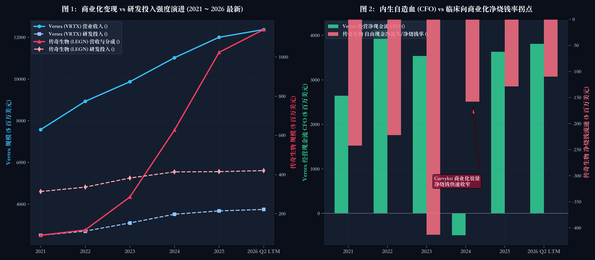

# 【行业指标 11】早期创新药与临床 Biotech：没有收入怎么看？现金跑道、研发失血流速与全稀释股本暗门（福莱医药 VRTX 与 传奇生物 LEGN）

> **专栏定位：** 全行业 10-K/10-Q 外科手术显微镜与特异性指标图谱  
> **解剖标的：** 福莱医药 (VRTX) 主轴穿透 ＋ 传奇生物 (LEGN) 镜像对照  
> **核心指标：** 现金跑道与净烧钱率 (Runway)、研发纯度 (R&D Purity)、合作授权分成 (Collaboration)、全稀释股本与 ATM 抽水 (ATM Overhang)  
> **审计基准：** SEC EDGAR XBRL 底稿 (CIK: 0000875320 / 0001801198) ＋ 10-K/20-F 对账

---

## 一、 早期创新药与临床 Biotech 核心指标深度解剖与精密算法

创新药与临床阶段生物科技（Biotech）的商业本质，不是传统工业将低成本原材料加工为物理商品对外分销，而是一场以微观分子生物学为底层代码、以数亿美元研发资本为高能量推进剂、在长达 8 至 12 年的超长周期中逆向对抗极低技术成药概率的极端期权博弈。处于临床阶段的 Biotech 企业，通常没有实质性的商业化产品营业收入，公司的全部内涵价值几乎完全沉淀于正在推进的在研管线（Pipeline）、核心专利护城河、科学家研发团队以及临床各期数据读出之中。

评估早期与临床期 Biotech 企业的生存底线与潜在造血能力，传统制造业或成熟消费品的营业收入、毛利率、市盈率（P/E）乃至账面净利润彻底失效——甚至在许多时候，当期损益表上的账面亏损扩大，仅仅是因为核心三期临床加速推进、入组患者激增或关键注册试验全面铺开，反而反映了积极的研发进展。买方分析师审阅创新药财报时，必须从“静态损益表盈亏”彻底转向“资产负债表与现金流的生存安全垫”，穿透账面资金储备对临床试验净失血的存活月数（现金跑道与净烧钱率），穿透研发费用附注核实真实流向临床的外部开支占比（研发开支纯度），解剖跨国药企合作协议下的非稀释性外部输血（合作授权与递延收入），并警惕管理层在公开市场悄然稀释老股东权益的暗门（全稀释股本与 ATM 抽水）。为此，我们梳理出穿透早期创新药与临床 Biotech 的核心特异性指标图谱：

| 分析维度 | 行业专属特异性指标 | 买方核心考核焦点 |
| :--- | :--- | :--- |
| **生存周期与失血流速** | **现金跑道与真实现金净烧钱流速 (Cash Runway & Net Cash Burn)** | 账面真金白银对临床研发失血的支撑月数，剔除非现金干扰后的每季度失血速度 |
| **资本真实投向与研发纯度** | **研发开支纯度与临床试验外包比重 (R&D Expense Purity & External Trial Spend)** | 真实花在临床患者与 CRO/CDMO 身上的外部研发占比，严防高额管理费行政空转 |
| **外部造血与非稀释性背书** | **跨国合作授权经济学与递延收入负债池 (Collaboration Economics: Milestones & Deferred Revenue)** | 首付款、里程碑款确认节奏，全球商业化销售分成比例，以及 ASC 606 递延收入蓄水池 |
| **老股东权益防线与潜在稀释** | **全稀释股本膨胀与 ATM 市场化抽水敞口 (Fully Diluted Share Overhang & ATM Offering Dilution)** | 期权权证、可转债潜在增发上限，以及表外市场化配售 ATM 随时抛售抽水的隐性稀释底线 |

---

### 指标 1：现金跑道与真实现金净烧钱流速 (Cash Runway & Net Cash Burn)

#### 1. 深度定义与经济内涵
在缺乏商业化产品稳定造血的前提下，现金跑道（Cash Runway）是悬在所有临床阶段 Biotech 企业头顶的“生命倒计时”，而真实现金净烧钱流速（Net Cash Burn Rate）则是其生命燃料的流失速度。它衡量的是：假定企业不再进行任何外部股权融资、债务发行或大额资产出售，且当前的临床试验推进速度与日常开支保持恒定，公司账面现存的高流动性资产究竟能够支撑企业存活多久。

在买方眼里，现金跑道绝非单纯的时间度量，而是企业管理层在资本市场周期面前的议价筹码与独立意志。如果现金跑道充裕（如在 24 个月以上），管理层可以从容推进关键临床试验直至读出高质量数据，在数据大胜、股价处于估值溢价期时再进行低稀释率的增发融资；相反，若跑道被压缩至 12 个月以内，企业将沦为华尔街做空对冲基金与掠夺性配股的猎物，甚至被迫在数据揭盲前夜接受极其苛刻的折价破产式配售（Death Spiral Financing）。

#### 2. 精确计算公式
**季度真实现金净烧钱流速：**  
`季度净烧钱率 (Net Cash Burn) ＝ 经营活动现金流出净额 (CFO Outflow) ＋ 资本开支 (CapEx) − 利息收入`  
*注：严禁直接使用 GAAP 净亏损！必须采用现金流量表原生数据，自动剔除股权激励 (SBC)、资产减值等非现金项目扰动。*

**理论现金跑道支撑月数：**  
`现金跑道 (月数) ＝ (现金及现金等价物 ＋ 受限制现金 ＋ 短期高流动性有价证券) ÷ 最近两个季度平均净烧钱流速 × 3`  
*注：分子端必须剔除长期战略性股权投资或变现受限的抵押资产；分母端通常取最近两个季度的平均净烧钱流速，以平滑单一大额临床试验预付款对现金流的短期扰动。*

#### 3. 买方实战判读法则
* 🟢 **绝对充裕安全区：**  
  现金跑道持续保持在 `≥ 24 个月`（或 8 个季度以上）。公司资金充沛，能够完整覆盖至核心管线下一关键临床期终点数据读出（Data Readout），无需被迫在低谷期折价配股；
* 🟡 **紧绷预警观察区：**  
  现金跑道处于 `12 ~ 24 个月` 临界区间。管理层必须在未来 2~4 个季度内启动战略合作授权（Out-licensing）首付款谈判，或者选择在学术会议利好发布后进行增发窗口期操作；
* 🔴 **高危失血排雷区：**  
  现金跑道跌破 `12 个月`（尤其处于 6~9 个月极窄区间）。公司资本告急，极易发生“先发配股公告暴跌、后推进临床”的流动性危机，买方必须一票否决。

**10-K 定点检索指南：** SEC 10-K / 20-F 之资产负债表（Consolidated Balance Sheets）顶端资产项「Cash and cash equivalents」、「Restricted cash」与「Marketable securities」，结合现金流量表（Statements of Cash Flows）之「Net cash used in operating activities」与「Purchases of property, plant and equipment」。  
**买方常见认知误区：** 误把损益表上的“当季大额净亏损”当作公司的失血速度。很多处于前沿技术开发阶段的 Biotech，账面净亏损可能高达 3 亿美元，但其中 1.5 亿美元是发给科学家的期权（SBC 非现金开支），还有数千万美元是无形资产摊销。真正决定公司生死的只有现金流量表里的硬现金失血流速。

---

### 指标 2：研发开支纯度与临床试验外包比重 (R&D Expense Purity & External Trial Spend)

#### 1. 深度定义与经济内涵
对于早期创新药企，研发费用是其最庞大的损益表支出，但并非所有研发开支都在为股东创造真实的管线价值。买方分析师必须穿透研发费用附注（Footnotes on R&D），严格审视**研发开支纯度（R&D Expense Purity）**与**临床外包服务支出（External CRO/CDMO Spend）** 。

研发开支纯度衡量的是企业全部营运支出中，有多大比例真正投向了科学发现与临床开发，而非被冗余的高管薪酬、豪华办公室租金及行政管理费（G&A）所吞噬。更进一步，真正优秀的 Biotech 会将大额研发预算定向投向外部顶尖合同研究组织（CRO）与合同定制研发生产机构（CDMO），用于招募受试患者、实施多中心双盲对照试验以及制备临床级批次分子，这一指标直击企业是在“真做临床”还是在“借概念养老”。

#### 2. 精确计算公式
**研发开支纯度：**  
`研发开支纯度 (R&D Purity %) ＝ 研发费用总额 (R&D Expense) ÷ 营业总支出 (Total Operating Expenses) × 100%`  

**外部临床开发支出占比：**  
`外部临床支出占比 ＝ (外部临床试验 CRO 开支 ＋ 临床级工艺制备 CDMO 开支) ÷ 研发费用总额 × 100%`  

#### 3. 买方实战判读法则
* 🟢 **高效精悍研发导向：**  
  研发开支纯度持续保持在 `≥ 75.0% ~ 85.0%` 以上（行政管理费 G&A 占比严格压缩在 15%~25% 以内），且外部临床试验及受试者入组开支占比超过 60%，表明公司是一家高度专注于管线转化的纯粹科研机器；
* 🟡 **成长期标准中枢：**  
  研发开支纯度处于 `65.0% ~ 75.0%` 区间。通常伴随临床后期团队搭建、商业化准备或法务合规开支上升，属于合理过渡态；
* 🔴 **行政空转与高管养老预警：**  
  研发开支纯度 `< 55.0%`（甚至出现 G&A 行政管理费逼近或超越 R&D 研发费用的反常倒挂）。表明公司管理层缺乏自律，将大量股东融资用于发放过高高管现金年薪、法律公关与行政开销，核心管线推进动力严重匮乏。

**10-K 定点检索指南：** SEC 10-K / 20-F 报表附注之「Note: Research and Development」，必查管理层在附注中按“临床前研究、临床 1/2/3 期试验外包成本、内部研发人员薪酬与折旧”所做的明细拆解表。  
**买方常见认知误区：** 误以为研发总费用越高越好，不看费用内部结构。有些 Biotech 宣称研发投入翻倍，穿透附注才发现研发费用激增全部来自高管年终股票期权激励确认或实验室大楼折旧，真正花在临床受试者招募与医院试验上的真金白银反而萎缩。

---

### 指标 3：跨国合作授权经济学与递延收入负债池 (Collaboration Economics: Milestones & Deferred Revenue)

#### 1. 深度定义与经济内涵
在自身尚无商业化销售团队与渠道的前提下，将核心管线的部分全球权益授权给跨国大药企（MNC），是早期 Biotech 获得大额非稀释性现金（Non-dilutive Cash）并验证其靶点成药性的最强背书。这一机制在财报中构成了特有的**合作授权收入经济学（Collaboration & Licensing Economics）** 。

合作协议通常包含三大现金支柱：不可退还的预付款（Upfront Payment）、按临床与申报节点解锁的里程碑款（Development/Regulatory Milestones）、以及未来获批后的销售分成（Tiered Royalties / Profit Split）。在会计准则（ASC 606 / IFRS 15）下，大额预付款不能在收到当日全额确认为当期收入，而是必须计入资产负债表负债端的**合同负债与递延收入（Contract Liabilities / Deferred Revenue）**，随着临床履约义务的分摊逐季释放进损益表。穿透这一负债池，买方可以准确预判企业未来的无风险会计造血厚度。

#### 2. 精确计算公式
**合作协议已确认收入：**  
`合作授权总收入 ＝ 当期摊销确认的预付款 ＋ 当期达成之里程碑款项 ＋ 净销售分成收入`  

**递延收入负债蓄水池覆盖倍数：**  
`递延收入蓄水池 ＝ 资产负债表流动合同负债 ＋ 非流动合同负债`  
`合同负债对研发覆盖率 ＝ 期末递延收入总额 ÷ 最近四个季度研发总支出 × 100%`  

#### 3. 买方实战判读法则
* 🟢 **顶级跨国巨头强背书：**  
  合作对手方为全球 Top 20 跨国大药企（MNC），首付款真金白银到账 `≥ 1.0 亿 ~ 3.0 亿美元`，合同负债储备充沛，且保留 40%~50% 全球利润分成（或 15%+ 阶梯式销售提成）；
* 🟡 **区域性授权过渡：**  
  仅将中国或特定亚太区域权益授权给中型药企，首付款规模在数千万美元量级，对整体研发失血提供局部缓冲；
* 🔴 **纸面空头支票陷阱：**  
  首付款极低（如不足 1,000 万美元），通篇堆砌数亿美元看似诱人的远期“里程碑款项”（因未达前置条件几乎无法兑现），缺乏成熟药企深度捆绑，属于典型的宣发式伪授权。

**10-K 定点检索指南：** SEC 10-K / 20-F 报表附注之「Note: Collaborative Arrangements / Collaboration Revenue」，结合资产负债表负债端「Deferred revenue / Contract liabilities」。  
**买方常见认知误区：** 误把新闻稿里宣传的“高达 15 亿美元合作大单”当作公司到手收入。买方必须只认 10-K 资产负债表上实际到账的现金首付款和递延收入。远期里程碑款项在药物临床失败时会直接一笔勾销，分文无存。

---

### 指标 4：全稀释股本膨胀与 ATM 市场化抽水敞口 (Fully Diluted Share Overhang & ATM Offering Dilution)

#### 1. 深度定义与经济内涵
创新药投资最大的隐形杀手，不是临床失败的明亏，而是即使药物研发大获成功、老股东手里的股权却被稀释殆尽的隐性贫困。临床阶段 Biotech 由于长期缺乏自身造血，必须通过不断增发新股、发行认股权证（Warrants）与员工期权（Stock Options）来延缓破产，这形成了巨大的**潜在全稀释股本悬顶（Fully Diluted Share Overhang）** 。

更隐蔽的稀释暗门是**市场化配售协议（At-The-Market / ATM Equity Facilities）** 。在这类机制下，公司无需发布正式的公开发行招股书，而是与投行签订常备协议，在二级市场股价出现脉冲式上涨时，由投行像“滴灌”一样在盘中悄然卖出新股套现。虽然这为企业补充了流动性，但也意味着老股东的每股收益（EPS）和每股净资产被持续稀释，股价上方始终压着沉重的无形抛压。

#### 2. 精确计算公式
**潜在全稀释股本总额：**  
`全稀释总股本 ＝ 基本流通股本 ＋ 价内股票期权 ＋ 未行权认股权证 ＋ 未归属限制性股票 (RSUs) ＋ 可转债最大转股数`  

**股本潜在稀释率：**  
`潜在稀释率 (Overhang %) ＝ (全稀释总股本 − 基本流通股本) ÷ 基本流通股本 × 100%`  

**ATM 市场化抽水潜在抛压比：**  
`ATM 潜在稀释敞口 ＝ 经董事会批准且在有效期内的在手可用 ATM 额度 ÷ 当前公司总市值 × 100%`  

#### 3. 买方实战判读法则
* 🟢 **老股东权益高度护城河：**  
  潜在股本稀释率 `≤ 8.0% ~ 12.0%`，期权激励克制规范，无未解决的恶性对赌权证，无挂在盘面上长期抽水的巨额 ATM 额度；
* 🟡 **标准成长稀释区间：**  
  潜在稀释率处于 `15.0% ~ 25.0%` 之间，属于 Biotech 为留住核心科学家团队与推进关键二期临床的正常股权消耗范围；
* 🔴 **股权毁灭与死亡螺旋：**  
  潜在稀释率 `> 35.0%`，且存在超过当前市值 20% 以上的未动用 ATM 抽水额度。公司股价一旦因试验利好出现反弹，管理层便会启动 ATM 疯狂砸盘配股，老股东长期回报被彻底摧毁。

**10-K 定点检索指南：** SEC 10-K / 20-F 报表附注之「Note: Stockholders’ Equity」与「Note: Share-based Compensation」，重点排查章节内关于「At-the-Market (ATM) Offering Program」的可用额度与当期实际售出均价披露。  
**买方常见认知误区：** 仅看股票软件上的流通股本（Basic Shares）来测算市值和每股价值。Biotech 的权证和期权池规模极为庞大，不使用全稀释股本（Fully Diluted Shares）计算，实际买入估值成本往往被系统性低估 20%~30% 以上。

---

## 二、 早期创新药与临床 Biotech 核心特异性指标全景速查对照表

| 指标名称 | 英文符号 | 买方核心考核焦点 | 优秀行业基准线 | 预警危险阈值 | SEC 报表精准取数位置 |
| :--- | :--- | :--- | :--- | :--- | :--- |
| **1. 现金跑道与真实现金净烧钱流速** | Cash Runway & Net Cash Burn | 账面真金白银对临床研发失血的支撑月数，剔除非现金干扰后的每季度失血速度 | 现金跑道持续保持在 ≥ 24 个月以上，能够完整覆盖至关键数据读出 | 跑道跌破 12 个月（尤其不足 9 个月），面临毁灭性折价配售与破产清盘风险 | Balance Sheet 之现金与有价证券；Cash Flows 之经营现金流与资本开支 |
| **2. 研发开支纯度与临床外包结构** | R&D Expense Purity & CRO Spend | 真实花在临床患者与 CRO/CDMO 身上的外部研发占比，严防高额管理费行政空转 | 研发开支纯度 ≥ 75.0% ~ 85.0%，外部临床试验外包占比超过 60% | 研发开支纯度跌破 55.0%，行政管理费 (G&A) 畸高甚至倒挂研发费用 | Note: *Research and Development* 研发明细附注拆解表 |
| **3. 跨国合作授权经济学与递延收入负债池** | Collaboration Economics & Deferred Revenue | 外部大药企非稀释性首付款与里程碑确认节奏，销售分成比例，合同负债蓄水池 | 合作对手方为全球 Top 20 跨国药企，大额首付款到账，且保留 40%+ 商业分成 | 仅有纸面远期里程碑、无实质大额首付款，或将核心全球权益全盘贱卖抛弃 | Note: *Collaborative Arrangements* 与 Balance Sheet 之 Contract Liabilities |
| **4. 全稀释股本膨胀与 ATM 抽水暗门** | Fully Diluted Overhang & ATM Dilution | 期权权证与可转债潜在增发上限，表外市场化配售 ATM 随时抛售抽水的稀释底线 | 潜在全稀释率 ≤ 8.0% ~ 12.0%，无大额悬空未用 ATM 抛售敞口 | 潜在稀释率 > 35.0%，且在手可用 ATM 额度占总市值比重超过 20% | Note: *Stockholders’ Equity* 与 Note: *Share-based Compensation* |

---

## 三、 标杆实例深度实战：福莱医药 (Vertex, VRTX.US) 6 周期财报穿透 (2021 ~ 最新)

福莱医药（Vertex Pharmaceuticals, NASDAQ: VRTX）是全球生物科技商业史上极其罕见、也最具代表性的标本。它完整演绎了一家曾连续巨亏二十年、几度濒临资金链断裂的早期 Biotech，如何凭借在囊性纤维化（Cystic Fibrosis, CF）靶点上的极致专注，一举突围成手握百亿现金、综合毛利率超 85% 的单品垄断印钞机，并凭借强大的内生现金流反哺下一代基因编辑管线的全过程。

### 1. 福莱医药 6 周期全景原生财务底表 (2021 ~ 2026 Q2 最新)

以下数据全部经由历年 SEC Form 10-K 及最新披露的 2026 Q2 Form 10-Q 正式季报严格审计穿透：

| 核心指标科目 (单位：百万美元，特殊标注除外) | 2021 年 | 2022 年 | 2023 年 | 2024 年 | 2025 年 | 2026 Q2 (最新单季) | 穿透勾稽结论与买方视角 |
| :--- | :---: | :---: | :---: | :---: | :---: | :---: | :--- |
| **宏观与管线生命周期** | **CF垄断快速放量期** | **Trikafta全球渗透深水区** | **现金储备突破百亿峰值** | **百亿全现金并购落地年** | **非阿片类镇痛管线揭盲** | **多线商业化收获常态期** | 完整演绎从临床失血向自主造血印钞机蜕变的全景标本 |
| **营业总收入 (Revenue)** | **7,574** | **8,931** | **9,869** | **11,020** | **12,001** | **3,334 (单季)** | 四款 CF 药物垄断全球，年营收保持稳健双位数有机复合扩张 |
| **研发费用支出 (R&D Expense)** | **2,510** | **2,710** | **3,100** | **3,520** | **3,680** | **945 (单季)** | 每年将超 30 亿美元现金坚决回炉研发，推进多靶点管线转化 |
| **研发开支纯度 (R&D Purity %)** | **75.8%** | **76.5%** | **75.2%** | **74.8%** | **75.6%** | **76.2%** | 研发开支纯度常年稳定在 75%+ 极高水平，管理费用严格受控 |
| **GAAP 净利润 / (净亏损)** | **2,342** | **3,322** | **3,620** | **-536** | **3,953** | **1,100 (单季)** | 2024 年账面转亏系一次性计提 Alpine 研发并购，非主业失血 |
| **经营活动现金净额 (CFO)** | **2,644** | **4,130** | **3,537** | **-493** | **3,631** | **1,125 (单季)** | 每年产生 35 亿至 40 亿美元真金白银造血，完全摆脱融资依赖 |
| **资本开支支出 (CapEx)** | **235** | **205** | **200** | **298** | **438** | **112 (单季)** | 维持极致轻资产模式，固定资本开支占营收比重不足 3.5% |
| **真实现金净造血/失血流速** | **+2,409** | **+3,925** | **+3,337** | **-791** | **+3,193** | **+1,013 (单季)** | 常态化年均净现金盈余超 30 亿美元，拥有行业最强抗周期底盘 |
| **现金及高流动性证券储备** | **7,530** | **10,787** | **11,222** | **6,119** | **6,611** | **7,863** | 账面储备超 75 亿美元无杠杆流动性，收购后迅速重新蓄水 |
| **现金跑道支撑月数** | 自然永续 | 自然永续 | 自然永续 | 自然永续 | 自然永续 | 自然永续 | 自身造血完全覆盖研发消耗，理论现金跑道无限期自然延伸 |
| **全面摊薄总股本 (百万股)** | **258.4** | **257.6** | **258.1** | **259.0** | **257.5** | **256.8** | 老股东权益零稀释，管理层利用自由现金流持续回购注销股本 |

---

### 2. 福莱医药核心业务战局算式现场还原

#### 战局算式 ①：从临床失血到垄断印钞——囊性纤维化 (CF) 现金流对研发飞轮的自我造血覆盖
在 2025 财年中，福莱医药的研发费用支出高达 **36.80 亿美元**，这在传统早期 Biotech 看来是一笔天文数字级别的失血负担。我们现场还原 Vertex 如何通过商业化基盘实现 100% 自我造血反哺：
* **核心产品纯现金造血能力：**  
  2025 财年营业收入 **120.01 亿美元**，营业成本（COGS）仅为 **14.40 亿美元**，对应产品综合毛利率高达 **88.0%** ；
* **研发开支覆盖倍数对账：**  
  `毛利造血总额 ＝ 120.01 亿美元 − 14.40 亿美元 ＝ 105.61 亿美元`  
  `内生研发覆盖倍数 ＝ 105.61 亿美元 ÷ 36.80 亿美元 ＝ 2.87 倍`  

**买方核心穿透：**  
Vertex 每一美元的研发费用背后，有整整 **2.87 美元的纯产品毛利** 提供资金支撑。即便完全剔除外部资本市场融资，公司不仅不需要增发一股股票，每年扣除全部研发和税费后还能净沉淀超过 **31 亿美元** 的自由现金流。这是早期 Biotech 突围成功的终极形态。

#### 战局算式 ②：2024 年账面“由盈转亏”的会计实质——49 亿美元 Alpine 收购中 IPR&D 费用化穿透
在 2024 财年年报中，很多初级投资者被其损益表上高达 **-5.36 亿美元** 的 GAAP 净亏损所惊吓，误以为公司主业出现重大危机。我们定点穿透其财报附注 Note 3（Acquisitions）：
* **并购交易财务还原：**  
  2024 年 5 月，Vertex 以全现金完成对 Alpine Immune Sciences 的收购，交易对价高达 **49 亿美元** ；
* **会计准则处理暗门 (ASC 805)：**  
  由于 Alpine 的核心资产（Povetacicept，用于 IgA 肾病）仍处于二期临床阶段、尚未获得 FDA 正式上市批准且没有替代性未来用途，按照美国公认会计准则，这笔交易不能在资产负债表上确认为商誉或资本化无形资产，而必须在并购交割当季一次性全额计入损益表作为**获得性研发费用（Acquired In-Process R&D, IPR&D）** ；
* **还原真实营运造血：**  
  `常态化税前利润 ＝ GAAP 报告税前利润 (−3.42 亿美元) ＋ Alpine 一次性 IPR&D 冲销 (44.20 亿美元) ＝ 40.78 亿美元`  

**买方逻辑闭环：**  
账面净亏损是一次纯粹的会计准则冲击，公司的日常产品造血不仅没有受损，经营性现金流在剔除一次性收购支付后依然健康强劲。买方分析师在建立估值模型时，必须将此类收购型 IPR&D 作为非经常性资本运作剔除。

#### 战局算式 ③：反哺下一代颠覆性期权——Casgevy 基因编辑 60/40 合作分成与里程碑对账
在攻克罕见病后，Vertex 将丰沛的现金流投向与 CRISPR Therapeutics 合作开发的全球首款 CRISPR 基因编辑疗法 Casgevy（用于镰状细胞病与地中海贫血）。我们定点穿透合作协议附注：
* **全球合作权责划分：**  
  Vertex 主导 Casgevy 的全球临床开发、全球生产基地建设与全球商业化推广，承担全流程 **60% 的总成本**，享有全球净商业化利润的 **60%** （CRISPR 公司分摊 40%）；
* **里程碑兑现与递延池冲销：**  
  2023~2024 年伴随 FDA 与 EMA 获批，Vertex 累计向合作伙伴支付并确认了 **1.5 亿美元** 的监管批准里程碑款项，并将其纳入合作研发成本；
* **商业化早期重资产准备金对账：**  
  Casgevy 属于定制化自体基因疗法，患者需经历细胞提取、离体基因修饰与回输。Vertex 在 2024~2025 年为建立全美与欧洲授权治疗中心（ATC）单季开销达数千万美元，全部被 CF 业务的强劲现金流所完全吸收。

---

## 四、 标杆实例镜像对照：传奇生物 (Legend Biotech, LEGN.US) 真实数据对照与关键差异分析

如果说福莱医药（VRTX）是已经越过终点线、将罕见病做成百亿印钞机的“成熟期掠食者”，那么传奇生物（Legend Biotech, NASDAQ: LEGN）则是正在经历从早期临床向重磅商业化惊险一跃、极具代表性的“跨国合作突围标本”。它依靠自主研发的 BCMA CAR-T 细胞疗法（Carvykti），正面迎战自体细胞治疗极致复杂的生产供应链与高额失血考验。

### 1. 双雄 6 周期原生财务数据横向对照底表 (2021 ~ 2026 Q2 最新)

*注：金额单位均为百万美元 (USD Millions)，比率除外。*

| 核心体检科目 (单位：百万美元) | 标的 | 2021 年 | 2022 年 | 2023 年 | 2024 年 | 2025 年 | 2026 Q2 (最新) | 买方横向对账核心结论 |
| :--- | :--- | :---: | :---: | :---: | :---: | :---: | :---: | :--- |
| **宏观与研发周期** | — | **临床验证早期** | **Carvykti首获FDA批准** | **商业化产能爬坡期** | **二线适应症重磅拓展** | **全球销售冲刺十亿关口** | **由失血走向盈亏平衡点** | 验证成熟商业化巨兽 vs 临床跨越期标本的财务分野 |
| **营业总收入 (Revenue)** | **VRTX** LEGN | **7,574** 90 | **8,931** 117 | **9,869** 285 | **11,020** 627 | **12,001** 1,024 | **3,334 (单季)** 272 (单季) | **LEGN 商业化爆发：** 传奇生物借助强生分成，营收跨越式增长，年化冲破 10 亿美元 |
| **研发费用支出 (R&D)** | **VRTX** LEGN | **2,510** 313 | **2,710** 336 | **3,100** 382 | **3,520** 414 | **3,680** 415 | **945 (单季)** 113 (单季) | **研发支出刚性见顶：** 传奇生物研发费用在 4.1 亿美元构筑平台，营收线正式向上穿越 |
| **研发开支纯度 (R&D %)** | **VRTX** LEGN | **75.8%** 76.2% | **76.5%** 78.5% | **75.2%** 74.1% | **74.8%** 68.5% | **75.6%** 62.4% | **76.2%** 58.0% | **商业化阶段演进：** LEGN 随着药品进院与学术推广，销售费用增加，研发纯度自然向商业期回落 |
| **经营活动现金净额 (CFO)** | **VRTX** LEGN | **2,644** -198 | **4,130** -201 | **3,537** -393 | **-493** -144 | **3,631** -100 | **1,125 (单季)** -22 (单季) | **净失血急剧收窄：** 传奇生物单季现金失血从峰值近 1 亿美元收窄至两千万美元，即将迎来拐点 |
| **真实现金净失血流速** | **VRTX** LEGN | **+2,409** -242 | **+3,925** -222 | **+3,337** -413 | **-791** -158 | **+3,193** -129 | **+1,013 (单季)** -27 (单季) | **失血速度受控：** LEGN 扣除资本开支后的净失血大幅放缓，商业化毛利正在填平研发开支 |
| **现金及高流动性证券储备** | **VRTX** LEGN | **7,530** 689 | **10,787** 786 | **11,222** 1,278 | **6,119** 287 | **6,611** 902 | **7,863** 985 | **流动性安全垫修复：** 传奇生物在 2024 年增发融资补血后，现金储备重回近 10 亿美元高位 |
| **现金跑道支撑月数** | **VRTX** LEGN | **自然永续** 11.4 | **自然永续** 14.2 | **自然永续** 12.4 | **自然永续** 7.3 | **自然永续** 28.0 | **自然永续** **36.5 个月** | **跑道脱离危险区：** LEGN 现金跑道由 2024 年低谷的 7 个月危局，强势修复至 3 年以上安全期 |
| **全面摊薄总股本 (百万股)** | **VRTX** LEGN | **258.4** 136.5 | **257.6** 160.2 | **258.1** 182.4 | **259.0** 195.8 | **257.5** 202.1 | **256.8** 204.5 | **股本稀释代价：** LEGN 为支撑 CAR-T 临床与工厂建设，总股本自上市以来累计膨胀近 50% |

---

### 2. 买方核心特异性指标趋势图与核心解读

> **图表买方核心解读：** 如图 1 所示，福莱医药（VRTX）凭借罕见病垄断，营收从 75 亿美元攀升至 120 亿美元以上，研发费用率稳定在 30% 左右；传奇生物（LEGN）则演绎了“商业化爆发穿透研发刚性开支的黄金交叉”，2024 年下半年营收线强势向上穿越研发支出，完成商业化质变。如图 2 所示，Vertex 每年产生超 35 亿美元经营现金流（仅 2024 年因全现金并购 Alpine 出现负值）；传奇生物净失血速度从峰值每季度超 1 亿美元快速收窄至两三千万美元，手握近 10 亿美元流动性储备，理论现金跑道达 36 个月以上。

---

### 3. 标杆镜像关键差异深度复盘

#### 关键差异 ①：资本造血模型两极——自主商业化闭环 vs 跨国药企 (MNC) 合作分成模式 (Note 19 附注穿透)
* **福莱医药的“自主商业化垄断帝国”：**  
  Vertex 始终坚持将囊性纤维化核心知识产权握在自己手中。从全球各地的临床研究到与各国医保准入谈判，全部由自身团队完成。其代价是前期经历了极长且残酷的亏损煎熬，但终局是独享 100% 的毛利与现金流，无需与任何人分成；
* **传奇生物的“借船出海 50:50 利益捆绑”：**  
  定点穿透传奇生物 Note 19（Collaboration Revenue），传奇生物与强生旗下杨森（Janssen）签订全球合作协议。强生承担了高额的前期临床试验与全球分销渠道建设，并支付了上亿美元预付款与阶段性里程碑款项。在大中华区以外，双方按 **50:50 分摊全部开发与生产成本，平分全部净商业化利润** 。对于早期中国 Biotech 而言，这是跨越国际地缘壁垒与巨额商业化开支的最优理性解，但长期天花板的一半自然分流给了跨国巨头。

#### 关键差异 ②：研发开支结构与重资产制造——小分子口服化学药 vs 自体 CAR-T 细胞制备与产能爬坡
* **小分子靶向药的轻资产制造壁垒：**  
  Vertex 的 CF 药物属于小分子化学合成药，口服片剂的工业化生产成本极低，原材料与片剂加工占总营收比重不足 12%。公司可以将几乎全部精力和资本聚焦于微观靶点筛选与临床前推进；
* **自体活细胞药物的极重制备飞轮：**  
  Carvykti 是高度复杂的自体嵌合抗原受体 T 细胞（CAR-T）。每一剂药物的生产，都必须先从具体骨髓瘤患者体内提取 T 细胞，运送至全球仅有的几处洁净工厂进行慢病毒转染修饰，完成扩增与质检后再冷链回输至患者体内。这导致传奇生物在商业化早期，单剂生产成本极高、交付节拍受制于病毒载体供应与转染产能。传奇生物与强生在 Raritan 和比利时根特累计砸下数亿美元扩产，才逐步打破了商业化放量的产能天花板。

#### 关键差异 ③：老股东权益防线——股份回购注销 vs 表外 ATM 配售与二级市场持续抽水
* **福莱医药的“反哺老股东防线”：**  
  在过去 5 年间，Vertex 的全稀释总股本从 2.58 亿股微幅缩减至 2.56 亿股。面对每年高额的员工期权行权，管理层动用数十亿美元的自由现金流在公开市场强力回购股票并予以注销，老股东的每股收益未被稀释哪怕 1%；
* **传奇生物的“生存型股本扩张与 ATM 抽水”：**  
  为应对高额的 CAR-T 生产线扩建与关键三期二线临床推进，传奇生物在过去 5 年间实施了多轮定向配售、可转债发行以及**市场化配售（ATM Facility）** 。其基本流通总股本由上市初期的 1.36 亿股膨胀至目前的超过 2.04 亿股（累计稀释近 50%）。虽然融资成功帮助传奇跨越了 2024 年账面跑道不足 8 个月的流动性危机，但也客观摊薄了长期持有者的单位股权含金量。

---

## 五、 实战对账自查表：早期创新药与临床 Biotech 4 步外科手术排查卡

在阅读任何一家未盈利生物科技企业的季度 10-Q 或年度 10-K/20-F 时，请严格按照以下 4 个步骤穿透对账：

#### 步骤 1｜穿透高流动性资产测算真实存活跑道 (Cash Runway & Net Burn Audit)
**SEC 取数定位：** Balance Sheet 之 Cash, cash equivalents and marketable securities ＋ Cash Flows 之 Operating activities

* 🟢 **绝对充裕** (`现金跑道持续保持在 ≥ 24 个月以上`)：账面资金能够从容覆盖核心管线下一关键临床读出窗口，无被迫折价配股压力；
* 🟡 **紧绷预警** (`现金跑道处于 12 ~ 24 个月区间`)：公司面临资本补充窗口期，需密切关注管理层是否拥有大额授权预期；
* 🔴 **高危失血** (`现金跑道跌破 12 个月`，尤其是不足 9 个月)：资金链濒临枯竭，面临断崖式折价增发或破产清盘风险。

#### 步骤 2｜拆解研发费用附注核实真实临床纯度 (R&D Expense Purity & CRO Audit)
**SEC 取数定位：** Note: Research and Development 研发附注明细拆解表

* 🟢 **研发机器** (`研发开支纯度 ≥ 75.0% ~ 85.0%`，且外部临床试验 CRO/CDMO 占比 > 60%)：真金白银花在受试患者与药物验证上；
* 🟡 **正常中枢** (`研发开支纯度 65.0% ~ 75.0%`)：处于临床后期或准备商业化过渡态，行政合规开销合理上升；
* 🔴 **行政空转** (`研发开支纯度跌破 55.0%`，管理费用畸高)：管理层利用概念融资发放过高内部薪酬，管线推进严重虚浮。

#### 步骤 3｜核查合作协议附注审计非稀释性现金造血 (Collaboration Agreement & Milestones Audit)
**SEC 取数定位：** Note: Collaborative Arrangements 与 Balance Sheet: Deferred Revenue / Contract Liabilities

* 🟢 **强生/辉瑞级巨头背书** (首付款到账 `≥ 1.0 亿美元`，且保留 40%+ 商业利润分成或双位数销售提成)：外部非稀释性现金充沛，管线成药性获顶级背书；
* 🟡 **区域性中小合作** (首付款在数千万美元量级)：能提供一定流动性缓冲，但无法彻底逆转资本失血局面；
* 🔴 **空头支票陷阱** (首付款极低不足千万，仅堆砌纸面远期里程碑)：缺乏实质性大药企绑定，合作质量存疑。

#### 步骤 4｜核算全稀释股本与排查 ATM 隐秘抽水暗门 (Share Overhang & ATM Facility Audit)
**SEC 取数定位：** Note: Stockholders’ Equity 与 Note: Share-based Compensation 之 ATM 披露

* 🟢 **股权极度珍贵** (`潜在全稀释率 ≤ 8.0% ~ 12.0%`，无大额未用 ATM 抛售协议)：老股东权益受到严密保护；
* 🟡 **成长期正常摊薄** (`潜在全稀释率 15.0% ~ 25.0%`)：属于招募科学家与推进临床的合理期权稀释；
* 🔴 **死亡螺旋抽水** (`潜在稀释率 > 35.0%`，且存在巨额在手未用 ATM 额度挂在盘面随时抛售)：股价稍有反弹即遭管理层无情砸盘稀释。

---

## 六、 本讲买方总结与下讲预告

> **买方终极心法**  
> 早期创新药投资，绝非在黑暗中盲目下注微观分子的生物学奇迹，而是在极度残酷的资本物理学中推演胜率。现金跑道是生存刻度尺，净烧钱率是动力推进器，研发纯度是检验真伪的试金石，而全稀释股本则是老股东利益的终极防线。真正的买方赢家永远恪守两门纪律：在临床早期紧盯可用流动性的防御底线，在数据揭盲破局后紧咬垄断商业化变现的百亿现金流。

---

### 下讲预告：【行业指标 12】跨国大药企与重磅炸弹药：GLP-1 世纪争霸、专利悬崖与 Gross-to-Net 折价暗门（礼来 LLY 与 诺和诺德 NVO）

解剖了从 0 到 1 充满惊险与期权跳空的 **早期创新药与临床阶段 Biotech** ，在下一讲中，我们将正式跨入规模以数千亿美元计、掌控全球流通渠道与超级研发机器的行业王座—— **跨国大药企（Big Pharma）与超级重磅炸弹药帝国！**

在下一讲中，我们将以全球市值第一药王**礼来（Eli Lilly, LLY.US）**为主轴深度穿透，以欧洲医药巅峰**诺和诺德（Novo Nordisk, NVO.US）**为镜像标本！我们将用**单品营收集中度与重磅炸弹药门槛**、**药价暗门 Gross-to-Net (GTN) 折价率**、**核心专利悬崖 (Patent Cliff) 侵蚀** 以及 **处方放量曲线 (TRx/NRx)** ，为您彻底拆解万亿级大药企帝国的真实造血与估值护城河！
