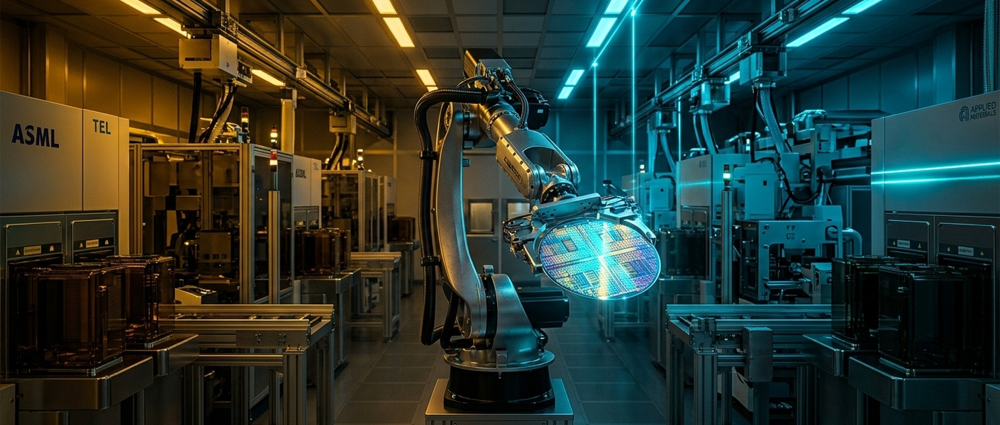
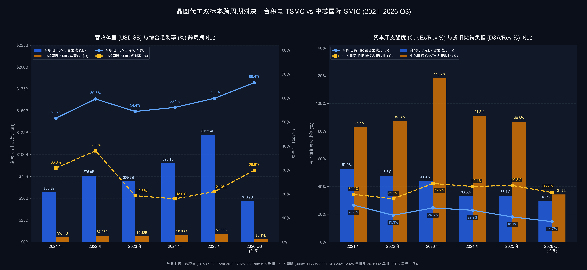

# 【行业指标 12】晶圆先进制程代工与制造：产能利用率、晶圆单价与折旧悬崖（台积电 TSMC 与 中芯国际 SMIC）

> **专栏定位：** 全行业 10-K/20-F 财报解剖与特异性指标图谱  
> **解剖标的：** 台积电 (TSMC, TSM) 主轴穿透 ＋ 中芯国际 (SMIC, 00981.HK / 688981.SH) 镜像对照  
> **核心指标：** 产能利用率与晶圆出货量、综合晶圆均价与先进制程占比、折旧占营收比与毛利-EBITDA 剪刀差、资本开支强度与现金自给率、终端应用平台与地缘客户集中度  
> **审计基准：** SEC EDGAR 原生底稿 (CIK: 0001046179) ＋ 港交所/上交所年报与季报 IFRS 对账

> **摘要：** 拆解晶圆代工与先进制造 5 大核心财报指标（产能利用率与锁单定金、综合晶圆均价、折旧占营收比与剪刀差、资本开支自给率与客户地缘结构），结合台积电（TSMC）与中芯国际（SMIC）最新财报对账，看透百亿折旧周期的排雷密码。

---

## 一、 晶圆代工与重资产制造核心指标深度解剖

在上一讲中，我们拆解了掌握芯片物理微缩极限、卖铲子旱涝保收的**前道半导体核心设备商（WFE）** 。顺着半导体产业链向下游迈出一步，究竟是谁掏出数百亿美元真金白银，把昂贵的极紫外光刻机（EUV）与纳米量测设备搬进超净无尘室，替全世界的芯片设计公司把电路图蚀刻在硅片上，并独自扛起每年上百亿美元的固定资产折旧？答案正是**纯晶圆代工厂（Pure-Play Foundry）** 。

如果说无晶圆厂芯片设计商的财务痛点是“流片失败与长交期存货减值”，那么晶圆代工行业的宿命就凝结在四个字上——**“刚性折旧”** 。一座现代 12 英寸晶圆厂造价高达 150 至 200 亿美元，其中约 **`80%`** 的投资用于购置光刻、刻蚀、薄膜沉积与过程控制机台。根据行业通行会计准则，这些精密机器一旦完成安装验收转入固定资产，无论无尘室里是 24 小时满负荷运转还是有一半机台停机闲置，每天都在按 **5 年（成熟基础设施按 5 至 10 年）** 的铁律计提折旧，叠加洁净室恒温恒湿的超纯水与电力消耗，使得**固定制造费用占晶圆代工厂营业成本（COGS）的比重常年高达 `60% ~ 70%`** 。

因此，普通投资者只盯着季度营收增速和表面市盈率（P/E）看晶圆代工股，往往会在景气顶点掉入“低市盈率价值陷阱”，又在折旧洪峰压制表观利润的底部错失反转买点。在买方机构眼中，审阅任何一家晶圆代工厂的财报，必须沿着五个相互独立的财务维度展开穿透式审计：一是看**产能利用率与晶圆出货量**，衡量固定折旧分摊杠杆与无尘室真实饱满度；二是看**综合晶圆均价与先进制程营收占比**，检验技术代际垄断溢价与成本转嫁能力；三是看**折旧占营收比与毛利-EBITDA 剪刀差**，穿透“折旧悬崖”对表观利润率的扭曲；四是看**资本开支强度与经营现金流自给率**，区分“内生复利印钞机”与“外源融资吞金兽”；五是看**终端应用平台与地缘客户集中度**，识别增长引擎含金量与单点断供风险。

| 分析维度 | 行业专属特异性指标 | 买方核心考核焦点 |
| :--- | :--- | :--- |
| **稼动杠杆与锁单温度** | **产能利用率与晶圆出货量 (Utilization Rate & Wafer Shipments)** | 统一 12 英寸/8 英寸物理折算口径，核算固定折旧摊薄弹性与客户产能保留定金热度 |
| **代际溢价与顺价能力** | **综合晶圆均价与先进制程占比 (Blended Wafer ASP & Advanced Node %)** | 量化先进节点（≤7nm）与先进封装溢价，检验能否靠单晶圆提价碾压设备折旧通胀 |
| **折旧悬崖与造血底力** | **折旧占营收比与毛利-EBITDA 剪刀差 (D&A Burden % & GM-EBITDA Spread)** | 穿透高强度转固期表观毛利与市盈率失真，还原加回非现金折旧后的真实经营现金利润率 |
| **扩产强度与内生闭环** | **资本开支强度与现金自给率 (CapEx Intensity % & OCF / CapEx)** | 核算当期经营现金流能否全额覆盖百亿扩产账单，捕捉重度扩产后的自由现金流转正拐点 |
| **算力引擎与地缘敞口** | **终端应用平台与地缘客户集中度 (Platform Mix & Customer/Geo Conc %)** | 拆解 HPC 算力与消费电子需求权重，排查头部客户集中度与地缘出口管制割裂冲击 |

---

### 指标 1：产能利用率与晶圆出货量 (Utilization Rate & Wafer Shipments)

由于固定资产折旧与无尘室基础运维占代工厂营业成本的六至七成，可变成本（裸硅片、光刻胶、特种气体与湿电子化学品）仅占三成左右，产能利用率每提升或下滑 **10 个百分点**，单位晶圆分摊的固定折旧成本就会发生剧烈摆动，进而触发远超收入波动幅度的**双向经营杠杆（Operating Leverage）** ：

`产能利用率 (Utilization Rate %) ＝ 当期实际投片或出货折合标准晶圆片数 ÷ 当期有效满载标准晶圆总产能 × 100%`  
`标准晶圆面积折算率：1 片 12 英寸 (300mm) 等效晶圆 ＝ 2.25 片 8 英寸 (200mm) 等效晶圆`

在审阅代工厂的产线饱满度时，买方需重点把握三档水位与两项交叉排雷规则：
* **三档稼动率水位分水岭：** 当产能利用率达到 **`95%`** 以上（甚至突破 **`100%`** ）时，无尘室超负荷连轴转，代工厂不仅能将固定折旧摊薄至极限，还能取消价格折扣并收取加急费或长期锁单定金；当产能利用率处于 **`80% ~ 95%`** 时，产线处于良性盈利区间；而成熟制程代工厂的毛利腰斩警戒线通常在 **`75%`** 左右，营业利润盈亏平衡线在 **`70%`** 附近——一旦全厂稼动率跌破 **`70%`** ，无法停计的机器折旧将瞬间吞噬毛利，引发同质化节点惨烈的降价抢单战；
* **交叉验证“客户产能保留定金”与“降价填产能”假象：** 头部垄断型代工厂往往在季报中不再直接公布单一的产能利用率百分比，此时买方需穿透资产负债表附注核查**“客户暂收款（Temporary Receipts from Customers，即客户为锁定远期产能缴纳的无息保留定金）”**是否持续净流入；对于显性披露稼动率的厂商，则必须将**稼动率与单晶圆均价（ASP）联立审视**——若稼动率从 `75%` 回升至 `90%` ，但同期单晶圆均价却下滑超过 **`10%`** ，说明工厂是在靠大幅降价承接低毛利订单来维持表面开机率，对股东回报并无实质改善。

---

### 指标 2：综合晶圆均价与先进制程营收占比 (Blended Wafer ASP & Advanced Node Mix %)

为什么随着摩尔定律演进，单台光刻机采购价从数千万美元飙升至数亿美元、单位晶圆折旧成倍增加，顶级代工厂的毛利率却没有被压垮，反而创出历史新高？秘密全在**综合晶圆均价（Blended ASP）的指数级跃升**与**先进封装配套溢价** ：

`综合晶圆平均售价 (Blended Wafer ASP) ＝ 当期晶圆代工相关营业收入 (或总营收) ÷ 当期出货折合标准晶圆片数`  
`先进制程营收占比 (Advanced Node Mix %) ＝ 7 纳米及以下先进节点晶圆收入 ÷ 晶圆代工总收入 × 100%`

从 28 纳米演进到 7 纳米、5 纳米乃至 3 纳米与 2 纳米，单片 12 英寸晶圆的代工报价从约 `2,500 美元` 一路跃升至 `10,000 ~ 20,000 美元` 以上。只要单晶圆提价幅度跑赢单晶圆折旧增幅，技术垄断者就能将上游设备与海外建厂通胀全额转嫁给下游芯片设计巨头：
* **先进制程统治力 vs 成熟节点升级替代标尺：** 拥有代际统治力的龙头，其 `7 纳米及以下` 先进制程占晶圆收入比重通常高达 **`65%`** 以上，即便在全行业晶圆出货量回落的去库存年份，依然能凭高价节点切换实现单晶圆均价逆势上涨 **`+10%`** 以上；对于受外部设备限制尚未涉足 7 纳米及以下节点的追赶型代工厂，买方则重点追踪其 **`12 英寸晶圆营收占比`** （优秀水位 ≥ **`75%`** ）作为产品结构升级的替代标尺。若一家代工厂先进制程占比为 **`0%`** 且同口径晶圆均价连续两年下滑超过 **`5%`** ，则表明其深陷成熟制程标准化红海内卷；
* **高度重视“非晶圆制造收入（Others：先进封装与光罩测试）”的乘数效应：** 审阅季报收入拆分时，必须单列核算以 CoWoS、3D 堆叠封装、光罩制作与测试服务为核心的非晶圆制造收入占比。在 AI 大算力时代，一旦先进封装等配套收入占总营收比重从传统的 **`10%`** 突破至 **`15% ~ 20%`** ，不仅能直接拉高按总营收折算的单片晶圆综合产值，更是将顶级算力客户牢牢锁定在自家制造生态内的关键护城河。

---

### 指标 3：折旧占营收比与毛利-EBITDA 剪刀差 (Depreciation Burden % & GM-EBITDA Spread)

这是晶圆代工行业最具辨识度的**财务透视镜** 。当一家代工厂逆势投入百亿美元新建晶圆厂并集中转固时，未来 5 年的折旧费用将呈阶梯式暴增——这就是令无数投资人闻风丧胆的**“折旧悬崖（Depreciation Cliff）”** ：

`总折旧及摊销占营收比 (D&A to Revenue %) ＝ 当期总折旧及摊销费用 (Total D&A) ÷ 当期营业总收入 × 100%`  
`毛利率与 EBITDA 利润率剪刀差 ＝ EBITDA 利润率 (%) － 综合毛利率 (%)`

在折旧洪峰期，代工厂损益表上的毛利率可能从 `35%` 暴跌至 `15% ~ 20%` ，净利率跌至个位数，对应的表观市盈率（P/E）飙升至 `50 ~ 80 倍` 看似贵得离谱；但如果穿透现金流量表加回非现金折旧费用（`EBITDA ＝ 营业利润 ＋ 总折旧及摊销`），其 **EBITDA 利润率往往依然稳居 `55% ~ 65%` 以上** ：
* **轻折旧压制态 vs 折旧悬崖承压态：** 具备高定价权的先进代工霸主，其折旧占营收比重常年控制在 **`15% ~ 25%`** ，毛利率与 EBITDA 利润率之间的剪刀差不超过 **`15 个百分点`** ，超七成 EBITDA 直接转化为营业利润，适合采用 **P/E 与 DCF** 估值；而处于逆周期高强度扩产转固期的代工厂，其折旧占营收比重往往高达 **`35% ~ 40%`** 以上，毛利率与 EBITDA 利润率剪刀差拉大至 **`30 ~ 40 个百分点`** （每赚取 100 元营收就有约 40 元被机器设备折旧吃掉，毛利率被按在 **`20%`** 上下，但 EBITDA 利润率仍达 **`55% ~ 60%`** ）。此时表观 P/E 完全失真，买方必须切换至 **EV/EBITDA 与 P/B（市净率）** 评估其跨过折旧洪峰后的真实价值；
* **严防更改折旧年限的会计粉饰：** 横向对比毛利率前，务必翻阅年报会计政策附注核对**机器设备折旧年限** （主流规范为 **5 至 7 年** ）。若某家代工厂在产能利用率下滑期突然将设备折旧年限拉长至 10 年，虽能凭空做高当期表观毛利率，但不会增加一分钱真实自由现金流。

---

### 指标 4：资本开支强度与经营现金流自给率 (CapEx Intensity % & OCF-to-CapEx Ratio)

晶圆代工是一场永无止境的资本军备竞赛。为了守住下一代制程王座或扩充本土产线，代工厂必须年复一年地投入巨资购置最新机台。但同样是百亿美元级扩产，**钱究竟从哪里来**，直接决定了股东权益是被复利增厚还是被不断摊薄：

`资本开支强度 (CapEx Intensity %) ＝ 当期购建固定资产等资本开支 (CapEx) ÷ 当期营业总收入 × 100%`  
`资本开支内生现金自给率 (OCF / CapEx) ＝ 当期经营活动现金流量净额 (OCF) ÷ 当期资本开支 (CapEx)`

通过将资本开支强度与现金自给率联立对账，买方可以一眼区分两类截然不同的生命周期阶段：
* **黄金内生自造血闭环（CapEx 强度 `30% ~ 40%`，且 `OCF / CapEx` ≥ `1.3 倍`）：** 意味着公司当期自身赚取的经营现金流在全额付清新厂建设账单后，还能剩下充沛的**自由现金流（FCF）**用于派发递增现金股息，属于罕见的“重资产复利印钞机”；
* **超常规吞金扩产期与现金流转正拐点（CapEx 强度 > `70%` 甚至破 `100%`，`OCF / CapEx` < `0.7 倍`）：** 全年买设备建厂花掉的钱接近甚至超过全年总营收，经营造血仅够支付约四成扩产账单，自由现金流连年巨额为负，必须依赖外部银团贷款、国家产业基金合资注资或股权融资补血。对于此类标的，买方最核心的右侧信号，就是紧盯其季度资本开支强度何时从 **`80%`** 以上的高位回落至 **`35% ~ 40%`** 的常态水位，从而迎来自由现金流由负转正的历史性拐点。

---

### 指标 5：终端应用平台与地缘客户集中度 (Platform & Geo Concentration %)

晶圆代工厂自己不设计终端品牌产品，其产线稼动率与顺价能力高度折射下游客户群的商业模式与毛利厚度。审阅分部与客户附注时，核心在于穿透“终端平台引擎”与“地缘客户结构”两个层面：

* **高溢价 HPC 算力引擎 vs 传统消费电子底盘：** 涵盖 AI 训练与推理芯片、定制 ASIC 加速卡及数据中心处理器的**高性能计算（HPC）**平台，下游客户自身毛利率高达 `60% ~ 75%` ，对先进制程晶圆价格极度不敏感而对良率与交期极度饥渴；当一家代工厂的 HPC 营收占比突破 **`50%`** 时，其顺价能力与估值中枢将发生质的飞跃。反之，若智能手机与传统消费电子合计占比超过 **`60%`** ，虽然在国产替代浪潮下能保障高稼动率底盘，但受限于下游客户自身微薄的利润空间，向上游代工厂让渡超额毛利率的弹性相对温和；
* **头部客户集中度与地缘平行世界敞口：** 先进制程代工厂的前两大客户合计营收占比往往高达 **`30% ~ 40%`** ，需严密跟踪核心大客户自研芯片流片节奏；而在地缘政治与出口管制博弈下，全球晶圆代工已实质演化为“服务全球算力设计巨头（北美客户占比超 **`70%`** ）”与“深耕本土供应链安全（本土客户占比超 **`85%`** ）”的平行世界格局，买方需据此采用差异化的估值锚。

---

## 二、 晶圆代工行业核心特异性指标全景速查对照表

下表汇总了买方机构审阅全球晶圆代工与重资产制造企业财报时重点对账的 5 大核心指标与通用参考标尺：

| 指标名称 | 标准计量符号 | 买方核心考核焦点 | 行业优秀基准线 (Benchmark) | 危险预警与破位阈值 | 官方财报与附注取数出处 |
| :--- | :--- | :--- | :--- | :--- | :--- |
| **1. 产能利用率与晶圆出货量** | Utilization Rate % & Wafer Shipments | 衡量无尘室产线饱满度与固定折旧分摊杠杆，识别真实量增与降价填产能 | 产能利用率 ≥ **`90%`** ，等效标准晶圆出货量与客户产能保留定金同步扩张 | 产能利用率跌破 **`70% ~ 75%`** 盈亏生死线，或稼动率回升但晶圆均价大幅跳水 | 季报/年报运营摘要（折合 12 英寸或 8 英寸出货片数、月产能）及资产负债表客户暂收款 |
| **2. 综合晶圆均价与先进制程占比** | Blended Wafer ASP & Advanced Node % | 量化技术代际垄断溢价与先进封装生态黏性，检验向上游设备与建厂通胀的转嫁力 | 先进制程（≤7nm）占比 ≥ **`65%`** （或 12 英寸占比 ≥ **`75%`** ），Blended ASP 持续攀升 | 先进制程占比为 **`0%`** 且同口径晶圆 ASP 连续两年下滑 > **`5%`** ，深陷红海价格战 | 季报法说会演示材料（节点占比、晶圆收入 vs 先进封装等其他收入）除以等效出货片数 |
| **3. 折旧占营收比与毛利-EBITDA 剪刀差** | D&A / Rev % & GM-EBITDA Spread | 穿透“折旧悬崖”对表观毛利率与 P/E 的扭曲，还原产线真实经营造血底力 | 折旧占营收比 **`15% ~ 25%`** ，毛利与 EBITDA 剪刀差 ≤ **`15 个百分点`** ，毛利率 ≥ **`50%`** | 折旧占营收比 ≥ **`35% ~ 40%`** ，剪刀差达 **`30 ~ 40 个百分点`** ，毛利率被压制在 **`20%`** 以下 | 现金流量表折旧与摊销行项、费用性质附注（营业成本折旧）及损益表毛利与营业利润 |
| **4. 资本开支强度与现金自给率** | CapEx Intensity % & OCF / CapEx | 检验百亿扩产账单能否由内生经营现金流全额覆盖，区分现金印钞机与融资吞金兽 | CapEx 占营收 **`30% ~ 40%`** ，且 **`OCF / CapEx`** ≥ **`1.3 倍`** ，自由现金流充沛稳定 | CapEx 占营收 > **`70%`** 且 **`OCF / CapEx`** < **`0.7 倍`** ，自由现金流连年巨额为负 | 现金流量表经营活动现金流净额 (OCF) 与购建固定资产资本开支 (CapEx) 行项 |
| **5. 终端平台与地缘客户集中度** | Platform Mix & Customer/Geo Conc % | 识别增长引擎是高溢价 AI 算力还是低毛利消费电子，评估大客户与地缘管制敞口 | HPC 高性能计算占比 ≥ **`50%`** ，客户付费能力强且大客户预付款锁单稳固 | 单一低毛利消费电子占比过高，或核心高毛利客户因地缘管制禁令出现断崖流失 | 年报分部与地理收入附注、主要客户集中度（≥10%）附注及季报平台拆分表 |

---

## 三、 标杆实例深度实战：台积电 (TSMC) 6 周期全景原生财报解剖 (2021 ~ 最新单季实战)

作为全球晶圆代工领域无可争议的绝对霸主，**台积电（Taiwan Semiconductor Manufacturing Company Limited, NYSE: TSM / TWSE: 2330，SEC CIK: 0001046179）** 是检验重资产制造业如何依靠“极致技术代际垄断”打破折旧魔咒、化身超级自由现金流印钞机的教科书级样本。

在 2021 至 2026Q3 的六年完整周期中，台积电经历了 2021~2022 年全球缺芯扩产与 5 纳米放量、2023 年消费电子去库存与 3 纳米初期爬坡带来的稼动率回调（全年 12 英寸等效晶圆出货量从 `1,530 万片` 降至 `1,200 万片` ）、2024~2025 年 AI 算力（HPC）与 CoWoS 先进封装引爆二次腾飞，直至 **2026 年 Q3 最新单季** ：伴随 2 纳米（N2）节点在首季闪电贡献 **`8%`** 晶圆收入、3 纳米与 5 纳米满载运转，台积电单季营收跃升至 **`14,942.4 亿新台币`（折合运营口径 `467.2 亿美元`，同比暴增 `+50.9%`）** ，单季综合毛利率冲破天际达到 **`66.4%`** ，单季营业利润率高达 **`58.7%`** ，单季自由现金流狂揽 **`4,765.6 亿新台币`** ！

以下是台积电（TSMC）的 6 周期官方原生财报底表（数据全部源自公司提交至 SEC 的 Form 20-F 年报与 Form 6-K 季报原件；法定合并报表单位为**十亿新台币（NT$ Billions）** ，同时对账运营美元营收与单晶圆美元均价）：

### 台积电 (TSMC) 6 周期核心财务与经营对账底表 (单位：十亿新台币 NT$B，特殊标注除外)

| 核心财务与经营科目 | 2021 年 | 2022 年 | 2023 年 | 2024 年 | 2025 年 | 2026 最新单季 (Q3) | 穿透勾稽结论与买方视角 |
| :--- | :---: | :---: | :---: | :---: | :---: | :---: | :--- |
| **宏观与技术节点演进周期** | **全球缺芯满载扩产 5nm 放量占 19%** | **提价共振毛利近六成 出货创 1,530 万片峰值** | **消费电子去库筑底 3nm 量产元年占 6%** | **AI 算力全面接棒 HPC 首破五成占 51%** | **CoWoS 与 3nm 爆发 全年净利破 1.7 万亿** | **2nm 首季即占 8% 单季毛利率飙至 66.4%** | 完整印证“先进节点提价碾压折旧爬坡、AI 算力重塑重资产盈利天花板” |
| **营业总收入 (Net Revenue, NT$B)** | **1,587.42** | **2,263.89** | **2,161.74** | **2,894.31** | **3,809.05** | **1,494.24 (单季)** | 2026 前三季度累计营收达 **3,898.73** 十亿新台币（同比 **+39.0%** ），仅用 9 个月即超越 2025 全年 |
| **美元营收 (运营口径 / 20-F 期末汇率 $B)** | **56.82 (57.22)** | **75.88 (73.67)** | **69.30 (70.60)** | **90.08 (88.27)** | **122.42 (121.42)** | **46.72 (单季)** | 26Q3 美元营收同比高增 **+41.2%** ，公司指引 26Q4 美元营收续创 **472~484 亿美元** 新高 |
| 营业收入同比增速 (NTD 口径 %) | +18.5% | +42.6% | -4.5% | +33.9% | +31.6% | **+50.9% (单季)** | 即使在 2023 年全行业出货暴跌 21.6% 的寒冬，新台币营收亦仅微降 **4.5%** |
| **▸ 1. 晶圆制造收入占比 (Wafer %)** | **88.5%** | **88.0%** | **87.1%** | **86.9%** | **85.9%** | **81.6% (单季)** | 2026Q3 单季晶圆制造收入为 **1,219.77** 十亿新台币（2025 全年为 **3,271.29** 十亿新台币） |
| **▸ 2. 先进封装及光罩测试等其他占比** | **11.5%** | **12.0%** | **12.9%** | **13.1%** | **14.1%** | **18.4% (单季)** | **【对应指标 2】CoWoS 先进封装爆发：** 26Q3 其他收入达 **274.47** 十亿新台币，同比翻倍暴增 **+112.8%** |
| **12 英寸等效晶圆出货量 (万片)** | **1,420** | **1,530** | **1,200** | **1,290** | **1,500** | **447.6 (单季)** | **【对应指标 1】** 26Q3 单季出货 **447.6 万片** （同比 +9.6%），前三季度累计出货 **1,295.4 万片** |
| **综合晶圆均价 Blended ASP (美元/片)** | **4,001** | **4,959** | **5,775** | **6,983** | **8,161** | **10,438 (单季)** | **【对应指标 2】5 年翻 2.6 倍：** 单片 12 英寸等效产值突破 **1 万美元** （新台币达 **33.38 万元/片** ） |
| **先进制程 (≤7nm) 占晶圆收入比重** | **50.0%** | **53.0%** | **58.0%** | **69.0%** | **74.0%** | **79.0% (单季)** | **【对应指标 2】** 26Q3 节点拆分：**2nm 占 8%** 、**3nm 占 33%** 、**5nm 占 28%** 、**7nm 占 10%** |
| **客户产能暂收定金 / 合同负债 (NT$B)** | **未单列 / 39.76** | **276.12 / 70.81** | **278.29 / 52.74** | **291.10 / 89.44** | **189.86 / 49.95** | **359.48 / 54.14** | **【对应指标 1】锁单定金井喷：** 26Q3 客户产能保留暂收款较 25 年末暴增 **+89.3%** 至 **3,594.8 亿** |
| **综合毛利率 (Gross Margin %)** | **51.6%** | **59.6%** | **54.4%** | **56.1%** | **59.9%** | **66.4% (单季)** | **【对应指标 1 & 2】** 2026 前三季度累计毛利率达 **63.7%** ，公司指引 26Q4 毛利率更达 **66.0%~68.0%** |
| **总折旧及摊销费用 D&A (及占营收比)** | **422.39 (26.6%)** | **437.25 (19.3%)** | **532.19 (24.6%)** | **662.80 (22.9%)** | **688.10 (18.1%)** | **220.20 (14.7%)** | **【对应指标 3】高溢价碾压折旧：** 营业成本内折旧占 COGS 比重稳定在 **40.9%~51.0%** ，占营收比降至 **14.7%** |
| **EBITDA 利润率 (及与毛利率剪刀差)** | **67.5% (15.9%)** | **68.8% (9.2%)** | **67.2% (12.8%)** | **68.6% (12.5%)** | **68.9% (9.0%)** | **73.4% (7.0%)** | **【对应指标 3】极窄折旧剪刀差：** 26Q3 单季 EBITDA 达 **1,097.27** 十亿新台币，剪刀差收窄至仅 **7.0 个百分点** |
| 研发费用支出 (R&D) 及研发费用率 | 124.73 (7.9%) | 163.26 (7.2%) | 182.37 (8.4%) | 204.18 (7.1%) | 246.43 (6.5%) | **88.98 (6.0%)** | 2026 前三季度累计研发支出 **242.73** 十亿新台币，冲击 A16 与 A14 埃米级节点的同时费率降至 **6.0%** |
| **报告营业利润 (Operating Income) 及利润率** | **649.98 (40.9%)** | **1,121.28 (49.5%)** | **921.47 (42.6%)** | **1,322.05 (45.7%)** | **1,935.02 (50.8%)** | **877.07 (58.7%)** | 2026 前三季度累计营业利润达 **2,175.46** 十亿新台币（利润率 **55.8%** ），超越 2025 全年总和 |
| **归母净利润 (Net Income) 及净利率** | **592.36 (37.3%)** | **992.92 (43.9%)** | **851.74 (39.4%)** | **1,158.38 (40.0%)** | **1,699.45 (44.6%)** | **764.13 (51.1%)** | **重资产奇迹：** 晶圆代工巨头单季净利率历史性突破 **51.1%** ，前三季度累计净利达 **1,908.60** 十亿新台币 |
| **经营现金流 OCF / 资本开支 CapEx** | **1,112.2 / 839.2** | **1,610.6 / 1,082.7** | **1,242.0 / 949.8** | **1,826.2 / 956.0** | **2,275.0 / 1,272.4** | **919.8 / 443.2** | **【对应指标 4】** 2026 前三季度累计 OCF 达 **2,213.38** 、累计 CapEx 达 **1,089.38** 十亿新台币 |
| **CapEx 占营收比 / OCF 自给倍数** | **52.9% / 1.33x** | **47.8% / 1.49x** | **43.9% / 1.31x** | **33.0% / 1.91x** | **33.4% / 1.79x** | **29.7% / 2.08x** | **【对应指标 4】内生复利闭环：** 每年投入三至四百亿美元扩产，OCF 仍常年超额覆盖 **1.3~2.1 倍** CapEx |
| **自由现金流 FCF (及现金股息派发)** | **272.97 (266.2)** | **527.93 (285.2)** | **292.15 (292.1)** | **870.17 (363.1)** | **1,002.57 (466.8)** | **476.56 (155.6)** | **【对应指标 4】** 2025 全年 FCF 首破 **1 万亿新台币** ，2026 前三季度累计 FCF 已达 **1,124.00** 十亿新台币 |
| 期末现金及有价证券 / 总有息债务 | 1,188.4 / 739.5 | 1,561.5 / 899.3 | 1,687.7 / 969.9 | 2,422.0 / 1,020.9 | 3,068.5 / 1,039.2 | **3,465.2 / 1,069.6** | 2026Q3 末账面广义现金高达 **3.47 万亿新台币（约 1,100 亿美元）** ，净现金逾 **2.4 万亿新台币** |
| **HPC 算力占比 / 智能手机占比 (%)** | **37.0% / 43.8%** | **41.2% / 39.3%** | **43.2% / 37.7%** | **51.0% / 34.7%** | **57.6% / 29.2%** | **67.9% / 20.9%** | **【对应指标 5】算力引擎彻底接管：** HPC 占比从 37% 飙升至 **67.9%** （单季贡献逾 1 万亿新台币营收） |
| **美国客户占比 / 中国大陆占比 / ≥10% 大客户** | **64.0% / 10.4% / 36%** | **66.0% / 10.8% / 23%** | **65.2% / 12.4% / 36%** | **68.8% / 11.5% / 34%** | **74.4% / 8.6% / 36%** | **78.9% / 5.5% / 年报披露** | **【对应指标 5】** 26Q3 美国客户占比升至 **78.9%** ，中国大陆降至 **5.5%** ；2025 前两大客户占 **19% 与 17%** |

---

### 核心看点 ①：单晶圆产值 5 年暴涨 2.6 倍破 1 万美元，如何击穿“重资产毛利天花板”？

在传统制造业认知里，重资产代工厂的毛利率很难突破 `50%` 。然而台积电在 2026Q3 交出了令全球买方震撼的 **`66.4%` 综合毛利率** 与 **`58.7%` 营业利润率** （甚至超越了众多无晶圆厂芯片设计公司）。结合 **指标 1（出货量与稼动率）** 与 **指标 2（综合晶圆均价与先进节点占比）** 对账，可以清晰拆解这台涨价机器的三重飞轮：

1. **量稳价飙——出货量仅较 2021 年高 5%，但营收翻了 2.4 倍：** 对比 2021 年与 2025 年，台积电全年 12 英寸等效晶圆出货量仅从 `1,420 万片` 温和增长至 `1,500 万片`（增幅仅 `+5.6%`），但运营美元营收却从 `568.2 亿美元` 暴增至 `1,224.2 亿美元`（增幅 `+115.5%`）！到了 2026Q3，单季单片 12 英寸等效晶圆的综合产值（Blended ASP）历史性突破 **`10,438 美元/片`（约合 `33.38 万新台币/片`）** ，较 2021 年的 `4,001 美元/片` 整整翻了 **`2.61 倍`** ；
2. **79% 先进制程统治力与 2 纳米闪电变现：** 推动单晶圆价格飞跃的核心动力，是 `7 纳米及以下` 先进节点占晶圆收入比重从 2021 年的 `50%` 一路跃升至 2026Q3 的 **`79%`** 。尤为惊人的是，2026 年刚进入量产的 **2 纳米（N2）制程在 2026Q3 单季即贡献了 `8%` 的晶圆收入** ，叠加 **3 纳米（`33%`）** 与 **5 纳米（`28%`）** ，仅最顶尖的三代节点就包揽了全公司 **`69%`** 的晶圆营收；
3. **CoWoS 先进封装（Others）单季翻倍至 18.4% 营收：** 翻开 2026Q3 Form 6-K 季报附注，以 CoWoS 3D 先进封装、光罩与测试为核心的“非晶圆制造收入（Others）”单季高达 **`2,744.7 亿新台币`** ，同比暴增 **`+112.8%`** ，占总营收比重从五年前的 `11.5%` 跃升至 **`18.4%`** 。台积电不再只是卖裸晶圆，而是将“2nm/3nm 算力裸片 + CoWoS 高带宽内存集成封装”打包成不可分割的交钥匙工程，彻底锁定了下游 AI 巨头的溢价分配权。

---

### 核心看点 ②：穿透资产负债表暗门——3,595 亿新台币“客户产能保留暂收款”透露了什么？

台积电自早年起便不再在季报中直接公布单一的产能利用率百分比数字，买方该如何从资产负债表上提前预判其无尘室是否爆满、客户是否在排队抢产能？答案藏在 20-F 年报与 6-K 季报附注的 **“客户暂收款（Temporary receipts from customers）”** 行项中（对应 **指标 1** ）：

* **客户倒贴无息巨款锁死远期产线：** 为了在 3 纳米、2 纳米及 CoWoS 产线上抢占确定性配额，苹果、英伟达、AMD、博通等头部客户必须提前向台积电打入巨额“产能保留押金”（账面分列于流动负债的“其他流动负债”与非流动负债的“其他非流动负债”）。在 2025 年老一代长约陆续履约抵扣后，该余额一度回落至 `1,898.6 亿新台币` ；然而在 **2026 年前三季度，客户暂收款再度井喷 `+89.3%`，飙升至历史最高点 `3,594.8 亿新台币`（叠加上表内的 `541.4 亿新台币` 短期合同负债，客户预付锁单资金合计突破 `4,136 亿新台币`，约合 `130 亿美元`）** ！
* **刚性折旧被高单价彻底驯服（指标 3）：** 正因为高价订单满载运转，尽管台积电 2026Q3 单季折旧与摊销绝对额高达 **`2,202.0 亿新台币`** （前三季度累计折旧达 `6,199.1 亿新台币` ），但折旧占营收比重却从 2021 年的 `26.6%` 逆势压缩至历史最低的 **`14.7%`** ，毛利率（`66.4%`）与 EBITDA 利润率（`73.4%`）之间的折旧剪刀差收窄至仅 **`7.0 个百分点`** 。

---

### 核心看点 ③：每年烧掉三四百亿美元买设备，自由现金流为何还能破万亿新台币？

审视 **指标 4（资本开支强度与现金自给率）** 与 **指标 5（平台与区域集中度）** ，台积电展示了全球工业史上绝无仅有的内生资本闭环：
* **OCF 超额覆盖 2 倍资本开支：** 2021 至 2025 年间，台积电累计投入高达 **`5.10 万亿新台币`（逾 `1,650 亿美元`）** 的资本开支用于购置 EUV 光刻机与建设美、日、德及台湾本土新厂；但在 2024 至 2026Q3 期间，公司资本开支占营收比稳步控制在 **`29.7% ~ 33.4%`** 的黄金区间，经营现金流（OCF）对资本开支的覆盖倍数高达 **`1.79x ~ 2.08x`** ，推动 2025 全年与 2026 前三季度自由现金流连续突破 **`1 万亿新台币`** 大关；
* **HPC 算力占比冲上 67.9% 与高度北美化敞口：** 2026Q3 单季，高性能计算（HPC）平台贡献了 **`10,141.9 亿新台币`（占总营收 `67.9%`）** ，较 2021 年的 `37.0%` 完成了彻底的引擎切换；与此同时，受先进算力芯片客户高度集中于北美及出口管制影响，美国客户营收占比已升至 **`78.9%`** ，而中国大陆客户占比则从 2023 年的 `12.4%` 持续收缩至 **`5.5%`** 。买方在享受 AI 算力盛宴的同时，需密切跟踪前两大客户（2025 年分别占总营收 **`19%`** 与 **`17%`** ）的资本开支节奏与海外晶圆厂（美国亚利桑那州、日本熊本）全面投产后的初期折旧摊薄影响。

---

## 四、 标杆实例镜像对照：中芯国际 (SMIC) 成熟制程逆周期扩产、40% 折旧重压与本土替代底盘

如果说台积电（TSMC）代表了“全球独家垄断 2nm/3nm/CoWoS、以超万美元晶圆均价碾压折旧、自由现金流充沛过剩”的先进制程天花板，那么中国大陆晶圆代工绝对龙头 **中芯国际（Semiconductor Manufacturing International Corporation, HKEX: 00981 / SSE: 688981）** ，则是理解重资产代工厂在 **“外部先进设备受限、全力承接本土成熟及主流节点国产替代、连续四年以近 100% 营收强度逆势扩产，并直面 40% 折旧悬崖大考”** 的最佳镜像教材。

为了实现最严谨的跨市场对比，我们直接提取中芯国际官方披露的 **IFRS 国际准则美元（USD）合并财务报表** 与台积电对账。需要特别提醒买方注意两个底层口径细节：
1. **物理晶圆折算基准差异：** 台积电按 **12 英寸等效晶圆** 披露出货与均价，而中芯国际在 2021~2026Q3 报告中统一按 **8 英寸等效晶圆** 披露月产能与出货片数（1 片 12 英寸晶圆 = `2.25 片` 8 英寸等效晶圆；若将中芯国际 `2026Q3` 的 `1,052 美元/8英寸等效片` 换算为 12 英寸等效口径，约为 **`2,367 美元/12英寸等效片`** ，约为台积电同期 `10,438 美元/片` 的 **`22.7%`** ）；
2. **少数股东损益差异：** 中芯国际旗下多座新建 12 英寸晶圆厂（如中芯京城、中芯深圳、中芯东方、中芯西青）引入了国家集成电路产业基金及地方国资作为重要合资股东，在新厂投产初期承担了部分折旧亏损，在盈利回升期则分走少数股东利润，因此分析时需同时关注**综合毛利率、EBITDA 利润率与归属于母公司股东净利润率** 。

### 1. 两大晶圆代工巨头 6 周期原生数据横向对照底表

| 核心对比科目 | 标的 | 2021 年 | 2022 年 | 2023 年 | 2024 年 | 2025 年 | 2026 最新单季 (Q3) | 穿透勾稽结论与买方视角 |
| :--- | :--- | :---: | :---: | :---: | :---: | :---: | :---: | :--- |
| **营业总收入 (亿美元)** *(TSMC 括号内为十亿新台币)* | **TSMC** SMIC | **568.2 (1,587B)** 54.43 | **758.8 (2,264B)** 72.73 | **693.0 (2,162B)** 63.22 | **900.8 (2,894B)** 80.30 | **1,224.2 (3,809B)** 93.27 | **467.2 (1,494B)** **31.90 (单季)** | **体量与增速：** TSMC 美元营收约为 SMIC 的 13~15 倍；26Q3 单季 SMIC 营收创 **31.90 亿美元** 新高（同比 **+33.9%** ） |
| **产能利用率 (%) 与等效出货量** *(TSMC:12寸万片；SMIC:8寸万片)* | **TSMC** SMIC | **满载 / 1,420** ~100% / 674.7 | **满载 / 1,530** 92.0% / 709.8 | **回调 / 1,200** 75.0% / 586.7 | **回升 / 1,290** 85.6% / 802.1 | **高载 / 1,500** 93.5% / 969.7 | **超载 / 447.6** **97.3% / 303.4** | **【对应指标 1】稼动率修复：** SMIC 8 寸等效月产能从 21 末 `62.1 万片` 扩至 26Q3 末 **`111.7 万片`** ，稼动率重返 **97.3%** |
| **综合晶圆均价 Blended ASP (美元)** *(TSMC:12寸片；SMIC:8寸等效片)* | **TSMC** SMIC | **4,001** 807 | **4,959** 1,025 | **5,775** 1,078 | **6,983** 1,001 | **8,161** 962 | **10,438** **1,052** | **【对应指标 2】代际定价鸿沟：** TSMC 单片均价 5 年涨 161%；SMIC 折合 12 寸等效均价约 **2,367 美元** ，受成熟节点竞争牵制 |
| **先进制程占比 / 12 英寸晶圆占比** *(TSMC: ≤7nm；SMIC: 12寸占比)* | **TSMC** SMIC | **50.0% (≤7nm)** 61.5% (12寸) | **53.0% (≤7nm)** 67.0% (12寸) | **58.0% (≤7nm)** 73.7% (12寸) | **69.0% (≤7nm)** 77.3% (12寸) | **74.0% (≤7nm)** 77.0% (12寸) | **79.0% (≤7nm)** **78.9% (12寸)** | **【对应指标 2】产品结构演进：** TSMC 2nm/3nm/5nm 合占 69%；SMIC 12 英寸大硅片占比稳步提升至 **78.9%** |
| **综合毛利率 (Gross Margin %)** | **TSMC** SMIC | **51.6%** 30.8% | **59.6%** 38.0% | **54.4%** 19.3% | **56.1%** 18.0% | **59.9%** 21.0% | **66.4% (单季)** **29.9% (单季)** | **【对应指标 1~3】36.5pp 毛利差：** SMIC 在 23~24 年受稼动率回调与新厂折旧双击压至 **18.0%** ，26Q3 随满载修复至 **29.9%** |
| **总折旧及摊销占营收比重 (D&A %)** | **TSMC** SMIC | **26.6%** 34.4% | **19.3%** 31.2% | **24.6%** 42.2% | **22.9%** 40.1% | **18.1%** 40.8% | **14.7% (单季)** **35.7% (单季)** | **【对应指标 3】折旧悬崖实锤：** SMIC 2023~2025 折旧占营收高达 **40.1%~42.2%** ，每百元收入逾 40 元用于计提机器折旧 |
| **EBITDA 利润率 (及毛利剪刀差)** | **TSMC** SMIC | **67.5% (15.9%)** 70.2% (39.4%) | **68.8% (9.2%)** 63.4% (25.4%) | **67.2% (12.8%)** 64.3% (45.0%) | **68.6% (12.5%)** 54.5% (36.5%) | **68.9% (9.0%)** 56.4% (35.4%) | **73.4% (7.0%)** **63.9% (34.0%)** | **【对应指标 3】34~45pp 剪刀差：** SMIC 表面毛利率仅 18%~30%，但加回折旧后 EBITDA 利润率常年高达 **54.5%~70.2%** |
| **研发费用率 (R&D %)** | **TSMC** SMIC | **7.9%** 11.7% | **7.2%** 10.1% | **8.4%** 11.2% | **7.1%** 9.5% | **6.5%** 8.3% | **6.0% (单季)** **8.1% (单季)** | 规模体量差异：TSMC 2025 研发绝对额约 **79 亿美元** （是 SMIC `7.74 亿美元` 的 10 倍），但营收分母庞大故费率更低 |
| **归母净利润率 (Net Margin %)** *(SMIC 括号内为归母净利百万美元)* | **TSMC** SMIC | **37.3%** 31.3% (1,702M) | **43.9%** 25.0% (1,818M) | **39.4%** 14.3% (903M) | **40.0%** 6.1% (493M) | **44.6%** 7.3% (685M) | **51.1% (单季)** **13.4% (428M)** | **盈利转化漏斗：** TSMC 超五成收入转化为归母净利；SMIC 2024 年净利率曾压至 **6.1%** ，26Q3 单季净利 **4.28 亿美元** （+91.8% YoY） |
| **资本开支强度 (CapEx / Revenue %)** *(SMIC 括号内为 CapEx 亿美元)* | **TSMC** SMIC | **52.9%** 82.9% (45.1) | **47.8%** 87.3% (63.5) | **43.9%** 118.2% (74.7) | **33.0%** 91.2% (73.3) | **33.4%** 86.8% (81.0) | **29.7% (单季)** **34.3% (10.94)** | **【对应指标 4】逆周期扩产与拐点：** SMIC 2021~2025 累计 CapEx 达 **337.6 亿美元** （23 年高达 **118.2%** ），26Q3 骤降至 **34.3%** |
| **经营现金流覆盖 CapEx 倍数** *(OCF / CapEx Ratio)* | **TSMC** SMIC | **1.33x** 0.67x | **1.49x** 0.84x | **1.31x** 0.45x | **1.91x** 0.43x | **1.79x** 0.39x | **2.08x (单季)** **1.04x (转正拐点)** | **【对应指标 4】现金流分野：** SMIC 过去五年 OCF 仅够覆盖约四成 CapEx，26Q3 随资本开支回落至 10.94 亿美元迎来 FCF 转正 |
| **本土/区域客户营收占比 (%)** *(TSMC: 美国；SMIC: 中国区)* | **TSMC** SMIC | **美国 64.0%** 中国 64.0% | **美国 66.0%** 中国 74.2% | **美国 65.2%** 中国 80.1% | **美国 68.8%** 中国 84.6% | **美国 74.4%** 中国 85.0% | **美国 78.9%** **中国 90.8%** | **【对应指标 5】平行世界镜像：** TSMC **78.9%** 收入来自美国客户；SMIC **90.8%** 收入来自中国区客户（美国区仅剩 **7.8%** ） |

---

### 2. 核心走势对比图：TSMC vs SMIC 原生财报核心指标走势对决 (2021 ~ 2026 Q3)

> **图表买方核心解读：**  
> 左图展示【指标 1 & 2 & 3】综合毛利率与 12 英寸等效晶圆均价：台积电凭 79% 先进制程将单晶圆产值推高至 10,438 美元，毛利率冲上 66.4%；中芯国际在经历 2023~2024 年 18% 毛利低谷后随 97.3% 满载修复至 29.9%。右图展示【指标 3 & 4】资本开支强度与折旧负担：中芯国际在连续五年超 80%~118% 极限扩产后，于 2026Q3 将 CapEx 强度压降至 34.3% 迎来现金流拐点。

---

### 3. 关键差异归因与买方深度复盘

#### 关键差异 ①：为什么中芯国际 2024 年表观净利率仅 6.1%，但 EBITDA 利润率却高达 54.5%？（指标 3“折旧悬崖”实战教学）
如果一位只看损益表净利润和市盈率（P/E）的投资者在 2024 年审视中芯国际，会看到一幅极度惨淡的画面：全年营收虽然突破 `80.30 亿美元` 创下历史新高，但综合毛利率却跌至 **`18.0%`** 的历史冰点，归母净利润从 2022 年的 `18.18 亿美元` 暴跌七成至 **`4.93 亿美元`** （净利率仅 **`6.1%`** ）。然而，只要用 **指标 3（折旧占营收比与毛利-EBITDA 剪刀差）** 穿透现金流量表，就能立即看懂重资产代工厂的“折旧假摔”：
* **每 100 美元营收就有 40~42 美元被机器折旧吞噬：** 为应对供应链安全挑战并扩充本土 12 英寸产线，中芯国际在 2021 至 2025 年间累计投入了惊人的 **`337.6 亿美元`（约合 `2,400 亿人民币`）** 资本开支，将折合 8 英寸月末产能从 `62.1 万片` 一举扩充至 `105.9 万片`（并在 2026Q3 末进一步达到 **`111.7 万片`** ）。当这些昂贵的新产线集中转入固定资产按 5 至 7 年计提折旧时，公司总折旧及摊销占营收比重在 2023 至 2025 年飙升至 **`42.2%`、`40.1%` 与 `40.8%`** ！
* **高达 34~45 个百分点的毛利-EBITDA 剪刀差：** 正是因为折旧属于“无需当期掏出现金的沉没成本摊销”，将巨额折旧加回后，中芯国际在 2023 至 2025 年的 **EBITDA 利润率始终稳居 `64.3%`、`54.5%` 与 `56.4%`** ，并在 2026Q3 随稼动率回升至 **`97.3%`** 而重返 **`63.9%`** （与毛利率 `29.9%` 之间存在 **`34.0 个百分点`** 的巨大剪刀差）。这给买方上了最生动的一课：**对处于高强度扩产转固期的晶圆代工厂，绝不能用失真的表观 P/E 估值，而必须锚定 P/B（市净率）与 EV/EBITDA，并紧盯产能利用率跨过 90% 后的折旧摊薄弹性。**

#### 关键差异 ②：10,438 美元 vs 2,367 美元（同口径 12 英寸）—— 先进制程代际垄断与成熟节点内卷的定价权鸿沟
对比两家公司跨越六年的 **指标 2（综合晶圆均价 Blended ASP）** ，可以一眼看清“全球独家先进节点垄断”与“成熟及主流节点标准化竞争”在商业模式上的本质分野：
* **台积电的单向提价权与通胀免疫：** 无论上游阿斯麦的光刻机涨价多少、全球电力与海外建厂人工成本上升多快，台积电凭借在 `7nm / 5nm / 3nm / 2nm` 及 `CoWoS` 上的绝对垄断，将 12 英寸等效晶圆均价从 `4,001 美元` 单向推高至 **`10,438 美元`** 。客户不仅毫无议价能力，甚至还要主动打入 **`3,595 亿新台币`** 的无息产能保留定金；
* **中芯国际的以量补价与结构升级长征：** 受外部出口管制限制，中芯国际无法采购极紫外光刻机（EUV），主战场聚焦于 28 纳米及以上成熟与主流特色工艺（涵盖消费电子 SoC、图像传感器 CIS、电源管理 PMIC、显示驱动 DDIC、射频及车规微控制器）。尽管公司全力推进大硅片升级，将 **12 英寸晶圆营收占比从 2021 年的 `61.5%` 提升至 2026Q3 的 `78.9%`** ，但其折合 8 英寸等效晶圆均价在 2023 年触及 `1,078 美元` 后，于 2024~2025 年受行业成熟制程降价去库拖累回调至 `1,001 美元` 与 `962 美元` ，直到 2026Q3 随产线满载与产品组合优化才恢复至 **`1,052 美元/8英寸等效片`** （折合 12 英寸等效约 **`2,367 美元/片`** ）。缺乏尖端节点的代际暴利，决定了追赶型代工厂必须靠极致的内生稼动率（`97.3%`）与本土大客户绑定来对冲折旧洪峰。

#### 关键差异 ③：2026Q3 的战略分水岭 —— 中芯国际 CapEx 强度从 118% 骤降至 34.3% 意味着什么？
审视 **指标 4（资本开支强度与现金自给率）** 与 **指标 5（终端平台与地缘客户结构）** ，两家标杆在 2026 年 Q3 同时展现出极具标志性的结构特征：
* **中芯国际迎来五年超常规扩产后的“资本开支正常化拐点”：** 在 2021 至 2025 年连续五年维持 **`82.9% ~ 118.2%`** 的极限资本开支强度（`OCF / CapEx` 仅 `0.39x ~ 0.84x` ，自由现金流累计净流出近 `150 亿美元` ，依靠科创板 IPO 超募资金、合资晶圆厂国资注资及低息长债托底）之后，中芯国际在 **2026Q3 单季资本开支回落至 `10.94 亿美元`** ，占单季营收（`31.90 亿美元`）比重骤降至 **`34.3%`** ！随着激进买设备阶段步入尾声，叠加 `97.3%` 满载稼动率驱动单季经营现金流突破 `11 亿美元` ，中芯国际终于跨过自由现金流转正的分水岭；
* **地缘平行世界中的各自底牌：** 截至 2026Q3，台积电 **`78.9%`** 的收入来自美国客户，且 **`67.9%`** 来自 HPC 高性能算力平台，是全球 AI 算力基建的总底座；而中芯国际 **`90.8%`** 的收入来自中国区客户（美国区仅占 `7.8%` ），智能手机（`21.6%`）、消费电子（`42.6%`）、工业与汽车（`9.6%`）及电脑与平板（`15.2%`）构成了中国本土电子工业“Chain for China（本土在地化制造）”不可替代的产能压舱石。

---

## 五、 实战对账自查表：买方机构 5 步穿透晶圆代工财报排查卡

在审阅任何一家晶圆代工或重资产半导体制造企业的年报（20-F / 10-K / 港股及 A 股年报）与季报时，建议按照以下 5 个步骤依次核查，并对照下方的买方核查指示灯评估其盈利弹性与周期位置：

1. **第一步：对齐物理晶圆口径，查“产能利用率与客户锁单暂收款”（对应指标 1）**  
   打开季报运营摘要，先确认出货量与月产能是按 **12 英寸还是 8 英寸等效晶圆** 计量（记住 `1 片 12 英寸 = 2.25 片 8 英寸` 面积换算律），核查产能利用率是否站在 **`85% ~ 95%`** 以上安全区；若公司不直接披露稼动率，则翻到资产负债表附注核查“客户产能保留暂收定金（Temporary receipts）”与“合同负债”是否大幅净流入。
2. **第二步：手算单片晶圆综合均价，验“先进节点与先进封装定价权”（对应指标 2）**  
   用当期美元营收除以标准等效晶圆出货片数算出 `Blended ASP` ，观察其在晶圆出货量波动时能否保持刚性上涨；同时拆解 `≤7nm` 先进制程占比（或 12 英寸大硅片占比）以及 CoWoS 等非晶圆先进封装收入占比，排除“靠降价填满低端产能”的虚假繁荣。
3. **第三步：穿透现金流量表折旧行项，算“折旧占营收比与毛利-EBITDA 剪刀差”（对应指标 3）**  
   从现金流量表提取总折旧与摊销（Total D&A）除以营业总收入，并计算 EBITDA 利润率与综合毛利率的差值。若折旧占营收比超过 **`35%`** 且剪刀差高达 **`30 个百分点`** 以上，说明表观毛利率与市盈率（P/E）正受“折旧悬崖”严重压制，估值应立即切换至 EV/EBITDA 与 P/B 体系。
4. **第四步：比对经营现金流与购建固定资产支出，判“内生自给率与扩产拐点”（对应指标 4）**  
   用经营活动现金流净额（OCF）除以资本开支（CapEx），检验公司是依靠内生造血超额覆盖扩产账单（`OCF / CapEx ≥ 1.3x`），还是处于外源融资烧钱扩产期（`OCF / CapEx < 0.7x`）；对高强度扩产标的，重点追踪其 CapEx 占营收比何时从 **`80%`** 以上回落至 **`35% ~ 40%`** 常态水位以捕捉自由现金流反转拐点。
5. **第五步：审阅平台与地理分部附注，剥离“低毛利周期敞口与地缘断供风险”（对应指标 5）**  
   在分部附注中核算 HPC 算力平台与传统消费电子占比，并核查前两大客户集中度及敏感地缘区域收入敞口，评估下游客户是否有足够高的毛利空间承接代工提价。

### 晶圆代工与先进制造买方核查指示灯

| 核查维度 | 🟢 绿灯安全区 (优秀标杆) | 🟡 黄灯观察区 (稳健常规) | 🔴 红灯排雷区 (高危预警) |
| :--- | :--- | :--- | :--- |
| **1. 产能利用率与锁单定金** | 产能利用率 ≥ **`90% ~ 95%`** ，客户产能保留暂收款与合同负债持续高增 | 产能利用率处于 **`75% ~ 90%`** 良性区间，出货量随季节性温和波动 | 产能利用率跌破 **`70% ~ 75%`** 盈亏生死线，或靠大幅降价勉强维持表面开机率 |
| **2. 晶圆均价与节点结构** | 先进制程（≤7nm）占比 ≥ **`65%`** （或 12 英寸占比 ≥ **`75%`** ），ASP 与先进封装占比齐升 | 主流特色工艺占比稳步提升，同口径晶圆 ASP 在周期波动中保持基本稳定 | 先进制程占比为 **`0%`** 且同口径晶圆 ASP 连续两年下滑 > **`5%`** ，深陷价格战 |
| **3. 折旧负担与剪刀差** | 折旧占营收比 **`15% ~ 25%`** ，毛利与 EBITDA 剪刀差 ≤ **`15 个百分点`** ，毛利率 ≥ **`50%`** | 折旧占营收比 **`25% ~ 35%`** ，剪刀差 **`15 ~ 25 个百分点`** ，EBITDA 利润率 ≥ **`55%`** | 折旧占营收比 ≥ **`35% ~ 40%`** 且稼动率不足，毛利率跌破 **`20%`** ，或违规拉长折旧年限 |
| **4. 资本开支与现金自给** | CapEx 占营收 **`30% ~ 40%`** ，且 **`OCF / CapEx`** ≥ **`1.3 倍`** ，自由现金流充沛且持续分红 | CapEx 占营收 **`40% ~ 60%`** ，且 **`OCF / CapEx`** 在 **`0.8 ~ 1.3 倍`** ，处于可控扩产期 | CapEx 占营收 > **`70%`** 且 **`OCF / CapEx`** < **`0.7 倍`** ，自由现金流连年巨额失血且负债率飙升 |
| **5. 终端平台与客户结构** | HPC 算力等高溢价平台占比 ≥ **`50%`** ，下游客户毛利丰厚且顺价机制顺畅 | 智能手机、汽车工业与本土替代需求多元均衡，单一客户占比 ≤ **`20%`** | 低毛利标准化消费电子占比 > **`60%`** ，或核心高毛利客户因地缘禁令出现断崖流失 |

---

## 六、 本讲买方总结与下讲预告

> **买方终极心法**  
> 审阅晶圆代工财报，核心是看透百亿折旧下的五重杠杆：一盯 75% 与 95% 稼动率分水岭及客户锁单暂收款，二算标准晶圆均价（ASP）与先进封装占比验真定价权，三拆折旧占营收比与毛利-EBITDA 剪刀差穿透折旧悬崖，四看 OCF 对 CapEx 覆盖倍数辨别内生印钞机与烧钱扩产期，五验 HPC 算力与本土替代底盘。

---

### 下讲预告：【行业指标 13】无晶圆厂芯片设计与算力平台：研发流片、表外产能锁水与芯片库存周期（英伟达 NVDA 与 超威半导体 AMD）

解剖了上游卖光刻与量测母机的**前道核心设备商（ASML 与 KLA）** ，以及中游把百亿美元机台搬进无尘室、独自扛起刚性折旧宿命的**晶圆代工巨头（TSMC 与 SMIC）** ，下一讲我们将顺着半导体价值链迎来硬科技铁三角的终极收官——自己不建一座晶圆厂、却拿走全产业链最丰厚超额利润的 **【无晶圆厂芯片设计与算力平台（Fabless）篇】！**

为什么同样是委托代工厂流片生产，有的芯片设计公司能赚取 **75% 的惊人毛利率** ，有的却在代工厂涨价与长交期备货中沦为“打工仔”？当算力需求狂飙时，为什么资产负债表外的 **“不可撤销产能采购承诺（Purchase Obligations）”** 既是锁定代工配额的护城河，又可能在周期转向时化作吞噬百亿利润的存货跌价深渊？在下一讲中，我们将派出全球 AI 算力绝对霸主 **英伟达（NVIDIA）** 正面交锋算力挑战者 **超威半导体（AMD）** ，为您揭开轻资产芯片设计帝国的财报排雷密码，敬请期待！
