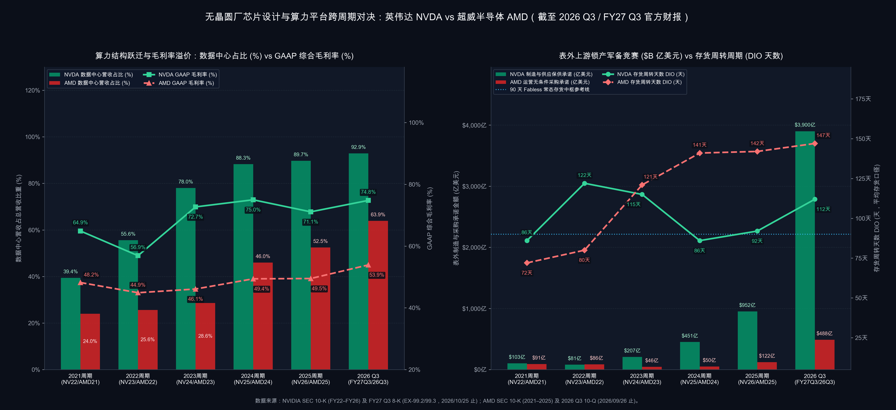

# 【行业指标 13】无晶圆厂芯片设计与算力平台：研发流片、表外产能锁水与芯片库存周期（英伟达 NVIDIA 与 超威半导体 AMD）

> **专栏定位：** 全行业 10-K/20-F 财报解剖与特异性指标图谱  
> **解剖标的：** 英伟达 (NVIDIA, NVDA) 主轴穿透 ＋ 超威半导体 (AMD) 镜像对照  
> **核心指标：** 业务分部结构与大客户/地缘集中度、软硬全栈毛利率壁垒与系统定价权、研发流片与并购摊销剪刀差、三级存货结构与跌价暗门、表外不可撤销采购承诺与预付锁产覆盖率  
> **审计基准：** SEC EDGAR 原生底稿 (CIK: 0001045810 / 0000002488) ＋ 10-K/10-Q 附注对账

> **摘要：** 拆解无晶圆厂芯片设计 5 大核心财报指标（业务结构与大客户集中度、全栈毛利壁垒、研发流片与并购摊销、三级存货跌价及表外采购承诺），结合英伟达与 AMD 财报对账，看透轻资产芯片巨头的排雷密码。

---

## 一、 无晶圆厂芯片设计与算力平台核心指标深度解剖

无晶圆厂芯片设计（Fabless）的商业本质，在于将动辄百亿美元投资的无尘室建造与刚性设备折旧完全剥离给外部晶圆代工厂与封测厂商，把全部智力资本聚焦于处理器架构设计、前端后端验证、掩模版流片（Tape-out）与底层系统软件栈构筑。凭借轻资产运营杠杆，顶级芯片设计商往往只需将营收的 **`2% ~ 5%`** 用于购置固定资产（CapEx），却能释放出全半导体产业链最高的净资产回报率与自由现金流弹性。

然而，“无厂”并不意味着没有重资产约束。当全行业步入先进制程与三维先进封装稀缺时代，Fabless 企业面临着极为凶险的上下游双向挤压：上游受制于极紫外光刻晶圆配额、先进封装机台与高带宽内存供应；下游则必须在云厂商资本开支周期与消费电子景气周期剧烈摆动之际，承受长交期备货触发的“牛鞭效应”存货跌价打击，以及天价外延并购留下的无形资产摊销包袱。审阅任何一家芯片设计公司的 10-K 与 10-Q 财报，必须围绕**“业务结构与客户/地缘集中度、软件毛利壁垒、研发流片与并购摊销剪刀差、三级存货与跌价暗门、表外锁产承诺覆盖率”**五大正交维度展开穿透式审计：

| 分析维度 | 行业专属特异性指标 | 买方核心考核焦点 |
| :--- | :--- | :--- |
| **收入结构与客户敞口** | **业务分部结构与大客户/地缘集中度 (Segment Mix & Conc %)** | 区分 B2B 企业算力底座与强周期消费终端占比，审计云巨头集中度与管制敞口 |
| **系统地租与议价层级** | **软硬全栈毛利率壁垒与系统定价权 (Gross Margin Moat %)** | 解构专有编译器/算子库软件地租、模块化芯粒方案与同质硬件红海的三层毛利分野 |
| **技术获取与利润水分** | **研发流片强度、SBC 与并购摊销剪刀差 (R&D, SBC & Amort Spread)** | 评估内生流片节奏与放量期研发绝对增速，同时穿透并购无形资产摊销造成的利润剪刀差 |
| **库存周期与牛鞭排雷** | **三级存货结构、周转天数与跌价减值暗门 (3-Stage Inventory & DIO)** | 拆解原料/在制品/产成品结构区分新品蓄势与渠道积压，核算存货及排产违约减值 |
| **表外锁产与违约风险** | **表外不可撤销采购承诺与预付锁产覆盖率 (Purchase Obligations %)** | 用相对 COGS 的覆盖率量化上游稀缺晶圆/封装锁产力，严防需求下行期巨额违约赔款 |

---

### 指标 1：业务分部结构与大客户/地缘集中度 (Segment Mix, Customer Concentration & Geo Exposure %)

芯片设计企业能否摆脱消费电子强周期波动、升级为高粘性的数字基础设施核心资产，首先取决于其分部收入底盘的迁移与下游客户群的集中度风险：

`核心企业级算力分部占比 (%) ＝ 数据中心与基础设施分部营收 ÷ 营业总收入 × 100%`

个人电脑处理器、游戏显卡等 B2C 消费级芯片具有极强的宏观敏感性与整机物料成本红线约束；而面向全球超大规模云服务商（Hyperscalers）与企业级算力中心的数据中心芯片，具备更长的采购规划周期与按系统总拥有成本（TCO）溢价的能力。与此同时，在出口管制日趋严格的背景下，单一高毛利区域断供同样能重创季度业绩与毛利中枢。

买方诊断标尺如下：
* **高壁垒企业算力底座：** 数据中心与企业级基础设施分部营收占比 ≥ **`70%`** ，下游订单由多元云端与主权算力基建需求驱动，摆脱了 PC 与游戏周期掣肘；
* **多元混合架构平台：** 数据中心占比处于 **`40% ~ 70%`** 区间，与客户端个人电脑、嵌入式工业及汽车业务并存，兼具算力弹性与一定周期对冲缓冲；
* **消费周期依赖与集中度预警：** 若数据中心占比 < **`30%`** ，本质上仍属于传统消费电子周期股；此外，无论企业体量大小，只要 10-K 附注披露前几大（占比 `≥ 10%` ）客户合计贡献营收 > **`50%`** ，或单一受出口管制敏感区域营收占比 > **`25%`** ，买方必须严密评估云巨头自研定制芯片（ASIC）替代分流与管制收紧引发的断崖风险。

---

### 指标 2：软硬全栈毛利率壁垒与系统定价权 (Gross Margin Moat & System Pricing Power %)

为什么同样委托上游晶圆代工厂生产芯片、采购同代高带宽显存（HBM），不同 Fabless 企业的综合毛利率却能分化出从不足四成到七成以上的巨大物理鸿沟？答案全在于 **系统交付形态与软件生态粘性** 的本质差异：

`综合毛利率 (Gross Margin %) ＝ (营业收入 − 营业成本 COGS) ÷ 营业收入 × 100%`

如果芯片设计商交付的只是一颗遵从行业公版接口的标准裸片，下游整机客户可以随时切换至同类替代架构，定价锚只能被压缩在“晶圆及封测物料成本加合理加工利润”的区间内；而一旦厂商构建了历经十余年沉淀的专有底层编译器、并行计算算子库、软件开发栈以及高带宽集群互联方案，客户实质购买的是大幅缩短大模型训练时间与降低数据中心电耗的“全栈生产力系统”，软件极低的边际分发成本将直接沉淀为纯利润。

据此，全行业毛利率呈现出清晰的三层壁垒结构：
* **全栈软件生态垄断区（综合毛利率 ≥ `70%` ）：** 凭借专有编译器生态与整机系统集成壁垒向客户征收显著的“数字软件地租”，拥有跨代际的排他性顺价能力；
* **主流高性能硬件平台区（综合毛利率 `50% ~ 65%` ）：** 芯片计算性能跻身行业第一梯队（往往借助模块化芯粒 `Chiplet` 拼接有效摊薄超大硅片良率损耗），但受限于开源软件生态追赶或客户制衡诉求，毛利中枢锚定于强势硬件定价水平；
* **同质化红海内卷区（综合毛利率 < `45%` ）：** 缺乏底层架构壁垒与生态粘性，产品易被竞争对手低价替代，在晶圆代工涨价周期中首当其冲遭到上下游双重挤压。

---

### 指标 3：研发流片强度、SBC 稀释与并购摊销剪刀差 (R&D Tape-out Intensity, SBC & M&A Amortization Spread)

获取下一代芯片架构无非两条路：要么靠 **内生工程师团队花真金白银流片自研** 逐代迭代，要么靠 **天价并购买下现成技术拼图** 换取时间窗口，这两种战略选择会在损益表与 Non-GAAP 调节表上留下截然不同的财务指纹：

`纯研发费用率 (R&D Intensity %) ＝ GAAP 研发费用支出 ÷ 营业总收入 × 100%`  
`并购摊销剪刀差 (Amortization Spread) ＝ Non-GAAP 营业利润率 (%) − GAAP 营业利润率 (%)`

在先进制程节点上，单款超大规模芯片从架构设计、EDA 仿真授权到完成掩模版流片（Tape-out）耗资数亿美元；一旦流片验证出现逻辑缺陷被迫改版重流（Respin），上市窗口将被延误 **12 至 18 个月** ，足以丧失整代市场先机。而选择大型外延并购（例如并购可编程逻辑芯片、网络互联或数据处理器厂商）的公司，则会在营业成本与研发费用下方背负起持续多年的巨额“并购无形资产摊销（Amortization of Acquisition Intangibles）”，叠加高额科研人员股权激励费用（SBC），使管理层推崇的“调整后利润”与法定 GAAP 利润产生剧烈背离。

买方在审阅研发与期间费用时必须把握两重标尺：
* **区分“常态流片期”与“放量稀释期”的研发纪律：** 常态迭代期，纯研发费用率（R&D %）应稳守 **`15% ~ 25%`** 区间，期间销售及管理费率（SG&A %）通过大客户直销模式摊薄至 **`10%`** 以内；当旗舰新品爆发带动营收倍增时，研发费用率往往被动稀释至 **`10%`** 以内——此时切忌误判为削减研发，应切换验证**研发绝对投入同比增速是否保持 ≥ `20%`** 。唯有当研发费率 < **`10%`** 且研发绝对金额停滞或连续两季同比负增长时，才触发技术掉队预警；
* **严审 SBC 稀释与 Non-GAAP 剪刀差：** 健康的软件与芯片龙头，员工股权激励费用（SBC）占营收比重常态应控制在 **`10%`** 以内，且 Non-GAAP 与 GAAP 营业利润率剪刀差不超过 **`5 个百分点`** ；若剪刀差长期大于 **`10 个百分点`** ，或资产负债表商誉及并购无形资产合计占总资产比重突破 **`35%`** ，买方绝不能盲目采信美化后的 Non-GAAP 利润，必须对并购资产的真实回报率与减值风险作实质性折价。

---

### 指标 4：三级存货结构、周转天数与跌价减值暗门 (3-Stage Inventory Anatomy, DIO & Write-downs)

芯片从晶圆厂投片、长周期先进封装测试到整机系统交付横跨两个季度以上，一旦下游需求转向，供应链牛鞭效应会以指数级烈度重击芯片设计商的利润表：

`存货周转天数 (DIO) ＝ [(期初存货净额 ＋ 期末存货净额) ÷ 2] ÷ 当期营业成本 COGS × 365`  
`存货跌价与排产减值占毛利比 (%) ＝ (存货跌价计提 ＋ 不可撤销排产违约减值) ÷ 当期毛利润 × 100%`

审阅 10-K 存货附注（Note: Inventories）时，买方绝不能只盯着资产负债表的存货总额，而必须将其拆解为**原材料（未封装晶圆裸片与基板）** 、**在制品（WIP，处于封测与系统集群集成中的高价值半成品）** 与 **产成品（已完工待发货成品卡）** 三层结构：
* **良性周转与新品放量先行信号：** 全行业常态良性 `DIO` 处于 **`70 ~ 100 天`** 区间，且存货跌价及排产违约减值合计占当期毛利不超过 **`5%`** 。当期**在制品（WIP）占总存货比重突破 `40%` 且环比显著暴增**、同时产成品并未滞销时，通常是下一代旗舰架构芯片正处于大规模封测爬坡、即将迎来爆发式交付的积极前兆；
* **渠道塞货警戒与牛鞭踩踏破位：** 当 `DIO` 爬升至 **`100 ~ 130 天`** 且产成品库存增速大幅跑赢未来季度营收指引时，说明渠道滞销已现；一旦 `DIO` 突破 **`130 ~ 140 天`** ，且管理层当期计提的“存货跌价准备 ＋ 未入库代工排产违约赔偿”合计占当期毛利比重超过 **`10%`** ，即构成老代产品技术性淘汰与全行业去库存踩踏的高危实锤。

---

### 指标 5：表外不可撤销采购承诺与预付锁产覆盖率 (Purchase Obligations Coverage & Supply Prepayments)

无晶圆厂芯片巨头账面上没有光刻机折旧，却在 10-K 年报附注（Note: Commitments and Contingencies）中隐藏着相当于数十座晶圆厂造价的**表外不可撤销采购承诺（Purchase Obligations）** ，并在资产负债表中搭配巨额**长期预付供应款（Supply Prepayments）** ，以此独占上游最稀缺的先进制程晶圆机时、2.5D/3D 晶圆级先进封装产能与高带宽内存配额：

`采购承诺 COGS 覆盖率 (%) ＝ 资产负债表外不可撤销采购承诺总额 ÷ 过去 12 个月营业成本 (COGS) × 100%`

由于绝对美元金额会随企业体量剧烈变化，买方必须采用**相对过去 12 个月营业成本（COGS）的覆盖率**来衡量锁产力度与违约风险的顺逆周期双重属性：
* **景气上行期的战略护城河：** 当下游算力与消费需求高度确定、产线供不应求时，表外不可撤销采购承诺覆盖年化 COGS 达到 **`80% ~ 150%`** （即 `0.8x ~ 1.5x` ）代表极强的进攻型上游锁产壁垒，未来 4 至 6 个季度交付兑现拥有高度确定性； **`40% ~ 80%`** 属于标准供应链协同匹配；若在全行业抢产能周期覆盖率却长期低于 **`40%`** ，说明企业缺乏足够财力或订单底气锁定稀缺配额，大概率在先进封装供货队列中遭到头部对手排挤；
* **景气下行期的致命违约炸弹：** 表外采购承诺具备极强的法律刚性——即便终端客户突然砍单，芯片设计商仍必须按协议付款提货或支付高额取消费。一旦行业进入需求降温周期（如 `DIO` 飙升且营收指引转弱），表外采购承诺覆盖率若依然高于 **`100%`** ，极可能在未来数个季度演变为数亿美元乃至数十亿美元级的排产违约减值冲击。

---

## 二、 无晶圆厂芯片设计行业核心特异性指标全景速查对照表

下表汇总了买方机构审阅全球无晶圆厂芯片设计与算力平台财报时重点对账的 5 大核心指标与通用参考标尺：

| 指标名称 | 标准计量符号 | 买方核心考核焦点 | 行业优秀基准线 (Benchmark) | 危险预警与破位阈值 | 官方财报与 SEC 取数出处 |
| :--- | :--- | :--- | :--- | :--- | :--- |
| **1. 业务分部结构与客户/地缘集中度** | Segment Mix & Customer Conc % | 检验 B2B 算力底座占比，审计云巨头集中度自研替代与地缘管制敞口 | 核心企业级/数据中心算力占比 ≥ **`70%`** ，前几大客户与区域敞口可控 | 数据中心占比 < **`30%`** （强消费周期），或大客户合计 > **`50%`** / 受限区 > **`25%`** | 10-K/10-Q 分部附注 (`Segment Information`)、大客户及地理附注 |
| **2. 软硬全栈毛利率壁垒** | Gross Margin % & System Moat | 区分全栈软件地租、模块化强硬件平台与同质化裸片加工的三层溢价 | 综合毛利率 ≥ **`70%`** （强势高性能硬件平台 **`50% ~ 65%`** ） | 综合毛利率 < **`45%`** ，缺乏底层软件生态粘性，陷入价格战 | 合并损益表 (`Gross Profit` / `Gross Margin %`) |
| **3. 研发流片、SBC 与并购摊销剪刀差** | R&D %, SBC % & Amort Spread | 区分常态流片率与放量期绝对额增速，剥离天价并购无形资产摊销水分 | 常态 R&D **`15% ~ 25%`** （放量期绝对增速 ≥ **`20%`** ），SBC ≤ **`10%`** ，剪刀差 ≤ **`5 个百分点`** | R&D < **`10%`** 且绝对额连续负增长，或利润率剪刀差 > **`10 个百分点`** 且商誉无形占比 > **`35%`** | 合并损益表 (`R&D`、`SG&A`)、Non-GAAP 调和表及资产负债表商誉无形资产 |
| **4. 三级存货结构与跌价暗门** | DIO & 3-Stage Inventory Mix | 拆解原料/WIP/产成品区分新品放量前夜与渠道积压，防范牛鞭减值 | DIO **`70 ~ 100 天`** ，WIP 结构良性（新品期 > **`40%`** ），减值占毛利 ≤ **`5%`** | DIO ≥ **`130 ~ 140 天`** 且产成品激增，或存货及排产减值占毛利 > **`10%`** | 资产负债表存货、存货附注 (`Raw/WIP/Finished Goods`) 及跌价附注 |
| **5. 表外采购承诺与预付锁产覆盖** | Purchase Obligations / COGS % | 用相对 COGS 覆盖率量化稀缺晶圆/封测控盘力与逆周期违约赔偿暗雷 | 景气饱满期覆盖年化 COGS **`80% ~ 150%`** （常态协同 **`40% ~ 80%`** ） | 抢产能期 < **`40%`** 遭上游排挤，或需求下行期仍 > **`100%`** 触发违约减值 | 10-K 附注 (`Commitments and Contingencies`) 及长期预付款项 |

---

## 三、 标杆实例深度实战：英伟达 (NVIDIA, NVDA.US) 6 周期全景原生财报解剖

英伟达（NVIDIA）是人类商业史上将无晶圆厂模式与全栈算力生态发挥到极致的巅峰样本。从早期的游戏 GPU 拓荒者，到敏锐押注通用并行计算（CUDA），再到借由大语言模型爆发加冕为市值数万亿美元的全球算力霸主，其财报演进史就是一部芯片产业的物理教科书。

以下是英伟达自 FY2022 至 FY2027 最新单季的官方审计与季度财报底表（注：英伟达财年截至每年 1 月底；FY2022~FY2026 为官方 10-K 已完成审计真数，FY27 Q2 为最新已披露官方单季实际真数）：

### 英伟达 6 周期核心财务与特异性指标对账表 (单位：亿美元，特殊标注除外)

| 财务与特异性科目 (单位：亿美元) | FY2022 (2021) | FY2023 (2022) | FY2024 (2023) | FY2025 (2024) | FY2026 (2025审计真数) | 2026 最新单季 (FY27 Q2) | 数据性质与 10-K 出处 |
| :--- | :---: | :---: | :---: | :---: | :---: | :---: | :--- |
| **宏观与半导体周期基准** | **游戏挖矿繁荣尾声** | **消费电子去库寒冬** | **生成式 AI 大模型元年** | **Blackwell 架构跨越** | **规模超算集群全面交付** | **Blackwell规模交付与推理集群放量** | 产业周期宏观坐标 |
| **营业收入 (Revenue)** | **269.1** | **269.7** | **609.2** | **1,305.0** | **2,159.4** | **962.2** | ✓ 10-K/10-Q 损益表原值 (Revenues) |
| 营收同比增速 (%) | +61.4% | +0.2% | +125.9% | +114.2% | **+65.5%** | **+105.8%** | ✓ 由官方原值计算 (单季同比) |
| **数据中心营收 (Data Center)** | **106.1** | **150.1** | **475.3** | **1,151.9** | **1,937.4** | **858.0** | ✓ 10-K/10-Q Note: Segment |
| **数据中心营收占比 (%)** | **39.4%** | **55.6%** | **78.0%** | **88.3%** | **89.7%** | **89.2%** | ✓ 由分部收入原值计算 |
| *其中：网络互联营收 (Networking)* | *32.2* | *38.0* | *85.8* | *129.9* | *313.8* | *110.0* | ✓ 10-K/10-Q Note: Segment |
| **GAAP 综合毛利率 (%)** | **64.9%** | **56.9%** | **72.7%** | **75.0%** | **71.1%** | **75.0%** | ✓ 10-K/10-Q 损益表原值 |
| Non-GAAP 综合毛利率 (%) | 66.8% | 59.2% | 73.8% | 75.8% | 73.5% | 75.5% | ✓ 10-K/10-Q Non-GAAP 调和项 |
| 研发费用支出 (R&D) | 52.7 | 73.4 | 86.8 | 129.1 | 185.0 | 70.5 | ✓ 10-K/10-Q 损益表原值 |
| **纯研发费用率 (%)** | **19.6%** | **27.2%** | **14.2%** | **9.9%** | **8.6%** | **7.3%** | ✓ 由官方原值计算 |
| 存货净额 (Inventories) | 26.1 | 51.6 | 52.8 | 100.8 | 214.0 | 315.8 | ✓ 10-K/10-Q 资产负债表原值 |
| *其中：原材料 (Raw Materials)* | *7.9* | *24.3* | *17.2* | *34.1* | *38.1* | *52.0* | ✓ 10-K/10-Q Note: Inventories |
| *其中：在产品 (WIP)* | *6.9* | *4.7* | *15.1* | *34.0* | *88.2* | *138.5* | ✓ 10-K/10-Q Note: Inventories |
| *其中：产成品 (Finished Goods)* | *11.2* | *22.6* | *20.6* | *32.7* | *87.7* | *125.3* | ✓ 10-K/10-Q Note: Inventories |
| **存货周转天数 (DIO, 天)** | **86** (期末 89) | **122** (峰值 142) | **115** (期末 92) | **86** (期末 85) | **92** (期末 98) | **82** | △ 平均存货口径 (附注见文末) |
| 存货跌价与采购承诺减值 | 1.8 | **21.7** | 7.7 | 16.0 | 40.0 | 7.8 | △ 10-K/10-Q 综合计提 (见注2) |
| **表外不可撤销采购承诺** | **103.0** | **80.6** | **207.1** | **450.8** | **952.0** (全口径超 1,220) | **952.0** (全口径超 1,220) | ✓ 10-K Item 7 / Note 12 (见注3) |
| 归母净利润 (GAAP Net Income) | 97.5 | 43.7 | 297.6 | 728.8 | **1,200.7** | **596.9** | ✓ 10-K/10-Q 损益表原值 |
| 经营活动现金流 (CFO) | 91.1 | 56.4 | 280.9 | 640.9 | **1,027.2** | **240.8** | ✓ 10-K/10-Q 现金流量表原值 (单季) |
| 自由现金流 (FCF) | 81.3 | 38.1 | 270.2 | 608.5 | **966.8** | **220.5** | ✓ CFO 减资本开支计算 (单季) |

**数据台账与勾稽注记：**  
1. **口径统一约定：** 除百分比与天数外，表中金额单位均为亿美元；
2. **存货跌价综合口径：** FY2023 披露的 21.7 亿美元包含单项存货跌价计提 10.4 亿美元（XBRL 标签 `InventoryWriteDown`）以及对代工厂未入库排产的不可撤销采购承诺违约赔偿 11.3 亿美元，两项合计对当期营业成本产生 21.7 亿美元直接冲击；
3. **表外采购承诺口径：** FY2026 官方 10-K 附注 Note 12 披露的制造业、供应与产能保供承诺高达 952.0 亿美元，叠加 270.0 亿美元多年期云服务协议后，全口径承诺超 1,220.0 亿美元；
4. **DIO 计算约定：** 历史完整财年采用官方平均存货净额口径 `(期初+期末)/2 ÷ COGS × 365`；单季数据采用单季年化口径计算。

---

### 战局算式 ①：表外不可撤销采购承诺（Purchase Obligations）的产能锁喉与上游垄断算式

在从 Hopper 到 Blackwell 架构的算力爆发浪潮中，全球市场最关心的核心命题是：“英伟达的 GPU 为什么始终供不应求？为什么竞争对手与云厂商自研 ASIC 无法迅速填补产能真空？”

**答案不在于公开报表的固定资产，而深藏在表外不可撤销采购承诺（Note: Commitments）的数学算式中：**

`表外承诺规模裂变 ＝ 从 FY2023 的 80.6 亿美元 ➔ FY2024 的 207.1 亿美元 ➔ FY2025 的 450.8 亿美元 ➔ FY2026 制造业保供达 952.0 亿美元 (全口径超 1,220.0 亿美元)`

当 FY2023 行业还在遭遇游戏显卡去库存的低谷时，管理层在表外悄然签署了数十亿美元的高额排他性产能协议。随着大模型军备竞赛白热化，英伟达在 FY2025 将多年度全口径采购承诺推升至 **450.8 亿美元** ，而在 FY2026 年报附注 Note 12 中，更正式披露其制造业、供应与产能保供承诺高达 **952.0 亿美元** （几乎全部将于一年内支付），叠加 270.0 亿美元多年期云服务承诺后，全口径表外承诺突破 **1,220.0 亿美元** 。

这一笔天量数字意味着什么？按照全球晶圆先进制程机台投入与先进封装（CoWoS）、高带宽内存（HBM3e/HBM4）产能规划测算，英伟达实质上**锁定了台积电 70% 以上的先进封装产能配额，以及海力士绝大部分的高带宽内存供应量** 。

英伟达正是通过在资产负债表外承担数百亿美元级的刚性付款责任，完成了对全球尖端代工与先进封装产能的战略控盘，将上游稀缺制造能力转化为排他性交付壁垒。

---

### 战局算式 ②：从 56.9% 到 75.0%+——CUDA 软件栈＋InfiniBand/Spectrum-X 如何构筑超额毛利溢价

芯片制造的物理成本是有据可查的：一片先进制程 12 英寸晶圆加工费约为 **20,000 美元** ，每片晶圆大约可切割出数十颗完整的大芯片裸片（Die），单颗硅片物理制造成本不足 **300 美元** ；即使算上高规格 HBM 显存（约 700 美元）以及先进封装与基板（约 500 美元），一颗标准加速卡的直接物料清单成本（BOM Cost）也不超过 **2,500 ~ 3,000 美元** 。

然而，英伟达向云厂商客户交付的单卡市场售价却高达 **25,000 ~ 30,000 美元** ，毛利率突破惊人的 **85.0%** 。进入 NVL72 机架时代，单机架售价高达 **300 万美元** ，整机毛利率依然坚挺在 **72% ~ 75%** 。为什么买家愿意承受数倍的加价？

`全栈毛利解剖 ＝ 纯硬件裸芯片价值 (20%) ＋ CUDA 编译器开发生态壁垒 (50%) ＋ 网络无损互联与系统集群价值 (30%)`  
`综合毛利率跃迁 ＝ FY2023 的 56.9% ➔ FY2024 的 72.7% ➔ FY2025 的 75.0% ➔ FY2026 的 71.1% (Non-GAAP 73.5%) ➔ 最新单季稳居 75.0% (Non-GAAP 75.5%)`

其核心奥秘在于：
1. **CUDA 软件生态地租：** 全球顶尖 AI 框架（PyTorch、TensorFlow）与前沿大模型在底层均针对 CUDA 算子库进行了长达 20 年的深度优化。如果云厂商改用竞品芯片，工程师团队需要耗费数月重写底层算子库，且面临大量未知编译器故障，由此造成的研发时间成本远超过节省下的硬件差价；
2. **网络互联与长思考推理（Test-time Compute）爆发：** 随着具身智能与长链条思考模型的普及，推理业务贡献已超过数据中心总体计算算力的 **50%** 。大集群性能不仅取决于单卡速度，更取决于万卡集群之间的通讯延迟。英伟达网络业务从 FY2022 的 **32.2 亿美元** 狂飙至 FY2026 的 **313.8 亿美元** ，最新单季更突破 **110.0 亿美元** 。当客户采购一个 NVL72 机架时，英伟达不仅售出了 GPU，更强制配售了高毛利的 NVLink 交换机、Spectrum-X 以太网网卡与专有线缆。软硬件全栈闭环，让英伟达成功将公司的综合毛利率牢固锚定在 **74% ~ 75%** 的高附加值区间。

---

### 战局算式 ③：芯片存货周期排雷公式——DIO 从 89 天到 142 天的牛鞭效应与三段存货结构异动

回顾英伟达的财报历史，它并非永远一帆风顺。在 FY2023（2022 历年），英伟达曾上演了一场教科书级别的“半导体库存周期踩踏事故”：

`DIO 恶化轨迹 ＝ FY2022 的 86 天 (期末 89 天) ➔ 跃升至 FY2023 的 122 天 (单季峰值高达 142 天)`  
`当期利润失血 ＝ 计提 21.7 亿美元存货跌价与不可撤销采购承诺减值 ➔ 拖累 GAAP 毛利率骤降 800 bps 至 56.9%`  
`归母净利润腰斩 ＝ 从 FY2022 的 97.5 亿美元腰斩至 FY2023 的 43.7 亿美元 (同比下滑 55.2%)`

翻开当年的 Note: Inventories 附注，可以清晰看到暴雷前的结构性异动：
* FY2022 年底：原材料 7.9 亿，WIP 6.9 亿，产成品 11.2 亿（三段比例均衡）；
* FY2023 年底：原材料堆积至 **24.3 亿美元** （+207%），产成品堆积至 **22.6 亿美元** （翻倍），而 WIP 萎缩至 **4.7 亿美元** （工厂主动放缓封装节奏）。

下游渠道商停止进货，旧架构显卡在仓库中迅速贬值；而此前英伟达向代工厂锁定的晶圆产能无法退订。英伟达不得不承担双重打击：一方面对仓库中积压的旧显卡计提 10.4 亿美元跌价损失，另一方面对已经向代工厂排产却无法提货的晶圆支付 11.3 亿美元违约罚款。这一笔合计 **21.7 亿美元** 的减值计提，直接让英伟达当年的净利润拦腰斩断超五成。

而在 FY2025 至 FY2026 年，三段存货结构又上演了完全相反的“新品爆发序幕”：
* FY2024 年底：WIP 从 4.7 亿跳升至 **15.1 亿美元** ；
* FY2025 年底：WIP 进一步翻倍至 **34.0 亿美元** ；
* FY2026 年底：WIP 暴增至惊人的 **88.2 亿美元** （+159%），最新单季更进一步达 **138.5 亿美元** ！这正对应着代工与组装流水线上数万套正在进行最终封测与系统集成的 Blackwell GB200 机架。

**买方启示：** 只要存货周转天数（DIO）向上突破 **130~140 天** 且产成品出现反常积压，就必定伴随着存货跌价计提与毛利承压；而当 WIP 在总存货中占比突破 40% 并成倍暴增时，往往预示着下一代旗舰产品交付周期的正式启动。

---

## 四、 标杆实例镜像对照：超威半导体 (AMD, AMD.US) 真实数据对照与关键差异分析

如果说英伟达是算力赛道上依靠“全栈自研、软硬闭环”独霸天下的领跑者，那么苏姿丰执掌的超威半导体（AMD, AMD.US）则是凭借“Chiplet 架构创新、开放生态与多线作战”不断完成逆袭的全能竞争者。

从深陷亏损泥潭到在数据中心 x86 CPU 领域攻城略地，再到通过收购赛灵思（Xilinx）补齐 FPGA 拼图、推出 MI300/MI325 系列正面迎战，AMD 为我们提供了观察无晶圆厂芯片模式演进的极佳镜像标本。

下表展现了这两大算力芯片巨头在 2021 ~ 2026 最新单季期间的核心经营与财务数据镜像横向对决：

### 1. 两大算力巨头 6 周期原生数据横向对照底表 (2021 ~ 2026 最新单季)

| 核心体检科目 (单位：亿美元，特殊标注除外) | 标的 | 2021 年 | 2022 年 | 2023 年 | 2024 年 | 2025 年 | 2026 最新单季 (Q2) | 买方横向对账核心结论 |
| :--- | :--- | :---: | :---: | :---: | :---: | :---: | :---: | :--- |
| **营业收入** | **NVDA** AMD | **269.1** 164.3 | **269.7** 236.0 | **609.2** 226.8 | **1,305.0** 257.8 | **2,159.4** 346.4 | **962.2** **115.4** | NVDA 单季营收突破 962.2 亿美元；AMD 单季凭借 EPYC 与 MI300/325 突破 115.4 亿美元，双方算力交付规模差距仍达 8 倍 |
| **数据中心营收** | **NVDA** AMD | **106.1** 39.4 | **150.1** 60.4 | **475.3** 64.9 | **1,151.9** 118.6 | **1,937.4** 181.9 | **858.0** **68.5** | **数据中心成为双方主战场：** NVDA 单季数据中心达 858.0 亿美元；AMD 单季突破 68.5 亿美元，占比持续提升 |
| **数据中心营收占比 (%)** | **NVDA** AMD | **39.4%** 24.0% | **55.6%** 25.6% | **78.0%** 28.6% | **88.3%** 46.0% | **89.7%** 52.5% | **89.2%** **59.4%** | **结构性向云基础设施跃迁：** NVDA 占比近 90%，成为全球云底座；AMD 占比逼近 60%，成功摆脱客户端 PC 周期掣肘 |
| **综合毛利率 (%)** | **NVDA** AMD | **64.9%** 48.2% | **56.9%** 44.9% | **72.7%** 46.1% | **75.0%** 49.4% | **71.1%** 49.5% | **75.0%** **53.8%** | **全栈软件地租构筑超额毛利鸿沟：** NVDA 凭借专有算子库与高速网络形成 75.0% 软硬一体毛利；AMD GAAP 毛利约 53.8%（Non-GAAP 约 56.2%），双方存在约 2,000 bps 差距 |
| **纯研发费用率 (%)** | **NVDA** AMD | **19.6%** 17.3% | **27.2%** 21.2% | **14.2%** 25.9% | **9.9%** 25.0% | **8.6%** 23.4% | **7.3%** **21.9%** | NVDA 营收暴增使费用率被动稀释至 7.3%，但单季绝对研发投入超 70 亿美元；AMD 研发强度长期保持在 21.9% 极高位（单季 25.3 亿美元），强推 Chiplet 与 ROCm 追击 |
| **存货周转天数 (DIO, 天)** | **NVDA** AMD | **86** (期末 89) 72 (期末 84) | **122** (峰值 142) 80 (期末 115) | **115** (期末 92) 121 (期末 138) | **86** (期末 85) 141 (期末 125) | **92** (期末 98) 142 (期末 110) | **82** **102** | 2022~2023 共同见证去库存阵痛（NVDA 峰值 142 天，AMD 期末 138 天）；当前算力卡全面供不应求，周转天数双双收敛至健康区间（NVDA 82 天，AMD 102 天） |
| **表外不可撤销采购承诺** | **NVDA** AMD | **103.0** 90.7 | **80.6** 86.1 | **207.1** 45.9 | **450.8** 49.7 | **952.0** (全口径超 1,220) 121.7 | **952.0** (全口径超 1,220) **302.8** | **上游产能锁水代差显著：** NVDA 制造保供承诺高达 952.0 亿美元，买断台积电 CoWoS 与 HBM 产能；AMD 2026 最新单季大幅扩充至 302.8 亿美元，瓶颈逐步打开 |
| **自由现金流 (FCF)** | **NVDA** AMD | **81.3** 32.2 | **38.1** 31.2 | **270.2** 11.2 | **608.5** 24.1 (剔除后 36) | **966.8** 67.4 | **220.5** **18.5** | NVDA 展现极强造血弹性，单季 FCF 达 220.5 亿美元；AMD 现金流稳健反弹，单季造血超 18.5 亿美元 |

---

### 2. 核心走势对比图：两大芯片巨头数据中心营收占比与综合毛利率 vs 表外采购承诺与存货周转天数 (2021 ~ 2026 最新单季)

> **图表买方核心解读：**  
> 右图展现了两家在“表外不可撤销采购承诺”上的代际落差：英伟达在 2025~2026 年将制造保供承诺推升至 952.0 亿美元（全口径超 1,220 亿美元），形成对上游先进制程与封装产能的强力锁定；AMD 2024 年为 49.7 亿美元，2025 年扩大至 121.7 亿美元，最新单季进一步升至 302.8 亿美元。左图则映射了毛利率分层：英伟达依靠全栈软件生态地租将毛利锚定在 71%~75% 以上，AMD 稳定在 45%~54%（Non-GAAP 50%~56%）的健康硬件平台中枢。

---

### 3. 关键差异归因与买方深度复盘

#### 关键差异 ①：Chiplet 小芯片架构的成本突围 vs 全栈软件生态与互联壁垒
在硬件工程路线上，AMD 是全球率先将 **Chiplet（小芯片芯粒重构）** 商业化落地的先驱。为了规避单块超大裸片（Monolithic Die）良率低、成本极度昂贵的物理瓶颈，AMD 的 MI300 系列将计算核心（XCD）、输入输出控制核心（IOD）以及 HBM3 显存通过先进 3D 封装拼接在一起。这种做法使得单个小芯片良率高达 90% 以上，显著摊薄了硅片制造成本。

然而，在商业变现与利润率端，AMD 却遇到了无形却深刻的“软件地租之壁”：
* AMD 的 ROCm 软件开源生态虽然历经 6.x 版本的全面重构，并获得了部分云厂商为了制衡单一供应链而给予的扶持，但其开发者生态与第三方模型原生适配度仍与 CUDA 存在代差；
* 客户在采购 AMD MI300X/MI325X 时，主要将其定位于推理任务或作为二级备选供应商，议价诉求显著高于采购主力生态显卡。因此，AMD 的综合毛利率在 Non-GAAP 口径下最高触及 **54.0% ~ 56.2%** ，与英伟达 **75.0%** 的水平存在约 **2,000 bps** 的软件溢价差距。

#### 关键差异 ②：表外锁产规模的代差：AMD 49.7 亿 ~ 302.8 亿 vs 英伟达 450.8 亿 ~ 952.0 亿（全口径超 1,220 亿美元）
对比两家公司的财报附注，买方分析师能捕捉到一个极具震撼力的数据对比：
* **英伟达表外不可撤销采购承诺：** 207.1 亿美元（FY24） ➔ 450.8 亿美元（FY25） ➔ 制造业保供达 952.0 亿美元（FY26，全口径超 1,220.0 亿美元）；
* **AMD 表外不可撤销采购承诺：** 45.9 亿美元（2023） ➔ 49.7 亿美元（2024） ➔ 121.7 亿美元（2025） ➔ 302.8 亿美元（2026 最新单季）。

在台积电 CoWoS 封装机台极度短缺的 2023 至 2024 年，英伟达的表外承诺规模是 AMD 的数倍。

这一数据代差直接解释了为何 2024 年英伟达数据中心营收能狂飙突破 1,150 亿美元，而 AMD 即使凭借 MI300 斩获了关键大单，其数据中心营收也仅能达到 118.6 亿美元。AMD 并非缺乏出货意愿，而是在上游先进制程与封装的供货清单上，其获得的机时配额在物理上受制于领跑者的天量预付锁水规模。直至 2025 至 2026 年 AMD 将表外无条件采购承诺推升至 **302.8 亿美元** 后，其供应链交付瓶颈才被逐步打开。

#### 关键差异 ③：数据中心客户结构对账与毛利中枢差距：单一 GPU 超级算力火箭 vs CPU+GPU+FPGA 综合军团作战
两家巨头的业务组合结构，决定了它们在跨越周期时的抗压表现大相径庭：
* **英伟达的高纯度“算力火箭”：** 英伟达的数据中心营收占比在 FY2026 高达 **89.7%** （最新单季 **89.2%** ），且捆绑了高毛利 InfiniBand/Spectrum-X 网络硬件，实质上是一家超级算力专卖店。一旦 AI 基础设施资本开支继续膨胀，其业绩弹性首屈一指；
* **AMD 的多兵种“军团作战”：** AMD 在 2022 年以全股票对价并表赛灵思（Xilinx）后，构建了“x86 CPU（EPYC）＋ 数据中心 GPU（Instinct）＋ 客户端 PC（Ryzen）＋ 嵌入式与自适应计算（FPGA）”四维产品矩阵。虽然客户端 PC 业务在 2022~2023 年遭遇了严酷的库存周期去化（拖累 DIO 升至 138 天），但赛灵思带来的工业、通信高粘性利润池，为 AMD 提供了宝贵的现金流防空洞。

---

## 五、 实战对账自查表：买方机构 5 步穿透无晶圆厂芯片财报排查卡

在审阅任何一家无晶圆厂芯片设计与算力平台企业的年报（10-K）与季报（10-Q）时，建议按照以下 5 个步骤依次核查，并对照下方的买方核查指示灯评估其生态壁垒与周期位置：

1. **第一步：拆解分部收入、大客户与地理附注，核验“算力纯度与客户/管制敞口”（对应指标 1）**  
   打开 10-K/10-Q 分部附注（`Segment Information`），核算数据中心与基础设施分部营收占总营收比重；同时检索主要客户（占比 ≥10%）附注及地理区域拆分表，排查云厂商资本开支依赖与出口管制受限敞口。
2. **第二步：穿透损益表综合毛利率，辨识“软硬全栈壁垒与系统定价层级”（对应指标 2）**  
   核对合并损益表毛利率中枢，判断企业究竟依靠专有软件与系统生态收取数字地租、依靠先进芯粒架构参与高性能硬件竞争，还是深陷标准化裸片同质化价格战。
3. **第三步：联立研发、SBC 与 Non-GAAP 调节表，审计“流片绝对增速与并购摊销水分”（对应指标 3）**  
   在营收放量期切忌仅看研发费用率，务必追踪研发绝对投入同比增速及流片（Tape-out）代际节奏；同时比对 GAAP 与 Non-GAAP 营业利润率剪刀差、SBC 占营收比重及商誉无形资产占总资产比例，剥离大型并购留下的摊销遮蔽与潜在减值。
4. **第四步：穿透存货附注（`Note: Inventories`），排查“三级存货结构与跌价违约暗门”（对应指标 4）**  
   将期末存货拆解为原材料、在制品（WIP）与产成品三部分并计算周转天数（DIO），同时检索存货跌价准备及代工排产违约减值合计占当期毛利比重，分清新品放量备货与渠道滞销踩踏。
5. **第五步：翻到承诺与或有事项附注，算清“表外采购承诺 COGS 覆盖率”（对应指标 5）**  
   在 `Commitments and Contingencies` 附注中提取全部不可撤销采购承诺余额及长期预付供应款，除以过去 12 个月营业成本（COGS），结合终端景气方向判断其属于稀缺锁产壁垒还是需求下行期违约隐患。

### 无晶圆厂芯片设计买方核查指示灯

| 核查维度 | 🟢 绿灯安全区 (优秀标杆) | 🟡 黄灯观察区 (稳健常规) | 🔴 红灯排雷区 (高危预警) |
| :--- | :--- | :--- | :--- |
| **1. 业务分部与客户敞口** | 企业级/数据中心算力占比 ≥ **`70%`** ，多云厂商及区域结构均衡抗压 | 数据中心占比 **`40% ~ 70%`** ，与 PC/嵌入式业务并存形成多元对冲 | 数据中心占比 < **`30%`** ，或大客户合计 > **`50%`** / 受限区域占比 > **`25%`** |
| **2. 软硬全栈毛利壁垒** | 综合毛利率 ≥ **`70%`** ，具备专有编译器与系统生态排他定价权 | 综合毛利率 **`50% ~ 65%`** ，硬件性能领先但受开源生态与标准竞争制约 | 综合毛利率 < **`45%`** ，缺乏生态护城河并遭遇代工涨价双向挤压 |
| **3. 研发流片与并购摊销** | 常态 R&D **`15% ~ 25%`** （放量期绝对增速 ≥ **`20%`** ），SBC ≤ **`10%`** ，剪刀差 ≤ **`5 个百分点`** | 研发按节奏交付且 SG&A ≤ **`10%`** ，利润率剪刀差 **`5 ~ 10 个百分点`** | R&D < **`10%`** 且绝对额连续负增长，或剪刀差 > **`10 个百分点`** 且商誉无形占比 > **`35%`** |
| **4. 三级存货与跌价减值** | DIO **`70 ~ 100 天`** ，WIP 结构良性（新品期 > **`40%`** ），减值占毛利 ≤ **`5%`** | DIO 升至 **`100 ~ 130 天`** 且产成品温和增加，需紧密跟踪去化 | DIO ≥ **`130 ~ 140 天`** 且产成品堆积，或存货及排产减值占毛利 > **`10%`** |
| **5. 表外采购承诺覆盖** | 景气饱满期采购承诺覆盖 COGS **`80% ~ 150%`** ，锁定上游先进封装配额 | 采购承诺覆盖 COGS **`40% ~ 80%`** ，与代工厂维持标准协同备货 | 抢产能期覆盖率 < **`40%`** 遭排挤，或需求下行期仍 > **`100%`** 触发违约减值 |

---

## 六、 本讲买方总结与下讲预告

> **买方终极心法**  
> 审阅无晶圆厂芯片设计财报，核心是看透轻资产外壳下的五重暗战：一查算力分部纯度与大客户/管制敞口，二辨 70% 全栈软件毛利鸿沟，三审计流片绝对增速、SBC 与并购摊销剪刀差，四拆三级存货与跌价暗门，五算表外采购承诺 COGS 覆盖率。

---

### 下讲预告：【行业指标 14】线下商超与会员制零售：同店量价、坪效、会员费飞轮与负营运资本（好市多 COST 与 沃尔玛 WMT）

解剖了冷峻硅基世界里的 **无晶圆厂芯片设计与算力平台（Fabless）** ，我们正式跨入软硬件之外、最贴近亿万大众日常生活与高频消费的全新阵地—— **【第五板块：大消费与现代服务业·线下商超与会员制零售】！**

在下一讲中，我们将派出全球精选仓储会员制零售教科书**好市多（Costco, COST.US）**，正面迎战全球规模最大的全品类商超与全渠道巨无霸**沃尔玛（Walmart, WMT.US，含同门仓储会员标杆山姆会员店 Sam's Club）**！我们将用**同店可比销售增速与客流/客单量价拆解 (SSSG: Traffic vs Ticket)** 、**每平方英尺坪效与单店年产出 (Sales per Sq.Ft. & AUV)** 、**商品毛利率定价纪律与会员费及零售媒体广告变现** 、**存货周转天数与应付占款负营运资本飞轮 (DIO, DPO & Negative CCC)** 以及 **SG&A 刚性费率与自由现金流自给** ，为您彻底拆解顶级线下商超如何把 11% 的极低加价率与 24% 的全品类平价体系，分别铸造成穿越通胀周期的印钞机，敬请期待！

