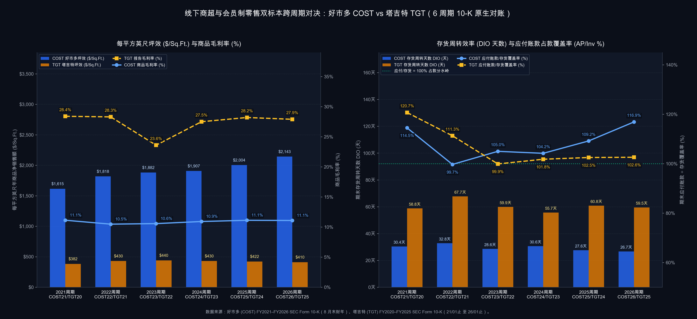

# 【行业指标 14】线下商超与会员制零售：同店量价、空间坪效、毛销差与存货周转（好市多 COST 与 塔吉特 TGT）

> **专栏定位：** 全行业 10-K/10-Q 财报解剖与特异性指标图谱  
> **解剖标的：** 好市多 (COST) 主轴穿透 ＋ 塔吉特 (TGT) 镜像对照  
> **核心指标：** 同店量价与全渠道 (SSSG)、空间坪效与单店产出 (Sales/Sq.Ft. & AUV)、非商品其他收入占比、毛销差纪律 (GM − SG&A)、存货周转与占款覆盖 (DIO & AP/Inv)  
> **审计基准：** SEC EDGAR Form 10-K 审计底稿 (CIK: 0000909832 / 0000027419)

> **摘要：** 提炼线下商超与会员制零售 5 大通用指标（同店量价、坪效、非商品收入占比、毛销差、存货周转与占款），用好市多与塔吉特 6 周期 10-K 实战对账，看透刚需会员仓与综合百货商超在通胀退潮周期的盈利分水岭。

---

## 一、 线下商超与会员制零售核心指标深度解剖

跨出高毛利的硬件制造与软件订阅赛道，我们来到商业史上历史最悠久、竞争也最白热化的红海领域——**线下商超与会员制零售（Mass, General Merchandise & Warehouse Club Retail）** 。在传统投资者的刻板印象里，无论是卖生鲜日百的连锁大卖场、精选大包装的仓储会员店，还是兼营服饰家居的综合百货商超，营业利润率普遍徘徊在 **`3% ~ 6%`** 的薄利区间，看起来是一门毫无性感度可言的“搬运工苦生意”。然而，同一赛道里既有穿越半个世纪周期持续滚雪球的现金流巨兽，也有在通胀退潮与库存过剩冲击下利润腰斩的连锁巨头。

为什么表面都在开大店卖货，财务命运却截然不同？原因在于线下零售业底层的一组刚性物理约束： **卖场的土地房租、水电冷链、门店折旧与一线人工每天都在刚性支出，而商品一旦过季或滞销就会迅速丧失价值** 。因此，无论采用何种细分商业模式，审阅线下商超财报都必须围绕五个全行业普适的特异性指标展开穿透诊断：一查**同店可比销售增速与客流/客单拆解**，辨别老店真实进店需求是在扩张还是萎缩；二查**每平方英尺坪效与单店年均销售额**，衡量物理货架空间的现金产出极限并排查内部开店蚕食；三查**非商品其他收入占比与利润贡献**，看清除了卖货之外，企业是否拥有高毛利增值收入池兜底；四查**商品毛利率与 SG&A 费用率剪刀差（毛销差）**，验证卖货赚到的毛利能否稳稳覆盖刚性门店费用；五查**存货周转天数与应付账款占款覆盖率**，监测滞销减值暗门以及无息占用供应商货款的现金流飞轮。

| 分析维度 | 行业专属特异性指标 | 买方核心考核焦点 |
| :--- | :--- | :--- |
| **内生需求与全渠道动能** | **同店可比销售增速与客流/客单拆解 (Comparable Sales: Traffic vs. Ticket & Digital %)** | 剥离新开门店、油价与汇率干扰，核查进店交易频次是否增长及门店前置履约占比 |
| **物理空间变现效率** | **每平方英尺坪效与单店年均销售额 (Sales per Sq.Ft. & AUV)** | 量化每平方英尺营业面积与单座卖场的年现金产出，排查扩店导致的内部客流分流 |
| **第二高毛利利润池** | **非商品其他收入占比与利润贡献 (Non-Merchandise Revenue & Profit Mix %)** | 检验会员年费、零售广告、联名信用卡分成、平台佣金等非卖货收入对营收与营业利润的贡献度 |
| **主业盈利安全垫** | **商品毛利率与 SG&A 费用率剪刀差 (Gross Margin vs. SG&A Spread)** | 跨越不同商品结构与毛利水平，审计前端商品加价率与后端门店刚性费率的匹配利差韧性 |
| **周转效率与无息杠杆** | **存货周转天数与应付账款占款覆盖率 (DIO, AP/Inventory % & CCC)** | 监控滞销库存减值爆发前兆，核查应付账款是否足以无息覆盖全部库存 |

---

### 指标 1：同店可比销售增速与客流/客单拆解 (Comparable Sales Growth: Traffic vs. Ticket & Digital Mix %)

靠不断借债或融资开新店，即便老店客流早已悄然流失，报表上的总营收依然可以维持表面增长。因此，剔除新开店开业不满一年（通常按 12 至 13 个月口径）以及关店影响的**同店可比销售增速（Comparable Sales Growth，简称 Comp Sales 或 SSSG）**，才是检验零售品牌内生生命力的第一道关卡：

`(1 ＋ 同店可比销售增速 SSSG) ＝ (1 ＋ 同店交易客流增速 ΔTraffic) × (1 ＋ 同店平均客单价增速 ΔTicket)`

审阅同店数据时，专业买方必须做 **两层穿透** ：
* **量（客流频次）与价（客单金额）的真实权重：** 最健康的增长是同店增速维持在 **`+5%`** 以上且**交易客流增速贡献 ≥ `+2% ~ +3%`** ，表明消费者正在更高频地走进门店或线上下单。反之，若表观同店仅 `+1% ~ +3%` 且完全靠通胀提价撑起客单价、进店客流已出现负增长，甚至客流连续跌破 **`-2%`** 拖累同店转负，说明门店性价比吸引力或商品企划力已经显著滑坡；
* **剔除日历、燃油与汇率噪音并跟踪数字化全渠道占比：** 零售财报常每五至六年出现一次 **53 周财年** （额外多出一周营业收入与费用会阶段性推高表观总营收增速并压低年末周转天数），审阅时须先确认 `Comparable Sales` 是否已按等长 52 周可比口径对齐；同时须对照**剔除燃油价格与外币汇率波动后的核心同店增速**，避免油价暴涨暴跌制造虚假繁荣或衰退，并跟踪依托现有门店网络完成网上下单、到店自提或当日直配的**数字化全渠道销售额占比（Digital Mix %）**，核查线上增长是正在反哺线下老店坪效，还是以牺牲高毛利、增加高昂尾程配送成本为代价在“左手倒右手”。

---

### 指标 2：每平方英尺坪效与单店年均销售额 (Sales per Square Foot & AUV)

线下零售本质上是重资产租用或购置商业地产空间，在货架上陈列商品并把周边社区客流转化为现金吞吐量。营业面积一旦落成，房租、物业折旧、冷链空调电费与基础理货人力均属刚性固定开销，单位物理空间的产出越高，单件商品分摊的固定成本就越低：

`单店年均销售额 (AUV) ＝ 全年商品净销售额 ÷ 期末(或平均)运营门店数`  
`每平方英尺坪效 (Sales / Sq.Ft.) ＝ 全年商品净销售额 ÷ 期末运营总营业面积 (Sq.Ft.)`

在不同商超业态间，坪效呈现显著的阶梯分层：全品类综合大卖场与大型超市的优秀坪效门槛通常在 **`600 美元/平方英尺`** 以上，常规区间大致落在 **`400 ~ 600 美元/平方英尺`** ；而高度精简 SKU 数量、采用仓储大包装与高周转日用刚需爆品打法的精选仓储业态，顶级标杆的坪效可达 **`1,500 美元/平方英尺`** 以上、单店年产出（AUV）突破 **`2.0 亿美元`** 。买方在跟踪拓店战略时，务必将新开门店数与综合坪效及单店 AUV 联立比对——如果门店数量在扩张，但全公司综合坪效跌破 **`400 美元/平方英尺`** 或连续两年以上持续滑坡，往往意味新店正在内部蚕食老店客流，或是单店对高毛利可选消费品的动销能力已严重受损。

---

### 指标 3：非商品其他收入占比与利润贡献 (Non-Merchandise Revenue & Profit Mix %)

许多投资者看零售财报时，默认整张损益表都是“低毛利卖货赚辛苦钱”。但实际上，**“除了直接买卖商品之外，还有没有其他收入、能占多少比例”**，往往决定了一家商超的估值天花板与抗衰退能力。在大型商超和仓储零售体系中，常见的**非商品其他收入（Non-Merchandise / Other Revenue）**主要涵盖四大形态： **前端预收的会员年费、向品牌商收取的站内外零售媒体广告费、联名信用卡利润分成，以及第三方平台佣金与门店内专柜租金** 。

`非商品其他收入占总营收比 (%) ＝ 非商品其他收入 ÷ 营业总收入 × 100%`  
`非商品其他收入营业利润贡献比 (%) ＝ 非商品其他收入 ÷ 合并营业利润 × 100%`

这笔收入之所以具备极其恐怖的财务杠杆，是因为它依托于现有卖场客流与线上流量自然衍生， **几乎不消耗额外的商品采购成本（增量毛利率高达 `70% ~ 100%` ）** 。哪怕非商品其他收入只占总营收的 **`2%`** 左右，放到原本只有 `4% ~ 5%` 营业利润率的商超损益表里，往往就能直接贡献 **`30% ~ 50%` 甚至更高的合并营业利润**！审阅年报时，买方既要横向对比各零售商的非商品收入体量、增速与营业利润占比（优秀标的通常营收占比 ≥ **`2%`** 且利润贡献 ≥ **`30%`** ；若有会员订阅体系，则须核查年度续费率 ≥ **`90%`** ），也要看透不同非商品收入的周期纯度：先收现金的会员年费与刚需流量广告具备极强抗周期韧性，而高度绑定消费信贷或可选品类预算的信用卡分成及传统促销摊位费，在宏观下行期仍可能面临萎缩压力。

---

### 指标 4：商品毛利率与 SG&A 费用率剪刀差 (Gross Margin vs. SG&A Expense Spread)

不同商业形态的商品结构千差万别， **脱离费用率单独对比毛利率是零售财报分析的最大陷阱** 。专攻四五千个高频刚需大单品、托盘直接上架的精选仓储店，商品毛利率只有 `10% ~ 15%` ，而涵盖数万至十几万个 SKU、包含高毛利服饰美妆与家居百货且提供精细陈列服务的综合大商超，商品毛利率常年高达 `25% ~ 30%` 。双方之所以都能活得好好的，核心秘密在于**毛销差（商品毛利率减去 SG&A 运营费用率）**是否足以形成稳定的盈利安全垫：

`毛销差 (Spread，百分点) ＝ 商品毛利率 (%) − SG&A 营业费用率 (%)`

这个看似简单的差值，实则是检验零售企业商业模式能否闭环的终极试金石：
* **低毛利＋极简低费率模式：** 将毛利率严控在 **`15%`** 以下主动让利锁客，必须同步凭借托盘陈列、低广告投放与精简 SKU 把 `SG&A` 费率死死压在 **`10%`** 以内，保住 **`+1.5%` 以上**的商品毛销差（商品卖货本身微利打平，高毛利非商品收入全额沉淀为纯利）；
* **较高毛利＋精细高费率模式：** 因门店陈列复杂度高、人力理货与全渠道分拣配送成本高昂，`SG&A` 费率通常维持在 **`20%`** 上下，因此其毛利率必须守稳在 **`25%` 以上**、维持至少 **`+5.0%`** 的毛销差厚度，才能在扣除各项刚性开支后留出合理的营业利润。

跨企横比毛销差时，专业买方还必须做两项会计口径校正：一是查清 **全渠道履约与供应链物流费用（Fulfillment & Supply Chain）** 究竟计入营业成本（COGS）还是 `SG&A`，以及门店铺租/房产折旧是否被单列在 `SG&A` 之外（常占营收 `2% ~ 3%` ）；二是核对损益表顶行毛利分母是否已混入高毛利的非商品其他收入，避免因分类口径不同错判真实盈利中枢。

一旦在财报中看到某家商超因可选品滞销被迫大幅打折清库，导致毛利率骤降、`SG&A` 费用率又因人工通胀与客流下滑出现反向刚性抬升，使毛销差在单年内急剧收窄 **`3 个百分点`以上**，盈利便会立刻遭遇戴维斯双杀。

---

### 指标 5：存货周转天数与应付账款占款覆盖率 (DIO, AP/Inventory % & Cash Conversion Cycle)

对于净利率仅几个百分点的线下零售商来说，**库存卖得够不够快、能不能无息占用上游供应商的货款**，直接决定了公司是自己造血的印钞机，还是被滞销货物拖垮现金流的脆弱资产：

`存货周转天数 (DIO) ＝ (期末存货 ÷ 全年销售成本 COGS) × 365`  
`应付账款周转天数 (DPO) ＝ (期末应付账款 ÷ 全年销售成本 COGS) × 365`  
`应付账款对存货覆盖率 (%) ＝ 期末应付账款 ÷ 期末存货 × 100%`  
`现金循环周期 (CCC) ＝ 存货周转天数 (DIO) ＋ 应收账款周转天数 (DSO) − 应付账款周转天数 (DPO)`

在顶级商超的资产负债表上，通常同时满足两项极其苛刻的硬约束： **`DIO` 压低至 `40 天` 以内** （高周转刚需仓甚至压至 `30 天` 下方），以及**期末应付账款对期末存货覆盖率 ≥ `100%`** （即 `DPO ≥ DIO`）。由于零售终端几乎现款或信用卡几日内即刻结算（`DSO` 极短），只要货物卖完收现的速度快于向供应商支付货款的账期，公司就能持续产生 **负营运资本（Negative Working Capital）** ：新开门店不仅不需要额外掏出自有流动资金铺货，反而能靠新增的应付占款净赚一笔免息资金。

相反，这是所有零售投资者必须牢记的 **头号排雷信号** ：如果一家以服装、家居、消费电子等季节性可选百货为主的商超，出现 **期末存货同比增速跑赢当期营收增速 `10 个百分点` 以上、存货周转天数突破 `60 天` 大关** ，同时**应付账款对存货覆盖率跌破 `100%`** ——这意味着货已经卖不动且供应商开始收紧账期或停止补货，接下来几乎必然触发惨烈的打折甩卖与毛利率暴跌。

---

## 二、 线下商超与会员制零售核心特异性指标全景速查对照表

| 指标名称 | 标准计量符号 | 买方核心考核焦点 | 行业优秀基准线 (Benchmark) | 危险预警与破位阈值 | 官方财报与 SEC 取数出处 |
| :--- | :--- | :--- | :--- | :--- | :--- |
| **1. 同店可比销售增速与量价拆解** | SSSG (Traffic vs Ticket) & Digital % | 剔除开店、油价及汇率干扰，验证进店客流贡献与门店前置全渠道增量 | 同店增速 ≥ **`+5%`** ，交易客流增速 ≥ **`+2% ~ +3%`** （客流贡献过半），全渠道占比持续抬升 | 同店增速 < **`0%`** ，或交易客流连续下滑（≤ **`-2%`** ）靠提价硬撑 | 10-K/10-Q MD&A「Comparable Sales」与收入渠道拆分附注 |
| **2. 每平方英尺坪效与单店产出** | Sales / Sq.Ft. & AUV | 评估单位物理卖场面积现金产出与单店体量，排查内部扩店分流 | 仓储会员模式 ≥ **`1,500 美元/平方英尺`** （单店 ≥ **`2.0 亿美元`** ）；综合大卖场 ≥ **`600 美元/平方英尺`** | 综合坪效 < **`400 美元/平方英尺`** ，或总店数扩张同时单店产出与坪效连续两年下滑 | Item 2 Properties（期末营业面积、门店数）÷ 损益表商品净销售额 |
| **3. 非商品其他收入占比与利润贡献** | Non-Merch Rev % & OpInc Mix % | 检验除了买卖商品差价之外的高毛利衍生收入（会费/广告/联名卡/佣金）厚度 | 非商品收入占总营收 ≥ **`2%`** ，对营业利润贡献 ≥ **`30%`** （若有会员费则续费率 ≥ **`90%`** ） | 非商品收入占总营收 < **`1%`** 纯靠差价维生，或原有高毛利广告/联名卡/会费持续萎缩 | 合并损益表与 Note「Revenues / Net Sales」拆分附注及 MD&A |
| **4. 商品毛利率与 SG&A 毛销差纪律** | Gross Margin − SG&A % Spread | 跨越业态结构差异，检验前端毛利对门店刚性费用的覆盖安全垫 | 仓储毛利 ≤ **`15%`** 配 `SG&A` ≤ **`10%`** （毛销差 ≥ **`+1.5%`** ）；综合卖场毛利 ≥ **`25%`** 配 `SG&A` ≤ **`20%`** （毛销差 ≥ **`+5%`** ） | 滞销清库或人力通胀导致毛销差较常态骤降 ≥ **`3%`** ，营业利润率跌破 **`3%`** | 合并损益表（Net Sales / COGS / SG&A）与 MD&A「Rate Analysis」 |
| **5. 存货周转与应付账款占款覆盖** | DIO, AP/Inventory % & CCC | 监测滞销打折减值危机与“先收款卖货、后结账付款”的无息杠杆飞轮 | `DIO` ≤ **`40 天`** （年周转 ≥ **`9 次`** ），应付对存货覆盖率 ≥ **`100%`** （`CCC` ≤ **`5 天`** 乃至为负） | `DIO` > **`60 天`** 且期末存货增速跑赢销售 ≥ **`+10%`** ，应付对存货覆盖率跌破 **`90% ~ 100%`** | 合并资产负债表（期末存货、应付账款、应收款）与损益表（COGS） |

---

## 三、 标杆实例深度实战：好市多 (COST) 6 周期全景原生财报解剖 (FY2021 ~ FY2026)

要理解线下商超行业如何用最极简、反人性的方式跑通上述五大指标，全球最佳的一号原生标本就是纯正精选仓储会员龙头——**好市多（Costco Wholesale Corporation, NASDAQ: COST，SEC CIK: 0000909832）** 。好市多的财年截止每年 8 月底最接近 8 月 31 日的周日（其中 FY2023 为 53 周财年，其余五年均为 52 周财年）。从 FY2021 到 FY2026 的六年周期里，好市多完整穿越了美国高通胀消费洪峰、2023 年海运拥堵消退后的耐用消费品去库低谷、以及 2024 年 9 月起正式落地的美加地区七年来首次会员年费上调，在 **FY2026** 创下营业总收入 **`3,031.5 亿美元`** 、商品净销售额 **`2,972.5 亿美元`** 、营业利润 **`116.9 亿美元`** 的历史纪录。

以下底表数据 100% 源自好市多提交至美国证监会（SEC）的 Form 10-K 官方审计年报：

### 好市多 (Costco, COST) 6 周期核心财务与经营对账底表 (单位：百万美元 $M，特殊标注除外)

| 核心财务与经营科目 | FY2021 (21/08 止) | FY2022 (22/08 止) | FY2023 (23/09 止·53周) | FY2024 (24/09 止) | FY2025 (25/08 止) | FY2026 (26/08 止) | 穿透勾稽结论与买方视角 |
| :--- | :---: | :---: | :---: | :---: | :---: | :---: | :--- |
| **宏观与行业创新周期** | **居家刺激高增期 线上占比跃升** | **高通胀滞胀考验 汽油杂货强拉动** | **耐用百货去库期 核心同店仍稳健** | **消费分化复苏期 会员提价落地前** | **会费上调元年 客流频次强扩张** | **总营收破 3,000 亿 高阶会员过半** | 横跨通胀脉冲、行业去库与会员提价的纯仓储零售标本 |
| **营业总收入 (Total Revenue)** | **195,929** | **226,954** | **242,290** | **254,453** | **275,235** | **303,154** | 五年复合增速 **`9.1%`** ，FY2026 正式迈入三千亿美元俱乐部 |
| *　↳ 内含：商品净销售额 (Net Sales)* | 192,052 | 222,730 | 237,710 | 249,625 | 269,912 | **297,247** | 商品净销售 YoY：`+17.7%` → `+16.0%` → `+6.7%` → `+5.0%` → `+8.1%` → **`+10.1%`** |
| *　↳ 内含：非商品其他收入 (会员费)* | **3,877** | **4,224** | **4,580** | **4,828** | **5,323** | **5,907** | **【对应指标 3】** 占总营收稳定在 **`1.86% ~ 1.98%`** ，FY26 同比高增 **`+11.0%`** |
| **同店可比销售增速 (表观 / 剔除油汇 %)** | **+16% / +13%** | **+14% / +11%** | **+3% / +5%** | **+5% / +6%** | **+6% / +8%** | **+8% / +7%** | **【对应指标 1】内生客流强韧：** FY25 客流 `+5%` / 客单 `+1%` ；FY26 客流 `+3%` / 客单 `+5%` 、数字化同店增 **`+21%`** |
| **期末全球营业门店数 (家)** | **815** | **838** | **861** | **890** | **914** | **939** | 每年稳健净增 `23 ~ 29` 家仓店；FY26 末美国 `647` 家、加拿大 `115` 家、其他国际 `177` 家 |
| **期末总营业面积 (百万平方英尺)** | 118.9 | 122.5 | 126.3 | 130.9 | 134.7 | **138.7** | 单仓平均营业面积约 `14.8 万平方英尺` ，自有土地房产比例高达 `80.4%` |
| **单仓年均商品销售额 AUV (百万美元/家)** | **235.6** | **265.8** | **276.1** | **280.5** | **295.3** | **316.6** | **【对应指标 2】** 商品净销售 ÷ 期末门店数，五年单仓年产出扩张 `+34.4%` |
| **每平方英尺商品坪效 (美元/平方英尺)** | **1,615** | **1,818** | **1,882** | **1,907** | **2,004** | **2,143** | **【对应指标 2】** 行业极值标杆，连续两年稳站 **`2,000 美元`** 上方 |
| **商品销售成本 (COGS)** | 170,684 | 199,382 | 212,586 | 222,358 | 239,886 | **264,279** | 采购议价权随单品规模持续向下挤压成本 |
| **商品毛利率 (占 Net Sales %)** | **11.13%** | **10.48%** | **10.57%** | **10.92%** | **11.12%** | **11.09%** | **【对应指标 4】严苛加价上限：** 六年商品毛利率锁死在 `10.48% ~ 11.13%` 窄幅区间 |
| **SG&A 费用及费率 (占 Net Sales %)** | **18,537 (9.65%)** | **19,779 (8.88%)** | **21,590 (9.08%)** | **22,810 (9.14%)** | **24,966 (9.25%)** | **27,190 (9.15%)** | **【对应指标 4】** 门店及总部折旧已全部计入 SG&A/成本内，仍死守一成以下 |
| **商品毛销差 (毛利率 − SG&A 费率)** | **+1.48pp** | **+1.60pp** | **+1.49pp** | **+1.78pp** | **+1.87pp** | **+1.94pp** | **【对应指标 4】** 卖货本身刻意只留不足 `2 个百分点` 微利（FY26 商品营业利仅 `5,778M` ） |
| **营业利润 (Operating Income) 及利润率** | **6,708 (3.42%)** | **7,793 (3.43%)** | **8,114 (3.35%)** | **9,285 (3.65%)** | **10,383 (3.77%)** | **11,685 (3.85%)** | 合并营业利润率占总营收稳步从 `3.42%` 爬坡至 **`3.85%`** （归母净利增至 **`9,233M`** ） |
| **非商品会员费占营业利润 / 归母净利比 (%)** | **57.8% / 77.4%** | **54.2% / 72.3%** | **56.4% / 72.8%** | **52.0% / 65.5%** | **51.3% / 65.7%** | **50.6% / 64.0%** | **【对应指标 3】** 不足 `2%` 的非商品收入贡献逾半营业利润；期末递延会费蓄水达 **`3,006M`** |
| *　↳ 内含：付费会员总数 / 黑钻会员占比* | 61.7 / 41.5% | 65.8 / 44.2% | 71.0 / 45.5% | 76.2 / 46.5% | 81.0 / 47.8% | **84.1 / 50.3%** | 单位：百万户；美加续费率六年稳守 **`91.0% ~ 93.0%`** （FY26 为 **`92.3%`** ），黑钻贡献 `75.2%` 销售额 |
| **期末存货 / 期末应付账款** | 14,215 / 16,278 | 17,907 / 17,848 | 16,651 / 17,483 | 18,647 / 19,421 | 18,116 / 19,783 | **19,324 / 22,591** | **【对应指标 5】** 应付对存货覆盖率 **`114.5% → 99.7% → 105.0% → 104.2% → 109.2% → 116.9%`** |
| **存货 DIO / 应付 DPO / 现金周期 CCC (天)** | **30.4 / 34.8 / -1.1** | **32.8 / 32.7 / +3.7** | **28.6 / 30.0 / +2.0** | **30.6 / 31.9 / +2.6** | **27.6 / 30.1 / +1.7** | **26.7 / 31.2 / +0.3** | **【对应指标 5】** FY26 周转提速至 **`26.7 天`** （年转 **13.7 次** ），DPO 比 DIO 长 `4.5 天` |
| **经营现金流 OCF / 资本开支 CapEx / FCF** | 8,958 / 3,588 / **5,370** | 7,392 / 3,891 / **3,501** | 11,068 / 4,323 / **6,745** | 11,339 / 4,710 / **6,629** | 13,335 / 5,498 / **7,837** | **15,817 / 6,435 / 9,382** | FY26 末账面广义现金 `21,301M` 、总债务 `6,162M` ，手握 **`151.4 亿美元`** 净现金 |

---

### 核心看点 ①：4,000 个精选 SKU 与仓储托盘陈列，如何把 SG&A 费用率压进 9.2% 跑出 2,143 美元坪效？

好市多最反直觉的第一重护城河不在营销，而在对运营复杂度的极致裁剪。普通综合大卖场动辄管理上十万个 SKU，而好市多在 10-K 中明确披露，单座核心仓库仅保留 **约 `4,000 个` 活跃 SKU** （并搭配占比超 `11%` 的高频平价加油站与自营品牌 **Kirkland Signature** 引流）。这种极简货架直接催生出双重运营杠杆：买手把采购预算集中在四千个大单品上获取全产业链底价，商品在供应商处直接打好整托盘、运抵门店后叉车直推上通道售卖，省去拆箱分拣、精美货架陈列与导购人工，把含全额门店折旧在内的 `SG&A` 费用率死死按在 **`9.15%`** 地板上；极简高频选品叠加周转速度，顺势将单仓年产值与单位空间坪效推升至 **`3.17 亿美元`** 与 **`2,143 美元/平方英尺`** 的行业天花板。

### 核心看点 ②：商品毛利率死锁 11.1%、毛销差仅留 1.94pp —— 为什么占营收不足 2% 的会员费能扛起半壁利润？

压低费用率后，好市多并未趁机提高加价率赚暴利，而是人为设立了最冷酷的定价上限——**连续六年将纯商品毛利率锁定在 `10.48% ~ 11.13%` 窄幅区间**，卖货本身的商品毛销差刻意只留 **`+1.94 个百分点`** （FY2026），把全部采购议价红利退还给会员。真正沉淀为公司核心利润的，是那笔仅占总营收 **`1.95%`** 、却几乎零边际成本的 **年度会员费收入** （稳定贡献全公司逾 **`50%` 的营业利润** ）。当 2024 年 9 月起好市多七年来首次上调美加会费时，由于超过半数付费会员持有享 `2%` 返现的黑钻卡（贡献逾七成五全球销售额），客户在货架让利与返现中获得的收益远超年费涨幅，美加续费率依然稳守 **`92.3%`** 高位，驱动会费收入连续两年保持双位数扩张。

### 核心看点 ③：26.7 天极速周转与 116.9% 应付覆盖率 —— 重资产直营买地如何跑出 151 亿美元净现金？

好市多并未因坚持重资产自持物业（939 家仓店中 **`80.4%`** 拥有完全自有土地与房产、每年投入数十亿美元资本开支）而背上沉重债务，反而沉淀出 **`151.4 亿美元` 账面净现金** 。核心奥秘全在 **指标 5** 的负营运资本飞轮：凭借四千个高频刚需大单品，好市多在 FY2026 末将存货周转天数进一步压缩至 **`26.7 天`** （全年存货周转近 14 轮），而**应付账款对存货覆盖率高达 `116.9%`** ——货早已卖出变现，给供应商的货款却还没到期。再叠加年末 **`30.1 亿美元` 的预收递延会员费现金流**，好市多等于同时拿着上游无息占款与会员预付年费全款购地扩仓，驱动自由现金流一路攀升。

---

## 四、 标杆实例镜像对照：塔吉特 (TGT) 全品类百货大商超的周期大考与镜像分裂

如果说好市多把“四千个刚需 SKU ＋ 会员年费订阅”推向了极致，那么北美另一家极具代表性的纯直营大型综合商超巨头——**塔吉特（Target Corporation, NYSE: TGT，SEC CIK: 0000027419）** ，则站在了商业光谱的另一端：塔吉特旗下没有任何会员仓储业态，全美 **`1,995 家`大型标准卖场（合计 `2.51 亿平方英尺`营业面积）** 陈列涵盖服装配饰（占 FY2025 商品销售 `15.3%` ）、家居装饰（`15.2%`）、消费电子硬百货（`15.4%`）、美妆个护（`12.9%`）以及食品日用必需品（合计 `41.0%`）的全品类矩阵，是一面检验**“传统全品类大商超 vs 精选刚需会员仓”**在通胀退潮周期孰强孰弱的绝佳显微镜。

*注：塔吉特财年截止每年 1 月末或 2 月初最接近 1 月 31 日的周六，10-K 官方命名为 FY2020 [21/01 止] ~ FY2025 [26/01 止]（与好市多 FY2021 ~ FY2026 恰好覆盖同一公历经营年度周期）。此外，自 FY2024 10-K 起，塔吉特将顶行收入重整为单行 `Net Sales`（将 `Other Revenue` 并入分母后，FY2023 起报告毛利率天然包含非商品高毛利贡献，并伴随 `9,200 万美元` 成本与费用重分类），下表严格遵循最新经审计 10-K 口径横向对账：*

### 1. 零售双雄 6 周期原生数据横向对照底表（COST vs TGT）

| 核心对比科目 | 标的 | FY21 / TGT20 (21/08 · 21/01止) | FY22 / TGT21 (22/08 · 22/01止) | FY23 / TGT22 (23/09 · 23/01止) | FY24 / TGT23 (24/09 · 24/02止) | FY25 / TGT24 (25/08 · 25/02止) | FY26 / TGT25 (26/08 · 26/01止) | 穿透勾稽结论与买方视角 |
| :--- | :--- | :---: | :---: | :---: | :---: | :---: | :---: | :--- |
| **营业总收入 (百万美元)** *(括号内为商品净销售额)* | **COST** TGT | **195,929 (192,052)** 93,561 (92,400) | **226,954 (222,730)** 106,005 (104,611) | **242,290 (237,710)** 109,120 (107,588) | **254,453 (249,625)** 107,412 (105,803) | **275,235 (269,912)** 106,566 (104,820) | **303,154 (297,247)** **104,780 (102,717)** | **顶行剪刀差彻底拉开：** COST 五年营收复合增速 **`9.1%`** ，而 TGT 在冲上 `1,091 亿` 后连续三年回落至 **`1,048 亿`** （五年 CAGR 仅 `2.3%` ） |
| **非商品其他收入 (百万美元)** *(占总营收 % / 占营业利润 %)* | **COST** TGT | **3,877 (1.98% / 57.8%)** 1,161 (1.24% / 17.8%) | **4,224 (1.86% / 54.2%)** 1,394 (1.32% / 15.6%) | **4,580 (1.89% / 56.4%)** 1,532 (1.40% / 39.8%) | **4,828 (1.90% / 52.0%)** 1,609 (1.50% / 28.2%) | **5,323 (1.93% / 51.3%)** 1,746 (1.64% / 31.4%) | **5,907 (1.95% / 50.6%)** **2,063 (1.97% / 40.3%)** | **【对应指标 3】惊人同步的 `1.95% ~ 1.97%` 占比：** TGT 靠 `Roundel` 广告三年大增 `75%` 至 `915M` ＋信用卡分成 `522M` ＋平台杂项 `626M` 托住四成营业利润 |
| **同店可比销售增速 (%)** *(客流 / 客单拆解)* | **COST** TGT | **+16%** *(核心+13%)* +19.3% *(量+3.7/价+15.0)* | **+14%** *(核心+11%)* +12.7% *(量+12.3/价+0.4)* | **+3%** *(核心+5%)* +2.2% *(量+2.1/价+0.1)* | **+5%** *(核心+6%)* -3.7% *(量-2.4/价-1.4)* | **+6%** *(量+5/价+1)* +0.1% *(量+1.4/价-1.3)* | **+8%** *(量+3/价+5)* **-2.6%** *(量-2.2/价-0.4)* | **【对应指标 1】需求红绿灯分叉：** COST 六年同店全数稳健正增；TGT 近三年有两年客流/同店双负，FY25 客流降 `-2.2%` |
| **数字化全渠道销售占比 (%)** *(及数字化同店增速)* | **COST** TGT | 约 7% **17.9%** *(+144.7%)* | 温和巩固 **18.9%** *(+20.8%)* | 阶段微调 **18.6%** *(+1.5%)* | 线上稳步恢复 **18.3%** *(-4.8%)* | 连续双位数增 **19.6%** *(+7.5%)* | 约 **11%** *(同店+21%)* **20.6%** *(+3.1%)* | **【对应指标 1】门店前置履约底座：** TGT 数字化占比逾两成（绝大多数由线下大店当日自提与配送完成履约），但难掩门店原生同店 `-4.0%` 的拖累 |
| **期末门店数 (家)** *(及总营业面积百万平方英尺)* | **COST** TGT | **815 (118.9M)** 1,897 (241.6M) | **838 (122.5M)** 1,926 (243.3M) | **861 (126.3M)** 1,948 (244.6M) | **890 (130.9M)** 1,956 (245.9M) | **914 (134.7M)** 1,978 (248.3M) | **939 (138.7M)** **1,995 (250.5M)** | 双方均高比例自有物业（COST `80.4%` 、TGT 含租地自建 `85.6%` ）；TGT 门店规模约为 COST 的 `2.1 倍` 、面积为 `1.8 倍` |
| **单店年均商品销售额 AUV (百万美元/家)** | **COST** TGT | **235.6** 48.7 | **265.8** 54.3 | **276.1** 55.2 | **280.5** 54.1 | **295.3** 53.0 | **316.6** **51.5** | **【对应指标 2】`6.1 倍`单店产值差：** COST 单仓年卖 `3.17 亿` 持续上攻；TGT 单店 `AUV` 连续三年自 `55.2M` 倒退至 `51.5M` |
| **每平方英尺商品坪效 (美元/平方英尺)** | **COST** TGT | **1,615** 382 | **1,818** 430 | **1,882** 440 | **1,907** 430 | **2,004** 422 | **2,143** **410** | **【对应指标 2】`5.2 倍`空间变现差距：** TGT 坪效自 `440 美元` 三连降至 `410 美元` 逼近 `400` 警戒线（按总营收计为 `418 美元` ） |
| **10-K 报告毛利率 (Gross Margin %)** | **COST** TGT | **11.13%** 28.4% | **10.48%** 28.3% | **10.57%** 23.6% | **10.92%** 27.5% | **11.12%** 28.2% | **11.09%** **27.9%** | **【对应指标 4】口径提示：** TGT 自 FY23 起并入非商品收入至顶行（最新纯商品毛利率估算约 **`26.5%`** ），且含供应链与店发履约成本 |
| **10-K 报告 SG&A 费用率 (%)** | **COST** TGT | **9.65%** 19.9% | **8.88%** 18.6% | **9.08%** 18.9% | **9.14%** 20.0% | **9.25%** 20.6% | **9.15%** **20.6%** | **【对应指标 4】** TGT 因营收连续萎缩叠加人力成本，SG&A 较低点反弹 `2.0pp` （另单列 **`2.5%`** 折旧摊销；FY25 经调整为 `20.9%` ） |
| **商品毛销差 (GM% − SG&A%)** | **COST** TGT | **+1.48pp** +8.5pp | **+1.60pp** +9.7pp | **+1.49pp** +4.7pp | **+1.78pp** +7.5pp | **+1.87pp** +7.6pp | **+1.94pp** **+7.3pp** | **【对应指标 4】** TGT 的 `27.9%` 报告毛利仅够扣完 `20.6%` SG&A 与 `2.5%` 折旧，最终核心营业利润率仅略高 COST 约 `0.8 个百分点` |
| **营业利润 ($M) 及利润率 (%)** | **COST** TGT | **6,708 (3.42%)** 6,539 (7.0%) | **7,793 (3.43%)** 8,946 (8.4%) | **8,114 (3.35%)** 3,848 (3.5%) | **9,285 (3.65%)** 5,707 (5.3%) | **10,383 (3.77%)** 5,566 (5.2%) | **11,685 (3.85%)** **5,117 (4.9%)** | **利润体量逆转：** COST 达 `116.9 亿` 反超 TGT（`51.2 亿` ）逾两倍；TGT 最新 GAAP `4.9%` 含一次性诉讼和解利得（经调整仅 **`4.6%`** ） |
| **存货周转天数 DIO / 应付 DPO (天)** | **COST** TGT | **30.4 / 34.8** 58.8 / 70.9 | **32.8 / 32.7** 67.7 / 75.4 | **28.6 / 30.0** 59.9 / 59.9 | **30.6 / 31.9** 55.7 / 56.7 | **27.6 / 30.1** 60.8 / 62.3 | **26.7 / 31.2** **59.5 / 61.0** | **【对应指标 5】周转两倍速差：** COST 始终稳居 `27 ~ 33 天` ；TGT 在 `22/01止` 存货 `DIO` 飙上 **`67.7 天`** 红线，近期仍贴近 `60 天` |
| **应付账款对存货覆盖率 (AP / Inventory %)** | **COST** TGT | **114.5%** 120.7% | **99.7%** 111.3% | **105.0%** 99.9% | **104.2%** 101.8% | **109.2%** 102.5% | **116.9%** **102.6%** | **【对应指标 5】** COST 占款盈余稳扩至 **`116.9%`** ；TGT 在去库阵痛期跌破 `100%` 至 `99.9%` ，随后仅勉强守在 `102%` 边缘 |
| **自由现金流 FCF ($M) & 净现金/(净债务)** | **COST** TGT | **5,370** *(+4,684)* 7,876 *(-4,169)* | **3,501** *(+4,492)* 5,081 *(-7,809)* | **6,745** *(+8,776)* -1,510 *(-13,910)* | **6,629** *(+5,247)* 3,815 *(-12,233)* | **7,837** *(+9,496)* 4,476 *(-11,178)* | **9,382** *(+15,139)* **2,835** *(-10,968)* | COST 稳守 `151 亿美元` 净现金；TGT 在 `23/01` 止因库存打折 FCF 崩为 **`-15.1 亿`** ，背负近 `110 亿美元` 净债务（不含租赁） |

---

### 2. 核心走势对比图：COST vs TGT 跨周期指标走势对决

> **图表买方核心解读：**  
> 左图直观呈现 5 倍空间效率鸿沟：COST 凭 `11.1%` 极简毛利跑出 **2,143 美元** 坪效，而 TGT 虽握 `27.9%` 毛利，坪效却三连降至 **410 美元** ；右图记录 TGT 在 `DIO` 冲上 **67.7 天** 并伴随占款覆盖跌破 `100%` 后的周期教训。

---

### 3. 关键差异归因与买方深度复盘

#### 关键差异 ①：刚需高频会员仓 vs 可选百货大商超 —— 为什么同店客流分化出 5 倍坪效与逾两倍营业利润鸿沟？

把双方的品类结构与经营曲线放在一起，高下瞬间分明：
* **高频刚需筑底 vs 可选消费顺周期敞口：** 塔吉特是一座不折不扣的“美学日用百货＋时尚平价卖场”，**服装配饰、家居装饰、消费电子等非刚性可选品类合计占其商品销售额的 `45.9%`** （食品饮料仅占 `23.5%` ）。在 2020~2021 年居家财政刺激期，消费者疯狂抢购家居与服饰，将塔吉特单店年产值一度推上 `5,520 万美元` 、营业利润狂飙至 `89.5 亿美元`（盈利曾一度大幅领先同期的好市多！）；但随着高通胀退潮后家庭预算向房租和刚需杂货收缩，塔吉特在最近三个财年里有两年出现进店客流与同店增速双双转负（最新财年同店 **`-2.6%`** 、进店客流 **`-2.2%`** ），导致总营业面积虽缓慢增至 `2.51 亿平方英尺` ，**单位坪效却连续三年从 `440 美元` 滑落至 `410 美元`** ——这正是“规模微增、效率退坡”的典型警示信号；
* **4,000 个爆品 SKU 形成“抗通胀飞轮”：** 恰恰相反，家庭在手头越紧的时候，越需要去购买生鲜杂货、纸品日化与平价汽油的大包装刚需仓囤货，推动好市多即使在消费降级期依然稳守 **`+3% ~ +8%`** 的内生正同店，并在坪效上与塔吉特拉开了 **`2,143` vs `410 美元/平方英尺` 的 `5.2 倍` 空间鸿沟** 。

#### 关键差异 ②：11.1% vs 27.9% 毛销差结构 —— 同样占营收约 1.95% 的非商品收入，为什么含金量截然不同？

这张对照表还揭开了一个极其隐蔽却致命的买方误区：**在最新一个完整财年里，好市多的非商品收入（会员费）占总营收比重为 `1.95%`（`59.07 亿美元`），塔吉特的非商品其他收入占总营收比重竟也高达 `1.97%`（`20.63 亿美元`），且分别贡献了双方 `50.6%` 与 `40.3%` 的合并营业利润！** 数字比例看上去高度接近，背后的商业含金量却有云泥之别：
* **结构差异一：会计口径剥离与毛销差厚度的根本目的不同：** 塔吉特最新财年报告的 **`27.9%`** 毛利率实际上已将 `20.6 亿美元` 非商品收入并入顶行（若剥离非商品部分还原纯商品毛利率仅为约 **`26.5%`** ），且把门店铺前拣货与出库物流履约成本计入营业成本；即便如此，这笔高毛利仍必须用来消化高达 **`20.6%` 的 `SG&A` 费用率与单列在损益表中的 `2.5%` 折旧摊销费用** 。更关键的是，塔吉特看似 `4.9%` 的 GAAP 营业利润率实则受益于一笔 **`5.93 亿美元` 的信用卡交换费诉讼和解一次性净收益** （与 `2.50 亿美元` 转型重组及减值费用轧差后直接垫高利润率 `0.3 个百分点` ），剔除该非经常性利得后的核心经调整营业利润率仅为 **`4.6%`** ——也就是说，扣除全盘运营成本后，卖高毛利百货的塔吉特最终只比极简仓储的好市多（`3.85%`）多赚不足 `0.8 个百分点` ！
* **结构差异二：非商品利润池的周期弹性天壤之别：** 好市多的 `59.1 亿美元` 会员年费是年初先收钱、续费率逾 `92%` 的订阅制年金；而塔吉特 `20.6 亿美元` 的非商品收入结构虽然有高速增长的 **`Roundel` 零售媒体广告（三年暴增 `+75.3%` 至 `9.15 亿美元`，成为管理层全力打造的第二利润引擎）**，但也包含了 **`5.22 亿美元` 持续萎缩的联名信用卡利润分成（较 FY2022 峰值 `7.34 亿美元` 下滑近三成）**——在消费信心走弱与信贷坏账率抬升周期，信用卡分成的下滑部分对冲了广告增长，无法像前置预收会员费那样形成铁板一块的抗周期护城河。

#### 关键差异 ③：27 天 vs 60 天存货周转 —— 复盘 TGT FY2021–FY2022 库存风暴的买方排雷铁证

如果读者想检验 **指标 5（存货周转与应付占款覆盖率）** 到底能不能提前预警业绩暴雷，塔吉特在 2022 至 2023 年初的 10-K 轨迹堪称华尔街载入教科书的“事前排雷标准案”：
* **红灯提前一年拉响：** 在截至 2022 年 1 月底的 FY2021 财报（对照表第 2 列）中，表面上看塔吉特风光无限——营收冲破千亿美元、营业利润高达 `89.5 亿美元`（净利润近 `70 亿美元`）。但如果此时运用 **指标 5** 翻看资产负债表，两盏刺眼的红灯已经同步闪烁： **期末存货同比暴增 `+30.5%` 至 `139.0 亿美元`（远超营收增速），存货周转天数 `DIO` 骤然恶化飙升至 `67.7 天`（远超 `60 天` 排雷红线！）** ；
* **次年直接爆雷崩盘：** 仅仅一年后的 FY2022（截至 2023 年 1 月末，第 3 列），随着海运堆积的服装与小家电集中到港叠加消费退坡，塔吉特被迫大幅取消采购订单并全国清仓大甩卖，直接将 **合并毛利率单年击穿 `4.7 个百分点`（`28.3%` 暴跌至 `23.6%`）、应付对存货覆盖率跌破 `100%` 至 `99.9%` 、营业利润腰斩 `-57.0%` 崩落至 `38.5 亿美元`、叠加高达 `55.3 亿美元` 的门店翻新与供应链资本开支，导致自由现金流由正 `50.8 亿` 惨烈转负为 `-15.1 亿美元`** ，账面净债务从此被永久推上 **`110 亿美元`** 以上的高台。反观同期的好市多，哪怕面对相同的海运拥堵，存货周转天数始终死控在 `26.7 ~ 32.8 天` 区间、快速腾挪 SKU 躲过了价格踩踏，再次用冰冷的资产负债表验证了零售业的第一铁律—— **高周转不是为了好看，而是为了在周期急刹车时能全身而退** 。

---

## 五、 实战对账自查表：买方机构 5 步穿透线下商超与会员制零售财报排查卡

在审阅任何一家线下商超、综合大卖场或仓储会员零售企业的 10-K 与 10-Q 财报时，建议严格按照以下 5 步依次穿透核查，并用红黄绿灯框架定位经营体质：

1. **第一步：翻到 MD&A「Comparable Sales」与收入分部附注，拆解“同店量价构成、日历对齐与全渠道渗透”（对应指标 1）**  
   核对同店销售增速中**交易客流（Traffic / Transactions）**与**平均客单（Average Ticket）**的各自贡献，剥离 53 周财年日历错位、燃油价格与汇率变动噪音；同时核查由门店前置自提或配送完成的数字化全渠道销售占比及增速。
2. **第二步：联立 Item 2 Properties 与损益表商品净销售额，核算“每平方英尺坪效与单店产出”（对应指标 2）**  
   提取期末运营门店总数与净零售营业平方英尺面积（剔除仓库配送中心与办公面积），计算 `Sales / Sq.Ft.` 与 `AUV` 的连续五至六年变动方向，排查总面积扩张背后是否隐藏单店效率连续下滑。
3. **第三步：穿透损益表顶行拆分附注（Revenues / Net Sales Note），审计“非商品其他收入占比与纯度”（对应指标 3）**  
   将会员年费、零售媒体广告、联名信用卡利润分成、第三方平台佣金与专柜租赁等非商品收入单独剥离加总，核算其占总营收与合并营业利润的比例，并逐项辨别各项非商品收入在宏观下行期的稳定性（续费率或信贷坏账敏感度）。
4. **第四步：用「Rate Analysis」与费用分类附注还原“商品毛利率与 SG&A 费率毛销差”（对应指标 4）**  
   核对企业属于低毛利低费率业态还是高毛利高费率业态，计算 `Gross Margin − SG&A` 毛销差稳态；在跨公司横向对比时，务必查清 Notes 中三项潜在差异——**非商品收入是否并入毛利率分母、全渠道履约物流计入成本还是 `SG&A` 、以及折旧摊销是否单列在 `SG&A` 之外**，同时排除诉讼和解等一次性非经常性损益干扰。
5. **第五步：用资产负债表期末存货与应付账款联立 COGS，监测“周转天数与占款覆盖红线”（对应指标 5）**  
   计算 `DIO`、`DPO` 与 `AP / 存货覆盖率`，并用**期末存货同比增速减去当期销售额同比增速**——一旦出现高增速剪刀差、`DIO` 突破高危阈值且应付覆盖率跌破基准线，立刻高度警惕即将到来的打折减值风暴。

### 线下商超与会员制零售买方核查指示灯

| 核查维度 | 🟢 绿灯安全区 (优秀标杆) | 🟡 黄灯观察区 (稳健常规) | 🔴 红灯排雷区 (高危预警) |
| :--- | :--- | :--- | :--- |
| **1. 同店量价与全渠道** | 同店增速 ≥ **`+5%`** ，交易客流增速 ≥ **`+2% ~ +3%`** （客流贡献过半），全渠道占比稳步抬升 | 同店增速 **`+1% ~ +4%`** ，客流基本走平（`0% ~ +1%`），靠温和消费升级或通胀拉动 | 同店增速 < **`0%`** ，或交易客流连续下滑（≤ **`-2%`** ）且靠提价硬撑 |
| **2. 坪效与单店体量** | 仓储会员模式 ≥ **`1,500 美元/平方英尺`** （单店 ≥ **`2.0 亿美元`** ）；综合大卖场 ≥ **`600 美元/平方英尺`** | 综合坪效处于 **`400 ~ 600 美元/平方英尺`** （或仓储 **`1,000 ~ 1,500 美元`** ），单店产出大体稳定 | 综合坪效跌破 **`400 美元/平方英尺`** ，或扩店同时坪效与单店产出连续两年持续滑坡 |
| **3. 非商品其他收入** | 非商品收入占总营收 ≥ **`2%`** ，贡献营业利润 ≥ **`30%`** （若有会员订阅则续费率 ≥ **`90%`** ） | 非商品收入占总营收 **`1% ~ 2%`** ，贡献营业利润 **`15% ~ 30%`** | 非商品收入占总营收 < **`1%`** 纯靠差价维生，或原有高毛利广告/联名卡/会费连续两年萎缩 |
| **4. 毛利率与 SG&A 毛销差** | 仓储毛利 ≤ **`15%`** 配 `SG&A` ≤ **`10%`** （毛销差 ≥ **`+1.5%`** ）；综合卖场毛利 ≥ **`25%`** 配 `SG&A` ≤ **`20%`** （毛销差 ≥ **`+5%`** ） | 毛利率或费率小幅波动，毛销差较五年均值收窄 **`1% ~ 2%`** ，营业利润率仍守住 ≥ **`3.5%`** | 滞销清库或人工通胀挤压毛销差单年骤降 ≥ **`3%`** ，营业利润率跌破 **`3%`** |
| **5. 存货周转与占款飞轮** | `DIO` ≤ **`40 天`** （年转 ≥ **`9 次`** ），应付对存货覆盖率 ≥ **`100%`** （`CCC` ≤ **`5 天`** 乃至为负） | `DIO` 处于 **`40 ~ 60 天`** ，应付对存货覆盖率 **`90% ~ 100%`** 且存货增速与营收大体同步 | `DIO` > **`60 天`** 且期末存货增速显著高于营收增速 ≥ **`+10%`** ，应付对存货覆盖率跌破 **`90% ~ 100%`** |

---

## 六、 本讲买方总结与下讲预告

> **买方终极心法**  
> 审阅线下商超财报，必须盯紧五把硬标尺：同店靠客流，坪效防蚕食，非商品收入看纯度，毛销差守安全垫，严防 `DIO` 破 `60 天` 引发清库失血。

---

### 下讲预告：【行业指标 15】连锁餐饮与特许经营帝国：直营四壁模型、体系流水与商业地租抽成（麦当劳 MCD 与 奇波雷 CMG）

在拆解了靠低价大包装与全品类陈列比拼“空间坪效、毛销差与负营运资本”的 **线下商超与会员制零售（好市多与塔吉特）** 后，下一讲我们将把显微镜推向大消费版图中单店面积更紧凑、却把商业模式分裂推向极致的高频赛道—— **【连锁餐饮与特许经营帝国】！**

为什么有的餐饮巨头把自己变成了向加盟商收取品牌特许使用费与商业地租抽成的“轻资产商业地产收租平台”，而有的品牌坚持百分百直营、自己扛着牛肉牛油果与一线厨师通胀，照样把单店四壁盈利与自由现金流推向极致？在下一讲中，我们将派出全球特许加盟帝国鼻祖**麦当劳（McDonald's, MCD.US）**正面迎战全直营单店印钞机器**奇波雷（Chipotle Mexican Grill, CMG.US）**，为您深度解剖**同店量价与数字渠道拆解**、**单店年产出与净开店扩张力（AUV & Net Unit Growth）**、**直营四壁营业利润率与首要成本（RLOM & Prime Cost）**以及**特许体系流水、双轨抽成率与总部体系杠杆（Systemwide Sales, Take Rate & G&A/Systemwide）**，带您看透跨国餐饮帝国把每一份快餐变成永续现金流的底层财务秘密，敬请期待！
