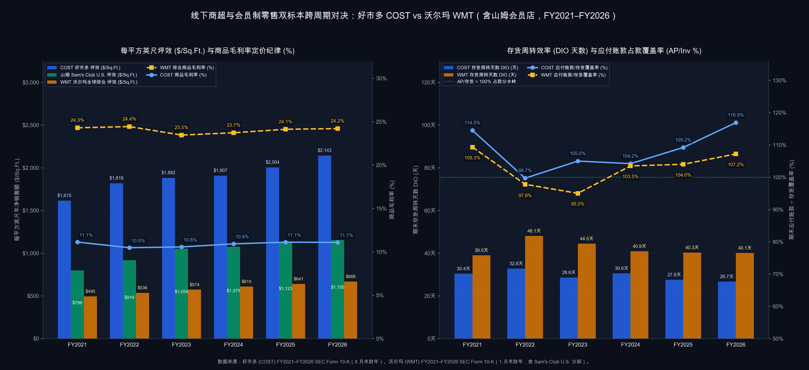

# 【行业指标 14】线下商超与会员制零售：同店量价、坪效、会员费飞轮与负营运资本（好市多 COST 与 沃尔玛 WMT）

> **专栏定位：** 全行业 10-K/10-Q 财报解剖与特异性指标图谱  
> **解剖标的：** 好市多 (COST) 主轴穿透 ＋ 沃尔玛 (WMT，含山姆会员店) 镜像对照  
> **核心指标：** 同店量价与全渠道 (SSSG)、坪效与单店产出 (Sales/Sq.Ft. & AUV)、毛利纪律与会员/广告生态、存货与负营运资本 (DIO/AP)、SG&A 费率与 FCF  
> **审计基准：** SEC EDGAR Form 10-K 审计底稿 (CIK: 0000909832 / 0000104169)

> **摘要：** 拆解线下商超与会员制零售 5 大核心指标（同店量价、坪效、毛利纪律与会员费/广告、负营运资本周转、SG&A 控盘与 FCF），结合好市多与沃尔玛（含山姆）FY21-FY26 官方 10-K 实战对账，揭开平价零售穿越周期的盈利密码。

---

## 一、 线下商超与会员制零售核心指标深度解剖

跨出高毛利的硅基算力世界，我们来到商业史上最残酷、竞争壁垒也最反直觉的红海赛道——**线下商超与会员制零售（Mass & Warehouse Club Retail）** 。在大多数投资者的第一印象里，卖柴米油盐、生鲜百货和日用消费品的超市几乎没有技术壁垒，综合毛利率长期只有 `10% ~ 25%` ，营业利润率往往贴着 `3% ~ 4%` 的地板爬行。然而，恰恰是在这条看似“赚辛苦钱”的苦生意赛道上，却诞生了穿越半个世纪通胀、衰退与电商冲击的超级长牛与自由现金流巨兽。

为什么同为大卖场和仓储店，有的连锁零售商在通胀退潮、可选消费降温时被堆积如山的打折库存直接拖垮，而顶级的连锁巨头却能在维持低加价率的同时源源不断产生百亿美元现金流？核心秘密在于零售业底层的一对核心物理矛盾——**“极薄前端零售价差”与“极致后端规模周转”的精密平衡** 。由于房租、冷链、折旧与门店人工属于高度刚性的物理开销，线下商超想要盈利，要么依靠高频刚需客流拉高单位货架空间的现金产值（坪效），要么把主营利润池从货架商品本身迁移到前端会员年费或高毛利生态增值服务，再凭借极快的存货变现速度无息占用上游供应商账款，实现“不花自己的钱扩张新店”。

因此，在买方机构审阅任何一家线下商超与会员制零售企业的 10-K 与 10-Q 财报时，绝不能只盯着表观营收增速和门店扩张数量，而必须沿五个相互扣合的特异性维度展开穿透式审计：一是拆解**同店可比销售增速（SSSG）的客流与客单价结构及全渠道渗透**，辨别内生真实需求与单纯通胀提价；二是核算**每平方英尺坪效与单店年均销售额（Sales/Sq.Ft. & AUV）**，检验物理空间的现金变现极值与新店内部蚕食风险；三是穿透**商品毛利率定价纪律与高毛利非商品收入占比**，看清企业是把“低加价率”当作护城河，还是靠会员年费与零售媒体广告重构第二利润曲线；四是联立**存货周转天数（DIO）、应付账款覆盖率与现金循环周期（CCC）**，验证负营运资本飞轮是否安全转动；五是审视**SG&A 刚性费率控盘、投入资本回报率（ROIC）与自由现金流自给率**，检验人工履约通胀下门店造血的真实含金量。

| 分析维度 | 行业专属特异性指标 | 买方核心考核焦点 |
| :--- | :--- | :--- |
| **内生客流与全渠道动能** | **同店可比销售增速与客流/客单拆解 (SSSG: Traffic vs Ticket & Digital Mix %)** | 剥离新开门店与油价汇率噪音，验证进店交易频次是否贡献主要增长及门店前置履约效率 |
| **空间资产产出极值** | **每平方英尺坪效与单店年均销售额 (Sales per Sq.Ft. & AUV)** | 量化每平方英尺营业面积与单座卖场的年现金产值，排查激进开店对老店的客流分流 |
| **定价纪律与生态利润池** | **商品毛利率与高毛利非商品收入占比 (Gross Margin & Membership / Ad Mix %)** | 检验主动让利锁客的加价上限纪律，核算会员费及零售媒体广告对营业利润的兜底占比 |
| **周转速度与无息杠杆** | **存货周转天数、应付覆盖率与现金循环周期 (DIO, AP/Inv & CCC)** | 监控呆滞可选品积压与被动打折减值风险，验证卖货回款快于向供应商付款的造血飞轮 |
| **费率韧性与资本复利** | **SG&A 费率、投入资本回报率与现金流转化 (SG&A %, ROIC & OCF / CapEx)** | 检验员工薪酬及电商尾程配送对毛利的侵蚀程度，核算资本开支后剩余自由现金流质量 |

---

### 指标 1：同店可比销售增速与客流/客单量价拆解 (SSSG: Traffic vs Ticket & Digital Mix %)

总营收增长可以轻易通过大举新开门店或并购实现，甚至在老店客流不断流失的情况下依然制造出繁荣假象。因此，零售财报审计的第一把手术刀是**同店可比销售增速（Comparable Sales / Same-Store Sales Growth，简称 SSSG）**——仅统计开业满 12 个月以上的成熟门店（及对应全渠道订单）较上年同期的销售额变动：

`(1 ＋ 同店可比销售增速 SSSG) ＝ (1 ＋ 同店交易客流增速 ΔTraffic) × (1 ＋ 同店平均客单价增速 ΔTicket)`

然而，仅看表观 `SSSG` 依然不够。高水平买方必须同时做 **三重拆解** ：
* **拆解量（客流）与价（客单）的真实权重：** 同店增速达到 **`+5%`** 以上且**交易客流（Traffic / Shopping Frequency）增速贡献至少 `+2% ~ +3%`** 的零售商，说明高频刚需品类的性价比心智极其稳固，老顾客正在更频繁地走进门店或下单。相反，如果一家商超表观 `SSSG` 勉强维持 `+1% ~ +3%` ，但在管理层讨论（MD&A）中坦言“进店客流同比下滑 `-2%` 以上、全靠提价硬撑客单价”，说明底层客户正在无声流失，一旦消费力退坡或通胀回落，同店增速将立刻塌方；
* **剔除燃油与汇率波动及识别全渠道贡献：** 许多大型商超与仓储俱乐部附设加油站，高油价或低油价期往往会人为拉高或拉低表观 `SSSG` 达 `2 ~ 3 个百分点`，审阅时务必对照**剔除燃油价格与外币汇率变动后的核心同店增速（Core Comp Ex-Gas & FX）** ；同时跟踪**数字化全渠道（eCommerce / Store Pickup & Delivery）** 对同店增速的正向贡献占比——依托既有门店网络完成网上下单、到店自提或当日直配的混合履约模式，能够把固定实体资产二次变现，是传统商超抵御纯电商平台分流的核心防线。

---

### 指标 2：每平方英尺坪效与单店年均销售额 (Sales per Square Foot & AUV)

零售业本质上是租赁或购买昂贵商业地产空间，在货架与过道上陈列商品并向周边社区人口转化现金流的生意。单位空间产出越高，单店的房租、折旧、冷链电费和保洁等固定费用就被摊得越薄：

`单店年均销售额 (AUV) ＝ 全年商品净销售额 ÷ 报告期期末(或平均)运营门店数`  
`每平方英尺坪效 (Sales / Sq.Ft.) ＝ 全年商品净销售额 ÷ 期末运营总营业面积 (Sq.Ft.)`

在这组物理效率标尺中，不同业态呈现截然不同的数量级台阶：常规全品类大卖场与大型超市的优秀坪效门槛通常在 **`600 ~ 800 美元/平方英尺`** 之间；而高度精简 SKU、采用托盘整箱陈列与大包装周转的精选仓储会员店，顶级标杆可以冲上 **`1,500 ~ 2,000 美元/平方英尺`** 以上、单店年产值轻松突破 **`2.0 亿美元`** （相当于普通小型便利店百倍的现金吞吐量）。此外，买方在追踪新开门店扩张时，必须比对**新店爬坡速度与同商圈老店同店趋势**——如果总营收随开店同步增长，但全公司综合坪效连续两年低于 **`400 美元/平方英尺`** 或单店 `AUV` 持续下滑，则往往意味着陷入了“内部自我蚕食（Cannibalization）”的低效规模扩张陷阱。

---

### 指标 3：商品毛利率定价纪律与高毛利非商品收入占比 (Gross Margin Discipline & Membership / Retail Media Mix %)

在传统消费品或软件行业，买方习惯于把“毛利率越高越好”奉为圭臬；但在线下平价商超领域，**盲目追求高毛利率反而是慢性自杀** 。商超面对的是信息透明、价格极度敏感的高频家庭消费，一旦商品加价率偏离平价心智，客流与复购率就会迅速向更具性价比的竞争对手迁移。因此，零售巨头在过去几十年演化出两套截然不同却同样高度自律的盈利公式：

`商品毛利率 (%) ＝ (商品净销售额 − 商品销售成本 COGS) ÷ 商品净销售额 × 100%`  
`非商品生态利润贡献率 (%) ＝ (会员费收入 ＋ 零售媒体广告/平台服务等其他收入) ÷ 营业利润 × 100%`

* **路线 A（极简会员制仓储路线）：主动把商品毛利率死锁在 `15%` 以下（常见 `10% ~ 12%` ）** ——管理层人为设定毛利上限，赚到的采购议价红利全部反哺降价让利，故意只靠卖货勉强打平高昂的人力与物流运维费用；真正的纯利润则几乎完全来自 **前置预收、零边际成本的年度会员费** （优秀标杆的会员费对营业利润贡献率常年 ≥ **`50%`** ，核心成熟区域会员续费率 ≥ **`90%`** ）。这套模型不仅让盈利具备类似软件订阅的极高可预测性，还能随时通过小幅上调会员年费来对冲商品端让利；
* **路线 B（全品类综合大卖场路线）：在 `20% ~ 25%` 商品毛利率中枢构筑高毛利生态第二曲线**——因 SKU 数量庞大且涵盖服饰、家居、电子等长尾可选品，全品类卖场需要 **`20% ~ 25%`** 的商品毛利率才能覆盖复杂的物流分拣与门店运营费用。在此基础上，龙头大卖场近年来依靠庞大的线下客流与官网流量，叠加**全渠道付费会员**与毛利率高达 `70%` 以上的**零售媒体广告及第三方平台履约服务**，将非商品及生态高毛利收入的营业利润贡献拉升至 **`20%`** 以上，实现“商品平价引流、广告会员抽税”的盈利升级。反之，若一家商超既无付费会员护城河，又因丧失平价心智被迫频繁打折，导致毛利率在 **`15%`** 以下持续失血，或者盲目提价超过 **`25% ~ 30%`** 引发客流雪崩，均属危险预警。

---

### 指标 4：存货周转天数、应付账款占款与负现金循环周期 (DIO, DPO & Negative Cash Conversion Cycle)

对于毛利率仅 `11% ~ 24%` 的商超而言，**现金周转效率决定生死，库存积压则是头号杀手** 。想象一下：一家年销售额数千亿美元的大卖场，只要判断错消费趋势导致季节性百货滞销、存货周转慢上 `10 天`，不仅瞬间锁死上百亿美元现金流，随后的清仓甩卖减值更会直接吞噬全年营业利润。买方穿透资产负债表的四把核心标尺如下：

`存货周转天数 (DIO) ＝ (期末存货 ÷ 全年商品销售成本 COGS) × 365`  
`应付账款周转天数 (DPO) ＝ (期末应付账款 ÷ 全年商品销售成本 COGS) × 365`  
`应付对存货覆盖率 (%) ＝ 期末应付账款 ÷ 期末存货 × 100%`  
`现金循环周期 (CCC) ＝ 存货周转天数 (DIO) ＋ 应收账款周转天数 (DSO) − 应付账款周转天数 (DPO)`

顶级线下商超之所以拥有堪比银行的现金创造力，秘密就藏在 **`DIO ≤ 35 天`（一年存货周转超 `10 次` ）** 与 **`应付账款 ÷ 期末存货 ≥ 100%`（即 `DPO ≥ DIO`）** 构成的 **负营运资本（Negative Working Capital）飞轮** ：商超面向终端消费者几乎全部现款或刷卡即收（`DSO` 通常仅 `3 ~ 6 天`），商品从入库到被顾客装车买走只花了 `25 ~ 35 天` ；而凭借巨量集中采购话语权，零售巨头给上游供应商的账期通常达到 `30 ~ 45 天` 。也就是说，**货物早就变成真金白银躺进零售商账户里，给供应商的货款还没到期**！这种结构下，公司每新开一家店不仅不额外占用自有流动资金，反而能靠多出来的应付占款替公司融来免息资金。相反，一旦在财报中看到 **`DIO ≥ 50 ~ 60 天`** 且期末存货同比增速远高于净销售额增速、**应付对存货覆盖率跌破 `80% ~ 90%`** ，买方必须立刻警惕库存爆雷与随后的利润率下修。

---

### 指标 5：SG&A 刚性费率控盘与门店资本回报及现金自给 (SG&A Expense Leverage %, ROIC & FCF Conversion)

线下商超是全社会最庞大的人力与固定资产密集型行业之一，一线收银、理货、冷链维修、卡车运输与门店水电房产折旧构成极其沉重的 `SG&A`（营业、销售及管理费用）底盘：

`SG&A 费用率 (%) ＝ 营业、销售及行政管理费用 ÷ 商品净销售额 × 100%`  
`自由现金流 (FCF) ＝ 经营活动现金流净额 (OCF) − 资本开支 (CapEx)`

审阅线下零售巨头的盈利韧性与资本分配质量，需严盯三项核心约束：
* **用商品毛利率与 SG&A 费率的“绝对差额”校验商业模式健康度：** 极简精选仓储模式因为整箱托盘直接上架、不提供复杂陈列与过度导购，能将 `SG&A` 费率死死按在 **`10%`** 以内（使其即便只有 `11%` 的商品毛利，商品自身仍有 `1% ~ 2%` 的微利余地）；全品类大卖场与超市因管理上十万个 SKU 且承担了大量门店自提拣货及当日达物流成本，`SG&A` 费率通常维持在 **`20%`** 上下，二者一旦叠加各自的高毛利会员与服务收入，稳态营业利润率均可精准收敛于 **`3.5% ~ 4.5%`** 之间；
* **谨防高强度自动化与物流基建期吞噬 ROIC 与自由现金流：** 在全渠道零售转型期，商超每年需要砸下数十亿乃至上百亿美元用于供应链自动化仓库改造、门店翻新与新仓土地购置。优秀的经营主体必须保证投入资本回报率（ROIC / ROI ≥ **`15%`** ）以及经营现金流对资本开支的覆盖率（`OCF / CapEx` ≥ **`1.5 倍`** ），确保扩张与技术升级全额由内生经营现金流买单，而非举债烧钱。

---

## 二、 线下商超与会员制零售核心特异性指标全景速查对照表

| 指标名称 | 标准计量符号 | 买方核心考核焦点 | 行业优秀基准线 (Benchmark) | 危险预警与破位阈值 | 官方财报与 SEC 取数出处 |
| :--- | :--- | :--- | :--- | :--- | :--- |
| **1. 同店可比销售增速与量价拆解** | SSSG (Traffic vs Ticket) & Digital % | 剔除开店、油价及汇率干扰，验证进店客流贡献与门店前置全渠道增量 | 同店增速 ≥ **`+5%`** ，交易客流增速 ≥ **`+2% ~ +3%`** （客流贡献过半），全渠道占比持续抬升 | 同店增速 < **`0%`** ，或交易客流连续下滑（≤ **`-2%`** ）且靠激进提价勉强维系 | 10-K/10-Q MD&A「Comparable Sales」与收入拆分附注 |
| **2. 每平方英尺坪效与单店产出** | Sales / Sq.Ft. & AUV | 评估单位物理卖场面积现金产出与单店体量，排查内部扩店分流 | 仓储会员店 ≥ **`1,500 美元/平方英尺`** （单店 ≥ **`2.0 亿美元`** ）；大型综合商超 ≥ **`600 美元/平方英尺`** | 坪效 < **`400 美元/平方英尺`** ，或总店数扩张但单店产出及坪效连续两年倒退 | Item 2 Properties（年末营业面积、门店数）÷ 合并损益表净销售额 |
| **3. 毛利定价纪律与非商品收入占比** | Gross Margin % & Memb/Ad Mix % | 识别极简低加价护城河与全品类生态利润池转换效率 | 仓储会员路线：毛利率 ≤ **`15%`** 、续费率 ≥ **`90%`** 、会员费占营业利润 ≥ **`50%`** ；综合卖场：毛利率 **`20% ~ 25%`** 、非商品生态贡献利润 ≥ **`20%`** | 无会员壁垒陷入价格战导致毛利率跌破 **`15%`** ，或盲目提价 > **`25% ~ 30%`** 丧失客流 | 合并损益表（Net Sales / COGS / Membership & Other Income）及 MD&A 会员章节 |
| **4. 存货周转、应付占款与现金周期** | DIO, AP/Inventory % & CCC | 监测呆滞库存减值危机与“先收款卖货、后结账付款”的无息杠杆飞轮 | 存货周转天数 `DIO` ≤ **`35 天`** （年转 > **`10 次`** ），应付覆盖率 ≥ **`100%`** （`CCC` ≤ **`5 天`** 乃至为负） | `DIO` ≥ **`50 ~ 60 天`** 且存货增速显著跑赢销售增速，应付覆盖率跌破 **`70% ~ 80%`** | 合并资产负债表（期末存货、应付账款、应收账款）与合并损益表（COGS） |
| **5. SG&A 费率、资本回报与现金自给** | SG&A %, ROIC & OCF/CapEx | 穿透门店人工与全渠道履约费用杠杆，确认自动化改建与扩店不毁损股东现金流 | 仓储 `SG&A` ≤ **`10%`** （大卖场 ≤ **`20%`** ），`ROIC` ≥ **`15%`** ，且 `OCF / CapEx` ≥ **`1.5 倍`** | 人工与配送费失控压低营业利润率跌破 **`2.5%`** ，`ROIC` < **`10%`** 或 `FCF` 连续转负 | 合并损益表（SG&A、营业利润）、现金流量表（OCF/CapEx）及非 GAAP ROIC 调节表 |

---

## 三、 标杆实例深度实战：好市多 (COST) 6 周期全景原生财报解剖 (FY2021 ~ FY2026)

要理解线下零售业最极致、最反人性的商业壁垒，全美乃至全球只有一个最佳原生样本——**好市多（Costco Wholesale Corporation, NASDAQ: COST，SEC CIK: 0000909832）** 。好市多的财年结算于每年 8 月底最接近 8 月 31 日的周日（其中 FY2023 为 53 周财年，其余五年均为 52 周财年）。从 FY2021 到 FY2026 的六年完整跨度中，好市多依次穿越了 2021~2022 年美国消费刺激与高通胀洪峰、2023 年海运拥堵消退与耐用消费品去库低谷、2024 年 9 月起正式落地的美加地区七年来首次会员费上调，最终在 **FY2026** 创下营业总收入突破 **`3,031.5 亿美元`** 、商品净销售额逼近 **`3,000 亿美元`** 、自由现金流高达 **`93.8 亿美元`** 的历史新高！

以下底表所有财务与经营数据均 100% 源自好市多提交至美国证监会（SEC）的 FY2021 至 FY2026 官方 Form 10-K 审计年报原件：

### 好市多 (Costco, COST) 6 周期核心财务与经营对账底表 (单位：百万美元 $M，特殊标注除外)

| 核心财务与经营科目 | FY2021 (21/08 止) | FY2022 (22/08 止) | FY2023 (23/09 止·53周) | FY2024 (24/09 止) | FY2025 (25/08 止) | FY2026 (26/08 止) | 穿透勾稽结论与买方视角 |
| :--- | :---: | :---: | :---: | :---: | :---: | :---: | :--- |
| **宏观与行业通胀周期** | **居家刺激高增期 线上占比大跃升** | **四十年罕见通胀 汽油及杂货拉动** | **耐用百货去库期 核心同店仍稳健** | **消费韧性复苏期 会员费提价前夜** | **会员提价落地元年 客流频率强扩张** | **总营收首破 3,000 亿 黑钻会员占比过半** | 完整横跨高通胀、去库回调与会员费提价周期的纯直营仓标本 |
| **营业总收入 (Total Revenue)** | **195,929** | **226,954** | **242,290** | **254,453** | **275,235** | **303,154** | 五年复合增速达 `9.1%` ，FY2026 正式迈入三千亿美元俱乐部 |
| *　↳ 内含：商品净销售额 (Net Sales)* | 192,052 | 222,730 | 237,710 | 249,625 | 269,912 | **297,247** | 商品净销售 YoY：`+17.7%` → `+16.0%` → `+6.7%` → `+5.0%` → `+8.1%` → **`+10.1%`** |
| *　↳ 内含：年度会员费收入 (Membership Fees)* | **3,877** | **4,224** | **4,580** | **4,828** | **5,323** | **5,907** | **【对应指标 3】** 2024 年 9 月美加提价逐步按 12 个月摊销释放，FY26 会员费同比高增 **`+11.0%`** |
| **同店可比销售增速 (表观 / 剔除油汇 %)** | **+16% / +13%** | **+14% / +11%** | **+3% / +5%** | **+5% / +6%** | **+6% / +8%** | **+8% / +7%** | **【对应指标 1】极强内生客流韧性：** FY25 交易频次增 `+5%` 、客单 `+1%` ；FY26 频次增 `+3%` 、客单 `+5%` 、数字化同店增 **`+21%`** |
| **期末全球营业门店数 (家)** | **815** | **838** | **861** | **890** | **914** | **939** | 每年稳健净增 `23 ~ 29` 家仓店；FY26 末美国 `647` 家、加拿大 `115` 家、其他国际 `177` 家 |
| **期末总营业面积 (百万平方英尺)** | 118.9 | 122.5 | 126.3 | 130.9 | 134.7 | **138.7** | 单仓平均营业面积约 `14.8 万平方英尺` （约 `1.37 万平米` ），自有物业比例达 `80.4%` |
| **单仓年均净销售额 AUV (百万美元/家)** | **235.6** | **265.8** | **276.1** | **280.5** | **295.3** | **316.6** | **【对应指标 2】全球零售单店奇迹：** 净销售除以期末仓数计算，五年单仓体量扩张 `+34.4%` 突破 3.16 亿美元 |
| **每平方英尺坪效 (美元/平方英尺)** | **1,615** | **1,818** | **1,882** | **1,907** | **2,004** | **2,143** | **【对应指标 2】全球物理空间产值天花板：** 跨过 2,000 美元大关后仍在加速抬升 |
| **商品毛利 (Net Sales − COGS) 及毛利率** | **21,368 (11.13%)** | **23,348 (10.48%)** | **25,124 (10.57%)** | **27,267 (10.92%)** | **30,026 (11.12%)** | **32,968 (11.09%)** | **【对应指标 3】极度自律毛利红线：** 六年商品毛利率严控在 **`10.48% ~ 11.13%`** 的铁律窄幅区间 |
| **SG&A 营业费用及费率 (占商品净销售比)** | **18,537 (9.65%)** | **19,779 (8.88%)** | **21,590 (9.08%)** | **22,810 (9.14%)** | **24,966 (9.25%)** | **27,190 (9.15%)** | **【对应指标 5】低于一成的费用护城河：** 门店小时工薪资持续上调下，规模效应将费率稳守 `9.2%` 附近 |
| **营业利润 (Operating Income) 及利润率** | **6,708 (3.42%)** | **7,793 (3.43%)** | **8,114 (3.35%)** | **9,285 (3.65%)** | **10,383 (3.77%)** | **11,685 (3.85%)** | 营业利润按占总营收比重口径计算（占商品净销售比重分别为 `3.49% ~ 3.93%` ），盈利质量持续小步爬坡 |
| **会员费占营业利润 / 归母净利润比 (%)** | **57.8% / 77.4%** | **54.2% / 72.3%** | **56.4% / 72.8%** | **52.0% / 65.5%** | **51.3% / 65.7%** | **50.6% / 64.0%** | **【对应指标 3】过半利润来自零边际成本会费：** 归母净利从 50.1 亿增至 **92.3 亿美元** |
| **期末付费会员数 / 总持卡人 (百万人)** | **61.7 / 111.6** | **65.8 / 118.9** | **71.0 / 127.9** | **76.2 / 136.8** | **81.0 / 145.2** | **84.1 / 150.4** | 五年新增 `2,240 万` 付费会员；**递延会员费负债** 同步蓄水增至 **`3,006 百万美元`** |
| *　↳ 内含：黑钻付费会员数及占比* | 25.6 (41.5%) | 29.1 (44.2%) | 32.3 (45.5%) | 35.4 (46.5%) | 38.7 (47.8%) | **42.3 (50.3%)** | 高阶 `Executive` 会员历史性突破五成，贡献全球 **`75.2%`** 商品销售额 |
| **会员续费率 (美加 / 全球 %)** | **91.0% / 89.0%** | **93.0% / 90.0%** | **92.7% / 90.4%** | **92.9% / 90.5%** | **92.3% / 89.8%** | **92.3% / 89.8%** | **【对应指标 3】涨价零流失验证：** 提高会员费后美加续费率依然稳居 **`92.3%`** 巅峰 |
| **期末存货 / 期末应付账款** | 14,215 / 16,278 | 17,907 / 17,848 | 16,651 / 17,483 | 18,647 / 19,421 | 18,116 / 19,783 | **19,324 / 22,591** | 应付对存货覆盖率 **`114.5% → 99.7% → 105.0% → 104.2% → 109.2% → 116.9%`** |
| **存货 DIO / 应付 DPO / 现金周期 CCC (天)** | **30.4 / 34.8 / -1.1** | **32.8 / 32.7 / +3.7** | **28.6 / 30.0 / +2.0** | **30.6 / 31.9 / +2.6** | **27.6 / 30.1 / +1.7** | **26.7 / 31.2 / +0.3** | **【对应指标 4】** FY26 周转加速至 **`26.7 天`** （年转 **13.7 次** ），`DPO` 高出 `DIO` 整整 **`4.5 天`** |
| **经营现金流 OCF / 资本开支 CapEx** | 8,958 / 3,588 | 7,392 / 3,891 | 11,068 / 4,323 | 11,339 / 4,710 | 13,335 / 5,498 | **15,817 / 6,435** | **【对应指标 5】** `OCF / CapEx` 自给倍数稳定在 **`1.90x ~ 2.56x`** （FY26 达 **`2.46x`** ） |
| **自由现金流 FCF (及期末广义现金 / 总债务)** | **5,370** (12,175 / 7,491) | **3,501** (11,049 / 6,557) | **6,745** (15,234 / 6,458) | **6,629** (11,144 / 5,897) | **7,837** (15,284 / 5,788) | **9,382** (21,301 / 6,162) | **净现金城堡：** FY26 末账面现金及短投达 **213.0 亿美元** ，净现金高达 **151.4 亿美元** |

---

### 核心看点 ①：主动把商品毛利率锁在 11.1%，凭什么每年多赚 11% 的会员费“消费税”？

普通零售商每天都在发愁如何靠促销季涨价把毛利率从 25% 抠到 26%，好市多却在 10-K 中确立了一条令同行畏惧的铁律——**连续六年将商品毛利率死锁在 `10.48% ~ 11.13%` 之间（FY2026 为 `11.09%`）** 。将商品毛利 `329.7 亿美元` 减去门店及管理费用 `271.9 亿美元` 后，这头年卖将近三千亿美元货物的巨无霸，卖货本身仅赚取微薄的 **`57.8 亿美元`** 商品税前经营利润，折合每卖出 100 美元商品只留下不到 2 美元的商业净利。

好市多真正的印钞核心在紧挨着商品净销售额下方的那一行数字—— **`59.07 亿美元` 的年度会员费收入** （贡献全公司 `50.6%` 的营业利润与 `64.0%` 的归母净利润）！更精妙的是“黑钻卡（Executive Membership）”的消费粘性锁死机制：缴纳双倍会费（2024 年 9 月提价后美国黑钻卡年费由 `120 美元` 升至 **`130 美元`** ，普通金星卡由 `60 美元` 升至 **`65 美元`** ）即可获得每年最高 `1,250 美元` 封顶的 **`2%` 消费返现** 。一旦家庭年采购额迈过 3,250 美元的盈亏平衡线，高额返现就变成了“白赚会费还倒贴现金”。到 FY2026 末，好市多 **8,410 万付费会员中黑钻卡人数占比首次突破半数（`50.3%` ，达 `4,230 万人`），贡献了全球 `75.2%` 的商品销售额** 。正因消费者从低价货架与 2% 返现中获益远超会费成本，好市多在 2024 年 9 月实施七年来首次会员涨价后，不仅没有引发退卡潮，反而推动美加地区续费率在 FY2025 与 FY2026 连续稳定在 **`92.3%`** 的惊人高位，驱动会员费收入于 FY2025 与 FY2026 连续跳涨 **`+10.3%`** 与 **`+11.0%`** ！

---

### 核心看点 ②：4,000 个精选 SKU 如何跑出单仓 3.17 亿美元、坪效 2,143 美元的零售极限？

同样是卖日用品与食品杂货，为什么全美大卖场平均单店年营收大多徘徊在数千万美元，而好市多一家仓库一年就能卖出 **`3.17 亿美元`（每平方英尺产出高达 `2,143 美元`）**？秘密在于好市多把零售业的复杂度压到了人类极简主义的极限—— **极低 SKU 密度 ＋ 大单品十亿美元级直采 ＋ 仓店合一托盘陈列** ：

* **不足 4,000 个 SKU 的单品集中火力：** 好市多 10-K 明确披露，单座核心门店在售活跃商品种类（SKU）**严格控制在 `4,000 个以内`** ，而常规综合大卖场或超级市场通常陈列 `10 万至 14 万个 SKU`。这看似反常的“减少选择”，直接让好市多的单品采购规模放大了二三十倍——单一品类的采购额动辄以十亿甚至数十亿美元计，赋予买手砍向供应链底价的绝对谈判权，同时也顺理成章孵化出了年销售额占主导地位的自有品牌 **Kirkland Signature（科克兰）** ；
* **取消华丽货架与分拣人工的“仓储直摆”：** 商品在供应商处直接按好市多仓库尺寸打好整托盘，卡车运抵门店后叉车直接推上过道销售，省去了传统大卖场繁琐的拆箱理货、货架补货与过度导购人工；叠加有限营业时间与零大规模广告投放（主要依赖口碑及高性价比加油站引流，FY2026 末全球运营 `774 座` 加油站贡献了 `11%` 净销售额），直接将好市多的 **`SG&A` 费用率牢牢按死在 `9.15%` 的行业极限** 。

---

### 核心看点 ③：26.7 天极速周转与 116.9% 应付覆盖率 —— 不花自己的钱建仓扩张的负营运资本飞轮

在重资产直营模式中，好市多在 939 座门店中坚持**自有土地与建筑比例高达 `80.4%`（`755 座` 完全自有房产，另加 `136 座` 自有建筑租赁土地）** ，每年资本开支达 **`64.4 亿美元`** ，但它却从未被重资产压垮。翻开现金流量表与资产负债表（对应 **指标 4 & 5** ），原因一目了然：

1. **货卖出去了，供应商账款还没到期：** 在 FY2026 末，好市多账面期末存货仅为 `193.2 亿美元` ，对应全年 `2,642.8 亿美元` 的商品成本，**存货周转天数（DIO）再创新低至 `26.7 天`** （平均不到四周全店商品就彻头彻尾清空一轮！）；而同期期末应付账款却高达 **`225.9 亿美元`** ，**应付账款对存货覆盖率高达 `116.9%`（`DPO = 31.2 天` ，比存货周转天数整整多出 `4.5 天` ）** ！叠加零售客户刷卡几乎零账期，全公司综合现金循环周期 `CCC` 仅 **`+0.3 天`** （并在高动销年份呈现负值）；
2. **内生现金流的“自融资”闭环：** 哪怕撇开高达 `30.1 亿美元` 的年度递延会员费现金预收，单靠 `2.46 倍` 的 `OCF / CapEx` 覆盖倍数，好市多在全额现金买地自建 25 至 30 座新仓库后，依然在 FY2026 净落袋 **`93.8 亿美元` 自由现金流** ，把资产负债表上的广义现金蓄水池推升至 **`213.0 亿美元`** （净现金逾 **151 亿美元** ），有底气在不定期向股东派发巨额特别现金股息的同时保持零信用风险扩张。

---

## 四、 标杆实例镜像对照：沃尔玛 (WMT，含山姆会员店) 全品类巨无霸与仓储孪生对决

如果说好市多把“精选 4,000 SKU ＋ 纯会员费盈利”做到了单一赛道的宗教级极致，那么全球零售史上规模第一的商业帝国——**沃尔玛（Walmart Inc., NYSE: WMT，SEC CIK: 0000104169，财年截止每年 1 月 31 日）** ，则提供了一场绝无仅有的**“商业物种双重对照实验”** ：
1. **在全公司维度上：** 沃尔玛以全球 **`10,955 家`门店、超过 `10.57 亿平方英尺` 营业面积** 支撑起 **`7,131.6 亿美元` 总营收** （体量是好市多的 **`2.35 倍`** ），走的是 **`24%` 商品毛利率 ＋ 十二万级全品类高频便利 ＋ 门店前置千亿美元级全渠道电商与高毛利广告第二曲线** 的全覆盖路线；
2. **在分部孪生维度上：** 沃尔玛旗下拥有 **`601 家` 同款仓储会员俱乐部——山姆会员店（Sam's Club U.S.，FY2026 净销售 `930.2 亿美元`）** ！把山姆会员店美国分部的 10-K 数据与好市多放到同一张手术台上解剖，就能精准剥离“行业属性”与“运营效率”的真实差值。

### 1. 零售双雄 6 周期原生数据横向对照底表（COST vs WMT，含 Sam's Club 分部拆解）

| 核心对比科目 | 标的 | FY2021 | FY2022 | FY2023 | FY2024 | FY2025 | FY2026 | 穿透勾稽结论与买方视角 |
| :--- | :--- | :---: | :---: | :---: | :---: | :---: | :---: | :--- |
| **营业总收入 (百万美元)** *(括号内为商品净销售额 Net Sales)* | **COST** WMT | **195,929 (192,052)** 559,151 (555,233) | **226,954 (222,730)** 572,754 (567,762) | **242,290 (237,710)** 611,289 (605,881) | **254,453 (249,625)** 648,125 (642,637) | **275,235 (269,912)** 680,985 (674,538) | **303,154 (297,247)** **713,163 (706,413)** | **体量与增速剪刀差：** WMT 营收规模约为 COST 的 `2.35 倍` ；但 COST 近五年净销售年均复合增速（`9.1%`）跑赢 WMT（`4.9%`） |
| *　↳ WMT 分部拆分：山姆会员店 Sam's Club U.S. 净销售* | WMT (山姆) | 63,910 *(占 11.5%)* | 73,556 *(占 13.0%)* | 84,345 *(占 13.9%)* | 86,179 *(占 13.4%)* | 90,238 *(占 13.4%)* | **93,015** *(占 13.2%)* | 山姆美国区单飞体量已接近 COST 全球盘子的 **31%** ，五年增幅达 `+45.5%` （此外 WMT 美国区占 `68.4%` 、国际区占 `18.5%` ） |
| **核心同店可比销售增速 (%)** *(COST 全球含油/核心；WMT 美国超市/山姆含油)* | **COST** WMT | **+16% (+13%)** +8.7% / 山姆 +8.7% | **+14% (+11%)** +6.4% / 山姆 +15.0% | **+3% (+5%)** +7.0% / 山姆 +14.6% | **+5% (+6%)** +5.5% / 山姆 +2.3% | **+6% (+8%)** +4.8% / 山姆 +4.7% | **+8% (+7%)** **+4.3% / 山姆 +2.9%** | **【对应指标 1】** 双方均在低基数后保持正客流；FY26 山姆同店受油价下跌拖累 `1.9 个百分点` （剔除油价后核心实增 `+4.8%` ） |
| **全渠道/数字化电商销售额及占比** *(十亿美元 $B / 占 Net Sales %)* | **COST** WMT | 电商约 7% **64.9B (11.7%)** | 核心电商温和放缓 **73.2B (12.9%)** | 低谷微调 **82.1B (13.6%)** | 数字化增速回暖 **100.1B (15.6%)** | 数字化持续双位数 **120.9B (17.9%)** | 约 **32.7B (11%)** **150.4B (21.3%)** | **【对应指标 1】全渠道分野：** WMT 靠 4,600+ 美国门店前置仓将全球电商推至 **`1,504 亿美元`** （占比超两成，山姆自身电商达 **`150 亿美元`** 占 `16.1%` ） |
| **期末全球营业门店总数 (家)** *(及总营业面积百万平方英尺)* | **COST** WMT | **815 (118.9M)** 11,443 (1,121M) | **838 (122.5M)** 10,593 (1,060M) | **861 (126.3M)** 10,623 (1,056M) | **890 (130.9M)** 10,616 (1,053M) | **914 (134.7M)** 10,771 (1,053M) | **939 (138.7M)** **10,955 (1,057M)** | WMT FY22 剥离英日市场收缩重资产面积后转为以改造既有大店与门店前置履约为主；山姆美国长期稳守 `599 ~ 601 家`（`80.5M` 平方英尺） |
| **单店年均净销售额 AUV (百万美元/家)** *(括号内为：山姆美国单店 AUV)* | **COST** WMT | **235.6** 48.5 *(山姆 106.7)* | **265.8** 53.6 *(山姆 122.6)* | **276.1** 57.0 *(山姆 140.6)* | **280.5** 60.5 *(山姆 143.9)* | **295.3** 62.6 *(山姆 150.4)* | **316.6** **64.5** *(山姆 **154.8** )* | **【对应指标 2】单店吸金量差距：** 同为仓储俱乐部，COST 单仓年营收（`3.17 亿`）整整是山姆美国（`1.55 亿`）的 **`2.05 倍`** 、是 WMT 全球平均的 `4.9 倍` |
| **每平方英尺坪效 (美元/平方英尺)** *(括号内为：山姆美国坪效)* | **COST** WMT | **1,615** 495 *(山姆 799)* | **1,818** 536 *(山姆 919)* | **1,882** 574 *(山姆 1,054)* | **1,907** 610 *(山姆 1,075)* | **2,004** 641 *(山姆 1,123)* | **2,143** **668** *(山姆 **1,155** )* | **【对应指标 2】空间效率阶梯：** 沃尔玛 U.S. 本土大卖场 FY26 坪效为 `691` 美元，山姆跑出 `1,155` 美元，好市多登顶 `2,143` 美元 |
| **商品毛利率 (Gross Margin %)** *(占 Net Sales 比；括号内为山姆分部)* | **COST** WMT | **11.13%** 24.30% | **10.48%** 24.44% | **10.57%** 23.46% | **10.92%** 23.73% *(山姆 10.9%)* | **11.12%** 24.13% *(山姆 11.3%)* | **11.09%** **24.21%** *(山姆 **11.3%** )* | **【对应指标 3】高度趋同与路线分化：** 山姆美国商品毛利率同样锁定 `11.3%` ，与好市多 `11.1%` 几乎分毫不差；WMT 合并大盘因超级中心高毛利品类贡献维持 `24.2%` |
| **会员费及其他非商品收入 (百万美元)** *(及占合并营业利润比例 %)* | **COST** WMT | **3,877 (57.8%)** 3,918 (17.4%) | **4,224 (54.2%)** 4,992 (19.2%) | **4,580 (56.4%)** 5,408 (26.5%) | **4,828 (52.0%)** 5,488 (20.3%) | **5,323 (51.3%)** 6,447 (22.0%) | **5,907 (50.6%)** **6,750 (22.6%)** | **【对应指标 3】双曲线对账：** WMT 该行包含会费及租户租金/生态杂项（其中 FY26 纯全球会费 **`44 亿美元`** ，含山姆及 Walmart+）；COST 会费贡献过半营业利润 |
| **SG&A 费用率 (占 Net Sales %)** | **COST** WMT | **9.65%** 20.94% | **8.88%** 20.75% | **9.08%** 20.98% | **9.14%** 20.38% | **9.25%** 20.74% | **9.15%** **20.94%** | **【对应指标 5】11.8pp 费率鸿沟：** 恰好对冲商品端 `13.1pp` 的毛利率差，使两者无需激进提价即可同样健康存活 |
| **报告营业利润率 (占 Total Revenue %)** *(WMT 括号内为山姆分部占净销售 %)* | **COST** WMT | **3.42%** 4.03% *(山姆 3.0%)* | **3.43%** 4.53% *(山姆 3.1%)* | **3.35%** 3.34% *(山姆 2.3%)* | **3.65%** 4.17% *(山姆 2.5%)* | **3.77%** 4.31% *(山姆 2.7%)* | **3.85%** **4.18%** *(山姆 **2.6%** )* | **殊途同归的 4% 稳态规律：** FY23 WMT 因库存打折利润率跌破 `3.4%` ，随后靠高毛利广告、会员与全渠道优化重回 `4.2%` |
| **存货周转天数 DIO / 现金循环 CCC (天)** | **COST** WMT | **30.4 / -1.1** 39.0 / +0.6 | **32.8 / +3.7** 48.1 / +6.3 | **28.6 / +2.0** 44.5 / +7.0 | **30.6 / +2.6** 40.9 / +3.5 | **27.6 / +1.7** 40.3 / +3.8 | **26.7 / +0.3** **40.1 / +2.8** | **【对应指标 4】库存危机实录：** FY22 末 WMT 存货暴增 **`+25.7%`** 至 `565.1 亿美元` 、DIO 飙至 `48.1 天` ，被迫在 FY23 打折去库；COST 周转始终稳居 `27 ~ 33 天` |
| **应付账款对存货覆盖率 (AP / Inventory %)** | **COST** WMT | **114.5%** 109.3% | **99.7%** 97.8% | **105.0%** 95.0% | **104.2%** 103.5% | **109.2%** 104.0% | **116.9%** **107.2%** | **【对应指标 4】供应链占款强弱：** 双方在常态期均实现 `AP > Inventory` （占款超 `100%` ），FY26 COST 占款盈余优势扩大至 `+9.7pp` |
| **自由现金流 FCF ($M) & OCF/CapEx** | **COST** WMT | **5,370 (2.50x)** 25,810 (3.51x) | **3,501 (1.90x)** 11,075 (1.85x) | **6,745 (2.56x)** 11,984 (1.71x) | **6,629 (2.41x)** 15,120 (1.73x) | **7,837 (2.43x)** 12,660 (1.53x) | **9,382 (2.46x)** **14,923 (1.56x)** | **【对应指标 5】资本开支周期对比：** WMT 近年将 CapEx 翻倍拉升至 **`266.4 亿美元`** 投入供应链自动化与全渠道改建，`FCF` 守稳 `150 亿美元` 关口；同时 WMT 年报 `ROI` 达 **`15.1%`** |

---

### 2. 核心走势对比图：COST vs WMT（含山姆会员店）跨周期指标走势对决 (FY2021 ~ FY2026)

> **图表买方核心解读：**  
> 左图显示 COST 以 11.1% 毛利换取 **2,143 美元** 坪效，约达山姆（1,155）与 WMT（668）的 2 至 3 倍；右图显示 WMT 在 FY22 遭遇 DIO 冲高至 48.1 天后重返占款超 100% 安全区，COST 凭 26.7 天周转维持 **116.9%** 占款盈余。

---

### 3. 关键差异归因与买方深度复盘

#### 关键差异 ①：11.1% vs 24.2% 毛利率与 9.2% vs 20.9% 费用率剪刀差 —— 为什么截然相反的财务方程能汇聚在同一利润终点？

对于初次对比两家零售巨头财务报表的投资者，最令人震撼的莫过于这组镜像剪刀差：在 FY2026，好市多的商品毛利率只有 **`11.09%`** ，而沃尔玛高达 **`24.21%`** （高出 **`13.12 个百分点`** ）；但翻到费用栏，好市多的 `SG&A` 费用率仅 **`9.15%`** ，沃尔玛则高达 **`20.94%`** （高出 **`11.79 个百分点`** ）。一正一负相互抵消之后，两家商业模式看似南辕北辙的企业，最终合并营业利润率竟奇迹般地同时收敛于 **`3.85%`（COST）与 `4.18%`（WMT）** ！

理解这组财务恒等式，就真正读懂了零售业的两条护城河路线：
* **沃尔玛的“高覆盖便利成本 ＋ 庞大全渠道毛利补偿”：** 沃尔玛单靠美国本土就有 `3,566 家` 超级中心和 `694 家` 社区超市（平均营业面积 `17.8 万平方英尺` ），货架陈列多达上十万个 SKU，涵盖了高毛利的日用百货、服装家居与医药健康（合并毛利率维持 `24%` 以上），并且必须支付全天候冷链、庞大导购收银人员以及数千家门店“到店自提＋当日直配”的高额分拣人工成本，导致 `SG&A` 费率刚性停留在 `20% ~ 21%` 区间；
* **好市多的“极简降维费率 ＋ 商品保本让利换会费”：** 好市多把上十万个长尾 SKU 削减至 `4,000 个` 以内、用叉车托盘省去 90% 的人工理货与陈列成本，一举砍掉近 `12 个百分点` 的运营费率；再把节省下来的费率空间全部让渡给商品价格（主动只赚 `11%` 毛利），换来高黏性会员在前端贡献近 `60 亿美元` 零成本会员费。**两条公式没有绝对优劣，唯一的铁律是“商品毛利率必须稳稳覆盖 `SG&A` 费率或由高确定性非商品收入托底”——若像普通百货商超那样既扛着 `22%` 的高费用率、商品毛利率又在价格战中跌破 `20%` ，就是不可逆的破产前兆。**

#### 关键差异 ②：同门仓储孪生兄弟正面肉搏（Costco vs 山姆会员店 Sam's Club）—— 毛利率同为 11%，为什么单店产出整整差一倍？

许多消费投资者都好奇：沃尔玛旗下的**山姆会员店（Sam's Club）**与好市多同源同宗，同样采用“极简仓储陈列 ＋ `4,000` 级精选 SKU ＋ 双层会员年费”模式，两者的真实财报表现到底差在哪里？把沃尔玛 10-K 分部附注单独拆出来对账，答案精准而残酷：
* **商品定价纪律高度同源，但空间与单店吸金能力差整整一倍：** 从 FY2024 至 FY2026，山姆会员店美国分部的商品毛利率分别为 **`10.9%`、`11.3%` 与 `11.3%`** ，与好市多同期的 **`10.92%`、`11.12%` 与 `11.09%`** 几乎完全一致！然而，同样挂着大仓招牌、平均单店面积也相近（山姆美国均面积约 `13.4 万平方英尺` vs 好市多全球约 `14.8 万平方英尺` ），好市多在 FY2026 跑出了 **`3.17 亿美元` 单店年产出（AUV）** 与 **`2,143 美元/平方英尺` 坪效** ，而山姆美国仅分别为 **`1.55 亿美元` AUV 与 `1,155 美元/平方英尺`** ——好市多的单仓产出整整高出一倍（分部营业利润率方面，好市多全公司为 `3.85%` ，山姆美国分部占净销售为 `2.63%` ）；
* **差距成因与山姆的数字化反击：** 一方面源于好市多数十年的中高收入中产心智先发壁垒、更极致的大包装选品口碑与 `75%` 以上的黑钻消费渗透率；另一方面，山姆在北美门店数长期稳定在 `600 家`（通过 `Scan & Go` 移动端无排队扫码离店与强劲电商渗透将山姆线上销售拉升至 **`150 亿美元` [占比 `16.1%`]** ），同时凭借中国等国际市场在 Walmart International 体系下极快的前置云仓与“极速达”增长（推动沃尔玛中国区年销售额在 FY2026 跳升 `+23.3%` 至 **`246.2 亿美元`** ），走出了一条极具辨识度的数字化会员仓差异化曲线。

#### 关键差异 ③：FY2022–FY2023 库存风暴压力测试与沃尔玛的“千亿全渠道 ＋ 广告第二曲线”反转

零售财报的真正试金石，往往不是顺风顺水的高通胀抢购期，而是周期骤然转向的库存大考：
* **FY2022–FY2023 的惨烈镜像分叉：** 2021 年底全球供应链拥堵叠加大规模货船提前到港，沃尔玛期末存货从 FY2021 末的 `449.5 亿美元` 暴力跳升 `+25.7%` 至 FY2022 末的 **`565.1 亿美元`** ，**存货周转天数（DIO）从 `39.0 天` 骤然恶化至 `48.1 天` ，应付账款对存货覆盖率更连续两年跌破 `100%`（FY22 `97.8%` → FY23 `95.0%` ）** ！面对堆积在仓库里的服装、小家电和居家耐用非必需品，沃尔玛不得不在 FY2023 大幅打折清库，直接把合并商品毛利率压低近 `1 个百分点` 至 `23.46%` 、营业利润大幅下滑 `21.3%` 至 **`204.3 亿美元`（营业利润率跌至 `3.34%` 谷底）** ，归母净利缩水至 `116.8 亿美元` 。反观好市多，即便在同期海运混乱高峰（FY2022），`DIO` 最高也仅触及 `32.8 天` ，次年（FY2023）立刻果断压缩收紧SKU库存至 `28.6 天` ，维持住 `105.0%` 的应付覆盖率，营业利润反而逆势增长；
* **绝地反击：从纯卖货商蜕变为“全渠道履约网 ＋ 零售媒体广告平台”：** 痛定思痛的沃尔玛在 FY2023 至 FY2026 连续砸下 **`878.9 亿美元`** 资本开支重塑供应链自动化与门店前置仓体系，把全美逾 `4,600 家` 门店变成贴近社区的微型电商履约中心，硬生生将全球电商销售额从 FY2021 的 `649 亿美元` 翻倍扩至 FY2026 的 **`1,504 亿美元`（占商品净销售 `21.3%`）** ；同时依托海量线上线下的真实交易闭环，加速发展以 `Walmart Connect`（并购 VIZIO 智能电视生态整合）为代表的**零售媒体广告与第三方平台高毛利生态收入**，辅以全球纯会员费三年从 `31 亿` 跃增至 **`44 亿美元`** ，推动综合毛利率重回 **`24.21%`** 、应付占款覆盖率修复至 **`107.2%`** 、ROIC 企稳在 **`15.1%`** ，完成了传统大卖场估值重塑的经典逆袭。

---

## 五、 实战对账自查表：买方机构 5 步穿透线下商超与会员制零售财报排查卡

在审阅任何一家线下商超与会员制零售企业的年报（10-K）与季报（10-Q）时，建议严格按照以下 5 个动作依次穿透核查，并对照下方的买方核查指示灯评估其护城河深度与库存风险：

1. **第一步：翻到 MD&A「Comparable Sales」与收入分部附注，拆解“同店量价构成与全渠道渗透”（对应指标 1）**  
   核对管理层是否完整披露同店增速中**交易客流（Traffic / Transactions）**与**平均客单（Average Ticket）**的各自贡献，并剥离燃油价格与外币汇率扰动；同步核查数字化下单且依托门店自提或配送履约的全渠道收入占商品净销售比重。
2. **第二步：联立 Item 2 Properties 与损益表净销售额，核算“单店年产值与每平方英尺坪效”（对应指标 2）**  
   从资产与门店物业列表提取期末运营门店总数与总营业平方英尺（Sq.Ft.），分别用全年商品净销售额除以门店数与总面积，计算 `AUV` 与 `Sales / Sq.Ft.` 的连续五年变化趋势，排查盲目加密布点带来的内部老店分流。
3. **第三步：穿透商品毛利率与非商品收入附注，校验“定价纪律与第二利润池占比”（对应指标 3）**  
   计算商品毛利率 `(Net Sales − COGS) ÷ Net Sales` 判定其所属业态路线；对于会员制商超，核查 **会员费占营业利润比例、续费率、高阶会员占比及资产负债表递延会费负债余额** ；对于全品类大卖场，重点核算零售媒体广告及生态会员对营业利润率的托底增量。
4. **第四步：用资产负债表期末存货与应付账款联立 COGS，算清“周转天数与占款覆盖率”（对应指标 4）**  
   手算 `DIO`、`DPO`、`AP / 存货覆盖率` 及现金循环周期 `CCC` ，同时将**期末存货同比增速与当期净销售额同比增速**直接作差——若存货增速连续两季大幅高于销售增速且应付覆盖率回落，立即预警打折清库风险。
5. **第五步：对齐 SG&A 费率、资本开支强度与 ROIC，审计“人工通胀抗性与现金流自给倍数”（对应指标 5）**  
   对比商品毛利率与 `SG&A` 费率的剪刀差稳态，再用现金流量表经营活动现金流净额（OCF）除以购建固定资产资本开支（CapEx），结合管理层披露的投入资本回报率（ROIC）与净现金状况，辨别扩张是否建立在健康内生造血之上。

### 线下商超与会员制零售买方核查指示灯

| 核查维度 | 🟢 绿灯安全区 (优秀标杆) | 🟡 黄灯观察区 (稳健常规) | 🔴 红灯排雷区 (高危预警) |
| :--- | :--- | :--- | :--- |
| **1. 同店量价与全渠道** | 同店增速 ≥ **`+5%`** ，交易客流增速 ≥ **`+2% ~ +3%`** （客流贡献逾半），数字化全渠道占比稳步提升 | 同店增速 **`+1% ~ +4%`** ，客流基本走平（`0% ~ +1%`），靠温和结构升级与温和通胀拉动 | 同店增速 < **`0%`** ，或交易客流连续下滑（≤ **`-2%`** ）全靠激进提价勉强维系 |
| **2. 坪效与单店体量** | 仓储会员店坪效 ≥ **`1,500 美元`** （单店 ≥ **`2.0 亿美元`** ）；大型综合卖场坪效 ≥ **`600 美元`** | 综合坪效处于 **`500 ~ 1,000 美元/平方英尺`** 常规区间，新开门店按期爬坡、无明显老店分流 | 坪效 < **`400 美元/平方英尺`** 或连续两年下行，陷入盲目加密拓店的自我蚕食 |
| **3. 毛利纪律与生态盈利** | 仓储路线毛利率 ≤ **`15%`** 、续费率 ≥ **`90%`** 、会费贡献利润 ≥ **`50%`** ；大卖场毛利率 **`20% ~ 25%`** 、非商品利润贡献 ≥ **`20%`** | 毛利率 **`15% ~ 20%`** 或会员续费率 **`80% ~ 85%`** ，高毛利广告及线上会员生态处于培育期 | 无会员保护却深陷价格战导致毛利率破 **`15%`** ，或盲目涨价超 **`25% ~ 30%`** 丧失平价心智 |
| **4. 存货周转与占款飞轮** | `DIO` ≤ **`35 天`** （年转 > **`10 次`** ），应付对存货覆盖率 ≥ **`100%`** （`CCC` ≤ **`5 天`** 乃至为负） | `DIO` 处于 **`35 ~ 50 天`** ，应付对存货覆盖率 **`80% ~ 100%`** ，存货增速与营收基本同步 | `DIO` ≥ **`50 ~ 60 天`** 且存货增速显著跑赢销售，应付覆盖率 < **`70% ~ 80%`** 面临清库减值 |
| **5. SG&A 控盘与资本回报** | 仓储 `SG&A` ≤ **`10%`** （大卖场 ≤ **`20%`** ），`ROIC` ≥ **`15%`** ，且 `OCF / CapEx` ≥ **`1.5 倍`** | 仓储 `SG&A` **`10% ~ 12%`** （大卖场 **`20% ~ 22%`** ），`ROIC` **`10% ~ 15%`** ，`OCF / CapEx` **`1.0 ~ 1.5 倍`** | 人工与履约费用失控挤压营业利润率跌破 **`2.5%`** ，`ROIC` < **`10%`** 或自由现金流转负 |

---

## 六、 本讲买方总结与下讲预告

> **买方终极心法**  
> 审阅线下商超财报，核心是看透薄利下的五重真金：同店靠客流，坪效看密度，毛利守纪律且由会费或广告兜底，应付全覆盖存货，扩建由 OCF 买单。

---

### 下讲预告：【行业指标 15】连锁餐饮与特许经营帝国：直营四壁模型、体系流水与商业地租抽成（麦当劳 MCD 与 奇波雷 CMG）

在拆解了赚“高频日用品微利、会员年费与供应链账期”的 **线下商超与会员制零售（好市多与沃尔玛）** 后，下一讲我们将深入大消费版图里现金流更敏捷、商业模式分裂更剧烈的阵地—— **【连锁餐饮与特许经营帝国】！**

为什么有的餐饮品牌自己苦哈哈雇厨师、付房租、扛牛肉牛油果通胀却跑出超高单店资本回报率，有的巨头则几乎关掉所有直营店，化身为专门向加盟商收特许使用费与商业地租抽成的“轻资产商业地产收租帝国”？在下一讲中，我们将派出全球特许加盟绝对鼻祖**麦当劳（McDonald's, MCD.US）**正面迎战全直营单店印钞机器**奇波雷（Chipotle Mexican Grill, CMG.US）**，带您穿透**直营餐厅四壁营业利润率（Restaurant-Level Operating Margin）**、**同店客流/客单价拆分**、**体系总销售额（Systemwide Sales）**、**特许加盟使用费及商业地租抽成率（Franchise Take Rate）** 与 **单店现金回报周期（Cash-on-Cash Return）** ，彻底看透跨国餐饮帝国把每一份汉堡与卷饼变成永续年金的财务密码，敬请期待！
