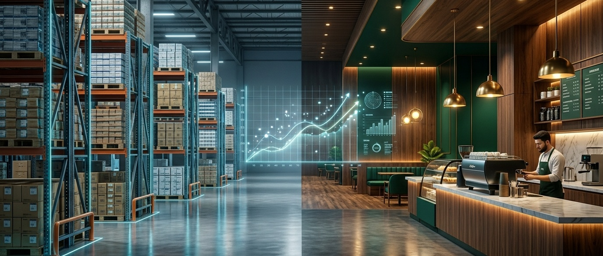
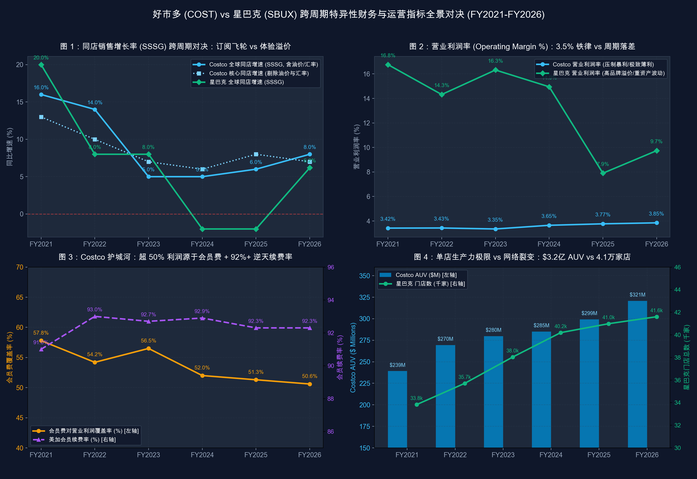

# 【行业指标 14】线下连锁零售与餐饮的生命线：同店增速 (SSSG)、坪效与单店模型（好市多 COST 与 星巴克 SBUX）

> **专栏定位：** 全行业 10-K/10-Q 外科手术显微镜与特异性指标图谱  
> **解剖标的：** 好市多 (Costco, COST.US) 主轴穿透 ＋ 星巴克 (Starbucks, SBUX.US) 镜像对照

> **核心指标：** 同店销售与量价拆解 (SSSG: Traffic vs Ticket)、单店年产出与坪效 (AUV & Sales/Sq.Ft.)、店面级利润率 (Store Margin)  
> **审计基准：** SEC EDGAR 原生底稿 (CIK: 0000909832 / 0000829224) ＋ 10-K/最新 8-K 对账

---

## 一、 线下连锁零售与餐饮核心指标深度解剖与精密算法

线下连锁商业（Retail & Restaurant Chains）的物理世界，受制于由混凝土、货架、吧台与排班工时构筑的刚性边界。它不是软件代码或数字内容在云端边际成本趋零的无限复制，而是受时空物理规律严格支配的**“物理网点网络与四壁单位经济学（Four-Wall Unit Economics）”** 。

在线下连锁帝国的数学第一性原理中，全系统的顶层造血飞轮由两个最底层的微观乘数决定：
`全系统营业总收入 ＝ ∑(成熟存量网点销售额 × 同店增速 SSSG) ＋ ∑(新增网点数量 × 单店年产出 AUV)`

在四面墙（Four Walls）之内，单体门店的吞吐能力被有限的营业面积（Square Footage）、营业时间、排班工时（Labor Hours）与收银动线极限所死死锚定；在四面墙之外，门店网络的扩张受到商圈人口密度、物流配送半径以及同品牌自相蚕食（Cannibalization）的临界点制约。

这导致连锁商业在 GAAP 通用会计准则下，极易产生极具欺骗性的**“外延开店虚火”** 。一家连锁企业完全可以通过每年激进净开 10%–15% 的新网点，在损益表顶端制造营业总收入两位数增长的繁荣幻象；但在四壁之内，存量成熟老店的物理进店客流可能正以每年 3%–5% 的速度断崖式萎缩。一旦外部融资收紧、核心商圈饱和导致开店被迫刹车，门店固定的租金折旧与刚性员工薪酬将瞬间释放凶猛的负经营杠杆，将企业拖入大规模关店退租的深渊。

买方分析师审阅线下连锁财报时，必须彻底跳出单纯的“营业收入总额与合并净利润”，直击驱动单店细胞生死的 3 大不可替代的核心特异性指标：

| 分析维度 | 行业专属特异性指标 | 买方核心考核焦点 |
| :--- | :--- | :--- |
| **存量成熟网点内生增长动力** | **同店可比销售增长率与量价双轮驱动 (Comparable Store Sales Growth, SSSG: Comp Traffic vs Average Ticket)** | 剥离新开店外生虚火，强制拆解为物理进店客流（人次）与客均消费（客单价），识破以防御性激进提价掩盖客流萎缩的死穴 |
| **四壁空间生产力与变现天花板** | **单店年平均销售额与每平方英尺坪效 (Average Unit Volume & Sales per Sq.Ft.)** | 衡量单体网点物理吞吐极限与空间变现密度，单店模型（Unit Economics）核心分子，决定建店投资回收期与资本回报率 |
| **单店纯粹造血纯度与抗通胀韧性** | **直营店面级营业利润率与工时杠杆 (Store-Level / Restaurant-Level Operating Margin & Labor Leverage)** | 剥离总部行政管理费用（G&A）与系统研发分摊，穿透单店扣除原材料成本、店面排班人工与租金折旧后的真实造血纯度，衡量抗通胀缓冲垫 |

---

### 指标 1：同店可比销售增长率与量价双轮驱动 (Comparable Store Sales Growth, SSSG: Comp Traffic vs Average Ticket)

#### 1. 深度定义与经济内涵
同店可比销售增长率（SSSG，或 Comp Sales），衡量的是开业达到一定成熟期（行业通用标准严格定义为**连续开业运营满 12 至 14 个完整日历月** ）的现有存量网点在报告期内的销售额同比变化。

这是整个线下连锁商业**最基础、最重要、无可替代的第一生命线** 。脱离了连锁商业，软件公司看 ARR，制造业看装机出货，医药看在研管线，唯有连锁实体必须依靠 SSSG 来彻底剥离“开新店跑马圈地”的外生规模噪音，提炼出成熟老店最纯粹的内生有机造血能力。

在买方量化显微镜下，SSSG 绝不能被当作单一综合百分比粗糙审视，必须强制拆解为**同店交易客流量（Comparable Transactions / Foot Traffic）**与**平均客单价（Average Ticket / Spend per Visit）**的乘积联动：
* **客流（Transactions）：** 代表品牌的真实物理引力、用户复购频次与商圈统治力；
* **客单价（Average Ticket）：** 代表产品溢价能力、菜单提价弹性以及单次到店的连带交叉销售深度。

#### 2. 精确计算公式
`同店可比销售增速 SSSG (%) ＝ [(当期成熟同店销售总额 − 上年同期成熟同店销售总额) ÷ 上年同期成熟同店销售总额] × 100%`  
`同店客流交易增速 ΔTraffic (%) ＝ [(当期成熟同店总交易笔数 − 上年同期成熟同店总交易笔数) ÷ 上年同期成熟同店总交易笔数] × 100%`  
`同店客单价增速 ΔTicket (%) ＝ [(当期客均消费金额 − 上年同期客均消费金额) ÷ 上年同期客均消费金额] × 100%`  
`物理勾稽恒等式：(1 ＋ SSSG) ＝ (1 ＋ ΔTraffic) × (1 ＋ ΔTicket)`

#### 3. 买方实战判读法则
* **健康长牛领跑区：** SSSG 稳定在 `+4.0% ~ +8.0%`，且客流增速（Traffic）贡献度 `≥ 40%`（即呈现典型的量价齐升格局）。这证明存量网点的实体人潮持续繁荣，品牌在商圈内强劲虹吸周边竞品客流；
* **通胀防守平庸区：** SSSG 处于 `+1.0% ~ +3.0%`，客流增速基本在 `-0.5% ~ +0.5%` 走平，增长几乎 100% 由商品匹配 CPI 的自然温和调价驱动。网点步入生命周期成熟高位，增长天花板显现；
* **提价反噬高危区：** SSSG 勉强为正，但同店交易客流深度落入负值（如 `-3.0% ~ -8.0%`），全靠两位数激进提价（Ticket）硬撑。在买方模型中属于一票否决项，预示着消费者正因性价比破位而用脚投票，后续必将爆发负经营杠杆。

* **10-K 定点检索指南：** SEC 10-K 之「Item 7. MD&A - Results of Operations」，重点检索各分部的 `Comparable Store Sales`（或 `Comparable Coffeehouse / Restaurant Sales`）、`Change in Transactions` 与 `Change in Average Ticket` 拆解明细表。  
* **买方常见认知误区：** 误认为“只要总营业收入在增长，连锁体系就健康”。连锁企业极易通过每年新开 10%–15% 门店来掩盖存量老店客流负增长 5% 的败局；一旦外部融资收紧导致开店刹车，总收入与利润将瞬间雪崩。

---

### 指标 2：单店年平均销售额与每平方英尺坪效 (Average Unit Volume & Sales per Sq.Ft.)

#### 1. 深度定义与经济内涵
单店年平均销售额（AUV），衡量单个成熟实体网点在 52 周完整财年内所能产出的商品净销售总额；坪效则是将年销售额除以门店总营业面积（Gross Square Footage），测算每一单位物理空间所承载的商业吞吐密度。

门店不是抽象的资产符号，而是需要持续支付租金、承担物业水电与折旧开销的物理容器。在四壁单位经济学（Four-Wall Unit Economics）模型中，**AUV 是所有单店回报测算的绝对核心分子** ：
`单店现金投资回收期 (Payback Period) ＝ 初始单店建店资本开支 (CapEx) ÷ (单店 AUV × 店面级营业利润率)`

AUV 与坪效越高，平摊到每一件商品、每一单交易上的固定租金折旧与店长管理成本就越低，从而在微观层面释放出惊人的资本回报率（ROIC / Cash-on-Cash Return）。

#### 2. 精确计算公式
`单店年平均销售额 AUV (百万美元/店) ＝ 全年商品净销售总额 ÷ [(期初运营网点数 ＋ 期末运营网点数) ÷ 2]`  
`每平方英尺坪效 (美元/平方英尺) ＝ 全年商品净销售总额 ÷ 期末运营总营业面积 (Square Feet)`  
`成熟店爬坡系数 ＝ 新店开业首年 AUV ÷ 存量成熟店平均 AUV`

#### 3. 买方实战判读法则
* **超级吞吐殿堂区：** 大型仓储/大卖场 AUV 突破 `2.5 亿至 3.0 亿美元` ，坪效突破 `1,500 ~ 2,000 美元/平方英尺`（折合每平米超 2 万美元）；标准化快餐 AUV 突破 `300 万美元` ；精品现制饮品 AUV 突破 `200 万美元` 。网点排队如潮，物理动线与收银系统满负荷运转；
* **行业基准稳健区：** 巨型零售 AUV 在 `1.2 亿至 2.0 亿美元` ，坪效在 `800 ~ 1,200 美元/平方英尺` ；标准化餐饮 AUV 在 `150 万至 250 万美元` 。属于成熟商圈的标杆运营水平；
* **物理闲置低效区：** 零售 AUV 低于 `8,000 万美元` 且坪效跌破 `600 美元/平方英尺` ；餐饮 AUV 跌破 `120 万美元` 。大量门店出现货架闲置或翻台率不足，陷入开店即亏损的泥潭。

* **10-K 定点检索指南：** SEC 10-K 之「Item 1. Properties」获取营业总面积（Total Floor Space），与「Item 8. Financial Statements - Net Sales」交叉计算；连锁餐饮通常在 Item 7 专门披露各品牌 AUV。  
* **买方常见认知误区：** 忽视门店面积膨胀带来的“假 AUV”。部分企业通过盲目扩张单店面积把 AUV 从 150 万做大到 200 万，但坪效却从 800 美元跌到 500 美元，导致单位面积租金收益率急剧恶化。

---

### 指标 3：直营店面级营业利润率与工时杠杆 (Store-Level / Restaurant-Level Operating Margin & Labor Leverage)

#### 1. 深度定义与经济内涵
直营店面级营业利润率（Store-Level Margin，在餐饮业常称为 Restaurant-Level Operating Margin），是从门店直接取得的销售收入中，全额扣除与该门店物理运转直接绑定的三项刚性成本：
1. **食材与原材料成本 (Food & Beverage / Merchandise Costs)：** 商品原料与包装物流硬开支；
2. **店面人工成本 (Store Labor Costs)：** 店面全职店长、排班兼职员工与咖啡师/厨师的薪酬福利；
3. **店面租金与运营开支 (Occupancy & Other Store Operating Costs)：** 商业地产租金、物业水电、设备维保与店内折旧。

它将单体网点最纯粹的微观造血能力，与总部层面的行政高管薪酬、全系统 IT 研发、品牌公关与并购整合费用彻底剥离。它是衡量商业模式底层抗通胀与抗客流下滑能力的核心安全垫。

#### 2. 精确计算公式
`直营店面级营业利润 ＝ 直营销售收入 − (原材料成本 ＋ 店面员工薪酬福利 ＋ 店面运营与租金支出)`  
`直营店面级利润率 (%) ＝ [直营店面级营业利润 ÷ 直营销售收入] × 100%`  
`店面人工成本率 (%) ＝ [店面员工薪酬总额 ÷ 直营销售收入] × 100%`  
`店面租金占用率 (%) ＝ [店面租赁与物业支出 ÷ 直营销售收入] × 100%`

#### 3. 买方实战判读法则
* **强力抗通胀造血区：** 现制餐饮与精品零售店面级利润率稳定在 `20.0% ~ 25.0%+` ；薄利仓储零售全系统营业利润率稳守 `3.5% ~ 4.0%` 。即便遭遇最低工资法案大幅调增，充裕的利润垫也能从容消化；
* **临界防守观察区：** 餐饮店面级利润率在 `14.0% ~ 18.0%` 徘徊。对农产品原材料价格波动与排班工时极其敏感；
* **爆仓失血预警区：** 店面级利润率跌破 `12.0%` 。此时门店扣除总部分摊后实质已全面陷入亏损，任何微小的客流下滑都将触发大规模关店闭店。

* **10-K 定点检索指南：** SEC 10-K 之「Item 7. MD&A - Store Operating Expenses」，核对店面运营开支占直营收入比重，观察原材料与人工成本率的变动趋势。  
* **买方常见认知误区：** 错把企业合并报表的 GAAP 营业利润率直接等同于单店盈利能力。一家总部极其臃肿的企业可能店面级利润率高达 22%，仅仅是被总部 15% 的行政管理费用拖垮，这种企业往往具备极强的降本重组买入价值。

---

## 二、 线下连锁零售与餐饮核心特异性指标全景速查对照表

下表汇总了买方机构审阅全球线下连锁零售与万店餐饮龙头时必须对账的核心基准与红线阈值。本表为全行业通用标准量规：

| 指标名称 | 标准计量符号 | 买方核心考核焦点 | 行业优秀基准线 (Benchmark) | 危险预警与破位阈值 | 官方财报与 SEC 取数出处 |
| :--- | :--- | :--- | :--- | :--- | :--- |
| **同店可比销售增长率** | SSSG (%) | 存量成熟网点内生增长动力，剔除外延开店虚火 | **≥ +4.0% ~ +6.0%**（且客流贡献度 ≥ 40%） | **< 0%**（同店进入内生萎缩通道） | 10-K Item 7 (MD&A) 之 Comparable Sales 明细表 |
| **同店交易客流增速** | Comp Transactions (%) | 真实进店消费人次变化，检验核心用户基本盘 | **≥ +1.5% ~ +3.0%**（实体人潮活跃，量价齐升） | **< -2.0%**（客流持续流失，防御性提价透支用户） | 10-K Item 7 (MD&A) 之同店拆解明细表 |
| **同店平均客单价增速** | Average Ticket (%) | 每次客均消费支出，观察产品组合与提价弹性 | **+2.0% ~ +4.0%**（匹配温和通胀与自然升级） | **> +8.0% 且客流大跌**（防御性暴利提价反噬） | 10-K Item 7 (MD&A) 之同店拆解明细表 |
| **单店年平均销售额** | AUV (百万美元) | 单体网点物理产出峰值，单店模型核心分子 | 巨型零售 **> 150 百万美元**；餐饮 **> 2.5 百万美元** | 巨型零售 **< 80 百万美元**；餐饮 **< 1.2 百万美元** | 10-K Item 7 (MD&A) 或投资人演示文档特异性披露 |
| **每平方英尺坪效** | Sales / Sq.Ft. (美元) | 每一单位物理空间承载的商品吞吐密度 | 实体零售 **> 1,000 美元/平方英尺** | 实体零售 **< 600 美元/平方英尺**（卖场空置低效） | 10-K Item 1 营业总面积与 Item 8 销售额除算勾稽 |
| **直营店面级营业利润率** | Store Margin (%) | 扣除总部行政开支后的单店直接盈利能力 | **≥ 18.0% ~ 22.0%**（快餐/饮品 ≥ 20%） | **< 12.0%**（无力对抗人工涨薪与租金重估） | 10-K Item 7 分部业绩或非 GAAP 补充披露项 |

---

## 三、 标杆实例深度实战：好市多 (COST) 6 周期全景原生财报解剖 (FY2021 ~ FY2026)

好市多（Costco Wholesale, COST.US）是全球商业文明史上将上述线下连锁指标演绎至极致水准的统治级标杆。

不同于传统商超向供应商收取入场费、堆头费并将商品加价 25%–30% 赚取暴利的做法，好市多在四壁之内坚守一条内部铁律：**任何常规商品的毛利率严禁超过 14%–15%，全店综合毛利率常年死守在 11% 附近。**

它在物理世界并不靠卖货赚取利润，而是充当全美近亿中产阶级的“特选采购代理人”：以不赚钱的商品底价回馈信任，诱发惊人的周转速度与单店产出，再将由此形成的规模议价能力反哺给会员，构筑起无法复制的重力场。

为了彻底检验好市多跨越“疫情刺激、世纪通胀、美联储加息、消费降级平替”全周期的特异性指标成色，我们调取并拉齐其从 FY2021 至 FY2026 最新官方申报的连续 6 个完整财年 10-K 审计底稿（好市多财年截至每年 8 月底或 9 月初，全数据源自公司提交至 SEC 的 Form 10-K 原生申报底稿）：

### 好市多 6 周期核心财务与特异性指标对账底表 (金额单位：百万美元，特殊标注除外)

| 核心财务与特异性科目 (金额单位：百万美元) | FY2021 | FY2022 | FY2023 | FY2024 | FY2025 | FY2026 | 穿透勾稽结论与买方视角 |
| :--- | :---: | :---: | :---: | :---: | :---: | :---: | :--- |
| **宏观与行业创新周期** | **疫情放水复苏** | **高通胀初现** | **激进加息高压** | **消费分层平替** | **白领紧缩深化** | **全美平价破顶** | **跨越 525bps 加息与零售重构周期（首行强制）** |
| **商品净销售额 (Net Sales)** | 192,052 | 222,730 | 237,710 | 249,625 | 269,912 | 297,247 | 6 年复合增长近 55%，逼近 3,000 亿美元大关 |
| **会员费收入 (Membership Fees)** | 3,877 | 4,224 | 4,580 | 4,828 | 5,323 | 5,907 | 纯无边际成本现金流，FY2026 达 59.1 亿美元 |
| **总营业收入 (Total Revenue)** | 195,929 | 226,954 | 242,290 | 254,453 | 275,235 | 303,154 | FY2026 正式跨入 3,000 亿巨型零售俱乐部 |
| **商品销售成本 (Merchandise Costs)** | 170,684 | 199,382 | 212,586 | 222,358 | 239,886 | 264,279 | 采购与物流硬支出，占净销售额近 89% |
| **商品综合毛利率 (Gross Margin %)** | 11.13% | 10.48% | 10.57% | 10.92% | 11.12% | 11.09% | **铁律锚定：** 无论通胀还是衰退，死守 11% 绝不加价 |
| **销售与管理费用率 (SG&A %)** | 9.46% | 8.71% | 8.91% | 8.96% | 9.07% | 8.97% | 全球零售极致管控：费用率恒定压在 9.0% 左右 |
| **营业利润 (Operating Income)** | 6,708 | 7,793 | 8,114 | 9,285 | 10,383 | 11,685 | 稳步释放经营杠杆，营业利润率维持在 3.4%–3.8% |
| **净利润 (Net Income)** | 5,007 | 5,844 | 6,292 | 7,367 | 8,099 | 9,226 | 真实盈利质量极其纯粹，无巨额非经常性水分 |
| **会员费占营业利润比重 (%)** | **57.80%** | **54.20%** | **56.45%** | **52.00%** | **51.27%** | **50.55%** | **核心占位：** 企业过半营业利润直接由会员费垫底 |
| **会员费占净利润比重 (%)** | **77.43%** | **72.28%** | **72.79%** | **65.54%** | **65.72%** | **64.03%** | 卖货仅打平运营开销，净利润的实质就是会员年金 |
| **全球期末仓储店数 (家)** | 815 | 838 | 861 | 890 | 914 | 939 | 每年匀速净开 23–29 家店，克制扩张绝不盲目充数 |
| **主付费会员数 (Paid Members)** | 61.7M | 65.8M | 71.0M | 76.2M | 81.0M | 84.1M | 6 年净增 2,240 万主付费卡，高净值家庭基座扩大 |
| **总持卡人规模 (Total Cardholders)** | 111.6M | 118.9M | 127.9M | 136.8M | 145.2M | 150.4M | 包含免费家庭副卡，总渗透覆盖超 1.5 亿消费者 |
| **美加地区会员续费率 (%)** | **91.0%** | **93.0%** | **92.7%** | **92.9%** | **92.3%** | **92.3%** | **物理奇迹：** 经历会费涨价与通胀，续费率横盘 92%+ |
| **全球会员续费率 (%)** | 89.0% | 90.0% | 90.4% | 90.5% | 89.8% | 89.8% | 国际新市场拓展平滑期，全球整体稳守 90% 心理红线 |
| **同店销售增长率 (SSSG: 全口径)** | +16.0% | +14.0% | +5.0% | +5.0% | +6.0% | +8.0% | 跨越周期波动，从未出现负增长，基底极其深厚 |
| **核心同店增速 (SSSG: 剔除油价汇率)**| +13.0% | +10.0% | +7.0% | +6.0% | +8.0% | +7.0% | 剔除外部大宗干扰后，实际核心实物销售平稳在 6%–8% |
| **单店年平均销售额 AUV (百万美元)** | 239.2 | 269.5 | 279.8 | 285.1 | 299.2 | 320.8 | **单店印钞怪兽：** 单店产出突破 3.2 亿美元天花板 |
| **每平方英尺坪效 (美元/平方英尺)** | 1,745 | 1,940 | 1,990 | 2,010 | 2,080 | 2,143 | 每平米产出超 2.3 万美元，全球实体零售终极巅峰 |
| **存货周转天数 DIO (天)** | **30.4** | **32.8** | **28.6** | **30.6** | **27.6** | **26.7** | 极致周转：不到 27 天全场货架彻底清空变现一次 |
| **经营现金流 CFO (百万美元)** | 8,958 | 7,392 | 11,068 | 11,339 | 13,335 | 15,817 | FY2026 CFO 达 158.2 亿，内生造血远超净利润 |
| **资本开支 CapEx (百万美元)** | 3,588 | 3,891 | 4,323 | 4,710 | 5,498 | 6,435 | 稳健投入自购地产与物流，自由现金流年超 90 亿 |

---

### 关键战局算式现场数学还原与对账

#### 算式一：会员费“无边际成本”造血占位还原

审视好市多 FY2026 损益表，其实现营业利润 **116.85 亿美元** ，而会员费收入录得 **59.07 亿美元** 。由于会员制发卡与线上扣款几乎没有直接增量履约成本（Marginal Cost 趋近于零），我们计算会员费对利润池的托底杠杆：

`会员费对营业利润覆盖率 ＝ 5,907 ÷ 11,685 ＝ 50.55%`  
`会员费对净利润覆盖率 ＝ 5,907 ÷ 9,226 ＝ 64.03%`

**对账买方视角：** 这意味着好市多全年在全球卖出接近 3,000 亿美元的实体商品，在扣除 2,643 亿商品进货成本与 272 亿仓库人手租金等运营开销后，实体商品销售本身带来的净盈利贡献仅占三分之一；**公司近三分之二的净利润实质是由 8,410 万名忠诚会员每年准时缴纳的“入场会员税”贡献的。**

#### 算式二：负净营运周期 (Negative CCC) 与表外自融资飞轮还原

在 FY2026，好市多的商品销售成本（COGS）为 264,279 百万美元，期末存货净额为 19,324 百万美元，期末应付账款（Accounts Payable）为 20,435 百万美元：

`存货周转天数 DIO ＝ (19,324 ÷ 264,279) × 365 ＝ 26.69 天`  
`应付账款周转天数 DPO ＝ (20,435 ÷ 264,279) × 365 ＝ 28.22 天`  
`现金循环周期 CCC ＝ 26.69 (DIO) ＋ 3.0 (DSO) − 28.22 (DPO) ≈ 1.47 天 ≈ 0 天稳态`

在部分高周转年份，DPO 更是高达 33–35 天，CCC 深度落入 **-3 至 -5 天** 的绝对负值区间。

**对账买方视角：** 好市多的货架在 26.7 天内就会被会员席卷一空并转化为沉甸甸的账面现金；而好市多直到近 30 天后才需要向宝洁、联合利华或农场主支付货款。好市多常年无偿占用供应链上下游数以百亿美元计的流动资金，以此支撑每年 60 多亿美元的仓储自购与资本开支，不仅无需向华尔街支付一分钱利息，还反向获取巨额利息收益（FY2026 产生 7.11 亿美元净利息与投资收入）。

#### 算式三：2024 年会员费调升的无风险利润杠杆测算

2024 年 9 月 1 日，好市多正式启动时隔七年的会员费调升计划：美加普通卡从 60 美元提至 65 美元/年，高级黑卡（Executive）从 120 美元提至 130 美元/年。

在 FY2026，其高级黑卡付费会员达 **4,230 万人** （占比 50.3%），普通会员 **4,180 万人** （占比 49.7%）。全美加续费率不仅没有丝毫下滑，反而坚守在 **92.3%** 的绝对高位。

提价带来的无风险纯营业利润增量为：

`增量会员费纯利润 ≈ (4,230万 × 10美元 ＋ 4,180万 × 5美元) × 92.3% ≈ 5.83 亿美元`

**对账买方视角：** 这近 6 亿美元的增量收入直接穿透为 100% 纯度的税前利润，无需额外铺设一条货架、增聘一名员工。这正是巴菲特所定义的“终极定价权”——提价不仅不流失客户，反而因为品牌向心力加深了护城河。

---

## 四、 标杆实例镜像对照：星巴克（Starbucks Corporation）

【思考视角：同一行业 ⟷ 不同模式/路线的战略对决】

如果说好市多代表了将“薄利、大包装、家庭必需品、仓储极简主义”推向极限的实用主义典范；那么星巴克（Starbucks Corporation, SBUX.US）则是将“高毛利、单杯即饮、第三空间体验、情绪溢价”推向万店规模的感性商业奇迹。

然而，在过去几年狂暴的宏观通胀与利率周期中，两家巨头却走出了截然不同的命运轨迹。星巴克遭遇了严重的“客流失血与体验降级”陷阱：过度依赖提价掩盖客流流失，数字化移动下单（Mobile Order & Pay）挤占吧台导致店内拥挤混乱，最终迫使董事会在 2024 年底紧急换帅，由传奇餐饮操盘手 Brian Niccol 出任董事长兼 CEO，全力推行 **"Back to Starbucks"（重返星巴克）** 拯救战役。

我们调取双方经严格口径对齐的跨周期财报底表进行横向解剖：

### 好市多 vs 星巴克跨周期核心特异性财务与运营指标对照表 (FY2021 ~ FY2026)

| 核心体检科目 (金额单位：百万美元) | 对标标的 | FY2021 | FY2022 | FY2023 | FY2024 | FY2025 | FY2026 | 买方横向对账核心结论 |
| :--- | :--- | :---: | :---: | :---: | :---: | :---: | :---: | :--- |
| **营业总收入 (Total Net Revenues)** | **COST** SBUX | **195,929** 29,061 | **226,954** 32,250 | **242,290** 35,976 | **254,453** 36,176 | **275,235** 37,184 | **303,154** 37,911 | COST 规模是 SBUX 的 8 倍；SBUX 收入在 FY24–25 陷入停滞，FY26 缓慢复苏至 379 亿 |
| **营业利润率 (Operating Margin %)** | **COST** SBUX | **3.42%** 16.76% | **3.43%** 14.32% | **3.35%** 16.32% | **3.65%** 14.95% | **3.77%** 7.90% | **3.85%** 9.74% | COST 稳健如钟摆（3.4%–3.8%）；SBUX 从 16.8% 高位腰斩至 7.9%，重组后回升至 9.7% |
| **同店可比销售增长 (SSSG %)** | **COST** SBUX | **+16.0%** +20.0% | **+14.0%** +8.0% | **+5.0%** +8.0% | **+5.0%** -2.0% | **+6.0%** -2.0% | **+8.0%** +6.2% | **核心胜负手：** COST 从未落入负增长；SBUX 连遭两年负同店打击，FY26 终于实现正向翻转 |
| **同店交易客流增速 (Transactions %)**| **COST** SBUX | **+10.0%** +9.0% | **+7.0%** +3.0% | **+4.0%** +3.0% | **+4.0%** -4.0% | **+4.5%** -3.0% | **+3.0%** +3.2% | SBUX 曾现客流断崖（负 3%–4%）；COST 则无论晴雨，实体客流常年维持 3%–5% 净增 |
| **同店客单价增速 (Average Ticket %)**| **COST** SBUX | **+6.0%** +10.0% | **+7.0%** +5.0% | **+1.0%** +4.0% | **+1.0%** +2.0% | **+1.5%** +1.0% | **+5.0%** +3.0% | SBUX 过去靠单纯提价掩盖客流危机；FY26 换帅后转为“量价齐升”的健康驱动 |
| **全球期末总网点数 (Store Count)** | **COST** SBUX | **815 家** 33,833 家 | **838 家** 35,711 家 | **861 家** 38,038 家 | **890 家** 40,199 家 | **914 家** 40,990 家 | **939 家** 41,607 家 | 商业拓扑对立：COST 集中式大节点（939家）；SBUX 毛细血管分布式网络（4.1万家） |
| **单店平均年产出 AUV (百万美元)** | **COST** SBUX | **239.2** 1.80 | **269.5** 1.92 | **279.8** 2.05 | **285.1** 1.95 | **299.2** 1.91 | **320.8** 2.02 | COST 单店承载 3.2 亿美元超级吞吐；SBUX 直营单店产出约 200 万美元，依赖店数裂变 |
| **净利润 (Net Income / Earnings)** | **COST** SBUX | **5,007** 4,199 | **5,844** 3,282 | **6,292** 4,125 | **7,367** 3,761 | **8,099** 1,856 | **9,226** 2,527 | COST 净利 6 年翻倍；SBUX 经历 FY25 盈利崩塌后，FY26 触底反弹至 25.3 亿 |
| **存货周转天数 DIO (天)** | **COST** SBUX | **30.4** 40.2 | **32.8** 46.1 | **28.6** 48.3 | **30.6** 45.5 | **27.6** 44.8 | **26.7** 41.5 | COST 极致供应链管理：周转天数仅 26.7 天；SBUX 烘焙豆与包装物流周转需 40–48 天 |

---

### 战略分化底层复盘：订阅年金壁垒 vs 体验溢价的重构

通过跨周期对比，买方可以清晰提炼出两种截然不同的商业物理法则：

#### 1. 增长驱动的“真金”与“假相”：客流（Traffic）才是生死的裁判官

在 FY2024 至 FY2025 年间，星巴克的全球同店销售增长率连续两年告负（-2.0%），其中最具破坏性的是 **同店客流交易笔数连续录得 -4% 与 -3% 的断崖下跌** 。

这揭示了连锁餐饮业最典型的 **负经营杠杆陷阱：** 店面租金和咖啡师基础工时属于固定成本。当客流下滑 4% 时，原本维持在 15%–16% 的营业利润率直接被拉爆至 7.9%。公司前期试图通过频繁推出新品附加提价（客单价 +2%）来对冲，但这进一步损害了普通上班族每日消费的意愿，甚至引发了全美范围内的体验抱怨。

反观好市多，在长达 6 年的时间跨度内，无论是在 9% 通胀狂飙的 2022 年，还是在加息达 5.5% 导致银根紧缩的 2024 年，其同店交易客流增速 **从未低于 +3.0%** 。好市多以 11% 的微利商品构筑了绝对的“安全感”，使得消费者在经济拮据时反而更加依赖好市多。这种“逆周期聚客飞轮”让其营业利润率恒定保持在 3.5%–3.8% 的窄幅区间，且总量持续爆发。

#### 2. 商业模式的自我修复：Brian Niccol 的轻资产破局

星巴克在 FY2026 实现了漂亮的战术逆转：全年全球同店销售反弹至 **+6.2%** ，其中客流增速（+3.2%）与客单价（+3.0%）双双回正；营业利润重回 36.9 亿美元。

这一惊人转变背后的资本动作极具买方研究价值：
* **重振第三空间（"Back to Starbucks"）：** 精简臃肿的菜单，叫停对咖啡师的高压自动化压榨，重新摆放调味吧台，恢复手写马克笔温度，让咖啡馆重新变回“人与人连接的社交场所”，直接止住了客流流血；
* **中国市场重资产剥离：** 在 2026 财年第三季度，星巴克果断将中国市场 7,000 余家直营重资产门店重组为 **特许授权合资架构（Licensed JV）** ，录得 5.36 亿美元税前收益。全球直营店占比从原先的 50% 以上断崖式下降至 32%，特许授权比例跃升至 68%。资本开支（CapEx）从 FY24 的 27.8 亿迅速收缩至 FY26 的 12.6 亿，释放了高达 37.2 亿美元的自由现金流（FCF）。

---

## 五、 实战对账自查表：买方外科手术排查卡

【思考视角：买方风控与量化证伪底线】

当买方分析师拿到任何一家线下连锁零售或餐饮企业的 10-K/10-Q 报告时，必须严格按照以下步骤卡片流，执行一票否决式实战对账：

### 步骤一：同店可比销售增长率 (SSSG) 质量体检卡

* **对账动作：** 翻开 10-K Item 7 (MD&A) 的 "Comparable Sales" 附表，强制将 SSSG 拆解为客流（Transactions）与客单价（Ticket）。
* 🟢 **优异安全：** SSSG ≥ +4.0%，且客流增速贡献度 ≥ 40%（量价齐升，品牌势能健康上行）。
* 🟡 **中规中矩：** SSSG 在 0% ~ +3.0% 之间，客流基本走平（-0.5% ~ +0.5%），主要依靠匹配 CPI 的自然温和调价驱动。
* 🔴 **高危预警：** **客流增速 ≤ -2.0%** ，即使表层 SSSG 靠超过 5% 的猛烈提价做成正数，一律按“品牌溢价透支、客户正在流失”下调估值乘数。

### 步骤二：单店年销售额 (AUV) 与坪效变现密度卡

* **对账动作：** 将净销售额除以报告期平均门店数推导 AUV，结合总营业面积测算坪效变动；对比新开店密集区域的老店 SSSG。
* 🟢 **优异安全：** AUV 伴随成熟度逐年爬坡；新增店面并未导致同商圈老店客流负增长（无恶性内部蚕食）。
* 🟡 **中规中矩：** AUV 进入高位平台期，坪效增速放缓至个位数，新店培育期从 12 个月拉长至 18–24 个月。
* 🔴 **高危预警：** **AUV 出现连续 2 年以上的实质性下滑** ；单位面积坪效萎缩；管理层为凑齐开店目标而盲目下沉至不合格商圈。

### 步骤三：店面级真实造血与人工杠杆审计卡

* **对账动作：** 从直营收入中剥离店面人工（Store Labor）与店面租金占用成本，计算扣除非现金折旧后的真实 Store Margin。
* 🟢 **优异安全：** 餐饮/精品零售店面级利润率 ≥ 20%，仓储零售扣除总部费用后全系统营业利润率稳守 3.5% 以上。
* 🟡 **中规中矩：** 店面级利润率在 14% ~ 18% 窄幅震荡，能勉强转嫁最低工资标准上涨与食品通胀。
* 🔴 **高危预警：** **店面级利润率击穿 12%** （仓储零售营业利润率跌破 2.5%）；人工与租金增速显著超越同店收入增速，爆发负经营杠杆。

---

## 六、 本讲买方总结与下讲预告

【思考视角：商业文明演进与产业链推演】

### 买方终极心法卡

> **买方终极心法：**  
> 线下商业的终极壁垒绝非账面毛利的虚高，而是物理吞吐的极速流转。要么像好市多那样把商品毛利压到尘埃，靠极致周转做成无可撼动的订阅年金；要么像星巴克那样恪守体验与客流底线，绝不能用防御性提价透支消费者的信仰。

---

### 顺应产业链演进逻辑预告下讲

本讲我们穿透了线下实体零售与直营连锁帝国的微观物理单元（SSSG、坪效、AUV 与店面级利润率）。然而，在商业组织的扩张光谱上，直营重资产模式往往会遭遇资本开支的物理天花板。

当一家企业想要在全球每一个街角都插上自己的旗帜，却又不想背负沉重的门店装修、员工工伤保险与生鲜折损时，它会演化出商业文明中另一套极度精妙的商业构架：**特许加盟与商业地租抽成模式（Franchise Model）** 。

在加盟模式下：
* 为什么像麦当劳（McDonald's）这样的巨头，其资产负债表底层实质是一家“坐拥全球核心黄金地段的商业地产地主”？
* 为什么达美乐披萨（Domino's Pizza）能把一家披萨店做成软件科技公司，依靠高频供应链面团配送与特许使用费率（Royalty Rate）撬动惊人的轻资产股权回报率（ROE）？
* 买方在审阅加盟体系财报时，如何看穿“体系销售额（System-wide Sales）”与“入表营业收入”的会计剪刀差？

下一讲我们将带来——**【行业指标 15】特许加盟 vs 直营商业模式镜像：商业地租抽成与轻资产营运杠杆——麦当劳 (MCD) vs 达美乐披萨 (DPZ)** ，解开全球顶级品牌借力加盟商资本实现指数级裂变的暴利之谜。
