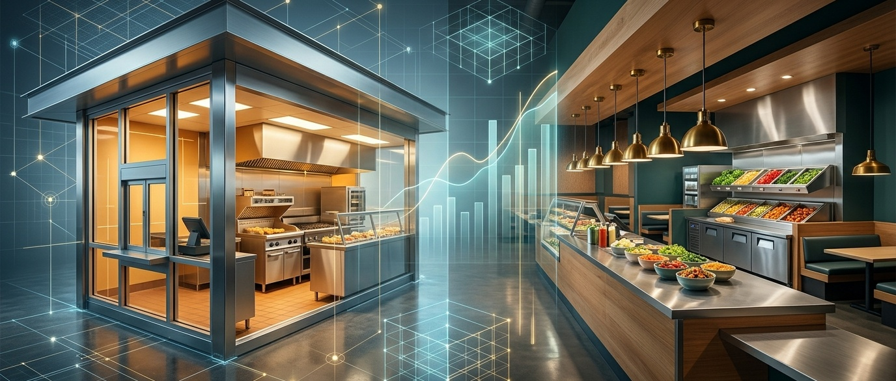
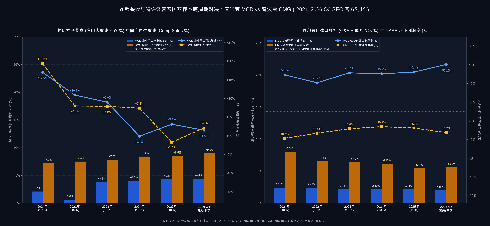

# 【行业指标 15】连锁餐饮与特许经营帝国：直营四壁模型、体系流水与商业地租抽成（麦当劳 MCD 与 奇波雷 CMG）

> **专栏定位：** 全行业 10-K/20-F 财报解剖与特异性指标图谱  
> **解剖标的：** 麦当劳 (McDonald's, MCD) 主轴穿透 ＋ 奇波雷 (Chipotle, CMG) 镜像对照  
> **核心指标：** 同店量价与数字渠道、单店产出与净开店力、四壁营业利润率与首要成本、特许流水与双轨抽成及总部体系杠杆  
> **审计基准：** SEC EDGAR 原生底稿 (CIK: 0000063908 / 0001058090) ＋ 10-K/10-Q/Ex.99.1 对账

> **摘要：** 拆解连锁餐饮 4 大核心特异性指标（同店量价、单店产出与扩店、四壁利润率、特许双轨抽成与体系杠杆），结合麦当劳与奇波雷对账，穿透轻资产收租与纯直营的盈利密码。

---

## 一、 连锁餐饮与特许经营行业核心指标深度解剖

连锁餐饮的物理商业本质，是把单店“选址获客 → 标准化出品 → 翻台履约”的单位经济模型（Unit Economics），通过资本与组织架构无限复制的现金流机器。从财务报表呈现来看，全行业沿着**“直营四壁模型（Company-Operated Four-Wall Model）”**与**“特许加盟收租帝国（Asset-Light Franchisor & Real-Estate Model）”**两大极端演化：前者将全额门店营收与食材、人工、租金通胀扛在自身损益表上，换取 100% 的单店盈利归属与执行品控；后者将 85% 以上的门店交由外部加盟商运营，自己退居供应链标准制定者、品牌 IP 授权方乃至核心商业物业“二房东”，彻底剥离了餐厅一线的日常运营波动与通胀风险。

这种商业模式的巨大分野，使得仅看 GAAP 合并营收与营业利润率极易陷入跨标的可比性陷阱：同样服务于海量消费客流，纯直营连锁的“总营收”约等于终端消费额，而高加盟化平台在报表上只确认抽成收入（营收规模被折叠压缩数倍），其营业利润率却可轻易突破 45% 以上。因此，穿透任何一家连锁餐饮巨头的 10-K 与 10-Q 财报，必须围绕以下四个正交维度构建行业特异性财务坐标系：

| 分析维度 | 行业专属特异性指标 | 买方核心考核焦点 |
| :--- | :--- | :--- |
| **内生需求成色** | **同店可比销售增速与量价拆解 (Comp Sales: Traffic vs. Check & Digital %)** | 穿透同店增速是靠真实进店客流 (Traffic) 驱动，还是靠菜单提价 (Pricing) 掩盖客流流失 |
| **外延扩张质量** | **单店年均销售额与门店净扩张增速 (AUV & Net Unit Growth %)** | 检验单店产出是否具备持续承压能力，警惕不计单店回报的盲目开店稀释效应 |
| **单店造血底盘** | **餐厅级四壁营业利润率与首要变动成本 (Restaurant-Level Margin & Prime Cost %)** | 拆解食材、人工、租金三座成本大山，并对齐“是否含餐厅折旧 D&A”的会计边界 |
| **模式与体系杠杆** | **特许占比、体系流水、双轨抽成与总部体系杠杆 (Franchised %, Systemwide Sales, Take Rate & G&A/Sys %)** | 量化品牌对终端消费池的撬动倍数、“品牌+地产”抽成厚度，并用体系流水拉齐总部费用效率 |

---

### 指标 1：同店可比销售增速与量价拆解 (Comparable Sales: Traffic vs. Check & Digital Mix)

同店可比销售增速（Comparable Restaurant Sales，通常统计开业满 13 个完整月以上门店的剔除汇率波动销售同比变动）是连锁餐饮一切财务推演的“体温计”。但对于买方而言，只看表面的同店合计数远远不够，必须将其拆解为**“进店交易量（客流 / Traffic or Guest Counts）”**与**“平均客单价（Check = 菜单涨价 Menu Price + 消费组合变动 Check Mix）”**两大底层分量：

`同店可比销售增速 (%) ≈ 可比客流交易量增速 (%) ＋ 平均客单价增速 (%)`

在通胀环境中，很多餐饮企业即便门店门可罗雀，仍可通过大幅调高菜单价格把同店增速“粉饰”为正数；但一旦消费者因性价比恶化开始“用脚投票”，客流就会陷入持续负增长，表现为 `Menu Price` 上涨被消费者减少加料、退向低价套餐的负 `Check Mix` 对冲，最终触发去杠杆雪崩。此外，移动端 App、点餐屏与外卖构成的**数字渠道占比（Digital Sales %）**越高，往往意味着越强的会员复购粘性与出餐并发处理效率。

买方诊断标尺如下：
* **量价齐升的黄金成长期：** 长期同店可比增速 ≥ **`5%`** ，且核心可比客流交易量增速 ≥ **`2%`** ，表明客流增长领先于调价贡献，品牌具备真正的消费者心智壁垒；
* **稳态防御或通胀转嫁区：** 同店可比增速维持在 **`0% ~ 5%`** ，且客流波动控制在 **`-2% ~ +2%`** 区间，主要依靠温和调价与新品结构迭代维持门店现金流平稳；
* **客流失血预警区：** 同店可比增速 ＜ **`0%`** ，或可比客流交易量持续深跌至 ＜ **`-2%`** ，即便靠菜单暴力提价勉强托住表观营收，亦预示性价比优势丧失与后续加盟商亏损闭店潮。

---

### 指标 2：单店年均销售额与门店净扩张增速 (AUV & Net Unit Growth %)

餐饮连锁的规模复利等于“单店平均产出 × 门店净总数”。在同店之外，**单店年均销售额（Average Unit Volume, AUV，即单店 LTM 年化餐饮收入，对于全加盟帝国则用体系总流水 ÷ 门店数近似衡量体系店均流水）**决定了单店的固定成本摊薄能力与回本速度；而**期末门店净扩张增速（Net Unit Growth %＝ 净增开店数 ÷ 期初门店数）**则决定着收入端的外延弹性和天花板高度：

`期末门店净扩张增速 (%) ＝ (本期末餐厅总数 − 上年同期餐厅总数) ÷ 上年同期餐厅总数 × 100%`

买方极度警惕“为了完成华尔街总收入增长指标而透支劣质点位”的失速扩张：当一家企业门店净增速高企，但 AUV 不升反降、或者新开门店大幅蚕食周边老店同店客流（Cannibalization）时，往往是单店投资回报恶化、边际资本开支效率塌方的危险前兆。

买方诊断标尺如下（注：以下绝对美元门槛适用于标准堂食及得来速快餐/快休闲业态；对于小型咖啡茶饮或纯自提档口，绝对 AUV 天然更低，需结合建店成本回收周期及 **AUV 跨期是否被加速开店稀释** 综合评判）：
* **高能效双轮驱动：** AUV ≥ **`300 万美元`** （具备极强的峰谷翻台率与高租金地段承受力），同时成熟期净扩张维持在 **`2% ~ 5%`** 或成长期 ≥ **`5%`** 且不明显稀释既有 AUV；
* **常规扩张区：** AUV 处于 **`200 万 ~ 300 万美元`** ，门店净扩张增速处于 **`2% ~ 5%`** ，具备稳定单店盈亏平衡安全垫；
* **低效缩容预警区：** AUV ＜ **`150 万美元`** 且呈下行趋势，或门店净扩张增速 ＜ **`0%`** （大规模永久关店，进入收缩止血周期）。

---

### 指标 3：餐厅级四壁营业利润率与三座成本大山 (Restaurant-Level Margin & Prime Cost %)

剥去企业总部高管薪酬与研发管理费用的干扰，单家餐厅在“四面墙壁以内”到底赚不赚钱，全看 **餐厅级（四壁）营业利润率（Restaurant-Level Operating Margin, RLOM）** 。任何一家餐厅的损益表底层，都压着“食材包材（Food & Paper）、门店人工（Labor）、租金物业与杂费（Occupancy & Other）”三座成本大山，其中食材与人工合计被称为 **首要变动成本（Prime Cost）** ：

`餐厅级营业利润率 (%) ＝ (直营餐饮营收 − 食材包材 − 门店人工 − 租金物业及杂费) ÷ 直营餐饮营收 × 100%`

`首要成本率 (Prime Cost %) ＝ (食材包材成本 ＋ 门店人工成本) ÷ 直营餐饮营收 × 100%`

**买方穿透会计边界警示：** 阅读 SEC 10-K/10-Q 时，必须首先核实利润表附注对**“门店折旧摊销（D&A）”**的列报口径！部分纯直营快速休闲品牌（Fast-Casual）在列示 `Restaurant operating costs` 时 **明确剔除了折旧与摊销** （exclusive of D&A），导致表观四壁利润率偏高约 `3 ~ 4 个百分点` ；而另一些传统快餐特许商在列示公司自营利润率（Company-operated margin）时，则将门店设备与装修折旧直接计入 `Occupancy & other` 成本之中。横向跨公司对比前必须校准该项会计口径差异。

买方诊断标尺（按剔除 D&A 口径，含 D&A 口径相应下移约 3~5 个百分点）：
* **印钞机级四壁盈利：** 餐厅级利润率（不含 D&A）≥ **`25%`** （含 D&A ≥ **`20%`** ），且首要成本率 (Prime Cost) ≤ **`55%`** ，拥有足以承受农产品或最低工资突发性上涨的厚重护城河；
* **良性经营区间：** 餐厅级利润率（不含 D&A）处于 **`15% ~ 25%`** ，首要成本率处于 **`55% ~ 65%`** ，对供应链规模采买和排队翻台高度敏感；
* **四壁失血红线：** 餐厅级利润率（不含 D&A）＜ **`15%`** 或首要成本率 ＞ **`65%`** ，门店稍遇同店客流下滑即会沦为负现金流包袱。

---

### 指标 4：特许门店占比、体系总流水、双轨抽成与总部体系杠杆 (Franchised Mix %, Systemwide Sales, Take Rate & G&A / Systemwide %)

这是决定餐饮企业估值体系、毛利率中枢和抗周期韧性的终极分水岭指标。当**特许加盟门店占比（Franchised Mix %＝ 特许门店数 ÷ 期末总门店数）**达到极高比例时，品牌方的商业属性会发生质变——报表不再体现加盟商门店的零售终端营收，必须引入**体系总销售额（Systemwide Sales ＝ 自营餐厅销售额 ＋ 加盟商餐厅销售额）**来还原品牌在真实消费市场上的绝对体量，进而核算集团面向加盟体系的 **综合有效抽成率（Blended Take Rate）** ，并用体系流水作为统一分母校验 **总部费用占体系流水比（G&A ÷ Systemwide Sales %）** ：

`体系总销售额 (Systemwide Sales) ＝ 直营餐厅销售额 ＋ 特许加盟商餐厅销售额`

`特许综合抽成率 (Blended Take Rate %) ＝ 特许加盟总收入 ÷ 特许加盟商销售额 × 100%`

`总部费用占体系流水比 (%) ＝ 总部销售、一般及行政费用 (SG&A) ÷ 体系总销售额 × 100%`

在特许收费结构上，行业分化出两种迥异的商业权柄：一种是仅按销售额收取 **`4% ~ 6%`** **品牌特许使用费（Royalties）**的轻资产纯 IP 模式；另一种则是更具统治力的**“品牌 ＋ 商业地产双轨收租”模式**——品牌方亲自买地或以长期主租约锁定稀缺高流量物业，再转租给加盟商收取与终端流水挂钩的**商业租金抽成（Rent Take Rate，通常占流水 7% ~ 10%）**外加特许费，将综合抽成率推升至 **`10% ~ 15%`** 以上，同时锁死加盟商物业命脉、榨取 **`80%`** 以上的特许板块利润率。而纯直营模式（特许占比 ＜ **`20%`** ）则把 100% 体系流水留在自身损益表，通过承担重资产换取全部单店现金流利润池。

**切忌用“总部 SG&A ÷ GAAP 合并营收”横向对比直营与特许巨头！** 因为特许平台的 GAAP 营收经过了加盟抽成折叠，用折叠分母算出的总部费率会被人为放大数倍；唯有以全网络终端消费额 `Systemwide Sales` 为统一标尺，才能看清总部后台的真实规模杠杆：

买方诊断标尺如下：
* **强统治力特许体系杠杆：** 特许门店占比 ≥ **`85%`** ，特许板块利润率 ≥ **`80%`** （采用双轨收租者综合抽成率通常达 **`10% ~ 15%`** ），且总部 `G&A ÷ Systemwide Sales` ≤ **`3%`** ；纯直营龙头总部占比 ≤ **`6%`** ；
* **混合过渡与稳态区：** 直营加盟混合模式（特许 **`30% ~ 80%`** ）或纯品牌 IP 特许利润率处于 **`70% ~ 80%`** ；直营总部占体系流水 **`6% ~ 8%`** ；
* **生态失血与官僚臃肿预警：** 加盟商盈利恶化引发大面积关店与租金减免、特许板块利润率跌破 **`70%`** ，或特许平台 `G&A ÷ Systemwide Sales` ＞ **`4%`** （纯直营 ＞ **`8%`** ）。

---

## 二、 连锁餐饮行业核心特异性指标全景速查对照表

| 指标名称 | 标准计量符号 | 买方核心考核焦点 | 行业优秀基准线 (Benchmark) | 危险预警与破位阈值 | 官方财报与 SEC 取数出处 |
| :--- | :--- | :--- | :--- | :--- | :--- |
| **同店可比销售增速与量价拆解** | `Comp Sales %` (`Traffic` / `Check`) | 区分真实客流增长与靠菜单提价掩盖的流量衰退，及数字订单渗透率 | 同店 ≥ **`5%`** ；可比客流 ≥ **`2%`** | 同店 ＜ **`0%`** 或客流 ＜ **`-2%`** | 10-K/10-Q Item 7 MD&A `Comparable Sales / Results of Operations` |
| **单店年均产出与净扩张增速** | `AUV` & `Net Unit Growth %` | 验证单店商业承载力上限，防止劣质点位扩张稀释门店回报 | AUV ≥ **`300 万美元`** ；成熟净开店 **`2% ~ 5%`** (成长 ≥ **`5%`** ) | AUV ＜ **`150 万美元`** 或净开店 ＜ **`0%`** | 10-K/10-Q `Restaurant Activity / Store Count` & `Average Restaurant Sales` |
| **餐厅级四壁利润率与首要成本** | `RLOM %` & `Prime Cost %` | 剥离总部干扰审计单店毛造血力与食材/人工通胀传导，校准是否含 D&A | RLOM (不含 D&A) ≥ **`25%`** (含 ≥ **`20%`** )；Prime Cost ≤ **`55%`** | RLOM (不含 D&A) ＜ **`15%`** ；Prime Cost ＞ **`65%`** | 10-K/10-Q 主表及 MD&A `Restaurant Operating Costs / Company Margins` |
| **特许占比、体系流水、双轨抽成与总部杠杆** | `Franchised %`, `Systemwide Sales`, `Take Rate`, `G&A/Sys %` | 透视终端真实体量倍数与“品牌+地产”收租厚度，拉齐总部运营杠杆 | 加盟 ≥ **`85%`** 、特许利润率 ≥ **`80%`** ；特许 G&A/流水 ≤ **`3%`** (直营 ≤ **`6%`** ) | 特许利润率 ＜ **`70%`** ；特许 G&A/流水 ＞ **`4%`** (直营 ＞ **`8%`** ) | 10-K/10-Q 营收附注与 MD&A `Systemwide Sales / Franchised / SG&A` |

---

## 三、 标杆实例深度实战：麦当劳 (McDonald's, MCD)——全球特许经营与商业地租双轨帝国

以下审计麦当劳（`McDonald's Corporation`, `CIK: 0000063908`）自 2021 至 2025 财年经审计 Form 10-K 年报（含 Exhibit 99.1 ROIC 与比率附注）及截至 2026 年 9 月 30 日的最新官方 2026 Q3 Form 10-Q 季报原生底稿。麦当劳是全球餐饮史将“特许经营轻资产印钞机 ＋ 核心商业地产二房东收租体系”绑定到极致的终极样板。

### 麦当劳 2021–2026 Q3 穿透式经营与财务底表
*(货币单位：亿美元，除门店数「家」、百分比及特殊标注外；2021~2025 为完整财年 10-K 审计真数，2026 Q3 为截至 2026 年 9 月 30 日的官方最新单季 10-Q 真数)*

| 核心财务与经营科目 | 2021年 (10-K) | 2022年 (10-K) | 2023年 (10-K) | 2024年 (10-K) | 2025年 (10-K) | 2026 Q3 (最新单季) | 穿透勾稽结论与买方视角 |
| :--- | :---: | :---: | :---: | :---: | :---: | :---: | :--- |
| **宏观与行业消费周期** | 疫后强复苏 | 俄乌退出+高通胀 | 全球提价+数字化放量 | 消费者对通胀疲劳 | 性价比套餐稳客流 | 国际强劲对冲美国微跌 | **周期锚定：** 跨越多轮通胀周期展现极强刚需防御底色 |
| **体系总销售额 (Systemwide Sales)** | 1,124.6 | 1,182.2 | 1,294.9 | 1,307.2 | 1,393.7 | 381.1 | **【对应指标 4】** 26Q3 前 9 月累计达 `1,093.2` 亿美元（约为报表营收 5.2 倍） |
| *　↳ 体系流水内含：加盟商终端销售额* | 1,026.8 | 1,094.7 | 1,197.5 | 1,209.3 | 1,296.8 | 356.3 | **【对应指标 4】** 占全球体系流水 **93.5%** ，构成特许提成与租金结算基数 |
| *　↳ 体系流水内含：公司直营餐厅销售额* | 97.9 | 87.5 | 97.4 | 97.8 | 96.9 | 24.8 | **【对应指标 4】** 仅用于维持标杆示范店与新菜单研发测试窗口 |
| **GAAP 营业总收入** | 232.2 | 231.8 | 254.9 | 259.2 | 268.9 | 71.6 | 含直营销售额、特许加盟总收入及少量其他收入 |
| *　↳ 总营收内含：特许加盟总收入* | 130.9 | 141.1 | 154.4 | 157.2 | 165.5 | 44.9 | **【对应指标 4】** 虽仅算抽成却贡献报表总营收的 **62.7%** (26Q3) |
| *　　↳ 特许收入内含：商业地产租金 (Rents)* | 83.8 | 90.5 | 98.4 | 100.2 | 104.4 | 28.1 | **【对应指标 4】** 占特许总收入超 **62%** ，真正赚钱底盘是“全球商业地租” |
| *　　↳ 特许收入内含：特许使用费 (Royalties)* | 46.5 | 50.1 | 55.3 | 56.1 | 60.2 | 16.6 | **【对应指标 4】** 几乎零边际成本的纯品牌 IP 现金流（另含 0.2~0.9 亿初始费） |
| **商业地产租金抽成率 (Rents ÷ 加盟流水)** | 8.16% | 8.26% | 8.22% | 8.28% | 8.05% | 7.87% | **【对应指标 4】** 走低系零租金海外授权店占比抬升稀释所致；传统特许租金率仍稳居 **11.1%** |
| **特许使用费抽成率 (Royalties ÷ 加盟流水)** | 4.52% | 4.57% | 4.62% | 4.64% | 4.64% | 4.67% | **【对应指标 4】** 稳中有升，锚定 **4.5% ~ 4.7%** 铁律区间 |
| **特许综合有效抽成率 (特许收入 ÷ 加盟流水)** | 12.74% | 12.89% | 12.89% | 12.99% | 12.76% | 12.60% | **【对应指标 4】** 远超纯 IP 加盟商的 **12.6% ~ 13.0%** 双轨收租统治力 |
| **全球同店可比销售增速 (Comp Sales)** | +17.0% | +10.9% | +9.0% | -0.1% | +3.1% | +1.5% | **【对应指标 1】** 26Q3 前 9 月累计 +2.1%，靠均单 Mix 对冲客流走弱 |
| *　↳ 美国本土同店可比增速* | +13.8% | +5.9% | +8.7% | +0.2% | +2.1% | -0.2% | **【对应指标 1】** 26Q3 美国可比客流承压略负，基本被客单价上涨抵消 |
| **期末全球餐厅总数 (家)** | 40,031 | 40,275 | 41,822 | 43,477 | 45,356 | 46,554 | **【对应指标 2】** 稳步向 2028 年底 **50,000 家**全球目标迈进 |
| **期末门店净扩张增速 YoY** | +2.1% | +0.6% | +3.8% | +4.0% | +4.3% | +4.4% | **【对应指标 2】** 2022 仅增 0.6% 系永久关停俄罗斯 855 家门店所致 |
| **期末特许加盟门店占比 (Franchised Mix)** | 93.2% | 94.8% | 94.9% | 95.3% | 95.5% | 95.9% | **【对应指标 4】** 44,630 家特许店 vs 仅 1,924 家直营店，轻资产化近极限 |
| **直营餐厅成本占直营销售额比 (含折旧)** | 82.2% | 84.4% | 84.4% | 85.2% | 85.3% | 84.2% | **【对应指标 3】** 2025 食材包材 31.0%、人工 30.0%、租金及折旧 24.3% |
| **直营餐厅营业利润率 (Company-Op Margin)** | 17.8% | 15.6% | 15.6% | 14.8% | 14.7% | 15.8% | **【对应指标 3】** 注意该科目**含单店资产折旧**，直接反映门店端通胀实压 |
| **特许加盟营业利润率 (Franchised Margin)** | 82.2% | 83.3% | 84.0% | 83.9% | 84.2% | 84.7% | **【对应指标 4】** 扣除房产折旧与主租成本后仍锁死 **82% ~ 85%** 暴利水平 |
| **总部费用 (SG&A) 占体系流水比** | 2.41% | 2.42% | 2.18% | 2.19% | 2.18% | 1.99% | **【对应指标 4】** 26Q3 降至 **2% 以下** （单季 SG&A 仅 7.6 亿美元） |
| **GAAP 营业利润 (Operating Income)** | 103.6 | 93.7 | 116.5 | 117.1 | 123.9 | 36.0 | 2022 受俄业务剥离减值拖累，此后连续刷新利润中枢 |
| **GAAP 营业利润率 (Operating Margin)** | 44.6% | 40.4% | 45.7% | 45.2% | 46.1% | 50.2% | **【财务校验】** 26Q3 历史性突破 **50%** 关口（含 1.39 亿售店等净收益贡献） |
| **GAAP 净利润** | 75.5 | 61.8 | 84.7 | 82.2 | 85.6 | 24.9 | 26Q3 前 9 月累计净利润达 `68.3` 亿美元 |
| **经营活动现金流 (CFO)** | 91.4 | 73.9 | 96.1 | 94.5 | 105.5 | 30.3 | 26Q3 前 9 月累计 CFO 达 `82.5` 亿美元，造血高度稳定 |
| **资本开支 (CapEx)** | 20.4 | 19.0 | 23.6 | 27.8 | 33.7 | 8.8 | 主要投向高增长市场新建直营/租持门店物业与翻新改造 |
| **自由现金流 (FCF) / 净利润转化率** | 71.0 (94.1%) | 54.9 (88.8%) | 72.6 (85.7%) | 66.7 (81.1%) | 71.9 (83.9%) | 21.5 (86.4%) | **【财务校验】** 长年稳居 **80% ~ 95%** 黄金区（官方 Ex.99.1 原生核定） |
| **官方税后投资资本回报率 (ROIC)** | 21.5% | 22.6% | 25.2% | 22% | 20% | — (年度披露) | **【财务校验】** 高杠杆下全投入资本（含 147 亿租赁）仍享 **20%+** 回报 |
| **期末有息债务 / 股东权益 (Deficit)** | 356.2 / -46.0 | 359.0 / -60.0 | 393.5 / -47.1 | 384.2 / -38.0 | 399.7 / -17.9 | 398.2 / -3.4 | **【财务校验】** 累计回购 810.4 亿库存股把账面净资产打穿为负，靠高现金流周转 |

*(注：麦当劳未在 10-K/10-Q 中公布合并口径客流/客单具体拆分百分比，仅在 MD&A 中定性披露驱动方向；体系总销售额由公司直营销售额与加盟商销售额合计数校验对齐 10-K 披露数。)*

### 核心看点 ①：商业地产“二房东”护城河，以及综合租金率下滑背后的结构真相
麦当劳盈利架构最令同行望尘莫及之处，在于它拒绝只做收取单一品牌管理费的“软特许商”。通过控股或签署长期主租约拿下核心街角得来速不动产并转租给加盟商，麦当劳在 `4.6%` 左右纯特许使用费之外，额外构筑起庞大的商业租金管道——即便扣除自有房产折旧与向上游房东支付的主租成本（单季仅 6.87 亿美元），特许板块利润率仍稳居 **82.2% ~ 84.7%** ，独立贡献了全集团约 **90%** 的餐厅级利润总额，并凭借按**加盟商毛销售额**结算的特权，将门店食材与时薪通胀留给加盟商消化。

值得注意的是，表格中“综合租金抽成率”由 2024 年 `8.28%` 温和滑落至 2026 Q3 `7.87%`， **绝非麦当劳向加盟商让利降租，而是加盟结构 Mix 稀释所致** ：麦当劳特许体系分为三层，仅 **传统特许（Conventional Franchised，22,930 家）** 由总部投入物业并收租；而 **区域开发特许（9,952 家）与海外参股合资（11,748 家）** 属于零地产资本开支、只收纯特许使用费（0 租金）。近年海外零租金门店扩张增速远超欧美成熟市场，拉大了总加盟流水分母；若精准穿透传统特许口径（`租金收入 ÷ 传统特许销售额`），2025 年为 **`11.14%`** 、2026 Q3 仍稳锁 **`11.09%`** ，核心商业地产定价权纹丝未动。

### 核心看点 ②：体系流水口径下的极致总部杠杆、利润质量微调与美国客流警报
若按传统口径算“总部 SG&A ÷ GAAP 总营收”，麦当劳 2025 年高达 `11.3%` 的费率极易误导分析师；切换为 **`SG&A ÷ Systemwide Sales`** 后，支撑全球 4.65 万余家门店的总部研发、IT 与督导费用在 2026 Q3 已压缩至 **`1.99%`** ，这正是其合并营业利润率中枢持续上移的底层动力。不过买方审计必须剔除表观水分：2026 Q3 单季 GAAP 营业利润率跃升至 `50.2%`，除了夏季旺季与控费贡献外，还叠加了 `Other operating income` 带来的 **`1.39` 亿美元净收益** （含 `0.97` 亿美元售店收益与 `0.75` 亿美元联营利润，而 2025 全年该项为微额净支出）；若剥离售店一次性收益，当季核心营业利润率约为 **`48.9%`** 。更需警惕的裂痕藏在同店结构里：2026 Q3 国际特许发展市场（IDL）同店高增 `+4.2%`，但作为利润核心压舱石的**美国本土同店转负为 `-0.2%`** ，10-Q MD&A 明确承认美国“可比进店客流持续负增长”，仅靠提价勉强托底，低收入客群消费弹性已逼近临界点。

### 核心看点 ③：负净资产背后的历史成本地产暗门与 ROIC 套利
从静态资产负债表看，麦当劳背负近 400 亿美元长债及 147 亿美元租赁负债，且股东权益因历史累计回购 `810.4` 亿美元库存股而长期处于负值。为何债市仍愿以仅约 `4.0%` 的平均利率（97% 为固定利率）为其提供充沛低息资金？除了 `81% ~ 94%` 的极高自由现金流转化率与 **`20% ~ 25.2%`** 的官方税后 ROIC 利差护航外，资产负债表深处还藏着一层 **GAAP 历史成本记账的隐蔽安全垫** ：公司名下 `Property and equipment` 历史购置原值高达 **`504.6` 亿美元** （账面净值 `288.0` 亿美元），这部分沉淀数十年的全球核心商业土地与建筑的公允市价远超账面折余价值，才是支撑其低息长债加杠杆并每年稳定派发逾 50 亿美元股息与数十亿美元回购的真正信用基石。

---

## 四、 标杆实例镜像对照：奇波雷 (Chipotle Mexican Grill, CMG)——百分百直营单店印钞机

把视野从特许帝国切向太平洋彼岸的快休闲赛道（Fast-Casual），奇波雷（`Chipotle Mexican Grill, Inc.`, `CIK: 0001058090`）堪称截然相反的商业物种：在北美核心市场坚持 **100% 门店自营** （截至 2026 Q3 共 4,267 家直营餐厅，仅在中东、墨西哥和韩国试水 20 家非控股权的国际合作伙伴门店，无实质性特许收入），不搞加盟提成、不卖地产租约、不加一分钱银行负债，凭一套极简透明的现做流水线把单店产出、四壁盈利和自由现金流推演到直营连锁的教科书巅峰。

### 麦当劳 (MCD) vs 奇波雷 (CMG) 双雄六周期核心指标横向对比表
*(单位：亿美元，除门店数「家」、AUV「万美元」及百分比外；两者均采用 SEC Form 10-K/10-Q 原生口径，利润率会计边界差异在右列明确注明)*

| 核心财务与经营科目 | 标的 | 2021年 (10-K) | 2022年 (10-K) | 2023年 (10-K) | 2024年 (10-K) | 2025年 (10-K) | 2026 Q3 (最新单季) | 穿透勾稽结论与买方视角 |
| :--- | :---: | :---: | :---: | :---: | :---: | :---: | :---: | :--- |
| **体系总流水 (Systemwide)** | **MCD** CMG | **1,124.6** 75.5 | **1,182.2** 86.3 | **1,294.9** 98.7 | **1,307.2** 113.1 | **1,393.7** 119.3 | **381.1** 32.9 | **【对应指标 4】** MCD 终端消费体量约为 CMG 的 11.6 倍；CMG 全额计入报表 |
| **GAAP 营业总收入** | **MCD** CMG | **232.2** 75.5 | **231.8** 86.3 | **254.9** 98.7 | **259.2** 113.1 | **268.9** 119.3 | **71.6** 32.9 | MCD 报表营收折叠至体量的 1/5；CMG 直营报表即体系全部流水 |
| **单店产出 / AUV (万美元)** | **MCD** **CMG** | 280.9* **260.0** | 293.5* **280.0** | 309.6* **300.0** | 300.7* **321.3** | 307.3* **310.4** | — **310.6** | **【对应指标 2】** CMG 单店产出突破 310 万美元，直逼全球第一快餐品牌体系单店均值 |
| **同店可比销售增速** | **MCD** CMG | +17.0% **+19.3%** | **+10.9%** +8.0% | **+9.0%** +7.9% | -0.1% **+7.4%** | **+3.1%** -1.7% | +1.5% **+2.1%** | **【对应指标 1】** CMG 2025 客流跌 2.9% 致同店转负，26Q3 回归正增长 |
| *　↳ CMG 拆解：客流 (Trans.) / 客单 (Check)* | **CMG** | +10.3% / 调价+8.5% | +0.9% / +7.1% | +5.0% / +2.9% | +5.3% / +2.1% | -2.9% / +1.2% | +0.8% / +1.3% | **【对应指标 1】** 26Q3 CMG 实现客流 +0.8% 止跌转正（菜单涨价 +2.7%，组合 -1.4%） |
| *　↳ CMG 数字渠道占餐饮营收比* | **CMG** | 45.6%* | 39.4% | 37.4% | 35.1% | 36.7% | 38.8% | **【对应指标 1】** 含得来速自提通道 Chipotlane；2021 为旧口径总营收占比 |
| **期末直营/体系总门店 (家)** | **MCD** CMG | **40,031** 2,966 | **40,275** 3,187 | **41,822** 3,437 | **43,477** 3,726 | **45,356** 4,042 | **46,554** 4,267 | **【对应指标 2】** CMG 另有 20 家海外非控股合作店，主盘仍保持全直营 |
| **期末门店净扩张增速 YoY** | **MCD** **CMG** | +2.1% **+7.2%** | +0.6% **+7.5%** | +3.8% **+7.8%** | +4.0% **+8.4%** | +4.3% **+8.5%** | +4.4% **+9.0%** | **【对应指标 2】** CMG 保持 7% ~ 9% 高速复利自营扩店（MCD 稳居 ~4%） |
| **特许门店占比 (Franchised Mix)** | **MCD** CMG | **93.2%** 0.0% | **94.8%** 0.0% | **94.9%** 0.0% | **95.3%** 0.0% | **95.5%** 0.3% | **95.9%** 0.5% | **【对应指标 4】** 两家站在行业资本密度光谱的绝对两端 |
| **直营餐厅级利润率 (RLOM)** | **MCD** **CMG** | 17.8% **22.6%** | 15.6% **23.9%** | 15.6% **26.2%** | 14.8% **26.7%** | 14.7% **25.4%** | 15.8% **23.3%** | **【对应指标 3】** ⚠ MCD 含折旧；CMG 不含 D&A (若扣除 ~3.1% D&A 仍达 **20.2%** ) |
| *　↳ CMG 四壁成本：食材 / 人工 / 租金 / 其他%* | **CMG** | 30.6 / 25.4 / 5.5 / 15.9 | 30.1 / 25.5 / 5.3 / 15.2 | 29.5 / 24.7 / 5.1 / 14.5 | 29.8 / 24.7 / 5.0 / 13.9 | 29.6 / 25.1 / 5.2 / 14.7 | 29.5 / 25.7 / 5.4 / 16.0 | **【对应指标 3】** 四项加总与四壁利润率精确闭合为 100%；26Q3 营运杂费飙升成最大拖累 |
| **总部费用占体系总流水比** | **MCD** CMG | **2.41%** 8.04% | **2.42%** 6.53% | **2.18%** 6.42% | **2.19%** 6.16% | **2.18%** 5.47% | **1.99%** 5.62% | **【对应指标 4】** MCD 全球体量摊薄总部至 2%；CMG 亦自 8% 持续收敛至 ~5.5% |
| **GAAP 营业利润率 (OPM)** | **MCD** CMG | **44.6%** 10.7% | **40.4%** 13.4% | **45.7%** 15.8% | **45.2%** 16.9% | **46.1%** 16.2% | **50.2%** 13.7% | **【财务校验】** 特许收租模式盈利厚度比直营高出逾 **30 个百分点** |
| **自由现金流 (FCF) / 转化率** | **MCD** CMG | **71.0 (94.1%)** 8.4 (128.6%) | **54.9 (88.8%)** 8.4 (93.9%) | **72.6 (85.7%)** 12.2 (99.5%) | **66.7 (81.1%)** 15.1 (98.5%) | **71.9 (83.9%)** 14.5 (94.3%) | **21.5 (86.4%)** 3.5 (102.1%) | **【财务校验】** CMG 全自营扩店仍实现 **94% ~ 129%** 超强内生现金流转化 |
| **期末有息债务 / 现金储备** | **MCD** **CMG** | 356.2 / 47.1 **0.0 / 13.5** | 359.0 / 25.8 **0.0 / 12.9** | 393.5 / 45.8 **0.0 / 18.6** | 384.2 / 10.9 **0.0 / 22.9** | 399.7 / 7.7 **0.0 / 12.5** | 398.2 / 11.9 **0.0 / 10.0** | **【财务校验】** CMG 保持 **0 银行有息债务** （2026 Q3 另有 56.0 亿经营租赁负债） |

*(注：MCD 表中带 `*` 号之单店产出为体系流水除以期末总门店数之近似参考值；CMG 现金储备统计包含现金、现金等价物及长短期国债/金融投资，不含受限现金；CMG 2026 Q3 单季 CFO 5.90 亿美元与 CapEx 2.43 亿美元按 Q3 10-Q 前九月累计额减 Q2 10-Q 前六月累计额精确倒推核算。)*

> **图表买方核心解读：** 左图清晰呈现两者的增长引擎分野：奇波雷保持 7.2% ~ 9.0% 的高速直营扩店节奏，但同店随客流波动在 2025 年出现 -1.7% 回撤；麦当劳扩店稳居 4% 附近，却依靠全球多区域对冲保持同店稳健韧性。右图揭示商业模式终极悬殊：麦当劳将总部费用占体系流水比压缩至 1.99%，把 GAAP 营业利润率推上 50.2% 高地，远高于纯直营的 13.7% ~ 16.9%。

### 关键差异 ①：极简流水线与 5.4% 低租金占率托起的“直营四壁奇迹”
为什么绝大多数全直营餐饮连锁在人力与房租挤压下净利润率勉强挣扎在个位数，而奇波雷坚持北美 100% 直营却能把单店利润池做得如此厚重？答案就藏在 **高 AUV 与 5.0%~5.4% 极致租金占率** 的化学反应里。奇波雷凭借单配料台现制组装的超高出餐并发效率，叠加 `38.8%` 的数字化订单及 Chipotlane 车窗自提通道，把直营单店年产出稳稳托举在 `310 万美元` 以上——几乎与全球快餐霸主的平均店效持平。庞大的客单规模把刚性门店租金压低至营收的 **`5.0% ~ 5.4%`** ，即便全额承担现切牛油果、牛肉食材与一线时薪，高峰期不含折旧的四壁利润率仍冲至 **`26.7%`** ；即使扣除约 `3.1%` 的单店折旧还原至可比口径，其单店税前净造血仍比麦当劳自营门店高出整整 5 个百分点以上。

### 关键差异 ②：直营反向经营杠杆的真实成本归因 vs 特许模式抗通胀免疫
2024 年至 2026 Q3 是观察“客流波动如何冲击两种模式损益表”的天然压力测试窗口。进入 2025 年，宏观消费分化叠加舆论波折触发奇波雷交易量（Transactions）下滑 **`-2.9%`** 、全年同店转负，直营重资产的**反向经营杠杆**随之暴露，推动四壁利润率从 `26.7%` 连续回撤 `340bp` 至 2026 Q3 的 **`23.3%`** 。拆解这 `340bp` 的真实去向，可以打破“全是食材涨价所致”的直觉误判：期内食材占营收比反降 `-30bp`、人工抬升 `+100bp`、租金抬升 `+40bp`， **真正的头号利润拖累是其他营运成本（Other Operating Costs）飙升 `+210bp` 至 `16.0%`** （其中美国分部单季营销费用同比大增 `23.3%` 至 `1.11` 亿美元，叠加数字履约与门店运维通胀）。反观麦当劳，即便美国本土客流同样承压，特许端却按终端流水旱涝保收，扣除一次性售店收益后的核心单季营业利润率依然维持在 **`48.9%`** 高位——这正是轻资产收租帝国与全直营连锁在逆风期最本质的盈利免疫鸿沟。

### 关键差异 ③：ASC 842 租赁刚性负债视角下的“零有息债自建” vs “低息地产债杠杆”
两家公司对待资产负债表的哲学同样处于两极，但买方穿透信用风险时必须透过表象看本质。奇波雷账面保持 **零银行及债券有息负债** （仅留存 5 亿美元未动用信贷额度），凭借自身高现金流转化率全自给每年约 6 亿美元新店 CapEx，并在 2025 年与 2026 年前九月分别斥资 `24.26` 亿与 `14.65` 亿美元主动消耗现金储备大额回购注销股票；但严格按买方信用口径（ASC 842 租赁资本化），奇波雷截至 2026 Q3 仍背负 **`56.0` 亿美元经营租赁负债** （约合账面股东权益 `24.6` 亿美元的 `2.3` 倍，2025 年报披露未折现租赁承诺总计 `83.1` 亿美元），在行业深冬期构成不可推卸的类债务刚性租金支出。与之形成镜像的是麦当劳：表面背负近 400 亿美元长债和负净资产，实则以 `504.6` 亿美元历史原值的全球商业不动产底座和刚性特许现金流作信用背书。两种模式殊途同归地揭示了顶级餐饮资产的终极筛选律：要么靠超高四壁现金流无息滚雪球扩店，要么靠锁定稀缺地产与特许流水赚取跨周期的 ROIC 资金利差。

---

## 五、 实战对账自查表：如何 5 分钟完成餐饮企业财报体检

拿着本讲的四维坐标系审阅任意一家港美股上市连锁餐饮公司的 10-K 或年报时，建议严格按照以下四步动作完成底层查账，不在文字中反复套用门槛，全部阈值统一收口于下方四列指示灯标准表：

1. **查 MD&A「Comparable Sales」与数字化披露：** 核对同店营收究竟是由进店客流（Traffic / Guest Counts）驱动还是纯靠菜单涨价（Pricing / Check）强撑，检验是否存在负 Check Mix 消费降级信号及数字自提订单比例。
2. **查「Restaurant Activity」门店增减表与 AUV：** 剥离当年新开、永久关店与重装迁址数目，核实净扩店速度是否与单店年产出（AUV）保持良性同步，严防靠加盟商强行铺店冲营收的空转泡沫。
3. **查「Restaurant Operating Costs」成本结构及附注：** 逐一计算食材包材、门店人工与物业租金占直营营收比，**首要动作是核对餐厅级营业利润率是否已扣除单店 D&A**，剔除会计列报口径干扰。
4. **查「Systemwide / Franchised Sales」及总部费用杠杆：** 确认特许门店占比，将特许总收入拆分为“地产租金”与“品牌特许费”核算综合抽成率与特许毛利率，并统一用 `SG&A ÷ 体系总流水` 横向校准总部规模效率。

| 核查维度 | 🟢 绿灯安全区 (优秀标杆) | 🟡 黄灯观察区 (稳健常规) | 🔴 红灯排雷区 (高危预警) |
| :--- | :--- | :--- | :--- |
| **同店增速与客流成色** | 同店 ≥ **`5%`** 且可比客流 ≥ **`2%`** ，量价齐升 | 同店 **`0% ~ 5%`** ，客流维持 **`-2% ~ +2%`** | 同店 ＜ **`0%`** 或可比客流 ＜ **`-2%`** 靠强涨价遮羞 |
| **单店产出与净扩店力** | AUV ≥ **`300 万美元`** ，净扩店稳居 **`2% ~ 5%`** (或成长 ≥ **`5%`** ) | AUV **`200 万 ~ 300 万美元`** ，净扩店 **`2% ~ 5%`** | AUV ＜ **`150 万美元`** 跌落，或净扩店 ＜ **`0%`** |
| **四壁利润率与首要成本** | 餐厅级利润率(不含 D&A) ≥ **`25%`** (含 ≥ **`20%`** )；Prime Cost ≤ **`55%`** | 餐厅级利润率 **`15% ~ 25%`** ；Prime Cost **`55% ~ 65%`** | 餐厅级利润率 ＜ **`15%`** ；Prime Cost ＞ **`65%`** |
| **特许抽成与体系流水杠杆** | 特许 ≥ **`85%`** 、特许利润率 ≥ **`80%`** ；特许 G&A/流水 ≤ **`3%`** (直营 ≤ **`6%`** ) | 混合模式 **`30% ~ 80%`** 或纯特许利润率 **`70% ~ 80%`** ；直营 G&A **`6% ~ 8%`** | 特许利润率 ＜ **`70%`** ；特许 G&A/流水 ＞ **`4%`** (直营 ＞ **`8%`** ) |

---

## 六、 本讲买方总结与下讲预告

> **买方极简心法：** 连锁餐饮估值锚定的从来不是餐厅开了多少家，而是**“进店客流真增长 × 四壁毛造血底盘 × 总部及地产收租杠杆”**三重乘数——直营拼的是单店极简流水线下的高 AUV 复利，特许拼的则是锁定核心商业物业与体系流水的永续现金地租抽成。

---

### 下讲预告：【行业指标 16】电力与公用事业财报解剖：受管制资产基数、发电结构与 AI 电力市场化重估（新纪元能源 NEE 与 维斯达能源 VST）

解剖完靠“实体门店、商业地租与特许流水”收割高频日常消费的 **连锁餐饮与特许经营帝国** 后，下一讲我们将把显微镜从“烟火气的线下街头”猛然拉升至支撑全球电气化与 AI 算力集群永不停机的物理能源基座—— **【电力与公用事业】！**

为什么同样生产每一度电，有的电力巨头依靠政府核定的资产回报率与长期绿电协议走出低波动复利，有的却在 AI 电力缺口下靠核电并购与市场化容量拍卖化身超高弹性重估标的？下一讲，我们将派出北美受管制电网与新能源双轮巨擘 **新纪元能源（NextEra Energy, NEE）** 与纯市场化核气独立发电商 **维斯达能源（Vistra Corp., VST）** 展开终极对账，深度穿透**收入定价与回报确定性、电源装机结构与机组容量因子、燃料购电传导与未实现衍生品 MTM 畸变、资本开支强度与信用覆盖红线**四大硬核能源财务密码，敬请期待！
