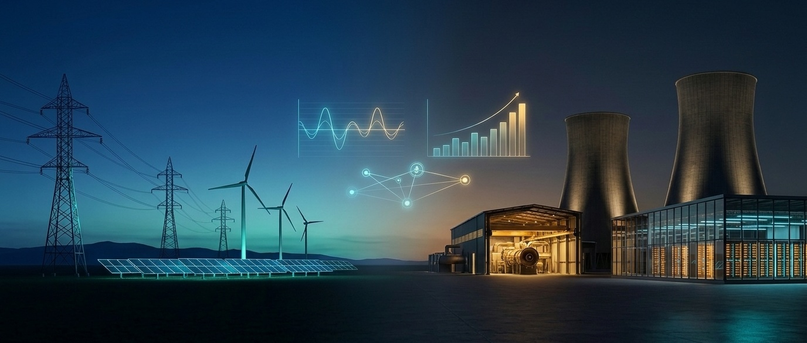
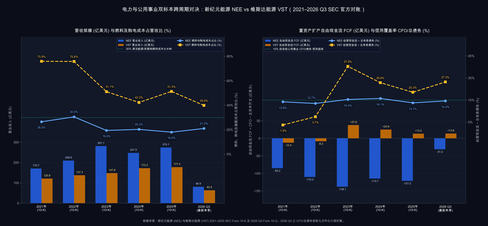

# 【行业指标 16】电力与公用事业财报解剖：受管制资产基数、发电结构与 AI 电力市场化重估

> **专栏定位：** 全行业 10-K/10-Q 外科手术显微镜与非 GAAP 核心指标全景字典  
> **解剖标的：** 新纪元能源 (NEE) 深度穿透 ＋ 维斯达能源 (VST) 镜像对照  
> **核心指标：** 收入定价与回报机制、电源装机结构与容量因子、燃料传导与衍生品 MTM 畸变、资本开支强度与信用覆盖  
> **审计基准：** 2021–2025 财年 SEC Form 10-K 年报 ＋ 2026 Q3 Form 10-Q 最新单季真数

> **摘要：** 电力企业分属受管制公用事业与市场化发电商两大阵营。本文剥离通用指标，提炼定价回报机制、电源装机与容量因子、燃料传导与 MTM 畸变、资本开支与信用覆盖四大指标，以 NEE 与 VST 拆解 AI 电力重估。

---

## 一、 行业核心指标深度解剖

电力与公用事业是现代经济体中最具物理刚性的基础设施：电能难以大规模廉价储存，必须实现毫秒级的发用实时平衡，且输配电网具有天然的区域垄断属性。在研究这一行业时，买方必须首先打破“电力股都是低波动收息债券”的陈旧刻板印象——在欧美及全球主流电力市场中，**受管制公用事业（Regulated Utilities）**与**市场化独立发电商（Independent Power Producers，IPP）**虽然同样生产每一度电，却运行在截然相反的定价体制、盈利弹性与资产负债表逻辑之下。要看懂电力股的真实护城河与 AI 算力浪潮下的重估成色，必须绕开表面市盈率，直击以下四个不可替代的行业专属维度：

| 分析维度 | 行业专属特异性指标 | 买方核心考核焦点 |
| :--- | :--- | :--- |
| **定价体制与盈利底座** | 收入定价机制与回报确定性 (Rate Base / Allowed ROE vs Merchant & PPA) | 辨别盈利源自行政核定资本回报还是市场竞价价差，核验长协或对冲覆盖率 |
| **物理供给与资产成色** | 电源装机结构与机组容量因子 (Capacity Mix & Capacity Factor) | 区分 24 小时稳定基荷与间歇性风光发电，核验核心机组实际满发利用率 |
| **成本传导与会计排雷** | 燃料购电成本占比与未实现衍生品畸变 (Fuel Ratio & MTM Distortion) | 审计极端燃料波动的传导能力，剔除非现金衍生品公允价值摆动对 GAAP 利润的扭曲 |
| **扩产飞轮与信用底线** | 重资产资本开支强度与信用覆盖红线 (CapEx/OCF & CFO/Debt) | 判别负自由现金流是受管制资产复利引擎还是盲目举债，盯紧投资级债务覆盖率 |

### 指标 1：收入定价机制与回报确定性（受管制费率核定 vs 市场化电价与长期 PPA）

审阅任何一家电力企业的年报，第一步不是看营收涨跌，而是定性其收入究竟处于哪一种监管定价体制。在**受管制公用事业体制**下，电力公司享有区域内独家输配电与供电特许权，作为交换，监管机构按“成本加成”原则核定终端电价：企业每年可获得的合法利润，等于其被纳入监管核算的**受管制资产基数（Rate Base）**、核定权益资本占比与**核定监管股本回报率（Authorized Regulatory ROE）**三者的乘积。

`受管制公用事业核定税后盈利 ≈ 受管制资产基数 (Rate Base) × 核定权益占比 × 核定监管 ROE`

在这种体制下，燃料涨价通常通过独立的“燃料附加费条款”全额传导给终端用户，企业真正的长期复利引擎只有一个：**持续投入合规资本开支，做大受管制资产基数** 。不过，资深电力买方在审计核定盈利时，绝不能只盯着名义 ROE 数字，还必须穿透两个关键变量：其一是**核定权益占比（Authorized Equity Ratio）**——行业常态约 `50%` ，顶级友好监管辖区可达 `60%` 附近，在同等 `10%` 核定 ROE 下， `60%` 权益占比每美元资产基数合法创造的股东利润比 `48%` 权益占比整整高出 **`25%`** ；其二是**监管滞后（Regulatory Lag）**与准备金平滑机制——由于新投入资本开支从入账到正式写入终端电价往往存在时滞，买方必须对比企业**实际赚取的监管 ROE（Earned Regulatory ROE）**是否稳定贴近核定区间上限，并穿透财报附注核查其是否动用了折旧准备金摊销或费率稳定机制来熨平天气与极端灾害扰动。

而在**解除管制的市场化发电体制（IPP）**下，电价由区域批发电力市场按边际机组出清决定，盈利不再受制于行政上限，而是取决于发电度电售价与燃料边际成本之间的价差（天然气发电称为**火花价差 Spark Spread**，煤电称为暗差），叠加电网为保障尖峰供电安全支付的**容量电价（Capacity Auction）**以及与科技巨头或工商业大户签署的**长期购电协议（PPA）** 。市场化发电商在电力短缺周期享受极高的正向经营杠杆，但一旦遭遇电价暴跌或机组非计划停运，便可能面临流动性危机。因此，买方考核市场化或混合型发电商的核心标尺，是**受管制业务占比、长期 PPA 签约覆盖率以及未来 1~2 年预期发电量的套保锁价比例**——当合同与对冲覆盖率稳居 **`80%` 以上** 时，盈利可视度大幅提升；若超过 **`50%`** 暴露在纯现货波动中，则必须按强周期品给予折价。

### 指标 2：电源装机结构与机组容量因子（Generation Capacity Mix & Capacity Factor）

在电力行业，“总装机容量（MW / GW）”本身是一个极易误导投资者的粗放数字，因为不同技术路线的 `1 GW` 装机在物理供电价值与商业变现能力上天差地别。风电与光伏虽然燃料边际成本趋近于零，但受自然光照与风力制约，天然具有间歇性与午间电价倒挂痛点，需要配套电池储能才能平抑波动；而人工智能数据中心与先进制造业需要的是全天候 `24 × 7` 零中断的**稳定基荷电力（Baseload Power）**，这正是**核电机组**与**高效联合循环燃气机组（CCGT）**在当前电力周期中重获稀缺溢价的物理根源。

衡量各类发电机组真实产出效率的核心物理标尺，是**机组容量因子（Capacity Factor）** ：

`机组容量因子 (Capacity Factor) ＝ 报告期实际净发电量 (MWh) ÷ (装机容量 MW × 报告期总小时数) × 100%`

在全行业物理常态下，核电机组除了每 18~24 个月例行停机换料外几乎全天候满发，优秀标杆的容量因子常年稳居 **`90%` 以上** ；联合循环燃气机组兼具基荷与调峰双重属性，在用电负荷吃紧、算力与电气化需求抬升的区域，其容量因子往往突破 **`55%` ~ `60%`** 甚至在夏季峰值逼近 `80%`；陆上风电与光伏受限于自然资源禀赋，容量因子通常仅在 `25% ~ 45%` 区间；而高排放煤电机组不仅碳税与环保改造成本高企，且在政策退役与新能源挤压下利用率持续滑坡。买方阅读 10-K「Item 1 / Item 2 资产清单」与 MD&A 运营数据时，必须同时穿透**清洁稳定基荷（核电 ＋ 高效气电 ＋ 配套储能）占比**、**老旧煤电敞口（警戒线 `> 25%` ）**以及核心核电与气电机组的容量因子趋势，以此判断一家电企究竟是卡位 AI 算力缺口的稀缺供给方，还是背负搁浅资产包袱的落后产能。

### 指标 3：燃料购电成本占比与未实现衍生品公允价值畸变（Fuel Ratio & MTM Distortion）

燃料、外购电与输配电费用通常是电力企业利润表上最大的单笔营业成本，买方通过**燃料及购电成本占营收比**来穿透两层底层风险：

`燃料与购电成本占比 ＝ (燃料成本 ＋ 外购电力与输配费用) ÷ 营业收入 × 100%`

对于以核电、风光水等零燃料或极低边际燃料电源为主的企业，以及拥有成熟监管燃料传导机制的受管制电网，该比例通常稳定控制在 **`30%` 以下** ；而以燃气或燃煤发电叠加零售供电业务为主的市场化发电商，该比例常规处于 `35% ~ 55%` 区间。横向对比这一比率时，买方还必须警惕一层**报表结构与分母口径差异** ：纵向一体化公用事业自有输配电网，电网折旧与运维计入折旧及运营费用，不落入燃料成本行；而拆解式零售发电商向外部本地电网支付的**代收转付过网费（Delivery Fees）**往往合并列示在该成本行内，直接对比表观数字容易高估后者的纯燃料负担。一旦该指标单季或单年陡然失控突破 **`55%` 甚至 `70%`** ，往往意味着极端天气导致气价与现货电价飙升，而企业因机组故障被迫高价向电网反向买电履约，引发严重的现金失血。

比燃料波动更隐蔽的，是电力财报中全市场最臭名昭著的会计暗门——**未实现衍生品公允价值变动（Unrealized Mark-to-Market，MTM）** 与伴生的**套保保证金追缴流动性陷阱（Margin Call Squeeze）** 。由于电力企业必须提前 1~3 年在期货市场卖出远期电力或买入天然气锁定利润，同时为长达数年的电站建设周期进行大额利率互换对冲，只要这些衍生品在会计准则（ASC 815）下不符合严格的“套期会计（Hedge Accounting）”认定，每一个季度末的远期电价、气价或美债利率跳动，都会把巨额的**未实现账面浮盈或浮亏**直接计入当期 GAAP 营业收入、燃料成本或利息费用！

这会同时制造出两重极具欺骗性的财报扭曲：第一，在利润表上，当远期电价大涨时，已经提前锁价套保的发电商反而会在当期 GAAP 营业收入中扣减几十亿美元的“未实现衍生品巨亏”，不仅把 GAAP 净利润砸至腰斩甚至转负，还会反向压低分母营收、人为抬高表观燃料成本占比；反之，美债利率变动触发的利率互换浮盈又可能让利息费用由负转正，凭空吹胖 GAAP 净利润。第二，在现金流量表上，高比例套保虽能锁死远期利润，却会在远期电价暴涨期迫使企业向交易所追加天量**期货保证金存款（Margin Deposits）** ，造成当期经营现金流（CFO）瞬间枯竭，待合约交割后保证金才大规模回流形成现金流过山车。因此，买方审计电力股利润表时，**严禁直接拿表观 GAAP 净利润乘以市盈率估值**，必须将当期未实现 MTM 影响额与税前利润对比——凡是单期 `|未实现 MTM 损益| ÷ 税前利润` 超过 **`30%`** 时，GAAP 净利润已彻底丧失经营信号意义，必须立即切换至剔除 MTM 噪音后的**核心经调整盈利 / 经调整 EBITDA（Ongoing Adjusted EBITDA）** ，并穿透现金流量表中的**保证金净变动**做二次验真。

### 指标 4：重资产资本开支强度、税收抵免变现与信用覆盖红线（CapEx/OCF & CFO/Debt）

绝大多数非金融行业的买方纪律都要求“自由现金流长期为正”，但把这把尺子生搬硬套到电力行业，往往会得出南辕北辙的误判。电力与电网属于典型的超长久期重资产行业，两种商业模式在资本开支强度（`CapEx ÷ 经营现金流 CFO`）上呈现截然相反的健康形态：

* **受管制公用事业（结构性负 FCF 扩表型）：**  
  只要监管核定 ROE 显著高于边际融资成本，每一美元合规投向电网升级、配网加固与新电站的资本开支，都会转化为未来 30~40 年稳赚核定回报的受管制资产基数。因此，高速扩张的受管制公用事业与绿电开发商常年维持 `CapEx ÷ CFO` 高达 **`150% ~ 220%`** 、表观自由现金流持续为负，同时叠加清洁能源税收抵免（PTC/ITC）与**税收权益融资伙伴（Tax Equity / Differential Membership）**机制——将税收折旧与抵免收益让渡给机构投资人换取免息项目资本金，在财报上体现为负所得税费用、大额非控制性权益亏损回加以及融资性现金流入。
* **市场化独立发电商（正 FCF 现金收割型）：**  
  由于没有行政费率兜底，市场化发电商无法承受无休止的举债绿地扩张，其健康底线是将内生维持及扩产资本开支严格控制在经营现金流的 **`60%` 以内**，确保在电价景气周期释放充沛正向自由现金流，用于降低杠杆、逆周期低价并购存量优质核气资产或大规模回购注销股份。

无论哪一种模式，高企的资产负债率都是悬在电力股头顶的达摩克利斯之剑。华尔街信用评级机构与买方风控盯守电力股是否会触发信用降级或资金链断裂的终极硬尺，是以经营现金流代理测算的**债务现金流覆盖率（`CFO ÷ 总有息债务`，对应评级机构核心指标 `FFO / Debt`）** ：

`信用覆盖率 (CFO / Total Debt) ＝ 年度经营活动现金流净额 (CFO) ÷ 期末有息债务总额 × 100%`

在实际风控中，评级机构看重的 **`FFO / Debt` 会进一步剔除营运资本与期货保证金的短期摆动** ，以免被套保追缴虚低或交割回流虚高误导；此外，买方还必须同步排查两类常被忽视的权益与准债务暗门：高资本开支公用事业往往长期通过增发普通股或发行强制可转债权益单位“以股换债”来硬托信用评级，从而系统性侵蚀每股盈利（EPS）增速；而部分市场化发电商资产负债表上挂有高股息**优先股（Preferred Stock）** ，在买方清算顺序与杠杆测算中属于普通股之上的准债务。对于收入高度受管制、抗衰退极强的公用事业龙头，投资级信用评级的常规安全垫位于 **`15%`** 附近（受监管缓冲保护，短期跌至 `12% ~ 15%` 需警惕股权稀释融资风险，长期跌破 `10%` 则构成信用红灯）；而盈利波动剧烈的市场化发电商必须留出更厚的缓冲带，信用健康线需稳居 **`20%` 以上**，一旦跌破 **`15%`** 叠加高息再融资窗口，极易在电价下行周期被迫低位增发甚至违约重组。

---

## 二、 行业核心特异性指标全景速查对照表

| 指标名称 | 标准计量符号 | 买方核心考核焦点 | 行业优秀基准线 (Benchmark) | 危险预警与破位阈值 | 官方财报与 SEC 取数出处 |
| :--- | :--- | :--- | :--- | :--- | :--- |
| **收入定价与回报确定性** | `Earned ROE` / `Hedge & Contract %` | 受管制资产回报兑现度，以及市场化电量的长协/对冲覆盖深度 | 管制 ROE ≥ **`10%`** ；长协或近期套保覆盖率 ≥ **`80%`** | 管制 ROE ＜ **`8%`** ；或无保护纯现货敞口 ＞ **`50%`** | 10-K Item 1 监管条款、MD&A 监管 ROE 与衍生品套保披露 |
| **电源装机结构与容量因子** | `Capacity Mix` / `Capacity Factor` | 核电/高效气电等稳定基荷占比及满发利用率，排查老旧煤电包袱 | 核电容量因子 ≥ **`90%`** ；CCGT ≥ **`55%`** ；煤电占比 ≤ **`10%`** | 核电 ＜ **`80%`** ；CCGT ＜ **`40%`** ；高排放煤电 ＞ **`25%`** | 10-K Item 1/2 电站资产清单与 MD&A 运营数据专表 |
| **燃料传导与衍生品 MTM 畸变** | `Fuel/Rev%`  / `MTM÷EBT` | 燃料剧烈波动的成本转嫁能力，及未实现衍生品浮盈亏对 GAAP 扰动 | 燃料购电占比 ≤ **`30%`** ；单期 MTM 扰动 ≤ **`10%`** | 燃料购电占比 ＞ **`55%`** ；单期 MTM 扰动 ＞ **`30%`** | 合并利润表、MD&A 衍生品公允价值与 Adjusted EBITDA 调节表 |
| **资本开支强度与信用覆盖** | `CapEx/OCF` / `CFO/Total Debt` | 区分受管制扩表与市场化造血，盯紧投资级信用红线与税收抵免变现 | 市场化 IPP：`CapEx/OCF` ≤ **`60%`** 且 `CFO/Debt` ≥ **`20%`** ；管制公用：`CFO/Debt` ≥ **`15%`** | 管制公用 `CFO/Debt` ＜ **`10%`** ；市场化 IPP ＜ **`15%`** 或内生持续失血 | 现金流量表、资产负债表债务附注及税收权益融资附注 |

---

## 三、 标杆实例深度实战：新纪元能源 (NEE) — 受管制电网与长期绿电 PPA 复利巨擘

作为北美市值最大、极具代表性的“受管制公用事业 ＋ 长期合约新能源”双轮驱动巨擘，新纪元能源（NextEra Energy, Inc.，NYSE: `NEE`）由两大支柱构成：其一是全美规模最大的单体受管制电力公用事业公司**佛罗里达电力与照明公司（FPL）**，服务逾 `600` 万户终端电力客户；其二是全球领先的批发光风储及核电开发运营商**新纪元能源资源公司（NEER）** 。下表全口径穿透其提交至 SEC 的 Form 10-K 年报与最新 Form 10-Q 季报六周期官方数据。

### 新纪元能源 (NEE) 核心指标跨周期全景财务底表 `(单位：亿美元，特殊标注除外)`

| 核心财务与经营科目 | 2021年 (10-K) | 2022年 (10-K) | 2023年 (10-K) | 2024年 (10-K) | 2025年 (10-K) | 2026 Q3 (最新单季) | 穿透勾稽结论与买方视角 |
| :--- | :---: | :---: | :---: | :---: | :---: | :---: | :--- |
| **宏观与行业创新周期** | 佛州电价新协议落地 | 美债利率飙升触发 ROE 上调 | 天然气价回落与绿电加速 | IRA 税收抵免兑现高峰 | AI 负荷爆发与核电重启签约 | 新一轮 4 年费率协议生效 | 完美穿越高通胀加息周期与 AI 电力景气起点 |
| **合并营业收入** | 170.7 | 209.6 | 281.1 | 247.5 | 274.1 | 80.9 | **【规模底座】** 2026 前九月累计 `223.3` 亿美元；双引擎驱动 |
| *　↳ 营收内含：FPL 受管制公用事业* | 141.0 | 172.8 | 183.7 | 170.2 | 182.6 | 54.2 | **【对应指标 1】** 稳定贡献近 **三分之二** 合并营收，抗周期压舱石 |
| *　↳ 营收内含：NEER 批发光风核储* | 30.5 | 37.2 | 96.7 | 75.4 | 87.6 | 25.2 | **【对应指标 1】** `95.0%` 装机锁定平均 **14 年** 长期 PPA 合约 |
| **FPL 实赚监管 ROE (%)** | **11.60%** | **11.74%** | **11.80%** | **11.40%** | **11.70%** | **11.80%** | **【对应指标 1】** 连续六年贴近核定区间上限运行（2026 核定中枢升至 `10.95%` ） |
| *　↳ FPL 税前准备金摊销 (RSM)* | 4.3 | 1.1 | 2.3 | 3.3 | 5.9 | -0.6 | **【对应指标 1】** 均为税前金额（26Q3 税后转回 `1.72` 亿）；2026 协议重充税后上限至 **15 亿美元** |
| **自有净装机总容量 (MW)** | **53,050** | **59,500** | **63,876** | **68,462** | **73,468** | 季报未单列 | **【对应指标 2】** 四年净增超 **20.4 GW** （`+38.5%` ），煤电仅余 **215 MW** （占比 `< 0.3%` ） |
| *　↳ 装机内含：FPL / NEER (MW)* | 28,450 / 24,600 | 32,100 / 27,400 | 33,276 / 30,600 | 35,052 / 33,410 | 35,963 / 37,505 | 季报未单列 | **【对应指标 2】** 2025 年底风电光伏 **40.8 GW** ＋ 气电 **25.9 GW** ＋ 核电 **5.8 GW** ，另含 **5.2 GW** 储能 |
| **燃料、购电及输配成本占比 (%)** | **26.5%** | **30.5%** | **19.4%** | **20.3%** | **18.0%** | **21.0%** | **【对应指标 3】** 清洁能源放量叠加密集燃料传导条款，稳守 **30% 优秀线内** |
| **GAAP 营业利润 (率)** | 29.1 (17.1%) | 40.8 (19.5%) | 102.4 (36.4%) | 74.8 (30.2%) | 82.8 (30.2%) | 26.2 (32.4%) | **【经营主干】** 剔除 2022 气价峰值后，核心营业利润率稳居 **30% 以上** |
| **GAAP 合并利息费用 (收益为正)** | -12.7 | -5.9 | -33.2 | -22.4 | -45.7 | **+19.3** | **【对应指标 3】** 26Q3 利率互换未实现 MTM 巨额浮盈致利息反转为正（9M 付现利息 `31.3` 亿） |
| **GAAP 所得税费用 (收益为负)** | 3.5 | 5.9 | 10.1 | 3.4 | **-8.0** | 6.6 | **【对应指标 4】** 2025 年清洁能源税收抵免发力，合并所得税转为 **净抵免收益** |
| **归属非控制性权益亏损回加 (NCI)** | +7.5 | +9.0 | +10.3 | +12.5 | **+15.0** | +4.1 | **【对应指标 4】** 税收权益伙伴吸收项目税盾亏损，持续增厚归母净利润 |
| **归母 GAAP 净利润** | 35.7 | 41.5 | 73.1 | 69.5 | 68.4 | **47.8** | **【对应指标 3】** 26Q3 归母净利受利率衍生品 MTM 虚增；FPL 单季稳赚 `16.2` 亿 |
| **经营活动现金流 (CFO)** | 75.5 | 82.6 | 113.0 | 132.6 | 124.9 | 50.5 | **【对应指标 4】** 2026 前九月累计 `123.2` 亿；底盘造血稳健上台阶 |
| **总资本开支 (含 NEER 投资及核燃料)** | 160.8 | 192.8 | 251.1 | 247.3 | 246.1 | 81.7 | **【对应指标 4】** `CapEx/OCF` 常年维持 **`162% ~ 233%`** ，典型负 FCF 扩表机器 |
| *　↳ 现金流内含：税收权益融资流入* | 27.8 | 41.6 | 27.5 | 22.6 | 32.8 | 季报未单列 | **【对应指标 4】** 每年引入 **23 ~ 42 亿美元** 税收权益资本金，分担扩产压力 |
| **期末固定资产净值 (Net PP&E)** | 993.5 | 1,110.6 | 1,257.8 | 1,388.5 | 1,562.0 | **1,770.8** | **【对应指标 1】** 资产基数不到五年大增 **`+78.2%`** ，奠定长期复利底座 |
| **期末总有息债务 / CFO 覆盖率** | 548.3 (13.8%) | 649.7 (12.7%) | 732.1 (15.4%) | 823.3 (16.1%) | 956.2 (13.1%) | 1,139.3 (14.4%) | **【对应指标 4】** 债务迈过千亿门槛，覆盖率紧贴 **15% 投资级红线** 谨慎游走 |

*(注：NEE 总资本开支严格按合并现金流量表投资活动项下 FPL 资本开支、NEER 资本开支与独立发电投资及核燃料采购合并口径核算；2026 Q3 单季 CFO 50.5 亿与总资本开支 81.7 亿按 Q3 10-Q 前九月累计额减 Q2 10-Q 前六月累计额精确倒推，26Q3 之 CFO/总债务覆盖率按前九月年化 CFO 口径折算。)*

### 核心看点 ①：受管制“ROE ＋ 59.6% 高权益占比 ＋ RSM 蓄水池”与 14 年长协构筑的双重确定性
NEE 之所以能在过去数十年成为华尔街公用事业的估值标杆，核心在于它把“行政特许经营的稳健”与“清洁能源长协的成长”无缝焊接在了一张资产负债表上。在受管制端，佛罗里达州公用事业委员会（FPSC）不仅给予 FPL 极度友好的监管框架——核定权益资本占比高达 **`59.6%`** （显著高于全美公用事业 `~50%` 常规水平，仅权益结构一项就放大了每美元资产基数的合法利润空间），核定监管 ROE 中枢随利率环境从 `10.60%` 抬升至 `10.80%` ，并在 2026 年生效的新一轮四年费率协议中进一步上调至 **`10.95%`** （允许区间 `9.95% ~ 11.95%` ）——更赋予了 FPL 独步全美的**准备金摊销与费率稳定机制（RSM）** 。通过合法增减税前折旧准备金摊销额（2025 年税前动用 `5.93` 亿美元，2026 新协议将其税后可用上限重新补足至 **`15` 亿美元** ），FPL 得以在不频繁申请涨价的前提下，连续六年将实赚监管 ROE 精准锁定在 **`11.40% ~ 11.80%`** 的核定上限边缘。在电源结构与批发电端，2025 年底 NEE 合计 `73.5 GW` 装机中风电光伏高达 `40.8 GW` 、高效燃气 `25.9 GW` 、零碳核电 `5.8 GW` 、独立配套储能 `5.2 GW` ，高排放煤电仅剩微不足道的 **`215 MW`（ `< 0.3%` ）** ；其中 NEER `37,505 MW` 装机中有 `35,627 MW`（ **`95.0%`** ）锁定了加权平均剩余期限长达 **`14` 年** 的长期购电协议，并且紧抓 AI 算力基荷风口，在 2025 年底向美国核管会提交了爱荷华州 Duane Arnold 核电站复运申请，同时提前签下覆盖其全额产能的 **`25` 年期** 长期 PPA。

### 核心看点 ②：穿透三大公用事业财报奇观——利率 MTM 虚盈、负所得税与税收权益回加
如果缺乏行业财务显微镜，普通投资者打开 NEE 的 2025 年报和 2026 Q3 季报一定会满头雾水：为何一家背负逾千亿美元债务的巨头，在 2026 Q3 合并利润表上的“利息费用”竟然变成了 **`+19.3` 亿美元的净利息收入**？又为何在 2025 年录得逾 `60` 亿美元税前利润的情况下，合并所得税不仅没交，反而确认了 **`8.0` 亿美元的所得税收益**？这恰恰是美国电力与新能源财报最具代表性的两大专业机制：第一，针对 2026 Q3 归母净利润暴冲至 `47.8` 亿美元的异象，附注明确披露，这是由于公司为对冲未来长期发债成本而持有的非合格利率衍生品在当季录得巨额**未实现公允价值浮盈**所致（前九月真实支付现金利息实为 `31.3` 亿美元），剔除这层 MTM 纸面泡沫后，FPL 与 NEER 的真实经营盈利仍维持稳健节奏；第二，美国清洁能源法案赋予风电、光伏与储能高额生产与投资税收抵免（PTC/ITC），NEER 通过向华尔街银行与大机构出售项目税收权益（Differential Membership Investors），把加速折旧与税收亏损分配给外部伙伴，从而同时在损益表上造就了“负所得税 ＋ 每年 `7.5 ~ 15.0` 亿美元非控制性权益亏损回加”，并在现金流量表上转化为每年 `23 ~ 42` 亿美元的免息扩产资金。

### 核心看点 ③：连续每年超百亿负 FCF 的扩表代价——`90.3` 亿增发稀释与紧绷的信用红线
看懂了受管制资产基数的复利逻辑，就能彻底理解为何 NEE 连续五年自由现金流深陷 `-85` 亿至 `-138` 亿美元泥潭，却依然稳居顶级蓝筹阵营：其每年 `240 ~ 250` 亿美元的重磅资本开支并非无效烧钱，而是直接沉淀为 `1,770.8` 亿美元的受管制电网与长期合约电站固定资产，驱动净固定资产在不到五年内扩张近八成，进而锁死未来数十年近两位数的稳态盈利复利。然而，天下没有免费的规模复利——面对持续放大的资金缺口，NEE 一方面推升期末总有息债务从 2021 年的 `548.3` 亿美元一路飙升至 2026 Q3 的 **`1,139.3` 亿美元**，使得其 `CFO ÷ 总有息债务` 覆盖率在 2025 年一度下探至 **`13.1%`** ，2026 Q3 年化口径回升至 **`14.4%`** ，始终贴近 **`15%`** 投资级公用事业信用红线的下沿游走；另一方面，NEE 在 2022 年至 2026 年前九月已通过筹资现金流累计净发行普通股及强制可转债权益单位（Equity Units）高达 **`90.3` 亿美元** （其中 2023 年单年即发行 `45.1` 亿、2025 年 `20.4` 亿、2026 前九月 `9.7` 亿），导致稀释后加权总股本从 2021 年 `19.72` 亿股稳步膨胀至 2026 Q3 的 **`20.98` 亿股（`+6.4%` ）** 。这种系统性“以股换债”硬托信用评级的代价，便是归母净利润增速与每股 EPS 增速之间长期存在的隐性稀释剪刀差。

---

## 四、 标杆实例镜像对照：维斯达能源 (VST) — 市场化独立发电商的核电并购与 AI 周期重估

为了与受管制公用事业巨擘形成最锋利的镜像对照，我们引入北美规模领先的纯市场化独立发电商兼零售电企——**维斯达能源（Vistra Corp.，NYSE: `VST`）** 。与 NEE 依托行政费率与 14 年长协不同，VST 彻底扎根于德州（ERCOT）、美东（PJM / ISO-NE / NYISO）与加州（CAISO）等全面解除管制的竞争性电力市场，不享受政府核定 ROE 兜底，其盈利完全取决于发电成本控制、核电与高效气电产能布局、PJM 容量拍卖价格以及终端零售对冲能力。

### 电力双雄跨周期核心指标镜像对照底表 `(单位：亿美元，特殊标注除外)`

| 核心财务与经营科目 | 标的 | 2021年 (10-K) | 2022年 (10-K) | 2023年 (10-K) | 2024年 (10-K) | 2025年 (10-K) | 2026 Q3 (最新单季) | 穿透勾稽结论与买方视角 |
| :--- | :---: | :---: | :---: | :---: | :---: | :---: | :---: | :--- |
| **商业体制与定价机制** | **NEE** **VST** | 管制+长协 市场+零售 | 管制+长协 市场+零售 | 管制+长协 市场+零售 | 管制+长协 市场+零售 | 管制+长协 市场+零售 | 管制+长协 市场+零售 | **【对应指标 1】** NEE 赚行政核定 ROE；VST 赚市场化价差、PJM 容量拍卖与核电 PTC |
| **合并营业收入** | **NEE** VST | 170.7 120.8 | 209.6 137.3 | 281.1 147.8 | 247.5 172.2 | 274.1 177.4 | 80.9 63.5 | **【营收体量】** VST 借并购与电价上行，2026 前九月营收增至 `160.0` 亿美元 |
| **自有净装机总容量 (MW)** | **NEE** **VST** | 53,050 ~37,000 | 59,500 ~37,000 | 63,876 36,702 | 68,462 40,657 | **73,468** **43,641** | 季报未单列 季报未单列 | **【对应指标 2】** VST 2024 购核电、2025 购气电，2026 年 10 月期后收购 Cogentrix 再添 `5,500 MW` 气电 |
| *　↳ VST 核电装机 (MW) / 占比* | **VST** | 2,400 (6%) | 2,400 (6%) | 2,400 (7%) | **6,448 (16%)** | **6,448 (15%)** | **6,448** | **【对应指标 2】** 收购 Energy Harbor 核电翻倍；另与 AWS、Meta 签 20 年 AI 核电大单合计 `3,809 MW` |
| *　↳ VST 德州核电 / 气电容量因子* | **VST** | 96.3% / 43.2% | 93.6% / 48.8% | 89.9% / 55.1% | 93.3% / 58.1% | 95.4% / 59.1% | **98.1% / 81.7%** | **【对应指标 2】** 26Q3 属夏季用电峰值，德州气电同比 `25Q3 (73.7%)` 升 `8.0pct` ，前九月同比 `64.8% vs 58.6%` |
| *　↳ VST 零售售电量 (太瓦时 TWh)* | **VST** | 93.1 | 98.1 | 97.4 | 133.4 | **139.1** | 38.4 | **【对应指标 1】** 庞大终端零售用户群与自有电厂形成天然上下游电价对冲 |
| **燃料、购电及输配占比 (%)** | **NEE** **VST** | **26.5%** 75.9% | **30.5%** 75.8% | **19.4%** 51.1% | **20.3%** 42.3% | **18.0%** 51.3% | **21.0%** **39.9%** | **【对应指标 3】** VST 该行含代收零售过网费；且营收分母受 MTM 浮盈亏干扰导致 2025 表观反弹 |
| **GAAP 营业利润率 (OPM)** | **NEE** VST | 17.1% -12.5% | 19.5% -8.6% | 36.4% 18.0% | 30.2% 23.7% | 30.2% 10.7% | 32.4% 26.9% | **【对应指标 3】** VST 2025 表观 OPM 骤降纯属衍生品 MTM 浮亏扭曲 |
| **GAAP 归母/合并净利润** | **NEE** VST | 35.7 -12.6 | 41.5 -12.1 | 73.1 14.9 | 69.5 28.1 | 68.4 **9.4** | 47.8 11.4 | **【对应指标 3】** 双方 GAAP 净利均遭衍生品公允价值重度扰动，不可直接比 PE |
| *　↳ VST 剔除 MTM 经调整 EBITDA* | **VST** | 19.1 | 29.9 | 41.0 | 55.4 | **58.4** | **23.6** | **【对应指标 3】** 剥离 `2022(-25.1亿)`、`2024(+11.6亿)`、`2025(-8.1亿)` MTM 后利润 **五年连涨超 3 倍** |
| **经营活动现金流 (CFO)** | **NEE** VST | 75.5 -2.1 | 82.6 4.9 | 113.0 54.5 | 132.6 45.6 | 124.9 40.7 | 50.5 21.1 | **【对应指标 4】** VST 彻底逆袭为超级现金牛（2026 前九月累计 CFO `43.3` 亿美元） |
| **总资本开支 / 占 CFO 比** | **NEE** **VST** | 160.8 (213%) 10.3 (N/A) | 192.8 (233%) 13.0 (268%) | 251.1 (222%) **16.8 (31%)** | 247.3 (187%) **20.8 (46%)** | 246.1 (197%) **27.5 (68%)** | 81.7 (162%) **7.5 (35%)** | **【对应指标 4】** NEE 重仓扩建资产基数；VST 内生 `CapEx/OCF` 克制在轻盈区间 |
| **自由现金流 (FCF = CFO − CapEx)** | **NEE** **VST** | -85.2 -12.4 | -110.2 -8.2 | -138.1 **+37.8** | -114.7 **+24.9** | -121.2 **+13.2** | -31.2 **+13.6** | **【对应指标 4】** 资本哲学两极：NEE 借债扩表，VST 2021–2025 累计回购股票 **`59.6` 亿美元** |
| **期末总有息债务 / CFO 覆盖率** | **NEE** **VST** | 548.3 (13.8%) 107.3 (-1.9%) | 649.7 (12.7%) 130.5 (3.7%) | 732.1 (15.4%) **144.0 (37.9%)** | 823.3 (16.1%) **170.5 (26.8%)** | 956.2 (13.1%) **200.7 (20.3%)** | 1,139.3 (14.4%) **211.5 (27.3%)** | **【对应指标 4】** VST 债务覆盖率自 2023 起持续稳居 **20% 以上** 市场化安全垫 |

*(注：本表严格遵守 GAAP 对 GAAP 可比口径，VST 剔除未实现大宗商品衍生品损益后的官方非 GAAP 核心指标「经调整 EBITDA」独立单列展示；VST 净利润为合并净利润，总有息债务含短期借款、应收账款融资及长短期债券，资产负债表另挂有 24.8 亿美元优先股；VST 资本开支含核燃料采购与长协预付款；VST 2026 Q3 单季 CFO 21.1 亿与 CapEx 7.5 亿按 Q3 10-Q 前九月累计额减 Q2 10-Q 前六月累计额倒推核算，26Q3 之 CFO/总债务按前九月年化口径折算。)*

> **图表买方核心解读：** 左图揭示燃料与过网费成本格局，需注意 VST 含零售过网费及营收 MTM 扰动。右图展现两极分化：NEE 连年负 FCF 扩表紧贴 15% 信用红线；VST 熬过 2021–2022 保证金抽血期后转为强正 FCF 现金牛，债务覆盖率跃升至 20% ~ 38%。

### 关键差异 ①：行政核定 11% 稳态复利 vs 3,809 MW AI 核电 20 年长协与 PJM 容量拍卖弹性
对比两家巨头的盈利曲线，能最直观地看穿“受管制公用事业”与“市场化独立发电商”的估值逻辑分水岭。NEE 的 FPL 板块赚的是**确定性极高但向上封顶的行政复利** ：只要佛州人口与用电负荷增长、资本开支持续入账，其监管 ROE 便精准落在 `11.4% ~ 11.8%` 的走廊里，哪怕 AI 算力引发全美局部电价翻倍，受管制电价也不可能借机暴涨。而 VST 恰好处于光谱的另一端——在 2021 年德州冬季风暴 Uri 期间，缺乏监管兜底的 VST 一度因燃气机组冻停被迫天价购电、惨遭亏损；但当 AI 数据中心引爆全天候基荷电力荒时，VST 凭借零碳核电完成了从“纯周期发电商”向“类公用事业 AI 能源军火库”的重估跃迁：先是于 2025 年 9 月与 **亚马逊 AWS** 签下 `20` 年期（另含最高 `20` 年续约权）核电 PPA，由德州 Comanche Peak 核电站供应 **`1,200 MW`** 零碳电力；紧接着于 2026 年 1 月与 **Meta Platforms** 达成 `20` 年期核电 PPA，由美东 PJM 核电机组供应高达 **`2,609 MW`** 电力与容量（含 `2,176 MW` 存量机组装机与 `433 MW` 增容扩建）。两笔 AI 巨头大单合计锁定 `3,809 MW`（其中存量在运产能 `3,376 MW` 占其 `6,448 MW` 核电总装机的 `52.4%` ），把大科技公司直接变成了二十年期的稳定支付对手方。在市场竞价端，2026 年 7 月完成的 PJM 2028–2029 年度容量拍卖全区出清价一举锁定 **`325.00` 美元/兆瓦·日** ，VST 中标 **`10,924 MW`** 提前锁定约 `13` 亿美元年度容量收入；同时，美国《通胀削减法案》第 `45U` 条款为存量核电设立了最高 `15` 美元/兆瓦时的生产税收抵免底线（2025 年退坡区间 `26.00 ~ 44.75` 美元/兆瓦时），形成“下方政府保底、上方 AI 竞价上不封顶”的非对称赔率。

### 关键差异 ②：严苛同比检验气电容量因子跃升，以及核气升级 vs 20% 遗留煤电包袱
如果只看 2021 年的 VST，它只是一家煤电占比偏高、饱受极寒冲击的传统周期发电商；但过去三年，管理层借助充沛现金流实施了教科书级的逆周期装机重构：先是在 2024 年 3 月斥资 `30.65` 亿美元现金完成对 Energy Harbor 的收购，将零碳核电装机从 `2,400 MW` 一步扩充至 **`6,448 MW`** （总装机占比从 `7%` 跃升至 `15% ~ 16%` ），同时将零售售电量推升至 `139.1` 太瓦时，形成“发电厂对冲零售用户”的一体化商业闭环；随后在 2025 年 10 月耗资 `11.40` 亿美元现金完成 Lotus 收购，新增 `2,600 MW` 现代化燃气机组；紧接着在 2026 年 10 月（26Q3 期后事项）又迅速交割 Cogentrix 交易，一口气再添 `10` 座合计约 **`5,500 MW`** 的高效率天然气电厂。但买方审读德州高效联合循环气电机组（CCGT）容量因子时必须剔除夏季用电峰值干扰： `2026 Q3` 高达 **`81.7%`** 固然叠加了三季度盛夏制冷负荷因素，真正证明供需结构性趋紧的铁证是**严格同季与累计同比涨幅**——对比 `2025 Q3` 的 `73.7%` 同比大增 **`+8.0` 个百分点** ，剔除单季极值的 `2026 前九月` 累计容量因子亦从上年同期的 `58.6%` 跃升至 **`64.8%`** （同比 `+6.2` 个百分点），同时德州核电 `26Q3` 稳定跑出 **`98.1%`** 超高满发率。不过与 NEE 煤电占比已降至不足 `0.3%` 不同，VST 截至 2025 年底仍保留着 **`8,743 MW`（占比 `20%` ）煤电装机** （其中 `3,928 MW` 已排期至 2027–2028 年退役），这部分遗留产能的转型减值与环保成本仍是买方不可忽视的尾端折扣项。

### 关键差异 ③：穿透营收 MTM 分母污染、保证金现金流过山车与 `-28.6%` 大幅缩股的终极对照
VST 的六周期底表，完整演绎了电力市场化交易中三大极易被普通投资者忽视的财务暗门：第一，**利润与营收分母的双重 MTM 幻象**——2022 年远期电价大涨触发 VST 提前套保合约录得 **`25.1` 亿美元未实现 MTM 浮亏**，把 `29.9` 亿美元核心经调整 EBITDA 硬生生砸成 `-12.1` 亿美元 GAAP 巨亏；更隐蔽的是，VST 的商品未实现损益主要直接计入**营业收入**，致使 2024 年（ `+11.6` 亿浮盈）与 26Q3（ `+5.6` 亿浮盈）虚增分母营收、表观压低了燃料占比，而 2025 年（ `-8.1` 亿浮亏）缩水了分母营收、叠加德州零售刚性过网费因素，让刚并完核电的 VST 2025 年燃料及过网费占比反而表观反弹至 **`51.3%`** ，实则剔除 MTM 后经调整 EBITDA 稳步从 `55.4` 亿美元爬坡至 **`58.4` 亿美元**，2026 前九月更劲增 `35.7%` 至 `55.8` 亿美元。第二，**套保保证金追缴制造的 CFO 过山车**——为何 VST 2022 年核心经调整 EBITDA 高达 `29.9` 亿，同年 CFO 却惨跌至 `4.9` 亿（ `CFO/Debt = 3.7%` ），而 2023 年又在 `41.0` 亿 EBITDA 下暴冲出 `54.5` 亿天量 CFO（ `37.9%` ）？SEC 现金流附注揭晓了真相：2021–2022 年远期电价飙涨期间，VST 被迫向交易所净追加 **`10.0` 亿与 `18.7` 亿** 美元套保保证金，几乎抽干当期经营现金流；2023–2024 年随合约交割回流 **`+19.0` 亿与 `+8.4` 亿** 美元，2025 年再次净流出 **`-7.7` 亿** 美元，这正是评级机构必须剔除保证金波动盯防 `FFO/Debt` 的根本原因。第三，**股本胀缩与准债务杠杆的资本配置两极**——NEE 靠每年逾 `240` 亿美元扩表并在 2022–2026 前九月净发行 `90.3` 亿美元股票及权益单位导致股本膨胀 **`+6.4%`** ；而 VST 凭借轻量内生 `CapEx/OCF`（ `31% ~ 68%` ），在 `2021–2025` 累计斥资 **`59.6` 亿美元** （2026 前九月再回购 `9.2` 亿）把流通股本从 `4.69` 亿股大幅削减 **`-28.6%`** 至 `3.35` 亿股，不过买方计算真实股权安全垫时亦须扣减其账面 **`24.8` 亿美元优先股** （2025 年刚性派息 `1.9` 亿美元）构成的准债务负担。

---

## 五、 实战对账自查表：如何 5 分钟完成电力与公用事业财报体检

审阅任意一家港美股或 A 股上市电力与公用事业公司的年报时，建议严格按照以下四步动作顺序查账，具体量规标尺统一收口于下方四列指示灯标准表：

1. **查 Item 1 监管条款与 MD&A 费率/套保披露：** 先定性公司属于受管制电网还是市场化 IPP；前者同步核对核定 ROE、核定权益占比、实赚监管 ROE 及准备金平滑余额，后者核对长期 PPA 占比、容量拍卖锁价与未来 1~2 年套保比例。
2. **查 Item 2 电站清单与 MD&A 运营发电表：** 拆分核电、高效气电、风光储能与老旧煤电的净装机占比，按严格同比口径核对核心核电与联合循环气电机组的容量因子变化（谨防拿夏季峰值单季直比全年均值），排查高排放搁浅煤电的退役减值包袱。
3. **查利润表燃料成本、衍生品调节表与现金流量表保证金：** 计算燃料及购电成本占营收比并确认是否混入代收过网费，随即翻到非 GAAP 调节表排查当期未实现 MTM 损益对营收分母与净利润的双重扭曲，并穿透经营现金流核查期货保证金存款净变动。
4. **查现金流量表与股本/债务附注：** 按商业模式分别检验 `CapEx ÷ CFO` 强度及税收权益融资依赖，以剔除保证金波动后的核心现金流与总债务比（`FFO / Debt`）对标信用底线，并核查是否伴随大规模增发稀释股本或账面优先股准债务压力。

| 核查维度 | 🟢 绿灯安全区 (优秀标杆) | 🟡 黄灯观察区 (稳健常规) | 🔴 红灯排雷区 (高危预警) |
| :--- | :--- | :--- | :--- |
| **收入定价与回报确定性** | 管制 ROE ≥ **`10%`** ；长协或近期套保覆盖率 ≥ **`80%`** | 管制 ROE **`8% ~ 10%`** ；长协或套保覆盖 **`50% ~ 80%`** | 管制 ROE ＜ **`8%`** ；或无保护纯现货敞口 ＞ **`50%`** |
| **电源结构与容量因子** | 核电容量因子 ≥ **`90%`** ；CCGT ≥ **`55%`** ；煤电占比 ≤ **`10%`** | 核电 **`80% ~ 90%`** ；CCGT **`40% ~ 55%`** ；煤电 **`10% ~ 25%`** | 核电 ＜ **`80%`** ；CCGT ＜ **`40%`** ；老旧煤电 ＞ **`25%`** |
| **燃料传导与 MTM 畸变** | 燃料购电占比 ≤ **`30%`** ；单期 MTM 扰动 ≤ **`10%`** | 燃料占比 **`30% ~ 55%`** ；单期 MTM 扰动 **`10% ~ 30%`** | 燃料占比 ＞ **`55%`** 成本倒挂；MTM 扰动 ＞ **`30%`** 严重失真 |
| **扩产强度与信用覆盖** | IPP：`CapEx/OCF` ≤ **`60%`** 且 `CFO/Debt` ≥ **`20%`** ；管制：`CFO/Debt` ≥ **`15%`** | IPP：`CFO/Debt` **`15% ~ 20%`** ；管制：`CFO/Debt` **`10% ~ 15%`** | 管制 `CFO/Debt` ＜ **`10%`** ；IPP ＜ **`15%`** 或长期负 FCF 失血 |

---

## 六、 本讲买方总结与下讲预告

> **买方极简心法：** 买电力股绝不可混为一谈——受管制公用事业买的是“核定 ROE × 资产基数 × 信用底线”，市场化发电商买的是“稀缺基荷 × 剔除 MTM 真实价差 × 正 FCF 回购”。

---

### 下讲预告：【行业指标 17】上游金属矿业与资源周期财报解剖：探明储量、单位现金成本与资源民族主义暗门（自由港迈克墨伦 FCX 与 南方铜业 SCCO）

解剖完支撑全球电气化与 AI 算力底座的 **电力与公用事业** 之后，下一讲我们将顺着实体产业链继续向最上游的地下矿脉掘进—— **【上游金属矿业与资源周期】！**

无论是特高压输电线路、数据中心液冷散热还是新能源风光储能，其背后都离不开被称为“现代电气化血管”的战略金属——铜。为什么同处铜价牛市，有的矿业巨头能坐享极低现金成本与半个世纪的纯权益储量年限，有的却在矿石品位下滑、强建冶炼厂资本开支与少数股东利润截留中剧烈颠簸？下一讲，我们将派出全球铜金矿业巨擘 **自由港迈克墨伦（Freeport-McMoRan, FCX）** 与坐拥顶级超长储量年限的 **南方铜业（Southern Copper, SCCO）** 展开跨周期硬核对账，深度拆解**储量权益与开采年限、产量品位与副产品、单位现金成本 C1 与均价剪刀差**三大矿业专属指标，并穿透资本开支周期与资源国少数股东分利暗门，敬请期待！
