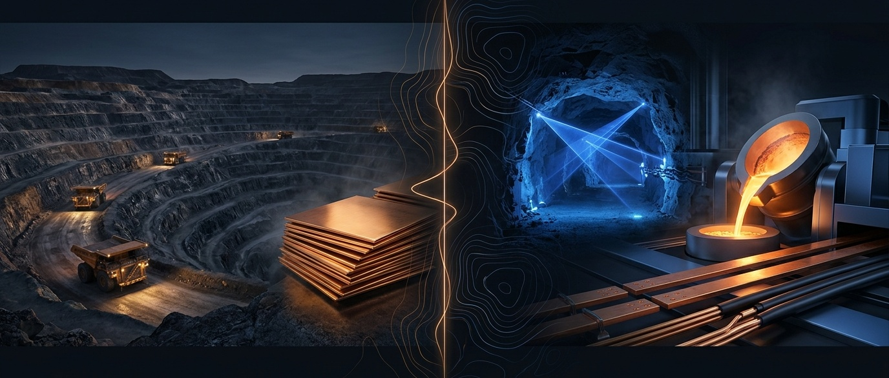
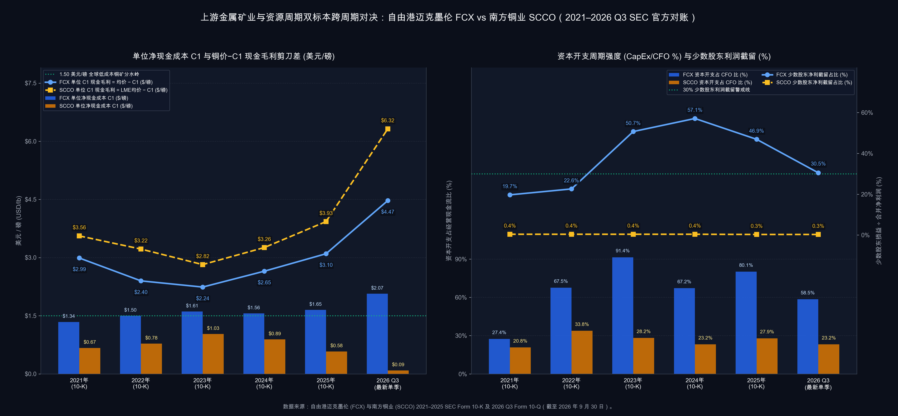

# 【行业指标 17】上游金属矿业与资源周期财报解剖：探明储量、单位现金成本与资源民族主义暗门

> **专栏定位：** 全行业 10-K/10-Q 外科手术显微镜与非 GAAP 核心指标全景字典  
> **解剖标的：** 自由港迈克墨伦 (FCX) 深度穿透 ＋ 南方铜业 (SCCO) 镜像对照  
> **核心指标：** 储量权益与开采年限、产量品位与副产品、单位现金成本剪刀差、资本开支与少数股东截留  
> **审计基准：** 2021–2025 财年 SEC Form 10-K 年报 ＋ 2026 Q3 Form 10-Q 最新单季真数

> **摘要：** 上游铜矿不是单纯的商品价格看涨期权，更是储量损耗、品位递减与资源民族主义的重资产博弈。本文提炼储量与开采年限、产量品位、C1 现金成本剪刀差、CapEx 与少数股东截留四大指标，以 FCX 与 SCCO 穿透矿业真实成色。

---

## 一、 行业核心指标深度解剖

金属矿业是典型的“消耗型重资产周期行业”：矿企账面上的每一吨精矿卖出，本质上都是在永久性消耗地下不可再生的有限矿藏；与此同时，从发现矿脉、环评批复、修路通电到建成投产往往跨越 `7 ~ 15` 年超长资本开支周期，且全球核心高品位矿藏高度集中于地缘与政局博弈频发的资源国。因此，用普通制造业的 PE 或表面毛利率去给矿业股定价极易踩坑。真正决定一家矿企能否穿越商品熊市、并在牛市中把金属涨幅切实装进普通股股东口袋的，是以下四个不可替代的行业专属维度：

| 分析维度 | 行业专属特异性指标 | 买方核心考核焦点 |
| :--- | :--- | :--- |
| **资源家底与期限** | 探明与概略储量、权益归属与开采年限 (P&P Reserves & Reserve Life) | 辨别商业可采储量与未验证资源量，剥离非控股方份额核算净权益年限 |
| **物理禀赋与产出** | 核心金属产量、矿石品位与伴生副产品 (Production, Ore Grade & By-Products) | 跟踪地下/露天矿石品位衰减曲线，评估副产品（金、钼、银）的先天补贴 |
| **盈利厚度与抗跌力** | 单位现金成本 C1 与实现均价剪刀差 (Gross/Net C1 vs Realized Price) | 同时拆解抵扣前毛成本与抵扣后净成本，盯防副产品高价掩盖矿山通胀 |
| **周期节奏与分配权** | 资本开支周期与少数股东利润截留 (CapEx Cycle & NCI Profit Leakage) | 辨别产能投建峰值与收获期拐点，穿透资源国股权分利与税费收割暗门 |

### 指标 1：探明与概略储量、权益归属与静态开采年限（P&P Reserves, Equity Share & Reserve Life）

审计矿业企业资产底座的第一把标尺，既不是固定资产原值，也不是账面现金，而是藏在年报资产清单里的**探明与概略储量（Proven and Probable Reserves，简称 P&P 储量）** 。买方在读取储量数字时必须连续穿透三层认知陷阱：

1. **严禁混淆“资源量”与“经济可采储量”：** 只有经过严密钻探证实、在当前技术与长期假设金属价格下**具备经济开采价值**的矿石才计入 P&P 储量；而大量仅处于地质推断阶段的“矿产资源量（Mineral Resources）”在缺乏基础设施与环评许可时随时可能只是账面画饼。
2. **分清“原位金属量（Contained）”与“可采金属量（Recoverable）”：** 矿石从破碎、浮选到浸出存在物理选矿回收率损耗（大型斑岩铜矿通常仅约 `80% ~ 88%` ），后者扣除了冶金选矿损失，口径更严苛；不同矿企披露惯例不同，横向对标前必须校准同一维度。
3. **死盯“合并口径”与“净权益口径（Net Equity Interest）”的差额：** 合并报表会把矿企持有控股权甚至部分合营矿山的 `100%` 储量并入“合并储量”，但真正归属上市公司股东的**净权益储量**需要按每座矿山的实际经济持股比例逐一折算。当两者的比率（ **权益储量占比** ）大幅跌破 `75%` 时，合并账面上的资源规模存在严重虚胖。

`静态储采比 (开采年限) ＝ 期末 P&P 铜储量 ÷ 当年铜产量`

在全行业标尺下，顶级世界级矿企的静态储采比往往高达 **`30 年` 以上** 且权益归属占比稳居 **`80%` 以上** ；一旦静态储采比跌破 **`15 年`** 而又缺乏优质接续绿地矿山，企业将被迫在周期高点高溢价举债并购续命。但买方测算储采比时必须警惕一个**分母塌陷悖论** ：如果某年因矿井坍塌、泥石流或罢工导致当年产量暴跌 `20% ~ 30%` ，用单一当年产量作分母算出的“开采年限”会凭空暴涨，此时必须改用**正常满产产能或多年平均产量**作为分母，以免误把事故减产当作资源增储。

### 指标 2：核心金属产量、矿石品位与伴生副产品禀赋（Metal Production, Ore Grade & By-Products）

对于上游矿企，“营收增长”完全可能只是金属涨价带来的周期幻象；衡量矿企真实经营执行力的第一物理指标，是**核心金属年产量**以及矿石深处的**入选矿石品位（Average Ore Grade %）** 。

铜矿工业遵循一条残酷的物理反比定律：在日处理矿石吨数（Throughput）与选矿回收率既定的前提下，如果矿山入选铜品位从 `1.0%` 滑坡至 `0.33%` ，意味着要生产出同样 1 吨阴极铜，矿企必须多炸开、挖掘、运输、破碎和研磨整整 **3 倍重量** 的岩石，直接触发电力、柴油、炸药、耐磨球磨介质与设备折旧呈几何级数飙升！因此，老矿山随着露天矿坑不断向下剥离扩深而出现的“品位自然衰减”，是所有重资产铜企永恒的通胀宿敌。

与此同时，买方必须分辨矿床开采方式与**伴生副产品（By-Products）**结构：大规模**露天斑岩矿（Open-Pit）** （主流铜品位在 `0.30% ~ 0.60%` 区间）地质稳定性强、边坡可控、产能波动小；而超大型**深井地下崩落矿（Underground Block Cave）** （铜品位常可高达 `1.0%` 以上并富集高品位伴生金矿）虽拥有极佳的物理品位，却伴随井下地压、突泥溃水等灾难性停产风险，一旦发生事故便可能一次性打掉集团近半成副产品产出。至于伴生黄金、钼、白银或锌，则是改变矿企全球成本曲线排位的核心胜负手——拥有高品位共伴生金属的矿山，相当于拿着副产品白赚的现金收入去补贴主金属的采选账单。

### 指标 3：单位现金成本 C1 与实现均价剪刀差（Unit Cash Cost C1 vs Realized Price Spread）

评判一家矿企究竟坐落在全球成本曲线的左侧安全区，还是高危的边际亏损区，业内通行且不可替代的标准化尺子是**单位净现金成本（Unit Net Cash Cost，俗称 C1 成本）**与铜价之间的剪刀差利润：

`单位净现金成本 (Net C1) ＝ 矿山现场采选与运输成本 (Site Cost) ＋ 冶炼加工费与运费 (TC/RC & Freight) ＋ 特许权使用费 − 副产品净抵扣`

`单位 C1 现金利润率 ＝ (金属实现均价 − 单位净现金成本 Net C1) ÷ 金属实现均价 × 100%`

买方审核矿企财报的 C1 数据时，必须守住三条铁律：

* **死盯“抵扣前毛成本”与“抵扣后净成本”双轨并行：**  
  副产品（金、钼、银）价格暴涨可以把 `Net C1` 压低至接近零甚至负数，制造出“单磅铜只需几美分成本”的神话。但买方必须同时翻出 **抵扣前毛现场成本（Gross Site Cost / Before By-Products）** ——如果毛成本每年以 `10% ~ 15%` 的速度失控膨胀，一旦未来金银钼价格高位回落，矿山的真实成本底牌就会瞬间暴露。
* **核验 C1 口径是否剔除特许权使用费与法定员工分红：**  
  不同矿企对非 GAAP 口径的 C1 界定存在微妙差异：有的矿企在计算 C1 时全额计入了矿区特许权使用费与出口关税，有的矿企则将政府矿区特许权使用费（Royalties）及法定强制员工利润分享（Workers' Participation）视为税项剥离在 C1 成本表之外。若不翻阅 10-K/10-Q「Non-GAAP Reconciliation」附注做口径还原，极易误判两家企业的真实开采成本。
* **理解“矿山加权成本”与“现金利润率”：**  
  行业优异标杆常年将单位净 C1 成本锁在 `1.50 美元/磅` 以下，在主流金属景气或常态周期中维持 `≥ 60%` 的 **单位 C1 现金利润率** ；而当净 C1 突破 `2.50 美元/磅` 且现场毛成本持续恶化时，一旦宏观经济步入下行周期、铜价回撤，企业便极易跌破现金盈亏线甚至被迫关闭高成本边缘矿区。

### 指标 4：矿业资本开支周期、少数股东利润截留与资源民族主义风险（CapEx Cycle & NCI Profit Leakage）

矿业的终极收割并不全部发生在地上矿坑里，同样剧烈地发生在股权结构与矿业税法之中。买方投资矿业股必须将**资本开支节奏（`CapEx ÷ CFO`）**与**少数股东损益截留占比（`NCI ÷ 合并净利润`）**绑定联审：

`少数股东利润截留占比 ＝ 利润表归属非控制性权益净利润 (NCI) ÷ 合并净利润总额 × 100%`

在矿业长周期中，当大宗商品处于牛市高点、各路矿企同时砸钱上马大型绿地新建项目，或被资源国强制要求在本土耗费巨资配套建设“下游冶炼厂（Smelter）”作为换取采矿证续期的先决条件时，资本开支占经营现金流比例往往飙升至 **`70%` 甚至 `90%` 以上** ；更致命的是伴随资本开支超支的**资源民族主义（Resource Nationalism）**暗门——资源所在国政府在核心矿权到期续约窗口期，往往通过修宪加征暴利矿区税、限制原矿出口、以及强制要求矿企将核心矿山过半股权低价或渐进让渡给本地国有矿业伙伴。

这一地缘收割不会立刻消灭利润表的“合并营业收入”或“合并净利润”，而是精准体现在**归属非控制性权益净利润（NCI）的飙升**与**现金流量表融资项下向少数股东派发的巨额股息分红**上：如果一家矿企的**合并净利润**大涨 `30%` ，但其中超过 **`30%` 甚至 `50%`** 在利润表倒数第二行被少数股东截走，那么普通股股东能享受到的真金白银就已腰斩！只有资本开支严格控制在经营现金流 **`40%` 以内**、同时少数股东截留率稳居 **`10%` 以下** 的资源巨头，才能把高金属价格最完整地转化为普通股股东的自由现金流与高额分红。

---

## 二、 行业核心特异性指标全景速查对照表

| 指标名称 | 标准计量符号 | 买方核心考核焦点 | 行业优秀基准线 (Benchmark) | 危险预警与破位阈值 | 官方财报与 SEC 取数出处 |
| :--- | :--- | :--- | :--- | :--- | :--- |
| **储量、权益与开采年限** | `P&P Reserves` / `Life` / `Equity %` | 辨别商业储量与净权益占比，校验排除停产异常后的真实开采年限 | 储采比 ≥ **`30 年`** 且净权益占比 ≥ **`80%`** | 储采比 ＜ **`15 年`** 或净权益占比 ＜ **`50%`** | 10-K Item 2 矿产储量专章与附注 (Mineral Reserves) |
| **产量、品位与副产品** | `Production` / `Ore Grade %` | 跟踪核心金属产量韧性与矿石品位趋势，核查共伴生黄金/钼银禀赋 | 露天铜品位 ≥ **`0.50%`** （井下 ≥ **`1.00%`** ）且产量 ≥ **`0%`** 稳增 | 露天品位 ＜ **`0.30%`** 加速衰减或单年事故减产 ＞ **`10%`** | 10-K Item 1/2 分矿山运营统计表与 10-Q 运营摘要 |
| **C1 成本与均价剪刀差** | `Gross / Net C1` & `C1 Margin %` | 并行核验毛现场成本通胀与副产品补贴，测算抗周期现金利润率厚度 | 铜净 C1 ≤ **`1.50 美元/磅`** 且 C1 现金利润率 ≥ **`60%`** | 净 C1 ＞ **`2.50 美元/磅`** 、利润率 ＜ **`40%`** 或毛成本年涨 ＞ **`15%`** | 10-K/10-Q MD&A「单位现金成本与 Non-GAAP 调节表」 |
| **资本开支与少数股东截留** | `CapEx/CFO` / `NCI Share %` | 识别冶炼及绿地投资高峰，盯防资源国税费暴增与过半权益分流 | `CapEx/CFO` ≤ **`40%`** 且少数股东截留占比 ≤ **`10%`** | `CapEx/CFO` ＞ **`70%`** 侵蚀造血，或少数股东截留 ＞ **`30%`** | 合并利润表 NCI 行项、现金流量表及矿权许可附注 |

---

## 三、 标杆实例深度实战：自由港迈克墨伦 (FCX) — 深井超高品位宝藏与资源民族主义的双重博弈

作为全球上市纯度最高、产能名列前茅的铜金矿业巨擘之一，自由港迈克墨伦（Freeport-McMoRan Inc.，NYSE: `FCX`）掌管着横跨美洲与东南亚的三大产区：全球规模顶尖但低品位老龄化的美国露天斑岩铜矿群（约 `0.21% ~ 0.31%` 品位）、南美大型铜钼矿带，以及全球罕见的地下高品位铜金超级宝库——印尼巴布亚 **Grasberg（格拉斯伯格）**地下矿区（铜品位高达 **`1.10%`** ，另含每吨 `0.77` 克伴生黄金）。然而，这座支撑集团最高盈利厚度的超级金矿，也正是 FCX 承受“地缘股权稀释、强制冶炼厂建投”与“地下突发灾难事故”三重挤压的核心风眼。下表完整呈现 FCX 提交至 SEC 的 Form 10-K 与最新 Form 10-Q 六周期官方真实底稿。

### 自由港迈克墨伦 (FCX) 核心指标跨周期全景财务底表 `(单位：亿美元，特殊标注除外)`

| 核心财务与经营科目 | 2021年 (10-K) | 2022年 (10-K) | 2023年 (10-K) | 2024年 (10-K) | 2025年 (10-K) | 2026 Q3 (最新单季) | 穿透勾稽结论与买方视角 |
| :--- | :---: | :---: | :---: | :---: | :---: | :---: | :--- |
| **宏观与行业创新周期** | 疫后供应链紧缺铜价飙升 | 全球加息压制铜价回调 | 印尼 PTFI 权益骤降至 48.76% | 地下稳产叠加黄金副产暴走 | 9 月 Grasberg 突发泥石流停产 | 铜价破 `6.5` ＋ 井下复产爬坡 | 一部横跨“铜牛 → 股权让渡 → 井下黑天鹅”的教科书 |
| **可采 P&P 合并铜储量 (十亿磅)** | 107.2 | 111.0 | 104.1 | 97.0 | **112.3** | 季报未单列 | **【对应指标 1】** 2025 年底另含 `2,060` 万盎司黄金与 `35` 亿磅钼储量 |
| *　↳ 储量内含：FCX 净权益铜储量 (占比)* | 76.2 (71.1%) | 80.4 (72.4%) | 75.1 (72.1%) | 70.2 (72.4%) | **78.6 (70.0%)** | 季报未单列 | **【对应指标 1】** 近 **三成合并储量并不归属上市公司股东** ，必须折算 |
| *　↳ 隐含合并静态开采年限 (年)* | 27.9 | 26.4 | 24.7 | 23.0 | **33.2\*** | 季报未单列 | **【对应指标 1】** 2025 年暴增纯属泥石流拉低分母产量的假象，按正常产约 26 年 |
| **合并可采铜产量 (百万磅)** | 3,843 | 4,210 | 4,212 | 4,214 | **3,383** | 832 | **【对应指标 2】** 2025 年暴跌 **`-19.7%`** ；2026 前九月 `2,280` 百万磅同比仍降 `16.9%` |
| *　↳ 伴生黄金产量 (万盎司)* | 138.1 | 181.1 | 199.3 | 188.0 | **95.6** | 23.4 | **【对应指标 2】** 2025 年腰斩 **`-49.1%`** ，直接重创黄金副产品成本补贴 |
| **铜平均实现均价 (美元/磅)** | **4.33** | 3.90 | 3.85 | 4.21 | **4.75** | **6.54** | **【价格引擎】** 26Q3 黄金均价同飙至 `4,273` 美元/盎司（前九月 `4,578` ） |
| *　↳ 抵扣前现场采选毛成本 (美元/磅)* | 1.93 | 2.19 | 2.36 | 2.49 | **2.75** | **3.24** | **【对应指标 3】** 美国低品位矿山持续通胀叠加印尼减产摊薄，毛成本五年大增 **`+68%`** |
| **合并单位净现金成本 C1 (美元/磅)** | **1.34** | **1.50** | **1.61** | **1.56** | **1.65** | **2.07** | **【对应指标 3】** 黄金产量减半叠加工矿摊薄，净 C1 明显突破 **`1.50` 优秀线** |
| **单位 C1 现金毛利 / 现金利润率** | 2.99 (69.1%) | 2.40 (61.5%) | 2.24 (58.2%) | 2.65 (62.9%) | 3.10 (65.3%) | **4.47 (68.3%)** | **【对应指标 3】** 26Q3 靠 `6.54` 美元历史级铜价把 C1 利润率强力拉回 `68.3%` |
| **合并营业收入** | 228.5 | 227.8 | 228.6 | 254.6 | 259.2 | **75.5** | **【规模底盘】** 2026 前九月累计 `208.1` 亿美元 |
| **GAAP 营业利润 (率)** | 83.7 (36.6%) | 70.4 (30.9%) | 62.3 (27.2%) | 68.6 (27.0%) | 65.2 (25.2%) | **23.5 (31.2%)** | **【经营主干】** 2026 前九月 `64.9` 亿含 Q2 一次性 `6.99` 亿泥石流保险理赔收益 |
| **合并净利润总额** | 53.7 | 44.8 | 37.5 | 44.0 | 41.5 | 16.9 | **【矿山造血池】** 税前利润中隐含高额印尼及南美矿产所得税 |
| *　↳ 减：少数股东截留净利 (占比)* | 10.6 (19.7%) | 10.1 (22.6%) | **19.0 (50.7%)** | **25.1 (57.1%)** | **19.5 (46.9%)** | **5.1 (30.5%)** | **【对应指标 4】** 自 2023 年 PTFI 分红权切半起，近 **半数合并净利被少数股东分走** |
| **归属普通股股东净利润** | **43.1** | 34.7 | **18.5** | **18.9** | **22.0** | **11.7** | **【真归母收益】** 2024 年营收比 2021 年高 `26` 亿，归母净利反被 **腰斩** |
| **经营活动现金流 (CFO)** | 77.2 | 51.4 | 52.8 | 71.6 | 56.1 | 19.8 | **【现金引擎】** 2026 前九月累计 `55.2` 亿美元（含 `6.99` 亿保险赔款入账） |
| **资本开支 / 占 CFO 比** | 21.2 (27.4%) | 34.7 (67.5%) | **48.2 (91.4%)** | 48.1 (67.2%) | **44.9 (80.1%)** | 11.6 (58.5%) | **【对应指标 4】** 2023–2025 印尼冶炼及井下三年合计烧掉 `86.8` 亿美元 |
| **自由现金流 (FCF = CFO − CapEx)** | **56.0** | 16.7 | 4.5 | 23.5 | 11.2 | 8.2 | **【内生余粮】** 仅 2021–2025 向少数股东现金派息即抽走 **`51.5` 亿美元** |
| **总有息债务 / 账面非受限现金** | 94.5 / 80.7 | 106.2 / 81.5 | 94.2 / 47.6 | 89.5 / 39.2 | 93.8 / 38.2 | **94.0 / 43.4** | **【资产负债表】** 净债务稳定在 `50.6` 亿美元稳健区间；股东权益 `209.8` 亿（NCI `126.3` 亿） |

*(注：FCX `2026 Q3` 单季 CFO `19.8` 亿与 CapEx `11.6` 亿按 Q3 10-Q 前九月累计额减 Q2 10-Q 前六月累计额精确倒推；`*` 号提示 2025 年 33.2 年隐含开采年限因当年泥石流减产造成分母异常压低，非真实增储；单位净现金成本与储量为集团合并可采口径。)*

### 核心看点 ①：一堂关于“储量权属、品位悬崖与分母停产假象”的实战公开课
把 FCX 的 2025 年报摊在桌面上，能一次性扫除矿业投研最常犯的三大盲区。首先是**合并储量与净权益储量的巨大剪刀差** ：截至 2025 年底，FCX 账面高悬 **`1,123` 亿磅** 合并 P&P 可采铜储量，但一旦按矿山实际持股逐座剔除印尼与南美合作方权益，真正归属 FCX 上市公司股东的净权益储量仅余 **`786` 亿磅（`70.0%` ）** ，硬生生打了个七折。其次是**机械除出来的“开采年限假象”** ：表观上 2025 年隐含静态储采比从 2024 年的 `23.0` 年突然跳升至 **`33.2` 年** ，似乎资源寿元凭空延寿十年——实则原因恰恰是当年 9 月 Grasberg 地下矿区遭遇灾难性**泥石流（Mud Rush）**停产事故，把全年铜产量狠狠砸低了 `19.7%` 到 `3,383` 百万磅（直到 2026 Q2 才启动 Grasberg Block Cave 地下矿区分阶段爬坡复产）！最后是美国老矿与印尼富矿在**品位维度**的云泥之别：FCX 美国本土主力选矿品位已稀释至区区 **`0.31%`** （浸出仅 `0.21%` ），唯有依靠超大规模堆浸技术提取低品位尾矿；而印尼地下矿区即便经历开采下移，2025 年仍维持高达 **`1.10%`** 铜品位与每吨 `0.77` 克黄金的高富矿禀赋，正是这一正一负的物理差距，决定了它既割舍不下印尼矿山、又极度畏惧其地下工程风险。

### 核心看点 ②：“48.76% 权益切半 ＋ 强制本土冶炼厂”——资源民族主义的教科书级利润截留
如果只看 FCX 合并利润表最上方的营收（从 2021 年 `228.5` 亿涨至 2024 年 `254.6` 亿）和营业利润，几乎很难解释为何归母净利润却从 **`43.1` 亿美元腰斩至 `18.9` 亿美元** 。答案就锁死在利润表下方那行冷冰冰的科目里——**归属非控制性权益净利润（NCI）** 。依据与印尼政府签署的 2018 年协议，2022 年底前 FCX 在 PTFI 仍享有约 `81%` 的过渡期经济收益分配权，当时 NCI 占合并净利润不过 `20% ~ 23%` ；但自 **2023 年 1 月 1 日** 起，经济权益严格回归法定股权比例——FCX 仅持 **`48.76%`** ，而印尼国有控股伙伴 MIND ID 等持有 **`51.24%`** ！再叠加另一座南美主力矿山 Cerro Verde 仅持股 `55.08%` ，导致 FCX 在 `2023–2025` 年间每年高达 **`46.9% ~ 57.1%`** 的合并净利润直接被少数股东截流（仅 2024 年一年少数股东就分走 `25.1` 亿账面利润与 **`18.3` 亿美元** 现金派息！）。更沉重的换证条件在于资本开支端：为满足印尼政府原矿禁止直接出口的本土下游化诉求，FCX 必须在印尼投建大型新建冶炼厂，导致 `2023–2025` 年印尼单一产区吞噬了高达 **`86.8` 亿美元** 资本开支，把合并 `CapEx / CFO` 推高至 `80% ~ 91%` 。最新 2026 Q3 季报进一步披露了远期底牌：PTFI 于 2026 年 6 月正式递交延续 `2041` 年后采矿权（IUPK）的延期申请，根据双方谅解备忘录，FCX 将在 2041 年前维持 `48.76%` 权益，但自 **`2042` 年起将进一步让渡减持至约 `37%`** ——资源国长期逐级收回矿权分利的宿命已写明在长期契约之中。

### 核心看点 ③：泥石流重创副产品补贴，暴露出 `1.93 → 3.24` 美元/磅的毛成本膨胀暗涌
透过 FCX 单位现金成本的上下两行拆解，能精准捕捉到高金价遮羞布失效时的成本冲击。2021–2024 年期间，尽管北美低品位露天矿人工与物料持续通胀，把 FCX **抵扣前现场毛成本**从 `1.93` 美元/磅一路推高至 `2.49` 美元/磅，但依靠 Grasberg 每年高达 `181 ~ 199` 万盎司的伴生黄金副产品抵扣，合并净 C1 成本仍被强行按在 `1.50 ~ 1.61` 美元/磅的舒适区。然而 2025 年 9 月泥石流意外发生后，副产品黄金年产量腰斩至 **`95.6` 万盎司** （2026 前九月继续同比大降 `41.3%` 至 `52.3` 万盎司），加之停产期固定成本摊薄恶化，直接令集团抵扣前现场毛成本在 `2026 Q3` 飙升至 **`3.24` 美元/磅** （五年暴涨 **`+68%`** ），单位净 C1 成本亦突破 **`2.07` 美元/磅** ，彻底击穿 `1.50` 美元全球一线低成本门槛。如果不是 `2026 Q3` 铜价冲上历史性的 `6.54` 美元/磅（叠加 Q2 到账 `6.99` 亿美元税前保险赔款缓冲），FCX 在高毛成本下对铜价回撤的抵御能力已显著薄弱于五年前。

---

## 四、 标杆实例镜像对照：南方铜业 (SCCO) — `50` 年储量底座与接近零 C1 的极简露天帝国

为了与承受高少数股东分流、深井事故与高毛成本通胀的 FCX 构成最鲜明的对照，我们请出由墨西哥集团控股（持股 `88.9%` ）、拥有全球最庞大上市铜储量库的行业另一极——**南方铜业（Southern Copper Corporation，NYSE: `SCCO`）** 。SCCO 全部主力资产集中于政治与矿业法律相对成熟的**秘鲁与墨西哥四大核心大型露天斑岩铜矿** （秘鲁 Cuajone、Toquepala 与墨西哥 Buenavista、La Caridad），几乎所有矿山均为全资拥有，且高度伴生钼、白银与锌，在公司治理与成本曲线上走出了与 FCX 截然相反的财务曲线。

### 上游铜矿双雄跨周期核心指标镜像对照底表 `(单位：亿美元，特殊标注除外)`

| 核心财务与经营科目 | 标的 | 2021年 (10-K) | 2022年 (10-K) | 2023年 (10-K) | 2024年 (10-K) | 2025年 (10-K) | 2026 Q3 (最新单季) | 穿透勾稽结论与买方视角 |
| :--- | :---: | :---: | :---: | :---: | :---: | :---: | :---: | :--- |
| **P&P 铜储量规模 (十亿磅)** | **FCX** **SCCO** | 107.2 93.5 | 111.0 99.5 | 104.1 97.1 | 97.0 **112.7** | **112.3** **109.0** | 季报未单列 季报未单列 | **【对应指标 1】** SCCO 100% 独享储量；FCX 净权益实际仅余 `78.6` 亿磅 |
| **隐含静态开采年限 (年)** | **FCX** **SCCO** | 27.9 **45.8** | 26.4 **52.5** | 24.7 **50.2** | 23.0 **54.8** | 33.2\* **53.5** | 季报未单列 季报未单列 | **【对应指标 1】** SCCO **半个世纪零外购续命压力** （注：SCCO 按原位金属量） |
| **合并铜产量 (百万磅)** | **FCX** **SCCO** | 3,843 2,042 | 4,210 1,895 | 4,212 1,935 | 4,214 2,058 | 3,383 **2,036** | 832 **497** | **【对应指标 2】** SCCO 四大露天斑岩矿极度稳定，2026 前九月稳产 `1,483` 百万磅 |
| **铜参考均价 (美元/磅)** | **FCX** SCCO | 4.33 4.23 | 3.90 4.00 | 3.85 3.85 | 4.21 4.15 | 4.75 4.51 | **6.54** **6.41** | **【价格基准】** FCX 为实际实现价；SCCO 为 LME 均价（26Q3 COMEX 均价 `6.48` ） |
| **抵扣前毛成本 (美元/磅)** | **FCX** **SCCO** | 1.93 **1.64** | 2.19 **2.02** | 2.36 **2.19** | 2.49 **2.13** | 2.75 **2.17** | 3.24 **2.46** | **【对应指标 3】** SCCO 抵扣前纯采选通胀极其克制（2026 前九月仅 `2.35` ） |
| **单位净现金成本 C1 (美元/磅)** | **FCX** **SCCO** | 1.34 **0.67** | 1.50 **0.78** | 1.61 **1.03** | 1.56 **0.89** | 1.65 **0.58** | 2.07 **0.09** | **【对应指标 3】** 钼银锌高额副产品抵扣将 SCCO `26Q3` 净 C1 压至 **9 美分** （9M `0.01` ） |
| **单位 C1 现金毛利 / 利润率** | **FCX** **SCCO** | 2.99 (69%) **3.56 (84%)** | 2.40 (62%) **3.22 (81%)** | 2.24 (58%) **2.82 (73%)** | 2.65 (63%) **3.26 (79%)** | 3.10 (65%) **3.93 (87%)** | 4.47 (68%) **6.32 (99%)** | **【对应指标 3】** 26Q3 每卖 1 磅 LME 铜，SCCO 现金毛利净赚高达 **`6.32` 美元** |
| **合并营业收入** | **FCX** SCCO | 228.5 109.3 | 227.8 100.5 | 228.6 99.0 | 254.6 114.3 | 259.2 134.2 | 75.5 **47.0** | **【体量对比】** 2026 前九月 SCCO 营收 `132.4` 亿，追至 FCX 规模 `64%` |
| **GAAP 营业利润率 (OPM)** | **FCX** **SCCO** | 36.6% **55.5%** | 30.9% **44.1%** | 27.2% **42.4%** | 27.0% **48.6%** | 25.2% **52.2%** | 31.2% **59.9%** | **【核心壁垒】** 同样采铜卖铜，SCCO 营业利润率高出近 **30 个百分点** |
| **少数股东截留占净利比 (%)** | **FCX** **SCCO** | 19.7% **0.4%** | 22.6% **0.4%** | **50.7%** **0.4%** | **57.1%** **0.4%** | **46.9%** **0.3%** | **30.5%** **0.3%** | **【对应指标 4】** 全球矿业股罕见 **0.3% 近零权益漏出** vs FCX 近五成截留 |
| **归母 GAAP 净利润** | **FCX** **SCCO** | 43.1 34.0 | 34.7 26.4 | 18.5 **24.3** | 18.9 **33.8** | 22.0 **43.3** | 11.7 **18.0** | **【反超奇迹】** 产铜量只有 FCX 的六成，归母净利润反而是 **FCX 近两倍** |
| **资本开支 / 占 CFO 比** | **FCX** **SCCO** | 21.2 (27%) **8.9 (21%)** | 34.7 (68%) **9.5 (34%)** | 48.2 (91%) **10.1 (28%)** | 48.1 (67%) **10.3 (23%)** | 44.9 (80%) **13.3 (28%)** | 11.6 (59%) **5.2 (23%)** | **【对应指标 4】** SCCO 长周期严守 **`21% ~ 34%`** 超克制资本开支纪律 |
| **自由现金流 (FCF = CFO − CapEx)** | **FCX** **SCCO** | 56.0 34.0 | 16.7 **18.5** | 4.5 **25.6** | 23.5 **33.9** | 11.2 **34.3** | 8.2 **17.1** | **【现金机器】** 2023 起 SCCO 年度内生自由现金流连续反超巨无霸 FCX |
| **总有息债务 / 现金及短投** | **FCX** **SCCO** | 94.5 / 80.7 65.5 / 34.9 | 106.2 / 81.5 62.5 / 22.8 | 94.2 / 47.6 62.5 / 17.5 | 89.5 / 39.2 62.6 / 35.0 | 93.8 / 38.2 67.5 / 49.1 | 94.0 / 43.4 **80.0 / 80.6** | **【资产负债表】** 26Q3 SCCO 现金短投首超有息债，步入 **净现金状态** |

*(注：储量口径方面，FCX 披露为经济可采金属量，SCCO 披露为原位含铜金属量；成本口径方面，SCCO 非 GAAP 单位净现金成本（C1）表剥离了秘鲁/墨西哥矿区特许权使用费与法定员工利润分享（2025 年合计相当于 `0.31` 美元/磅），而 FCX 单位净现金成本内含印尼及秘鲁特许权与出口关税，横向对标时需同步还原此差异；FCX 现金不含受限现金，SCCO 现金储备包含现金及短期投资。)*

> **图表买方核心解读：** 左图见成本裂变：SCCO 借钼银锌补贴将 C1 压至 0.09 美元/磅（九月 0.01 美元），毛利飙至 6.32 美元；FCX 毛成本膨胀加金产减半使 C1 破 2 美元。右图见分流：SCCO 守低 CapEx 且 NCI 仅 0.3%，FCX 近半净利被分流。

### 关键差异 ①：以六成铜产量反杀出两倍归母净利——“权益漏出”与“露天稳定”的复利鸿沟
2023–2025 年间最令矿业市场震撼的财务现象，莫过于 **SCCO 仅凭 `19 ~ 20` 亿磅年铜产量（约为 FCX `34 ~ 42` 亿磅的五至六成），竟然连续三年在“归母净利润”与“自由现金流”两项股东终极回报指标上彻底碾压 FCX** ：2025 年 SCCO 归母净利润高达 **`43.3` 亿美元** ，几乎是 FCX（ `22.0` 亿美元）的 **两倍** ；2026 Q3 单季 SCCO 进一步在 `47.0` 亿营收上炸出 `59.9%` 的惊人 GAAP 营业利润率与 `18.0` 亿归母净利润！这道天堑背后的核心解释变量只有两个：**一是不被剥皮的 `99.7%` 极纯股权留存**——SCCO 少数股东利润截留长年不到 **`0.4%`** ，每一分铜价涨幅都实打实流进普通股股本；而 FCX 合并净利润有近半数必须拱手让给印尼与南美少数股东伙伴。**二是全露天斑岩矿群 `50+` 年零中断稳定产线**——即便把 SCCO 含铜储量乘以 `~85%` 选矿回收率折算至可采口径，其 `> 45` 年的超长开采年限与稳定维持在 `0.44% ~ 0.53%` 区间的主力矿山品位，使其既不必忍受深井突泥停产风险，也不用耗费巨资去外部高价收矿续航。

### 关键差异 ②：`9` 美分（九月仅 `1` 美分）的 C1 现金成本奇迹，以及被剥离在 C1 之外的税费暗账
为什么同样受困于全球矿业通胀，SCCO 的抵扣前现场毛成本在 `2026 Q3` 还能克制在 `2.46` 美元/磅（前九月仅 `2.35` 美元/磅），且最终单位净 C1 成本一路砸穿地板，降至不可思议的 **`0.09` 美元/磅** （`2026 前九月` 累计更是低至 **`0.01` 美元/磅** ，几乎相当于“免费产铜”）？秘密全在副产品金属的强力补贴：**钼、白银与锌**！2025 年 SCCO 每磅铜享受高达 **`1.59` 美元** 的副产品抵扣（2024 年为 `1.25` 美元），其中仅**钼（`0.69` 美元/磅）与白银（`0.43` 美元/磅）** 就抵消了大半选矿开支；到了 `2026 Q3` ，伴随钼银价格全线暴走，每磅铜的副产品补贴飙升至 **`2.36` 美元** （仅钼一项即抵扣 **`1.15` 美元/磅** ），把净 C1 成本直接抹至几美分！不过，严谨的买方分析师在横评对比时必须多留一个会计心眼：翻开 SCCO 的 Non-GAAP 成本调节表可知，其 C1 成本明确**扣减剔除了两项法定支出——法定员工利润分红（2025 年 `4.63` 亿，合 `0.23` 美元/磅）与秘鲁/墨西哥矿区特许权使用费（`1.61` 亿，合 `0.08` 美元/磅）** ；而 FCX 的净现金成本直接计入了印尼与南美特许权税费。即便将这 `0.31` 美元/磅完全加回对齐，SCCO 依然以绝对优势稳坐全球大型上市铜企成本曲线的最底端。

### 关键差异 ③：克制的 `23% ~ 34%` 收获期现金机器，与南美绿地环评的“十年马拉松”硬伤
资本配置纪律同样将两家公司推向迥异的自由现金流周期：过去五年 FCX 被迫在印尼冶炼厂与井下工程投入天量重资产支出，而 SCCO 则始终将 `CapEx / CFO` 死死锁在 **`20.8% ~ 33.8%`** 的极致收获区间，在 `2021–2025` 累计释放超 `146` 亿美元自由现金流、向股东派发逾 `123` 亿美元现金红利后，2026 Q3 资产负债表上的现金及短期投资更是达到 **`80.6` 亿美元** ，一举覆盖 `80.0` 亿美元总债务，正式跻身**净现金矿业贵族** （并巧妙搭配现金股息＋股票股息平衡绿地扩建留存现金）。然而，**极其克制的资本开支背后同样暗藏着南美绿地矿权审批的“硬伤另一面”** ：SCCO 筹划多年的秘鲁超级绿地项目 **Tia Maria（设计年产 `12` 万吨 SX-EW 阴极铜）** ，直到 2026 年才实质性推进大规模土石方与采购（截至 2026 Q3 已投入 `8.84` 亿美元、承诺资本支出 `11.01` 亿美元，目标 `2028 上半年` 投产），期间仍持续遭遇当地环评与施工许可的行政诉讼扯皮。这也提醒所有买方：在拉丁美洲开绿地新矿，“省下的 CapEx”很多时候只是因为社区博弈与环评拉锯让项目迟迟无法开工，矿企的产能成长性依然必须穿透单一项目诉讼清单去逐一验真。

---

## 五、 实战对账自查表：如何 5 分钟完成上游金属矿企财报体检

拿着本讲的四维坐标系审阅任意一家港美股或 A 股上市上游有色/金属矿业公司的年报时，建议严格按照以下四步动作顺序查账，全部红绿灯定量标准统一收口于下方对比表：

1. **查 10-K Item 2 矿产储量表与矿区股权表：** 分清报告数字究竟是经济可采储量（P&P）还是未验证资源量、是原位金属量还是回收后可采量；按逐座矿山股权剥离少数股东权益算出**净权益储采比**，并留意当年是否存在异常停产扭曲分母产量。
2. **查运营摘要与分矿山产销品位表：** 核对主力在产矿山是稳定露天矿还是高风险深井矿，对比核心金属产量同比变化与入选矿石品位趋势，评估伴生黄金、白银或钼等副产品产量稳定性。
3. **查 MD&A「单位现金成本与 Non-GAAP 调节表」：** 同时对比**抵扣前毛现场成本**与**抵扣后净 C1 成本**，核验特许权使用费及强制员工分红是否已被剔除在表外，最终测算单位 C1 现金利润率抗跌深度。
4. **查现金流量表、NCI 行项与矿权续期附注：** 核算 `CapEx ÷ CFO` 识别公司正处于重资产建矿烧钱期还是现金收获期；同时对比利润表少数股东损益截留占比及未来矿权续期让股条款，警惕账面繁荣下普通股权益被静默分流。

| 核查维度 | 🟢 绿灯安全区 (优秀标杆) | 🟡 黄灯观察区 (稳健常规) | 🔴 红灯排雷区 (高危预警) |
| :--- | :--- | :--- | :--- |
| **储量、权益与开采年限** | 储采比 ≥ **`30 年`** 且净权益占比 ≥ **`80%`** | 储采比 **`15 ~ 30 年`** 或权益占比 **`50% ~ 80%`** | 储采比 ＜ **`15 年`** 或净权益占比 ＜ **`50%`** |
| **产量韧性与矿石品位** | 露天铜品位 ≥ **`0.50%`** (井下 ≥ **`1.00%`** )；产量稳增 ≥ **`0%`** | 露天品位 **`0.30% ~ 0.50%`** 或产量小幅回撤 **`-5% ~ 0%`** | 露天品位 ＜ **`0.30%`** 衰减或单年事故减产 ＞ **`10%`** |
| **C1 成本与均价剪刀差** | 铜净 C1 ≤ **`1.50 美元/磅`** 且 C1 现金利润率 ≥ **`60%`** | 净 C1 **`1.50 ~ 2.50 美元/磅`** ；C1 利润率 **`40% ~ 60%`** | 净 C1 ＞ **`2.50 美元/磅`** 、利润率 ＜ **`40%`** 或毛成本年涨 ＞ **`15%`** |
| **扩产节奏与权益截留** | `CapEx/CFO` ≤ **`40%`** 且少数股东截留占比 ≤ **`10%`** | `CapEx/CFO` **`40% ~ 70%`** 或少数股东截留 **`10% ~ 30%`** | `CapEx/CFO` ＞ **`70%`** 持续烧钱，或少数股东截留 ＞ **`30%`** |

---

## 六、 本讲买方总结与下讲预告

> **买方极简心法：** 看懂矿业股只抓一句话：既要“低毛成本 ＋ 超长露天权益储量”把价格周期的甜头稳稳落袋，更要透过少数股东损益与强建冶炼厂账单，识别资源国收割股东红利的隐性税单。

---

### 下讲预告：【行业指标 18】上游油气与一体化能源：储量替代率、桶油成本与上下游裂解价差对冲（埃克森美孚 XOM 与 康菲石油 COP）

穿透了深埋地下的实体固体矿山之后，下一讲我们将驶入全球大宗商品体量最庞大、资本配置纪律重构最剧烈的能源核心战场—— **【上游油气与一体化能源】！**

为什么同样面对国际油价每桶 60 美元到 100 美元的惊涛骇浪，有的石油巨头即使在油价下跌季依然能靠下游炼化化工撑起现金流底座，而专注于上游勘探生产的纯页岩油气巨头却拥有截然不同的资本效率、盈亏平衡油价与股东分红弹性？下一讲，我们将派出全球超级一体化能源霸主 **埃克森美孚（Exxon Mobil, XOM）** 与北美纯上游油气巨擘 **康菲石油（ConocoPhillips, COP）** 展开跨周期终极对账，为您硬核拆解油气企业的**储量替代率、油气当量日产量与油气比、单桶发现与开采成本、上下游一体化裂解价差对冲**等核心行业密码，敬请期待！
