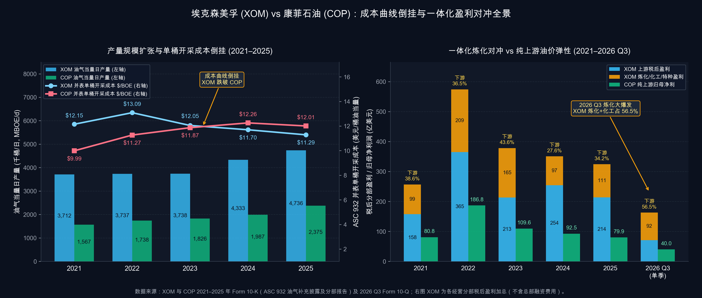

# 【行业指标 18】上游油气与一体化能源：储量替代率、桶油成本与上下游裂解价差对冲（埃克森美孚 XOM 与 康菲石油 COP）

> **专栏定位：** 全行业 10-K/10-Q 外科手术显微镜与非 GAAP 核心指标全景字典  
> **解剖标的：** 埃克森美孚 (XOM) 深度穿透 ＋ 康菲石油 (COP) 镜像对照  
> **核心指标：** 探明储量与内生替代率、油气当量产量与液态占比、全周期桶油成本（开采＋折耗）与净回值、上下游一体化炼化对冲度  
> **审计基准：** 2021–2025 财年 SEC Form 10-K 年报 ＋ 2026 Q3 Form 10-Q 最新单季真数

> **摘要：** 油气本质是“边开采、边衰减”的耗竭性资源生意。本文提炼探明储量与内生替代率、产量与液态占比、全周期桶油成本（开采＋折耗）、上下游一体化对冲度四大指标，以 XOM 与 COP 透视周期底牌。

---

## 一、 行业核心指标深度解剖

在全球大宗商品体系中，上游油气与一体化能源是资本体量最庞大、现金流波动最剧烈、地缘与周期定价权最集中的核心赛道。与制造业建好工厂即可长期复产不同，油气资产具有天然的**物理枯竭属性（Depletion）** ——每一口油气井从投产第一天起产量便在自然递减，企业必须持续投入勘探开发资本开支（E&P CapEx）补充新储量，否则本质上就是在做一场缓慢的“资产清盘”。

纵观全球油气行业，所有上市公司的商业模式最终收敛为两大阵营的路线分野：一类是业务横跨“上游勘探开发 → 中游管输与 LNG → 下游炼化与化工”的**超级一体化能源巨头（Integrated Supermajors）** ，凭借油价下跌时炼厂原料成本同步下降、裂解价差走阔的特性构筑逆周期缓冲垫；另一类是剥离炼化包袱、100% 聚焦低成本油气区块的**纯粹上游独立开采商（Pure-Play E&P）** ，在油价牛市拥有最猛烈的盈利弹性，但在油价深跌周期生死全系于桶油成本底线。真正立足第一性原理、直击美国会计准则油气补充披露（ASC 932）与分部利润表的专属核心指标，凝练在以下四个维度：

| 分析维度 | 行业专属特异性指标 | 买方核心考核焦点 |
| :--- | :--- | :--- |
| **资源家底与续航** | 探明储量、内生储量替代率与储采比 (Proved Reserves, Organic RRR & R/P) | 剥离高价并购注水，核验自有区块跨周期内生找油能力与静态开采年限 |
| **物理产量与含金量** | 油气当量日产量与液态油气占比 (Daily Production MBOE/d & Liquids Mix %) | 识破 `6:1` 热值折算陷阱，穿透广义液态占比进一步核验高价纯原油比例 |
| **全周期成本与净回值** | 全周期桶油成本（开采＋折耗）与综合净回值 (Lifting + DD&A vs Realized BOE) | 兼顾单桶直接开采费与历史资本折耗 DD&A，避免以纯原油单价高估全品种净回值 |
| **周期缓冲与模式分野** | 上下游一体化盈利结构与炼化对冲度 (Downstream & Chemicals Earnings Mix %) | 量化下游炼化、化工与特种油品对上游油价剧烈波动的逆周期对冲实效 |

### 指标 1：探明储量、内生储量替代率与储采比（Proved Reserves, Organic RRR & Reserve Life R/P）

审计油气企业资产底座的第一把尺子，不是账面固定资产原值，而是藏在年报 ASC 932 补充附注里的**探明储量（Proved Reserves，单位：百万桶油当量 MMBOE）** ——即在现有经济条件与技术水平下，有极高确定性（通常指 90% 以上把握）能够商业化采出的地下油气总量。买方核算资源续航力必须牢记三条公式：

`总储量替代率 (Total RRR) ＝ (新增探明发现与扩边 ＋ 储量修正 ＋ 净并购增减量) ÷ 当年油气总产量 × 100%`

`内生储量替代率 (Organic RRR) ＝ (新增探明发现与扩边 ＋ 储量修正) ÷ 当年油气总产量 × 100%`

`静态储采比 (Reserve Life, R/P) ＝ 年末探明储量 ÷ 当年油气总产量`

买方排雷时必须把**总储量替代率**拆成**内生替代率**与**外延并购**两笔账：如果一家油企账面总替代率高达 200% 以上，却全靠增发股票或举债高价收购同行堆出来，而内生勘探替代率长期低于 **80%** ，说明其自有区块资源正在枯竭，未来极易陷入高价买矿的价值毁灭循环。同时，国际油价大跌年份往往触发 SEC 规则下的**价格性负修正（Price-Related Downward Revisions）** ，导致单年替代率阶段性失真，因此买方必须结合 **3 至 5 年滚动中枢**与 **R/P 储采比**综合定性。

### 指标 2：油气当量日产量与液态油气占比（Daily Production MBOE/d & Liquids Mix %）

衡量油气企业真实物理规模与产出质量的核心指标，是**油气当量日产量（MBOE/d）** 以及藏在产量结构深处的**液态油气占比（Liquids Mix %）** ：

`液态油气占比 ＝ (原油 ＋ 凝析液 NGL ＋ 沥青砂日产量) ÷ 油气当量总日产量 × 100%`

这是油气财报中最隐蔽的“单位陷阱”：行业通用把 `6 千立方英尺天然气` 折算为 `1 桶油当量（BOE）` ，但这只是**热值当量（Thermal Equivalence）** ，绝非**经济价值等价（Economic Parity）** 。当国际原油维持在每桶 65 至 95 美元区间，而区域天然气基准价仅在每百万英热单位 2 至 3.5 美元徘徊时，1 桶天然气当量的售价往往只有原油的三分之一甚至五分之一。更进一步，即便在广义液态内部，**纯原油（Crude Oil）** 才是真正的现金之王——**凝析液（NGL）** 售价往往仅及纯原油的三分之一左右，而**重质沥青砂（Bitumen）** 也普遍存在显著的重油贴水；买方在核验广义液态占比（ ≥ **65%** ）的同时，还须穿透核对**纯原油占比（Crude Oil Cut）** ，严防高比例低价凝析液或重油稀释单桶真实变现力。

### 指标 3：全周期桶油成本（开采＋折耗 DD&A）与综合净回值（Full-Cycle Unit Cost & Netback）

国际油价由全球宏观需求与产油国联盟博弈决定，任何单一上市油企都毫无定价权；唯一能掌控命运的变量就是**全球成本曲线站位** 。但买方排雷切忌只看账面的直接开采费用而漏掉重资产的“另一半成本”——在 ASC 932 油气补充披露中，真正决定上游盈亏底线的是两条并行的全周期单桶标尺：

`全周期桶油基础成本 (美元/桶油当量) ＝ 并表单桶开采成本 (Lifting Cost) ＋ 并表单桶折旧折耗 (DD&A)`

* **并表单桶开采成本（Lifting Cost）：** 将油气从地下采出地面并完成基础分离处理所需的直接操作费用（不含折耗与生产税），决定企业在极端熊市下“是否被迫关井停产”的现金底线。
* **并表单桶折旧折耗（DD&A）：** 反映前期勘探钻井与油田开发资本开支的单位摊销成本。对于首年递减率极高的页岩油或巨额前期投入的深水油田，单桶 DD&A 往往比直接开采成本更高，二者相加（再计入约 2 至 3 美元的生产税）才是衡量企业是否真正赚取经济利润的**全周期上游成本** 。
* **严防量纲错配：** 单桶开采成本与 DD&A 的分母均为**全品种油气当量（BOE）** ，因此测算盈利厚度时，必须与**全品种综合实现均价（美元/桶油当量）** 严格对标，绝不能拿每桶油当量成本直接去减纯原油售价，以免因忽略低价天然气与凝析液的稀释效应而虚增安全边际。

### 指标 4：上下游一体化盈利结构与炼化对冲度（Integrated Segment Earnings Mix）

这一指标是区分“超级一体化巨头”与“纯上游独立开采商”的试金石，直接取自 10-K/10-Q 分部报告：

`下游及化工盈利占比 ＝ (炼化能源产品 ＋ 基础化工 ＋ 特种油品税后分部盈利) ÷ 经营分部税后总盈利 × 100%`

国际原油价格往往与成品油裂解价差（柴油、航煤、汽油与原油的价差）形成阶段性错位：在油价温和震荡或回调期，一体化巨头的下游炼厂与化工装置能贡献 **25% ~ 50%** 的税后盈利，有效平滑上游周期深坑；而在成品油供给偏紧与高油价共振期，下游炼化甚至可能爆发超越上游的暴利。反观下游占比为 **0%** 的纯上游开采商，其利润曲线几乎 1:1 映射油价涨跌，投资这类标的的核心纪律是在低油价底部买低成本安全垫，绝不能在高油价顶部将其当作稳健收息股线性外推。

---

## 二、 行业核心特异性指标全景速查对照表

| 指标名称 | 标准计量符号 | 买方核心考核焦点 | 行业优秀基准线 (Benchmark) | 危险预警与破位阈值 | 官方财报与 SEC 取数出处 |
| :--- | :--- | :--- | :--- | :--- | :--- |
| **探明储量与内生替代率** | `Organic RRR` / `R/P` | 剥离高价并购注水，校验 3~5 年内生找油能力与静态储采年限 | 3~5 年内生替代率 ≥ **`100%`** 且储采比 ≥ **`10 年`** | 长期内生替代率 ＜ **`80%`** 或储采比 ＜ **`8 年`** | 10-K Supplemental Oil & Gas (ASC 932 储量变动表) |
| **油气日产量与液态占比** | `MBOE/d` / `Liquids %` | 识破 `6:1` 热值折算陷阱，核验高价值原油及凝析液产出纯度 | 液态油气占比 ≥ **`65%`** 且日产量稳健增长 | 液态占比 ＜ **`45%`** （且无海外 LNG 长协溢价）或连年减产 | 10-K Item 2 产量统计表与 10-Q 运营摘要 |
| **全周期桶油成本与净回值** | `Lifting + DD&A` / `Realized` | 并行核验开采操作费与资本折耗 DD&A，按同口径油当量综合均价测算底线 | 开采 ≤ **`10 美元/桶`** 且开采＋折耗 ≤ **`25 美元/桶`** | 开采 ＞ **`15 美元/桶`** 或开采＋折耗 ＞ **`35 美元/桶`** | 10-K ASC 932「油气经营业绩与单位成本表」 |
| **一体化下游盈利对冲度** | `Downstream Mix %` | 评估炼化、化工与特种油品对上游周期波动的逆周期平滑能力 | 一体化油企下游占比 **`25% ~ 50%`** （纯上游按 **`0%`** 考严底线） | 一体化油企下游占比 ＜ **`10%`** 或炼化化工持续亏损拖累 | 10-K/10-Q 分部报告附注 (Segment Information) |

---

## 三、 标杆实例深度实战：埃克森美孚 (XOM) — 成本曲线反转与一体化炼化对冲的超级样本

作为全球规模领先的超级一体化能源霸主，埃克森美孚（Exxon Mobil Corporation，NYSE: `XOM`）横跨上游油气勘探开发（Upstream）、能源产品（Energy Products，全球炼化与成品油营销）、基础化工（Chemical Products）与特种油品（Specialty Products）四大经营分部。过去五年，XOM 彻底甩掉高成本老油田包袱，将资本集中砸向圭亚那深水整装油田与美国二叠纪核心页岩区块（含 2024 年 5 月 3 日完成的 Pioneer 世纪并购），同时依托全球顶级炼化集群穿越油价大起大落。下表完整呈现 XOM 提交至 SEC 的 2021–2025 财年 Form 10-K 及最新 2026 Q3 Form 10-Q 六周期官方真实底稿。

### 埃克森美孚 (XOM) 核心指标跨周期全景财务底表 `(单位：亿美元，特殊标注除外)`

| 核心财务与经营科目 | 2021年 (10-K) | 2022年 (10-K) | 2023年 (10-K) | 2024年 (10-K) | 2025年 (10-K) | 2026 Q3 (最新单季) | 穿透勾稽结论与买方视角 |
| :--- | :---: | :---: | :---: | :---: | :---: | :---: | :--- |
| **宏观与行业周期阶段** | 疫后需求复苏油价回暖 | 俄乌冲突推升油价暴走 | 油价回调但炼化强支撑 | 630 亿股并购 Pioneer | 油价回落至 65 美元 | 油价与裂解价差双井喷 | 一部横跨“深水扩产 → 世纪并购 → 炼化爆发”的教科书 |
| **年末探明储量 (MMBOE)** | 18,536 | 17,742 | 16,928 | **19,949** | **19,311** | 季报未单列 | **【对应指标 1】** 2024 年并购 Pioneer 一次性注入 `2,281` 百万桶储量 |
| *　↳ 内生 / 总储量替代率 (%)* | 347.7 / 338.5 | 15.6 / 43.4 | 45.4 / 41.9 | **153.3 / 286.6** | **64.8 / 63.8** | 季报未单列 | **【对应指标 1】** 2021 价格回拨、2022 退俄负修正、2025 低油价负修正 |
| *　↳ 静态储采比 R/P (年)* | 13.3 | 12.7 | 12.1 | 12.3 | **11.0** | 季报未单列 | **【对应指标 1】** 虽缓降但仍稳守 `10 年` 以上超级巨头安全线 |
| **油气当量日产量 (千桶/日)** | 3,712 | 3,737 | 3,738 | 4,333 | **4,736** | **4,496** | **【对应指标 2】** 五年产量大增 **`+27.6%`** ，跻身全球最大上市产油商之一 |
| *　↳ 液态油气占比 (%)* | 61.7% | 63.0% | 65.5% | 68.9% | **70.3%** | **72.9%** | **【对应指标 2】** 连续六年单边攀升（2025 年纯原油占比达 **`47.8%`** ） |
| **并表单桶开采成本 (美元/桶)** | 12.15 | 13.09 | 12.05 | 11.70 | **11.29** | 季报未单列 | **【对应指标 3】** 逆通胀连降三年；含联营权益综合成本更低至 **`10.20`** |
| *　↳ 并表单桶折耗 DD&A (美元/桶)* | 14.32 | 17.08 | 14.05 | 13.75 | **13.96** | 季报未单列 | **【对应指标 3】** 2022 含退俄减值冲高；近年稳定在 `14 美元` 一线 |
| **并表单桶开采＋折耗 (美元/桶)** | 26.47 | 30.17 | 26.10 | 25.45 | **25.25** | 季报未单列 | **【对应指标 3】** 全周期成本四年压降近 **`5 美元/桶`** ，跌近优秀线 |
| **并表油当量均价 / 原油均价** | 48.55 / 66.96 | 71.98 / 95.88 | 55.64 / 77.92 | 53.40 / 76.23 | **46.12 / 65.18** | 季报未单列 | **【价格底盘】** 2025 油当量均价虽跌至 `46.12` ，全周期仍保有厚利 |
| **上游分部税后盈利** | 157.8 | 364.8 | 213.1 | 253.9 | 213.5 | **70.9** | **【对应指标 4】** 核心利润主轴，受油价与产量双轮驱动 |
| *　↳ 炼化能源产品税后盈利* | -3.5 | 149.7 | **121.4** | 40.3 | 74.2 | **71.7** | **【对应指标 4】** 2026 Q3 单季盈利 **历史性反超上游分部** |
| *　↳ 化工与特种油品税后盈利* | 102.5 | 59.6 | 43.5 | 56.3 | 36.6 | **20.2** | **【对应指标 4】** 2021 化工景气单年赚超百亿，平滑炼化低谷 |
| **下游及化工盈利占比 (%)** | 38.6% | 36.5% | **43.6%** | 27.6% | 34.2% | **56.5%** | **【对应指标 4】** 跨周期稳定处于 `25% ~ 50%+` 顶级对冲区间 |
| **营业收入与其它收入** | 2,856.4 | 4,136.8 | 3,445.8 | 3,495.9 | 3,322.4 | **1,131.6** | **【规模底盘】** 2026 前九月累计 `3,143.2` 亿美元 |
| **归属 XOM 净利润** | 230.4 | 557.4 | 360.1 | 336.8 | 288.4 | **154.1** | **【终极盈利】** 2026 Q3 同比暴增 **`+104.2%`** （前九月 `341.2` 亿） |
| **经营现金流 (CFO) / 资本开支** | 481.3 / 120.8 | 768.0 / 184.1 | 553.7 / 219.2 | 550.2 / 243.1 | 519.7 / 283.6 | **256.5 / 71.8** | **【财务校验】** 2025 年扩产推高 CapEx 至 `283.6` 亿，26Q3 现金大爆发 |
| **自由现金流 (FCF) / 股东回报** | 360.5 / 150.8 | 583.9 / 300.9 | 334.5 / 326.9 | **307.2 / 363.3** | **236.1 / 375.0** | **184.7 / 93.7** | **【财务校验】** 2024–2025 分红＋回购超发至 FCF 的 **`118% ~ 159%`** |
| **总有息债务 / 账面现金** | 477.0 / 68.0 | 411.9 / 296.4 | 415.7 / 315.4 | 417.1 / 231.9 | 435.4 / 106.8 | **342.5 / 121.5** | **【资产负债表】** 26Q3 顺周期大举降债近百亿，净债压至 `221.0` 亿 |

*(注：储量、产量、开采成本及折耗 DD&A 均取自 XOM 历年 Form 10-K ASC 932 油气补充披露与油气经营业绩表；并表油当量均价与并表 DD&A 按 ASC 932 同口径并表销量还原；2026 Q3 现金流由前三季度 10-Q 减去上半年 10-Q 精确还原；下游及化工盈利占比分母为四大经营分部税后盈利合计数，不含总部融资费用；股东回报为现金分红与股票回购合计数。)*

### 核心看点 ①：产量含金量与全周期成本曲线的“双重剪刀差”反转
过去五年，XOM 在上游完成了一次脱胎换骨的资产置换：坚决剥离高成本老旧常规油田，将资本集中投向圭亚那深水整装油田与美国二叠纪核心页岩盆地（包括 2024 年 5 月 3 日以 **`630` 亿美元**全股票外加承担 **`50` 亿美元**债务完成的 Pioneer 世纪并购）。这场换仓在物理产量与成本曲线上同时兑现了惊人红利：油气当量日产量从 2021 年的 **`3,712` 千桶/日**跃升至 2025 年的 **`4,736` 千桶/日** （增幅 **`+27.6%`** ），且**液态油气占比**从 `61.7%` 连续六年攀升至 2026 Q3 的 **`72.9%`** （2025 年纯原油占比达 **`47.8%`** ）。更硬核的是成本端的逆通胀表现——在全行业遭遇人工与油服通胀的背景下，XOM 不仅把并表单桶开采成本从 2022 年高点 **`13.09` 美元/桶**连续三年压降至 2025 年的 **`11.29` 美元/桶** （含联营权益区块综合成本更低至 **`10.20` 美元/桶** ），叠加单桶折耗 DD&A 后，全周期开采＋折耗成本亦稳步压降至 **`25.25` 美元/桶** ，即便 2025 年并表全品种油当量均价回落至 `46.12` 美元/桶，依然稳坐厚实的单桶经济利润安全垫。

### 核心看点 ②：2026 Q3 炼化盈利历史性反超上游，一体化对冲威力实证
翻开 XOM 六年分部盈利矩阵，能最直观地看懂超级一体化能源巨头的“全周期压舱石”效应。2021 年炼化能源产品受疫情拖累小幅亏损 `-3.5` 亿美元，化工与特种油品立刻扛出 **`102.5` 亿美元**盈利补位；2023 年国际原油实现均价从 `95.88` 美元回调至 `77.92` 美元，上游盈利缩水超四成，但下游炼化能源产品单年赚回 **`121.4` 亿美元**，将下游及化工整体盈利占比推高至 **`43.6%`** ；2024 年全球炼化裂解价差陷入低迷，炼化盈利回落至 `40.3` 亿美元，上游分部则凭借产量大增逆势攀升至 **`253.9` 亿美元**接过接力棒；而到了最新 **2026 Q3** ，随着国际原油与成品油裂解价差双双井喷，XOM 炼化能源产品单季狂赚 **`71.7` 亿美元**，历史上罕见地反超上游分部（ **`70.9` 亿美元** ），下游及化工合计贡献高达 **`56.5%`** 的经营利润，直接助推集团单季归母净利润同比暴增 **`+104.2%`** 至 **`154.1` 亿美元** 。

### 核心看点 ③：【财务校验】SEC 储量剧震的规则真相与“透支回购”红线
面对 XOM 光鲜的体量，买方必须穿透两处财务底牌：首先是**储量替代率的极端波动**——2021 年内生替代率飙升至 **`347.7%`** ，并非突然发现超级油田，而是 2020 年油价暴跌时按 SEC 12 个月均价规则被迫核减的油砂等储量，在 2021 年油价反弹后大规模**价格性回拨（ `+35.72` 亿桶正修正）** ；2022 年骤降至 **`15.6%`** （且单桶折耗跳升至 `17.08` 美元/桶），则是俄乌冲突退出俄罗斯萨哈林-1 号项目引发 **`−11.57` 亿桶**负修正所致；而 2024 年总替代率 `286.6%` 中近半来自收购 Pioneer 的 `22.81` 亿桶外延增量，2025 年油价回落再度触发 `−9.29` 亿桶负修正，使储采比缓降至 **`11.0` 年** 。其次是**资本回报的超发风险**——2024 至 2025 年间，XOM 每年发放现金分红加回购高达 **`363.3` 亿美元**与 **`375.0` 亿美元**，分别达到当年自由现金流的 **`118.3%`** 与 **`158.8%`** ，导致账面现金从 2023 年底的 `315.4` 亿美元消耗至 2025 年底的 **`106.8` 亿美元** （直至 2026 Q3 单季 FCF 暴涨至 `184.7` 亿美元后，才将总债务压降至 `342.5` 亿美元、现金回血至 `121.5` 亿美元）。

---

## 四、 标杆实例镜像对照：康菲石油 (COP) — 纯上游高油价贝塔与成本曲线倒挂警报

为了与横跨全产业链的超级一体化霸主 XOM 构成最鲜明的商业镜像，我们请出北美独立纯上游油气巨擘——**康菲石油（ConocoPhillips，NYSE: `COP`）** 。COP 早在十余年前便彻底剥离下游炼化资产，100% 聚焦美国本土页岩（二叠纪、鹰滩、巴肯）、阿拉斯加、加拿大油砂及海外 LNG 权益区块，是一台 **100% 纯粹的上游油气印钞机** 。下表将 XOM 与 COP 置于同一张六周期手术台下逐行对账。

### 上游油气双雄跨周期核心指标镜像对照底表 `(单位：亿美元，特殊标注除外)`

| 核心财务与经营科目 | 标的 | 2021年 (10-K) | 2022年 (10-K) | 2023年 (10-K) | 2024年 (10-K) | 2025年 (10-K) | 2026 Q3 (最新单季) | 穿透勾稽结论与买方视角 |
| :--- | :---: | :---: | :---: | :---: | :---: | :---: | :---: | :--- |
| **年末探明储量 (MMBOE)** | **XOM** **COP** | 18,536 6,101 | 17,742 6,599 | 16,928 6,758 | **19,949** **7,812** | **19,311** **7,637** | 季报未单列 季报未单列 | **【对应指标 1】** 2024 均靠大并购增储（XOM `+2,281` / COP `+891` ） |
| **内生 / 总储量替代率 (%)** | **XOM** **COP** | 347.7 / 338.5 188.9 / 376.9 | 15.6 / 43.4 177.2 / 176.3 | 45.4 / 41.9 96.3 / 123.5 | 153.3 / 286.6 123.0 / 244.0 | 64.8 / 63.8 **98.9 / 80.0** | 季报未单列 季报未单列 | **【对应指标 1】** COP 五年内生替代率稳健，但 2025 剥离 `-165` 百万桶拉低总率 |
| **静态储采比 R/P (年)** | **XOM** **COP** | 13.3 10.3 | 12.7 10.1 | 12.1 10.0 | 12.3 10.7 | **11.0** **8.7** | 季报未单列 季报未单列 | **【对应指标 1】** COP 扩产叠加资产剥离后 **储采比骤降至 `8.7` 年观察下沿** |
| **油气当量日产量 (千桶/日)** | **XOM** **COP** | 3,712 1,567 | 3,737 1,738 | 3,738 1,826 | 4,333 1,987 | **4,736** **2,375** | **4,496** **2,302** | **【对应指标 2】** COP 并购 Marathon 后五年产量大增 **`+51.6%`** |
| **液态油气占比 (%)** | **XOM** **COP** | 61.7% 66.4% | 63.0% 70.0% | 65.5% 71.4% | 68.9% 71.3% | **70.3%** **71.5%** | **72.9%** **71.4%** | **【对应指标 2】** 双方均跨过 `70%` 高液态门槛（纯原油占比均约 `48%` ） |
| **并表单桶开采成本 (美元/桶)** | **XOM** **COP** | 12.15 **9.99** | 13.09 **11.27** | 12.05 **11.87** | **11.70** 12.26 | **11.29** 12.01 | 季报未单列 **约 12.49** | **【对应指标 3】** 历史性倒挂！XOM 逆势压降，反超 COP **`−0.72` 美元/桶** |
| **并表单桶折耗 DD&A (美元/桶)** | **XOM** **COP** | 14.32 **13.92** | 17.08 **13.12** | 14.05 **13.77** | **13.75** 14.54 | **13.96** 14.26 | 季报未单列 **约 15.38** | **【对应指标 3】** 折耗成本均高于开采成本，切忌漏算资本摊销底线 |
| **并表单桶开采＋折耗 (美元/桶)** | **XOM** **COP** | 26.47 **23.91** | 30.17 **24.39** | 26.10 **25.64** | **25.45** 26.80 | **25.25** 26.27 | 季报未单列 **约 27.87** | **【对应指标 3】** XOM 全周期反超 COP **`−1.02` 美元/桶** ，格局彻底改写 |
| **原油实现均价 (美元/桶)** | **XOM** **COP** | 66.96 67.64 | 95.88 97.23 | 77.92 78.96 | 76.23 76.74 | 65.18 65.62 | 季报未单列 **88.80** | **【价格引擎】** 26Q3 布伦特飙至 `97.00` 美元，COP 全品种均价跃至 `61.40` |
| **下游及化工盈利占比 (%)** | **XOM** **COP** | **38.6%** 0.0% | **36.5%** 0.0% | **43.6%** 0.0% | **27.6%** 0.0% | **34.2%** 0.0% | **56.5%** 0.0% | **【对应指标 4】** 超级一体化逆周期缓冲 vs `0%` 缓冲纯上游高 Beta |
| **营业收入与其它收入** | **XOM** COP | 2,856.4 483.5 | 4,136.8 821.6 | 3,445.8 585.7 | 3,495.9 569.5 | 3,322.4 615.5 | 1,131.6 **200.6** | **【体量对比】** XOM 含庞大炼化贸易流，营收体量为 COP 的 `5` 倍以上 |
| **归属母公司净利润** | **XOM** **COP** | 230.4 80.8 | 557.4 **186.8** | 360.1 109.6 | 336.8 92.5 | 288.4 79.9 | **154.1** **40.0** | **【盈利弹性】** 26Q3 COP 净利同比暴增 **`+131.8%`** ，高于 XOM 的 `+104.2%` |
| **经营现金流 (CFO) / 资本开支** | **XOM** **COP** | 481.3 / 120.8 170.0 / 53.2 | 768.0 / 184.1 283.1 / 101.6 | 553.7 / 219.2 199.7 / 112.5 | 550.2 / 243.1 201.2 / 121.2 | 519.7 / 283.6 198.0 / 125.5 | 256.5 / 71.8 **72.0 / 31.3** | **【财务校验】** COP 2025 年 CapEx 占 CFO 升至 `63.4%` ，26Q3 回落至 `43.5%` |
| **自由现金流 (FCF) / 股东回报** | **XOM** **COP** | 360.5 / 150.8 116.7 / 59.8 | 583.9 / 300.9 181.6 / 150.0 | 334.5 / 326.9 **87.2 / 109.8** | **307.2 / 363.3** **80.1 / 91.1** | **236.1 / 375.0** **72.4 / 90.1** | 184.7 / 93.7 **40.6 / 34.1** | **【财务校验】** 2023–2025 COP 连续三年分红＋回购超发至 FCF 的 **`114% ~ 126%`** |
| **总有息债务 / 现金及短投** | **XOM** **COP** | 477.0 / 68.0 199.3 / 54.7 | 411.9 / 296.4 166.4 / 92.4 | 415.7 / 315.4 189.4 / 66.1 | 417.1 / 231.9 243.2 / 61.1 | 435.4 / 106.8 234.4 / 69.8 | **342.5 / 121.5** **232.6 / 99.3** | **【资产负债表】** COP 并购 Marathon 承债推高负债，26Q3 现金储备显著回血 |

*(注：COP 2026 Q3 并表单桶开采成本 `约 12.49` 美元与折耗 DD&A `约 15.38` 美元，系按当季并表生产运营费用 `24.40` 亿美元、折旧折耗 `30.05` 亿美元分别除以同口径并表产量约 `1.954` 亿桶严格对齐核算，已剔除权益法联营 LNG 产量干扰；COP 2024 年、2025 年及 2026 Q3 全品种综合实现均价分别为 `58.39`、`47.01` 及 `61.40` 美元/桶油当量；2026 Q3 现金流均由前三季度 10-Q 减去上半年 10-Q 精确还原。)*

> **图表买方核心解读：** 左图见成本曲线历史性倒挂：XOM 并表单桶开采成本从 12.15 美元压降至 11.29 美元，反超一路升至 12.01 美元的 COP。右图见盈利结构分化：2026 Q3 炼化爆发使 XOM 下游占比飙至 56.5%，而 COP 凭纯上游高弹性实现单季净利同比暴增 131.8%。

### 关键差异 ①：开采成本与全周期折耗成本双重“倒挂”——超级巨头为何反超轻装纯上游？
翻开 2021 年底账本，轻装聚焦上游的 COP 曾以 **`9.99` 美元/桶**的并表单桶开采成本（叠加 DD&A 后全周期 **`23.91` 美元/桶** ），把 XOM（开采 `12.15` 美元、全周期 `26.47` 美元）甩在身后整整 **`2.56` 美元/桶** 。但短短四年间，行业成本曲线发生了令华尔街震动的历史性反转：COP 一方面受阿拉斯加极地高成本区块拖累（2025 年阿拉斯加单桶开采成本飙升至 **`20.44` 美元/桶** ），另一方面在 2024 年 11 月 22 日收购 Marathon Oil 后承受整合磨合通胀，导致 2025 年并表单桶开采成本攀升至 **`12.01` 美元/桶** 、全周期开采＋折耗升至 **`26.27` 美元/桶** （2026 Q3 按严苛并表口径进一步走高至约 **`27.87` 美元/桶** ）；反观 XOM 凭借圭亚那深水大油田与二叠纪超级集群放量，硬生生将并表单桶开采成本压低至 **`11.29` 美元/桶** 、全周期成本压降至 **`25.25` 美元/桶** ，罕见地实现了超级一体化巨头对纯上游龙头的**全周期单桶成本反超（领先 `−1.02` 美元/桶）** 。

### 关键差异 ②：纯上游的高油价弹性 vs 一体化的低油价防御力，以及液态定价鸿沟
**2026 Q3** 为两类商业模式提供了最极致的压力测试：当季国际布伦特原油均价同比暴涨 40% 至 **`97.00` 美元/桶** （WTI 均价 `85.79` 美元/桶），COP 原油实现均价直接跳升至 **`88.80` 美元/桶** （全品种综合实现均价 `61.40` 美元/桶）。由于没有低弹性基础化工板块稀释，COP 单季归母净利润同比暴增 **`+131.8%`** 至 **`40.0` 亿美元** ，自由现金流单季飙升至 **`40.6` 亿美元** （超过 2025 年全年的半数），把纯上游高 Beta 的爆发力展现得淋漓尽致。然而硬币的另一面同样残酷：在 2025 年油价回落至 65 美元区间时，COP 归母净利润较 2022 年高点大幅回撤 **`−57.2%`** ，抗跌性明显弱于坐拥下游炼化缓冲垫的 XOM（同期回撤 **`−48.3%`** ）。此外，透过 COP 2025 年报还可以看清“广义液态占比”内部的定价鸿沟：其液态占比虽高达 `71.5%` ，但纯原油仅占 **`48.2%`** ，其余为售价仅 **`21.07` 美元/桶**的凝析液与 **`40.74` 美元/桶**的加拿大沥青砂，这也直接解释了为何其全品种综合实现均价仅 **`47.01` 美元/桶** ，远低于 `65.62` 美元/桶的纯原油单价。

### 关键差异 ③：并购扩产后的储采比警报与双方共同的“逆周期超额派发”考验
2024 年两家巨头不约而同发动了大型全股票并购（XOM 吞下 Pioneer、COP 收购 Marathon Oil 带来 **`8.91` 亿桶**并购探明储量，助推日产量从 `1,987` 跃升至 `2,375` 千桶/日）。但 2025 年底的体检结果拉响了分化警报：COP 内生储量替代率虽稳守 **`98.9%`** ，但由于全年剥离 `1.65` 亿桶非核心资产且开采体量放大，总储量替代率跌至 **`80.0%`** ，**储采比（R/P）从 2024 年的 `10.7` 年骤降至 `8.7` 年** ，明显落后于 XOM 的 **`11.0` 年** ，已触及观察区下沿。而在【财务校验】维度，两家巨头暴露出同一个周期弱点：2023 至 2025 年油价回调期间，COP 连续三年将分红加回购维持在当年 FCF 的 **`113.8% ~ 126.0%`** ，叠加并购 Marathon 承接债务，总债务从 2022 年底的 `166.4` 亿美元升至 2026 Q3 的 **`232.6` 亿美元** 。这再次印证油气行业铁律：任何超过 FCF 100% 的刚性股东派发，本质上都是在透支资产负债表，唯有顺周期高油价才能完成真正的去杠杆修复。

---

## 五、 实战对账自查表：如何 5 分钟完成上游油气与一体化能源企财报体检

拿着本讲的四维行业坐标系审阅任意一家全球上市石油与天然气公司（无论是一体化巨头还是纯上游独立开采商）的年报时，建议严格按照以下四步动作顺序查账，全部红绿灯定量标准统一收口于下方对比表：

1. **查 10-K ASC 932 储量变动表（Proved Reserves Rollforward）：** 把**总储量替代率**拆成**内生替代率**与**外延并购**两笔账，重点看 **3~5 年滚动中枢** （剔除单年油价波动触发的价格性修正干扰），同时核对静态**储采比（R/P）**是否稳守 `10 年` 以上安全垫。
2. **查 10-K Item 2 产量统计表与 10-Q 运营摘要：** 识破 `6:1` 热值折算陷阱，先看**广义液态油气占比**是否达标，再进一步穿透核验**纯原油占比（Crude Oil Cut）**，防止高比例低价凝析液或无海外 LNG 长协保护的廉价伴生气稀释单桶变现力。
3. **查 ASC 932「油气经营业绩与单位成本表」：** 并行核算**并表单桶开采成本（Lifting Cost）**与**并表单桶折旧折耗（DD&A）**，用二者的合计值对比**全品种油气当量综合实现均价（美元/桶油当量）**，严防分子分母口径错配或拿纯原油单价虚增安全边际。
4. **查 10-K/10-Q 分部报告（Segment Information）：** 计算下游炼化、化工与特种油品占经营分部税后盈利的比例；对一体化巨头核验下游是否真能发挥逆周期缓冲作用，对下游占比为 `0%` 的纯上游开采商则相应拔高对桶油成本底线与低负债的苛刻要求。

| 核查维度 | 🟢 绿灯安全区 (优秀标杆) | 🟡 黄灯观察区 (稳健常规) | 🔴 红灯排雷区 (高危预警) |
| :--- | :--- | :--- | :--- |
| **内生储量替代率与储采比** | 3~5 年内生替代率 ≥ **`100%`** 且储采比 ≥ **`10 年`** | 内生替代率 **`80% ~ 100%`** 或储采比 **`8 ~ 10 年`** | 长期内生替代率 ＜ **`80%`** （纯靠并购注水），或储采比 ＜ **`8 年`** |
| **产量韧性与液态占比** | 液态油气占比 ≥ **`65%`** ，纯原油稳健且日产量增长 | 液态油气占比 **`45% ~ 65%`** ，油气结构均衡 | 液态占比 ＜ **`45%`** 且无海外 LNG 长协溢价，或连续减产 |
| **全周期桶油成本（开采＋折耗）** | 开采 ≤ **`10 美元/桶`** 且开采＋折耗 ≤ **`25 美元/桶`** | 开采 **`10 ~ 15 美元/桶`** 且开采＋折耗 **`25 ~ 35 美元/桶`** | 开采 ＞ **`15 美元/桶`** 或开采＋折耗 ＞ **`35 美元/桶`** |
| **一体化下游对冲度** | 一体化油企下游占比 **`25% ~ 50%`** ；纯上游（ **`0%`** ）须配更低成本底线 | 一体化下游占比 **`10% ~ 25%`** 或阶段性 ＞ **`50%`** | 一体化油企下游占比 ＜ **`10%`** 或炼化化工长期亏损拖累 |

*(买方财务校验提示：完成上述四步行业指标体检后，还应常规核对现金流量表中的 `(现金分红 + 股票回购) ÷ 自由现金流 FCF` 及净负债变动趋势，警惕油价平淡期靠举债或消耗账面现金硬撑高分红的“伪高息陷阱”。)*

---

## 六、 本讲买方总结与下讲预告

> **买方极简心法：** 买油气股绝不赌明年油价涨跌，只抓两把铁尺：向上看“液态占比 ＋ 单桶开采成本”锁死低油价生存底线，向下拆“内生储量替代率 ＋ 炼化对冲度”辨别真护城河与周期赌徒。

---

### 下讲预告：【行业指标 19】全球航运与重资产运力周期：箱量运价、供给订单与综合/干线模式分化（马士基 Maersk 与 中远海控 1919.HK）

穿透了深海钻井平台与巨型炼化装置之后，下一讲我们将驶入全球贸易的大动脉、周期波动比原油还要狂野的重资产战场—— **【全球航运与重资产运力周期】！**

为什么同样面对地缘绕航、运价暴涨暴跌与造船厂新船集中下水的惊涛骇浪，有的班轮霸主选择重金押注陆地综合物流试图平滑海运周期，而有的干线巨擘却手握千亿现金在运费高点赚得盆满钵满？下一讲，我们将派出全球航运与综合物流巨头 **马士基（Maersk）** 与亚洲集装箱干线霸主 **中远海控（1919.HK）** 展开跨周期终极对账，为您硬核拆解航运财报的**装运箱量与单箱平均运价、船队运力与在手新船订单比、海运与综合物流分部盈利分化**等核心行业密码，敬请期待！
