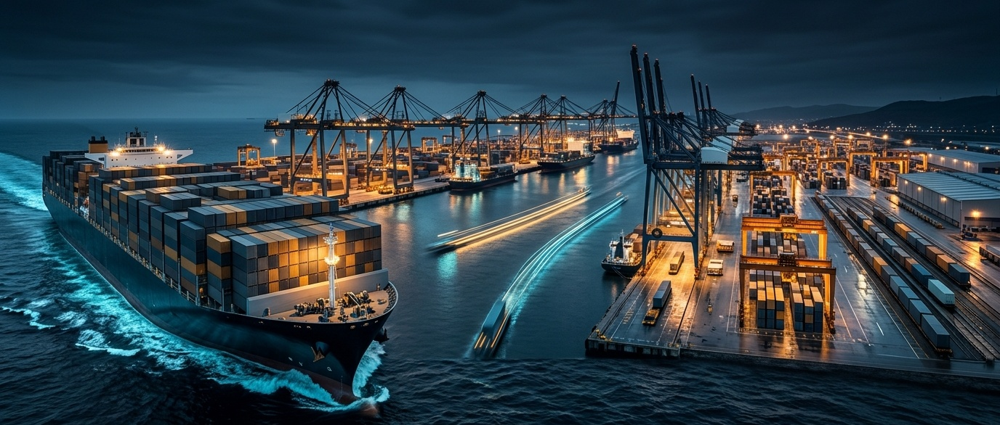
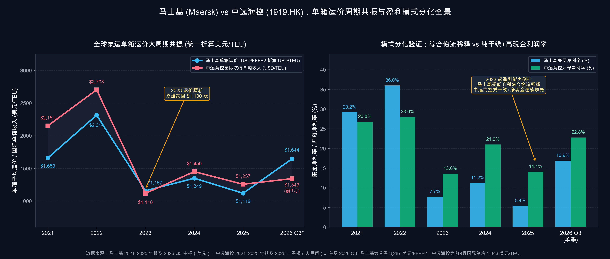

# 【行业指标 19】全球航运与重资产运力周期：箱量运价、供给订单与综合/干线模式分化（马士基 Maersk 与 中远海控 1919.HK）

> **专栏定位：** 全行业 10-K/10-Q/年报外科手术显微镜与非 GAAP 核心指标全景字典  
> **解剖标的：** 马士基 (Maersk) 深度穿透 ＋ 中远海控 (1919.HK) 镜像对照  
> **核心指标：** 装运箱量与单箱平均运价、船队运力与在手新船订单比、海运/码头/综合物流分部盈利分化  
> **审计基准：** 2021–2025 财年官方年度报告 ＋ 2026 Q3 最新单季财报真数

> **摘要：** 全球集装箱航运是“需求缓增、供给脉冲”的极端周期赛道。本文提炼装运箱量与单箱运价、船队运力与在手订单比、海运与码头/综合物流分部盈利分化三大专属指标，以马士基与中远海控透视周期底牌。

---

## 一、 行业核心指标深度解剖

在全球贸易体系中，远洋航运（涵盖集装箱班轮、油轮与干散货三大子赛道）是公认周期波动比原油和铜矿更加狂野的重资产战场，底层均受制于同一套**“运价弹性 × 在手订单比 × 自有/期租杠杆”**周期铁律。其中，与全球消费和工业供应链绑定最深的**集装箱班轮航运（Container Shipping）** 商业矛盾尤为残酷：**需求端温和线性，供给端脉冲滞后**——全球海运箱量需求常年仅跟随全球 GDP 以每年 `2% ~ 4%` 的速度缓慢爬升，而一艘大型集装箱船从下订造船到下水交付长达 **2 至 4 年** 。每当运价暴涨时，全行业船东集体手握巨额现金冲进船厂抢订新船；等到 3 年后新船集中下水，恰逢需求回落，运价便在短短几个季度内腰斩甚至击穿现金成本线。

面对这一宿命，全球头部航运巨头分化出截然不同的两条进化路线：一类是试图打破纯海运周期魔咒、砸重金向陆地延伸仓储/空运/清关的**端到端综合物流整合商（Integrated Logistics）** ；另一类则是坚守规模效应与成本控制、以**“干线集运 ＋ 全球核心枢纽码头”**双轮驱动的纯航运干线巨擘。真正立足第一性原理、不可替代的全球航运专属核心指标，凝练在以下三个维度：

| 分析维度 | 行业专属特异性指标 | 买方核心考核焦点 |
| :--- | :--- | :--- |
| **量价周期引擎** | 装运箱量与单箱平均运价 (Loaded Volume & Average Freight Rate) | 统一 `FFE` 与 `TEU` 换算量纲，拆解长协锁价与现货暴涨暴跌的盈利弹性 |
| **供给悬崖先导** | 船队运力、自有/租入结构与在手新船订单比 (Fleet & Orderbook-to-Fleet %) | 盯紧 2~4 年后的运力供给冲击，透视自有船与期租船在熊市中的刚性成本 |
| **盈利模式分化** | 海运、码头与综合物流分部盈利结构 (Ocean vs Terminals & Logistics EBIT %) | 校验综合物流转型是否沦为低毛利拖累，识别高利润率枢纽码头的抗周期底座 |

### 指标 1：装运箱量与单箱平均运价（Loaded Volume & Average Freight Rate）

航运股利润表的第一驱动力几乎全部浓缩在“量 × 价”两项物理数字里，但买方跨公司对账前必须先跨越一道最常踩坑的**标准箱量纲陷阱** ：

`1 个 40 英尺高箱 (FFE / FEU) ＝ 2 个 20 英尺标准箱 (TEU)`

部分欧洲班轮巨头习惯按 **FFE（40 英尺当量箱）** 披露装运量与单箱运价，而亚洲班轮公司普遍按 **TEU（20 英尺标准箱）** 披露。横向对比时，必须将 FFE 装运量乘以 `2` 、单箱运价除以 `2` ，统一折算至 **美元/TEU** 同一起跑线。

更核心的买方洞察在于**“单箱运价 − 单箱综合成本”的剪刀差杠杆** ：由于班轮公司固定与半固定成本（船舶折旧、期租费、燃油成本、港口装卸与空箱调运费）占比极高，在船舶装载率维持 `85% ~ 96%` 高位时，单箱运价哪怕仅上涨 30% ，超出单箱盈亏平衡线的增量运费几乎 100% 直接转化为税前利润。但买方切忌把单箱成本当成死数字——**燃油价格（Bunker Price）飙升或地缘绕航拉长航距**都会显著抬高单箱综合成本，导致同一水平的名义运价在不同年份对应的盈利厚度天差地别。与此同时，买方还需关注**长协合同占比（Contract vs Spot Mix）**——长协占比高能在运价下行期延缓失血，但在运价突发飙升期则会短期跑输高现货敞口同行。

### 指标 2：船队运力、自有/租入结构与在手新船订单比（Fleet Capacity & Orderbook-to-Fleet %）

如果说单箱运价决定的是“今年赚多少钱”，那么**在手新船订单比**决定的就是“三年后会不会全行业亏钱”：

`在手新船订单比 (Orderbook-to-Fleet %) ＝ 在手新造船及待交付租赁订单运力 (TEU) ÷ 现有运营船队总运力 (TEU) × 100%`

航运业历史上几乎每一次长达数年的超级寒冬，源头都不是需求崩盘，而是**订单比失控引发的供给海啸** 。当全行业或单家船东的在手订单比低于 **10%** 时，扣除老旧船舶拆解与环保减速（如碳排放法规导致的降速航行），有效供给极为紧绷，任何地缘绕航或港口拥堵都能瞬间引爆运价；而当订单比飙升至 **25% 以上** （尤其是超过 **30%** ），哪怕名义上是为了替换老旧船队的绿色双燃料升级，一旦新船集中交付期遭遇绕航解除，巨大的过剩运力都会迅速压垮现货运价。

此外，买方必须拆解船队的**自有船（Owned）与租入船（Chartered）结构** ：在 IFRS 16 租赁准则下，长期期租船舶全额资本化为资产负债表上的**租赁负债（Lease Liabilities）** 。高比例自有船虽然在造船期资本开支重，但船龄中后期现金运营成本极低；而在周期高点签订的长期高价期租船，则会在行业寒冬期化作甩不掉的刚性现金失血口。

### 指标 3：海运、码头与综合物流分部盈利分化（Ocean vs Terminals & Logistics EBIT Margin %）

评判一家航运巨头究竟是靠天吃饭的周期赌徒，还是真正跑通了穿越周期的商业模式，核心标尺在于分部报告里的**海运、枢纽码头与综合物流三大板块盈利结构** ：

* **干线海运（Ocean）：** 极端高弹性引擎，景气周期 EBIT 利润率可飙至 **30% ~ 45%** ，但在平淡或低谷期极易滑落至 **5% 以下** 甚至亏损。
* **全球枢纽码头（Terminals）：** 航运产业链上最被低估的**类基础设施现金牛**——只要全球贸易箱量保持稳健，无论海运运价腰斩还是翻倍，码头照样按箱收取装卸费与堆存费，优质码头板块跨周期 EBIT 利润率常年稳居 **25% ~ 35%** 。
* **端到端综合物流（Logistics & Services）：** 涵盖货代、空运、陆运仓储与报关，本质上是一门**高度分散、人力密集、低毛利（常态 EBIT 率仅 3% ~ 6%）** 的苦生意。如果班轮巨头在海运暴利期盲目高溢价并购陆地物流，却迟迟无法跑出协同溢价，低毛利物流收入占比扩大反而会持续摊薄集团整体利润率。

---

## 二、 行业核心特异性指标全景速查对照表

| 指标名称 | 标准计量符号 | 买方核心考核焦点 | 行业优秀基准线 (Benchmark) | 危险预警与破位阈值 | 官方财报与年报取数出处 |
| :--- | :--- | :--- | :--- | :--- | :--- |
| **装运箱量与单箱平均运价** | `TEU/FFE` / `USD per TEU` | 统一 FFE/TEU 量纲，追踪单箱运价周期弹性与船舶装载率 | 箱量稳增 ≥ **`0%`** 且装载率 ≥ **`90%`** ，单箱运价显著高于成本线 | 装载率 ＜ **`80%`** 或单箱运价跌破 **`1,000 美元/TEU`** 现金预警线 | 年报/季报「分部经营数据（Ocean / Container Shipping）」 |
| **船队运力与在手订单比** | `Fleet TEU` / `Orderbook %` | 预判未来 2~4 年运力供给冲击，核验自有/租入船结构与绿色替换节奏 | 行业/自身订单比 **`10% ~ 20%`** （有序替换）且自有运力占比 ≥ **`50%`** | 订单比 ＞ **`30%`** （供给过剩警报）或高价期租船占比 ＞ **`60%`** | 年报「船队运力与新船订单表」及航运权威运力披露 |
| **海运与非海运分部盈利分化** | `Segment EBIT Margin %` | 剥离海运暴利幻觉，核验码头基础设施与综合物流的独立造血能力 | 码头 EBIT 率 ≥ **`25%`** 、物流 EBIT 率 ≥ **`5%`** ，非海运有效平滑低谷 | 综合物流 EBIT 率 ＜ **`3%`** 长期低效，或集团纯靠海运低谷期转亏 | 年报/季报「分部报告附注（Segment Information）」 |

---

## 三、 标杆实例深度实战：马士基 (Maersk) — 端到端综合物流转型与码头暗藏皇冠的欧洲巨擘

作为全球百年航运旗帜与端到端综合物流转型的坚定旗手，**A.P. 穆勒-马士基（A.P. Møller - Mærsk A/S，CPH: `MAERSK-B`）** 将集团业务清晰划分为海运（Ocean）、物流与服务（Logistics & Services）以及码头（APM Terminals）三大支柱。过去五年，马士基一边严守约 `430 万 ~ 470 万 TEU` 的克制船队规模并推行“双子星（Gemini）”高准班率航线网络，一边将海运超级周期赚取的巨额现金大举投入陆地物流并购与全球枢纽码头扩建。下表完整呈现马士基 2021–2025 年官方年报及最新 2026 Q3 中报的六周期真实底稿。

### 马士基 (Maersk) 核心指标跨周期全景财务底表 `(单位：亿美元，特殊标注除外)`

| 核心财务与经营科目 | 2021年 (年报) | 2022年 (年报) | 2023年 (年报) | 2024年 (年报) | 2025年 (年报) | 2026 Q3 (最新单季) | 穿透勾稽结论与买方视角 |
| :--- | :---: | :---: | :---: | :---: | :---: | :---: | :--- |
| **宏观与行业周期阶段** | 疫后堵港运价起飞 | 超级大周期历史巅峰 | 供给释放运价腰斩 | 红海绕航带动反弹 | 运力过剩运价回落 | 旺季叠加拥堵运价暴走 | 完整经历“史诗牛市 → 腰斩归位 → 地缘脉冲”三段论 |
| **海运装运箱量 (千 FFE)** | 12,634 | 13,089 | 11,904 | 12,338 | **12,942** | **3,370** | **【对应指标 1】** 折合 TEU 约 `2,588 万`（2025）；26Q3 装载率高达 **`96%`** |
| **海运单箱平均运价 (美元/FFE)** | 3,318 | **4,628** | 2,313 | 2,698 | **2,237** | **3,287** | **【对应指标 1】** 26Q3 同比暴涨 **`+46%`** 、环比大涨 `+20%` |
| *　↳ 折算标准箱运价 (美元/TEU)* | 1,659 | **2,314** | 1,157 | 1,349 | **1,119** | **1,644** | **【对应指标 1】** 统一除以 `2` 换算为 TEU，方便与亚洲航企直接对标 |
| **运营船队规模 / 订单比** | ~430 万 TEU | ~430 万 TEU | ~410 万 TEU | ~430 万 TEU | ~450 万 TEU | **订单 120~170 万** | **【对应指标 2】** 2026 年底绿船订单激增，订单比升至 **`35% ~ 45%`** |
| **海运分部营收 / EBIT** | 482.3 / 179.2 | 643.1 / **291.5** | 337.2 / 22.3 | 373.9 / 47.4 | 349.8 / **13.9** | 126.5 / **26.0** | **【对应指标 3】** 2025 海运 EBIT 率跌至 `4.0%` ；26Q3 单季猛弹至 **`20.6%`** |
| **物流与服务营收 / EBIT** | 98.3 / 6.2 | 144.2 / 9.0 | 139.2 / 4.5 | 149.2 / 5.4 | **151.0 / 5.1** | **45.0 / 2.6** | **【对应指标 3】** 营收冲上 `150 亿` 量级，但 2023–2025 EBIT 率仅 `3.2% ~ 3.6%` |
| **码头分部营收 / EBIT** | 40.0 / 11.7 | 43.7 / 12.3 | 38.4 / 9.8 | 44.7 / 13.3 | **53.4 / 17.5** | **15.2 / 4.9** | **【对应指标 3】** 隐藏皇冠！2025 码头 EBIT **`17.5` 亿首次反超海运（`13.9` 亿）** |
| **集团合并营业收入** | 617.9 | **815.3** | 510.7 | 554.8 | 540.0 | **181.0** | **【规模底盘】** 26Q3 营收同比大增 **`+27%`** |
| **集团息税前利润 (EBIT)** | 196.7 (31.8%) | **308.6 (37.9%)** | 39.3 (7.7%) | 65.0 (11.7%) | 35.0 (6.5%) | **32.7 (18.1%)** | **【经营主干】** 26Q3 单季 EBIT 几乎追平 **2025 全年总和（`35.0` 亿）** |
| **集团净利润 (净利率)** | 180.3 (29.2%) | **293.2 (36.0%)** | 39.1 (7.7%) | 62.3 (11.2%) | 29.2 (5.4%) | **30.5 (16.9%)** | **【终极盈利】** 26Q3 单季净利 **`30.5` 亿反超 2025 全年（`29.2` 亿）** |
| **经营现金流 (CFO) / 资本开支** | 220.2 / 29.8 | 344.8 / 41.6 | 96.4 / 36.5 | 114.1 / 42.0 | 97.6 / 48.0 | — / **11.6** | **【财务校验】** 2026 前九月 CapEx `31.0` 亿，投向双燃料船与码头 |
| **自由现金流 (FCF)** | 165.4 | **271.1** | 39.7 | 51.1 | 22.3 | **23.9** | **【内生余粮】** 26Q3 单季 FCF 反超 2025 全年，集团大幅上调全年指引 |
| **租赁负债 (IFRS 16) / 净现金** | 104.5 / **15.3** | 116.1 / **126.3** | 104.5 / **46.6** | 114.1 / **73.7** | 130.2 / **29.5** | **125.8 / 32.1** | **【财务校验】** 租船负债占总债务 **`72%`** ，但账面 `206.3` 亿现金保净现金 |

*(注：马士基财报以美元编制；表中 `净现金` 对应马士基年报中为负值的净有息负债 NIBD，正数代表现金及存款高于总有息负债与 IFRS 16 租赁负债之和；2026 Q3 集团总债务 `174.2` 亿美元中含借款 `53.1` 亿与租赁负债 `125.8` 亿，对应现金及存款 `206.3` 亿美元；2026 Q3 海运营收按官方披露同比增 37% 区间中值 `126.5` 亿列示。)*

### 核心看点 ①：2026 Q3 单季赚超 2025 全年，把航运的“经营杠杆暴走”写到极致
对比马士基 2025 年全年与 **2026 Q3 单季** 两列数字，就能彻底理解航运股为何是资本市场最极端的杠杆机器：2025 年全年，马士基海运单箱均价回落至 **`2,237` 美元/FFE** （折合 `1,119` 美元/TEU），全年海运分部在 `349.8` 亿美元营收上仅勉强挤出 **`13.9` 亿美元** EBIT（利润率仅 `4.0%` ）。然而到了 **2026 Q3** ，仅仅因为全球海运需求稳健叠加港口拥堵与地缘绕航，马士基船舶装载率连续三个季度顶在 **`96%`** 满载红线，单箱平均运价同比暴涨 **`+46%`** 至 **`3,287` 美元/FFE** （折合 `1,644` 美元/TEU）——结果海运分部单季就轰出 **`26.0` 亿美元** EBIT，集团单季净利润 **`30.5` 亿美元**与自由现金流 **`23.9` 亿美元**双双**直接碾压 2025 年一整年的成绩单**，迫使管理层在季报中大幅上调 2026 全年核心 EBIT 指引至 `80 ~ 85` 亿美元！

### 核心看点 ②：综合物流“增收不增利”，真正的抗周期皇冠其实是 APM 码头
过去五年，马士基最响亮的战略叙事是“去周期化、转型端到端综合物流”。但买方用分部利润表逐行检验后，发现了截然不同的冷酷真相：**物流与服务（Logistics & Services）** 营收确实从 `98.3` 亿美元膨胀至 `151.0` 亿美元（占集团近三成营收），但 2023–2025 年其分部 EBIT 率常年在 **`3.2% ~ 3.6%`** 的泥潭里苦苦挣扎（直到 2026 Q3 才艰难修复至 **`5.8%`** ），面对动辄百亿美元波动的海运周期，这几亿美元的陆地物流利润几乎杯水车薪，反而严重摊薄了集团整体利润率。真正替马士基撑起周期底部尊严的隐藏皇冠，是**码头分部（APM Terminals）** ：凭借全球核心枢纽港口的垄断卡位与提价权，2025 年码头营收创纪录达 `53.4` 亿美元、EBIT 飙升至 **`17.5` 亿美元（EBIT 率高达 `32.7%` ）** ，历史上首次**超过庞大的海运主业（`13.9` 亿美元）** ，成为集团低谷期最坚实的现金奶牛。

### 核心看点 ③：【财务校验】125.8 亿美元 IFRS 16 租赁负债与 2026 年绿色新船订单激增
翻开马士基 2026 Q3 资产负债表，有一个极易被新手忽视的航运专属结构：集团总有息负债 `174.2` 亿美元中，传统银行借款与债券仅 `53.1` 亿美元，而 **IFRS 16 租赁负债高达 `125.8` 亿美元（占比 `72%` ）** ——主要来自长期期租船舶与码头特许经营权租约。好在马士基账面坐拥 `206.3` 亿美元现金与存款，依然维持着 **`32.1` 亿美元净现金** 安全垫。但买方必须紧盯另一盏闪烁的黄灯：尽管马士基长期宣称将船队规模克制在 `430 万 ~ 450 万 TEU` 左右，但为应对全球脱碳法规与老船换代，截至 2026 年底其绿燃料双燃料新船在手订单已飙升至 **`120 万 ~ 170 万 TEU`** （订单比跃升至 **`35% ~ 45%`** ），这意味着 2028–2030 年的资本开支刚性与行业供给压力已提前埋下伏笔。

---

## 四、 标杆实例镜像对照：中远海控 (1919.HK) — 纯干线极致盈利效率与千亿现金堡垒

为了与重金押注陆地综合物流的马士基构成最锋利的路线对决，我们请出亚洲集装箱干线霸主——**中远海控（COSCO SHIPPING Holdings，HKEX: `1919.HK` / SSE: `601919.SH`）** 。中远海控旗下拥有“中远海运集运 ＋ 东方海外（OOCL）”双品牌集装箱船队以及全球吞吐量领先的中远海运港口，**超过 95% 的营收聚焦于高弹性的纯干线集装箱航运**，没有庞大低毛利陆地货代拖累，同时手握逾千亿元级现金储备。下表将马士基（美元口径）与中远海控（人民币口径，单箱运价统一折算美元/TEU）置于同一张六周期手术台下硬核对账。

### 全球集运双雄跨周期核心指标镜像对照底表 `(马士基：亿美元 / 中远海控：亿元人民币，特殊标注除外)`

| 核心财务与经营科目 | 标的 | 2021年 (年报) | 2022年 (年报) | 2023年 (年报) | 2024年 (年报) | 2025年 (年报) | 2026 Q3 (最新单季) | 穿透勾稽结论与买方视角 |
| :--- | :---: | :---: | :---: | :---: | :---: | :---: | :---: | :--- |
| **装运箱量 (万 TEU)** | **马士基** **中远海控** | 2,527 **2,691** | 2,618 2,440 | 2,381 2,356 | 2,468 **2,594** | 2,588 **2,743** | 674 **721** | **【对应指标 1】** 马士基 FFE×2 折算后，中远海控装运箱量 **反超领先** |
| **单箱运价 (美元/TEU)** | **马士基** **中远海控** | 1,659 2,151 | 2,314 2,703 | **1,157** 1,118 | 1,349 1,450 | **1,119** 1,257\* | **1,644** 1,343\* | **【对应指标 1】** 马士基为全航线；中远为国际航线（2025 全航线综合约 `1,076` ） |
| **运营船队规模 (万 TEU)** | **马士基** **中远海控** | ~430 ~294 | ~430 ~292 | ~410 304 | ~430 333 | ~450 **360** | ~450 **366** | **【对应指标 2】** 中远海控五年运力净增 **`+24.5%`** ，自有及光租占比达 `75%` |
| **手持订单运力 (万 TEU)** | **马士基** **中远海控** | 克制更新 58.5 | 克制更新 58.5 | ~30+ 73.0 | ~30+ 75.0 | 加速下订 82.0+ | **120~170** **196**\* | **【对应指标 2】** 双雄 2026 均大举加码绿船；中远海控订单比冲至 **`~53.6%`** |
| **海运营收占集团比 (%)** | **马士基** **中远海控** | 78.1% **97.6%** | 78.9% **98.1%** | 66.0% **95.8%** | 67.4% **95.8%** | 64.8% **96.0%** | 69.9% **96.8%** | **【对应指标 3】** 战略彻底分野：马士基三成压物流，中远海控极纯干线 |
| **码头业务体量 / 盈利力** | **马士基** **中远海控** | 40.0 / 29% 77.3 / — | 43.7 / 28% 97.3 / — | 38.4 / 26% 104.0 / — | 44.7 / 30% 110.8 / — | **53.4 / 33%** **120.4 / 26%** | **15.2 / 32%** 控股 2,566 万箱\* | **【对应指标 3】** 双雄码头均为高盈利压舱石（马士基 EBIT 率 / 中远毛利率） |
| **集团营业收入** | **马士基** **中远海控** | 617.9 亿美元 3,336.9 亿元 | 815.3 亿美元 3,910.6 亿元 | 510.7 亿美元 1,754.5 亿元 | 554.8 亿美元 2,338.6 亿元 | 540.0 亿美元 2,195.0 亿元 | 181.0 亿美元 **756.9 亿元** | **【规模对比】** 26Q3 中远海控单季营收同比大增 **`+29.4%`** |
| **集团 EBIT 利润率 (%)** | **马士基** **中远海控** | 31.8% **39.4%** | 37.9% **43.7%** | 7.7% **20.9%** | 11.7% **29.9%** | 6.5% **20.5%** | 18.1% 季报未单列 | **【核心壁垒】** 2023–2025 中远海控 EBIT 率 **持续领先马士基 `13 ~ 18` 个百分点** |
| **归母 / 集团净利率 (%)** | **马士基** **中远海控** | **29.2%** 26.8% | **36.0%** 28.0% | 7.7% **13.6%** | 11.2% **21.0%** | 5.4% **14.1%** | 16.9% **22.8%** | **【终极盈利】** 2023 起彻底倒挂！26Q3 中远海控单季净赚 **`172.3` 亿元** |
| **经营现金流 (CFO)** | **马士基** **中远海控** | 220.2 亿美元 1,710.1 亿元 | 344.8 亿美元 1,968.0 亿元 | 96.4 亿美元 225.8 亿元 | 114.1 亿美元 693.1 亿元 | 97.6 亿美元 455.5 亿元 | — **479.1 亿 (前9月)** | **【财务校验】** 2026 前九月中远海控 CFO 已超越 2025 全年总额 |
| **资本开支 (CapEx)** | **马士基** **中远海控** | 29.8 亿美元 95.5 亿元 | 41.6 亿美元 104.9 亿元 | 36.5 亿美元 153.2 亿元 | 42.0 亿美元 260.0 亿元 | 48.0 亿美元 250.2 亿元 | 11.6 亿美元 **229.0 亿 (前9月)** | **【财务校验】** 双方均进入绿色双燃料大船资本开支爬坡期 |
| **现金储备与负债率** | **马士基** **中远海控** | 净现金 15 亿 现金 1,783 亿 | 净现金 126 亿 现金 2,356 亿 | 净现金 47 亿 现金 1,811 亿 | 净现金 74 亿 现金 1,842 亿 | 净现金 30 亿 现金 1,509 亿 | 净现金 **32.1 亿** 现金 **1,518 亿+** | **【资产负债表】** 中远海控 26Q3 资产负债率降至 **`41.36%`** 历史新低 |

*(注：本表统一将马士基装运量 FFE 乘以 2、运价 FFE 除以 2 折算为全航线 TEU 口径；中远海控单箱运价列示官方披露的中远海运集运国际航线单箱收入美元口径（不含低单价内贸航线，其中 2025 年集团双品牌国际单箱为 `1,187` 美元/TEU，而按 2025 年集运总收入 `295.2` 亿美元除以总箱量 `2,743.5 万 TEU` 还原的全航线综合单箱收入约 `1,076` 美元/TEU；2026 Q3\* 为前九月累计 `1,342.77` 美元/TEU，Q3 单季全航线人民币单箱达 `10,164` 元/TEU）；中远海控 2026 Q3 手持订单 `196 万 TEU`\* 含自有新造船订单 `100 艘约 146 万 TEU` 及在建租赁运力约 `50 万 TEU`；中远海控 2026 Q3 控股码头吞吐量 `2,566 万 TEU`\* 为前九月累计值。)*

> **图表买方核心解读：** 左图见运价周期共振：双雄单箱运价在 2022 登顶后于 2023 同步腰斩至 1,100 美元一线，2026 Q3 再度飙升。右图见模式倒挂：2023 年起马士基受低毛利物流摊薄，中远海控凭纯干线与千亿现金连年跑赢 6 至 10 个百分点净利率。

### 关键差异 ①：纯干线成本护城河碾压综合物流，顺带揭开“吨位税”与“少数股东”账底
翻开右侧对比图，最震撼买方的商业真相跃然纸上：在 2021–2022 史诗级运费大牛市中，马士基集团净利率（ `29.2% → 36.0%` ）一度反超中远海控（ `26.8% → 28.0%` ），核心推手是欧洲船东独享极低的**海运吨位税（Tonnage Tax，有效税率仅个位数）** ，而中远海控在高利年份既需缴纳正常企业所得税，又须扣除旗下东方海外（OOCL）及码头板块的**少数股东损益** （如 2025 年集团合并净利润 `352.3` 亿元中约 `43.6` 亿元归属少数股东）。但自 **2023 年行业回归常态起，局势彻底倒挂**——2023、2024、2025 年及 **2026 Q3 单季**，中远海控归母净利率高达 **`13.6%`、`21.0%`、`14.1%`、`22.8%`** ，连续四期大幅领先马士基的 **`7.7%`、`11.2%`、`5.4%`、`16.9%`** （EBIT 利润率更是持续领先 **`13 ~ 18` 个百分点** ）！更硬核的是，2025 年中远海控全航线综合单箱收入（约 `1,076` 美元/TEU）其实略低于马士基（ `1,119` 美元/TEU），却在马士基海运 EBIT 率跌至 `4.0%`（受绕航拉高单箱综合成本与 `150` 亿美元低毛利陆地物流双重挤压）之际，凭借 **96%** 纯干线聚焦、 **75%** 高比例自有及光租船队低成本以及高毛利码头（ `25.91%` ）跑出碾压级盈利效率。

### 关键差异 ②：克制替换 vs 逆势扩军——双雄 2026 年不约而同拉响“新船供给警报”
对比两家巨头的船队策略，能清晰嗅到下一轮航运周期的火药味。过去五年，马士基坚持“不盲目扩充总运力”，船队规模稳居 `430 万 ~ 450 万 TEU` 区间；而中远海控则依托“海洋联盟”与双品牌协同稳步扩张，自营船队从 2021 年约 `294 万 TEU` 增至 2026 Q3 的 **`366 万 TEU`（ `610` 艘）** ，装运总箱量（2025 年 `2,743 万 TEU` ）更是反超马士基（折合 `2,588 万 TEU` ）。然而，面对国际海事组织（IMO）严苛的绿色脱碳新规与 2026 年再度暴涨的丰厚现金流，**双雄在 2026 年不约而同大幅加码了新船订单** ：中远海控截至 2026 Q3 手持自有新造船订单已增至 `100` 艘约 **`146 万 TEU`** ，叠加约 `50 万 TEU` 在建租赁运力，订单占现有船队运力比飙升至惊人的 **`~53.6%`** （现有加订单合计突破 `530 万 TEU` ）；马士基手持绿船订单也猛增至 `120 万 ~ 170 万 TEU`（订单比 `35% ~ 45%` ）。对买方而言，这是一记极具前瞻性的警钟：2026 Q3 的单季暴利越耀眼，2028–2030 年新船集中交付时的供给过剩风险就越需要提前折价定价。

### 关键差异 ③：【财务校验】千亿现金“利息垫”＋50% 高分红 vs 租船负债管理
航运股能不能在熊市活下来、能不能在牛市给股东真金白银，最终要看资产负债表与分红纪律。截至 **2026 Q3** ，中远海控账面现金及现金等价物依然高达 **`1,518` 亿元人民币以上**，资产负债率进一步压降至 **`41.36%`** 的近年新低——这笔长期沉淀的千亿级高息现金每年贡献丰厚的净财务利息收益（买方估值时须将“纯海运 EBIT”与“类固收现金利息垫”分层定价），叠加 2025 年盈利回落期仍坚持约 **50%** 归母净利润的高比例现金分红（全年派息约 `154.1` 亿元）与持续回购注销，构筑了极厚的下行保护；马士基则背负着 `125.8` 亿美元高额 IFRS 16 租赁负债，虽依靠 `206.3` 亿美元现金保住了 `32.1` 亿美元净现金状态，但在单季资本开支和长租刚性约束下，其自由现金流对运价回调的敏感度显著高于轻债务、高现金的中远海控。

---

## 五、 实战对账自查表：如何 5 分钟完成全球航运企业财报体检

拿着本讲的三维行业坐标系审阅任意一家港美股或 A 股上市集装箱航运公司的年报时，建议严格按照以下三步动作顺序查账，全部红绿灯定量标准统一收口于下方对比表：

1. **查分部经营数据（箱量与单箱运价表）：** 第一时间核对计量单位是 `FFE` 还是 `TEU`（务必统一折算为 **美元/TEU** ），追踪船舶装载率是否稳居 `90%` 以上、单箱运价处于历史周期什么分位，并核查长协锁价比例以预判未来两季业绩滞后弹性。
2. **查船队运力结构与在手新船订单表：** 计算**在手订单运力 ÷ 现有运营运力（Orderbook-to-Fleet %）**，同时核验自有船与期租船比例——警惕全行业订单比超 `30%` 的远期供给悬崖，以及高价期租船比例过高在熊市引发的刚性现金失血。
3. **查分部报告（海运 vs 码头 vs 综合物流 EBIT 率）：** 剥离高运价年份海运暴利的周期滤镜，重点核验在运价低谷年份，**枢纽码头**是否维持 `25%` 以上高利润率托底、**综合物流**转型是否跑通正向协同而非长期以 `< 3%` 低毛利摊薄集团回报。

| 核查维度 | 🟢 绿灯安全区 (优秀标杆) | 🟡 黄灯观察区 (稳健常规) | 🔴 红灯排雷区 (高危预警) |
| :--- | :--- | :--- | :--- |
| **箱量装载率与单箱运价** | 装载率 ≥ **`90%`** 、箱量正增长，单箱运价远高于现金成本 | 装载率 **`80% ~ 90%`** ，单箱运价处于 **`1,000 ~ 1,500 美元/TEU`** 震荡区 | 装载率 ＜ **`80%`** 或单箱运价跌破 **`1,000 美元/TEU`** 现金预警线 |
| **船队结构与在手订单比** | 订单比 **`10% ~ 20%`** （有序更新）且自有运力占比 ≥ **`50%`** | 订单比 **`20% ~ 30%`** （绿船替换提速，需紧盯拆船进度） | 订单比 ＞ **`30%`** （远期供给过剩警报）或高价期租船占比 ＞ **`60%`** |
| **海运与非海运盈利分化** | 码头 EBIT 率 ≥ **`25%`** 、物流 EBIT 率 ≥ **`5%`** ，低谷期集团仍稳健盈利 | 综合物流 EBIT 率 **`3% ~ 5%`** 爬坡中，或纯干线靠低成本稳守正利润 | 综合物流 EBIT 率 ＜ **`3%`** 长期低效拖累，或海运低谷期集团大额亏损 |

*(买方财务校验提示：完成上述三步行业指标体检后，还应常规核对资产负债表中的 **IFRS 16 租赁负债占总债务比重**、**净现金安全垫**及**现金分红与回购兑现率**，严防在运价周期顶部用高市盈率或低市盈率陷阱线性外推，务必给 2~4 年后的新船集中交付周期留足估值安全边际。)*

---

## 六、 本讲买方总结与下讲预告

> **买方极简心法：** 买航运股绝不能看景气高点的低市盈率，只抓三道闸门：用“统一 TEU 运价”测当下弹性，用“在手订单比”防三年后供给海啸，用“码头盈利 ＋ 净现金”守住寒冬底线。

---

### 下讲预告：【行业指标 20】全行业指标勾稽与买方财报自查清单（收官总览）：20 大行业核心暗门速查字典

走过银行、投行、资管、财险、寿险、SaaS、互联网平台、医疗器械、大药企、Biotech、半导体设备/代工/设计、零售、餐饮、电力、矿业、油气与全球航运整整 **19 大核心行业** 的 10-K/年报外科手术解剖之后，下一讲我们将迎来整个专栏的终极巅峰收官—— **【全行业指标勾稽与买方财报自查清单（收官总览）】！**

下一讲，我们将把全部 19 大赛道的底层商业基因、核心特异性指标、官方财报取数坐标与一票否决排雷红线彻底打通串联，为您锻造一张可永久收藏、拿来即用的 **《买方 20 大行业财报解剖终极全景速查字典》** ，敬请期待！
