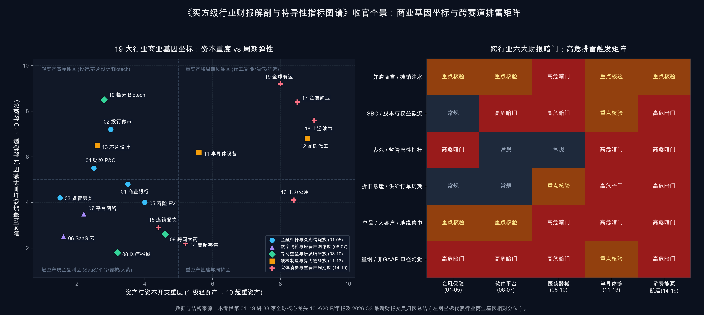

# 【行业指标 20】全行业指标勾稽与买方财报自查清单（收官总览）：全行业核心暗门速查字典

> **专栏定位：** 全行业 10-K/10-Q/年报外科手术显微镜与非 GAAP 核心指标全景字典（终极收官卷）  
> **覆盖范围：** 全专栏 **19** 大核心行业 · **38** 家全球顶流龙头跨周期真数交叉复盘  
> **核心交付：** 五大商业基因簇、四大分野矩阵、19 行业一票否决全景字典与三大跨行业传导链  
> **收官定位：** 买方投研 10 分钟读透任意 10-K/年报的标准化排雷操作手册

> **摘要：** 本文收官串联全专栏 19 大行业与 38 家龙头，精炼五大基因簇与四大商业分野，一表收口 19 行业指标与红线，打通三大产业链交叉验真与 10 分钟查账 SOP。

---

## 一、 跨行业第一性原理：五大商业基因簇与“同赛道四大模式分野”

历时十九讲的外科手术式解剖，我们横向穿过了华尔街金融帝国、硅谷云端软件与消费平台、跨国医药与前沿生物科技、全球半导体全产业链、线下消费与连锁特许，最终深入电力公用事业、上游金属矿山、油气能源与远洋集装箱航运。如果只能从这 **38 家全球顶级公司** 的六年原生财报里提炼一条买方铁律，那就是：**资本市场上从来不存在“放之四海而皆准的静态市盈率（PE）或净资产收益率（ROE）”；绝大多数财务分析错判，本质上都是把 A 行业的会计语言机械套用在了 B 行业的商业模式上。**

### 1.1 五大商业基因簇：翻开年报第 1 分钟的财务语言切换

成熟的买方分析师翻开任何一份 10-K 或年报时，第一动作不是算估值倍数，而是先定**商业基因**——识别目标公司所属的会计范式与造血坐标：

| 五大商业基因簇 | 覆盖讲数与核心行业 | 资产负债表与损益表底层特性 | 第一估值锚与核心战场 |
| :--- | :--- | :--- | :--- |
| **一、金融杠杆与久期错配族** | **01–05 讲** 商业银行 / 投行做市 / 资管另类 / 财险 / 寿险 | 三表逻辑与实体企业**完全颠倒** ；负债端是客户存款、未决赔款与长期保单责任 | 有形净资产回报率 `ROTCE`、费用收益 `FRE`、综合成本率 `CR`、内含价值 `ROEV` |
| **二、数字飞轮与轻资产网络族** | **06–07 讲** SaaS 云计算 / 互联网双边平台 | 极轻物理资本开支，重研发与获客费用前置；交易流水、合同履约与 GAAP 盈利高度分离 | 经常性收入 `ARR`、留存率 `NDR`、`Rule of 40`、全平台流水 `GMV` 与抽成率 `Take Rate` |
| **三、专利壁垒与研发临床族** | **08–10 讲** 医疗器械 / 跨国大药企 / 临床 Biotech | 极高毛利率护城河伴随重度研发、商业化返利或外延并购沉淀的巨额无形资产与商誉 | 经常性耗材占比、内生处方量价、专利悬崖 `LOE` 接棒、临床现金跑道与分成权 |
| **四、硬核制造与算力链条族** | **11–13 讲** 半导体前道设备 / 晶圆代工 / 芯片设计 | 技术代际寡头垄断与百亿美元级扩产/流片共振；上下游客户产能定金与表外承诺高度咬合 | 积压订单 `RPO` 覆盖倍数、先进节点与晶圆 `ASP`、折旧负担、`DIO` 与表外锁产覆盖率 |
| **五、消费连锁与周期资源族** | **14–19 讲** 商超零售 / 连锁餐饮 / 电力 / 矿业 / 油气 / 航运 | 内部分化最剧烈：线下消费拼同店坪效周转与特许抽成，重资产周期拼储量寿命、成本曲线与供给周期 | 同店客流 `SSSG`、四壁 `RLOM`、管制 `ROE`、储采比与权益 `C1`/全周期桶油成本、在手订单比 |

### 1.2 38 家龙头浓缩的“四大商业模式分野矩阵”

前 19 讲每一讲都刻意挑选了两家商业基因截然对立的行业龙头展开同台手术。将这 **19 组对决** 合并同类项，就能看清全球股票市场跨越行业的四大终极商业路线分野：

| 四大商业模式分野 | 轻资产 / 稳定收租 / 内生一极 | 重资产 / 高波动 Beta / 稀释一极 | 买方跨行业定价铁律 |
| :--- | :--- | :--- | :--- |
| **1. 轻资产抽成 vs 重资产自营履约** | **MCD** (`95%+` 加盟)、**ABNB** (纯撮合)、**BLK/BX** (管理费飞轮) | **CMG** (`100%` 直营四壁模型)、**UBER** (重履约抽成) | 前者享极高利润率与轻资本复合扩店，但须盯防 `Take Rate` 天花板；后者须死盯单店四壁 `RLOM` 与营运杠杆拐点 |
| **2. 全链一体化对冲 vs 纯赛道高弹性** | **XOM** (上下游炼化对冲)、**马士基** (海运＋码头＋物流)、**TSMC** (先进制程垄断) | **COP** (纯上游)、**中远海控** (纯干线＋高现金)、**SMIC** (成熟节点逆周期扩产) | 一体化未必跑赢纯赛道（马士基反遭低毛利物流摊薄）；若纯赛道兼具顶级成本与现金盾（如中远海控、COP 高油价期），爆发力与常态利润率反更高 |
| **3. 稳定规费/管制复利 vs 浮动暴利/市场化** | **MS** (财富管理净新增 `NNA`)、**NEE** (受管制 `11%` ROE 稳态复利)、**ISRG** (`70%+` 耗材) | **GS** (投行做市周期波动)、**VST** (AI 核电长协 ＋ 市场化电价)、**SYK** (骨科设备＋高并购) | 稳定型可给高确定性复利估值但须防扩表融资（NEE 负 FCF）；市场化周期型绝不能在高景气顶部给高倍数，须看长协锁价与缩股回购兑现 |
| **4. 权益纯净复利 vs 股本稀释与少数股东截留** | **SCCO** (NCI 仅 `0.3%` )、**CRM** (`SBC 压降至 8%` )、**COST** (高续费会员仓) | **FCX** (印尼权益降至 `48.76%` 截留半数净利)、**SNOW** (`SBC 长期 30%~49%` )、**CRSP/LEGN** (潜在稀释) | 表观高营收或高产量毫无意义，买方只为**归属母公司普通股每股真实自由现金流**付费 |

---

## 二、 全专栏 19 大行业核心特异性指标与一票否决全景字典（永久收藏版）

本字典作为全专栏唯一的定量基准总表，严守**“零凑数、双标的原生可核验、通用五/十进位标尺”**铁律，将第 **01** 至 **19** 讲的专属核心指标、护城河优秀锚点、**一票否决排雷红线**与年报取数坐标一次性收口如下：

### 2.1 金融与保险篇（01–05 讲）

| 讲数与行业 | 解剖双标杆 | 核心特异性指标精选（零凑数） | 🟢 护城河优秀锚点 | 🔴 一票否决排雷红线 | 年报 / 10-K 取数坐标 |
| :--- | :--- | :--- | :--- | :--- | :--- |
| **01 商业银行** | **JPM** vs **BAC** | 净息差 `NIM`、有形净资产回报 `ROTCE`、一级资本 `CET1`、`CECL` 核销率 `NCO`、`AOCI` 浮亏侵蚀 | `NIM ≥ 2.50%` 、`ROTCE ≥ 18.0%` 、`CET1 ≥ 14.5%` 、`NCO ≤ 0.40%` 、`AOCI < 10%` | `NIM < 2.00%` 、`ROTCE < 10.0%` 、`CET1 < 12.0%` 、`NCO > 1.00%` 、`AOCI > 30%` 冻结流动性 | MD&A 平均余额表、`Regulatory Capital` 及 `Note: ACL / Securities` |
| **02 投行做市** | **MS** vs **GS** | 投行佣金、交易做市收入、净新增客户资产 `NNA`、收费资产占比、薪酬率、`SLR` | 投行稳居 Top 3、`NNA ≥ 5%` 、收费资产 `≥ 30%~35%` 、薪酬率 `40%~43%` 、`SLR ≥ 5.4%` | 佣金显著跑输同业、`NNA` 净流出、薪酬率 `> 48%` 吞噬利润、`SLR < 5.1%` 冻结做市额度 | 损益表 `Investment banking / Trading`、MD&A `Wealth Metrics` |
| **03 资管另类** | **BLK** vs **BX** | `AUM`、有机资金净流入率、基础管理费率 `bps`、费用相关收益 `FRE` 占比与利润率、可分配利润 `DE` | 有机净流入 `≥ 4%~5%` 、`FRE` 占比 `≥ 70%` 、`FRE Margin ≥ 55%~60%` 、`DE` 覆盖分红 | 有机净流入 `< 1%` 或净流出、基础管理费无法覆盖薪酬、`FRE Margin < 45%` | MD&A `AUM / Net Inflows`、Non-GAAP `Segment Metrics / DE` |
| **04 财险 P&C** | **PGR** vs **CB** | 签单净保费 `NPW`、综合成本率 `Combined Ratio`、剔除巨灾 `Ex-CAT CR`、准备金调整、净投资收益率 | `NPW` 跑赢同业、综合成本率 `≤ 90%~92%` 、`Ex-CAT CR 84%~88%` 、准备金有利释放 | 核心险种 `NPW` 萎缩、连续承保亏损 **`CR > 102%`** 或 `Ex-CAT CR > 95%` 、准备金恶性调增 | MD&A `Underwriting Results` 与 `Note: Loss Reserves` 三角表 |
| **05 寿险 EV** | **友邦** vs **保诚** | 年化新保费 `APE`、新业务价值 `VNB`、新业务价值率、营运 `ROEV`、合约服务边际 `CSM`、继续率 | `APE` 复合增 `≥ 8%~12%` 、`VNB Margin ≥ 50%~55%` 、`ROEV 13%~16%` 、继续率 `≥ 92%~95%` | `APE` 连跌两年、`VNB` 下滑 `> 20%` 、`VNB Margin < 25%` 、`ROEV < 8%` 、继续率 `< 85%` | `EEV` 补充报告及 `IFRS 17` 保险负债附注 |

### 2.2 数字经济与软件平台篇（06–07 讲）

| 讲数与行业 | 解剖双标杆 | 核心特异性指标精选（零凑数） | 🟢 护城河优秀锚点 | 🔴 一票否决排雷红线 | 年报 / 10-K 取数坐标 |
| :--- | :--- | :--- | :--- | :--- | :--- |
| **06 SaaS 云** | **CRM** vs **SNOW** | `ARR` 纯度、净金额留存率 `NDR`、现时剩余履约义务 `cRPO`、`Rule of 40`、`CAC` 回收期、`SBC` 占营收比 | 纯净订阅 `≥ 85%~90%` 、`NDR ≥ 120%` 、`Rule of 40 ≥ 40%` 、成熟期 `SBC ≤ 8%~10%` | 订阅 `< 70%` 、`NDR < 100%` 存量失血、`Rule of 40 < 25%` 、`CAC > 36 个月` 、`SBC > 35%` | MD&A `Key Metrics`、收入附注 `RPO` 及现金流量表 `CFO` |
| **07 互联网平台** | **UBER** vs **ABNB** | 全平台交易额 `GMV/GBV`、综合抽成率 `Take Rate`、活跃买家与单客频次、客单价 `AOV/ATV` | `GMV` 复增 `≥ 15%~20%` 、轻撮合抽成 `≥ 13%~15%`（重履约 `25%~28%`）、频次上扬 | `GMV` 增速 `< 5%` 、抽成率持续补贴倒贴萎缩、频次连续两季下滑或客单价骤降 `> 10%` | MD&A `Key Operating Metrics` 与 `Take Rate Reconciliation` |

### 2.3 医疗健康与生命科学篇（08–10 讲）

| 讲数与行业 | 解剖双标杆 | 核心特异性指标精选（零凑数） | 🟢 护城河优秀锚点 | 🔴 一票否决排雷红线 | 年报 / 10-K 取数坐标 |
| :--- | :--- | :--- | :--- | :--- | :--- |
| **08 医疗器械** | **ISRG** vs **SYK** | 经常性耗材/服务占比、内生增长量价拆分、毛利与 `SG&A/R&D` 费率结构、并购商誉占总资产与摊销减值 | 经常性占比 `≥ 70%` 、内生销量 `≥ 10%` 、毛利率 `≥ 65%` 、`SG&A ≤ 25%` 、商誉无形 `< 20%` | 经常性占比 `< 50%` 、内生销量 `< 5%` 、毛利率 `< 55%` 、`SG&A > 35%` 、**商誉无形 `> 50%` 频减值** | 收入分解表、MD&A `Organic Growth` 及商誉无形附注 |
| **09 跨国大药** | **LLY** vs **NVO** | 单品专营权集中度与专利悬崖 `LOE`、处方量价拆分与返利 `GTN`、毛利与研发/销售杠杆、外延 `IPR&D` 引进减值 | 第一专营权占比 `20%~40%` 、处方销量 `≥ 15%` 、`GTN < 50%` 、毛利率 `≥ 80%` 、`SG&A ≤ 20%` | **单一专营权 `> 60%` 且 3 年内专利断崖**、处方 `< 5%` 或净价年降 `> 10%` 、频繁数十亿管线减值 | 产品营收拆分、`GTN` 政策说明、损益表及外延 `IPR&D` 附注 |
| **10 临床 Biotech** | **LEGN** vs **CRSP** | 静态现金跑道与净烧钱流速、研发纯度（`R&D` vs 行政管理 `G&A`）、合作分成权益、全稀释股本与 `ATM` 抽水 | 现金跑道 `≥ 24 个月` 或实现造血、研发纯度 `≥ 75%` 、分成 `40%~50%` 、稀释 `≤ 10%` | **现金跑道 `< 12 个月`（无造血）**、研发纯度 `< 60%` 行政内耗、**潜在稀释 `> 20%` 频繁抽水** | 资产负债表现金短投、`Collaboration` 附注及 `EPS / Equity` 附注 |

### 2.4 硬科技与半导体全产业链篇（11–13 讲）

| 讲数与行业 | 解剖双标杆 | 核心特异性指标精选（零凑数） | 🟢 护城河优秀锚点 | 🔴 一票否决排雷红线 | 年报 / 10-K 取数坐标 |
| :--- | :--- | :--- | :--- | :--- | :--- |
| **11 半导体设备** | **ASML** vs **KLAC** | 在手订单 `RPO` 覆盖与定金、装机经常性服务占比、毛利壁垒、三级存货与 `FCF/NI`、大客户与地缘敞口 | `RPO ≥ 1.0 倍`、服务占比 `20%~30%` 、毛利率 `50%~60%+` 、产成品 `≤ 20%` 、`FCF/NI ≥ 85%` | **`RPO < 0.5 倍`且定金流出**、服务连两季负增、毛利率 `< 45%` 、产成品 `> 30%` 、受限区 `> 35%` | 收入附注 `RPO`、合同负债、存货明细及地理/大客户附注 |
| **12 晶圆代工** | **TSMC** vs **SMIC** | 产能利用率与出货量、等效晶圆均价 `ASP` 与先进节点占比、折旧占营收比与毛利-EBITDA 剪刀差、`OCF/CapEx`、平台与地缘敞口 | 稼动率 `≥ 90%` 、先进制程 `≥ 65%` 、折旧 `15%~25%`（剪刀差 `≤ 15pp`）、`OCF/CapEx ≥ 1.3 倍` | 稼动率 `< 70%~75%` ＋ 折旧 `≥ 35%~40%` 、先进 `0%` 且 `ASP` 连跌、`CapEx/Rev > 70%` 且 `OCF/CapEx < 0.7` | 运营摘要与法说材料（出货量/节点）、现金流量表折旧与 `CapEx` |
| **13 芯片设计** | **NVDA** vs **AMD** | 数据中心分部结构与客户地缘集中、全栈毛利壁垒、研发/`SBC` 与并购摊销剪刀差、三级存货 `DIO`、表外采购承诺覆盖 `COGS` | 数据中心 `≥ 70%` 、毛利率 `≥ 70%` 、`SBC ≤ 10%`（剪刀差 `≤ 5pp`）、`DIO 70~100 天`、锁产 `80%~150%` | 数据中心 `< 30%` 或受限区 `> 25%` 、毛利率 `< 45%` 、`DIO ≥ 130~140 天` 堆积减值、下行期承诺 **`> 100%`** | 分部/大客户附注、Non-GAAP 调节表、存货及表外承诺 `Note` |

### 2.5 线下消费、能源电力、资源与全球航运篇（14–19 讲）

| 讲数与行业 | 解剖双标杆 | 核心特异性指标精选（零凑数） | 🟢 护城河优秀锚点 | 🔴 一票否决排雷红线 | 年报 / 10-K 取数坐标 |
| :--- | :--- | :--- | :--- | :--- | :--- |
| **14 商超零售** | **COST** vs **TGT** | 同店 `SSSG`（客流 vs 客单）、坪效与单店 `AUV`、非商品收入/利润占比、毛销差 `GM − SG&A`、存货周转与 `AP/Inv` | 同店 `≥ +5%`（客流过半）、会员仓坪效 `≥ 1,500 美元/ft2` 、非商品利润 `≥ 30%` 、`DIO ≤ 40 天`且 `AP/Inv ≥ 100%` | **同店 `< 0%` 或客流负增**、坪效 `< 400 美元/ft2` 、续费率 `< 80%` 、毛销差走负或 `DIO` 失控拉长 | MD&A `Comparable Sales`、Item 2 门店统计表与营运资本 |
| **15 连锁餐饮** | **MCD** vs **CMG** | 同店 `Comp`（客流 vs 客单）、单店 `AUV` 与净开店、餐厅四壁利润率 `RLOM` 与首要成本、特许占比/体系流水/双轨抽成与 `G&A/Sys` | 同店 `≥ 5%`（客流 `≥ 2%` ）、`AUV ≥ 300 万美元`、`RLOM ≥ 25%`（不含 D&A）、`Prime Cost ≤ 55%` 、加盟 `≥ 85%` | 同店 `< 0%` 或客流 `< -2%` 、`AUV < 150 万美元`、`RLOM < 15%`（高危） 、`Prime Cost > 65%` 、盲目重资产缩店 | MD&A 餐厅销售拆分、分部直营与特许利润表及体系流水附表 |
| **16 电力公用** | **NEE** vs **VST** | 管制 `ROE` vs 市场化长协套保比、电源结构与容量因子、燃料占比与 `MTM` 衍生品畸变、扩产 `CapEx/OCF` 与 `CFO/Debt` | 管制 `ROE ≥ 10%` 或套保 `≥ 80%` 、核电因子 `≥ 90%`（煤电 `≤ 10%` ）、`MTM ≤ 10%` 、`IPP CFO/Debt ≥ 20%`（管制 `≥ 15%`） | 管制 `ROE < 8%` 或纯现货 `> 50%` 、煤电 `> 25%` 、燃料 `> 55%` 或 `MTM > 30%` 、**管制 `CFO/Debt < 10%`（`IPP < 15%`）** | Item 1 监管条款、MD&A 电站运营表、衍生品与 Adjusted EBITDA 表 |
| **17 金属矿业** | **FCX** vs **SCCO** | `P&P` 储量/净权益占比与静态开采年限、核心金属产量/品位与副产品、抵扣前毛成本与 `Net C1` 现金利润率 | 储采比 `≥ 30 年`且净权益 `≥ 80%` 、品位稳态且产量 `≥ 0%` 、`C1` 现金利润率 `≥ 60%`（前 `25%` 分位） | 储采比 `< 15 年`或**净权益 `< 50%`** 、品位衰减或事故减产 `> 10%` 、**C1 利润率** `< 40%` 或毛成本年涨 `> 15%` | 10-K Item 2 矿产储量表、分矿山统计与单位现金成本调节表 |
| **18 上游油气** | **XOM** vs **COP** | 探明储量/内生替代率 `Organic RRR` 与 `R/P`、日产量与液态/纯原油占比、全周期成本（开采＋折耗）与综合净回值、下游炼化化工盈利占比 | 3~5 年内生替代 `≥ 100%` 且 `R/P ≥ 10 年`、液态 `≥ 65%` 、开采 `≤ 10 美元/桶`且全周期 `≤ 25 美元/桶`、一体化下游 `25%~50%` | **长期内生替代 `< 80%`** 或 `R/P < 8 年`、液态 `< 45%` 、**开采或全周期** `> 15 / 35 美元/桶`、一体化下游 `< 10%` | `ASC 932` 油气补充披露、Item 2 产量表与分部利润表 |
| **19 全球航运** | **马士基** vs **中远海控** | 装运箱量与统一 `TEU` 单箱运价、船队结构（自有/租入）与在手订单比、海运 vs 码头 vs 综合物流分部 `EBIT` 率 | 装载率 `≥ 90%` 且箱量正增、订单比 `10%~20%` 且自有船 `≥ 50%` 、码头 `EBIT 率 ≥ 25%` 、物流 `≥ 5%` | 装载率 `< 80%` 或单箱跌破 `1,000 美元/TEU` 、**在手订单比 `> 30%`** 或高价期租 `> 60%` 、物流 `< 3%` 拖累或低谷巨亏 | 年报/季报分部经营表、船队及新船订单表、`Segment Information` |

---

## 三、 全市场联立沙盘：三大产业链上下游交叉验真与五大跨赛道财务幻觉

拿下一张行业速查字典只是入门；买方高阶研究的真正护城河，在于把不同行业的财报放在同一张沙盘上**交叉验真（Cross-Sector Triangulation）**，并用同一套底层透视镜扫清所有跨赛道财务幻觉。

> **图表买方核心解读：** 左图将 19 大行业锚定在资本重度与周期波动坐标上；右图用热力矩阵标出六大跨赛道暗门在不同基因簇的高危触发区——医疗与科技严防 SBC 与商誉水分，金融与半导体/周期重资产紧盯表外杠杆、折旧与订单悬崖。

### 3.1 跨行业上下游交叉验真：三大财务传导链

单看一家公司的财报很容易被管理层指引牵着鼻子走；把产业链上下游四家不同行业的财报摊在同一张桌上，任何一方的虚假繁荣都会在第一时间现形：

1. **传导链 ①：AI 算力、半导体制造与电力基荷链（第 13 → 12 → 11 → 16 讲）**
   * **下游需求承诺：** 第 13 讲英伟达在 2026 Q3 把表外制造采购承诺拉升至 **`3,900 亿美元`** （覆盖年化 `COGS` 高达 **`334.3%`** ），AMD 亦暴增近四倍至 `488.0 亿美元`（覆盖率 **`197.8%`** ）。
   * **中游定金与产值兑现：** 这股下游锁产狂潮立刻精确咬合到第 12 讲台积电资产负债表上的 **`3,595 亿新台币` 客户产能保留暂收款**、跃升至 `67.9%` 的 HPC 算力营收占比，以及冲破 `10,438 美元` 的 12 英寸等效晶圆产值。
   * **上游设备积压订单与底层电力基荷：** 再往上游与底座穿透，中游晶圆厂的百亿美元 CapEx 必须兑现为第 11 讲 ASML/KLA 账上的 `RPO` 积压订单与非流动客户定金，并最终传导至第 16 讲维斯达（VST）等市场化电力巨头手里 **`3,809 MW` 亚马逊/Meta 核电 20 年长期购电协议**——四张不同行业财报的现金与订单互为底牌，缺一环即是伪需求！
2. **传导链 ②：大宗资源、远洋航运与线下消费通胀链（第 17/18 → 19 → 14/15 讲）**
   * **上游成本与海运脉搏：** 第 18 讲 2026 Q3 国际布伦特原油冲上 `97.00 美元/桶`、第 17 讲铜价飙至 `6.54 美元/磅` ，叠加地缘绕航拉长航距，顺着供应链直接抬高第 19 讲班轮公司的单箱燃油航次成本并引爆运价（马士基 26Q3 单箱运价同比暴涨 `+46%` 至 `1,644 美元/TEU`、中远海控单季归母净利大增 `+80.7%` ）。
   * **下游消费终端压力测试：** 这些海运运费与大宗原材料价格，滞后一到两个季度即转化为第 14 讲商超零售（COST/TGT）存货成本上升与毛销差（`GM − SG&A`）承压，以及第 15 讲连锁餐饮（MCD/CMG）的食材人工首要成本（`Prime Cost`）通胀大考——谁能靠会员黏性与客流护城河顺畅转嫁成本，谁只能靠打折清库存失血，一查即知。
3. **传导链 ③：宏观利率久期、金融重估与重资产/研发融资链（第 01–05 → 16 → 10 讲）**
   * **利率中枢双刃剑：** 长期美债收益率变动一面决定第 01–05 讲商业银行的 `NIM` 存款贝塔与证券 `AOCI` 浮亏（如 BAC 曾达 `-1,090 亿美元` 峰值锁死流动性）、决定财险/寿险庞大浮存金的新增固收收益率；另一面直接决定全市场重资产扩表与零造血长久期资产的融资成本——如第 16 讲连年百亿美元负 FCF 扩表的公用事业巨头 NEE 累计通过增发募资 `90.3 亿美元` 并紧绷在 `~15%` `CFO/Debt` 信用红线边沿，更决定了第 10 讲依靠资本市场融资续命的临床 Biotech 企业 24 个月现金跑道之外的配售稀释代价。

### 3.2 五大跨赛道财报幻觉与排雷实证

站在 38 家龙头样本之上复盘，几乎所有重仓踩雷都来自以下五大跨行业共用套路：

#### 幻觉 ①：低市盈率幻觉与重资产“折旧/供给悬崖”
景气高点扩产时现金先支出而折旧与供给滞后 2~4 年爆发，造成极易误导买方的会计错位。**晶圆代工（第 12 讲）** 中芯国际在砸下 `337.6 亿美元` 扩产后，2023–2025 年折旧占营收高达 **`40.1% ~ 42.2%`** ，2024 年表观净利率跌至 `6.1%` 而 `EBITDA` 率高达 `54.5%` ；**全球航运（第 19 讲）** 马士基 2026 Q3 单季净利（`30.5 亿美元`）反超 2025 全年，但双雄在同年大举下单绿船（中远海控订单比 **`~53.6%`** 、马士基 **`35% ~ 45%`** ）已埋下 2028–2030 年供给过剩隐患；**上游油气（第 18 讲）** 单看 `11~12 美元/桶` 开采成本会误判盈亏线，算上 `DD&A` 折耗的全周期成本实际高达 **`25~28 美元/桶`** 。

#### 幻觉 ②：“账面净利 ≠ 股东真金白银”的三重截流（NCI / SBC / 并购摊销）
合并报表净利润与普通股真实落袋价值之间往往横亘着三道暗闸。**矿业（第 17 讲）** 自由港因印尼权益降至 **`48.76%`** ，连续三年 **`46.9% ~ 57.1%`** 合并净利被少数股东分走，产铜量远高于南方铜业（截留仅 `0.3%` ）而归母净利反被反超两倍；**SaaS（第 06 讲）** Snowflake 表面 Non-GAAP 转正但 `SBC` 占营收仍高达 **`29.5%`** （早期 `45%~50%` ），实质是以股权稀释换取表观自由现金流；**器械与芯片（第 08/13 讲）** 史赛克商誉无形资产占总资产 **`52.6%`** （`248.7 亿美元`）、AMD 账面商誉无形达 `405.7 亿美元`，导致 GAAP 与 Non-GAAP 利润率长期相差十余个百分点。

#### 幻觉 ③：藏在表外与附注深处的四类隐性杠杆
真正杀死巨头的杠杆往往不在传统长短期借款行项，而藏在附注与准则重分类之中。除了银行长债 `AOCI` 浮亏外，**航运（第 19 讲）** 马士基 2026 Q3 总债务中 **IFRS 16 租赁负债占 `72%`（`125.8 亿美元`）** ；**芯片设计（第 13 讲）** 英伟达/AMD 数百亿至数千亿美元表外不可撤销采购承诺会在行业反转期化为违约减值重锤；**电力（第 16 讲）** 维斯达 2022 年因衍生品 `MTM` 浮亏 `-25.1 亿美元` 触发巨额保证金现金抽血并污染营业收入分母。

#### 幻觉 ④：物理量纲、统计口径与停产分母换算陷阱
跨公司对标专属指标前，必须先统一计量量纲与分子分母口径。**油气（第 18 讲）** `6:1` 热值当量非经济等价（COP 2025 年凝析液仅 `21.07 美元/桶` 远低于纯原油 `63.75 美元/桶`）；**航运（第 19 讲）** `FFE` 与 `TEU` 差两倍，且中远海控披露的 `1,257 美元/TEU` 为国际航线口径（全航线综合约 `1,076 美元/TEU` 反略低于马士基的 `1,119 美元/TEU` ）；**矿业（第 17 讲）** 自由港 2025 年静态开采年限从 `23.0` 年突升至 `33.2` 年，实则是泥石流停产把分母年产量砸低 `19.7%` 引起的分母塌陷假象。

#### 幻觉 ⑤：外延并购注水 vs 内生复利增长
高价并购可以瞬间做大储量、管线或营收体量，却极易掩盖内生护城河的衰退。2024 年 **油气双雄（第 18 讲）** XOM 吞下 Pioneer（`+22.81 亿桶`）与 COP 收购 Marathon Oil（`+8.91 亿桶`）将总储量替代率分别推高至 `286.6%` 与 `244.0%` ，唯有剔除并购看内生替代率、在 **大药企与器械（第 08/09 讲）** 死盯内生销量增速、在 **零售餐饮（第 14/15 讲）** 拆出同店客流增速，才能剥掉花钱买出来的虚假繁荣。

---

## 四、 买方案头实战：“10 分钟拆解任意 10-K/年报”五步 SOP 与通用【财务校验】六道防火墙

拿到任何一家陌生上市公司的年报或 10-K，买方分析师按以下 **五步标准化操作流水线** 推进，只需 **10 分钟** 即可完成初筛体检与排雷定性：

1. **第 1 分钟 · 归类商业基因与分野模式：** 按 **1.1 节** 锁定该公司所属基因簇（金融/数字网络/医药研发/半导体硬制造/消费周期），确认会计准则与记账本位币，并在 **1.2 节** 定位它是轻资产收租方还是重资产周期方。
2. **第 2~3 分钟 · 调取第二篇专属 KPI 核对一票否决线：** 翻开 `Item 1/2 业务与资产清单`、`MD&A 运营指标` 与分部报告，按 **第二篇全景字典** 精准提取该行业 3~5 个物理/监管专属指标，直接与绿灯锚点和红色一票否决线对撞—— **凡触及任何一条红灯排雷红线且无明确反转契约者，直接终止研究、剔除观察池** 。
3. **第 4~6 分钟 · 横向联立三表＋通用【财务校验】六道防火墙：** 核算现金转化率、资本开支吞噬度、自由现金流对分红回购的真实覆盖率以及少数股东/SBC 稀释，确认专属业务赚来的钱有没有变成归属普通股的真现金。
4. **第 7~8 分钟 · 扫荡年报附注与产业链交叉验真：** 按所属基因簇直奔后半段附注（`ASC 932 储量`、`Commitments 采购承诺`、`IFRS 16 租赁负债`、`Loss Reserves 三角表`、`AOCI 浮亏`、`Non-GAAP 调节表`），同时对照 **3.1 节** 的上下游龙头财报核验景气真实度。
5. **第 9~10 分钟 · 写下底牌清单转入赔率定价：** 汇总跨越三年至五年的核心指标轨迹，形成一句话买方底牌判断；只有全面通关微观体检的标的，才值得进入下一阶段的估值与仓位赔率博弈。

### 通用【财务校验】六道跨行业底线防火墙

本专栏严格将**“行业专属特异性指标”**与**“全行业通用的财务卫生检验”**剥离——绝不拿普通财务比率去凑行业指标名额，但在每一讲底表底部都必配以下六道通用【财务校验】底线：

| 通用【财务校验】维度 | 标准计算口径 | 🟢 健康安全线 | 🔴 重点排查警示线 |
| :--- | :--- | :--- | :--- |
| **现金流造血转化率** | `经营现金流 CFO ÷ 归母净利润`（金融除外） | 常周期稳定 ≥ **`100%`** （科技/消费常见 **`110%+`** ） | 连续多年 ＜ **`80%`** （利润纸面化、应收或存货严重占款） |
| **资本开支吞噬强度** | `CapEx ÷ 经营现金流 CFO` | 成熟收获期 ≤ **`30% ~ 40%`** ；高回报扩产 ≤ **`70%`** | 长期 ＞ **`80% ~ 100%+`** 且自由现金流连年失血 |
| **股东回报真实覆盖率** | `(现金分红 ＋ 回购) ÷ 自由现金流 FCF` | 长期维持 ≤ **`80% ~ 100%`** ，完全由内生 `FCF` 覆盖 | 连续多年 ＞ **`100%`** （实质靠举债或消耗现金硬撑高分红） |
| **净负债与信用防线** | `有息债务（含租赁负债）− 现金及短投` | 净现金或 `净债务 / EBITDA ≤ 2.0 倍`（管制公用事业 `CFO/Debt ≥ 15%`） | 杠杆激增且 `利息覆盖倍数` 恶化、信用评级逼近下调边缘 |
| **非控制性权益漏出** | `少数股东损益 ÷ 合并净利润` | **＜ `10%`** ，核心优质资产由母公司高度控股 | **＞ `30%`** （甚至近五成利润被合资方或资源国截留） |
| **SBC 稀释与商誉包袱** | `SBC / 营收` 与 `(商誉＋无形) / 总资产` | 成熟期 `SBC ≤ 8% ~ 10%` ；商誉及无形占比 ＜ **`20%`** | `SBC > 25% ~ 35%` 或商誉无形占比 ＞ **`50%`** 频发大额减值 |

---

## 五、 专栏收官终章：从“微观排雷定胜率”走向“安全边际定赔率”

> **专栏终极心法：** 好行业与好指标只能告诉你“谁值得进射程、哪些雷绝对不能踩”，却不能替你回答“什么价格才能扣扳机”；唯有用本图谱完成微观排雷，再叠加上下行赔率安全边际，才是一场完整的买方级胜率闭环。

至此，《买方级行业财报解剖与特异性指标图谱：从商业模式到 10-K 外科手术》全系列 **二十讲** 正式圆满收官。从商业银行的息差久期到 SaaS 的 `SBC` 照妖镜，从芯片制造的折旧悬崖到跨国大药企的医保返利，再到深海油气全周期桶油成本与集装箱航运的在手订单海啸，我们已经共同锻造出一整套穿透全球资本市场核心赛道的**第一性原理财务显微镜** 。

但请永远铭记买方投研的第二条铁律：**看懂商业本质与排掉财务假雷，只是赢下比赛的上半场；真正决定长期复利的下半场，是拒绝为远期叙事溢价买单、只在极端非对称赔率出现时扣动扳机的估值纪律。** 当你手握本手册这把经过 `38` 家全球顶级公司六年真数反复淬火的外科手术刀，再结合《买方级估值修炼手册》的反脆弱期望定价体系，你便真正拥有了穿越任何一轮宏观牛熊周期的独立买方护城河。全篇终，感谢同行！
