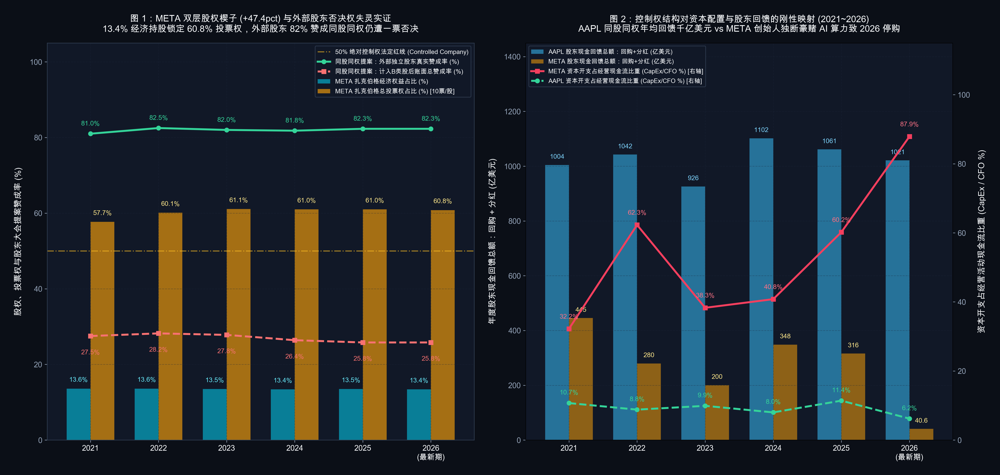

# 【治理与资本配置 01】控制权地图：股权结构、超级投票权与股东权利边界（Meta Platforms META 与 苹果 AAPL）

> **专栏定位：** 上市公司治理契约与资本配置审计显微镜  
> **解剖标的：** Meta Platforms (META) 双层股权主轴穿透 ＋ 苹果 (Apple, AAPL) 同股同权镜像对照  
> **核心指标：** 控制权与现金流权分离度、内部人与机构持股结构、董事会独立性与日落条款、股东提案真实赞成率  
> **审计基准：** SEC EDGAR 原生底稿 (CIK: 0001326801 / 0000320193) ＋ DEF 14A / 10-K / 8-K 对账

> **摘要：** 拆解公司控制权 4 大核心指标（投票权与经济权分离度、内部人与机构持股结构、董事会独立性与日落条款、股东提案真实赞成率），结合 Meta 与苹果 6 周期信披对账，穿透超级投票权与同股同权对资本配置的刚性影响。

---

## 一、 公司控制权与股东权利核心指标深度解剖

当投资者在二级市场买入一家上市公司的普通股时，很容易产生一种天真的错觉：自己买下的是按持股比例平等享有分红权、资产剩余索取权与重大事项表决权的标准化契约。然而在现代公司法与证券交易所规则下，**“经济收益权（Cash Flow Rights，即分钱的权利）”与“公司控制权（Voting Rights，即拍板的权利）”完全可以通过公司章程（Certificate of Incorporation）的设计实现彻底剥离** 。一家公司在赚到丰厚的经营现金流之后，这笔钱究竟是用来回购注销股票回馈全体股东，还是被管理层拿去投入长达十年、累计亏损数百亿美元的远期探险项目，首先取决于公司的权力地图掌握在谁手中。

审阅任何一家上市公司的治理底座，买方分析师不能只看管理层在公关稿里的口头承诺，而必须翻开其每年股东大会前提交的 **法定代理投票委托书（SEC Form DEF 14A）** 与年报股本附注，围绕四个通用契约维度绘制公司的控制权地图：一是测算**控制权与现金流权的分离度（Wedge）**，确认公司是否属于单一主体绝对控盘的“受控公司”；二是核查**内部人与外部机构股东的持股结构**，区分内部人控制与分散公众治理；三是审视**董事会独立性、两职合一与日落条款（Sunset Provisions）**，检验内部制衡机制是否有效；四是穿透**股东大会提案的账面赞成率与外部独立股东真实赞成率**，评估外部中小股东在公司战略偏航时是否具备实质纠偏能力。

| 分析维度 | 治理专属特异性指标 | 买方核心考核焦点 |
| :--- | :--- | :--- |
| **投票权杠杆与控盘度** | **控制权与现金流权分离度 (Voting-to-Economic Wedge)** | 穿透 A/B/C 多重股权结构，核算控制人投票权占比与其实际出资经济权益占比的剪刀差 |
| **所有权分布与代理结构** | **内部人与外部机构持股集中度 (Insider vs. Institutional Ownership)** | 区分“管理层低持股职业经理人模式”与“创始人/大股东绝对控股模式”的核心代理矛盾 |
| **董事会制衡与退出机制** | **董事会独立性与超级投票权日落条款 (Board Independence & Sunsets)** | 审查董事长与 CEO 是否两职分离，以及超级投票权是否绑定离职、身故或减持自动降级条款 |
| **外部纠偏与资本响应** | **股东提案真实赞成率与资本配置弹性 (Outside Support & Capital Discipline)** | 剥离内部人超级选票后还原外部股东真实意愿，检验自由现金流回馈对股东诉求的响应度 |

---

### 指标 1：控制权与现金流权分离度 (Voting-to-Economic Wedge)

在传统的“同股同权（One-Share, One-Vote）”公司中，每一股普通股既代表一份经济收益权，也代表一票表决权，任何股东要想掌控公司 50% 以上的投票权，就必须真金白银掏钱买下公司 50% 以上的股票，自己承担超过一半的经营亏损风险。但在硅谷科技巨头、传媒集团与家族企业广泛采用的 **双层或多层股权结构（Dual-Class / Multi-Class Stock Structure）** 中，公司将普通股拆分为投票权截然不同的多个类别：
* **A 类普通股 (Class A Common Stock)：** 在二级市场公开交易，由外部机构与散户持有，每 1 股仅享有 **1 票** 投票权；
* **B 类超级投票权股 (Class B Common Stock)：** 不公开交易，仅由创始人及核心内部人持有，每 1 股享有 **10 票** （部分公司甚至高达 20 票）投票权，但每股分红权与经济权益与 A 类股完全相同，且可随时按 1:1 转换为 A 类股出售变现；
* **C 类无投票权股 (Class C Common Stock)：** 每 1 股享有与 A/B 类股同等的经济权益，但拥有 **0 票** 投票权，常被用于向公众派发股票股利、融资或发放员工股权激励，从而在扩张总股本的同时确保创始人的投票权比例不被稀释。

为了定量刻画这种权力放大效应，买方通过 `DEF 14A` 实益所有权表计算控制人的投票权占比与经济权益占比之差：

`总投票权池 ＝ A 类流通股数 × 1 票 ＋ B 类流通股数 × 10 票 ＋ C 类流通股数 × 0 票`  
`控制权与现金流权分离度 (Voting Wedge) ＝ 控制人合计投票权占比 (%) − 控制人合计经济持股占比 (%)`

当单一创始人或一致行动人凭借 10 票/股的杠杆掌握超过 **50%** 的总投票权时，该公司在纳斯达克与纽交所规则下即被界定为 **“受控公司（Controlled Company）”** 。一旦分离度超过 **30 ~ 40 个百分点** （例如仅持有 13% 的经济股份却垄断 60% 的选票），意味着控制人每做出一个烧掉 100 亿美元现金的鲁莽决策，其个人账面仅承担 13 亿美元的经济损失，其余 **87 亿美元** 的代价全部由毫无否决权的外部公众股东买单。

---

### 指标 2：内部人与外部机构持股集中度 (Insider vs. Institutional Ownership)

翻开任何一家美股公司 `DEF 14A` 的「Security Ownership of Certain Beneficial Owners and Management」章节，买方会固定提取两组数字：**全体董事及高管合计持股比例（All Directors and Executive Officers as a Group）**，以及 **持股 5% 以上外部机构大股东（5%+ Institutional Blockholders，如先锋领航 Vanguard、贝莱德 BlackRock、道富 State Street 等）合计持股比例** 。

这两组数字的对比，直接将上市公司划分为两种截然不同的委托代理博弈场：
1. **高度分散的公众公司 (Widely Held Public Firm)：** 全体董事与高管合计持股比例通常不足 **1%** （甚至低于 0.1%），前三大外部机构股东合计持股约 **20% ~ 25%** ，且无任何单一股东掌握控制权。在这种结构下，CEO 本质上是替全体股东打工的“职业经理人”。如果管理层长期战略失误、资本回报率低迷或挥霍现金流，外部机构股东与激进基金（Activist Investors）随时可以联合投票改组董事会、否决高管薪酬甚至解雇 CEO。其潜在缺陷则是管理层可能因持股过低而趋于保守，或利用薪酬规则谋取短期私利；
2. **内部人/控股股东绝对控制公司 (Insider-Controlled Firm)：** 创始人或控股家族持有 **10% ~ 30%** 的经济股份，并通过超级投票权或金字塔持股掌握 **50% 以上** 的绝对投票权。其优势在于创始人能够跨越华尔街季度业绩考核压力，果断执行长达 5 到 10 年的技术架构转型；其致命风险则在于 **“绝对权力缺乏外部刹车”** ——一旦创始人的个人执念偏离商业常识，外部机构股东即便全员反对也无法在股东大会上撼动其分毫。

---

### 指标 3：董事会独立性与超级投票权日落条款 (Board Independence & Sunsets)

在正常的公司治理架构中，董事会（Board of Directors）是代表全体股东监督管理层的核心防线。但买方在审阅董事会结构时，绝不能只看表面上的“独立董事人数占比”，而必须穿透三项决定董事会能否真正硬起腰杆的制度契约：

* **第一，形式独立 vs 实质选任权：** 在同股同权公司中，独立董事由全体股东按一票一权选举产生，若某位董事纵容管理层损害股东利益，次年改选时就会收到机构股东的大批反对票（Withhold / Against Votes）；而在创始人掌握 > 50% 投票权的受控公司中，哪怕董事会里坐着 90% 的知名独立董事，**每一位独立董事的去留实际上都由创始人一人手里的选票决定** ，独立董事在重大战略分歧上很难对创始人形成刚性否决；
* **第二，董事长与 CEO 两职分离 (Separate Chair vs. Combined CEO/Chair)：** 当 CEO 同时兼任董事会主席（Chairman）时，相当于“自己召集会议监督自己”。规范的现代治理要求将董事长与 CEO 两职分离，由独立董事出任独立董事长（Independent Chair），或至少设立具备独立召集会议与设定议程实权的 **首席独立董事（Lead Independent Director）** ；
* **第三，超级投票权的“日落条款（Sunset Provisions）”：** 这是审计双层股权公司章程最关键的排雷点。所谓日落条款，是指公司章程中是否明确规定：**当创始人不再担任公司全职高管、身故、丧失行为能力、将股份转让给非直系第三方、或经济持股比例跌破某一底线（如 5% 或 10%）时，其持有的 10 票权 B 类股必须自动、不可撤销地按 1:1 降级为 1 票权 A 类股。** 如果一家双层股权公司缺乏严格的离职与持股下限日落条款，甚至允许创始人将其 10 倍投票权世袭传承给后代或离职后继续垂帘听政，其治理风险将呈指数级上升。

---

### 指标 4：股东提案真实赞成率与资本配置弹性 (Outside Support & Capital Discipline)

如何用客观数据检验一家公司的治理机制是在倾听股东声音，还是在无视外部股东诉求？最直接的法定证据就在每年股东大会结束后 4 个工作日内提交的 **Form 8-K（Item 5.07: Submission of Matters to a Vote of Security Holders）** 表决结果公告中。

在每年的股东大会上，外部机构或中小股东会提交各类治理改进提案（Shareholder Proposals，例如：要求取消双层股权恢复同股同权、要求设立独立董事长、要求强化高管薪酬追回或披露重大资本开支风险）。在同股同权公司中，账面总赞成率就是全体股东的真实意愿；而在双层股权公司中，由于控制人手握的 10 倍投票权几乎 100% 投出反对票，买方必须执行一步还原计算：

`账面总赞成率 (%) ＝ 提案获得赞成票数 ÷ (赞成票数 ＋ 反对票数) × 100%`  
`外部独立股东真实赞成率 (%) ＝ 提案获得赞成票数 ÷ (赞成票数 ＋ 反对票数 − 内部控制人超级选票数) × 100%`

当一项要求治理纠偏的股东提案在账面上仅获得 25% 赞成而被否决，但剥离创始人选票后发现 **外部独立股东真实赞成率高达 80% 以上** 时，说明外部股东与管理层之间已经出现了严重的治理撕裂。与此同时，买方会将这一表决结果与现金流量表上的 **股东现金回馈占自由现金流比重（(回购＋分红) ÷ FCF）** 及 **资本开支占经营现金流比重（CapEx ÷ CFO）** 联动核对，观察公司的自由现金流究竟是转化为稳定的股东回馈，还是在缺乏外部制衡的情况下被大举抽调去支撑高风险的资本开支。

---

## 二、 公司控制权与股东权利核心指标全景速查对照表

下表汇总了买方机构在启动任何个股深度研究前，用于穿透控制权契约与股东权利边界的 4 大核心指标及通用衡量标尺：

| 指标名称 | 标准计量符号 | 买方核心考核焦点 | 治理优秀基准线 (Benchmark) | 危险预警与治理折价阈值 | 官方财报与 SEC 取数出处 |
| :--- | :--- | :--- | :--- | :--- | :--- |
| **1. 控制权与现金流权分离度** | Voting Wedge % | 控制人投票权占比与实际经济出资占比的剪刀差，识别小股控大权 | 分离度 ＝ **0%** （100% 同股同权，1 股 1 票，无超级投票权或 0 票权股票） | 分离度 > **30%** 且控制人投票权 > **50%** （或增发 0 票权 C 类股锁死控制权） | DEF 14A Beneficial Ownership 表及 10-K 封面/股本附注 |
| **2. 内部人与机构持股结构** | Insider vs. Inst. % | 区分分散公众治理与单一内部人绝对控盘的委托代理结构 | 外部机构持股为主，或内部人经济持股与投票权 1:1 匹配（无特权杠杆） | 内部人经济持股 < **15%** 却垄断 > **50%** 投票权（权责严重不对等） | DEF 14A Security Ownership of Certain Beneficial Owners 表 |
| **3. 董事会独立性与日落条款** | Board Indep. & Sunsets | 审查董事长与 CEO 两职分离度，以及超级投票权自动降级触发条件 | 独立董事 ≥ **80%** ，董事长与 CEO 两职分离，双层股权具备严格离职/减持日落条款 | CEO 兼任董事长且无强力首席独董，超级投票权无离职或持股下限日落条款 | DEF 14A Corporate Governance 章节及公司章程 (Exhibit 3.1) |
| **4. 股东提案真实赞成率与现金回馈** | Outside Vote % & Payout | 还原外部独立股东真实表决意愿，检验现金流回馈纪律 | 股东提案账面与真实赞成率一致，成熟期股东回馈占 FCF 比重 ≥ **70%** | 外部独立股东对治理提案赞成率 > **70%** 却被控制人一票否决，或停购豪赌 | Form 8-K Item 5.07 股东大会表决结果及 10-K 现金流量表 |

---

## 三、 标杆实例深度实战：Meta Platforms (META) 双层股权、61% 超级投票权与两轮百亿豪赌解剖 (2021 ~ 2026 最新期)

Meta Platforms, Inc.（META.US）是全球科技巨头中将“双层股权结构（Dual-Class Structure）、创始人绝对控制权与大开大合的资本配置转向”展现得最为淋漓尽致的实战样本。根据公司章程，Meta 的普通股分为两类：**A 类普通股（每股 1 票）**在纳斯达克公开交易，而 **B 类普通股（每股 10 票）** 超过 99% 由创始人、董事长兼 CEO 马克·扎克伯格（Mark Zuckerberg）及其关联信托持有。

正是凭着这 10 倍投票权杠杆，扎克伯格在过去六年里仅持有公司约 **13.4% ~ 13.6%** 的经济股份，却始终牢牢锁定全公司 **57.7% ~ 61.1%** 的绝对投票权。在这把“制度保护伞”下，Meta 先后在 2021 至 2022 年单方面推进元宇宙（Reality Labs）豪赌导致自由现金流腰斩，在 2023 至 2024 年急转弯开启“效率之年”大裁员并首次派发股息，随后又在 2025 至 2026 年将年化资本开支推高至近千亿美元级别豪赌 AI 算力基建，甚至在 2026 年前三季度将股票回购直接降为零，并宣布推出无投票权的 C 类普通股。

以下是 Meta Platforms 自 2021 年至 2026 年第三季度的治理契约与资本配置对账底表（数据全部源自公司提交至 SEC 的 Form DEF 14A 委托书、Form 10-K 年报、Form 10-Q 季报及 Form 8-K 表决结果公告，报告期截至 2026 年 9 月 30 日）：

### Meta Platforms 6 周期控制权结构与资本配置对账底表 (单位：亿美元，股数单位：亿股，特殊标注除外)

| 核心治理与财务对账科目 | 2021 年 | 2022 年 | 2023 年 | 2024 年 | 2025 年 | 2026 前三季度 (截至Q3) | 穿透勾稽结论与买方视角 |
| :--- | :---: | :---: | :---: | :---: | :---: | :---: | :--- |
| **宏观与公司控制权战略周期** | **更名 Meta 全面押注元宇宙 RL 年亏破百亿** | **广告逆风叠加 CapEx 翻倍 FCF 腰斩股价暴跌逾 70%** | **扎克伯格宣布“效率之年” 万人裁员修复利润率** | **开启首次季度现金分红 AI 与广告变现强劲共振** | **CapEx 飙升至 697 亿美元 RL 单年亏损扩至 192 亿** | **前9月 CapEx 狂飙至 831 亿 全面停购并拟推 0 票权 C 类股** | 完整印证“13.4% 经济持股锁定 61% 选票，外部股东零否决权，战略成败全系于创始人一念之间” |
| ▸ 1. A 类普通股流通股数 (1 票/股，亿股) | 23.09 | 22.26 | 22.00 | 21.90 | 21.87 | 22.10 (期末) | 二级市场公众股东持有的普通股，合计仅占全公司总投票权的约 **39%** |
| ▸ 2. B 类超级投票权股数 (10 票/股，亿股) | 4.13 | 3.67 | 3.49 | 3.44 | 3.42 | 3.42 (期末) | **【对应指标 1】** 约 99.7% 由扎克伯格持有，3.42 亿股折合 **34.2 亿票** 绝对控盘选票 |
| **普通股总经济股本 (A类＋B类合计，亿股)** | **27.22** | **25.93** | **25.49** | **25.34** | **25.30** | **25.52 (期末)** | 2026Q3 因全面停止股票回购且员工 SBC 持续归属，总股本由降转升至 25.52 亿股 |
| **扎克伯格经济权益占比 (Economic Stake %)** | **13.6%** | **13.6%** | **13.5%** | **13.4%** | **13.5%** | **13.4%** | **【对应指标 1 & 2】** 扎克伯格实际享有的分红与承担的经济亏损比例仅约 **13.4%** |
| **扎克伯格总投票权占比 (Total Voting Power %)** | **57.7%** | **60.1%** | **61.1%** | **61.0%** | **61.0%** | **60.8%** | **【对应指标 1 & 2】** 凭 10 倍投票权杠杆常年锁定 **60% ~ 61%** 选票，构成法定受控公司 |
| **控制权与现金流权分离度 (Voting Wedge)** | **+44.1pct** | **+46.5pct** | **+47.6pct** | **+47.6pct** | **+47.5pct** | **+47.4pct** | **【对应指标 1】** 投票权比经济出资高出 **47.4 个百分点** ，权责杠杆比高达 **4.5 倍** |
| **董事会独立董事席位 / 总席位 (独立占比)** | **8/9 (88.9%)** | **8/9 (88.9%)** | **10/11 (90.9%)** | **14/15 (93.3%)** | **11/12 (91.7%)** | **11/12 (91.7%)** | **【对应指标 3】** 账面独董占比超 90%，但扎克伯格一人兼任董事长与 CEO 且垄断董事任免票 |
| **同股同权股东提案：账面总赞成率 (%)** | **27.5%** | **28.2%** | **27.8%** | **26.4%** | **25.8%** | **拟推 0 票权 C 类股** | **【对应指标 4】** 2025 股东大会（8-K 披露）12.87 亿票赞成、37.02 亿票反对，提案遭否决 |
| *　↳ 剔除B类股后：外部股东真实赞成率 (%)* | *81.0%* | *82.5%* | *82.0%* | *81.8%* | *82.3%* | *无需外部股东表决批准* | **【对应指标 4】核心治理撕裂：** 剔除扎克伯格 34.2 亿反对票后，外部独立股东 **82.3%** 投票要求废除特权股 |
| **营业总收入 (Total Revenue)** | **1,179.29** | **1,166.09** | **1,349.02** | **1,645.01** | **2,009.66** | **1,817.10 (前9月)** | 2026 前三季度总营收 1,817.10 亿美元（其中 Q3 单季营收达 646.01 亿美元，YoY +26.1%） |
| ▸ 1. 核心应用家族营业利润 (Family of Apps) | 569.46 | 426.61 | 628.71 | 871.09 | 1,024.71 | 668.90 (前9月) | 社交与广告主业是超级印钞机，2025 全年贡献逾千亿美元营业利润 |
| ▸ 2. 元宇宙分部营业亏损 (Reality Labs Loss) | -101.93 | -137.17 | -161.20 | -177.29 | -191.93 | -122.55 (前9月) | **无外部刹车实证：** 2021 至 2026Q3 累计烧掉 **892.07 亿美元** 营业亏损（Q3 单季续亏 41.29 亿） |
| **GAAP 合并营业利润 (Operating Income)** | **467.53** | **289.44** | **467.51** | **693.80** | **832.78** | **546.35 (前9月)** | 2026Q3 单季计提 **98.90 亿美元** 青少年心理健康州检察长诉讼和解金，拉低当期账面营业利润 |
| **GAAP 归母净利润 (Net Income)** | **393.70** | **232.00** | **391.00** | **623.60** | **604.58** | **524.80 (前9月)** | 2026Q3 单季归母净利 98.60 亿美元，前三季度累计归母净利 524.80 亿美元 |
| **经营活动现金流净额 (Operating Cash Flow)** | **576.83** | **504.75** | **711.13** | **913.28** | **1,158.00** | **945.20 (前9月)** | Q3 单季经营现金流净额达 327.86 亿美元，广告主业现金创造能力依然强悍 |
| **资本性支出 (CapEx，购建固定资产)** | **185.67** | **314.31** | **272.66** | **372.56** | **696.90** | **830.55 (前9月)** | **【对应指标 4】** 2026 前三季度 CapEx 飙至 830.55 亿美元（Q3 单季 **339.42 亿美元** 超过当季 CFO） |
| **自由现金流 (Free Cash Flow ＝ CFO − CapEx)** | **391.16** | **190.44** | **438.47** | **540.72** | **461.10** | **114.65 (前9月)** | 受 AI 算力中心激进扩产挤压，2026Q3 单季自由现金流转负至 **-21.20 亿美元** |
| **A 类普通股回购现金支出 (Share Repurchases)** | **445.37** | **279.56** | **200.30** | **297.50** | **262.60** | **0.00 (前9月停购)** | **【对应指标 4】** 为优先保障 AI 算力基建，2026 前三季度股票回购金额直接砍至 **0 亿美元** |
| **现金股息支付总额 (Dividends Paid)** | **0.00** | **0.00** | **0.00** | **50.70** | **53.20** | **40.60 (前9月)** | 2024 年起开启季度分红（扎克伯格按 13.4% 经济股本每年同步获得约 7 亿美元现金股息） |
| **股东总回报占自由现金流比重 ((回购+分红)/FCF)** | **113.9%** | **146.8%** | **45.7%** | **64.4%** | **68.5%** | **35.4% (Q3仅分红)** | 股东现金回馈完全服从于创始人的资本开支意志，随投资周期呈现剧烈波动 |

---

### 核心看点 ①：+47.4 个百分点的控制权楔子——为什么外部股东 82.3% 的赞成票形同虚设？

审视 Meta 的实益所有权表与股东大会表决记录，最核心的治理事实就浓缩在 **“13.4% 经济权益 vs 60.8% 投票权”** 这组数字中。截至 2026 年三季度末，Meta 共有 22.10 亿股 A 类股（1 票/股）和 3.42 亿股 B 类股（10 票/股），全公司总投票权池为 `22.10 亿 ＋ 34.20 亿 ＝ 56.30 亿票`。扎克伯格一人控制的 B 类股就代表了约 **34.2 亿票** ，占总投票权的 **60.8%** ，控制权与现金流权分离度（Voting Wedge）高达 **+47.4 个百分点** 。

这种结构在股东大会上制造了极具冲击力的表决数学现象：
* 在 2025 年 5 月召开的年度股东大会上（详见公司提交的 Form 8-K Item 5.07），针对外部股东提出的第 6 号提案《要求废除双层股权、恢复一股一票（Dual-Class Capital Structure）》，最终计票结果为 **12.87 亿票赞成、37.02 亿票反对** ，账面赞成率仅为 **25.8%** ，提案宣告流产；
* 然而，如果我们从 37.02 亿反对票中剔除扎克伯格一人投下的约 34.2 亿张 B 类超级反对票，就会发现：在参与投票的约 15.64 亿股外部独立 A 类股东中，有 **12.87 亿股投出了赞成票，外部独立股东真实赞成率高达 82.3%！** 同样，要求将董事长与 CEO 两职分离、设立独立董事长的提案，也年年在获得绝大多数外部机构支持的情况下被扎克伯格一票否决。

这意味着在 Meta 的治理契约下，只要扎克伯格不点头，外部股东无论联合多少家万亿资管机构，在法律上都**不可能通过投票改变公司章程、不可能改组董事会、也不可能叫停任何一项资本开支计划** 。

---

### 核心看点 ②：缺乏刚性持股下限的日落条款与 2026 年“零投票权 C 类股”扩权

在模块一的指标 3 中我们指出，评估双层股权公司底线风险的关键，是核查公司章程中的**日落条款（Sunset Provisions）** 。翻开 Meta 的公司章程，其对 B 类股设定的自动降级触发条件主要是“扎克伯格身故、丧失行为能力、或主动辞去公司高管职务且不再保留指定职务”，但**并未设置严格的“经济持股比例下限日落条款”** （当年独立董事特别委员会曾试图要求加入“若扎克伯格抛售超过一半股份则自动失去超级投票权”的限制，但遭到了扎克伯格的坚决拒绝）。

不仅如此，在 2026 年第三季度财报发布的同时，Meta 董事会正式批准了一项重大的资本结构扩张方案：**创设全新的无投票权 C 类普通股（Class C Common Stock，每股 0 票）** ，并宣布向全体在册的 A 类和 B 类股东按 1:1 比例派发 C 类股股票股利（于 2027 年 1 月生效，效果等同于 1 拆 2 拆股）。

为什么 Meta 要大费周章创设 0 票权的 C 类股？背后的算盘非常清晰：
1. 如果扎克伯格未来为了资助慈善基金（CZI）或个人资产配置而继续出售手中的 B 类股（B 类股一旦对外出售即自动变为 1 票权的 A 类股），或者公司为了筹集 AI 算力资金、收购外部公司及发放高额员工 SBC 而大量增发 A 类股，扎克伯格的投票权占比就会逐渐逼近 50% 的生死线；
2. 有了 **0 票权的 C 类股** 后，公司未来所有的员工股权激励、外延并购对价支付乃至二级市场增发融资，都可以全部用 C 类股来完成；扎克伯格本人甚至可以先卖掉分到手里的 C 类股套现，而**自己手里的 B 类股一股不动，从而在不稀释 60.8% 绝对投票权的前提下，无限期锁死对公司的终身控制** 。

---

### 核心看点 ③：一把双刃剑的真实账本——892 亿元宇宙亏损、AI 算力狂飙与闪电纠偏

如果用客观、非脸谱化的视角审视 Meta 2021 至 2026 年的财务底表，我们会看到双层股权结构最为真实的两面性：

* **B 面（缺乏外部刹车的试错代价）：** 从 2021 年到 2026 年前三季度，扎克伯格力推的元宇宙分部（Reality Labs）累计产生的营业亏损高达 **892.07 亿美元** （仅 2025 年单年即亏损 191.93 亿美元，2026 前三季度续亏 122.55 亿美元）。进入 2025 至 2026 年，为了在生成式 AI 大模型与算力集群竞赛中抢占制高点，扎克伯格再次将资本开支（CapEx）从 2024 年的 372.56 亿美元推高至 2025 年的 **696.90 亿美元** ，2026 年前三季度更进一步狂飙至 **830.55 亿美元** （其中 2026Q3 单季 CapEx 达 339.42 亿美元，直接超出当季 327.86 亿美元的经营现金流，导致单季自由现金流转负至 **-21.20 亿美元** ，前三季度股票回购直接被砍至 **0 亿美元** ）。在任何一家同股同权的公众公司里，如此激进、不计短期现金流代价的连续豪赌，管理层早已被董事会或激进股东罢免；
* **A 面（无需内耗的极速战略掉头）：** 同样是因为扎克伯格一人说了算，当他在 2022 年底意识到宏观广告逆风与组织冗员危机时，无需经历漫长的董事会派系扯皮，一夜之间便在 2023 年初启动“效率之年”，果断裁员超 2 万人、砍掉低效中层，将核心应用家族（Family of Apps）的营业利润从 2022 年的 426.61 亿美元迅速拉升至 2025 年的 **1,024.71 亿美元** ，并在 2024 年开启了公司历史上首次现金分红。

这给买方投资者上了极其深刻的一课：**买入超级投票权受控公司的股票，本质上不是在买一份受制度保护的现金流契约，而是把自己的真金白银交给创始人个人做全权委托风险投资。**

---

## 四、 标杆实例镜像对照：苹果 (AAPL) 100% 同股同权、职业经理人制衡与万亿现金回馈镜像

如果说 Meta 代表了硅谷“创始人 10 倍超级投票权一言堂、现金流大开大合豪赌技术浪潮”的极点，那么全球市值标杆 **苹果公司 (Apple Inc., AAPL.US)** ，则是现代商业史上“100% 同股同权、股权高度分散、管理层受董事会与机构股东严密制衡、将逾 90% 自由现金流悉数返还股东”的教科书级镜像。

以下是 Meta Platforms 与苹果公司在 2021 年至 2026 年的官方控制权契约与资本配置横向对照底表（数据全部源自双方提交至 SEC 的 Form DEF 14A、Form 10-K 与 Form 10-Q，苹果财年截至每年 9 月末）：

### 1. 两大科技巨头 6 周期控制权契约与资本配置横向对照底表 (单位：亿美元，特殊标注除外)

| 核心对比科目 | 标的 | 2021 年 | 2022 年 | 2023 年 | 2024 年 | 2025 年 | 2026 最新期 | 穿透勾稽结论与买方视角 |
| :--- | :--- | :---: | :---: | :---: | :---: | :---: | :---: | :--- |
| **普通股投票权契约结构** *(META: A类1票 / B类10票 / C类0票)* *(AAPL: 单一普通股 1股1票)* | **META** AAPL | **A:1 / B:10** 单一 1股1票 | **A:1 / B:10** 单一 1股1票 | **A:1 / B:10** 单一 1股1票 | **A:1 / B:10** 单一 1股1票 | **A:1 / B:10** 单一 1股1票 | **新增 C类0票** **单一 1股1票** | **【对应指标 1】底层契约分野：** META 通过 B 类 10 票股与新增 C 类 0 票股锁死控制权；AAPL 仅设单一普通股，100% 同股同权 |
| **期末流通普通股总股本 (亿股)** | **META** AAPL | **27.22** 164.27 | **25.93** 159.43 | **25.49** 155.50 | **25.34** 151.16 | **25.30** 147.73 | **25.52 (26Q3)** **145.32 (FY26)** | AAPL 依靠持续百亿级回购注销，6 年间流通总股本从 164.27 亿股单向净缩减 **11.5%** 至 145.32 亿股 |
| **核心控制人 / 全体高管董事经济持股 (%)** *(META: 扎克伯格经济持股占比)* *(AAPL: 全体董事及高管合计持股)* | **META** AAPL | **13.6%** 0.06% | **13.6%** 0.06% | **13.5%** 0.06% | **13.4%** 0.06% | **13.5%** 0.06% | **13.4%** **0.06% (<0.1%)** | **【对应指标 2】** AAPL 全体董事及高管（含库克）合计持有约 908 万股，占总股本仅 **0.06%** ，属于纯粹的职业经理人公众公司 |
| **核心控制人 / 内部人总投票权占比 (%)** | **META** AAPL | **57.7%** 0.06% | **60.1%** 0.06% | **61.1%** 0.06% | **61.0%** 0.06% | **61.0%** 0.06% | **60.8%** **0.06%** | **【对应指标 1 & 2】** META 扎克伯格一人掌握 **60.8%** 选票；AAPL 内部人选票仅 **0.06%** ，99.94% 选票掌握在外部股东手中 |
| **控制权与现金流权分离度 (Voting Wedge)** | **META** AAPL | **+44.1pct** 0.0pct | **+46.5pct** 0.0pct | **+47.6pct** 0.0pct | **+47.6pct** 0.0pct | **+47.5pct** 0.0pct | **+47.4pct** **0.0pct** | **【对应指标 1】** AAPL 控制权与现金流权分离度恒为 **0.0 个百分点** ，每一分表决权都对应实打实的出资额 |
| **前两大外部机构股东持股占比 (%)** *(Vanguard 先锋 / BlackRock 贝莱德)* | **META** AAPL | **7.6% / 6.2%** 7.9% / 6.5% | **7.8% / 6.4%** 8.3% / 6.7% | **8.2% / 6.8%** 8.0% / 6.7% | **8.5% / 7.1%** 8.3% / 6.6% | **8.7% / 7.3%** 8.8% / 7.0% | **8.9% / 7.4%** **9.6% / 7.2%** | **【对应指标 2】** 在 AAPL 中，先锋（9.6%）与贝莱德（7.2%）拥有同等比例的最大话语权；在 META 中机构选票被稀释 10 倍 |
| **董事会领导层结构与独立董事占比** *(是否实现董事长与 CEO 两职分离)* | **META** AAPL | **两职合一 (89%)** 两职分离 (88%) | **两职合一 (89%)** 两职分离 (88%) | **两职合一 (91%)** 两职分离 (88%) | **两职合一 (93%)** 两职分离 (88%) | **两职合一 (92%)** 两职分离 (88%) | **两职合一 (92%)** **独立制衡 (88%)** | **【对应指标 3】** AAPL 长期由独立董事 Arthur Levinson 担任非执行董事长/首席独董制衡 CEO；META 长期由扎克伯格一人兼任 |
| **营业总收入 (Total Revenue)** | **META** AAPL | **1,179.29** 3,658.17 | **1,166.09** 3,943.28 | **1,349.02** 3,832.85 | **1,645.01** 3,910.35 | **2,009.66** 4,161.61 | **1,817.10 (前9月)** **4,788.32 (FY26)** | AAPL FY2026 全年营收创下 4,788.32 亿美元新高；META 2026 前三季度营收 1,817.10 亿美元 |
| **GAAP 合并营业利润 (Operating Income)** | **META** AAPL | **467.53** 1,089.49 | **289.44** 1,194.37 | **467.51** 1,143.01 | **693.80** 1,232.16 | **832.78** 1,330.50 | **546.35 (前9月)** **1,581.03 (FY26)** | AAPL FY2026 营业利润达 1,581.03 亿美元（营业利润率 33.0%），归母净利润达 1,321.75 亿美元 |
| **经营活动现金流净额 (Operating Cash Flow)** | **META** AAPL | **576.83** 1,040.38 | **504.75** 1,221.51 | **711.13** 1,105.43 | **913.28** 1,182.54 | **1,158.00** 1,114.82 | **945.20 (前9月)** **1,450.97 (FY26)** | 两家公司均具备顶级经营造血机器，AAPL FY2026 经营现金流净额高达 **1,450.97 亿美元** |
| **资本性支出 (CapEx) 及占 CFO 比重 (%)** | **META** AAPL | **185.7 (32.2%)** 110.9 (10.7%) | **314.3 (62.3%)** 107.1 (8.8%) | **272.7 (38.3%)** 109.6 (9.9%) | **372.6 (40.8%)** 94.5 (8.0%) | **696.9 (60.2%)** 127.2 (11.4%) | **830.6 (87.9%)** **90.4 (6.2%)** | **【对应指标 4】资本开支纪律极化：** AAPL 严控重资产投入（FY26 CapEx 仅占 CFO 的 **6.2%** ）；META 前9月吞噬 **87.9%** CFO |
| **自由现金流 (Free Cash Flow ＝ CFO − CapEx)** | **META** AAPL | **391.16** 929.53 | **190.44** 1,114.43 | **438.47** 995.84 | **540.72** 1,088.07 | **461.10** 987.67 | **114.65 (前9月)** **1,360.56 (FY26)** | AAPL FY2026 自由现金流高达 **1,360.56 亿美元** ；META 因 AI 算力重资产扩产，2026Q3 单季 FCF 转负 |
| **股东现金回馈总额：回购＋分红 (亿美元)** | **META** AAPL | **445.37** 1,004.38 | **279.56** 1,042.43 | **200.30** 925.75 | **348.20** 1,101.83 | **315.80** 1,061.32 | **40.60 (前9月)** **1,021.11 (FY26)** | **【对应指标 4】** AAPL 连续 6 年每年向股东刚性返还 **1,000 亿美元** 左右真金白银（FY26 回购 863.90 亿＋分红 157.21 亿） |
| **股东总回报占自由现金流比重 (%)** | **META** AAPL | **113.9%** 108.1% | **146.8%** 93.5% | **45.7%** 93.0% | **64.4%** 101.3% | **68.5%** 107.5% | **35.4% (前9月)** **75.1% (FY26)** | **【对应指标 4】** AAPL 6 年累计将 **95.0%** 的自由现金流返还给股东；META 在 2026 年直接暂停回购优先保基建 |

---

### 2. 核心走势对比图：Meta vs 苹果控制权分离度与资本配置传导对决 (2021 ~ 2026)

> **图表买方核心解读：**  
> 左图展示【指标 1 & 4】Meta 控制权楔子与投票失灵：扎克伯格以 **13.4%** 经济持股锁定 **60.8%** 选票（分离度 **+47.4pct** ），外部股东连续多年以逾 **82%** 赞成率要求同股同权，均被压制在 **26% ~ 28%** 败北。右图展示【指标 4】权力结构向现金流的传导：同股同权的苹果 CapEx 仅占经营现金流的 **6.2% ~ 11.4%** ，每年刚性回馈约 **1,000 亿美元** ；而 Meta 在 2026 前三季度将 **87.9%** 经营现金流砸向 CapEx，股票回购降至 **0** 。

---

### 3. 关键差异归因与买方深度复盘

#### 关键差异 ①：权力底座的本质分野——“创始人特权防弹衣” vs “职业经理人受托契约”
对比两家万亿巨头的 `DEF 14A` 股东名册，就能立刻明白为什么它们在资本配置上会走出截然不同的轨迹：
* **苹果的分散公众制衡机制：** 苹果自上市以来始终维持单一普通股（1 股 1 票），不设任何超级投票权股票，也不设交错董事会（全体 8 名董事每年全员重新改选，且采用多数票当选制 Majority Voting）。由于管理层与董事会全体成员合计持股仅 **0.06%** ，CEO 蒂姆·库克（Tim Cook）及接班管理团队没有任何天然的“免死金牌”。如果管理层敢像 Meta 一样拿每年近两百亿美元去补贴一个长期亏损的边缘硬件分部，或者突然宣布把 88% 的经营现金流全部拿去建重资产机房并停止股票回购，先锋领航（持股 9.6%）、贝莱德（持股 7.2%）等外部机构股东在下一次年度股东大会上就能直接改组董事会；
* **Meta 的创始人受控体制：** 扎克伯格凭借 B 类股 10 倍投票权筑起了无法逾越的制度壁垒。在 Meta，外部股东购买 A 类普通股的法律实质，是**让渡了全部治理监督权与资本配置否决权，换取搭乘创始人商业战车的经济分润票** 。

#### 关键差异 ②：资本开支（CapEx）与研发试错边界——为什么苹果从不搞“烧光自由现金流”的豪赌？
在 2023 至 2026 年的全球 AI 算力军备竞赛中，市场上曾有不少声音质疑苹果为什么没有像 Meta 那样一年砸下七八百亿美元采购 GPU 建超算中心。如果从公司治理与控制权契约的角度审视，答案其实非常清晰：
* **苹果的轻资产高回馈铁律：** 在机构股东与独立董事会的严格资本回报率（ROIC）考核约束下，苹果管理层遵循极度审慎的资本开支纪律——2021 至 2026 财年，苹果每年的资本开支始终严格控制在 **90 亿 ~ 127 亿美元** 之间，仅占其经营活动现金流的 **6.2% ~ 11.4%** （2026 财年经营现金流高达 1,450.97 亿美元，CapEx 仅 90.41 亿美元）。即便是曾经耗资巨大的自动驾驶汽车项目（Project Titan），一旦评估发现商业化回报率不达标，苹果管理层也会果断关停止损，绝不允许其演变为常年吞噬百亿利润的无底洞；
* **Meta 的创始人风险偏好投射：** 只有像扎克伯格这样手握 60.8% 选票、完全不必担心被股东解雇的创始人，才敢在元宇宙累计亏损 **892 亿美元** 的同时，又在 2026 年前三季度将 CapEx 推高至 **830.55 亿美元** （占经营现金流比重高达 **87.9%** ，Q3 单季甚至达到 **103.5%** ）。这种极端的资本密度切换，是创始人超级投票权在财务报表上最直接的映射。

#### 关键差异 ③：股东现金回馈的确定性溢价——6 年 6,157 亿美元刚性返还 vs 随投资周期剧烈摆动
从中小股东最终拿到手的真金白银来看，两种控制权结构决定了截然不同的现金流归属确定性：
1. **苹果的准债券级现金回馈纪律：** 从 FY2021 到 FY2026 的六个财年里，苹果累计创造了 **6,476.10 亿美元** 的自由现金流，并通过股票回购（累计 **5,249.73 亿美元** ）与现金分红（累计 **907.09 亿美元** ）向全体股东实打实返还了 **6,156.82 亿美元** ，股东总回报占自由现金流比重高达 **95.1%** ！稳定的回购将苹果流通总股本从 164.27 亿股净注销至 **145.32 亿股** ，让每一位长期持有的小股东在不追加一分钱投入的情况下，被动享受到持股比例的持续提升；
2. **Meta 的顺位次级化特征：** 在 Meta 的资金分配序列中，**外部股东的回购诉求永远排在创始人战略投资的后面** 。当投资温和时（如 2021 年和 2024 年），公司会拿出三四百亿美元回购股票；而一旦创始人决定全力冲刺元宇宙（2022–2023 年）或全力抢建 AI 数据中心（2026 年前三季度回购直接降为 **0** ），股东回馈就会立刻为资本开支让路。

---

## 五、 实战对账自查表：买方机构 4 步穿透公司控制权与股东权利排查卡

在准备建仓任何一家美股、港股或中概股公司前，建议按照以下 4 个步骤依次核查其控制权契约，并对照下方的买方核查指示灯决定是否需要在估值模型中计入治理折价：

1. **第一步：查股本结构，算“控制权与现金流权分离度”（对应指标 1）**  
   打开公司最新年报（Form 10-K 封面或 Item 5 / Form 20-F）与股东大会委托书（Form DEF 14A），检查是否存在多重投票权股票（Class A / B / C）或金字塔控股结构。计算核心控制人的总投票权占比减去其实际经济权益占比的剪刀差（Voting Wedge），确认公司是否属于单一主体投票权 > 50% 的“受控公司（Controlled Company）”。
2. **第二步：看股东名册，辨“内部人与外部机构制衡关系”（对应指标 2）**  
   在 `DEF 14A` 的「Security Ownership of Certain Beneficial Owners and Management」表中，核对全体董事及高管合计持股比例，以及持股 5% 以上外部机构股东的阵容。明确公司到底是由外部机构与董事会共同监督的职业经理人模式，还是由内部人绝对控盘的家长制模式。
3. **第三步：审公司章程，找“董事会独立性与超级投票权日落条款”（对应指标 3）**  
   核查董事长与 CEO 是否两职分离（若合一，是否设有具备实权的首席独立董事）；对于存在双层股权的公司，务必在公司章程（Certificate of Incorporation）中确认是否存在不可撤销的**日落条款（Sunset Provisions）**——即创始人离职、身故或经济持股跌破特定阈值（如 10%）时，超级投票权是否自动按 1:1 降级为普通一票权，以及公司是否试图通过增发 0 票权 C 类股来规避稀释。
4. **第四步：验表决结果，测“外部股东真实意愿与现金流归属弹性”（对应指标 4）**  
   翻阅最近两年的 `Form 8-K Item 5.07` 股东大会表决结果，剔除内部人超级选票后计算外部独立股东对治理提案的真实赞成率；同时结合现金流量表核算过去 5 年 `（回购＋分红）÷ 自由现金流` 的比例，检验管理层在重大资本开支与股东回报之间是否存在失控风险。

### 公司控制权与股东权利买方核查指示灯

| 核查维度 | 🟢 绿灯安全区 (治理标杆) | 🟡 黄灯观察区 (有条件受控) | 🔴 红灯排雷区 (高危治理折价) |
| :--- | :--- | :--- | :--- |
| **1. 控制权与现金流权分离度** | 分离度 ＝ **0%** （100% 同股同权，1 股 1 票，无任何特权股或 0 票权股） | 存在双层股权，分离度 **10% ~ 30%** ，控制人经济持股 ≥ **20%** 与股东利益较一致 | 分离度 > **30%** 且控制人以 < **15%** 经济股垄断 > **50%** 投票权（或增发 0 票权股锁权） |
| **2. 内部人与机构持股结构** | 股权结构清晰透明，外部大型机构股东享有与出资额完全匹配的投票制衡权 | 创始人或家族控股 **30% ~ 50%** ，但同股同权、真金白银共担经营盈亏 | 控股股东通过多层协议控制（VIE）、高比例股权质押或交叉持股掏空公众公司 |
| **3. 董事会独立性与日落条款** | 独董占比 ≥ **80%** ，董事长与 CEO 两职分离，全体董事每年按多数票制改选 | CEO 兼任董事长但设强力首席独董，双层股权设有明确的离职/持股下限日落条款 | 双层股权无离职或持股下限日落条款（可世袭或终身控盘），董事会沦为橡皮图章 |
| **4. 外部股东意愿与现金回馈** | 股东大会表决100%反映真实出资意愿，成熟期股东回馈占 FCF 比重 ≥ **70%** | 虽为创始人控盘，但核心主业 ROIC 极高，且常态年份持续通过回购分红回馈股东 | 外部股东逾 **70%** 赞成治理纠偏却遭一票否决，且自由现金流被长期挪用至低效黑洞 |

---

## 六、 本讲买方总结与下讲预告

> **买方终极心法**  
> 审视公司治理的第一步，是看清你买到的股票在契约上到底有几分话语权。同股同权加上分散机构制衡，决定了苹果必须把 95% 的自由现金流老老实实返还股东；而 +47.4 个百分点的超级投票权楔子，决定了投资 Meta 本质上是把身家押在扎克伯格一人的战略眼光上。面对失去外部否决权的受控公司，唯有在估值中要求更高的安全边际折价，方能抵御绝对权力失控的尾部风险。

---

### 下讲预告：【治理与资本配置 02】董事会制衡、反收购壁垒与激进投资者（13D）纠偏（迪士尼 DIS 与 宝洁 PG 代理权争夺实战）

在第一讲中，我们看到在同股同权的分散公众公司里，外部股东拥有形式上平等的投票权。但一个新的问题随之而来：**如果一家同股同权的公司没有超级投票权，管理层却依然尸位素餐、盲目并购、长期毁灭股东价值，为什么普通散户和被动指数基金还是很难换掉他们？当内部董事会装睡时，华尔街令人闻风丧胆的“激进投资者（Activist Investors，俗称野蛮人）”又是如何强行破门而入、逼宫管理层改弦更张的？**

在下一讲 **【董事会制衡、反收购壁垒与激进投资者（13D）纠偏】** 中，我们将带您深入解剖管理层为自己打造的三大制度防弹衣——**交错董事会 (Staggered Board)** 、**毒丸计划 (Poison Pill)** 与 **超多数决壁垒** ，并手把手教您读懂华尔街最具攻击性的法定核武器文件——**SEC Schedule 13D（激进举牌申报书）与 DEFC14A（争夺战委托书）** ！我们将通过复盘激进基金 Trian Partners 针对 **迪士尼（Disney, DIS.US）** 与 **宝洁（Procter & Gamble, PG.US）** 发起的世纪代理权争夺战（Proxy Fight），看清外部资本如何通过争夺董事会席位倒逼巨头削减臃肿成本、剥离亏损资产并重塑股东回报，敬请期待！
