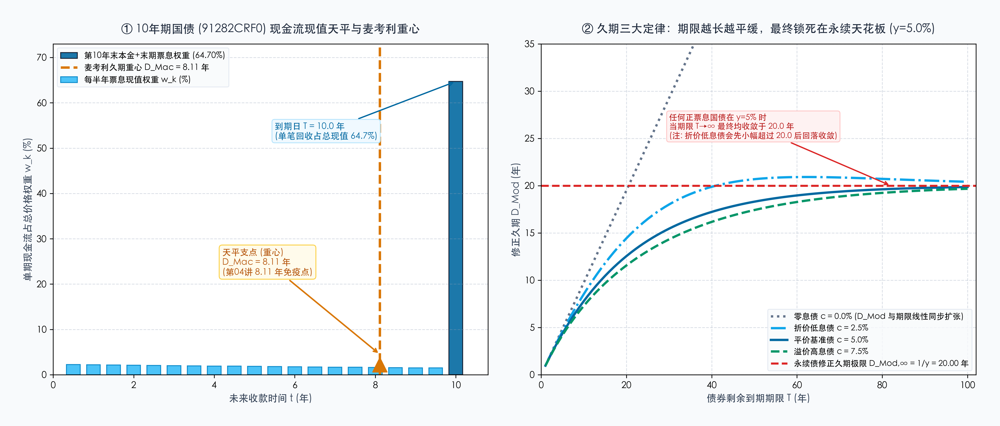
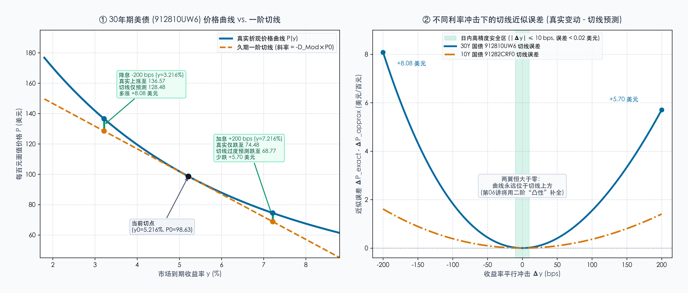

# 05｜久期：利率敏感度的一阶近似

> **系列总览：** 《从国债到宏观：利率研究课》｜阶段 A：债券语言与定价基础（05/30）  
> **研究问题：** 为何 2026 年秋 30Y 收益率仅升 40.2 bps、净价跌幅反超升 61.7 bps 的 10Y？为何 10Y 持有 **8.11 年** 时价格与再投资风险恰好抵消？如何用 $D_{\text{Mac}}$、$D_{\text{Mod}}$、DV01 与 KRD 压缩利率风险？  
> **先备知识：** 承接[第 01 讲](./01_固定收益地图_债券与现金流契约.md)至[第 04 讲](./04_收益率_持有期回报与再投资.md)（贴现因子、$a_N$、导数与免疫直觉）。

---

## 一、从两道实盘现象切入：麦考利久期（Macaulay Duration）的时间重心本质

在第 04 讲的真实美债回测与情景测算中，存在两道有待从定价微积分底层给出定量解释的实盘现象：

1. **跨期限价格跌幅倒挂：** 第 04 讲表 1 记录了 2026 年 8 月 17 日至 10 月 15 日（59 天）的美债抛售行情<sup>[1][2][3][4]</sup>。在此期间，10 年期基准国债 91282CRF0（票息 **4.625%** ）的拍卖收益率从 **4.683%** 升至 **5.300%** （上行 **61.7 bps** ），净价下跌 **4.676435 美元** ；同期 30 年期基准国债 912810UW6（票息 **5.125%** ）的收益率仅从 **5.216%** 升至 **5.618%** （仅上行 **40.2 bps** ），净价却下跌 **5.737886 美元** 。收益率涨幅更小的 30 年期国债，绝对价格跌幅反而多出 1 美元以上。
2. **8.11 年持有期免疫均衡点：** 第 04 讲表 5 测算了 10 年期国债 91282CRF0 在买入次日遭遇 ±100 bps 利率冲击时的总回报——持有 1 年时价格风险占主导，持有至 10 年到期时再投资风险占主导，而在持有约 **8.11 年** 时，价格损益与再投资损益恰好相互抵消，总回报对利率变动一阶不敏感。

1938 年，经济学家弗雷德里克·麦考利（Frederick Macaulay）在研究铁路债券波动时指出：用“到期年限 $T$”去度量一只附息债券的实际期限是严重失真的——因为到期日之前，债券每半年都在向投资者提前归还大量票息现金流，只有最后一天才归还本金<sup>[5]</sup>。真正科学的“有效回收时间”，应当是 **每笔现金流的到账时间，以其现值占债券总价格的比重为权重，加权求平均** 。

### 1. 现值权重与“现金流天平”模型

假设一只附息美债还剩 $N$ 个完整半年期，第 $k$ 期（对应距离今天 $t_k = k / 2$ 年）支付的合同现金流为 $\text{CF}_k$，按半年折现率 $y / 2$ 折算的现值为 $\text{PV}_k = \text{CF}_k / (1 + y/2)^k$，全部现值之和即为债券价格 $P = \sum \text{PV}_k$。

我们把第 $k$ 期现金流的现值占总价格的比例记作 **现值权重** $w_k$ （显然 $\sum w_k = 100\%$）：

$$w_k = \frac{\text{PV}_k}{P} = \frac{\text{CF}_k \div \left(1 + \frac{y}{2}\right)^k}{P}$$

将每期兑付时间 $t_k = k / 2$（单位：年）乘以对应现值权重 $w_k$ 求和，便得到了 **麦考利久期** （Macaulay Duration, $D_{\text{Mac}}$）的严格定义<sup>[5]</sup>：

$$D_{\text{Mac}} = \sum_{k=1}^{N} t_k \times w_k = \sum_{k=1}^{N} \left(\frac{k}{2}\right) \times \frac{\text{PV}_k}{P} = \frac{1}{P} \sum_{k=1}^{N} \left(\frac{k}{2}\right) \times \frac{\text{CF}_k}{\left(1 + \frac{y}{2}\right)^k}$$

* **物理天平直觉（重心支点）：** 把时间轴想象成一根轻质木杆，在 0.5 年、1.0 年、……、$T$ 年各个刻度位置挂上重量等于 $\text{PV}_k$ 的砝码。 **麦考利久期** $D_{\text{Mac}}$ （单位：年）就是 **能让整根现金流木杆保持水平平衡的重心支点（Center of Gravity）** 。
* **零息债 vs. 附息债边界：** 对于期间不付任何利息的 T-Bill 或零息 STRIPS，全部 100% 的砝码都集中挂在期末 $t_N = T$ 这一个点上，重心别无选择，故 **零息债券的麦考利久期严格等于其剩余到期年限** （$D_{\text{Mac}} = T$）；而任意正票息债券（$c > 0$）因早年提前收回了多笔票息砝码，必然把重心向左侧拉动，严格满足 $D_{\text{Mac}} < T$。

### 2. 2 年期美债 91282CRU7 逐期手算实操

沿用第 02 讲表 1 的 2 年期基准国债 91282CRU7（$N = 4$ 个半年期，票息率 $c = 4.625\%$，每半年付息 2.3125 美元，拍卖高收益率 $y = 4.708\%$，半年折现率 2.354%，完整期价格 $P = 99.843327$ 美元）<sup>[6]</sup>，我们在表 1 中一步步算出它的天平重心：

### 表 1：2 年期美债 91282CRU7 麦考利久期逐期手算分解表（每 100 美元面值）

| 期数 $k$ | 兑付时间 $t_k = k/2$（年） | 名义现金流 $\text{CF}_k$（美元） | 贴现因子 $\text{DF}_k$ | 单笔现值 $\text{PV}_k$（美元） | 现值权重 $w_k = \text{PV}_k / P$ | 时间加权现值 $t_k \times \text{PV}_k$ | 久期贡献 $t_k \times w_k$（年） |
| :--- | :--- | :--- | :--- | :--- | :--- | :--- | :--- |
| **第 1 期** | 0.5 | 2.312500 | 0.977001 | 2.259316 | 2.2629% | 1.129658 | 0.011314 |
| **第 2 期** | 1.0 | 2.312500 | 0.954532 | 2.207355 | 2.2108% | 2.207355 | 0.022108 |
| **第 3 期** | 1.5 | 2.312500 | 0.932578 | 2.156588 | 2.1600% | 3.234883 | 0.032400 |
| **第 4 期（本息）** | 2.0 | 102.312500 | 0.911131 | 93.220069 | 93.3663% | 186.440137 | 1.867327 |
| **合计** | — | **109.250000** | — | **99.843327** | **100.0000%** | **193.012033** | **1.933149 年** |

手算核验非常直观：将最后一列 4 项加总（或用时间加权现值总和 193.012033 除以总价格 99.843327），得到 2 年期国债 91282CRU7 的麦考利久期为 **1.933149 年** （若按半年期个数计量，则为 3.866298 个半年期，3.866298 ÷ 2 ＝ 1.933149 年）。因为前 3 期提前收回了合计 6.6337% 的现值，天平支点从 2.0 年被往前拉回了约 0.067 年（约 24 天）。

### 3. 麦考利久期的闭式代数公式与平价化简

面对 10 年期（20 期）或 30 年期（60 期）国债时，逐行列表计算较为繁琐。通过等比级数求和并整理，可以直接写出任意 $N$ 个完整半年期附息债券（设半年折现率 $i = y / 2$）的 **麦考利久期闭式公式** ：

$$D_{\text{Mac}} = \frac{1}{2} \times \left[ \frac{1 + i}{i} - \frac{(1 + i) + N \times \left(\frac{c}{2} - i\right)}{\frac{c}{2}\left[(1 + i)^N - 1\right] + i} \right]$$

当债券恰好处于 **平价** （Par Bond，$c = y$，即 $c/2 = i$）时，右侧分子中 $N \times (c/2 - i)$ 等于 0，公式化简为：

$$D_{\text{Mac, Par}} = \frac{1 + i}{2} \times a_N = \frac{1 + \frac{y}{2}}{y} \times \left[1 - \left(1 + \frac{y}{2}\right)^{-N}\right]$$

用该闭式公式核验两只真实现券（直接代入半年期数值：2Y 的 $c/2 = 0.023125$、$i = 0.02354$、$N = 4$；10Y 的 $c/2 = 0.023125$、$i = 0.023415$、$N = 20$）：
* **2 年期美债 91282CRU7：** 1.02354 ÷ 0.02354 ＝ 43.480884；减去减项 $[1.02354 + 4 \times (-0.000415)] \div [0.023125 \times (1.02354^4 - 1) + 0.02354] = 1.021880 \div 0.025799 = 39.614586$，括号内得 3.866298 个半年期，乘以 1/2 等于 **1.933149 年** ，与表 1 逐期手算结果一致。
* **10 年期美债 91282CRF0：** 同理代入 $N = 20$，解得 16.225468 个半年期，折合麦考利久期为 **8.112734 年** 。

至此，$D_{\text{Mac}}$ 给出了现金流在时间轴上的平均回收重心。在此基础上，还需要将这一时间尺度转化为直接度量债券价格百分比变动与绝对美元损益的风险标尺——即修正久期（$D_{\text{Mod}}$）与基点价值（DV01）。

---

## 二、从时间重心到价格敏感度：修正久期（Modified Duration）、基点价值（DV01）与持有期免疫

麦考利久期（$D_{\text{Mac}}$）的物理单位是“年”，回答的是“本息现值平均几年收回”。而在二级市场交易与风控中，交易员更直接关心两个问题： **一是收益率每变动 1%（100 bps），债券价格反向涨跌百分之几？二是收益率每跳动 1 bp（0.01%），持仓账面实际盈亏多少美元？** 下面通过对债券定价方程求导，依次引出解决这两个问题的核心指标——修正久期（$D_{\text{Mod}}$）与基点价值（DV01）。

### 1. 修正久期（Modified Duration）的微积分推导与价格百分比弹性

将债券价格方程 $P(y) = \sum \text{CF}_k \times (1 + y/2)^{-k}$ 直接对年化到期收益率 $y$ 求一阶导数（利用复合函数求导法则，$d(1 + y/2)/dy = 1/2$）：

$$\frac{dP}{dy} = \sum_{k=1}^{N} \text{CF}_k \times (-k) \times \left(1 + \frac{y}{2}\right)^{-k - 1} \times \frac{1}{2} = -\frac{1}{1 + \frac{y}{2}} \sum_{k=1}^{N} \left(\frac{k}{2}\right) \times \frac{\text{CF}_k}{\left(1 + \frac{y}{2}\right)^k}$$

对照第 1.1 节的定义，右侧求和项恰好等于 $P \times D_{\text{Mac}}$。将上式两边同时除以 $-P$，得到 **修正久期** （Modified Duration, $D_{\text{Mod}}$）：

$$D_{\text{Mod}} \equiv -\frac{1}{P}\frac{dP}{dy} = \frac{D_{\text{Mac}}}{1 + \frac{y}{2}}$$

由于美债按半年复利计息，收益率变动通过折现因子 $(1 + y/2)$ 传导至各期现金流现值，求导时自然产生一个额外因子 $(1 + y/2)^{-1}$。因此，将时间重心的麦考利久期除以复利修正因子 $(1 + y/2)$ 后，得到的 **修正久期** $D_{\text{Mod}}$ **就是专门用来计算“收益率每变动 1 个单位，债券价格反向变动百分之几”的百分比弹性乘数** （一般地，年付息 $m$ 次的债券满足 $D_{\text{Mod}} = D_{\text{Mac}} / (1 + y/m)$；仅在连续复利 $m \to \infty$ 时两者相等）：

$$\frac{\Delta P}{P} \approx -D_{\text{Mod}} \times \Delta y, \qquad \Delta P \approx -D_{\text{Mod}} \times P \times \Delta y$$

以 10 年期基准国债 91282CRF0（$D_{\text{Mac}} = 8.112734$ 年，$y = 4.683\%$，半年折现率 $y/2 = 2.3415\%$）为例，其修正久期 $D_{\text{Mod}} = 8.112734 \div 1.023415$ ＝ **7.927120** 。这意味着：无论持仓规模大小，当市场收益率平行上行 1.00%（100 bps）时，该债券价格一阶约下跌 **7.9271%** ；上行 0.50%（50 bps）时，价格约下跌 **3.9636%** 。

### 2. 持有期免疫定理的微积分证明（持有期等于麦考利久期）

借助一阶导数表达式 $dP/dy = -[P / (1 + y/2)] \times D_{\text{Mac}}$，可以直接给出 8.11 年持有期免疫性质的严格微积分证明。假设投资者今日以价格 $P(y)$ 买入附息国债，计划持有 $H$ 年（即 $2H$ 个半年期）。若买入次日收益率水平发生平行变动，在收益率仍保持于 $y$ 处的第 $H$ 年末，包含全部票息再投资与期末卖出价值的账户总终值 $\text{FV}_H(y)$ 为：

$$\text{FV}_H(y) = P(y) \times \left(1 + \frac{y}{2}\right)^{2H}$$

对 $y$ 求导，总财富的一阶边际变动拆分为两项：

$$\frac{d\text{FV}_H}{dy} = \underbrace{\frac{dP}{dy}\left(1 + \frac{y}{2}\right)^{2H}}_{\text{① 价格变动项 (< 0)}} + \underbrace{P \times H \left(1 + \frac{y}{2}\right)^{2H - 1}}_{\text{② 票息再投资变动项 (> 0)}}$$

将 $dP/dy = -P \times D_{\text{Mac}} / (1 + y/2)$ 代入第 ① 项并提取公因式：

$$\frac{d\text{FV}_H}{dy} = P \left(1 + \frac{y}{2}\right)^{2H - 1} \times \left( H - D_{\text{Mac}} \right)$$

上式表明：当且仅当计划持有期 $H = D_{\text{Mac}}$ （对于 91282CRF0 即为 **8.1127 年** ）时，括号项为零。此时，收益率波动引起的 **价格变动项** 与 **再投资复利变动项** 大小相等、方向相反，组合总终值对收益率微扰实现一阶免疫。

### 3. 交易台的风险计量单位：每百元基点价值（DV01）

修正久期给出的是相对价格变动比例（$\Delta P / P$）。但在实际组合管理与跨券对冲中，不同债券的价格基数可能差异悬殊（例如全价 99.54 美元的附息母券 vs. 折价仅 62.95 美元的零息 STRIP）。为了直接衡量每笔头寸的绝对美元风险、或是计算用 A 债券对冲 B 债券所需的面值配比，交易台将收益率变动设定为 **1 个基点** （$\Delta y = 0.0001$，即 1 bp），定义出 **基点价值（Dollar Value of an 01, DV01，又称 PVBP）** ——即收益率每变动 1 bp 所对应的债券绝对美元价格变动：

$$\text{DV01}_{100} = -\frac{dP}{dy} \times 0.0001 = P \times D_{\text{Mod}} \times 0.0001$$

$$\text{DV01}_{\text{Position}} = \text{持仓面值} \times \frac{\text{DV01}_{100}}{100} = \text{持仓总市值} \times D_{\text{Mod}} \times 0.0001$$

基于每只债券的 $\text{DV01}_{100}$，任意规模头寸在一阶近似下的利率盈亏可表示为 −头寸总 DV01 × 利率变动基点数。

### 4. 2026 年四类真实美债标本的久期与 DV01 全景对账

将第 02 讲拆解过的三只 2026 年真实附息国债标本与 10Y 本金 STRIP 放在同一口径下，完整对账它们的麦考利久期 $D_{\text{Mac}}$、修正久期 $D_{\text{Mod}}$ 与 DV01 指标：

### 表 2：2026 年四类美债标本的麦考利久期、修正久期与 DV01 风险标尺底表

| 2026 真实标本与 CUSIP | 半年期数 $N$ | 票息率 $c$ | 基准收益率 $y$ | 完整期全价 $P$（美元/百元） | 麦考利久期 $D_{\text{Mac}}$（年） | 修正久期 $D_{\text{Mod}}$（年） | 百元面值 $\text{DV01}_{100}$（美元/bp） | 每 1,000 万美元面值 DV01（美元/bp） |
| :--- | :--- | :--- | :--- | :--- | :--- | :--- | :--- | :--- |
| **2 年期 T-Note** （91282CRU7）<sup>[6]</sup> | 4 | 4.625% | 4.708% | 99.843327 | **1.933149** | **1.888689** | **0.018857** | **1,885.73** |
| **10 年期 T-Note** （91282CRF0）<sup>[1]</sup> | 20 | 4.625% | 4.683% | 99.541071 | **8.112734** | **7.927120** | **0.078907** | **7,890.74** |
| **30 年期 T-Bond** （912810UW6）<sup>[3]</sup> | 60 | 5.125% | 5.216% | 98.627614 | **15.529300** | **15.134590** | **0.149269** | **14,926.88** |
| **10 年期本金 STRIP** （源自 91282CRF0） | 20 | 0.000% | 4.683% | 62.945464 | **10.000000** | **9.771207** | **0.061505** | **6,150.53** |

表 2 直接给出了第 1 节跨期限跌幅倒挂现象的定量答案，并揭示了一个常见的头寸计量陷阱：

1. **跨期限跌幅倒挂的定量解释：** 30 年期国债 912810UW6 的修正久期（ **15.1346** ）与百元 DV01（ **0.149269 美元/bp** ）接近 10 年期 91282CRF0（修正久期 **7.9271** 、DV01 **0.078907** ）的 **1.89 倍** 。按此估算 2026 年 8–10 月抛售冲击：
    * **10 年期基准国债（91282CRF0）：** +61.7 bps 上行带来一阶近似跌幅为 −61.7 × 0.078907 ＝ − **4.8686 美元** ；考虑 59 天时间衰减与二阶曲率修正后，实际净价跌 − **4.6764 美元** ；
    * **30 年期基准国债（912810UW6）：** +40.2 bps 上行乘以近两倍 DV01 后，一阶近似跌幅仍高达 −40.2 × 0.149269 ＝ − **6.0006 美元** ；实际净价跌 − **5.7379 美元** 。久期如同一台杠杆放大器，使 30 年期债券只靠三分之二的利率涨幅就造成了更深的价格失血。
2. **深度折价零息债的“百分比久期 vs. 面值 DV01”反转陷阱：** 仔细比较表 2 最后两行！10 年期本金 STRIP 的修正久期（ **9.7712** ）高出同期限附息母券（ **7.9271** ）整整 **23.3%** ——如果你分别投入 **1,000 万美元现金市值** ，本金 STRIP 的盈亏波动比附息母券高出 23.3%。 **但如果两位交易员都买入 1,000 万美元票面面值** ，由于 10 年期本金 STRIP 的发行价格只有 **62.95 美元** （远低于母券的 **99.54 美元** ），乘以价格 $P$ 后，1,000 万面值本金 STRIP 的 DV01 反而只有 **6,150.53 美元/bp** ，比同面值母券（ **7,890.74 美元/bp** ）低了 **22.1%** ！用零息 STRIPS 或深度折价老券做对冲时，绝不可把“面值相等”误当成“市值相等”。

---

## 三、决定久期的三大物理定律与“永续债久期天花板”

什么力量决定了一只债券久期的长短？把思维拉回到第 1 节的“现金流天平模型”，以下三条 **马尔基尔久期定律（Malkiel Duration Theorems）** 完全符合物理重心直觉：

1. **定律一（期限效应与永续债上限）：** 票息率与收益率固定时，附息国债的期限越长，久期越大， **但边际增长迅速衰减，最终锁死在一个无法突破的“永续债上限（Perpetuity Limit）”** 。
   在 $D_{\text{Mac}}$ 闭式公式中令期数 $N \to \infty$，贴现因子项 $(1 + i)^{-N} \to 0$，无论合同票息率 $c > 0$ 高还是低，永续债（Perpetuity）的麦考利久期与修正久期都会收敛到 **完全与票息率无关** 的极限值：

$$D_{\text{Mac}, \infty} = \frac{1 + \frac{y}{2}}{y}, \qquad D_{\text{Mod}, \infty} = \frac{1}{y}$$

   当市场收益率 $y = 5.000\%$ 时，任何正票息债券哪怕发到 **100 年期甚至永不到期** ，其麦考利久期天花板严格封顶在 1.025 ÷ 0.05 ＝ **20.50 年** ，修正久期天花板严格封顶在 1 ÷ 0.05 ＝ **20.00 年** ！因为 50 年以后的现金流折现到今天已几乎化为尘埃，再往后延长到期日也无法继续向右拖动天平重心（唯有零息债例外，其 $D_{\text{Mac}} = T$ 随期限线性无限拉长）。

2. **定律二（票息效应）：** 期限与收益率相同时， **票息率** $c$ **越高，久期越短** 。道理很朴素：票息越高，前几年提前回流到账户的现金砝码就越重，天平支点自然向左（近期）移动；反之，低票息券与零息债把回报死死推迟到最终到期日，重心最靠右。

3. **定律三（收益率水平效应——利率升高反而缩短久期）：** 期限与票息率相同时， **市场收益率** $y$ **越高，久期越短；收益率越低，久期越长** 。这是因为更高的折现率会以复利指数速度加速“压缩”远期（例如第 20–30 年）现金流的现值权重，相对凸显近期票息的重量，从而把天平重心向左拉回！

### 表 3：三大决定因子在不同期限（2Y 至永续）与票息率下的交叉验证表（基准 y = 5.000%）

| 剩余到期期限 $T$ | 零息债券 $c = 0.0\%$（$D_{\text{Mac}}$ / $D_{\text{Mod}}$） | 低息折价债 $c = 2.5\%$（$D_{\text{Mac}}$ / $D_{\text{Mod}}$） | 平价基准债 $c = 5.0\%$（$D_{\text{Mac}}$ / $D_{\text{Mod}}$） | 高息溢价债 $c = 7.5\%$（$D_{\text{Mac}}$ / $D_{\text{Mod}}$） | 期限边际特征说明 |
| :--- | :--- | :--- | :--- | :--- | :--- |
| **2 年期** （$N = 4$） | 2.0000 / 1.9512 | 1.9622 / 1.9144 | 1.9280 / 1.8810 | 1.8969 / 1.8506 | 短债本金占比极高，票息对久期影响不足 0.1 年 |
| **5 年期** （$N = 10$） | 5.0000 / 4.8780 | 4.7111 / 4.5962 | 4.4854 / 4.3760 | 4.3043 / 4.1993 | 高息债已把重心拉回近 0.7 年 |
| **10 年期** （$N = 20$） | 10.0000 / 9.7561 | 8.7514 / 8.5380 | 7.9894 / 7.7946 | 7.4760 / 7.2937 | 平价 10Y 修正久期约为期限的 78% |
| **30 年期** （$N = 60$） | 30.0000 / 29.2683 | 18.4629 / 18.0126 | 15.8407 / 15.4543 | 14.6800 / 14.3220 | 远期本金权重坍缩，30Y 久期仅及期限一半左右 |
| **100 年期** （$N = 200$） | 100.0000 / 97.5610 | 20.9197 / 20.4095 | 20.3531 / 19.8567 | 20.1624 / 19.6707 | **期限从 30 年翻 3.3 倍，久期收敛于 20 年上限** |
| **永续债** （$N \to \infty$） | 无定义 | **20.5000 / 20.0000** | **20.5000 / 20.0000** | **20.5000 / 20.0000** | **任何正票息率最终收敛于 1.025/0.05 与 1/0.05** |



*(图注：左联展示 10 年期美债 91282CRF0 的 20 笔现金流现值分布——尽管第 10 年末的单笔回收占总价值的 64.7%，但前 9.5 年累计回收的 19 笔票息把天平支点往前拉到了 8.11 年；右联展示在 $y = 5.0\%$ 下各票息率债券的修正久期随到期期限的变化路径，任意正票息债券在超长端均逐步收敛向红色虚线标注的永续极限 $1/y = 20.00$ 年——注意低息折价债 $c = 2.5\%$ 会在 40–80 年区间短暂微超 20 年后从上方回落收敛。)*

观察定律三的实盘威力：同样是 30 年期国债 912810UW6（票息 5.125%），如果是在 2020–2021 年 $y = 2.000\%$ 的低利率周期，其修正久期高达 **18.8272 年** （百元 DV01 ＝ **0.3205** ）；而到了 2026 年 $y = 5.216\%$ 的高利率平台，其修正久期已自然收缩为 **15.1346 年** （百元 DV01 ＝ **0.1493** ），价格波动敏感度相比低利率时代自动减轻了一半以上！相反， **在利率越低的环境里，长债持有者每降 1 bp 利率获得的弹性越高、但一旦遇到加息翻脸时的净值杀伤力也越恐怖** ——这正是为什么 2020 年底那些在超低收益率买入超长债的机构，在 2022–2023 年遭遇史上最惨烈净值回撤的底层数学原因。

---

## 四、久期一阶近似的几何本质与适用边界：切线为什么永远在曲线下方？

回到本讲标题里的核心限定词—— **一阶近似（First-Order Approximation）** 。为什么用修正久期算出的价格变动只是近似值，而非精确答案？

把债券价格函数 $P(y)$ 在当前市场收益率 $y_0$ 处做一阶泰勒级数展开：

$$P(y_0 + \Delta y) \approx P(y_0) + \frac{dP}{dy}\bigg|_{y_0} \Delta y = P_0 \times \left(1 - D_{\text{Mod}} \times \Delta y\right)$$

在二维坐标系中，横轴是收益率 $y$，纵轴是价格 $P$：
* 真实的价格函数 $P(y)$ 是一条 **向右下方倾斜、并且向原点显著内凹弯曲（Strictly Convex）的光滑曲线** ——利率越低，下跌斜率越陡；利率越高，曲线越平缓；
* 而修正久期一阶近似 $\Delta P \approx -D_{\text{Mod}} \times P_0 \times \Delta y$，在几何上就是贴着初始点 $(y_0, P_0)$ 画出的一条 **笔直的切线（Tangent Line）** ！

对于一条严格向下方凸出的光滑曲线， **它的任意一条切线，在切点两侧永远严格位于真实价格曲线的下方** 。



*(图注：左联以 30 年期美债 912810UW6 为例，在当前收益率 $y_0 = 5.216\%$、价格 98.63 美元处，久期预测值就是一条笔直的橙色切线，它比蓝色真实价格曲线永远“矮”一截——降息 200 bps 时切线只预测涨到 128.48，实际价格涨到 136.57（多涨 +8.08 美元）；加息 200 bps 时切线悲观预测跌至 68.77，实际只跌到 74.48（少跌 +5.70 美元）。右联对比 10Y 与 30Y 在 ±200 bps 内的切线误差，中间绿色阴影为修正久期高精度的日内安全区。)*

表 4 列出了 10 年期与 30 年期基准国债在 ±1 bp 至 ±200 bps 平行利率冲击下的精确价格变动、久期切线预测值及近似误差：

### 表 4：久期一阶线性近似与精确价格变动误差审计表（每 100 美元面值）

| 收益率平行冲击 $\Delta y$ | 10Y 91282CRF0 精确变动 $\Delta P_{\text{exact}}$（百分比） | 10Y 久期切线预测 $\Delta P_{\text{approx}}$（百分比） | 10Y 切线误差（$\Delta P_{\text{exact}} - \Delta P_{\text{approx}}$） | 30Y 912810UW6 精确变动 $\Delta P_{\text{exact}}$（百分比） | 30Y 久期切线预测 $\Delta P_{\text{approx}}$（百分比） | 30Y 切线误差（$\Delta P_{\text{exact}} - \Delta P_{\text{approx}}$） |
| :--- | :--- | :--- | :--- | :--- | :--- | :--- |
| − **200 bps（暴跌降息）** | + **17.3931** （+17.47%） | +15.7815（+15.85%） | + **1.6116** | + **37.9381** （+38.47%） | +29.8538（+30.27%） | + **8.0843** |
| − **100 bps（显著降息）** | + **8.2796** （+8.32%） | +7.8907（+7.93%） | + **0.3888** | + **16.7661** （+17.00%） | +14.9269（+15.13%） | + **1.8392** |
| − **50 bps（温和下行）** | +4.0409（+4.06%） | +3.9454（+3.96%） | + **0.0955** | +7.9029（+8.01%） | +7.4634（+7.57%） | + **0.4394** |
| − **10 bps（日内波动）** | +0.7928（+0.80%） | +0.7891（+0.79%） | + **0.0038** | +1.5097（+1.53%） | +1.4927（+1.51%） | + **0.0170** |
| − **1 bp（微调测试）** | +0.0789（+0.08%） | +0.0789（+0.08%） | + **0.00004** | +0.1494（+0.15%） | +0.1493（+0.15%） | + **0.00017** |
| + **1 bp（微调测试）** | -0.0789（-0.08%） | -0.0789（-0.08%） | + **0.00004** | -0.1491（-0.15%） | -0.1493（-0.15%） | + **0.00017** |
| + **10 bps（日内波动）** | -0.7853（-0.79%） | -0.7891（-0.79%） | + **0.0037** | -1.4760（-1.50%） | -1.4927（-1.51%） | + **0.0167** |
| + **50 bps（温和上行）** | -3.8531（-3.87%） | -3.9454（-3.96%） | + **0.0923** | -7.0606（-7.16%） | -7.4634（-7.57%） | + **0.4028** |
| + **100 bps（显著加息）** | − **7.5278** （-7.56%） | -7.8907（-7.93%） | + **0.3629** | − **13.3816** （-13.57%） | -14.9269（-15.13%） | + **1.5453** |
| + **200 bps（通胀冲击）** | − **14.3776** （-14.44%） | -15.7815（-15.85%） | + **1.4039** | − **24.1498** （-24.49%） | -29.8538（-30.27%） | + **5.7040** |

仔细审视上图与表 4 的“误差”列，两条深刻的量化适用边界跃然纸上：
1. **小幅波动的高精度安全区** （$|\Delta y| \le 10$ bps）：当利率波动不超过 10 bps 时，10 年期国债的切线误差不到 **0.0038 美元/百元** （万分之四），30 年期也不超过 **0.017 美元/百元** ，修正久期在日内做市与例行头寸对冲中完全胜任；
2. **大幅冲击下的单向正偏移规律：** 一旦利率移动达到 ±100 bps 甚至 ±200 bps，切线预测出现巨大偏差，且请务必注意符号—— **无论是上涨还是下跌** ，$\Delta P_{\text{exact}} - \Delta P_{\text{approx}}$ **永远为正数** ！以 30 年期国债为例，利率暴跌 200 bps 时它实际狂飙 +37.94 美元（比切线多涨整整 +8.08 美元）；利率暴涨 200 bps 时它只跌 -24.15 美元（比切线少亏整整 +5.70 美元）。这种“ **涨多跌少** ”的免费曲率红利，正是因为真实价格曲线在切线下方找不到落脚点—— **第 06 讲将用二阶导数凸性（Convexity）把这缺失的 8.08 美元与 5.70 美元一分不差地补全回来** 。

---

## 五、从单券到组合：组合久期、DV01 对冲与关键利率久期（KRD）

当你的账户不再只有一只国债，而是由不同期限的现券或期货组成的投资组合时，久期在组合层面具备优异的线性可加性——但前提是必须选对加权权重：

$$D_{\text{Mod, Portfolio}} = \sum_{j=1}^{M} \left(\frac{\text{MV}_j}{\text{MV}_{\text{Total}}}\right) \times D_{\text{Mod}, j}, \qquad \text{DV01}_{\text{Portfolio}} = \sum_{j=1}^{M} \text{DV01}_j$$

* **组合修正久期按实际市值权重** （$\text{MV}_j / \text{MV}_{\text{Total}}$） **加权平均** ，切不可用面值权重加权（除非所有债券全按 100 平价交易）；
* **组合总 DV01 则是各成分头寸美元 DV01 的直接算术相加** （多头为正、空头为负）。

### 实战案例：1 亿美元子弹型组合（10Y Bullet）vs. 久期匹配的哑铃型组合（2Y + 30Y Barbell）

然而，哪怕两个组合的 **总市值完全相等、总修正久期一模一样、总 DV01 分毫不差** ，它们在真实宏观市场中的命运依然可能天差地别——因为单个久期只度量 **整条收益率曲线平行上下平移（Parallel Shift）** 这一个维度的风险。

让我们在 2026 年基准标本上构造两组 **总市值同为 1 亿美元（10,000.00 万美元）、总修正久期同为 7.927120 年、总 DV01 同为 79,271.20 美元/bp** 的组合：
* **组合甲（10Y 子弹型组合 Bullet）：** 全仓 **10,000.00 万美元** 市值（对应面值 **10,046.10 万美元** ）买入 10 年期基准国债 91282CRF0（$D_{\text{Mod}} = 7.927120$）。
* **组合乙（2Y + 30Y 哑铃型组合 Barbell）：** 只买 2 年期 91282CRU7（$D_{\text{Mod}} = 1.888689$）与 30 年期 912810UW6（$D_{\text{Mod}} = 15.134590$）。解市值权重方程 $w_{2\text{Y}} \times 1.888689 + (1 - w_{2\text{Y}}) \times 15.134590 = 7.927120$，得到精确配比：
  * **54.4128%** 市值（ **5,441.28 万美元** ，面值 **5,449.82 万美元** ）买入 2 年期 91282CRU7，贡献 $\text{DV01}_{2\text{Y}}$ ＝ **10,276.89 美元/bp** ；
  * **45.5872%** 市值（ **4,558.72 万美元** ，面值 **4,622.15 万美元** ）买入 30 年期 912810UW6，贡献 $\text{DV01}_{30\text{Y}}$ ＝ **68,994.31 美元/bp** 。

为了戳穿总量久期相同的假象，1992 年学者托马斯·何（Thomas Ho）提出了 **关键利率久期** （Key Rate Duration, $\text{KRD}_k$）<sup>[7]</sup>：保持收益率曲线上其余期限点全部冻结，仅仅让第 $k$ 个关键期限节点（例如 2Y、10Y、30Y）局部移动，测量组合市值对该单一期限节点利率的局部偏导数。所有关键节点 $\text{KRD}_k$ 加总，正好等于组合总修正久期（$\sum \text{KRD}_k = D_{\text{Mod}}$）：

$$\text{KRD}_k = -\frac{1}{P} \frac{\partial P}{\partial y_k}, \qquad \sum_{k} \text{KRD}_k = D_{\text{Mod}}$$

将组合乙的市值权重分别乘以各成分债自身的修正久期，即可算出两个关键期限节点上的局部关键利率久期（以及对应的 DV01 贡献）：
* **2Y 关键利率久期：** $\text{KRD}_{2\text{Y}} = w_{2\text{Y}} \times D_{\text{Mod}, 2\text{Y}} = 54.412829\% \times 1.888689$ ＝ **1.027689 年** （对应 $\text{DV01}_{2\text{Y}} = 10,276.89$ 美元/bp，仅占总 DV01 的 **12.96%** ）；
* **30Y 关键利率久期：** $\text{KRD}_{30\text{Y}} = w_{30\text{Y}} \times D_{\text{Mod}, 30\text{Y}} = 45.587171\% \times 15.134590$ ＝ **6.899431 年** （对应 $\text{DV01}_{30\text{Y}} = 68,994.31$ 美元/bp，独占总 DV01 的 **87.04%** ）；
* 二者相加：1.027689 + 6.899431 ＝ **7.927120 年** ，恰好还原出组合总修正久期！

对上述两个看似“风险完全相等”的 1 亿美元组合进行关键利率久期剖析，并测试一次经典的 **曲线陡峭化扭曲（Twist：美联储暗示未来降息导致 2Y 下行 -20 bps、10Y 维持 0 bps 不变，同时财政赤字担忧推动 30Y 上行 +20 bps）** ：

### 表 5：1 亿美元子弹型（10Y）与哑铃型（2Y+30Y）组合的关键利率久期（KRD）与扭曲冲击审计表

| 风险维度与情景指标 | 组合甲：10Y 子弹型（Bullet） | 组合乙：2Y + 30Y 哑铃型（Barbell） | 多空相对价值对冲（做多哑铃 / 做空子弹） |
| :--- | :--- | :--- | :--- |
| **组合净市值** $\text{MV}$（美元） | 100,000,000.00 | 100,000,000.00 | **0.00（零净资金占用）** |
| **总修正久期** $D_{\text{Mod}}$（年） | **7.927120** | **7.927120** | **0.000000（总量久期中性）** |
| **总基点价值 DV01（美元/bp）** | **79,271.20** | **79,271.20** | **0.00（总量 DV01 中性）** |
| **2Y 关键利率久期** $\text{KRD}_{2\text{Y}}$ / $\text{DV01}_{2\text{Y}}$ | 0.0000 年 / 0.00 美元 | **1.027689 年** / **10,276.89 美元** | +1.027689 年 / +10,276.89 美元 |
| **10Y 关键利率久期** $\text{KRD}_{10\text{Y}}$ / $\text{DV01}_{10\text{Y}}$ | **7.927120 年** / **79,271.20 美元** | 0.0000 年 / 0.00 美元 | -7.927120 年 / -79,271.20 美元 |
| **30Y 关键利率久期** $\text{KRD}_{30\text{Y}}$ / $\text{DV01}_{30\text{Y}}$ | 0.0000 年 / 0.00 美元 | **6.899431 年** / **68,994.31 美元** | +6.899431 年 / +68,994.31 美元 |
| **曲线平行上行 +20 bps 一阶盈亏（美元）** | -1,585,424.04 | -1,585,424.04 | **0.00（平行冲击完全对冲）** |
| **曲线陡峭扭曲（2Y -20bps / 10Y 0 / 30Y +20bps）一阶盈亏** | **0.00** | − **1,174,348.37** （2Y 赚 20.55 万 vs. 30Y 亏 137.99 万） | − **1,174,348.37（实亏 117.43 万美元）** |

> **买方关键风险警钟（资金权重 ≠ 风险权重）：** 在组合乙（哑铃组合）中，虽然超过一半的本金（ **54.41%** ）买的是极其安稳的 2 年期短债，但在风险权重（DV01 / KRD）结构里， **30 年期长债却独占了整个组合高达 68,994.31 ÷ 79,271.20 ＝ 87.04% 的利率敞口** ！当曲线发生“短降长升”陡峭化时，哑铃组合的 2Y 端仅赚取 +20.55 万美元，30Y 端却暴亏 -137.99 万美元，净亏 **117.43 万美元** ——这就是第 06 讲即将继续深挖的“曲线曲率与久期中性假象”。

---

## 六、竞争性视角、失效边界与可复算 Python 脚本

### 1. 竞争性视角辨析：分析性修正久期 vs. 有效久期（Effective Duration）

本文第 2 节基于合同现金流 $\text{CF}_k$ 固定不变推导出解析形式的 **修正久期** （$D_{\text{Mod}}$）。这在处理无嵌入期权的普通美国国债（T-Notes、T-Bonds、STRIPS）时完全精确。然而，一旦走出标准国债范畴，遇到 **含权债券（Callable Bonds / 机构抵押贷款支持证券 Agency MBS）** 或 **浮动利率国债（FRNs）** ，“现金流 $\text{CF}_k$ 与利率 $y$ 无关”这一前提瞬间崩塌：
* **Agency MBS 与可赎回债的“负凸性截断”：** 当房贷利率大幅下行时，房主会提前再融资还本（Prepayment），把原本 30 年期的现金流在 3 年内提前终结，使 MBS 价格上涨被强行封顶。此时解析公式毫无意义，必须用期权调整模型上下微调平行收益率曲线 $\pm \Delta y$（如 ±5 bps），通过数值有限差分测算 **有效久期** （Effective Duration, $D_{\text{Eff}}$）：

$$D_{\text{Eff}} = \frac{P(y_0 - \Delta y) - P(y_0 + \Delta y)}{2 \times P_0 \times \Delta y}$$

* **浮动利率国债（FRN）的“双久期”分离：** 回顾第 01 讲的 2 年期浮息国债 91282CRS2<sup>[8]</sup>。虽然本金 2 年后到期，但因为它的票息每周紧随 13 周 T-Bill 拍卖利率浮动重置，加息周期来临时它的票息会自动水涨船高，因此其 **基准利率久期（Rate Duration）几乎为 0（约 1 周 = 0.02 年）** ！但与此同时，它相对于基准利率的“固定附加利差（Spread）”在 2 年内被契约锁死，若市场对该浮息债券要求的贴现利差（Discount Margin）走阔，它依然会有接近 **2 年的利差久期（Spread Duration）** 。绝不能看剩余期限是 2 年，就把 FRN 算作 2 年期利率久期。

### 2. 三大常见认知与模型失效条件（Failure Conditions）

* **失效条件一：把“面值配比”混同于“市值配比”计算或对冲**  
  折价老券、零息 STRIPS 或高溢价债的价格 $P$ 显著偏离 100。做多或做空对冲时必须对齐 **头寸总 DV01** （$\text{Par} \times \text{DV01}_{100} / 100$），而不可直接拿修正久期做面值配比（见表 2 10Y 母券 vs. 10Y 本金 STRIP）。
* **失效条件二：在超 ±50 bps 的剧烈利率冲击下把线性切线当成精确损益预测**  
  表 4 已定量证明，在 ±200 bps 冲击下，30 年期国债的久期切线误差高达 **5.70 至 8.08 美元/百元面值** 。大波动情景必须引入二阶凸性（第 06 讲专题）。
* **失效条件三：把“总量 DV01 = 0”误认为“曲线风控安全”**  
  如表 5 所示，只要多头和空头落在不同的关键利率节点上（$\text{KRD}_k$ 分布错位），组合就会在陡峭化（Steepener）或平坦化（Flattener）行情中出现剧烈损益。

### 3. 一手证据清单与最小可复现 Python 脚本

本讲真实美债标本（2Y 91282CRU7、10Y 91282CRF0、30Y 912810UW6 及 FRN 91282CRS2）数据均取自美国财政部 TreasuryDirect 2026 年官方拍卖公告与结果表<sup>[1][2][3][4][6][8]</sup>。运行以下零依赖 Python 脚本，即可完整复现表 1 至表 5 的全部计算结果：

```python
# 最小可运行复算脚本：麦考利久期、修正久期、DV01、泰勒切线误差与 Bullet/Barbell KRD 审计
def bond_risk_metrics(c_annual, y_annual, n_periods):
    """计算完整半年期附息国债的价格、麦考利久期、修正久期与百元 DV01"""
    i = y_annual / 2.0
    c_semi = 100.0 * (c_annual / 2.0)
    price = 0.0
    weighted_t_pv = 0.0
    for k in range(1, n_periods + 1):
        cf = c_semi + (100.0 if k == n_periods else 0.0)
        pv = cf / ((1.0 + i) ** k)
        t_yr = k / 2.0
        price += pv
        weighted_t_pv += t_yr * pv
    d_mac = weighted_t_pv / price
    d_mod = d_mac / (1.0 + i)
    dv01_per_100 = price * d_mod * 0.0001
    return price, d_mac, d_mod, dv01_per_100

# 1. 复现表 2：2026 年四类真实美债标本久期与 DV01
print("=== 1. 2026 年美债标本久期与 DV01 对账 ===")
specimens = [
    ("2Y T-Note 91282CRU7", 0.04625, 0.04708, 4),
    ("10Y T-Note 91282CRF0", 0.04625, 0.04683, 20),
    ("30Y T-Bond 912810UW6", 0.05125, 0.05216, 60),
    ("10Y Principal STRIP", 0.00000, 0.04683, 20),
]
res = {}
for name, c, y, n in specimens:
    p, dm, dmod, dv01 = bond_risk_metrics(c, y, n)
    res[name] = (p, dm, dmod, dv01)
    print(f"[{name}] P={p:.6f} | D_Mac={dm:.6f} | D_Mod={dmod:.6f} | DV01/100={dv01:.6f} | DV01/$10M=${dv01*100000:,.2f}")

# 2. 复现表 4：10Y 与 30Y 久期一阶线性近似误差审计
print("\n=== 2. 10Y 与 30Y 泰勒一阶线性近似 vs 精确变动 ===")
for name, c, y, n in [("10Y T-Note 91282CRF0", 0.04625, 0.04683, 20), ("30Y T-Bond 912810UW6", 0.05125, 0.05216, 60)]:
    p0, _, dmod, _ = res[name]
    print(f"-- {name} (P0={p0:.6f}, D_Mod={dmod:.6f}) --")
    for dy_bps in [-200, -100, -10, 10, 100, 200]:
        dy = dy_bps / 10000.0
        p1, _, _, _ = bond_risk_metrics(c, y + dy, n)
        dp_exact = p1 - p0
        dp_approx = -dmod * p0 * dy
        print(f"  dy={dy_bps:+4d} bps: Exact={dp_exact:+8.4f} | Approx={dp_approx:+8.4f} | Error(Exact-Approx)={dp_exact - dp_approx:+7.4f}")

# 3. 复现表 5：$100M 子弹组合 (10Y) vs 哑铃组合 (2Y+30Y) KRD 与陡峭扭曲测试
p2, _, dmod2, dv2 = res["2Y T-Note 91282CRU7"]
p10, _, dmod10, dv10 = res["10Y T-Note 91282CRF0"]
p30, _, dmod30, dv30 = res["30Y T-Bond 912810UW6"]
w30 = (dmod10 - dmod2) / (dmod30 - dmod2)
w2 = 1.0 - w30
mv = 100_000_000.0
dv01_2y = (mv * w2) * dmod2 * 0.0001
dv01_30y = (mv * w30) * dmod30 * 0.0001
pnl_twist = -dv01_2y * (-20) - dv01_30y * (20)
print(f"\n=== 3. $100M 哑铃匹配 10Y 久期: w_2Y={w2:.4%}, w_30Y={w30:.4%} ===")
print(f"KRD_2Y={w2*dmod2:.6f} (DV01=${dv01_2y:,.2f}) | KRD_30Y={w30*dmod30:.6f} (DV01=${dv01_30y:,.2f})")
print(f"2Y -20bps / 10Y 0 / 30Y +20bps 陡峭扭曲: 子弹损益=$0.00 | 哑铃一阶损益=${pnl_twist:,.2f}")
```

---

## 七、本讲小结与下一讲预告

* **1. 麦考利久期是一只债券现金流天平的时间重心，也是对抗利率波动的免疫持有期：** 正票息债券的 $D_{\text{Mac}}$ 恒小于到期年限 $T$；对于 10 年期国债 91282CRF0，其重心（8.1127 年）恰好对应第 04 讲“持有约 8.11 年时卖出价格变动与票息再投资盈亏一阶相消”的均衡点。
* **2. 修正久期与基点价值分别度量百分比价格弹性与每基点绝对美元损益：** $D_{\text{Mod}} = D_{\text{Mac}} / (1 + y/2)$ 与 $\text{DV01} = P \times D_{\text{Mod}} \times 0.0001$ 刻画了不同维度的风险标尺；实操中务必区分“按面值配比”与“按市值配比”，并牢记高票息或高收益率环境会自然压缩债券久期，正票息债券在超长期限下收敛于永续债上限 $D_{\text{Mod}, \infty} = 1/y$。
* **3. 走出单一平行平移假设，需用关键利率久期拆解曲线扭曲风险、用有效久期度量含权债券：** 在多空对冲或子弹/哑铃组合配置中，必须用关键利率久期（KRD）拆解不同期限节点的 DV01 分布（绝不能把总量 $\text{Net DV01} = 0$ 当成无风险保护伞）；面对现金流随利率改变的 MBS 或可赎回债，则需以数值差分有效久期 $D_{\text{Eff}}$ 替代解析久期。

在本讲第 4 节的泰勒切线压力测试中，我们发现了一个至关重要的二阶现象：面对 ±200 bps 的大幅利率冲击，30 年期国债 912810UW6 在降息时比久期切线 **多涨了 +8.08 美元** ，在加息时比久期切线 **少亏了 +5.70 美元** 。 **为什么真实的债券价格曲线总是向右弯向切线的上方？机构债券组合该如何度量并定价这种“涨多跌少”的二阶曲率红利——凸性（Convexity）？面对收益率曲线非平行扭曲（陡峭化、平坦化、蝴蝶形），交易台又是如何利用现券或美债期货实现多点精细对冲的？**

**第 06 讲《凸性、曲线风险与对冲直觉》** 将正式补全阶段 A（债券语言与定价基础）的最后一块微积分与风控拼图。

---

### 静默附注（Silent Notes）

* **标本定价与整数期简化口径：** 表 1、表 2、表 4、表 5 及第 6 节 Python 脚本中所用 2Y 91282CRU7（$c = 4.625\%$、$y = 4.708\%$、$N = 4$）、10Y 91282CRF0（$c = 4.625\%$、$y = 4.683\%$、$N = 20$）与 30Y 912810UW6（$c = 5.125\%$、$y = 5.216\%$、$N = 60$）均采用整期（起息日无应计利息）理论折现框架核算以凸显闭式数学结构；其中因 2026 年周末顺延交割带来的首期 2 天非整期实际应计利息微调机制已在第 02 讲与第 03 讲详细核对（其对上述久期指标的影响在万分之一年量级以下）。
* **实盘对账口径差异说明：** 实务中在非付息日之间计算二级市场实际交割头寸的精确 DV01 时，应采用含应计利息的全价（Dirty Price）作为价格基数 $P$ 并按实际剩余天数的分式折现因子求导；对于普通无含权美债，在交割日附近解析久期与有限差分有效久期偏差低于 0.001 年。

### 一手信源链接
* [1] U.S. Department of the Treasury, *10-Year Treasury Note Initial Auction Results (CUSIP 91282CRF0, August 12, 2026)*: https://www.treasurydirect.gov/auctions/auction-query/
* [2] U.S. Department of the Treasury, *9-Year 10-Month Treasury Note Reopening Auction Results (CUSIP 91282CRF0, October 7, 2026)*: https://www.treasurydirect.gov/auctions/auction-query/
* [3] U.S. Department of the Treasury, *30-Year Treasury Bond Initial Auction Results (CUSIP 912810UW6, August 13, 2026)*: https://www.treasurydirect.gov/auctions/auction-query/
* [4] U.S. Department of the Treasury, *29-Year 10-Month Treasury Bond Reopening Auction Results (CUSIP 912810UW6, October 8, 2026)*: https://www.treasurydirect.gov/auctions/auction-query/
* [5] Frederick R. Macaulay, *Some Theoretical Problems Suggested by the Movements of Interest Rates, Bond Yields and Stock Prices in the United States since 1856*, National Bureau of Economic Research (NBER), 1938.
* [6] U.S. Department of the Treasury, *2-Year Treasury Note Auction Results (CUSIP 91282CRU7, October 26, 2026)*: https://www.treasurydirect.gov/auctions/auction-query/
* [7] Thomas S. Y. Ho, *Key Rate Durations: Measures of Interest Rate Risks*, The Journal of Fixed Income, September 1992.
* [8] U.S. Department of the Treasury, *2-Year Treasury Floating Rate Note Auction Results (CUSIP 91282CRS2, October 28, 2026)*: https://www.treasurydirect.gov/auctions/auction-query/

---

## 附：阶段自测练习与完整推导解析

> **自学检验建议：** 请先独立完成以下 5 道久期手算、对冲配比与边界辨析题，再对照下方解析逐项核对。

### 练习题

1. **【四期附息国债久期与 DV01 逐笔手算（承接第 02 讲练习 1）】** 沿用第 02 讲练习 1 的 2 年期附息国债：剩余期限恰好 2 年（$N = 4$ 个完整半年期），票息率 $c$ ＝ **4.000%** （每半年支付 2.00 美元票息），当前市场到期收益率 $y$ ＝ **5.000%** （半年折现率 2.500%），已知理论价格 $P$ ＝ **98.119013 美元** 。求：（1）逐笔算出第 1–4 期的单笔现值 $\text{PV}_k$（保留 6 位小数）及时间加权现值 $t_k \times \text{PV}_k$；（2）该债券的麦考利久期 $D_{\text{Mac}}$、修正久期 $D_{\text{Mod}}$（均保留 6 位小数）与每百元面值基点价值 $\text{DV01}_{100}$；（3）利用第 1 节闭式久期公式核验你在第（2）问求出的 $D_{\text{Mac}}$。
2. **【10 年期附息母券 vs. 10 年期零息本金 STRIP 的“面值 vs. 市值”风险反转】** 根据正文表 2，10 年期附息母券 91282CRF0 的价格 $P$ ＝ **99.541071** 、修正久期 $D_{\text{Mod}}$ ＝ **7.927120 年** 、$\text{DV01}_{100}$ ＝ **0.078907 美元/bp** ；由它剥离出的 10 年期零息本金 STRIP 的价格 $P$ ＝ **62.945464** 、$D_{\text{Mod}}$ ＝ **9.771207 年** 、$\text{DV01}_{100}$ ＝ **0.061505 美元/bp** 。假设市场收益率瞬间平行上行 + **25 bps** ，用修正久期一阶近似回答：（1）若甲交易员持有 **1,000 万美元票面面值（Par Value）** 的 10 年期附息母券，乙交易员持有 **1,000 万美元票面面值** 的 10 年期本金 STRIP，谁的账面美元亏损更大，分别亏多少美元？（2）若甲、乙两人各投入 **1,000 万美元真实资金市值（Market Value）** 分别买入这两种债券，此时又是谁的亏损更大，分别亏多少美元？解释为何结果恰好反转。
3. **【平价国债久期快速公式与百岁超长债的“永续天花板”】** 假设某宏观市场环境的到期收益率为 $y$ ＝ **5.000%** （半年折现率 $i = 2.500\%$），分别利用平价债化简公式 $D_{\text{Mac, Par}} = [(1 + i) / 2] \times a_N$ 与修正久期关系，计算票息率同样等于 **5.000%** 的三只平价债券：（1） **30 年期平价国债** （$N = 60$）；（2） **100 年期世纪平价国债** （$N = 200$）；（3） **永续平价国债** （$N \to \infty$）各自的麦考利久期 $D_{\text{Mac}}$ 与修正久期 $D_{\text{Mod}}$。解释为什么到期期限从 30 年整整拉长 70 年到 100 年，修正久期却仅仅增加了不到 4.5 年？
4. **【买方机构 DV01 跨期限对冲实战】** 某宏观养老基金当前持有 **5,000 万美元面值** 的 30 年期基准国债 912810UW6（表 2 基准全价 98.627614，修正久期 15.134590，$\text{DV01}_{100}$ ＝ **0.149269 美元/bp** ）。为了在重要经济数据公布前彻底剥离单边利率方向敞口，基金经理决定做空流动性极佳的 10 年期基准国债 91282CRF0（全价 99.541071，修正久期 7.927120，$\text{DV01}_{100}$ ＝ **0.078907 美元/bp** ），使组合整体净 DV01 精准归零。求：（1）现有 30 年期国债头寸的总市值与总基点价值（$\text{DV01}_{\text{Position}}$）；（2）基金经理需要做空多少美元面值的 10 年期国债 91282CRF0？（3）该对冲组合在实现总量 $\text{DV01} = 0$ 后，依然面临哪一种未对冲的核心风险？
5. **【浮息国债（FRN）的“利率久期 vs. 利差久期”概念辨析】** 结合第 01 讲拆解过的 2 年期美国财政部浮动利率国债 91282CRS2（每周跟随 13 周 T-Bill 拍卖高利率重置一次票息率，并额外加付固定利差 +0.038%）<sup>[8]</sup>，回答：（1）为什么当市场预期美联储即将加息 50 bps 时，这只还剩整整 2 年才到期的 FRN 价格几乎纹丝不动（利率修正久期趋近于 0）？（2）在什么样的风险情景下，这只 2 年期 FRN 依然会产生相当于“2 年期附息国债”级别的显著价格下跌？

---

### 参考答案与推导解析

* **1. 【解析：四期国债麦考利久期与 DV01 逐笔手算】**
  * **（1）逐笔折现与时间加权现值** （半年折现率 $i = 0.025$，已知价格 $P = 98.119013$）：
    * $k = 1$（$t = 0.5$ 年）：$\text{CF}_1 = 2.00$，$\text{PV}_1 = 2.00 \div 1.025^1$ ＝ **1.951220** ，$t_1 \times \text{PV}_1 = 0.5 \times 1.951220$ ＝ **0.975610** ；
    * $k = 2$（$t = 1.0$ 年）：$\text{CF}_2 = 2.00$，$\text{PV}_2 = 2.00 \div 1.025^2$ ＝ **1.903629** ，$t_2 \times \text{PV}_2 = 1.0 \times 1.903629$ ＝ **1.903629** ；
    * $k = 3$（$t = 1.5$ 年）：$\text{CF}_3 = 2.00$，$\text{PV}_3 = 2.00 \div 1.025^3$ ＝ **1.857199** ，$t_3 \times \text{PV}_3 = 1.5 \times 1.857199$ ＝ **2.785798** ；
    * $k = 4$（$t = 2.0$ 年）：$\text{CF}_4 = 102.00$，$\text{PV}_4 = 102.00 \div 1.025^4$ ＝ **92.406966** ，$t_4 \times \text{PV}_4 = 2.0 \times 92.406966$ ＝ **184.813932** ；
    * 时间加权现值总和：0.975610 + 1.903629 + 2.785798 + 184.813932 ＝ **190.478969** 。
  * **（2）三大风险指标：**
    * 麦考利久期 $D_{\text{Mac}} = 190.478969 \div 98.119013$ ＝ **1.941305 年** （即 3.882611 个半年期）；
    * 修正久期 $D_{\text{Mod}} = 1.941305 \div (1 + 0.025) = 1.941305 \div 1.025$ ＝ **1.893956 年** ；
    * 百元面值 $\text{DV01}_{100} = 98.119013 \times 1.893956 \times 0.0001$ ＝ **0.018583 美元/bp** 。
  * **（3）闭式公式核验** （$i = 0.025$、$c/2 = 0.020$、$N = 4$）：  
    $D_{\text{Mac}} = 0.5 \times [1.025 \div 0.025 - (1.025 + 4 \times (0.020 - 0.025)) \div (0.020 \times (1.025^4 - 1) + 0.025)] = 0.5 \times [41.000000 - 1.005000 \div 0.02707626] = 0.5 \times [41.000000 - 37.117389] = 0.5 \times 3.882611$ ＝ **1.941305 年** ，精确吻合。

* **2. 【解析：10Y 附息母券 vs. 10Y 本金 STRIP 的“面值 vs. 市值”反转】**
  * **（1）各自持有 1,000 万美元“票面面值（Par Value）”时** （按 $\text{Par} \times (\text{DV01}_{100} / 100) \times \Delta y_{\text{bps}}$ 计算）：
    * 10Y 附息母券亏：10,000,000 × (0.0789074 ÷ 100) × 25 ＝ **197,268.51 美元** ；
    * 10Y 本金 STRIP 亏：10,000,000 × (0.0615053 ÷ 100) × 25 ＝ **153,763.29 美元** 。
    * **结论：** 等面值持仓下， **附息母券反而比零息 STRIP 多亏 43,505.22 美元** ！因为 1,000 万面值附息母券今天需要掏出 **995.41 万美元** 本金，而 1,000 万面值本金 STRIP 今天只值 **629.45 万美元** ，投入资本基数相差超过 360 万美元。
  * **（2）各自投入 1,000 万美元“真实资金市值（Market Value）”时** （按 $\text{MV} \times D_{\text{Mod}} \times \Delta y$ 计算）：
    * 10Y 附息母券亏：10,000,000 × 7.927120 × 0.0025 ＝ **198,178.01 美元** ；
    * 10Y 本金 STRIP 亏：10,000,000 × 9.771207 × 0.0025 ＝ **244,280.18 美元** 。
    * **结论：** 等市值（同本金）下， **本金 STRIP 反而比附息母券多亏 46,102.17 美元（多亏 23.3%）** ！因为同样拿 1,000 万美元真金白银下注，这笔本金大约能买到 **1,588.68 万美元面值** 的折价 STRIP，且所有现金流全部压在第 10 年末，单位资金的价格敏感度（修正久期）彻底反超附息券。

* **3. 【解析：平价国债久期化简与永续上限】**
  * 已知 $y = 0.050$，半年折现率 $i = 0.025$，平价系数 $(1 + i) / 2 = 0.5125$：
    * **（1）30 年期平价国债** （$N = 60$）：  
      $a_{60} = (1 - 1.025^{-60}) \div 0.025 = (1 - 0.227284) \div 0.025 = 30.908656$；  
      $D_{\text{Mac}} = 0.5125 \times 30.908656$ ＝ **15.840686 年** ；$D_{\text{Mod}} = 15.840686 \div 1.025$ ＝ **15.454328 年** 。
    * **（2）100 年期世纪平价国债** （$N = 200$）：  
      $a_{200} = (1 - 1.025^{-200}) \div 0.025 = (1 - 0.007177) \div 0.025 = 39.712904$；  
      $D_{\text{Mac}} = 0.5125 \times 39.712904$ ＝ **20.353114 年** ；$D_{\text{Mod}} = 20.353114 \div 1.025$ ＝ **19.856696 年** 。
    * **（3）永续平价国债** （$N \to \infty$）：  
      $D_{\text{Mac}, \infty} = 1.025 \div 0.05$ ＝ **20.500000 年** ；$D_{\text{Mod}, \infty} = 1 \div 0.05$ ＝ **20.000000 年** 。
  * **机理解释：** 期限从 30 年延长 70 年到 100 年，修正久期仅增加 19.8567 − 15.4543 ＝ **4.4024 年** ，因为按照 5.00% 的年化复利折现，第 30 年至第 100 年期间的所有本息现值权重总共只剩不到 **22.7%** ，绝大多数投资价值已经在前 30 年的票息中回收完毕。

* **4. 【解析：机构组合 DV01 跨期限对冲】**
  * **（1）现有 30Y 头寸市值与总 DV01：**
    * 总市值：$\text{MV}_{30\text{Y}} = 50,000,000 \times (98.627614 \div 100)$ ＝ **49,313,807.23 美元** ；
    * 总基点价值：$\text{DV01}_{30\text{Y}} = 50,000,000 \times (0.14926885 \div 100)$ ＝ **74,634.42 美元/bp** 。
  * **（2）对冲所需做空 10Y 国债面值：**  
    要使净 $\text{DV01} = 0$，需做空的 10Y 头寸 DV01 必须等于 **74,634.42 美元/bp** ：  
    做空 10Y 面值 ＝ 74,634.424 ÷ (0.07890741 ÷ 100) ＝ **94,584,813.81 美元** （约合 **9,458.48 万美元面值** ，约为 30 年期多头面值的 **1.8917 倍** ）。
  * **（3）剩余未对冲的核心风险：**  
    即使总量 DV01 严格归零，该组合在关键利率节点上仍然严重错配（净多头拥有 +74,634 美元/bp 的 $\text{KRD}_{30\text{Y}}$，净空头拥有 −74,634 美元/bp 的 $\text{KRD}_{10\text{Y}}$）。因此它实际上变成了一个巨大的 **做平坦化交易** （Flattener：做多 30Y / 做空 10Y）——一旦美债收益率曲线发生“10s30s 熊市或牛市陡峭化（$\Delta y_{30\text{Y}} - \Delta y_{10\text{Y}} > 0$）”，该所谓的“中性”组合依然会出现巨额亏损！

* **5. 【解析：浮息国债（FRN）的双久期机制】**
  * **（1）为何利率久期趋近于 0：** 每次市场基准短端利率（13 周 T-Bill 利率）上升 50 bps，FRN 的未来每周票息都会在几天之内自动上调 50 bps——分子端（未来现金流）与分母端（折现率）几乎同幅同步抬升，相互抵消，使得债券理论全价在每个周度重置日始终紧贴 100 美元面值附近波动，仅在重置间隔内有约 1 周 ≈ 0.02 年的微弱利率久期。
  * **（2）何时会出现类似 2 年期固息债的跌幅：** 当市场无风险利率并未变动，但投资者对美国政府短期债券流动性或财政主权信用溢价的担忧加剧，导致市场对该 FRN 要求的 **贴现利差（Discount Margin）从 +0.038% 突然飙升（例如扩大至 +0.538%，即走阔 +50 bps）** 时，由于契约锁死的附加固定利差依然只有 +0.038%，多出来的 50 bps 利差在未来 2 年（约 2 年利差久期）都不会被重定价补偿，从而砸低 FRN 的二级市场净价下跌约 2 × 0.50% ≈ 1.0%！
