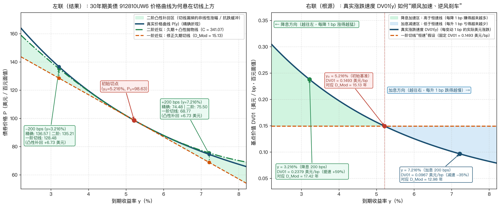
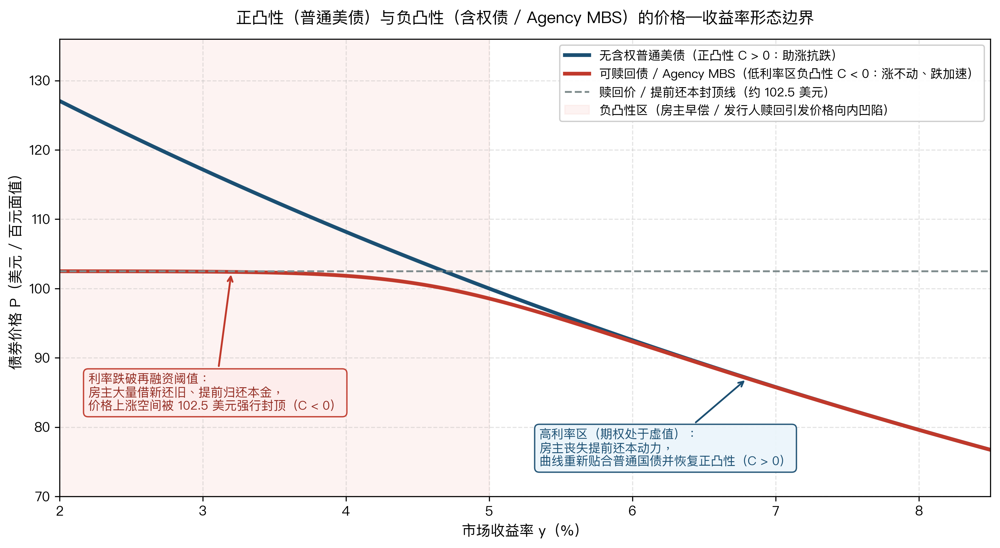
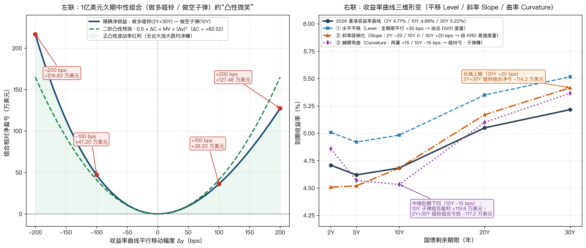

# 06｜凸性、曲线风险与对冲直觉

> **系列总览：** 《从国债到宏观：利率研究课》｜阶段 A：债券语言与定价基础（06/30）  
> **研究问题：** 当市场收益率大幅移动 `±200 bps` 时，久期直线为何总呈现“降息多涨、加息少跌”的系统性偏差？如何引入二阶凸性（`C`）刻画并定价这一曲率红利与负凸性反转？当“做多凸性”遇上收益率曲线非平行形变时，为什么没有免费午餐？交易台又如何在现券与 CME 国债期货之间做出对冲抉择？  
> **先备知识：** 承接[第 01 讲](./01_固定收益地图_债券与现金流契约.md)至[第 05 讲](./05_久期_利率敏感度的一阶近似.md)（折现因子、`D_Mod`、`DV01`、`KRD` 与一阶切线近似）。

---

## 一、直线尺子的失效：利率大幅波动时，久期漏掉了什么？

合上第 05 讲时，我们的工具箱里已经有了度量债券利率敏感度的一阶直尺——修正久期（`D_Mod`）与基点价值（`DV01`）。然而，第 05 讲表 4 的大波动测试却留下了一组反直觉的异常数字：当市场收益率上下移动 `±200 bps` 时，30 年期基准美债 `912810UW6` 在降息 `200 bps` 时实际涨了 `37.94 美元`，比一阶久期切线（`+29.85 美元`）足足 **多涨了 8.08 美元** ；而在加息 `200 bps` 时实际只跌了 `24.15 美元`，比一阶久期切线（`-29.85 美元`） **少跌了 5.70 美元** 。

如果仅仅是“大波动下模型存在误差”，误差理应有高估也有低估、双向对称分布；但在这里，无论利率暴涨还是暴跌，普通国债的真实价格却永远高悬在久期切线的上方。这把直线尺子究竟漏掉了什么？

答案藏在折现公式的动态权重漂移之中：一阶久期切线之所以失准，是因为它在初始收益率 `y₀` 处固定了一条笔直的斜率，暗含了一个静止假设—— **不管利率怎么走，债券的久期永远固定在 15.13 年不动** 。但真实世界遵循第 05 讲的马尔基尔久期第三定律： **利率本身会重塑各期现金流的现值分布，导致久期随收益率同步漂移。** 以 30 年期基准国债 `912810UW6`（`y₀ = 5.216%`，`P₀ = 98.627614`，`D_Mod = 15.134590 年`，`DV01 = 0.149269`）为例：
* **当市场大幅降息 200 bps（y 降至 3.216%）时：** 遥远的第 20–30 年本息折现权重急剧抬升，修正久期 `D_Mod` 自动拉长至 **17.42 年** ，百元面值 `DV01` 跳升至 **0.2379 美元/bp** ——降息路上切线越走越陡，价格也就“越涨越快”；
* **当市场大幅加息 200 bps（y 升至 7.216%）时：** 远端现金流被高利率大幅折价，近端票息权重被动上升，修正久期 `D_Mod` 自动缩短至 **12.98 年** ，百元面值 `DV01` 萎缩至 **0.0967 美元/bp** ——加息路上切线越走越平，价格也就“越跌越慢”。

固定收益分析把这种“价格斜率随利率动态加速与减速”的二阶弯曲特征，正式命名为 **凸性（Convexity，记作 C）** [1]。如图 1 所示，左联直观呈现了曲率带来的额外红利（绿色阴影补回区），右联则直接绘出左联价格曲线的真实斜率速度 `DV01(y)`，揭示“顺风加速、逆风刹车”的底层机制。



*(图注：左联展示 30 年期美债 `912810UW6` 在 `y₀ = 5.216%` 处的价格曲面与切线偏离，绿色阴影为二阶凸性补回的非线性涨幅与抗跌缓冲；右联直接绘出左联曲线的真实美元斜率速度 `DV01(y)`——相对橙色虚线代表的“恒速”假设（`0.1493 美元/bp`），降息至 `3.216%` 时每降 `1 bp` 涨幅飙升至 `0.2379 美元`（提速 `+59%`，`D_Mod` 拉长至 `17.42 年`），加息至 `7.216%` 时每升 `1 bp` 跌幅收窄至 `0.0967 美元`（减速 `-35%`，`D_Mod` 缩短至 `12.98 年`）。)*

### 1. 从现金流到凸性：二阶导数推导与逐期计算

既然第 05 讲的修正久期本质上是价格函数 `P(y)` 对收益率的一阶导数，那么度量斜率自身变化快慢的凸性，在微积分上自然对应价格对收益率的 **二阶导数** 。在半年付息惯例下，附息美债的价格方程为 `P(y) = ∑ CF_k × (1 + y/2)^(-k)`，其一阶导数为：

$$\frac{dP}{dy} = \sum_{k=1}^{N} \text{CF}_k \times \left(-\frac{k}{2}\right) \times \left(1 + \frac{y}{2}\right)^{-k - 1}$$

对年化到期收益率 `y` 再求一次导数（指数 `-k - 1` 下落并与链式法则因子 `1/2` 相乘，两次求导共产生分母 `4`）：

$$\frac{d^2 P}{dy^2} = \sum_{k=1}^{N} \text{CF}_k \times \left(-\frac{k}{2}\right) \times \left(-\frac{k + 1}{2}\right) \times \left(1 + \frac{y}{2}\right)^{-k - 2} = \frac{1}{\left(1 + \frac{y}{2}\right)^2} \sum_{k=1}^{N} \frac{k(k + 1)}{4} \times \frac{\text{CF}_k}{\left(1 + \frac{y}{2}\right)^k}$$

注意到求和项右侧 `CF_k ÷ (1 + y/2)^k` 正是第 `k` 期现金流的现值 `PV_k`。比照修正久期对价格 `P` 做归一化的写法，将上式两边同除以债券价格 `P` 并代入现值权重 `w_k = PV_k ÷ P`，即正式推导出标准半年付息债券的 **凸性（Convexity, C）** 公式（由于权重乘以时间的平方项，其物理量纲自然为 **年²** ）：

$$C \equiv \frac{1}{P} \frac{d^2 P}{dy^2} = \frac{1}{\left(1 + \frac{y}{2}\right)^2} \sum_{k=1}^{N} \frac{k(k + 1)}{4} \times w_k = \frac{1}{P \times \left(1 + \frac{y}{2}\right)^2} \sum_{k=1}^{N} \left(t_k^2 + \frac{t_k}{2}\right) \times \text{PV}_k$$

与第 05 讲的麦考利久期 `D_Mac` 对照，结构对称性清晰可见：`D_Mac` 以现值权重 `w_k` 对兑付时间 `t_k = k/2`（时间的一阶矩）加权平均；而凸性 `C` 则以同一组现值权重 `w_k` 对 `k(k + 1)/4 = t_k(t_k + 0.5)`（时间的近似二阶矩）加权平均，再除以半年复利修正因子的平方 `(1 + y/2)^2`。

以第 02–05 讲沿用的 2 年期基准美债 `91282CRU7`（`N = 4`，票息 `c = 4.625%`，每半年付息 `2.3125 美元`，收益率 `y = 4.708%`，半年折现率 `0.02354`，全价 `P = 99.843327 美元`）[2] 为例，表 1 展示了逐期分解手算的完整口径：

### 表 1：2 年期美债 `91282CRU7` 凸性（`C`）逐期手算分解表（每 100 美元面值）

| 期数 `k` | 兑付时间 `t_k = k/2`（年） | 名义现金流 `CF_k`（美元） | 单笔现值 `PV_k`（美元） | 现值权重 `w_k = PV_k ÷ P` | 二阶时间因子 `k(k+1)/4`（年²） | 二阶加权现值 `[k(k+1)/4] × PV_k` | 二阶权重贡献 `[k(k+1)/4] × w_k` |
| :--- | :--- | :--- | :--- | :--- | :--- | :--- | :--- |
| **第 1 期** | 0.5 | 2.312500 | 2.259316 | 2.2629% | 0.50 | 1.129658 | 0.011314 |
| **第 2 期** | 1.0 | 2.312500 | 2.207355 | 2.2108% | 1.50 | 3.311032 | 0.033162 |
| **第 3 期** | 1.5 | 2.312500 | 2.156588 | 2.1600% | 3.00 | 6.469765 | 0.064799 |
| **第 4 期（本息）** | 2.0 | 102.312500 | 93.220069 | 93.3663% | 5.00 | 466.100343 | 4.668317 |
| **合计** | — | **109.250000** | **99.843327** | **100.0000%** | — | **477.010798** | **4.777593 年²** |

将表 1 末列的二阶加权和 `4.777593` 除以半年复利平方项 `(1 + 0.02354)^2 = 1.047634`，立即得到：

$$C = \frac{4.777593}{(1 + 0.02354)^2} = \frac{4.777593}{1.047634} = 4.560364 \text{ 年}^2$$

对于期间不付息的 **零息债券（Zero-Coupon Bond / STRIP）** ，由于 `100%` 的现值权重集中在第 `N = 2T` 期（`w_N = 1`），公式无需列表，直接化简为一行代数式：

$$C_{\text{Zero}} = \frac{N(N + 1)}{4 \times \left(1 + \frac{y}{2}\right)^2} = \frac{T(T + 0.5)}{\left(1 + \frac{y}{2}\right)^2}$$

代入 2026 年 **10 年期本金 STRIP** （`T = 10 年`，`N = 20`，`y = 4.683%`，`y/2 = 0.023415`），即得 `C = (10 × 10.5) ÷ (1.023415)^2 = 105 ÷ 1.047378` ＝ **100.250314 年²** 。

### 2. 二阶价格近似：将曲率红利写进估值方程与实盘核验

推导出凸性 `C` 后，现在把它正式写回价格预测方程，看这把二阶工具究竟能补回多少切线误差。将债券价格函数 `P(y)` 在初始收益率 `y₀` 处展开至泰勒级数的第二阶项：

$$P(y_0 + \Delta y) \approx P_0 + \frac{dP}{dy}\Delta y + \frac{1}{2}\frac{d^2 P}{dy^2}(\Delta y)^2$$

由第 05 讲的一阶导数关系 `dP/dy = -D_Mod × P₀` 与刚刚推导出的二阶导数关系 `d²P/dy² = C × P₀`（交易台常把未经价格归一化的 `d²P/dy² = C × P₀` 称为 **美元凸性 Dollar Convexity** ），一并代入展开式，即得到固定收益风控标准的 **“久期＋凸性”二阶价格近似公式** ：

$$\frac{\Delta P}{P_0} \approx -D_{\text{Mod}} \times \Delta y + \frac{1}{2} \times C \times (\Delta y)^2$$

$$\Delta P \approx \underbrace{-D_{\text{Mod}} \times P_0 \times \Delta y}_{\text{① 一阶久期切线项}} + \underbrace{\frac{1}{2} \times C \times P_0 \times (\Delta y)^2}_{\text{② 二阶凸性弯曲修正项}}$$

在二阶近似方程中，无论利率下跌（`Δy < 0`）还是上涨（`Δy > 0`），平方项 `(Δy)^2` 恒为正数（系数 `1/2` 来自泰勒展开阶乘 `1/2!`）。因此只要 `C > 0`，第 ② 项 `+0.5 × C × P₀ × (Δy)^2` 在双向波动中永远贡献正收益——降息时助涨，加息时抗跌。

现在把上述公式放回 2026 年四类真实美债标本的实盘检验中，表 2 完整对账了各自的凸性数值以及 `10Y` / `30Y` 在大波动下的二阶误差修复效果：

### 表 2：2026 年四类美债标本的凸性指标与 `10Y` / `30Y` 二阶泰勒近似核验表（每 100 美元面值）

| 2026 真实标本与情景测试 | 完整期全价 `P₀` | 修正久期 `D_Mod`（年） | 凸性 `C`（年²） | 一阶久期切线预测 `ΔP_1st` | 二阶凸性修正项 `+0.5×C×P₀×(Δy)²` | 二阶合成预测 `ΔP_2nd` | 真实精确变动 `ΔP_exact` | 残余误差 `ΔP_exact - ΔP_2nd` |
| :--- | :--- | :--- | :--- | :--- | :--- | :--- | :--- | :--- |
| **标本 1：2Y T-Note（91282CRU7）** [2] | 99.843327 | 1.888689 | **4.560364** | — | `+0.0228`（@100bps） | — | — | — |
| **标本 2：10Y T-Note（91282CRF0）** [3] | 99.541071 | 7.927120 | **75.448058** | — | `+0.3755`（@100bps） | — | — | — |
| **标本 3：30Y T-Bond（912810UW6）** [4] | 98.627614 | 15.134590 | **341.066881** | — | `+1.6819`（@100bps） | — | — | — |
| **标本 4：10Y 本金 STRIP** | 62.945464 | 9.771207 | **100.250314** | — | `+0.3155`（@100bps） | — | — | — |
| **10Y 冲击 A：-200 bps（降息）** | 99.541071 | 7.927120 | 75.448058 | +15.7815 | **+1.5020** | **+17.2835** | **+17.3931** | +0.1096 |
| **10Y 冲击 B：-100 bps（降息）** | 99.541071 | 7.927120 | 75.448058 | +7.8907 | **+0.3755** | **+8.2662** | **+8.2796** | +0.0133 |
| **10Y 冲击 C：+100 bps（加息）** | 99.541071 | 7.927120 | 75.448058 | -7.8907 | **+0.3755** | **-7.5152** | **-7.5278** | -0.0126 |
| **10Y 冲击 D：+200 bps（加息）** | 99.541071 | 7.927120 | 75.448058 | -15.7815 | **+1.5020** | **-14.2794** | **-14.3776** | -0.0982 |
| **30Y 冲击 A：-200 bps（降息）** | 98.627614 | 15.134590 | 341.066881 | +29.8538 | **+6.7277** | **+36.5815** | **+37.9381** | +1.3566 |
| **30Y 冲击 B：-100 bps（降息）** | 98.627614 | 15.134590 | 341.066881 | +14.9269 | **+1.6819** | **+16.6088** | **+16.7661** | +0.1572 |
| **30Y 冲击 C：+100 bps（加息）** | 98.627614 | 15.134590 | 341.066881 | -14.9269 | **+1.6819** | **-13.2450** | **-13.3816** | -0.1366 |
| **30Y 冲击 D：+200 bps（加息）** | 98.627614 | 15.134590 | 341.066881 | -29.8538 | **+6.7277** | **-23.1260** | **-24.1498** | -1.0237 |

对照表 2 的结果，可以清楚把握二阶近似的修复威力与数量级直觉：
* **以精确算账而言：** 对于 `10Y` 美债 `91282CRF0`，在 `±100 bps` 冲击下，二阶凸性项 `0.5 × 75.448058 × 99.541071 × 0.01^2` ＝ **+0.3755 美元** ，将 `-100 bps` 与 `+100 bps` 的预测分别校准至 `+8.2662` 与 `-7.5152 美元`（与精确值的残差仅 `0.013 美元`），消除了 **96% 以上** 的一阶切线误差；对于 `30Y` 美债 `912810UW6`，在 `±200 bps` 冲击下（`(0.02)^2` 为 `100 bps` 时的 4 倍），二阶凸性项达到 `0.5 × 341.066881 × 98.627614 × 0.0004` ＝ **+6.7277 美元** ，填平了绝大部分切线偏差，仅余约 `1.0~1.3 美元` 的三阶导数残差 `O(Δy^3)`。
* **以交易台心算量级而言：** 看着表 2 中的 `4.56`、`75.45` 与 `341.07`，“年²”量纲很难直接对应成钱包里的盈亏幅度。其实只需记住一个精确换算——当市场利率移动 `100 bps`（`Δy = ±0.01`）时，二阶项贡献的百分比涨跌幅等于 `0.5 × C × (0.01)^2 = C × 0.00005 = (C ÷ 200)%`。也就是说， **把凸性数值 C 除以 200，大致就是收益率变动 100 bps 时额外兑现的价格百分比红利** ：对 `2Y` 美债（`4.56 ÷ 200`）而言约 `+0.02%`，几乎可忽略；对 `10Y` 美债（`75.45 ÷ 200`）而言约 `+0.38%`；而对 `30Y` 美债（`341.07 ÷ 200`），`100 bps` 冲击便贡献 **+1.71%** ，遇到 `200 bps` 巨震时（平方放大 4 倍）仅曲率本身就能额外贡献 **+6.82%** ！

---

## 二、并非所有债券都“涨多跌少”：决定凸性的规律与负凸性边界

既然二阶曲率在大波动中能贡献高达数个百分点的不对称保护，顺理成章的两个深度追问是：究竟哪些结构特征决定了债券凸性的大小？以及——是不是所有固定收益资产都能享受这种“助涨抗跌”的福利？

### 1. 久期平方放大律与现金流分散度定律

从凸性定义式 `C ∝ ∑ [t_k(t_k + 0.5)] × w_k` 与表 2 的实证数据出发，可以提炼出两条支配普通国债凸性的结构定理：

1. **久期平方放大律（期限越长，凸性呈平方级数爆发）：**  
   因为权重因子与时间近似成平方关系（`t_k^2`），当债券的修正久期拉长 `k` 倍时，凸性大致放大 **k² 倍** 。在表 2 中，30 年期国债的修正久期（`15.13`）是 2 年期国债（`1.89`）的 **8.0 倍** ，而其凸性（`341.07`）却达到了 2 年期国债（`4.56`）的 **74.8 倍** 。这解释了为何长久期国债即使按 `DV01` 等比例缩放，在极端宏观行情中依然比短债拥有不成比例的非线性爆发力。
2. **现金流分散度定律（同久期下，时间方差越大，凸性越高）：**  
   利用统计学恒等式 `E[t^2] = (E[t])^2 + Var(t)`，可以将附息债券的凸性精确拆解为麦考利久期平方与 **现金流到期时间方差 Var(t)** 之和：
   $$C = \frac{D_{\text{Mac}}^2 + D_{\text{Mac}} \div 2 + \text{Var}(t)}{\left(1 + \frac{y}{2}\right)^2}, \qquad \text{其中 } \text{Var}(t) = \sum_{k=1}^{N} w_k \times \left(t_k - D_{\text{Mac}}\right)^2$$
   这行等式是固定收益组合构建的基石之一： **当两只债券或两个投资组合的久期完全相等时，现金流在时间轴上分布得越分散（时间方差 Var(t) 越大），凸性 C 就越高。** 单笔零息债券因全部现金流集中在单一到期日（`Var(t) = 0`），在同久期资产中凸性最低；相反，如果把资产一分为二、分别押注在极短端（如 `2Y`）和极长端（如 `30Y`）形成哑铃组合，由于两翼现金流远离均值，`Var(t)` 被拉到极大值，相同久期下能产出远超单只中端债券的凸性。

### 2. 红利的反转边界：含权债与 Agency MBS 的负凸性

然而，“正凸性保护”并非所有债券的普适属性，它严格依赖于一个隐含前提—— **未来每一期现金流 CF_k 固定不变、不受市场利率变动影响** 。对普通美国国债（T-Bills、T-Notes、T-Bonds、STRIPS）而言，这一前提绝对成立，因此 `C > 0` 恒成立。

一旦资产嵌入了偏向债务人（发行人或房主）的提前偿还期权——最典型的代表是美国房贷市场体量庞大的 **机构抵押贷款支持证券（Agency MBS）** 与 **可赎回公司债（Callable Bonds）** ——整个价格曲面的逻辑就会在低利率区间彻底反转：
* 当市场利率大幅上行时，房主手中锁定的旧低息房贷极有价值，没有人会提前还款（提前还款期权处于深度虚值），MBS 现金流接近长期固定债券，随利率上行大幅下跌；
* 但当市场利率大幅下跌并跌破房主的再融资盈亏平衡点时，大量房主会借新还旧、按面值提前归还全部贷款本金（对可赎回债则是发行人按约定的赎回价提前收走债券）。

结果便是持有人的上行空间被提前还本封顶价（约 `100~103 美元`）强行截断： **价格—收益率曲线在低利率区从“向上弯”折腰变成“向下弯”（d²P/dy² < 0，即负凸性 C < 0）** 。如图 2 所示，原本令人向往的“利率跌时助涨、利率涨时抗跌”，在此刻逆转为“利率跌时涨不动，利率涨时反而与久期最长的债券一样加速下跌”的不对称劣势。这也正是实务中 MBS 投资者必须索要更高利差补偿（OAS）并动态对冲负凸性风险（Convexity Hedging）的根源。



*(图注：对比无含权普通美债的正凸性曲线与含提前还款权的 Agency MBS / 可赎回债在低利率区的负凸性封顶现象——利率跌破再融资阈值后，早偿机制截断价格上行弹性并导致曲线向下凹陷。)*

---

## 三、免费午餐的幻觉：当“做多凸性”撞上收益率曲线形变

综合上一节的两条发现，相对价值交易台立刻会推导出一个极具诱惑力的策略构想：既然普通国债拥有 `C > 0` 的曲率红利，而且根据现金流分散度定律，同久期的 `2Y+30Y` 哑铃组合凸性远高于 `10Y` 子弹组合，那么 **能否构造一个“做多 1 亿美元哑铃组合 ＋ 做空 1 亿美元子弹组合”的对冲盘，使净市值与净一阶久期（Net DV01）同时归零，从而在任何利率大波动中无风险提取二阶凸性正收益？**

### 1. 平行大波动下的“凸性微笑”

先按第 05 讲表 5 的实盘头寸精确核算两套 1 亿美元组合的凸性差异：
* **组合甲（10Y 子弹组合 Bullet）：** `100%` 市值（`10,000.00 万美元`）持有 `10Y 91282CRF0`，修正久期 `D_Mod = 7.927120 年`，总 `DV01 = 79,271.20 美元/bp`，组合凸性等于单券凸性 `C_Bullet` ＝ **75.448058 年²** ；
* **组合乙（2Y + 30Y 哑铃组合 Barbell）：** 按市值权重 `w_2Y = 54.412829%`（`5,441.28 万美元`）持有 `2Y 91282CRU7`、`w_30Y = 45.587171%`（`4,558.72 万美元`）持有 `30Y 912810UW6`，总修正久期同为 `7.927120 年`，总 `DV01` 同为 `79,271.20 美元/bp`。由市值加权可加性 `C_Portfolio = ∑ w_j × C_j`，哑铃组合凸性 `C_Barbell = 0.54412829 × 4.560364 + 0.45587171 × 341.066881` ＝ **157.964164 年²** 。

两者的久期完全锁死在同一水平（`Net DV01 = 0`），但哑铃组合的凸性（`157.96`）高达子弹组合（`75.45`）的 **2.09 倍** ，净凸性优势达到 **ΔC = +82.5161 年²** 。

若将情景限定在“整条收益率曲线平行上下移动”（表 3 情景 1 至情景 6），这笔交易确实展现出了迷人的单边盈利特征：无论曲线平行暴跌 `-200 bps` 还是平行暴涨 `+200 bps`，“做多哑铃 / 做空子弹”全部实现净盈利（`-100 bps` 赚 **+47.20 万美元** ，`+100 bps` 赚 **+36.20 万美元** ，二阶公式估值为 `0.5 × 82.5161 × 1亿 × 0.01^2` ＝ **+41.26 万美元** ），在损益图上画出一道标准上扬的 **微笑曲线（Volatility Smile）** ——做多凸性在数值上等价于做多利率的平行波动率（Long Parallel Volatility）。

### 2. 撕破幻觉：收益率曲线三维形变（Level / Slope / Curvature）

无套利市场从不派发免费的波动率红利。上述微笑曲线成立的前提——“整条曲线各期限同幅平行移动”——在现实中只是三种运动维度之一。1991 年，罗伯特·利特曼（Robert Litterman）与何塞·沙因克曼（José Scheinkman）对美债历史收益率曲线做主成分分析（PCA）后指出，美债曲线超过 95% 的日常变动可正交分解为三大形态因子 [5]：

1. **水平平移（Level / Parallel Shift）：** 各期限同向、近似同幅移动，风险敞口由 **组合总 DV01** 度量；
2. **斜率扭曲（Slope / Twist）：** 短端与长端分化运行（如降息预期压低 `2Y`、通胀与赤字推升 `30Y` 的陡峭化 Steepener，或加息压扁长短端利差的平坦化 Flattener），风险敞口由各节点 **关键利率久期（KRD）分布差值** 决定；
3. **曲率弯曲（Curvature / Butterfly Shift）：** 曲线中端肚腩（Belly，如 `5Y/10Y`）相对于两端两翼（Wings，如 `2Y/30Y`）发生相对下凹或上凸，直接决定子弹组合与哑铃组合的相对输赢。

表 3 与图 3 将平行冲击与非平行曲线形变摆在同一张账单上，免费午餐的代价瞬间水落石出：

### 表 3：1 亿美元子弹型（10Y）与哑铃型（2Y+30Y）组合的凸性对比及多维曲线冲击精确损益表

| 组合特征与宏观曲线冲击情景 | 组合甲：10Y 子弹组合（Bullet） | 组合乙：2Y + 30Y 哑铃组合（Barbell） | 久期中性对冲净损益<br>（做多哑铃 − 做空子弹） | 二阶凸性公式预测净差额<br>`0.5 × ΔC × MV × (Δy)²` |
| :--- | :--- | :--- | :--- | :--- |
| **组合总市值 MV（美元）** | 100,000,000.00 | 100,000,000.00 | **0.00（零净本金）** | — |
| **组合修正久期 D_Mod / 总 DV01** | 7.927120 年 / 79,271.20 | 7.927120 年 / 79,271.20 | **0.000000（久期中性）** | — |
| **组合凸性 C（年²）** | **75.448058** | **157.964164** | **+82.516106（净做多凸性）** | — |
| **情景 1：平行暴跌 -200 bps** | +17,473,278.40 | +19,641,546.12 | **+2,168,267.72** | +1,650,322.11 |
| **情景 2：平行下行 -100 bps** | +8,317,737.07 | +8,789,744.56 | **+472,007.49** | +412,580.53 |
| **情景 3：平行微跌 -10 bps** | +796,497.49 | +800,678.49 | **+4,180.99** | +4,125.81 |
| **情景 4：平行微升 +10 bps** | -788,952.61 | -784,881.12 | **+4,071.50** | +4,125.81 |
| **情景 5：平行上行 +100 bps** | -7,562,541.70 | -7,200,570.84 | **+361,970.87** | +412,580.53 |
| **情景 6：平行暴涨 +200 bps** | -14,443,903.49 | -13,169,095.84 | **+1,274,807.65** | +1,650,322.11 |
| **情景 7：斜率陡峭化（2Y -20 / 10Y 0 / 30Y +20 bps）** | 0.00 | -1,143,288.15 | **-1,143,288.15** | 非平行移动不适用 |
| **情景 8：斜率平坦化（2Y +20 / 10Y 0 / 30Y -20 bps）** | 0.00 | +1,206,489.03 | **+1,206,489.03** | 非平行移动不适用 |
| **情景 9：蝴蝶弯曲 A（两翼 +15 / 中端 10Y -15 bps）** | +1,197,600.06 | -1,171,523.39 | **-2,369,123.45** | 非平行移动不适用 |
| **情景 10：蝴蝶弯曲 B（两翼 -15 / 中端 10Y +15 bps）** | -1,180,623.89 | +1,207,070.14 | **+2,387,694.03** | 非平行移动不适用 |

表 3 的情景 7 至情景 10 清晰揭示了“做多凸性”所付出的两重隐性对价：
1. **将一阶平行风险转化为了非平行曲线与蝴蝶曲率风险：** 哑铃组合虽然久期均值与 `10Y` 相同，但其 `DV01` 高达 87% 集中在 `30Y` 节点。一旦发生长端上翘的陡峭化（情景 7），或遭遇两翼上行 `+15 bps`、中端 `10Y` 下行 `-15 bps` 的蝴蝶弯曲（情景 9），哑铃组合在两端蒙受双重下跌而空头子弹在中端被逼空，净头寸单次暴亏 **-236.91 万美元** ——远非日常窄幅波动下的二阶凸性红利所能覆盖。
2. **高凸性在均衡定价下的静态收益率折价（Convexity Give-up）：** 在凸起向上的正常收益率曲线上，市场参与者愿意为哑铃型或超长端债券更高的凸性支付溢价（表现为更低的静态到期收益率 / 持有期票息 Carry）。唯有当市场实际实现波动率高于收益率曲线隐含的波动率预期时，正凸性的动态收益才能跑赢静态利差损耗。



*(图注：左联展示 1 亿美元“做多 2Y+30Y 哑铃 / 做空 10Y 子弹”久期中性组合在平行移动 `±200 bps` 下的凸性微笑曲线；右联展示驱动组合损益分化的收益率曲线三大正交形变——水平平移 Level、斜率陡峭化 Slope 与蝴蝶弯曲 Curvature。)*

---

## 四、交易台的真实抉择：用现券还是期货对冲利率风险？

在厘清了一阶久期、二阶凸性与非平行曲线风险的权衡之后，回到真实交易台的日常风控场景：假设机构账户持有 **5,000 万美元面值** 的 30 年期基准国债 `912810UW6`（总市值 `4,931.38 万美元`，总基点价值 `DV01_30Y = 74,634.42 美元/bp`），需要锁死利率风险。在有限的资产负债表额度与交易成本约束下，实盘操作呈现三个渐进层级：

### 1. 层级一：单一现券 `DV01` 中性对冲（只消一阶平行风险）

最直接的做法是使用流动性充沛的 10 年期基准国债 `91282CRF0`（百元面值 `DV01_100 = 0.078907 美元/bp`）做空对冲，使组合整体 `Net DV01 = 0`：

$$\text{需做空 10Y 现券面值} = \frac{\text{DV01}_{\text{Target}}}{\text{DV01}_{100, \text{Hedge}} \div 100} = \frac{74,634.424}{0.07890741 \div 100} = 94,584,813.81 \text{ 美元}$$

做空约 **9,458.48 万美元面值** （市值 `9,415.07 万美元`）的 `10Y` 现券后，组合剥离了一阶平行敞口，同时保留着一层有趣的二阶不对称：多头 `30Y` 贡献 `+84.10 万美元/@100bps` 的凸性收益，空头 `10Y` 扣减 `-35.52 万美元/@100bps` 的凸性支出，组合净保留了 **+48.58 万美元/@100bps** 的正凸性红利——代价则是承担 `10s30s` 利差走阔（斜率陡峭化）的斜率风险，并在回购市场借入近 1 亿美元现券。

### 2. 层级二：双券联立“久期＋凸性”双中和对冲（同时消掉一阶与二阶平行风险）

如果交易台希望在消除一阶 `DV01` 的同时，将二阶美元凸性也一并抹平（Duration & Convexity Neutral），根据线性代数基本定理， **消除两个风险因子至少需要两只不同期限的对冲工具** （此处联立 `2Y 91282CRU7` 与 `10Y 91282CRF0`）。

设两只对冲券的市值为 `MV_2` 与 `MV_10`（正数做多、负数做空），要同时抵消 `5,000 万面值 30Y 国债`（`MV_30 = 49,313,807.23 美元`，`D_30 = 15.134590`，`C_30 = 341.066881`）的一阶久期与二阶凸性，只需联立二元一次方程组：

$$\begin{cases} D_{\text{Mod}, 2} \times \text{MV}_2 + D_{\text{Mod}, 10} \times \text{MV}_{10} = -D_{\text{Mod}, 30} \times \text{MV}_{30} & \text{（一阶总 DV01 归零）} \\ C_2 \times \text{MV}_2 + C_{10} \times \text{MV}_{10} = -C_{30} \times \text{MV}_{30} & \text{（二阶总美元凸性归零）} \end{cases}$$

代入表 2 参数得右端目标（一阶目标 `-746,344,242.42`，二阶目标 `-16,819,306,496.50`），克莱姆法则消元求解得唯一精确解：
* **需做空 10Y 国债市值** `MV_10 = -266,699,954.49 美元`（对应做空面值 **26,792.96 万美元** ）；
* **需做多 2Y 国债市值** `MV_2 = +724,215,693.59 美元`（对应做多面值 **72,535.21 万美元** ）。

从数学上看，这套“做多 `30Y` ＋ 做多 `2Y` ＋ 做空 `10Y`”的三腿蝶式组合将一阶 `DV01` 与二阶美元凸性双双精准压至 `0.00`。但把头寸表摊在台面上，实务瓶颈也暴露无遗：为了对冲仅仅 `5,000 万美元` 的 `30Y` 头寸，竟要在现券端拆借与买入接近 **10 亿美元** 的双边名义规模（做空 `2.68 亿` `10Y` ＋ 做多 `7.25 亿` `2Y`）。这不仅会吞噬巨额银行资产负债表额度、产生高昂 Repo 借券成本，还会把原本温和的组合转化为一个对 `2s10s30s` 蝴蝶弯曲极其敏感的巨型杠杆蝶式头寸——这正是现货交易台极少在实盘中强行推行静态“久期＋凸性”现券双中和的原因。

### 3. 层级三：机构实盘主力工具——芝商所（CME）美债期货对冲与转换因子（`CF`）直觉

正因为大规模现券做空受制于回购市场摩擦与资产负债表约束，养老金、做市商与宏观对冲基金在日常调仓时，绝大部分 `DV01` 对冲都选择通过 **芝商所（CME）美债期货合约** 完成（如 `ZT`、`ZF`、`ZN`、`ZB`）[6]。

关于期货交割篮子与基差套利的全景机制将在 **阶段 B 第 10 讲《国债期货、基差与杠杆链条》** 深入剖析；在阶段 A 的定价框架内，计算准确对冲手数依赖三个紧扣定价公式的枢纽概念：

1. **转换因子（Conversion Factor, CF）：**  
   1 手 CME 10 年期美债期货（`ZN`）的标准名义面值为 **100,000 美元（10 万美元）** ，合约虚拟标准票息设定为 **6.00%** [6]。由于实际可交割现券票息率与 `6.00%` 存在差异（如 `91282CRF0` 票息仅 `4.625%`），直接按期货原价交割会对买方极不公平。交易所因此为每只合资格现券设定固定的 **转换因子 CF ——其本质就是将这只现券的未来现金流强行按 6.00% 年化收益率折现所得的每 1 美元面值理论价格** [6]。将 `10Y 91282CRF0`（`c = 4.625%, N = 20`）按 `y = 6.00%` 折现，理论价格为 `89.7717 美元`，四舍五入至四位小数即得 **CF = 0.8977** 。
2. **最便宜可交割券（Cheapest-to-Deliver, CTD）主导期货 DV01：**  
   交割月空头拥有挑选可交割篮子中最划算一券的权利（即 **CTD 券** ），交割发票金额等于 `期货价格 F × CF_CTD`。在无套利均衡下，期货报价锚定 CTD 现券价格除以其转换因子：

   $$F \approx \frac{P_{\text{CTD}}}{\text{CF}_{\text{CTD}}} \quad \Longrightarrow \quad \text{DV01}_{\text{Futures}} \approx \frac{\text{DV01}_{\text{CTD, 每10万美元面值}}}{\text{CF}_{\text{CTD}}}$$

   这意味着： **1 手国债期货的美元基点价值 DV01_Futures，等于 10 万美元面值 CTD 现券的 DV01 除以它的转换因子 CF_CTD。**
3. **期货对冲手数 N_f：**  
   将待对冲组合总风险除以单手期货风险：

   $$N_f = \frac{\text{DV01}_{\text{Portfolio}}}{\text{DV01}_{\text{Futures}}} = \frac{\text{DV01}_{\text{Portfolio}}}{\text{DV01}_{\text{CTD, 每10万美元面值}}} \times \text{CF}_{\text{CTD}}$$

* **实盘对冲计算：** 假设当前 `10Y 91282CRF0` 为 `ZN` 期货篮子中的 CTD 券（百元面值 `DV01_100 = 0.0789074 美元/bp`，`CF = 0.8977`）：
  * `10 万美元` 面值 CTD 现券的 `DV01` ＝ `0.0789074 × 1,000` ＝ **78.9074 美元/bp** ；
  * 单手 `ZN` 期货合约的基点价值 `DV01_Futures = 78.9074 ÷ 0.8977` ＝ **87.8995 美元/bp** ；
  * 对冲 **5,000 万美元面值 30Y 国债** （总 `DV01 = 74,634.42 美元/bp`），需卖空的 `ZN` 期货合约数为：`N_f = 74,634.424 ÷ 87.8995` ＝ **849.09 手** （实盘取整卖空 **849 手** ）。

### 表 4：三大层级利率对冲策略的机制、敞口特征与实务权衡对照表

| 对冲策略层级 | 对冲工具配置（以对冲 5,000 万面值 `30Y` 多头为例） | 一阶平行风险（`Net DV01`） | 二阶平行凸性（`Net C`） | 非平行曲线风险暴露 | 资金与资产负债表占用 |
| :--- | :--- | :--- | :--- | :--- | :--- |
| **1. 单一现券 DV01 对冲** | 做空 `9,458.48 万` 面值 `10Y` 现券 | **0.00** （完全中和） | `+48.58 万/@100bps`（保留净正凸性） | 暴露于 `10s30s` 斜率陡峭化风险 | 高（需通过 Repo 借入近 1 亿美元现券） |
| **2. 双现券久期＋凸性对冲** | 做空 `2.68 亿` 面值 `10Y` ＋ 做多 `7.25 亿` 面值 `2Y` | **0.00** （完全中和） | **0.00** （完全中和） | 暴露于 `2s10s30s` 蝴蝶曲率反转 | 极高（多空总名义面值近 10 亿美元） |
| **3. CME 国债期货 DV01 对冲** | 卖空 **849 手** `ZN` 10 年期国债期货 | **≈ 0.00** （快速中和） | 保留正凸性（受 CTD 切换微调） | 暴露于 `10s30s` 斜率及现券—期货基差 | **极低** （仅需缴纳交易所初始保证金） |

---

## 五、竞争性视角、失效边界与阶段 A 全链路复算脚本

### 1. 竞争性视角：泰勒二阶局部展开 vs. 精确全重估（Full Revaluation）

在现代量化风控系统中，计算机可以在毫秒内按精确折现公式重估任意情景下的债券全价 `P(y₀ + Δy)`（即 **全重估法 Full Revaluation** ）。既然精确解唾手可得，`DV01` 与凸性 `C` 为何依然牢牢占据交易台核心仪表盘？
* **不可替代的归因与线性对冲结构：** 全重估法只输出单一假定路径下的“结果数字”，既不能直接给出“卖空几手期货”的对冲比率，也难以把当日盈亏拆解为方向性（Delta/DV01）与曲率波动率（Gamma/Convexity）。`DV01` 与 `C` 将复杂的非线性贴现曲面压缩为可跨组合相加、可求解线性方程组的局部敏感度语言。
* **极端尾部情景的切换边界：** 如表 2 所示，面对 `30Y` 国债 `±200 bps` 以上的极端冲击，即便计入二阶凸性，泰勒展开仍存在 `1.0~1.3 美元` 的三阶残差。因此，常规日内交易与对冲使用“久期＋凸性”管理局部敞口，而银行间极端压力测试（Stress Testing）与 VaR 尾部风控则全面切换至全重估法兜底。

### 2. 三大常见认知与模型失效条件（Failure Conditions）

* **失效条件一：将无含权国债的正凸性保护外推至含权债与 Agency MBS**  
  现金流刚性的普通国债恒具正凸性（`C > 0`），而含提前还本权的 Agency MBS 与可赎回债在降息周期穿过再融资阈值后会呈现负凸性（`C < 0`）。若用固定正凸性模型外推降息期间 MBS 净值涨幅，将严重低估提前还款带来的价格天花板压缩。
* **失效条件二：将“久期中性＋正凸性”视作任何宏观行情下的稳赢头寸**  
  表 3 情景 7 与情景 9 验证了做多凸性的本质仅仅是做多“曲线平行波动率（或两翼下行）”；一旦曲线发生陡峭化扭曲或两翼上行、中端下行的蝴蝶弯曲，关键利率节点的一阶损失将迅速击穿二阶凸性红利。
* **失效条件三：期货对冲中忽视 CTD 切换（CTD Switch）导致的久期跳变**  
  当长端市场收益率逼近期货名义基准利率 `6.00%` 并剧烈穿越，或者曲线斜率大幅反转时，国债期货交割篮子中的 CTD 券可能由一只中短期券骤然切换为长久期券，引发单手期货 `DV01_Futures` 的跳跃式突变（将在阶段 B 第 10 讲展开详析）。

### 3. 阶段 A（01–06 讲）闭环核验与最小可复现 Python 脚本

作为 **阶段 A（债券语言与定价基础，01–06 讲）** 的收官复核，下面这段零依赖 Python 脚本完整复现了本讲表 1 至表 4 的全部数字，并串联起整套从现金流、折现定价、久期、凸性到 CME 期货对冲手数的阶段 A 定价链条 [2][3][4][6]：

```python
# 阶段 A（01-06 讲）全链路闭环核验与第 06 讲底表复算脚本
def bond_analytics(c_annual, y_annual, n_periods):
    """计算完整半年期附息国债的价格、D_Mac、D_Mod、DV01 与凸性 C"""
    i = y_annual / 2.0
    c_semi = 100.0 * (c_annual / 2.0)
    price = 0.0
    w_t_pv = 0.0
    w_conv_pv = 0.0
    for k in range(1, n_periods + 1):
        cf = c_semi + (100.0 if k == n_periods else 0.0)
        pv = cf / ((1.0 + i) ** k)
        price += pv
        w_t_pv += (k / 2.0) * pv
        w_conv_pv += (k * (k + 1.0) / 4.0) * pv
    d_mac = w_t_pv / price
    d_mod = d_mac / (1.0 + i)
    dv01 = price * d_mod * 0.0001
    convexity = (w_conv_pv / price) / ((1.0 + i) ** 2)
    return price, d_mac, d_mod, dv01, convexity

# 1. 复现表 1 & 表 2：四类美债标本的久期、DV01 与凸性对账
print("=== 1. 2026 年四类美债标本久期与凸性对账（表 1 & 表 2）===")
specimens = [
    ("2Y T-Note 91282CRU7", 0.04625, 0.04708, 4),
    ("10Y T-Note 91282CRF0", 0.04625, 0.04683, 20),
    ("30Y T-Bond 912810UW6", 0.05125, 0.05216, 60),
    ("10Y Principal STRIP", 0.00000, 0.04683, 20),
]
res = {}
for name, c, y, n in specimens:
    p, dm, dmod, dv, conv = bond_analytics(c, y, n)
    res[name] = (p, dm, dmod, dv, conv, c, y, n)
    c100 = 0.5 * conv * p * (0.01 ** 2)
    c200 = 0.5 * conv * p * (0.02 ** 2)
    print(f"[{name:20s}] P={p:9.6f} | D_Mod={dmod:9.6f} | DV01={dv:8.6f} | C={conv:10.6f} | +100bps二阶项={c100:+7.4f} | +200bps二阶项={c200:+7.4f}")

# 2. 复现表 2 下半部分：10Y 与 30Y 二阶泰勒近似误差修复
print("\n=== 2. 10Y 与 30Y 一阶切线 vs 二阶凸性近似核验 ===")
for name in ["10Y T-Note 91282CRF0", "30Y T-Bond 912810UW6"]:
    p0, _, dmod, _, conv, c, y0, n = res[name]
    print(f"-- {name} --")
    for dy_bps in [-200, -100, 100, 200]:
        dy = dy_bps / 10000.0
        p1 = bond_analytics(c, y0 + dy, n)[0]
        dp_ex = p1 - p0
        dp_1st = -dmod * p0 * dy
        dp_conv = 0.5 * conv * p0 * (dy ** 2)
        dp_2nd = dp_1st + dp_conv
        print(f"  dy={dy_bps:+4d}bps: 1st={dp_1st:+8.4f} | ConvTerm={dp_conv:+7.4f} | 2nd={dp_2nd:+8.4f} | Exact={dp_ex:+8.4f} | Err2nd={dp_ex-dp_2nd:+7.4f}")

# 3. 复现表 3：$100M 子弹组合 vs 哑铃组合凸性对比与多维曲线冲击
p2, _, dmod2, dv2, conv2, c2, y2, n2 = res["2Y T-Note 91282CRU7"]
p10, _, dmod10, dv10, conv10, c10, y10, n10 = res["10Y T-Note 91282CRF0"]
p30, _, dmod30, dv30, conv30, c30, y30, n30 = res["30Y T-Bond 912810UW6"]
w30 = (dmod10 - dmod2) / (dmod30 - dmod2)
w2 = 1.0 - w30
conv_barbell = w2 * conv2 + w30 * conv30
mv = 100_000_000.0
sh10, sh2, sh30 = mv / p10, (mv * w2) / p2, (mv * w30) / p30
print(f"\n=== 3. $100M 子弹 vs 哑铃: C_Bullet={conv10:.6f}, C_Barbell={conv_barbell:.6f}, ΔC=+{conv_barbell-conv10:.6f} ===")
for label, dy2, dy10, dy30 in [
    ("平行 -200 bps", -0.02, -0.02, -0.02),
    ("平行 -100 bps", -0.01, -0.01, -0.01),
    ("平行 +100 bps", +0.01, +0.01, +0.01),
    ("平行 +200 bps", +0.02, +0.02, +0.02),
    ("斜率陡峭化 (2Y -20 / 10Y 0 / 30Y +20)", -0.002, 0.0, +0.002),
    ("蝴蝶弯曲 A (两翼 +15 / 10Y -15)", +0.0015, -0.0015, +0.0015),
]:
    pnl_bul = sh10 * (bond_analytics(c10, y10 + dy10, n10)[0] - p10)
    pnl_bar = sh2 * (bond_analytics(c2, y2 + dy2, n2)[0] - p2) + sh30 * (bond_analytics(c30, y30 + dy30, n30)[0] - p30)
    print(f"  {label:38s}: 子弹=${pnl_bul:+13,.2f} | 哑铃=${pnl_bar:+13,.2f} | 净差额=${pnl_bar-pnl_bul:+12,.2f}")

# 4. 复现第 4 节：双券久期+凸性中和方程组 & CME ZN 期货对冲手数
mv30_target = 50_000_000.0 * (p30 / 100.0)
b1 = -dmod30 * mv30_target
b2 = -conv30 * mv30_target
det = dmod2 * conv10 - dmod10 * conv2
mv2_hedge = (b1 * conv10 - b2 * dmod10) / det
mv10_hedge = (dmod2 * b2 - conv2 * b1) / det
cf_10y = round(bond_analytics(0.04625, 0.0600, 20)[0] / 100.0, 4)
dv01_fut = (dv10 * 1000.0) / cf_10y
n_fut = (50_000_000.0 * dv30 / 100.0) / dv01_fut
print(f"\n=== 4. 对冲实操核验（表 4）===")
print(f"双券久期+凸性中和: 做多 2Y 市值=${mv2_hedge:,.2f} (面值=${mv2_hedge/p2*100:,.2f}) | 做空 10Y 市值=${mv10_hedge:,.2f} (面值=${mv10_hedge/p10*100:,.2f})")
print(f"CME ZN 期货对冲: CF={cf_10y:.4f} | 单手期货 DV01=${dv01_fut:.4f}/bp | 需卖空手数={n_fut:.2f} 手")
```

---

## 六、阶段自测练习与完整推导解析

> **自学检验建议：** 本节包含 4 道本讲核心练习与 1 道 **阶段 A（01–06 讲）综合通关大题** 。请先独立完成推导与计算，再对照下方解析逐项核对。

### 练习题

1. **【四期附息国债凸性逐笔手算（承接第 02 讲与第 05 讲练习 1）】** 沿用第 02 讲和第 05 讲练习 1 的 2 年期附息国债：剩余期限恰好 2 年（`N = 4` 个完整半年期），票息率 `c` ＝ **4.000%** （每半年支付 `2.00 美元` 票息），当前到期收益率 `y` ＝ **5.000%** （半年折现率 `i = 2.500%`）。已知第 1–4 期的单笔现值分别为 `PV_1 = 1.951220`、`PV_2 = 1.903629`、`PV_3 = 1.857199`、`PV_4 = 92.406966`，债券理论价格 `P` ＝ **98.119013 美元** ，修正久期 `D_Mod` ＝ **1.893956 年** 。求：（1）逐期计算第 1–4 期的二阶时间因子 `k(k + 1) ÷ 4` 及二阶加权现值 `[k(k + 1) ÷ 4] × PV_k`；（2）计算该债券的凸性 `C`（保留 6 位小数）；（3）若市场收益率瞬间上行 **+100 bps** （`Δy = +0.01`），分别计算一阶久期切线预测的价格变动、二阶凸性修正项及二阶合成预测价格。
2. **【零息本金 STRIP 凸性快速公式与“二阶抗跌助涨”核验】** 根据正文第 1.1 节推导的零息债公式，10 年期零息本金 STRIP（`T = 10 年`，`N = 20` 个半年期，基准收益率 `y = 4.683%`，价格 `P₀ = 62.945464 美元`，修正久期 `D_Mod = 9.771207 年`）的凸性可直接由时间代数式算出。求：（1）利用公式 `C_Zero = T(T + 0.5) ÷ (1 + y/2)^2` 验证其凸性 `C`；（2）当市场收益率大幅下行 **-200 bps** （`Δy = -0.02`，新收益率 `2.683%`）时，分别计算该 STRIP 的一阶切线预测涨幅、二阶凸性修正项、二阶合成预测涨幅，并与精确折现涨幅（`62.945464` 对比 `100 ÷ 1.013415^20`）对账。
3. **【1 亿美元久期中性“做多哑铃 / 做空子弹”组合的波动率盈亏测算】** 某宏观相对价值基金构建了正文表 3 中的久期中性组合：做多 **1 亿美元市值** 的 `2Y + 30Y` 哑铃组合（`D_Mod = 7.927120`，`C_Barbell = 157.964164`），同时做空 **1 亿美元市值** 的 `10Y` 子弹组合（`D_Mod = 7.927120`，`C_Bullet = 75.448058`）。求：（1）该多空组合的净修正久期与净凸性 `ΔC`；（2）若次日美债收益率曲线发生平行下移 **-150 bps** （`Δy = -0.015`），利用二阶泰勒近似公式估算该久期中性组合的净盈利美元金额；（3）指出哪两类非平行曲线形变会导致该组合出现亏损。
4. **【芝商所（CME）10 年期美债期货（ZN）跨品种对冲实操】** 某银行交易台持有 **2,000 万美元面值** 的 30 年期基准国债 `912810UW6`（全价 `98.627614`，百元面值 `DV01_100 = 0.149269 美元/bp`）。交易员计划卖空 CME 10 年期美债期货（`ZN`，每手面值 `100,000 美元`）对冲全部一阶利率风险。已知当前 `ZN` 期货的最便宜可交割券（CTD）每百元面值的 `DV01_100` 为 **0.078907 美元/bp** ，转换因子 `CF_CTD` 为 **0.8977** 。求：（1）现有 30 年期国债头寸的总 `DV01`；（2）单手 `ZN` 期货合约的美元基点价值 `DV01_Futures`；（3）交易员应当卖空多少手 `ZN` 期货合约（四舍五入取整）？
5. **【阶段 A（01–06 讲）综合通关核验】** 以 2026 年 10 月新发的 2 年期基准美债 `91282CRU7`（票息率 `c = 4.625%`，每半年付息一次，到期日 `2028-10-31`）为样本 [2]：（1）若在起息日（`N = 4` 个完整半年期）按拍卖高收益率 `y = 4.708%` 定价，写出其完整期理论净价 `P₀`、麦考利久期 `D_Mac`、修正久期 `D_Mod`、百元 `DV01_100` 与凸性 `C`；（2）若投资者在起息日后第 `46` 天（该半年付息周期共 `E = 182` 天）在二级市场按净价 `99.800000 美元` 买入 `1,000 万美元面值` 该国债，按 Actual/Actual 规则计算其应计利息 `AI` 与实际交割全价总金额（回顾第 03 讲）；（3）说明若将该国债一直持有至 `1.9331 年`（即 `H = D_Mac`）卖出，为何能够在一阶上免疫买入次日的平行利率冲击（回顾第 04、05 讲）。

---

### 参考答案与推导解析

* **1. 【解析：四期附息国债凸性逐笔手算】**
  * **（1）逐期二阶时间因子与加权现值：**
    * `k = 1（t = 0.5 年）`：`k(k + 1) ÷ 4 = (1 × 2) ÷ 4` ＝ **0.50** ，加权现值 `0.50 × 1.951220` ＝ **0.975610** ；
    * `k = 2（t = 1.0 年）`：`k(k + 1) ÷ 4 = (2 × 3) ÷ 4` ＝ **1.50** ，加权现值 `1.50 × 1.903629` ＝ **2.855443** ；
    * `k = 3（t = 1.5 年）`：`k(k + 1) ÷ 4 = (3 × 4) ÷ 4` ＝ **3.00** ，加权现值 `3.00 × 1.857199` ＝ **5.571596** ；
    * `k = 4（t = 2.0 年）`：`k(k + 1) ÷ 4 = (4 × 5) ÷ 4` ＝ **5.00** ，加权现值 `5.00 × 92.406966` ＝ **462.034829** ；
    * 二阶加权现值总和：`0.975610 + 2.855443 + 5.571596 + 462.034829` ＝ **471.437479** 。
  * **（2）计算凸性 C：**  
    将总和除以 `P × (1 + i)^2 = 98.119013 × (1.025)^2 = 98.119013 × 1.050625 = 103.086288`：  
    `C = 471.437479 ÷ 103.086288` ＝ **4.573232 年²** 。
  * **（3）+100 bps（Δy = +0.01）冲击下的二阶价格预测：**
    * 一阶久期切线项：`-D_Mod × P × Δy = -1.893956 × 98.119013 × 0.01` ＝ **-1.858331 美元** ；
    * 二阶凸性修正项：`0.5 × C × P × (Δy)^2 = 0.5 × 4.573232 × 98.119013 × 0.0001` ＝ **+0.022436 美元** ；
    * 二阶合成预测变动：`-1.858331 + 0.022436` ＝ **-1.835895 美元** ，预测新价格为 `98.119013 - 1.835895` ＝ **96.283118 美元** （精确折现新价格为 `96.283476 美元`，二阶误差仅 `0.000358 美元`）。

* **2. 【解析：10 年期零息本金 STRIP 凸性与 -200 bps 冲击核验】**
  * **（1）零息债凸性公式核验：**  
    已知 `T = 10`，`y/2 = 0.023415`，`(1 + y/2)^2 = 1.0473784`：  
    `C_Zero = [10 × (10 + 0.5)] ÷ 1.0473784 = 105 ÷ 1.0473784` ＝ **100.250314 年²** 。
  * **（2）-200 bps（Δy = -0.02）冲击下的价格变动对账：**
    * 一阶切线预测涨幅：`-9.771207 × 62.945464 × (-0.02)` ＝ **+12.301063 美元** ；
    * 二阶凸性修正项：`0.5 × 100.250314 × 62.945464 × (-0.02)^2 = 0.5 × 6,310.30 × 0.0004` ＝ **+1.262060 美元** ；
    * 二阶合成预测涨幅：`12.301063 + 1.262060` ＝ **+13.563123 美元** （预测新价格 `76.508587 美元`）；
    * 精确折现涨幅：新价格 `P_exact = 100 ÷ (1 + 0.02683/2)^20 = 100 ÷ 1.013415^20` ＝ **76.604610 美元** ，精确涨幅为 `76.604610 - 62.945464` ＝ **+13.659146 美元** 。二阶凸性项单独补回了 `+1.2621 美元`，消除了一阶切线 `92.9%` 的误差。

* **3. 【解析：1 亿美元久期中性“做多哑铃 / 做空子弹”波动率收益】**
  * **（1）净久期与净凸性：**  
    净修正久期 `Net D_Mod = 7.927120 - 7.927120` ＝ **0.000000 年** ；  
    净凸性 `ΔC = 157.964164 - 75.448058` ＝ **+82.516106 年²** 。
  * **（2）平行下移 -150 bps（Δy = -0.015）的二阶净盈利估算：**  
    由于一阶净 `DV01 = 0`，组合净收益完全由二阶凸性差额驱动：  
    `Net PnL ≈ 0.5 × ΔC × MV × (Δy)^2 = 0.5 × 82.516106 × 100,000,000 × (-0.015)^2 = 4,125,805,300 × 0.000225` ＝ **+928,306.19 美元** （约合 **+92.83 万美元** ）。
  * **（3）导致亏损的两类非平行曲线形变：**  
    一是 **收益率曲线陡峭化（Steepener，30Y 利率涨幅显著大于 10Y）** ，因为哑铃组合 87% 的 `DV01` 暴露在 `30Y` 节点；二是 **“两翼上翘、中端下凹”的蝴蝶形弯曲（2Y 与 30Y 利率上行，而 10Y 利率下行）** ，此时多头哑铃在两端受损而空头子弹在中端被逼空。

* **4. 【解析：CME 10 年期美债期货（ZN）对冲手数计算】**
  * **（1）2,000 万面值 30Y 现券总 DV01：**  
    `DV01_Position = 20,000,000 × (0.14926885 ÷ 100)` ＝ **29,853.77 美元/bp** 。
  * **（2）单手 ZN 期货（10 万美元面值）基点价值：**  
    10 万美元面值 CTD 现券的 `DV01` 为 `0.0789074 × 1,000` ＝ **78.9074 美元/bp** ；  
    除以转换因子 `0.8977`：`DV01_Futures = 78.9074 ÷ 0.8977` ＝ **87.8995 美元/bp** 。
  * **（3）应卖空期货手数：**  
    `N_f = 29,853.77 ÷ 87.8995` ＝ **339.64 手** ，四舍五入应卖空 **340 手** `ZN` 期货合约。

* **5. 【解析：阶段 A（01–06 讲）综合通关核验】**
  * **（1）起息日五项基准定价与风险指标（见本讲表 1 与表 2）：**  
    理论净价（全价）`P₀` ＝ **99.843327 美元** ，麦考利久期 `D_Mac` ＝ **1.933149 年** ，修正久期 `D_Mod` ＝ **1.888689 年** ，百元面值 `DV01_100` ＝ **0.018857 美元/bp** ，凸性 `C` ＝ **4.560364 年²** 。
  * **（2）起息后第 46 天交割的应计利息与全价总金额（第 03 讲 Actual/Actual 规则）：**  
    单期票息 `100 × c ÷ 2 = 4.625 ÷ 2` ＝ **2.3125 美元/百元** ；  
    百元面值应计利息 `AI_100 = 2.3125 × (46 ÷ 182)` ＝ **0.584478 美元/百元** ；  
    百元交割全价 `Dirty Price = 99.800000 + 0.584478` ＝ **100.384478 美元/百元** ；  
    `1,000 万美元面值` 实际交割全价总金额 ＝ `10,000,000 × (100.384478 ÷ 100)` ＝ **10,038,447.80 美元** 。
  * **（3）持有 H = D_Mac = 1.9331 年 的一阶免疫机理（第 04、05 讲）：**  
    在第 `H` 年末，账户总终值 `FV_H(y) = P(y) × (1 + y/2)^(2H)` 对收益率 `y` 的一阶导数为 `dFV_H / dy = P × (1 + y/2)^(2H - 1) × (H - D_Mac)`。当持有期 `H` 恰好设定为麦考利久期 `1.933149 年` 时，`H - D_Mac = 0`——买入次日若利率上升，期末卖出债券的资本利得损失恰好被期间票息按更高利率再投资的复利增量一比一抵消。

---

## 七、本讲小结与阶段 B 预告

* **1. 久期动态漂移造就了凸性（C）的曲率红利：** 普通国债的修正久期随利率下降自动拉长、随利率上升自动缩短，表现为价格—收益率曲线向上弯曲（`C > 0`），其二阶项 `+0.5 × C × P × (Δy)^2` 在双向大波动中恒为正值；而含提前还款权的 Agency MBS 与可赎回债则在低利率区间因赎回封顶逆转为负凸性（`C < 0`）。
* **2. 同久期不等风险，曲线三维形变（Level / Slope / Curvature）决定组合盈亏：** 根据时间方差定律，同久期下哑铃组合拥有两倍于子弹组合的凸性（做多平行波动率），但无套利市场对其征收了两重对价——平行以外的斜率陡峭化 / 蝴蝶弯曲风险暴露，以及静态收益率折价。
* **3. 跨期限对冲受制于维度与资产负债表约束：** 单一现券对冲留有二阶凸性与利差敞口；双现券联立强行消掉凸性需撬动近十亿美元双边名义规模；机构日常 `DV01` 对冲的主力工具仍是以高资本效率著称的 CME 美债期货（通过转换因子 `CF` 与最便宜可交割券 `CTD` 映射对冲比率）。

至此， **阶段 A：债券语言与定价基础（第 01–06 讲）** 已全部收官。从现金流契约出发，我们逐层构建了折现估值、到期收益率、应计利息、持有期回报归因、一阶久期切线、二阶凸性与期货跨品种对冲的完整定价体系。

然而，精确的定价语言只是理解利率市场的起点—— **美国财政部每年数万亿美元的新发国债是如何通过一级市场拍卖出清的？拍卖中的“尾差（Tail）”为何能在一分钟内引发二级市场闪崩？一级交易商与对冲基金又是如何借助回购市场（Repo）杠杆撬动现券—期货基差交易的？** 下一讲，我们将正式迈入 **阶段 B：国债市场如何运转（第 07–12 讲）** ，首篇开启 **第 07 讲《国债拍卖：发行机制与结果表》** 。

---

### 静默附注（Silent Notes）

* **标本定价与整数期简化口径：** 表 1、表 2、表 3、表 4 及第 5 节 Python 脚本中所用 `2Y 91282CRU7`（`c=4.625%, y=4.708%, N=4`）、`10Y 91282CRF0`（`c=4.625%, y=4.683%, N=20`）与 `30Y 912810UW6`（`c=5.125%, y=5.216%, N=60`）均沿用第 02、05 讲的完整半年期折现口径以保证跨讲数据严丝合缝。
* **CME 转换因子精确计算说明：** 芝商所（CME）实盘公布的标准转换因子（Conversion Factor）在按 `6.00%` 年化收益率折现时，会将交割月首日剩余期限向下取整至最近的完整季度（3 个月的整数倍）后再行折算并四舍五入至 4 位小数 [6]；本文第 4.3 节算例对恰处整 10 年（20 个半年期）节点的 `91282CRF0` 按 `6.00%` 折现所得 `CF = 0.8977` 与 CME 整年节点公式完全一致。

### 一手信源链接
* [1] Frank J. Fabozzi, *The Handbook of Fixed Income Securities*, 9th Edition, McGraw-Hill Education, 2021 (Chapter 40: Measuring Interest Rate Risk).
* [2] U.S. Department of the Treasury, *2-Year Treasury Note Auction Results (CUSIP 91282CRU7, October 26, 2026)*: https://www.treasurydirect.gov/auctions/auction-query/
* [3] U.S. Department of the Treasury, *10-Year Treasury Note Initial Auction Results (CUSIP 91282CRF0, August 12, 2026)*: https://www.treasurydirect.gov/auctions/auction-query/
* [4] U.S. Department of the Treasury, *30-Year Treasury Bond Initial Auction Results (CUSIP 912810UW6, August 13, 2026)*: https://www.treasurydirect.gov/auctions/auction-query/
* [5] Robert Litterman and José Scheinkman, *Common Factors Affecting Bond Returns*, The Journal of Fixed Income, June 1991.
* [6] CME Group, *U.S. Treasury Futures Contract Specifications & Conversion Factor Calculation Guide*: https://www.cmegroup.com/markets/interest-rates/us-treasuries/10-year-us-treasury-note.contractSpecs.html
