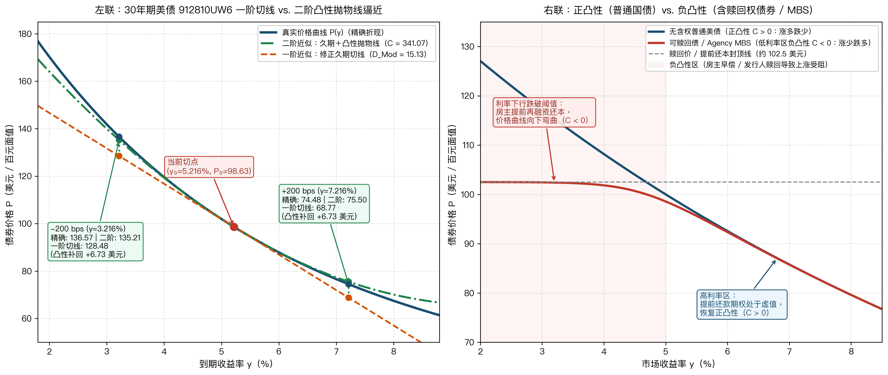

# 06｜凸性、曲线风险与对冲直觉

> **系列总览：** 《从国债到宏观：利率研究课》｜阶段 A：债券语言与定价基础（06/30）  
> **研究问题：** 当市场收益率大幅移动 `±200 bps` 时，30 年期美债 `912810UW6` 在降息时比久期切线多涨 **8.08 美元** ，加息时少跌 **5.70 美元** ——该如何用凸性（`C`）定价这笔曲率红利？为什么总市值与总久期完全相同的 `10Y` 子弹与 `2Y+30Y` 哑铃组合，在大波动与曲线弯曲下会有数百万美元的盈亏分化？交易台又如何用现券或 CME 国债期货对冲？  
> **先备知识：** 承接[第 01 讲](./01_固定收益地图_债券与现金流契约.md)至[第 05 讲](./05_久期_利率敏感度的一阶近似.md)（折现因子、`D_Mod`、`DV01`、`KRD` 与一阶切线近似）。

---

## 一、为什么久期切线总是“看涨不足、看跌过多”？——凸性（`C`）的物理本质与推导

在第 05 讲第 4 节的切线误差测试中，我们观察到一个方向恒定的偏差：无论市场收益率是大幅下行还是大幅上行，债券的真实价格永远落在久期切线的上方。

要理解这一偏差的来源，只需回顾第 05 讲的马尔基尔久期第三定律： **债券的修正久期并非固定常数，而是随市场收益率 y 动态变化的——收益率越低，债券久期自动拉长（切线变陡，每降 1 bp 价格涨得更快）；收益率越高，债券久期自动缩短（切线变平，每升 1 bp 价格跌得更慢）。**

修正久期一阶近似之所以在大波动下失准，是因为它把斜率固定在初始点 `y₀` 处画了一条笔直的切线，忽略了“久期本身随利率变动而改变”的二阶效应。为了度量**价格—收益率曲线的弯曲程度（即久期随利率变化的快慢）** ，并把切线漏掉的非线性价格变动补回来，固定收益分析引入了价格对收益率的二阶导数指标—— **凸性（Convexity，记作 C）** [1]。

### 1. 凸性（`C`）的二阶导数推导与逐期公式

在半年付息惯例下，附息美债的价格方程为 `P(y) = ∑ CF_k × (1 + y/2)^(-k)`。在第 05 讲中，对年化到期收益率 `y` 求一阶导数得到了：

$$\frac{dP}{dy} = \sum_{k=1}^{N} \text{CF}_k \times \left(-\frac{k}{2}\right) \times \left(1 + \frac{y}{2}\right)^{-k - 1}$$

现在将 `dP/dy` 对年化收益率 `y` 再求一次导数（根据复合函数求导法则，指数 `-k - 1` 乘下来，同时 `d(1 + y/2)/dy` 再次乘以 `1/2`，两次求导共产生因子 `1/4`）：

$$\frac{d^2 P}{dy^2} = \sum_{k=1}^{N} \text{CF}_k \times \left(-\frac{k}{2}\right) \times \left(-\frac{k + 1}{2}\right) \times \left(1 + \frac{y}{2}\right)^{-k - 2} = \frac{1}{\left(1 + \frac{y}{2}\right)^2} \sum_{k=1}^{N} \frac{k(k + 1)}{4} \times \frac{\text{CF}_k}{\left(1 + \frac{y}{2}\right)^k}$$

注意到求和号内部右侧的 `CF_k ÷ (1 + y/2)^k` 就是第 `k` 期现金流的现值 `PV_k`。将上式两边同时除以债券价格 `P`（并记现值权重 `w_k = PV_k ÷ P`），便得到**债券凸性（Convexity, C）** 的标准定义（物理量纲为**年²** ）：

$$C \equiv \frac{1}{P} \frac{d^2 P}{dy^2} = \frac{1}{\left(1 + \frac{y}{2}\right)^2} \sum_{k=1}^{N} \frac{k(k + 1)}{4} \times w_k = \frac{1}{P \times \left(1 + \frac{y}{2}\right)^2} \sum_{k=1}^{N} \left(t_k^2 + \frac{t_k}{2}\right) \times \text{PV}_k$$

观察上式可以清楚看到凸性与麦考利久期的结构对应关系：
* **麦考利久期 D_Mac** 是以现值权重 `w_k` 对兑付时间 **t_k = k/2（时间的一阶矩）** 加权平均；
* **凸性 C** 则是以现值权重 `w_k` 对 **k(k + 1)/4 = t_k(t_k + 0.5)（时间的近似二阶平方项）** 加权平均，再除以半年复利修正因子的平方 `(1 + y/2)^2`。

### 2. 2 年期美债 `91282CRU7` 凸性逐期手算实操

沿用前几讲的 2 年期基准国债 `91282CRU7`（`N = 4` 个半年期，票息率 `c = 4.625%`，每半年付息 `2.3125 美元`，收益率 `y = 4.708%`，半年折现率 `y/2 = 0.02354`，全价 `P = 99.843327 美元`）[2]，表 1 展示了从单笔现金流现值一步步算出凸性 `C` 的完整过程：

### 表 1：2 年期美债 `91282CRU7` 凸性（`C`）逐期手算分解表（每 100 美元面值）

| 期数 `k` | 兑付时间 `t_k = k/2`（年） | 名义现金流 `CF_k`（美元） | 单笔现值 `PV_k`（美元） | 现值权重 `w_k = PV_k ÷ P` | 二阶时间因子 `k(k+1)/4`（年²） | 二阶加权现值 `[k(k+1)/4] × PV_k` | 二阶权重贡献 `[k(k+1)/4] × w_k` |
| :--- | :--- | :--- | :--- | :--- | :--- | :--- | :--- |
| **第 1 期** | 0.5 | 2.312500 | 2.259316 | 2.2629% | 0.50 | 1.129658 | 0.011314 |
| **第 2 期** | 1.0 | 2.312500 | 2.207355 | 2.2108% | 1.50 | 3.311032 | 0.033162 |
| **第 3 期** | 1.5 | 2.312500 | 2.156588 | 2.1600% | 3.00 | 6.469765 | 0.064799 |
| **第 4 期（本息）** | 2.0 | 102.312500 | 93.220069 | 93.3663% | 5.00 | 466.100343 | 4.668317 |
| **合计** | — | **109.250000** | **99.843327** | **100.0000%** | — | **477.010798** | **4.777593 年²** |

完成表 1 的加总后，只需最后一步复利因子修正（将合计值 `4.777593` 除以 `(1 + y/2)^2 = 1.02354^2 = 1.047634`）：

$$C = \frac{4.777593}{(1 + 0.02354)^2} = \frac{4.777593}{1.047634} = 4.560364 \text{ 年}^2$$

对于期间不付息的**零息债券（Zero-Coupon Bond / STRIP）** ，由于全部 `100%` 的现值权重都集中在第 `N = 2T` 期这一个点上（`w_N = 1`），凸性公式无需列表，直接化简为一行代数式：

$$C_{\text{Zero}} = \frac{N(N + 1)}{4 \times \left(1 + \frac{y}{2}\right)^2} = \frac{T(T + 0.5)}{\left(1 + \frac{y}{2}\right)^2}$$

以第 02 讲和第 05 讲中的 **10 年期本金 STRIP** （`T = 10 年`，`N = 20`，`y = 4.683%`，`y/2 = 0.023415`）为例，直接代入得 `C = (10 × 10.5) ÷ (1.023415)^2 = 105 ÷ 1.047378` ＝ **100.250314 年²** 。

### 3. 二阶泰勒展开：“久期＋凸性”价格近似公式与美元凸性

将债券价格函数 `P(y)` 在初始收益率 `y₀` 处展开至泰勒级数的第二阶项：

$$P(y_0 + \Delta y) \approx P_0 + \frac{dP}{dy}\Delta y + \frac{1}{2}\frac{d^2 P}{dy^2}(\Delta y)^2$$

将 `dP/dy = -D_Mod × P₀` 与 `d²P/dy² = C × P₀` 代入，即得到固定收益风控标准的**“久期＋凸性”二阶价格近似公式** ：

$$\frac{\Delta P}{P_0} \approx -D_{\text{Mod}} \times \Delta y + \frac{1}{2} \times C \times (\Delta y)^2$$

$$\Delta P \approx \underbrace{-D_{\text{Mod}} \times P_0 \times \Delta y}_{\text{① 一阶久期切线项}} + \underbrace{\frac{1}{2} \times C \times P_0 \times (\Delta y)^2}_{\text{② 二阶凸性弯曲修正项}}$$

在实务中，交易台常把 `d²P/dy² = C × P₀` 称为**美元凸性（Dollar Convexity）** 。理解上述二阶公式只需把握两个核心要点：
* **为什么凸性修正项前面有一个 1/2？** 这来自泰勒级数二阶导数项的阶乘分母 `1 / 2! = 1/2`。
* **为什么正凸性（C > 0）永远对持有人有利？** 无论利率是下跌（`Δy < 0`）还是上涨（`Δy > 0`），平方项 **(Δy)^2 永远是正数** 。因此，只要债券具有正凸性（`C > 0`），第 ② 项 `0.5 × C × P₀ × (Δy)^2` 就永远为正—— **利率下行时，它在切线涨幅之上额外叠加一笔正收益（助涨）；利率上行时，它抵消掉一部分切线跌幅（抗跌）** 。

---

## 二、二阶近似实盘核验与决定凸性的三大规律

### 1. 2026 年四类真实美债标本的凸性对账与大波动误差修复

我们将 2026 年四类真实美债标本的修正久期 `D_Mod`、凸性 `C` 以及在 `±100 bps`（`Δy = ±0.01`）和 `±200 bps`（`Δy = ±0.02`）冲击下的二阶修正效果完整汇总于表 2：

### 表 2：2026 年四类美债标本的凸性指标与 `10Y` / `30Y` 二阶泰勒近似核验表（每 100 美元面值）

| 2026 真实标本与情景测试 | 完整期全价 `P₀` | 修正久期 `D_Mod`（年） | 凸性 `C`（年²） | 一阶久期切线预测 `ΔP_1st` | 二阶凸性修正项 `+0.5×C×P₀×(Δy)²` | 二阶合成预测 `ΔP_2nd` | 真实精确变动 `ΔP_exact` | 残余误差 `ΔP_exact - ΔP_2nd` |
| :--- | :--- | :--- | :--- | :--- | :--- | :--- | :--- | :--- |
| **标本 1：2Y T-Note（91282CRU7）**[2] | 99.843327 | 1.888689 | **4.560364** | — | `+0.0228`（@100bps） | — | — | — |
| **标本 2：10Y T-Note（91282CRF0）**[3] | 99.541071 | 7.927120 | **75.448058** | — | `+0.3755`（@100bps） | — | — | — |
| **标本 3：30Y T-Bond（912810UW6）**[4] | 98.627614 | 15.134590 | **341.066881** | — | `+1.6819`（@100bps） | — | — | — |
| **标本 4：10Y 本金 STRIP** | 62.945464 | 9.771207 | **100.250314** | — | `+0.3155`（@100bps） | — | — | — |
| **10Y 冲击 A：-200 bps（降息）** | 99.541071 | 7.927120 | 75.448058 | +15.7815 | **+1.5020** | **+17.2835** | **+17.3931** | +0.1096 |
| **10Y 冲击 B：-100 bps（降息）** | 99.541071 | 7.927120 | 75.448058 | +7.8907 | **+0.3755** | **+8.2662** | **+8.2796** | +0.0133 |
| **10Y 冲击 C：+100 bps（加息）** | 99.541071 | 7.927120 | 75.448058 | -7.8907 | **+0.3755** | **-7.5152** | **-7.5278** | -0.0126 |
| **10Y 冲击 D：+200 bps（加息）** | 99.541071 | 7.927120 | 75.448058 | -15.7815 | **+1.5020** | **-14.2794** | **-14.3776** | -0.0982 |
| **30Y 冲击 A：-200 bps（降息）** | 98.627614 | 15.134590 | 341.066881 | +29.8538 | **+6.7277** | **+36.5815** | **+37.9381** | +1.3566 |
| **30Y 冲击 B：-100 bps（降息）** | 98.627614 | 15.134590 | 341.066881 | +14.9269 | **+1.6819** | **+16.6088** | **+16.7661** | +0.1572 |
| **30Y 冲击 C：+100 bps（加息）** | 98.627614 | 15.134590 | 341.066881 | -14.9269 | **+1.6819** | **-13.2450** | **-13.3816** | -0.1366 |
| **30Y 冲击 D：+200 bps（加息）** | 98.627614 | 15.134590 | 341.066881 | -29.8538 | **+6.7277** | **-23.1260** | **-24.1498** | -1.0237 |

对照表 2 的中间计算步骤，可以清楚看到二阶凸性修正是如何运作的：
* **以 10 年期美债 91282CRF0 在 ±100 bps（Δy = ±0.01）冲击下为例：**  
  一阶久期切线预测涨跌为 `∓7.927120 × 99.541071 × 0.01` ＝ **±7.8907 美元** ；  
  二阶凸性修正项为 `0.5 × 75.448058 × 99.541071 × (0.01)^2 = 0.5 × 7,510.18 × 0.0001` ＝ **+0.3755 美元** ；  
  两者相加，`-100 bps` 下的二阶预测为 `7.8907 + 0.3755` ＝ **+8.2662 美元** （与精确值 `+8.2796 美元` 仅差 `0.0133 美元`）；`+100 bps` 下的二阶预测为 `-7.8907 + 0.3755` ＝ **-7.5152 美元** （与精确值 `-7.5278 美元` 仅差 `0.0126 美元`），一阶切线原本约 `0.38 美元` 的误差被消除了 **96% 以上** 。
* **以 30 年期美债 912810UW6 在 ±200 bps（Δy = ±0.02）极端冲击下为例：**  
  由于 `(Δy)^2 = 0.0004` 是 `100 bps` 冲击时的 **4 倍** ，30 年期国债的二阶凸性修正项达到 `0.5 × 341.066881 × 98.627614 × 0.0004` ＝ **+6.7277 美元** ，单靠这一项就填平了第 05 讲遗留的大部分切线偏差（剩余约 `1.0~1.3 美元` 差额则来自泰勒级数的三阶导数项 `O(Δy^3)`）。

### 2. 决定凸性大小的三大规律与“负凸性（Negative Convexity）”边界

观察表 2 并结合凸性定义式，可以归纳出决定债券凸性的三条核心规律：

1. **久期平方放大律（C 随期限呈近似平方级数增长）：**  
   由于凸性公式中的权重乘数是 `t_k(t_k + 0.5) ≈ t_k^2`，当债券久期拉长 `k` 倍时，其凸性大约放大 **k^2 倍** 。在表 2 中，30 年期国债的修正久期（`15.13`）是 2 年期国债（`1.89`）的 **8.0 倍** ，但其凸性（`341.07`）却是 2 年期国债（`4.56`）的 **74.8 倍** 。
2. **现金流分散度定律（同久期下，现金流越分散，凸性越大）：**  
   利用统计学中的方差公式 `E[t^2] = (E[t])^2 + Var(t)`，可以将附息债券的凸性精确改写为麦考利久期平方与**现金流到账时间方差 Var(t)** 的函数：
   $$C = \frac{D_{\text{Mac}}^2 + D_{\text{Mac}} \div 2 + \text{Var}(t)}{\left(1 + \frac{y}{2}\right)^2}, \qquad \text{其中 } \text{Var}(t) = \sum_{k=1}^{N} w_k \times \left(t_k - D_{\text{Mac}}\right)^2$$
   这行恒等式揭示了一个极为重要的买方组合原理： **当两只债券或两个投资组合的麦考利久期 D_Mac 完全相同时，现金流在时间轴上分布越分散（时间方差 Var(t) 越大），凸性 C 就越大** 。单笔零息债券因为所有现金流集中在同一个时点（`Var(t) = 0`），在**相同久期**的所有债券中凸性最小；而由极短端与极长端拼成的哑铃型组合（Barbell），因为现金流分布在两端，`Var(t)` 最大，所以在**相同久期**下拥有最高的凸性。
3. **正凸性与负凸性（Negative Convexity）的物种分界：**  
   一切现金流固定不变的普通国债（T-Bills、T-Notes、T-Bonds、STRIPS）的 `PV_k > 0`，其凸性严格为正（`C > 0`，价格曲线向原点凸出）。但对于**含赎回权公司债（Callable Bonds）**或**机构抵押贷款支持证券（Agency MBS）** ，当市场利率大幅下跌并跌破房主再融资阈值时，大量房主会提前借新还旧、归还全部房贷本金，导致高息债券的上涨空间被赎回价（约 `100~103 美元`）强行封顶。此时价格—收益率曲线从“向上翘”变成“向下弯”（二阶导数 `d²P/dy² < 0`，即 **负凸性 C < 0** ），表现出“利率跌时涨不动、利率涨时加速跌”的不利特征。



*(图注：左联展示 30 年期美债 `912810UW6` 在 `y₀ = 5.216%` 处的三线对比——橙色虚线为一阶修正久期切线，绿色点划线为加入二阶凸性项 `+0.5×C×P₀×(Δy)²` 后的二次抛物线，在 `±200 bps` 宽幅区间内紧密贴合深蓝色真实价格曲线；右联对比无含权普通美债的正凸性曲线与含提前还款权的 Agency MBS / 可赎回债在低利率区的负凸性封顶现象。)*

---

## 三、超越平行平移：收益率曲线三维形变与“子弹 vs. 哑铃”凸性对决

### 1. 收益率曲线的三大正交形态因子（Level / Slope / Curvature）

在第 05 讲第 5 节中我们已经看到，单靠一个总修正久期或总 `DV01`，只能防范整条收益率曲线上下平行移动的风险。1991 年，罗伯特·利特曼（Robert Litterman）与何塞·沙因克曼（José Scheinkman）对美债历史收益率曲线做主成分分析（PCA）后指出，美债收益率曲线超过 95% 的日常变动可以分解为三个相互独立的几何形变因子[5]：

1. **第一因子：水平平移（Level / Parallel Shift）** —— 短端（`2Y`）、中端（`10Y`）与长端（`30Y`）同向、近似同幅上下移动，风险敞口由**组合总 DV01** 度量；
2. **第二因子：斜率扭曲（Slope / Twist）** —— 短端与长端反向运动或变动幅度悬殊（如短端降息、长端因赤字担忧上行的陡峭化 Steepener，或短端加息、长端下行的平坦化 Flattener），风险敞口由不同期限节点的**关键利率久期（KRD）分布差值**度量；
3. **第三因子：曲率弯曲（Curvature / Butterfly Shift）** —— 收益率曲线的“中端肚腩（Belly，如 `5Y/10Y`）”相对于“两翼（Wings，即短端 `2Y` 与超长端 `30Y`）”发生相对下凹或上凸，风险敞口直接取决于组合是集中在中间（子弹型 Bullet）还是分布在两端（哑铃型 Barbell），以及两者的**组合凸性差异** 。

### 2. 1 亿美元子弹型（10Y）vs. 哑铃型（2Y + 30Y）组合的凸性与多维情景对账

承接第 05 讲表 5 的两个 1 亿美元实盘组合：
* **组合甲（10Y 子弹组合 Bullet）：** `100%` 市值（`10,000.00 万美元`）持有 10 年期国债 `91282CRF0`，总修正久期 `D_Mod = 7.927120 年`，总 `DV01 = 79,271.20 美元/bp`；
* **组合乙（2Y + 30Y 哑铃组合 Barbell）：** 按市值权重 `w_2Y = 54.412829%`（`5,441.28 万美元`）持有 2 年期 `91282CRU7`、`w_30Y = 45.587171%`（`4,558.72 万美元`）持有 30 年期 `912810UW6`，总修正久期同样精确等于 **7.927120 年** ，总 `DV01` 同样等于 **79,271.20 美元/bp** 。

现在利用组合凸性的市值加权可加性（`C_Portfolio = ∑ w_j × C_j`），计算两个组合的凸性：
* **子弹组合凸性 C_Bullet：** 等于 10 年期国债自身的凸性，即 **75.448058 年²** ；
* **哑铃组合凸性 C_Barbell：** `0.54412829 × 4.560364 + 0.45587171 × 341.066881 = 2.4814 + 155.4827` ＝ **157.964164 年²** 。

这组数字直接验证了上一节的“现金流分散度定律”：虽然两个组合的修正久期与 `DV01` 完全相等，但因为哑铃组合把现金流拉开在 `2Y` 和 `30Y` 两端（时间方差极大）， **哑铃组合的凸性（157.96）高达子弹组合（75.45）的 2.09 倍，净凸性优势达到 ΔC = +82.5161 年²！**

如果一位相对价值交易员构建一笔零净资金占用、零净久期敞口的对冲头寸—— **“做多 1 亿美元哑铃组合 ＋ 做空 1 亿美元子弹组合”** （`Net MV = 0`，`Net DV01 = 0`，净凸性 `Net C = +82.5161`），在不同曲线形变下会发生什么？表 3 给出了精确折现重估下的全情景账单：

### 表 3：1 亿美元子弹型（10Y）与哑铃型（2Y+30Y）组合的凸性对比及多维曲线冲击精确损益表

| 组合特征与宏观曲线冲击情景 | 组合甲：10Y 子弹组合（Bullet） | 组合乙：2Y + 30Y 哑铃组合（Barbell） | 久期中性对冲净损益<br>（做多哑铃 − 做空子弹） | 二阶凸性公式预测净差额<br>`0.5 × ΔC × MV × (Δy)²` |
| :--- | :--- | :--- | :--- | :--- |
| **组合总市值 MV（美元）** | 100,000,000.00 | 100,000,000.00 | **0.00（零净本金）** | — |
| **组合修正久期 D_Mod / 总 DV01** | 7.927120 年 / 79,271.20 | 7.927120 年 / 79,271.20 | **0.000000（久期中性）** | — |
| **组合凸性 C（年²）** | **75.448058** | **157.964164** | **+82.516106（净做多凸性）** | — |
| **情景 1：平行暴跌 -200 bps** | +17,473,278.40 | +19,641,546.12 | **+2,168,267.72** | +1,650,322.11 |
| **情景 2：平行下行 -100 bps** | +8,317,737.07 | +8,789,744.56 | **+472,007.49** | +412,580.53 |
| **情景 3：平行微跌 -10 bps** | +796,497.49 | +800,678.49 | **+4,180.99** | +4,125.81 |
| **情景 4：平行微升 +10 bps** | -788,952.61 | -784,881.12 | **+4,071.50** | +4,125.81 |
| **情景 5：平行上行 +100 bps** | -7,562,541.70 | -7,200,570.84 | **+361,970.87** | +412,580.53 |
| **情景 6：平行暴涨 +200 bps** | -14,443,903.49 | -13,169,095.84 | **+1,274,807.65** | +1,650,322.11 |
| **情景 7：斜率陡峭化（2Y -20 / 10Y 0 / 30Y +20 bps）** | 0.00 | -1,143,288.15 | **-1,143,288.15** | 非平行移动不适用 |
| **情景 8：斜率平坦化（2Y +20 / 10Y 0 / 30Y -20 bps）** | 0.00 | +1,206,489.03 | **+1,206,489.03** | 非平行移动不适用 |
| **情景 9：蝴蝶弯曲 A（两翼 +15 / 中端 10Y -15 bps）** | +1,197,600.06 | -1,171,523.39 | **-2,369,123.45** | 非平行移动不适用 |
| **情景 10：蝴蝶弯曲 B（两翼 -15 / 中端 10Y +15 bps）** | -1,180,623.89 | +1,207,070.14 | **+2,387,694.03** | 非平行移动不适用 |

表 3 与下图共同揭示了固定收益组合管理中最核心的**“凸性—曲线风险权衡”** ：
* **在平行大波动中，做多凸性等价于“做多利率波动率（Long Volatility）”：** 观察情景 1 至情景 6，由于一阶 `DV01` 已完全对冲归零，只要收益率曲线发生平行移动，无论利率是暴跌还是暴涨，“做多哑铃 / 做空子弹”的净损益全部为正（`-100 bps` 净赚 **+47.20 万美元** ，`+100 bps` 净赚 **+36.20 万美元** ，二阶公式预测值均为 `0.5 × 82.5161 × 1亿 × 0.01^2` ＝ **+41.26 万美元** ），在坐标图上走出一条标准的**微笑曲线（Volatility Smile）** 。
* **哑铃组合的软肋——害怕曲线陡峭化与“两翼上翘、中端下凹”的蝴蝶弯曲：** 既然做多哑铃拥有两倍以上的凸性，为什么市场不会让所有人白捡这笔免费午餐？看情景 7 与情景 9：一旦曲线并非平行移动，而是发生长端上翘的陡峭化（情景 7），或者发生两翼（`2Y` 与 `30Y`）上行 `+15 bps`、中端（`10Y`）下行 `-15 bps` 的蝴蝶弯曲（情景 9），哑铃组合在两翼遭受双重下跌，而子弹组合在中端独享价格上涨，导致“做多哑铃 / 做空子弹”头寸单次暴亏 **-236.91 万美元** ！此外，在正常的收益率曲线定价中，高凸性组合往往需要让渡一部分静态票息或到期收益率（Convexity Give-up），只有在市场实际波动率超出隐含波动率时，凸性红利才能覆盖静态成本。


*(图注：左联展示 1 亿美元“做多 2Y+30Y 哑铃 / 做空 10Y 子弹”久期中性组合在平行移动 `±200 bps` 下的净盈亏微笑曲线——利率不动时盈亏为 0，波动越大净盈利越高；右联展示驱动债券组合损益分化的三大曲线形态因子：水平平移 Level、斜率陡峭化 Slope 与蝴蝶弯曲 Curvature。)*

---

## 四、对冲直觉实战：如何用现券或美债期货锁死利率风险？

当买方机构或做市商持有一笔国债多头头寸（例如第 05 讲练习 4 中持有 **5,000 万美元面值** 的 30 年期基准国债 `912810UW6`，总市值 `4,931.38 万美元`，总基点价值 `DV01_30Y = 74,634.42 美元/bp`），在实际交易台上有三种不同层级的对冲手段：

### 1. 层级一：单一现券 `DV01` 中性对冲（只消一阶平行风险）

如果只使用一只流动性最好的 10 年期基准国债 `91282CRF0`（百元面值 `DV01_100 = 0.078907 美元/bp`）进行空头对冲，目标是令组合净 `DV01 = 0`：

$$\text{需做空 10Y 现券面值} = \frac{\text{DV01}_{\text{Target}}}{\text{DV01}_{100, \text{Hedge}} \div 100} = \frac{74,634.424}{0.07890741 \div 100} = 94,584,813.81 \text{ 美元}$$

做空约 **9,458.48 万美元面值** （对应市值 `9,415.07 万美元`）的 10 年期国债后，组合对平行移动的一阶敞口归零。但请注意残余的二阶敞口：
* 多头 `30Y` 的美元凸性（乘以 `0.5 × (0.01)^2` 即 `100 bps` 凸性收益）为：`5,000 万 ÷ 100 × 1.6819` ＝ **+84.10 万美元** ；
* 空头 `10Y` 的 `100 bps` 凸性损益为：`-9,458.48 万 ÷ 100 × 0.3755` ＝ **-35.52 万美元** ；
* 组合仍保留了 **+48.58 万美元/@100bps** 的净正凸性，同时也暴露在 `10s30s` 曲线陡峭化风险之下。

### 2. 层级二：双券联立“久期＋凸性”双中和对冲（同时消掉一阶与二阶平行风险）

如果交易员希望把一阶 `DV01` **和** 二阶凸性同时对冲归零（Duration & Convexity Neutral），根据线性代数基本原理， **消掉两个风险因子至少需要两只不同期限的对冲工具** （例如同时使用 `2Y` 国债 `91282CRU7` 与 `10Y` 国债 `91282CRF0`）。

设对冲组合中持有的 `2Y` 国债与 `10Y` 国债的市值分别为 `MV_2` 与 `MV_10`（正数为做多，负数为做空）。要同时抵消掉 `5,000 万面值 30Y 国债`（市值 `MV_30 = 49,313,807.23 美元`，修正久期 `D_30 = 15.134590`，凸性 `C_30 = 341.066881`）的一阶久期与二阶凸性，只需联立以下二元一次方程组：

$$\begin{cases} D_{\text{Mod}, 2} \times \text{MV}_2 + D_{\text{Mod}, 10} \times \text{MV}_{10} = -D_{\text{Mod}, 30} \times \text{MV}_{30} & \text{（一阶总 DV01 归零）} \\ C_2 \times \text{MV}_2 + C_{10} \times \text{MV}_{10} = -C_{30} \times \text{MV}_{30} & \text{（二阶总美元凸性归零）} \end{cases}$$

将表 2 的真实参数代入方程组右端：
* 一阶目标：`-15.134590 × 49,313,807.23` ＝ **-746,344,242.42** （即总 `DV01` 等于 `-74,634.42 美元/bp`）；
* 二阶目标：`-341.066881 × 49,313,807.23` ＝ **-16,819,306,496.50** 。

解此二元一次方程组（克莱姆法则消元），直接得到唯一精确解：
* **需做空 10Y 国债市值** `MV_10 = -266,699,954.49 美元`（对应做空面值 **26,792.96 万美元** ）；
* **需做多 2Y 国债市值** `MV_2 = +724,215,693.59 美元`（对应做多面值 **72,535.21 万美元** ）。

核验可知：这套“做多 `30Y` ＋ 做多 `2Y` ＋ 做空 `10Y`”的三腿蝶式组合（Butterfly），不仅总 `DV01` 严格等于 `0.00 美元/bp`，连二阶总美元凸性也严格等于 `0.00`！

### 3. 层级三：机构实盘主力工具——芝商所（CME）美债期货对冲与转换因子（`CF`）直觉

在真实金融市场中，要直接借入近 1 亿美元的现券做空，不仅需要在回购市场（Repo）支付借券成本，还会占用大量资产负债表额度。因此，养老金、银行与对冲基金在日常调仓和风险对冲时，最常使用的是**芝商所（CME）国债期货合约** （如 2 年期 `ZT`、5 年期 `ZF`、10 年期 `ZN`、30 年期 `ZB`）[6]。

关于国债期货的完整交割篮子与基差交易机制，我们将在**阶段 B 第 10 讲《国债期货、基差与杠杆链条》**专门深入展开；但在这里，只需掌握三个环环相扣的定价直觉，就能立刻算出期货对冲手数：

1. **为什么需要“转换因子（Conversion Factor, CF）”？**  
   1 手 CME 10 年期美债期货（代码 `ZN`）的名义标准面值为 **100,000 美元（10 万美元）** ，合约规定的虚拟基准票息率为 **6.00%** [6]。然而，财政部实际发行的每一期国债票息率和剩余期限各不相同（例如 `91282CRF0` 的票息率是 `4.625%`）。如果空头交割一只票息只有 `4.625%` 的国债，买方拿到的利息比 `6.00%` 标准券少，自然不肯按期货原价付款。  
   为此，交易所为每只可交割国债公布一个固定的**转换因子 CF** ——它的定义非常直观： **把这只现券的未来现金流按 6.00% 的年化收益率折现，算出来的每 1 美元面值理论价格就是它的转换因子 CF** [6]。例如，将 `10Y 91282CRF0`（`c = 4.625%, N = 20`）代入 `y = 6.00%` 折现，理论价格为 `89.7717 美元`，除以 100 并四舍五入至小数点后四位，得到其转换因子 **CF = 0.8977** 。
2. **最便宜可交割券（CTD）如何决定期货的 DV01？**  
   在交割月，期货空头有权利从一篮子合资格国债中挑选最划算的一只去交割，这只大家都抢着交割的现券就叫**最便宜可交割券（Cheapest-to-Deliver, CTD）** 。由于交割发票价格等于 `期货价格 F × CF_CTD`，在无套利均衡下，期货报价 `F` 紧跟着 CTD 现券价格 `P_CTD` 走：

   $$F \approx \frac{P_{\text{CTD}}}{\text{CF}_{\text{CTD}}} \quad \Longrightarrow \quad \text{DV01}_{\text{Futures}} \approx \frac{\text{DV01}_{\text{CTD, 每10万美元面值}}}{\text{CF}_{\text{CTD}}}$$

   这说明： **1 手国债期货（10 万美元面值）的美元基点价值 DV01_Futures，等于 10 万美元面值 CTD 现券的 DV01 除以它的转换因子 CF_CTD** 。
3. **期货对冲手数 N_f 的一键计算公式：**  
   要用国债期货对冲一个总基点价值为 `DV01_Portfolio` 的现券组合，所需做空的期货合约手数 `N_f` 就是用“组合总风险”除以“单手期货风险”：

   $$N_f = \frac{\text{DV01}_{\text{Portfolio}}}{\text{DV01}_{\text{Futures}}} = \frac{\text{DV01}_{\text{Portfolio}}}{\text{DV01}_{\text{CTD, 每10万美元面值}}} \times \text{CF}_{\text{CTD}}$$

* **实盘算例：** 假设某时刻 `10Y 91282CRF0` 正是 10 年期国债期货 `ZN` 的 CTD 券（百元面值 `DV01_100 = 0.0789074 美元/bp`，转换因子 `CF = 0.8977`）。
  * 先算 10 万美元面值 CTD 现券的 `DV01`：`0.0789074 × (100,000 ÷ 100)` ＝ **78.9074 美元/bp** ；
  * 再除以转换因子 `0.8977`，得到 1 手 `ZN` 期货合约的基点价值：`DV01_Futures = 78.9074 ÷ 0.8977` ＝ **87.8995 美元/bp** ；
  * 要对冲前文 **5,000 万美元面值 30Y 国债** （总 `DV01 = 74,634.42 美元/bp`），需卖空的 `ZN` 期货手数为：`N_f = 74,634.424 ÷ 87.8995` ＝ **849.09 手** （实盘取整卖空 **849 手** `ZN` 期货合约）。

### 表 4：三大层级利率对冲策略的机制、敞口特征与实务权衡对照表

| 对冲策略层级 | 对冲工具配置（以对冲 5,000 万面值 `30Y` 多头为例） | 一阶平行风险（`Net DV01`） | 二阶平行凸性（`Net C`） | 非平行曲线风险暴露 | 资金与资产负债表占用 |
| :--- | :--- | :--- | :--- | :--- | :--- |
| **1. 单一现券 DV01 对冲** | 做空 `9,458.48 万` 面值 `10Y` 现券 | **0.00** （完全中和） | `+48.58 万/@100bps`（保留净正凸性） | 暴露于 `10s30s` 斜率陡峭化风险 | 高（需通过 Repo 借入近 1 亿美元现券） |
| **2. 双现券久期＋凸性对冲** | 做空 `2.68 亿` 面值 `10Y` ＋ 做多 `7.25 亿` 面值 `2Y` | **0.00** （完全中和） | **0.00** （完全中和） | 暴露于 `2s10s30s` 蝴蝶曲率反转 | 极高（多空总名义面值近 10 亿美元） |
| **3. CME 国债期货 DV01 对冲** | 卖空 **849 手** `ZN` 10 年期国债期货 | **≈ 0.00** （快速中和） | 保留正凸性（受 CTD 切换微调） | 暴露于 `10s30s` 斜率及现券—期货基差 | **极低** （仅需缴纳交易所初始保证金） |

---

## 五、竞争性视角、失效边界与阶段 A 全链路复算脚本

### 1. 竞争性视角：泰勒二阶局部展开 vs. 精确全重估（Full Revaluation）

在现代量化风控系统中，既然计算机可以在毫秒内按折现公式算出精确价格 `P(y₀ + Δy)`（即**全重估法 Full Revaluation** ），为什么全世界的交易台依然每天紧盯 `DV01` 与凸性 `C`？
* **泰勒展开的不可替代性在于“归因与线性规划对冲”：** 全重估法只能告诉你在某个单一假设情景下赚亏多少美元，却无法直接告诉你“需要卖空多少手期货”或“当前盈利到底有几成来自利率方向、几成来自波动率凸性”。`DV01` 与 `C` 将复杂的非线性定价函数压缩成了可加总、可列方程求解的局部偏导数语言。
* **极端尾部情景则必须切换回全重估法：** 如表 2 所示，当 30 年期国债遭遇 `±200 bps` 以上的超大幅度冲击时，即便加上二阶凸性，泰勒展开仍有约 `1.0~1.3 美元` 的三阶残余误差。因此在压力测试（Stress Testing）与历史极端行情回演中，机构风控后台一律采用全重估法兜底。

### 2. 三大常见认知与模型失效条件（Failure Conditions）

* **失效条件一：将“正凸性（涨多跌少）”外推至含赎回权债券或 Agency MBS**  
  普通国债的现金流与利率无关，故恒有 `C > 0`；但 Agency MBS 与可赎回债在利率下跌穿过再融资门槛时会出现负凸性（`C < 0`）。若在降息周期中按正凸性线性外推 MBS 涨幅，将严重高估组合净值。
* **失效条件二：误以为“久期中性＋正凸性”在任何行情下都稳赚不赔**  
  表 3 情景 7 与情景 9 证明，“做多哑铃 / 做空子弹”的微笑曲线仅在**收益率曲线平行移动（或中端上凸）**时成立。一旦遭遇两翼利率上行、中端利率下行的蝴蝶弯曲，二阶平行凸性红利根本无法弥补关键利率节点错位造成的一阶损失。
* **失效条件三：期货对冲中忽略 CTD 切换（CTD Switch）引起的久期跳变**  
  当市场收益率在 `6.00%` 附近大幅波动或曲线斜率剧烈变化时，国债期货一篮子可交割券中的“最便宜可交割券（CTD）”可能从一只短久期券突然切换为另一只长久期券，导致单手期货的 `DV01_Futures` 发生非线性跳变（这正是第 10 讲将剖析的期权调整基差风险）。

### 3. 阶段 A（01–06 讲）闭环核验与最小可复现 Python 脚本

作为**阶段 A（债券语言与定价基础，01–06 讲）**的收官之作，下面提供一段零依赖 Python 脚本。它不仅完整复现了本讲表 1 至表 4 的全部数据，还以 2026 年 10 年期基准美债 `91282CRF0` 为标本，完成了路线图要求的**阶段 A 全链路闭环核验（现金流日历 → 应计利息与净价/全价 → 到期收益率反解 → 麦考利久期/修正久期/DV01 → 凸性与二阶情景损益 → 期货对冲手数）**[2][3][4][6]：

```python
# 阶段 A（01-06 讲）全链路闭环核验与第 06 讲底表复算脚本
def bond_analytics(c_annual, y_annual, n_periods):
    """计算完整半年期附息国债的价格、D_Mac、D_Mod、DV01 与凸性 C"""
    i = y_annual / 2.0
    c_semi = 100.0 * (c_annual / 2.0)
    price = 0.0
    w_t_pv = 0.0
    w_conv_pv = 0.0
    for k in range(1, n_periods + 1):
        cf = c_semi + (100.0 if k == n_periods else 0.0)
        pv = cf / ((1.0 + i) ** k)
        price += pv
        w_t_pv += (k / 2.0) * pv
        w_conv_pv += (k * (k + 1.0) / 4.0) * pv
    d_mac = w_t_pv / price
    d_mod = d_mac / (1.0 + i)
    dv01 = price * d_mod * 0.0001
    convexity = (w_conv_pv / price) / ((1.0 + i) ** 2)
    return price, d_mac, d_mod, dv01, convexity

# 1. 复现表 1 & 表 2：四类美债标本的久期、DV01 与凸性对账
print("=== 1. 2026 年四类美债标本久期与凸性对账（表 1 & 表 2）===")
specimens = [
    ("2Y T-Note 91282CRU7", 0.04625, 0.04708, 4),
    ("10Y T-Note 91282CRF0", 0.04625, 0.04683, 20),
    ("30Y T-Bond 912810UW6", 0.05125, 0.05216, 60),
    ("10Y Principal STRIP", 0.00000, 0.04683, 20),
]
res = {}
for name, c, y, n in specimens:
    p, dm, dmod, dv, conv = bond_analytics(c, y, n)
    res[name] = (p, dm, dmod, dv, conv, c, y, n)
    c100 = 0.5 * conv * p * (0.01 ** 2)
    c200 = 0.5 * conv * p * (0.02 ** 2)
    print(f"[{name:20s}] P={p:9.6f} | D_Mod={dmod:9.6f} | DV01={dv:8.6f} | C={conv:10.6f} | +100bps二阶项={c100:+7.4f} | +200bps二阶项={c200:+7.4f}")

# 2. 复现表 2 下半部分：10Y 与 30Y 二阶泰勒近似误差修复
print("\n=== 2. 10Y 与 30Y 一阶切线 vs 二阶凸性近似核验 ===")
for name in ["10Y T-Note 91282CRF0", "30Y T-Bond 912810UW6"]:
    p0, _, dmod, _, conv, c, y0, n = res[name]
    print(f"-- {name} --")
    for dy_bps in [-200, -100, 100, 200]:
        dy = dy_bps / 10000.0
        p1 = bond_analytics(c, y0 + dy, n)[0]
        dp_ex = p1 - p0
        dp_1st = -dmod * p0 * dy
        dp_conv = 0.5 * conv * p0 * (dy ** 2)
        dp_2nd = dp_1st + dp_conv
        print(f"  dy={dy_bps:+4d}bps: 1st={dp_1st:+8.4f} | ConvTerm={dp_conv:+7.4f} | 2nd={dp_2nd:+8.4f} | Exact={dp_ex:+8.4f} | Err2nd={dp_ex-dp_2nd:+7.4f}")

# 3. 复现表 3：$100M 子弹组合 vs 哑铃组合凸性对比与多维曲线冲击
p2, _, dmod2, dv2, conv2, c2, y2, n2 = res["2Y T-Note 91282CRU7"]
p10, _, dmod10, dv10, conv10, c10, y10, n10 = res["10Y T-Note 91282CRF0"]
p30, _, dmod30, dv30, conv30, c30, y30, n30 = res["30Y T-Bond 912810UW6"]
w30 = (dmod10 - dmod2) / (dmod30 - dmod2)
w2 = 1.0 - w30
conv_barbell = w2 * conv2 + w30 * conv30
mv = 100_000_000.0
sh10, sh2, sh30 = mv / p10, (mv * w2) / p2, (mv * w30) / p30
print(f"\n=== 3. $100M 子弹 vs 哑铃: C_Bullet={conv10:.6f}, C_Barbell={conv_barbell:.6f}, ΔC=+{conv_barbell-conv10:.6f} ===")
for label, dy2, dy10, dy30 in [
    ("平行 -200 bps", -0.02, -0.02, -0.02),
    ("平行 -100 bps", -0.01, -0.01, -0.01),
    ("平行 +100 bps", +0.01, +0.01, +0.01),
    ("平行 +200 bps", +0.02, +0.02, +0.02),
    ("斜率陡峭化 (2Y -20 / 10Y 0 / 30Y +20)", -0.002, 0.0, +0.002),
    ("蝴蝶弯曲 A (两翼 +15 / 10Y -15)", +0.0015, -0.0015, +0.0015),
]:
    pnl_bul = sh10 * (bond_analytics(c10, y10 + dy10, n10)[0] - p10)
    pnl_bar = sh2 * (bond_analytics(c2, y2 + dy2, n2)[0] - p2) + sh30 * (bond_analytics(c30, y30 + dy30, n30)[0] - p30)
    print(f"  {label:38s}: 子弹=${pnl_bul:+13,.2f} | 哑铃=${pnl_bar:+13,.2f} | 净差额=${pnl_bar-pnl_bul:+12,.2f}")

# 4. 复现第 4 节：双券久期+凸性中和方程组 & CME ZN 期货对冲手数
mv30_target = 50_000_000.0 * (p30 / 100.0)
b1 = -dmod30 * mv30_target
b2 = -conv30 * mv30_target
det = dmod2 * conv10 - dmod10 * conv2
mv2_hedge = (b1 * conv10 - b2 * dmod10) / det
mv10_hedge = (dmod2 * b2 - conv2 * b1) / det
cf_10y = round(bond_analytics(0.04625, 0.0600, 20)[0] / 100.0, 4)
dv01_fut = (dv10 * 1000.0) / cf_10y
n_fut = (50_000_000.0 * dv30 / 100.0) / dv01_fut
print(f"\n=== 4. 对冲实操核验（表 4）===")
print(f"双券久期+凸性中和: 做多 2Y 市值=${mv2_hedge:,.2f} (面值=${mv2_hedge/p2*100:,.2f}) | 做空 10Y 市值=${mv10_hedge:,.2f} (面值=${mv10_hedge/p10*100:,.2f})")
print(f"CME ZN 期货对冲: CF={cf_10y:.4f} | 单手期货 DV01=${dv01_fut:.4f}/bp | 需卖空手数={n_fut:.2f} 手")
```

---

## 六、阶段自测练习与完整推导解析

> **自学检验建议：** 本节包含 4 道本讲核心练习与 1 道**阶段 A（01–06 讲）综合通关大题** 。请先独立完成推导与计算，再对照下方解析逐项核对。

### 练习题

1. **【四期附息国债凸性逐笔手算（承接第 02 讲与第 05 讲练习 1）】** 沿用第 02 讲和第 05 讲练习 1 的 2 年期附息国债：剩余期限恰好 2 年（`N = 4` 个完整半年期），票息率 `c` ＝ **4.000%** （每半年支付 `2.00 美元` 票息），当前到期收益率 `y` ＝ **5.000%** （半年折现率 `i = 2.500%`）。已知第 1–4 期的单笔现值分别为 `PV_1 = 1.951220`、`PV_2 = 1.903629`、`PV_3 = 1.857199`、`PV_4 = 92.406966`，债券理论价格 `P` ＝ **98.119013 美元** ，修正久期 `D_Mod` ＝ **1.893956 年** 。求：（1）逐期计算第 1–4 期的二阶时间因子 `k(k + 1) ÷ 4` 及二阶加权现值 `[k(k + 1) ÷ 4] × PV_k`；（2）计算该债券的凸性 `C`（保留 6 位小数）；（3）若市场收益率瞬间上行 **+100 bps** （`Δy = +0.01`），分别计算一阶久期切线预测的价格变动、二阶凸性修正项及二阶合成预测价格。
2. **【零息本金 STRIP 凸性快速公式与“二阶抗跌助涨”核验】** 根据正文第 1 节，10 年期零息本金 STRIP（`T = 10 年`，`N = 20` 个半年期，基准收益率 `y = 4.683%`，价格 `P₀ = 62.945464 美元`，修正久期 `D_Mod = 9.771207 年`）的凸性可通过零息债公式直接算出。求：（1）利用公式 `C_Zero = T(T + 0.5) ÷ (1 + y/2)^2` 验证其凸性 `C`；（2）当市场收益率大幅下行 **-200 bps** （`Δy = -0.02`，新收益率 `2.683%`）时，分别计算该 STRIP 的一阶切线预测涨幅、二阶凸性修正项、二阶合成预测涨幅，并与精确折现涨幅（`62.945464` 对比 `100 ÷ 1.013415^20`）对账。
3. **【1 亿美元久期中性“做多哑铃 / 做空子弹”组合的波动率盈亏测算】** 某宏观相对价值基金构建了正文表 3 中的久期中性组合：做多 **1 亿美元市值** 的 `2Y + 30Y` 哑铃组合（`D_Mod = 7.927120`，`C_Barbell = 157.964164`），同时做空 **1 亿美元市值** 的 `10Y` 子弹组合（`D_Mod = 7.927120`，`C_Bullet = 75.448058`）。求：（1）该多空组合的净修正久期与净凸性 `ΔC`；（2）若次日美债收益率曲线发生平行下移 **-150 bps** （`Δy = -0.015`），利用二阶泰勒近似公式估算该久期中性组合的净盈利美元金额；（3）指出哪两类非平行曲线形变会导致该组合出现亏损。
4. **【芝商所（CME）10 年期美债期货（ZN）跨品种对冲实操】** 某银行交易台持有 **2,000 万美元面值** 的 30 年期基准国债 `912810UW6`（全价 `98.627614`，百元面值 `DV01_100 = 0.149269 美元/bp`）。交易员计划卖空 CME 10 年期美债期货（`ZN`，每手面值 `100,000 美元`）对冲全部一阶利率风险。已知当前 `ZN` 期货的最便宜可交割券（CTD）每百元面值的 `DV01_100` 为 **0.078907 美元/bp** ，转换因子 `CF_CTD` 为 **0.8977** 。求：（1）现有 30 年期国债头寸的总 `DV01`；（2）单手 `ZN` 期货合约的美元基点价值 `DV01_Futures`；（3）交易员应当卖空多少手 `ZN` 期货合约（四舍五入取整）？
5. **【阶段 A（01–06 讲）综合通关核验】** 以 2026 年 10 月新发的 2 年期基准美债 `91282CRU7`（票息率 `c = 4.625%`，每半年付息一次，到期日 `2028-10-31`）为样本[2]：（1）若在起息日（`N = 4` 个完整半年期）按拍卖高收益率 `y = 4.708%` 定价，写出其完整期理论净价 `P₀`、麦考利久期 `D_Mac`、修正久期 `D_Mod`、百元 `DV01_100` 与凸性 `C`；（2）若投资者在起息日后第 `46` 天（该半年付息周期共 `E = 182` 天）在二级市场按净价 `99.800000 美元` 买入 `1,000 万美元面值` 该国债，按 Actual/Actual 规则计算其应计利息 `AI` 与实际交割全价总金额（回顾第 03 讲）；（3）说明若将该国债一直持有至 `1.9331 年`（即 `H = D_Mac`）卖出，为何能够在一阶上免疫买入次日的平行利率冲击（回顾第 04、05 讲）。

---

### 参考答案与推导解析

* **1. 【解析：四期附息国债凸性逐笔手算】**
  * **（1）逐期二阶时间因子与加权现值：**
    * `k = 1（t = 0.5 年）`：`k(k + 1) ÷ 4 = (1 × 2) ÷ 4` ＝ **0.50** ，加权现值 `0.50 × 1.951220` ＝ **0.975610** ；
    * `k = 2（t = 1.0 年）`：`k(k + 1) ÷ 4 = (2 × 3) ÷ 4` ＝ **1.50** ，加权现值 `1.50 × 1.903629` ＝ **2.855443** ；
    * `k = 3（t = 1.5 年）`：`k(k + 1) ÷ 4 = (3 × 4) ÷ 4` ＝ **3.00** ，加权现值 `3.00 × 1.857199` ＝ **5.571596** ；
    * `k = 4（t = 2.0 年）`：`k(k + 1) ÷ 4 = (4 × 5) ÷ 4` ＝ **5.00** ，加权现值 `5.00 × 92.406966` ＝ **462.034829** ；
    * 二阶加权现值总和：`0.975610 + 2.855443 + 5.571596 + 462.034829` ＝ **471.437479** 。
  * **（2）计算凸性 C：**  
    将总和除以 `P × (1 + i)^2 = 98.119013 × (1.025)^2 = 98.119013 × 1.050625 = 103.086288`：  
    `C = 471.437479 ÷ 103.086288` ＝ **4.573232 年²** 。
  * **（3）+100 bps（Δy = +0.01）冲击下的二阶价格预测：**
    * 一阶久期切线项：`-D_Mod × P × Δy = -1.893956 × 98.119013 × 0.01` ＝ **-1.858331 美元** ；
    * 二阶凸性修正项：`0.5 × C × P × (Δy)^2 = 0.5 × 4.573232 × 98.119013 × 0.0001` ＝ **+0.022436 美元** ；
    * 二阶合成预测变动：`-1.858331 + 0.022436` ＝ **-1.835895 美元** ，预测新价格为 `98.119013 - 1.835895` ＝ **96.283118 美元** （精确折现新价格为 `96.283476 美元`，二阶误差仅 `0.000358 美元`）。

* **2. 【解析：10 年期零息本金 STRIP 凸性与 -200 bps 冲击核验】**
  * **（1）零息债凸性公式核验：**  
    已知 `T = 10`，`y/2 = 0.023415`，`(1 + y/2)^2 = 1.0473784`：  
    `C_Zero = [10 × (10 + 0.5)] ÷ 1.0473784 = 105 ÷ 1.0473784` ＝ **100.250314 年²** 。
  * **（2）-200 bps（Δy = -0.02）冲击下的价格变动对账：**
    * 一阶切线预测涨幅：`-9.771207 × 62.945464 × (-0.02)` ＝ **+12.301063 美元** ；
    * 二阶凸性修正项：`0.5 × 100.250314 × 62.945464 × (-0.02)^2 = 0.5 × 6,310.30 × 0.0004` ＝ **+1.262060 美元** ；
    * 二阶合成预测涨幅：`12.301063 + 1.262060` ＝ **+13.563123 美元** （预测新价格 `76.508587 美元`）；
    * 精确折现涨幅：新价格 `P_exact = 100 ÷ (1 + 0.02683/2)^20 = 100 ÷ 1.013415^20` ＝ **76.604610 美元** ，精确涨幅为 `76.604610 - 62.945464` ＝ **+13.659146 美元** 。二阶凸性项单独补回了 `+1.2621 美元`，消除了一阶切线 `92.9%` 的误差。

* **3. 【解析：1 亿美元久期中性“做多哑铃 / 做空子弹”波动率收益】**
  * **（1）净久期与净凸性：**  
    净修正久期 `Net D_Mod = 7.927120 - 7.927120` ＝ **0.000000 年** ；  
    净凸性 `ΔC = 157.964164 - 75.448058` ＝ **+82.516106 年²** 。
  * **（2）平行下移 -150 bps（Δy = -0.015）的二阶净盈利估算：**  
    由于一阶净 `DV01 = 0`，组合净收益完全由二阶凸性差额驱动：  
    `Net PnL ≈ 0.5 × ΔC × MV × (Δy)^2 = 0.5 × 82.516106 × 100,000,000 × (-0.015)^2 = 4,125,805,300 × 0.000225` ＝ **+928,306.19 美元** （约合 **+92.83 万美元** ）。
  * **（3）导致亏损的两类非平行曲线形变：**  
    一是**收益率曲线陡峭化（Steepener，30Y 利率涨幅显著大于 10Y）** ，因为哑铃组合 87% 的 `DV01` 暴露在 `30Y` 节点；二是**“两翼上翘、中端下凹”的蝴蝶形弯曲（2Y 与 30Y 利率上行，而 10Y 利率下行）** ，此时多头哑铃在两端受损而空头子弹在中端被逼空。

* **4. 【解析：CME 10 年期美债期货（ZN）对冲手数计算】**
  * **（1）2,000 万面值 30Y 现券总 DV01：**  
    `DV01_Position = 20,000,000 × (0.14926885 ÷ 100)` ＝ **29,853.77 美元/bp** 。
  * **（2）单手 ZN 期货（10 万美元面值）基点价值：**  
    10 万美元面值 CTD 现券的 `DV01` 为 `0.0789074 × 1,000` ＝ **78.9074 美元/bp** ；  
    除以转换因子 `0.8977`：`DV01_Futures = 78.9074 ÷ 0.8977` ＝ **87.8995 美元/bp** 。
  * **（3）应卖空期货手数：**  
    `N_f = 29,853.77 ÷ 87.8995` ＝ **339.64 手** ，四舍五入应卖空 **340 手** `ZN` 期货合约。

* **5. 【解析：阶段 A（01–06 讲）综合通关核验】**
  * **（1）起息日五项基准定价与风险指标（见本讲表 1 与表 2）：**  
    理论净价（全价）`P₀` ＝ **99.843327 美元** ，麦考利久期 `D_Mac` ＝ **1.933149 年** ，修正久期 `D_Mod` ＝ **1.888689 年** ，百元面值 `DV01_100` ＝ **0.018857 美元/bp** ，凸性 `C` ＝ **4.560364 年²** 。
  * **（2）起息后第 46 天交割的应计利息与全价总金额（第 03 讲 Actual/Actual 规则）：**  
    单期票息 `C/2 = 4.625 ÷ 2` ＝ **2.3125 美元/百元** ；  
    百元面值应计利息 `AI_100 = 2.3125 × (46 ÷ 182)` ＝ **0.584478 美元/百元** ；  
    百元交割全价 `Dirty Price = 99.800000 + 0.584478` ＝ **100.384478 美元/百元** ；  
    `1,000 万美元面值` 实际交割全价总金额 ＝ `10,000,000 × (100.384478 ÷ 100)` ＝ **10,038,447.80 美元** 。
  * **（3）持有 H = D_Mac = 1.9331 年 的一阶免疫机理（第 04、05 讲）：**  
    在第 `H` 年末，账户总终值 `FV_H(y) = P(y) × (1 + y/2)^(2H)` 对收益率 `y` 的一阶导数为 `dFV_H / dy = P × (1 + y/2)^(2H - 1) × (H - D_Mac)`。当持有期 `H` 恰好设定为麦考利久期 `1.933149 年` 时，`H - D_Mac = 0`——买入次日若利率上升，期末卖出债券的资本利得损失恰好被期间票息按更高利率再投资的复利增量一比一抵消。

---

## 七、本讲小结与阶段 B 预告

* **1. 凸性（C）度量债券价格—收益率曲线的弯曲程度（即久期随利率变化的敏感度）：** 无含权普通美债恒具正凸性（`C > 0`），其二阶修正项 `+0.5 × C × P × (Δy)^2` 在加息与降息下恒为正值，赋予债券持有人“涨时助涨、跌时抗跌”的二阶曲率红利；而含提前赎回权的 Agency MBS 或可赎回债在低利率区则面临负凸性（`C < 0`）封顶。
* **2. 久期中性绝不等于无风险，曲线三维形变（Level / Slope / Curvature）决定组合生死：** 同久期下，现金流分散在两端的哑铃组合（Barbell）比集中在中间的子弹组合（Bullet）拥有显著更高的凸性（做多凸性即做多平行波动率），但代价是暴露在收益率曲线斜率陡峭化与蝴蝶形弯曲风险之下。
* **3. 跨期限对冲需匹配风险维度，国债期货对冲需校准转换因子（CF）：** 单一对冲工具只能中和一阶 `DV01`；同时中和久期与凸性需联立两只以上工具；使用 CME 国债期货对冲时，单手期货的 `DV01` 等于十万美元面值 CTD 现券的 `DV01` 除以转换因子 `CF_CTD`。

至此，我们已经完整走完了 **阶段 A：债券语言与定价基础（第 01–06 讲）** 。从一张债券的现金流契约出发，我们亲手推导并复算了折现定价、到期收益率、应计利息、持有期总回报归因、久期、凸性以及组合曲线对冲。

然而，这些精妙的定价公式并不是在真空中运行的—— **美国财政部每年数万亿美元的新发国债究竟是如何通过一级市场拍卖发出去的？为什么有的拍卖会出现惊心动魄的“尾差（Tail）”，瞬间引发二级市场闪崩？一级交易商（Primary Dealers）如何利用回购市场（Repo）融资做市？对冲基金又是如何用几十倍杠杆套利现券与国债期货基差的？**

下一讲，我们将正式迈入 **阶段 B：国债市场如何运转（第 07–12 讲）** ，首篇开启 **第 07 讲《国债拍卖：发行机制与结果表》** 。

---

### 静默附注（Silent Notes）

* **标本定价与整数期简化口径：** 表 1、表 2、表 3、表 4 及第 5 节 Python 脚本中所用 `2Y 91282CRU7`（`c=4.625%, y=4.708%, N=4`）、`10Y 91282CRF0`（`c=4.625%, y=4.683%, N=20`）与 `30Y 912810UW6`（`c=5.125%, y=5.216%, N=60`）均沿用第 02、05 讲的完整半年期折现口径以保证跨讲数据严丝合缝。
* **CME 转换因子精确计算说明：** 芝商所（CME）实盘公布的标准转换因子（Conversion Factor）在按 `6.00%` 年化收益率折现时，会将交割月首日剩余期限向下取整至最近的完整季度（3 个月的整数倍）后再行折算并四舍五入至 4 位小数[6]；本文第 4.3 节算例对恰处整 10 年（20 个半年期）节点的 `91282CRF0` 按 `6.00%` 折现所得 `CF = 0.8977` 与 CME 整年节点公式完全一致。

### 一手信源链接
* [1] Frank J. Fabozzi, *The Handbook of Fixed Income Securities*, 9th Edition, McGraw-Hill Education, 2021 (Chapter 40: Measuring Interest Rate Risk).
* [2] U.S. Department of the Treasury, *2-Year Treasury Note Auction Results (CUSIP 91282CRU7, October 26, 2026)*: https://www.treasurydirect.gov/auctions/auction-query/
* [3] U.S. Department of the Treasury, *10-Year Treasury Note Initial Auction Results (CUSIP 91282CRF0, August 12, 2026)*: https://www.treasurydirect.gov/auctions/auction-query/
* [4] U.S. Department of the Treasury, *30-Year Treasury Bond Initial Auction Results (CUSIP 912810UW6, August 13, 2026)*: https://www.treasurydirect.gov/auctions/auction-query/
* [5] Robert Litterman and José Scheinkman, *Common Factors Affecting Bond Returns*, The Journal of Fixed Income, June 1991.
* [6] CME Group, *U.S. Treasury Futures Contract Specifications & Conversion Factor Calculation Guide*: https://www.cmegroup.com/markets/interest-rates/us-treasuries/10-year-us-treasury-note.contractSpecs.html
