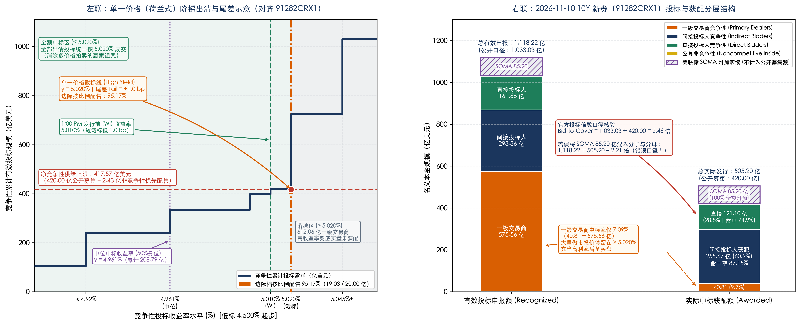
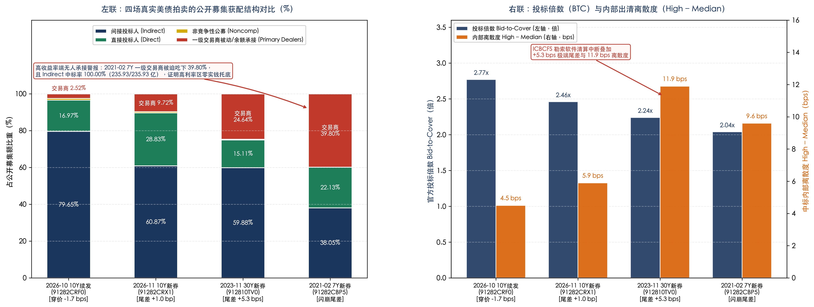

# 07｜国债拍卖：发行机制与结果表

> **系列总览：** 《从国债到宏观：利率研究课》｜阶段 B：国债市场如何运转（07/30）  
> **研究问题：** 美国财政部如何通过单一价格拍卖将单场数百亿美元的新增债务注入市场？为何把 SOMA 混入投标倍数会扭曲需求判断，而高收益率与发行前收益率的偏差（尾差）又如何在数分钟内重塑二级市场定价？  
> **先备知识：** 承接[第 01 讲](./01_固定收益地图_债券与现金流契约.md)至[第 06 讲](./06_凸性_曲线风险与对冲直觉.md)（契约要素、折现定价、应计利息与 DV01）。

---

## 一、从“单券定价”走向“一级发行”：拍卖的四阶段时序与两轨通道

在阶段 A（第 01–06 讲）中，我们始终站在二级市场投资者的视角审视一只已经存在的美国国债，默认票息率 $c$、面值与到期日都是事先写定的静态参数。但在现实金融体系里，这些条款并非凭空产生——每一只市场化国债（Marketable Treasury Security）都在财政部的一级市场拍卖（Treasury Auction）中完成初始数量发现与价格发现，随后才进入全球二级市场流转。

支撑每年数万亿美元美债持续发行的底层准则，是财政部“规律且可预期（Regular and Predictable）”的发行制度与《统一发行通告》（31 CFR Part 356）<sup>[1]</sup>。一笔标准国债从酝酿到资金入库严格经过四个时间节点，并在投标受理上切分为两条互不交叉的物理通道。

### 表 1：美国国债一级拍卖四阶段标准时序与制度约束（31 CFR Part 356）

| 拍卖阶段 | 标准美东时间节点（ET） | 核心参与主体与系统通道 | 关键规则与现金流/风险边界 |
| :--- | :--- | :--- | :--- |
| **1. 发行公告与 WI 开启** | T − 3 至 T − 6 个工作日（如周四公告次周发行） | 财政部发布 Offering Announcement；二级市场开启发行前交易 | 锁定本次公开募集总额（Offering Amount）、CUSIP、交割日、到期日及（若属续发）NLP 豁免额度 |
| **2. 非竞争性投标截标** | Bills 11:00 AM；Notes/Bonds/TIPS 12:00 PM | 个人零售账户（TreasuryDirect）、部分FIMA及小型机构通道 | 仅报面值金额、不报价格；单户上限 **1,000 万美元** （直接到期再投资除外），100% 保证全额中标 |
| **3. 竞争性投标截标** | Bills 11:30 AM；Notes/Bonds/TIPS 1:00 PM | 一级交易商、直接机构投资者、间接客户（通过 TAAPS 系统） | 申报利率精确至小数点后 **3 位** （Notes/Bonds/FRNs 最小步长 0.001%，Bills 最小步长 0.005%）；受 35% 规则封顶 |
| **4. 结果公布与交割入账** | 截标后约 2–5 分钟披露 Result；数日后 Issue Date 交割 | 商业簿记系统（CBES）与美联储 TGA 一般账户 | 买方交付清洁价加应计利息（含 SOMA 到期滚续部分）；新发券按截标高收益率向下取整锁定票息率 |

上述两轨通道在法律权限与风险暴露上存在严格边界，读懂拍卖表之前必须先拆清三条硬性红线（31 CFR §§ 356.12–356.13）<sup>[1]</sup>：

* **非竞争性投标（Noncompetitive Bids）：保证中标但禁止投机对冲。** 非竞争性投标人只需填写认购面值（最低 **100 美元** 、按 100 美元整数倍递增，单场常规上限 **1,000 万美元** ，该上限于 2022 年 8 月由 500 万美元上调至现行标准），即可在公开募集额度内获得 **100% 优先配售** ，成交价统一适用后续竞争性环节拍出的高收益率（对零息 Bills 则适用高贴现率）<sup>[1]</sup>。作为交换条件，31 CFR § 356.12 明确禁止同一主体在同场拍卖中兼报竞争性投标，亦禁止非竞争性投标人在截标前持有该券的发行前（WI）、期货或远期合约头寸。
* **竞争性投标（Competitive Bids）与最小申报步长：** 机构买家在 TAAPS 系统中既申报面值规模，也明确写出自己愿意接受的最低价格对应利率。附息国债（Notes/Bonds）报到期收益率、TIPS 报真实收益率、FRNs 报贴现利差（Discount Margin），三者均精确至 3 位小数、最小步长 **0.001%** （即 0.1 bp）；短期国库券（T-Bills）则按银行贴现率报价，精确至 3 位小数但最小步长规定为 **0.005%** （即 0.5 bp）。
* **35% 单一买家上限与净多头头寸（NLP）规则：** 为防止单一大型金融机构垄断新券筹码从而在回购或二级市场制造逼空（Squeeze），31 CFR § 356.13 规定单一竞争性投标人在同场拍卖中在任意单一利率档位的最高有效申报（Maximum Recognized Bid）及最终总获配上限，均为 **公开募集总额的 35%** <sup>[1]</sup>。若投标人的报价总额加上其在当期债券上的净多头头寸（Net Long Position, NLP，涵盖现券持仓、WI 多头与空头、期货净多头等）达到或超过该 35% 门槛，则必须在投标时如实申报 NLP，其最大可获配额度将被强制扣减 NLP 敞口：

$$\text{Max Award}_{i} = 0.35 \times Q_{\text{off}} - \max\left(0, \ \text{NLP}_{i}\right)$$

在既有老券的 **续发（Reopening）** 拍卖中，已持有老券的资管机构与做市商天然携带存量多头。若不加调整直接套用上式，老券持有人将被迫丧失再次参与续发竞标的资格。为此，31 CFR § 356.13(d) 引入了 **续发净多头豁免额度（NLP Exclusion Amount）** ——允许投标人选择性从其存量同 CUSIP 持仓（含对应本金 STRIPS）中扣除官方公布的豁免额，仅把超出豁免额的存量与 WI 头寸计入 NLP 扣减项，从而在不破坏集中度上限的前提下维系续发流动性<sup>[1]</sup>。

---

## 二、单一价格（荷兰式）出清引擎：边际截标、按比例配售与票息锁定

### 1. 为何全面转向“单一价格”拍卖？

历史上美国财政部曾长期对多数附息债采用 **多价格拍卖（Multiple-Price / Discriminatory Auction）** ——每位中标者按自己所报的收益率分别付款，报价越激进（收益率越低、价格越高）的买家付出的成本越昂贵。然而，这种机制制造了严重的 **赢家诅咒（Winner's Curse）** ：你报得比别人更激进才能抢到筹码，事后却立即发现自己买在了全场最高价格上，账面从交割前就开始浮亏。为规避赢家诅咒，投标人只能刻意压低出价、互相试探甚至抱团串谋。

自 1992 年 9 月起，美国财政部在 2 年期与 5 年期国债上启动单一价格拍卖实验，并在验证能够吸引更多非交易商实钱买家直接入场后，于 **1998 年 11 月** 将全部市场化美债品种统一切换为 **单一价格拍卖（Single-Price / Uniform-Price Auction，国内常简称荷兰式拍卖）** <sup>[2]</sup>。

在现行单一价格机制下，所有在截标点之内获配的中标者（以及全部非竞争性投标人），不论原本申报的收益率有多低， **最终统一按照边际截标高收益率（High Yield / Stop-Out Rate）的同一个价格完成结算** 。

### 2. 出清方程、按比例配售与 1/8% 票息锁定算法

将上述法律条文翻译成可执行的一级市场出清算法，只需四个严密步骤：

* **第一步：计算净竞争性供给额度** （$Q_{\text{comp}}$）  
  公开募集额 $Q_{\text{off}}$ 首先全额满足所有合格的公开非竞争性投标 $Q_{\text{nc, inside}}$（注意：美联储 SOMA 账户的到期滚续通常作为额外附加额度加在 $Q_{\text{off}}$ 之上，不挤占竞争性配额），余下部分才是竞争性机构争抢的额度：

$$Q_{\text{comp}} = Q_{\text{off}} - Q_{\text{nc, inside}}$$

* **第二步：按收益率由低到高（即价格由高到低）排队出清**  
  财政部系统将所有有效竞争性投标按申报收益率升序排列 $y_1 < y_2 < \dots < y_M$，依次累计申报规模 $B(y_k)$，直至累计申报首次覆盖或超过 $Q_{\text{comp}}$，该边际档位收益率即为本场拍卖的 **最高中标收益率（High Yield）** $y_{\text{high}}$：

$$\sum_{y_k < y_{\text{high}}} B(y_k) < Q_{\text{comp}} \le \sum_{y_k \le y_{\text{high}}} B(y_k)$$

* **第三步：边际档按比例配售系数（Allotted at High Yield Percentage）**  
  所有报价严格低于 $y_{\text{high}}$ 的投标 **100% 全额中标** ；而在截标边界 $y_{\text{high}}$ 上，剩余未分配的额度往往小于该档位上的全部申报量 $B(y_{\text{high}})$，所有站在该档位的投标人按同一比例 $\alpha_{\text{high}}$ 切分额度（按 100 美元最小发行面值舍入微调）：

$$\alpha_{\text{high}} = \frac{Q_{\text{comp}} - \sum_{y_k < y_{\text{high}}} B(y_k)}{B(y_{\text{high}})}$$

* **第四步：锁定票息率与结算价格（31 CFR § 356.20 及 Appendix B）**  
  对 **新发（New Issue）** 固定票息 Notes/Bonds 或 TIPS，在 $y_{\text{high}}$ 敲定的一瞬间，财政部依据“八分之一百分点规则”将票息率 $c$ 设定为不高于 $y_{\text{high}}$ 且最接近的 0.125% 整数倍（法定下限为 0.125%）<sup>[1]</sup>；而对 **续发（Reopening）** 债券，票息率早已在首次发行时永久锁定，拍卖仅据此 $c$ 与新的 $y_{\text{high}}$ 反算当日折价或溢价净价：

$$c = \max\left(0.125\%, \ \left\lfloor \frac{y_{\text{high}}}{0.125\%} \right\rfloor \times 0.125\%\right)$$

为直观演示这一微观出清流程，表 2 基于 **2026 年 11 月 10 日拍卖的 10 年期新发基准国债（CUSIP: 91282CRX1）** <sup>[3]</sup> 公开募集与净竞争性供给额度（公开募集 **420.00 亿美元** ，公募非竞争性 **2.42641 亿美元** ，余下净竞争性供给 **417.57359 亿美元** ），构建了一张 6 档位仿真投标簿：

### 表 2：单一价格拍卖出清仿真演练（净竞争性供给对齐 91282CRX1 口径 417.57 亿美元）

| 投标利率档位（%） | 档位经济含义（对照真实拍卖统计点） | 单档申报额（亿美元） | 累计申报额（亿美元） | 出清后获配额（亿美元） | 档位中标率 | 实际结算收益率与定价归属 |
| :--- | :--- | ---: | ---: | ---: | ---: | :--- |
| **4.500–4.920** | 低收益率激进买盘（含 5% 分位低标 4.500%） | 105.00 | 105.00 | 105.00 | 100.00% | 统一按 5.020% 结算（多赚利差保护） |
| **4.961** | 中位水准档位（全中标池 50% 分位线穿过该档） | 135.00 | 240.00 | 135.00 | 100.00% | 统一按 5.020% 结算 |
| **5.000** | 整数票息心理关口买盘 | 95.00 | 335.00 | 95.00 | 100.00% | 统一按 5.020% 结算 |
| **5.010** | 1:00 PM 截标前发行前市场（WI）一致报价档 | 63.54 | 398.54 | 63.54 | 100.00% | 统一按 5.020% 结算 |
| **5.020** | **边际截标高收益率档（High Yield / Stop-Out）** | **20.00** | **418.54** | **19.03** | **95.17%** | **截标边际档：余下 19.03 亿按 95.17% 配售** |
| **5.045–5.080** | 高收益率之外的做市商兜底防线报价 | 612.06 | 1,030.60 | 0.00 | 0.00% | **全部落选（未获配但计入公开有效申报总额）** |

图 1 左联把表 2 的阶梯出清机制画成累计需求曲线，右联则进一步把整场 **91282CRX1** 拍卖的真实申报与获配总额拆解成四类机构身份与央行附加盘。



*(图注：左联展示 91282CRX1 对齐口径下的单一价格阶梯需求曲线与供给线在 5.020% 处交汇，低于 5.020% 的全额中标者均享有 5.020% 的统一高收益率结算；右联完整对账该场拍卖 1,118.22 亿美元总有效申报与 505.20 亿美元总发行额度，明晰 SOMA 85.20 亿美元外置附加对投标倍数 2.46 倍的计算边界。)*

---

## 三、逐行解剖一份原始财政部拍卖结果表：从 91282CRX1 到续发周期 91282CRF0

在财政部新闻稿发布后的几十秒内，行情终端弹出的短评通常只播报“高收益率、尾差与投标倍数”三个碎片数字。要真正把结果表变成买方资产负债表与资金流向的透视镜，必须逐行拆解一份原汁原味的官方结果通告（Treasury Auction Results Press Release）。

表 3 逐字核对了 2026 年 11 月 10 日拍卖的 **10 年期新发基准国债 91282CRX1** （官方公告文号 R_20261110_1.pdf）的全部核心字段<sup>[3]</sup>：

### 表 3：2026 年 11 月 10 日 10 年期基准国债（CUSIP: 91282CRX1）官方拍卖结果明细表

| 官方结果字段 | 官方披露数值（金额单位：美元，比率除外） | 口径定义与底层勾稽逻辑解析 |
| :--- | :--- | :--- |
| **Security Term / CUSIP** | 10-Year Note / 91282CRX1 | 2026 年 11 月季末再融资（Q4 Refunding）新发 10 年期标杆债券 |
| **Dated Date / Issue / Maturity** | 2026-11-15 / 2026-11-16 / 2036-11-15 | 11 月 15 日适逢周日，交割顺延至周一 16 日，起息后多走 1 天形成 1 天应计利息 |
| **Offering Amount（公开募集额）** | 42,000,000,000 | 面向市场公开招标的目标发行额；竞标者单户 35% 上限（147.00 亿）以此为基数 |
| **Interest Rate（锁定年票息率）** | **5.000%** | 截标高收益率 5.020% 按 1/8% 规则向下取整至 5.000% |
| **High / Median / Low Yield** | **5.020%** / 4.961% / 4.500% | 边际截标 5.020%；中标池 50% 分位 4.961%；5% 极端低标门槛 4.500% |
| **Allotted at High** | **95.17%** | 报在 5.020% 截标线上的竞争性投标最终获得了 95.17% 的比例配售 |
| **High Price / Accrued Interest** | **99.843952** / 0.13812（每 1,000 美元面值） | 按 5.000% 票息、5.020% 收益率及 $1/181$ 零头期按 31 CFR Part 356 算得清洁价与 AI |
| **Inside Noncompetitive（公募非竞争）** | 242,641,000（全部获配） | 含财政部直购零售 6,981.80 万、间接非竞争 1.72823 亿、FIMA 0 |
| **Competitive（公开竞争性总额）** | 申报 103,060,038,000 / 获配 41,757,418,700 | 公开总额 420 亿扣减 2.42641 亿非竞争后的净竞争余量（按 100 美元整数舍入微调） |
| **Primary Dealers（一级交易商竞争）** | 申报 57,556,000,000 / 获配 4,080,513,500 | 中标率仅 **7.09%** ，最终仅吃下 420 亿公开募集额的 **9.72%** |
| **Direct Bidders（直接投标人竞争）** | 申报 16,167,600,000 / 获配 12,109,950,200 | 中标率高达 **74.90%** ，吃下公开募集额的 **28.83%** |
| **Indirect Bidders（间接投标人竞争）** | 申报 29,336,438,000 / 获配 25,566,955,000 | 中标率高达 **87.15%** ，加上 1.73 亿非竞争后是核心买方主力（纯竞争占 **60.87%** ） |
| **Public Subtotal（公开口径合计）** | 申报 103,302,679,000 / 获配 42,000,059,700 | 官方投标倍数 **Bid-to-Cover = 2.46** （＝ 103,302,679,000 ÷ 42,000,059,700） |
| **SOMA（美联储非竞争性附加滚续）** | 申报 8,519,558,500 / 获配 8,519,558,500 | 按同日到期 SOMA 本金比例 **全额附加** 在 420 亿公开募集额之外，不摊薄公开配额 |
| **Grand Total（全口径总发行量）** | 申报 111,822,237,500 / 获配 50,519,618,200 | 本期新发最终记入商业簿记与 SOMA 账户的总面值规模为 505.20 亿美元 |

围绕表 3 里的官方字段，日常研究中最容易踩中以下四个真实体制细节：

### 1. SOMA 附加滚续与官方 Bid-to-Cover 的除数陷阱

2025 年 10 月末，联邦公开市场委员会（FOMC）正式决定自 **2025 年 12 月 1 日** 起结束资产负债表缩表（QT），指令纽约联储公开市场交易台在国债拍卖中将到期的 SOMA 国债本金 **100% 通过非竞争性附加投标全额滚续** （同时将到期的机构债/MBS 本金转投国库券）<sup>[4]</sup>。

当 SOMA 持有的一批老券在交割日（如 2026 年 11 月 16 日）集中到期时，美联储不会单边偏爱某一只期限，而是严格按照当日同结算日各新发附息债的 **公开募集额比例** ，把到期本金等比例切分作为 **外置附加项（Add-On / Outside of Offering Amount）** <sup>[5]</sup>：
* 2026 年 11 月 15/16 日，SOMA 到期附息国债共计 **25,355,828,900 美元** （约 253.56 亿美元）；
* 同于 11 月 16 日交割的季末再融资三期公募新券合计 **1,250 亿美元** ：3 年期 91282CRW3（580 亿美元）、10 年期 91282CRX1（420 亿美元）、30 年期 912810UY2（250 亿美元），SOMA 等比例滚续系数为 $253.558289 / 1,250 = 20.284663\%$；
* 按该比例（并向 100 美元最小发行单位取整）分摊后，三只债券分别获得 SOMA 非竞争性附加配售 **11,765,104,700 美元** （3Y）、**8,519,558,500 美元** （10Y）与 **5,071,165,700 美元** （30Y）——三者精确相加恰好等于 **25,355,828,900 美元** 。

这也彻底解释了一个初学时极易算错的勾稽细节：若直接用表 3 最底行的全口径总申报除以总获配，得到的是错误的 $111,822,237,500 / 50,519,618,200 = 2.21$；而财政部官方通报的 **Bid-to-Cover = 2.46** ，分子与分母均 **严格剔除了 SOMA 附加盘** （$103,302,679,000 / 42,000,059,700 = 2.4596$），仅反映公开市场主体对 420 亿美元真实承销额度的认购倍数<sup>[3]</sup>。

### 2. Low Yield、Median Yield 与 31 CFR 356 简单零头折现价

表 3 中的 Low Yield（4.500%）与 Median Yield（4.961%）并非全场所有申报单的均值或最低值，而是在 **已中标竞争性配额池** （表 3 中的 417.57 亿美元）内部，按收益率从低到高排序后累计获配规模分别跨过 **5% 门槛（Low Yield Threshold）** 与 **50% 门槛（Median Yield Threshold）** 时的收益率水位<sup>[3]</sup>——设置 5% 门槛正是为了过滤个别机构“防错价”报出的极低异常数字，使其不至于污染需求分布的可信度。

此外，在 91282CRX1 结算价格 **99.843952** 与每千元应计利息 **0.13812 美元** 的后台精算中，财政部严格执行第 03 讲揭示的 **31 CFR Part 356 Appendix B 首个短付息周期单利折现法则** ：由于 11 月 15 日起息日适逢周日、资金于 16 日交割，首段付息周期 2026-11-15 至 2027-05-15 共 $E = 181$ 天、已过去 $A = 1$ 天、剩余 $r = 180$ 天（$v = 180/181$）。财政部将该券在首个付息日 2027-05-15 的未来 20 期本息总现值（按半年贴现率 $i = 5.020\% / 2 = 2.510\%$ 折现至该日）先算出来，再对首段非完整半年的零头 $v$ **按单利因子** $1 + v \cdot i$ **折现**至 11 月 16 日，并减去 1 天的应计利息 $2.500 \times (1 / 181) = 0.013812$ 美元/百元，算得清洁价恰好等于 **99.843952** （若误用复利折现 $(1 + i)^v$，则会算出错误的 99.844119）。

### 3. 三类竞争性投标主体的制度身份与认知误区

面对一级交易商、直接投标人与间接投标人的拆解数据，市场快讯常把 Indirect Bidders 简单翻译成“海外央行”，这是严重误读。三类主体的法定口径与交易行为特征截然不同<sup>[6]</sup>：

* **Primary Dealers（一级交易商，截至 2026 年 11 月共 25 家）：** 由纽约联储指定的官方核心做市商对手方（2026 年 1 月 15 日新增 MUFG Securities Americas Inc.，同年 10 月 16 日 NatWest Markets Securities Inc. 退出后现存 **25 家** <sup>[5]</sup>）。他们负有“在每场国债拍卖中按合理市场价格主动报价参与并承托流动性”的做市义务。但在平常拍卖里，交易商往往把大量报价挂在高于市场价的保护性高收益率档位充当后备防线——例如表 3 中他们申报了 575.56 亿美元，却只有 **7.09%** 命中、仅接盘公开募集额的 **9.72%** ；反过来说，一旦真需求退潮，一级交易商就会成为被动兜底的余额吸收器（Residual Absorber），其获配占比的跳升比单纯看投标倍数更能反映卖压沉重。
* **Direct Bidders（直接投标人）：** 不通过一级交易商、而是以自身 TAAPS 直连账户向财政部递交标书的非交易商机构买家（包括大型公募资管、养老金、保险公司、自营机构及少数开通直连的外国官方机构）。表 3 中直接投标人中标率高达 **74.90%** ，拿下公开募集的 **28.83%** ，说明该部分买盘出价贴近甚至低于 WI 市价，属于主动拿货配置型资金。
* **Indirect Bidders（间接投标人）：** 通过一级交易商、托管银行或经纪商代为递交投标的客户买盘，既包含**海外央行与主权财富基金（经由纽约联储 FIMA 托管或国际银行转报）**，也囊括了大量**国内对冲基金、共同基金与企业财资账户**通过做市商通道下达的买单。因此，拍卖日当天 1:03 PM 看到的 Indirect 占比上升只能确认“终端客户与代理渠道承接强”，至于买盘究竟来自海外官方机构还是美国本土公募/对冲基金，必须等待财政部按半月/月度滞后发布的《投资者类别拍卖配售报告》（*Investor Class Auction Allotments*）才能完成最终归因核实<sup>[6]</sup>。

### 4. 一只 10 年期国债的三次拍卖生命周期：以阶段 A 基准标本 91282CRF0 为例

回到阶段 A（第 02–06 讲）一直沿用的 **2026 年 8 月版 10 年期基准国债（CUSIP: 91282CRF0，2036 年 8 月 15 日到期，合同年票息率 4.625%）** ，它在 2026 年 8 月新发后，又于 9 月和 10 月经历了两次标准续发（Reopenings），成为透视单只 CUSIP 如何长成千亿美元流动性池的最佳样本<sup>[7]</sup>：

### 表 4：阶段 A 基准标本 91282CRF0（2036-08-15 到期，4.625% 票息）三次拍卖全周期演化（单位：亿美元，价格/收益率除外）

| 拍卖批次与披露文件 | 公开募集额 | 高收益率（%） | 投标倍数 | 一级交易商占比（%） | 清洁价（美元/百元） | 每千元应计利息（美元） | NLP 豁免额 | SOMA 附加 | 单场总发行 |
| :--- | ---: | ---: | ---: | ---: | ---: | ---: | ---: | ---: | ---: |
| **首发新券** （2026-08-12 / R_20260812_2） | 420.00 | 4.683 | 2.53 | 8.57 | **99.540696** | 0.25136 | 0.00 | 106.24 | **526.24** |
| **一次续发** （2026-09-09 / R_20260909_2） | 390.00 | 4.834 | 2.71 | 4.30 | **98.361116** | 3.89606 | 147.00 | 0.00 | **390.00** |
| **二次续发** （2026-10-07 / R_20261007_2） | 390.00 | **5.300** | **2.77** | **2.52** | **94.864261** | 7.66644 | 284.00 | 9.26 | **399.26** |

表 4 清晰展示了同一条法律契约在一级与二级市场间的连续耦合：三次拍卖把 **91282CRF0** 这一只 CUSIP 的存续流通规模推升至 **1,315.50 亿美元**，却始终复用同一组本息日历——合同票息率固定在 **4.625%** 一动不动，而随着利率从 8 月的 4.683% 上行至 10 月的 5.300% ，加上距离起息日累计了 61 天（$61/184$ 周期），10 月续发买家只需按 **94.864261 美元**的深折价购入，同时垫付 **7.66644 美元/千元**的应计利息；与此同时，财政部将其续发 NLP 豁免额顺次放大至 147 亿与 **284 亿美元**，保障原有老仓位买家能顺畅参与 10 月续发并把交易商接盘比例压低至 **2.52%** 。

---

## 四、读懂交易台真正的胜负手：发行前市场（WI）、尾差（Tail）与多维证伪框架

如果只读财政部结果公告，你看到的只是一场**闭合内部投票**的静态切片；交易台真正用来判断拍卖冷暖与瞬时价格冲击的实时标尺，在于把拍卖结果与截标前最后一秒的**发行前市场（When-Issued, WI）** 进行横向碰撞。

### 1. WI 远期定价与“尾差 / 穿价”的美元冲击

从财政部 T − 5 个工作日公布发售公告开始，二级市场便同步开启该尚未交割证券的远期合约报价，称为发行前交易（When-Issued Market）。在 1:00 PM（或 Bills 的 11:30 AM）竞标截止前的最后几秒钟，屏幕上跳动的 **WI 收益率** （$y_{\text{WI}}$）凝结了全市场交易台对该新发券此时此刻愿意交易的 **一致公允价格预期** 。将官方拍出的高收益率 $y_{\text{high}}$ 与截标瞬间 $y_{\text{WI}}$ 作差（乘以 100 换算为基点 bps），即得一级市场核心信号：

$$\text{Tail / Stop-Through (bps)} = \left(y_{\text{high}} - y_{\text{WI, close}}\right) \times 100$$

* **尾差** （Tail，$y_{\text{high}} > y_{\text{WI, close}}$） **：** 说明按预期市价收到的买单不足以消化全部供给，财政部被迫“往下弯腰”接受更低价格（更高收益率）的投标才完成出清——供给压过了截标前的市场预期。在表 3 的 2026-11-10 10Y 拍卖中，截标前 WI 报 **5.010%** <sup>[8]</sup>，而最终 High Yield 落在 **5.020%** ，产生 + **1.0 bp 尾差** 。按该券百元面值 0.0778 美元/10 bps 对应的 1 bp 价格折让算，420 亿美元公开新券相当于刚诞生即以低于盘前预期约 **3,268 万美元** 的价格成交。
* **穿价** （Stopped Through，$y_{\text{high}} < y_{\text{WI, close}}$） **：** 说明抢筹买单过于踊跃，未等到达 WI 报价线就把全部供给抢购一空。例如表 4 的 2026-10-07 10Y 二次续发中，盘前 WI 报 **5.317%** ，拍卖却在 **5.300%** 就提前截标，实现 − **1.7 bps 穿价（Stopped Through 1.7 bps）** ——此前提前做空 WI 等待拍卖砸盘接货的交易商被迫在二级市场紧急回补空头，反而进一步推动美债走强。

### 2. 四场历史与当代拍卖的多维交叉诊断（严禁单一指标断案）

绝不能把“高投标倍数 ＝ 拍卖很强”或“出现尾差 ＝ 无人买美债”当成机械公式。表 5 与图 2 并列对比了 2026 年两次分化明显的 10 年期拍卖，以及两场载入联储市场微观结构研究报告的极端拍卖事件—— **2021 年 2 月 25 日 7 年期新券（91282CBP5）** 与 **2023 年 11 月 9 日 30 年期新券（912810TV0）** ：

### 表 5：四场典型美债拍卖多维需求与结构诊断对比表（占公开募集比重 %，离散度 bps）

| 拍卖日期与债券标本 | 公开募集额（亿美元） | 尾差 / 穿价（vs. WI） | 官方投标倍数 | 内部离散度（High − Median） | 间接投标人占比 / 命中率 | 直接投标人占比 / 命中率 | 一级交易商占比 / 命中率 | 综合诊断结论 |
| :--- | ---: | :--- | ---: | ---: | :--- | :--- | :--- | :--- |
| **2026-10-07 10Y（91282CRF0）** <sup>[7]</sup> | 390.00 | **穿价 −1.7 bps** （WI 5.317%） | **2.77** | 4.5 bps | **79.65%** / 77.65% | 16.97% / 44.56% | **2.52%** / 1.86% | 强势实钱抢筹：外围机构买走八成筹码，交易商几乎空手而归 |
| **2026-11-10 10Y（91282CRX1）** <sup>[3]</sup> | 420.00 | **尾差 +1.0 bp** （WI 5.010%） | **2.46** | 5.9 bps | 60.87% / 87.15% | **28.83%** / 74.90% | 9.72% / 7.09% | 温和偏软但未失控：直接投标人承接扎实，交易商配售低于 10% |
| **2023-11-09 30Y（912810TV0）** <sup>[10]</sup> | 240.00 | **尾差 +5.3 bps** （WI 4.716%） | **2.24** | **11.9 bps** | 59.88% / 91.95% | 15.11% / 52.46% | **24.64%** / 19.05% | 渠道与承接双重受阻：恰逢 ICBCFS 勒索攻击清算中断，交易商扛走近 1/4 |
| **2021-02-25 7Y（91282CBP5）** <sup>[9]</sup> | 620.00 | **闪崩大尾差** | **2.04** | **9.6 bps** | **38.05%** / **100.00%** | 22.13% / 73.96% | **39.80%** / 29.16% | 显著流动性真空警报：间接买家仅抢到 38% 且 100% 命中，高利率端完全靠交易商托底 |



*(图注：左联清晰展示四场拍卖从左到右一二级买方接力断层——一级交易商被迫吃下的供给占比从 2.52% 阶梯式攀升至 39.80%；右联揭示投标倍数从 2.77x 滑落至 2.04x 之际，反映内部投标断层的离散度 High − Median 从 4.5 bps 骤扩至 9.6–11.9 bps。)*

### 3. 竞标失效时的三种竞争性解释：实钱退潮、资产负债表挤兑还是清算管道故障？

当交易员看到一场 **High − Median 离散度飙升且交易商被迫吃下 25%–40% 份额**的糟糕拍卖（如表 5 后两行）时，宏观策略上存在至少**三种截然不同的竞争性归因假说**，必须借助结果表之外的高频成交与清算证据加以区分<sup>[8][9][10]</sup>：

1. **假说 A：长期结构性买家退潮（基本面与期限溢价重定价）。**  
   如果拍卖走弱伴随长期通胀数据超预期或财政赤字供给展望上调，且在拍卖后一小时乃至数周内收益率持续走高不回头，同时海外官方托管与长期养老金配售占比在随后披露的 Investor Class 报告中同步下滑，则支持长期需求不足与期限溢价上升的结构性解释。
2. **假说 B：交易时段流动性挤兑与交易商风险预算耗尽（微观结构失衡）。**  
   以 2021 年 2 月 25 日 **7 年期国债 91282CBP5** 为典型样本<sup>[9]</sup>：结果表中 Indirect Bidders 申报与获配均为 **235.9288 亿美元** （ **100.00% 命中率** ）——这意味着并非所有投标都被甩在后头，而是在市场高收益率一侧**没有任何间接客户挂着备用限价买单**！随着当时美债早盘急跌触发 MBS 负凸性对冲抛压（回顾第 06 讲），高频做市商与二级市场交易深度瞬间枯竭，一级交易商被迫扛下 **39.80%** （246.79 亿美元）7 年期新券并随即在 1:00 PM 后恐慌抛售对冲，引发全市场短时闪崩；但随着机构逢高重新接盘，流动性在一个多小时内逐步恢复。
3. **假说 C：清算基础设施或操作管道故障（外生摩擦冲击）。**  
   以 2023 年 11 月 9 日 **30 年期国债 912810TV0** 拍卖为例<sup>[10]</sup>：该场拍卖爆出 **+5.3 bps 极端尾差** 、内部离散度达 **11.9 bps** ，一级交易商吃下 **24.64%** 。但事后复盘发现，当天恰逢为众多美债参与者提供清算与托管代理的核心节点之一——工银金融服务（ICBCFS）遭遇勒索软件攻击、被迫切断系统与人工逐笔结算，导致部分交易台在融资回购与交割链路受阻下不敢轻易在拍卖窗口满额报单。单靠结果表数字本身无法区分“假说 A 的需求崩塌”与“假说 C 的管道故障”，必须交叉核验当天 Repo 清算延迟、代客交割失败率（Settlement Fails）与次日价格是否迅速回吐尾差。

### 4. 单一拍卖指标的四大失效边界

* **边界一：Bid-to-Cover 对发行规模与非交易商结构高度钝感。** 一级交易商只要在远离市价的高利率档位虚挂巨额防线标书，就可以在不真金白银拿货的前提下轻松刷高投标倍数；反之，在续发或规模暴增周期中，哪怕实际实钱购买规模绝对值增加，投标倍数作为比值仍可能因分母扩张而下降。
* **边界二：WI 未能覆盖跨时间窗口的突发性事件。** 尾差衡量的是“截标最终瞬间拍卖 vs. 二级 WI”的相对偏差，若截标前 30 分钟刚发布超预期 CPI 导致 WI 本身已先行暴涨 15 bps，此时即便零尾差收官，也绝不代表债券需求健康。
* **边界三：制度规则变迁破坏跨十年历史可比性。** 将今天单一价格体制、25 家一级交易商、1,000 万美元非竞争性上限及 100% SOMA 滚续的指标水平，与 1998 年前多价格拍卖时期或 2022–2025 年缩表上限期的数值做直接均值对比，会因体制机制切换产生误导。
* **边界四：当期 Indirect 占比不等于实时外资流向。** 若对冲基金和境内资管集中改变下单渠道（从 Direct 直连转向通过做市商 Indirect 代理下单，或反向切换），Direct 与 Indirect 份额就会发生此消彼长的“通道迁移”，而真实终端投资者结构并未变化。

---

## 五、最小可运行 Python 复现脚本

以下代码使用 Python 标准库精确复现：2026-11-10 10 年期基准国债（91282CRX1）单价格出清及 WI 尾差美元冲击、31 CFR Part 356 四只真实国债标本的 6 位小数官方发行清洁价与应计利息、2026 年 11 月再融资 SOMA 滚续按比例切分恒等式，以及五场真实拍卖的严格 Ex-SOMA 官方投标倍数核算：

```python
from datetime import date

def calc_treasury_356_price(coupon_pct, yield_pct, dated_d, issue_d, next_coupon_d, total_coupons):
    """按 31 CFR Part 356 Appendix B 单利零头期法则精确复算美债发行清洁价与应计利息"""
    E = (next_coupon_d - dated_d).days
    A = (issue_d - dated_d).days
    r = (next_coupon_d - issue_d).days
    v = r / E
    i = (yield_pct / 100.0) / 2.0
    half_c = 100.0 * (coupon_pct / 100.0) / 2.0

    pv_at_first = half_c + sum(half_c / ((1.0 + i) ** k) for k in range(1, total_coupons))
    pv_at_first += 100.0 / ((1.0 + i) ** (total_coupons - 1))

    dirty = pv_at_first / (1.0 + v * i)   # 首个不足整期采用单利贴现 (1 + v * i)
    ai_100 = half_c * (A / E)
    clean = dirty - ai_100
    return round(clean, 6), round(ai_100 * 10.0, 5), E, A, r

print("=== 1. 31 CFR Part 356 真实发行价与应计利息精确核验 ===")
specimens = [
    ("91282CRX1 (2026-11 10Y新发)", 5.000, 5.020, date(2026,11,15), date(2026,11,16), date(2027,5,15), 20, 99.843952),
    ("912810UY2 (2026-11 30Y新发)", 5.375, 5.441, date(2026,11,15), date(2026,11,16), date(2027,5,15), 60, 99.028979),
    ("91282CRF0 (2026-08 10Y新发)", 4.625, 4.683, date(2026,8,15),  date(2026,8,17),  date(2027,2,15), 20, 99.540696),
    ("91282CRF0 (2026-09 10Y续发)", 4.625, 4.834, date(2026,8,15),  date(2026,9,15),  date(2027,2,15), 20, 98.361116),
    ("91282CRF0 (2026-10 10Y续发)", 4.625, 5.300, date(2026,8,15),  date(2026,10,15), date(2027,2,15), 20, 94.864261),
]
for name, c, y, dd, iss, ncp, n, official in specimens:
    clean, ai1000, E, A, r = calc_treasury_356_price(c, y, dd, iss, ncp, n)
    print(f"  {name:27s}: 复算净价={clean:.6f} (官方={official:.6f}) | AI/1000={ai1000:.5f} (A={A}/E={E})")

cl_wi, _, _, _, _ = calc_treasury_356_price(5.000, 5.010, date(2026,11,15), date(2026,11,16), date(2027,5,15), 20)
cl_hi, _, _, _, _ = calc_treasury_356_price(5.000, 5.020, date(2026,11,15), date(2026,11,16), date(2027,5,15), 20)
tail_usd = (cl_wi - cl_hi) / 100.0 * 42_000_000_000
print(f"\n=== 2. 91282CRX1 +1.0 bp 尾差 (5.010% -> 5.020%) 美元折价冲击 ===")
print(f"  WI清洁价={cl_wi:.6f} vs 截标清洁价={cl_hi:.6f} | 全场420亿美元隐含折让=${tail_usd:,.0f}")

print("\n=== 3. 2026-11-16 美联储 SOMA 到期滚续按公募比例切分核验 ===")
soma_maturing = 25_355_828_900
offerings_nov16 = [("3Y 91282CRW3", 580e8, 11_765_104_700), ("10Y 91282CRX1", 420e8, 8_519_558_500), ("30Y 912810UY2", 250e8, 5_071_165_700)]
tot_off = sum(x[1] for x in offerings_nov16)
for label, off, off_soma in offerings_nov16:
    theo = soma_maturing * (off / tot_off)
    print(f"  {label:14s}: 理论比例={theo:,.2f} | 官方实际获配={off_soma:,} (按100美元面值微调)")
print(f"  三券实际 SOMA 获配加总 = {sum(x[2] for x in offerings_nov16):,} (严格等于到期SOMA本金 {soma_maturing:,})")

print("\n=== 4. 剔除 SOMA 后的官方 Bid-to-Cover 与多场投标人占比核验 ===")
auctions = [
    ("2026-11-10 10Y (91282CRX1)", 103_302_679_000, 42_000_059_700, 8_519_558_500, 4_080_513_500, 25_566_955_000, 29_336_438_000),
    ("2026-11-12 30Y (912810UY2)", 59_046_096_200,  25_000_011_800, 5_071_165_700, 2_840_322_500, 16_987_621_000, 18_865_621_000),
    ("2026-10-07 10Y (91282CRF0)", 108_068_999_700, 39_000_031_700, 926_290_200,   984_000_000,   31_063_238_000, 40_006_206_000),
    ("2023-11-09 30Y (912810TV0)", 53_668_077_100,  24_000_017_100, 456_715_300,   5_912_940_000, 14_371_980_000, 15_630_980_000),
    ("2021-02-25 7Y  (91282CBP5)", 126_776_035_400, 62_000_025_400, 13_431_124_300,24_678_990_000,23_592_880_000, 23_592_880_000),
]
for label, p_rec, p_awd, soma_a, pd_a, ind_a, ind_r in auctions:
    btc_off = p_rec / p_awd
    btc_naive = (p_rec + soma_a) / (p_awd + soma_a)
    print(f"  {label:27s}: Ex-SOMA BTC={btc_off:.2f} (误含SOMA={btc_naive:.2f}) | 交易商占比={pd_a/p_awd*100:.2f}% | Indirect命中={ind_a/ind_r*100:.2f}%")
```

---

## 六、本讲小结与下一讲预告

* **1. 单一价格拍卖（1998 年起全面实施）与双轨规则：** 所有市场化国债均按非竞争性（单户上限 1,000 万美元、100% 优待）和竞争性（0.001% 或 Bills 0.005% 报价、35% 上限并扣减净多头 NLP）双轨进场，截标点以下按同一边际高收益率 $y_{\text{high}}$ 结算，并通过 $1/8\%$ 向下取整锁定新发券票息率。
* **2. 读懂官方结果表的底线在于剔除口径混淆：** 美联储 SOMA 到期滚续按公募规模等比例附加在公开募集额之外，官方 Bid-to-Cover 严格仅统计公开市场部分（91282CRX1 为 2.46 倍，而非混入 SOMA 后的 2.21 倍）；且 Indirect Bidders 并非单一“海外央行”同义词。
* **3. 单一指标不能代表需求全貌，交叉诊断才能识别危机根源：** 必须联合审视**对 WI 的尾差/穿价、内部离散度（High − Median）、一级交易商余额承接比重及 Indirect 命中率**，并在“基本面实钱退潮、日内负凸性流动性挤兑、结算清算故障”三类竞争性假设中做出证据区分。

搞清楚一张国债如何在 1:00 PM 一级市场完成造币与初始分配之后，更庞大的问题紧随而来——**一级交易商在拍卖中拿到的筹码如何进入二级市场、怎样通过电子做市平台 BrokerTec 与客户场外市场向全球流通？为什么高风险危机到来时新券（On-the-Run）与老券（Off-the-Run）的买卖价差与流动性会瞬间撕裂？**

下一讲，我们继续深入阶段 B，进入 **第 08 讲《一级交易商、做市与二级市场流动性》** 。

---

### 静默附注（Silent Notes）

* **官方数字精度与最小发行单位取整：** 财政部拍卖结果表中的公开竞争性加非竞争性实际获配总额常比目标 Offering Amount 多出数万美元（例如 91282CRX1 公布为 42,000,059,700 美元、多出 59,700 美元），这是边际截标档（95.17%）各竞标账户按 **100 美元最小发行倍数** （31 CFR § 356.20）就近舍入的正常法定误差；同样，2026-11-16 30Y 912810UY2 的 SOMA 理论分摊值为 5,071,165,780 美元，向下按 100 美元取整后实际配售 5,071,165,700 美元。
* **历史与实时数据源截止口径：** 本文所用 2026 年 8–11 月国债拍卖样本与 SOMA 滚续政策截止至 **2026 年 11 月末最新官方披露** ；各单券投标明细均已通过美国财政部 Fiscal Data API 与 TreasuryDirect TA_WS 一手 XML/JSON 原文件校验。

### 一手信源链接
* [1] U.S. Department of the Treasury, *Uniform Offering Circular: Sale and Issue of Marketable Book-Entry Treasury Bills, Notes, and Bonds (31 CFR Part 356, §§ 356.12, 356.13, 356.20 & Appendix B)*: https://www.ecfr.gov/current/title-31/subtitle-B/chapter-II/subchapter-A/part-356
* [2] Kenneth D. Garbade & Jeffrey F. Ingber, *The Treasury Auction Process: Objectives, Structure, and Recent Adaptations*, Federal Reserve Bank of New York Current Issues in Economics and Finance, February 2005: https://www.newyorkfed.org/research/current_issues/ci11-2.html
* [3] U.S. Department of the Treasury, *10-Year Treasury Note Auction Results (CUSIP 91282CRX1, November 10, 2026, Press Release R_20261110_1.pdf & XML)*: https://www.treasurydirect.gov/instit/annceresult/press/preanre/2026/R_20261110_1.pdf
* [4] Board of Governors of the Federal Reserve System, *FOMC Decisions Regarding Monetary Policy Implementation (Balance Sheet Runoff Conclusion Effective December 1, 2025 & Treasury Rollover)*: https://www.federalreserve.gov/monetarypolicy/fomccalendars.htm
* [5] Federal Reserve Bank of New York, *System Open Market Account (SOMA) Treasury Rollover Operational Policy & Primary Dealers List*: https://www.newyorkfed.org/markets/primarydealers
* [6] U.S. Department of the Treasury, *Investor Class Auction Allotments (Marketable Treasury Coupon & Bill Securities)*: https://home.treasury.gov/data/investor-class-auction-allotments
* [7] U.S. Department of the Treasury, *10-Year Treasury Note Lifecycle Results (CUSIP 91282CRF0: Initial Issue Aug 12, Sep 9 & Oct 7, 2026 Reopenings)*: https://www.treasurydirect.gov/auctions/auction-query/
* [8] Michael J. Fleming, *Treasury Auction Demand and Secondary Market Functioning*, Federal Reserve Bank of New York Research & Liberty Street Economics: https://www.newyorkfed.org/research/economics-and-finance
* [9] U.S. Department of the Treasury & Federal Reserve Board, *7-Year Note Auction Results (CUSIP 91282CBP5, February 25, 2021) & FEDS Notes on February 25, 2021 Flash Event*: https://www.federalreserve.gov/econres/notes/feds-notes/
* [10] U.S. Department of the Treasury, *30-Year Bond Auction Results (CUSIP 912810TV0, November 9, 2023) & Market Clearing Incident Disclosures*: https://www.treasurydirect.gov/auctions/auction-query/
* [11] U.S. Department of the Treasury Fiscal Data API, *Treasury Securities Auctions Data (912810UY2, 91282CRW3, 912797WB9)*: https://api.fiscaldata.treasury.gov/services/api/fiscal_service/v1/accounting/od/auctions_query

---

## 附：阶段自测练习与完整推导解析

> **自学检验建议：** 本附录包含 4 道一级市场拍卖机制与结果表核算题（难度递进）。请先独立手算或编写脚本核对，再对照下方解析逐项验证。

### 练习题

1. **【单一价格出清、按比例配售与票息锁定手算】** 假设美国财政部新发一只 5 年期中期国债（T-Note），公告公开募集总额（Offering Amount）为 **600.00 亿美元** 。截标后统计：合格的公开非竞争性投标为 **8.00 亿美元** ；竞争性有效投标按收益率从低到高共汇集了 5 个整数档位——4.820% 档申报 120.00 亿美元、4.835% 档申报 180.00 亿美元、4.850% 档申报 210.00 亿美元、4.862% 档申报 200.00 亿美元、4.890% 档申报 672.00 亿美元（SOMA 本期无滚续）。求：（1）净竞争性可分配额度 $Q_{\text{comp}}$ 是多少？（2）本场拍卖的最高中标收益率（High Yield）$y_{\text{high}}$ 与边际按比例配售百分比（Allotted at High）分别是多少？（3）各档位中标者最终按哪个收益率付款，这只新券的合同年票息率 $c$ 应锁定为多少？（4）本场拍卖的官方投标倍数（Bid-to-Cover）是多少？
2. **【2026-11-12 30 年期国债 912810UY2 结果表穿透与口径辨析】** 查阅 2026 年 11 月 12 日拍卖的 30 年期新发国债 912810UY2 真实官方记录<sup>[11]</sup>：公开募集额 25,000,000,000 美元（与同周 3 年期 580 亿美元、10 年期 420 亿美元同于 11 月 16 日交割），高收益率 **5.441%** ，公开非竞争性中标 59,875,200 美元，公开竞争性总申报 58,986,221,000 美元（实际获配 24,940,136,600 美元，其中一级交易商获配 2,840,322,500 美元），同日 SOMA 附加滚续非竞争性获配 **5,071,165,700 美元** 。求：（1）若某财经新闻误把 SOMA 50.71 亿美元一并塞入分子与分母计算 Bid-to-Cover，会算出多少？严格按财政部口径剔除 SOMA 后的官方 Bid-to-Cover 是多少？（2）按 1/8% 规则，这只 30 年期新券的合同票息率应是多少？（3）一级交易商占本场公开募集获配总额（25,000,011,800 美元）的比重是多少，能否仅凭该数字断定是“长期资金还是流动性危机”？
3. **【31 CFR § 356.13 续发净多头豁免额度（NLP Exclusion）合规限额计算】** 某宏观对冲基金计划参与 2026 年 10 月 7 日 10 年期续发国债（91282CRF0，公开募集额 **390.00 亿美元** ，35% 单一买家限额及 NLP 报告门槛为 **136.50 亿美元** ，官方公告续发 NLP 豁免额度为 **284.00 亿美元** <sup>[7]</sup>）。假定该基金在截标时刻账户内已持有 8 月/9 月发行的 91282CRF0 存量老券 **320.00 亿美元** ，同时在发行前（WI）市场上做多了 **25.00 亿美元** 该券；此时该基金拟以 5.290% 收益率提交一笔 **60.00 亿美元** 的竞争性标书。求：（1）该基金是否必须向财政部申报净多头头寸（NLP）？（2）在启用官方 284.00 亿美元续发豁免后，其须申报的净多头敞口与剩余最高可获配额度各是多少，这笔 60.00 亿美元标书能否全额获得有效确认（Recognized）？（3）若未设续发豁免条款，该基金最高可获配额度会变成多少？
4. **【30 年期国债尾差的清洁价损失与 31 CFR Appendix B 单利零头复算】** 续第 2 题，已知 2026-11-12 拍卖的 30 年期国债 912810UY2<sup>[11]</sup>：合同票息率 5.375%，起息日 2026-11-15，交割日 2026-11-16，首个付息日 2027-05-15（首期完整周期 $E = 181$ 天，已计息 $A = 1$ 天，剩余 $r = 180$ 天，此后尚有 59 个完整半年期，总计 $N = 60$ 期）。截标瞬间 30 年期 WI 收益率为 **5.437%** ，而最终拍卖截标在 **5.441%** （尾差 +0.4 bp）。求：（1）按 31 CFR Part 356 Appendix B 单利零头法，分别算出 5.437%（WI 基准）与 5.441%（官方高收益率）对应的百元清洁价（均保留 6 位小数）及每千元应计利息（保留 5 位小数）；（2）对于某机构在该场拍卖中中标的 **5,000 万美元面值** 头寸而言，+0.4 bp 的尾差相对于截标前 WI 市价相当于少花了多少美元成本（即拍卖价较 WI 折让多少）？

---

### 参考答案与推导解析

* **1. 【解析：单一价格出清、按比例配售与票息锁定】**
  * **（1）净竞争性可分配额度：**  
    $Q_{\text{comp}} = 600.00 - 8.00$ ＝ **592.00 亿美元** 。
  * **（2）最高中标收益率与按比例配售系数：**  
    沿收益率升序累加：至 4.820% 累计 120.00 亿；至 4.835% 累计 300.00 亿；至 4.850% 累计 510.00 亿（仍低于 592.00 亿，差额 592.00 − 510.00 ＝ **82.00 亿美元** ）；进入 **4.862%** 档（申报 200.00 亿美元）后累计达 710.00 亿，首次跨过 592.00 亿。故 High Yield ＝ **4.862%** ，边际配售比例 $\alpha_{\text{high}} = 82.00 / 200.00$ ＝ **41.00%** 。
  * **（3）统一成交价与票息锁定：**  
    全部中标者（含 4.820%–4.850% 全部及 4.862% 的 41%）以及 8.00 亿非竞争性买盘，均统一按照 $y_{\text{high}}$ ＝ **4.862%** 折算成交价；按 1/8%（0.125%）向下取整，$4.862\% / 0.125\% = 38.896$，向下取整数 **38** ，故年票息率 $c = 38 \times 0.125\%$ ＝ **4.750%** 。
  * **（4）官方投标倍数：**  
    公开有效总申报 ＝ $8.00 + (120 + 180 + 210 + 200 + 672) = 8.00 + 1,382.00$ ＝ **1,390.00 亿美元** ；Bid-to-Cover $= 1,390.00 / 600.00$ ＝ **2.32 倍** （精确值 2.3167）。

* **2. 【解析：912810UY2 结果表口径对比】**
  * **（1）误含 SOMA vs. 官方剔除口径：**  
    公开口径总申报 $= 58,986,221,000 + 59,875,200 = 59,046,096,200$ 美元，公开口径总获配 $= 24,940,136,600 + 59,875,200 = 25,000,011,800$ 美元，官方 **Bid-to-Cover** $= 59,046,096,200 / 25,000,011,800$ ＝ **2.36 倍** （2.3618）<sup>[11]</sup>；若误把 SOMA 5,071,165,700 美元分别加入分子和分母，会算出错误结果 $64,117,261,900 / 30,071,177,500$ ＝ **2.13 倍** （低估公开市场认购意愿 0.23 倍）。
  * **（2）合同票息率：**  
    $5.441\% / 0.125\% = 43.528$，向下取整至 43 倍 0.125% 即得年票息率 **5.375%** （与表 3 同周公告一致）。
  * **（3）一级交易商比重与定性边界：**  
    一级交易商获配占比 $= 2,840,322,500 / 25,000,011,800$ ＝ **11.36%** ；这仅说明交易商承接了略高于一成的份额、需求较 10 月显著转淡，远不足以单独判定发生了流动性危机（当时 30Y 尾差仅 +0.4 bp，仍处于正常做市接盘波动带）。

* **3. 【解析：31 CFR § 356.13 续发净多头豁免算例】**
  * **（1）是否触发 NLP 申报义务：**  
    启用 284.00 亿美元续发豁免后，剩余多头敞口与拟投 60.00 亿美元标书之和为 **121.00 亿美元** ；由于 121.00 亿低于 136.50 亿美元法定报告门槛，该基金在本次 60.00 亿竞标规模下不触发强制 NLP 报告（若其将拟投标书加码至 ≥ 75.50 亿使合计跨过 136.50 亿，则须正式填报 NLP）。
  * **（2）启用续发豁免后的净敞口与可用额度：**  
    老券存量 320.00 亿减去官方豁免 284.00 亿后，须计入的超额存量为 **36.00 亿美元** ；加上 25.00 亿 WI 多头，最终折算净多头敞口 $\text{NLP} = 36.00 + 25.00$ ＝ **61.00 亿美元** 。依据 35% 规则，剩余最高可获配额度 $= 136.50 - 61.00$ ＝ **75.50 亿美元** 。由于 **60.00 亿 ≤ 75.50 亿** ，这笔 60.00 亿美元标书 **可以 100% 获有效确认** 。
  * **（3）无续发豁免条款的情形：**  
    若无豁免机制，该基金净多头达 345.00 亿美元，早已突破 136.50 亿上限，最高可获配额度降为 **0 美元** （彻底被剥夺竞标权）。

* **4. 【解析：30 年期国债 912810UY2 尾差价差与 31 CFR 单利零头精算】**
  * **（1）WI 基准与官方高收益率精确折现对账：**  
    每期固定半年票息 $100 \times 5.375\% / 2$ ＝ **2.6875 美元** ；首期剩余比重 $v = 180 / 181$ 。  
    在官方高收益率 **5.441%** （半年利率 $i = 2.7205\%$ ）下，2027-05-15 日的未来 60 期本息折现总值先按标准半年复利算得 **101.737694 美元** ，再按单利因子 $1 + (180/181) \times 0.027205 = 1.027055$ 折回 11 月 16 日得全价 **99.043827 美元** ；减去 1 天应计利息 $\text{AI}_{100} = 2.6875 \times (1 / 181)$ ＝ **0.014848 美元** （即每千元 **0.14848 美元** ），得官方净价 **99.028979 美元** （与财政部披露精确吻合）。  
    同法代入 WI 收益率 **5.437%** （$i = 2.7185\%$ ），算得净价 **99.087401 美元** 。
  * **（2）5,000 万美元中标头寸的尾差折让：**  
    单百元面值价格差 $= 99.087401 - 99.028979$ ＝ **0.058422 美元** ；对于 5,000 万美元（即 50 万份百元面值）头寸而言，+0.4 bp 尾差使中标买方比截标前 WI 市价少付现金 $500,000 \times 0.058422$ ＝ **29,210.92 美元** 。
