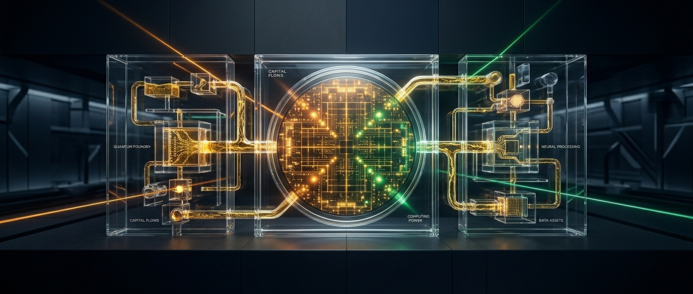
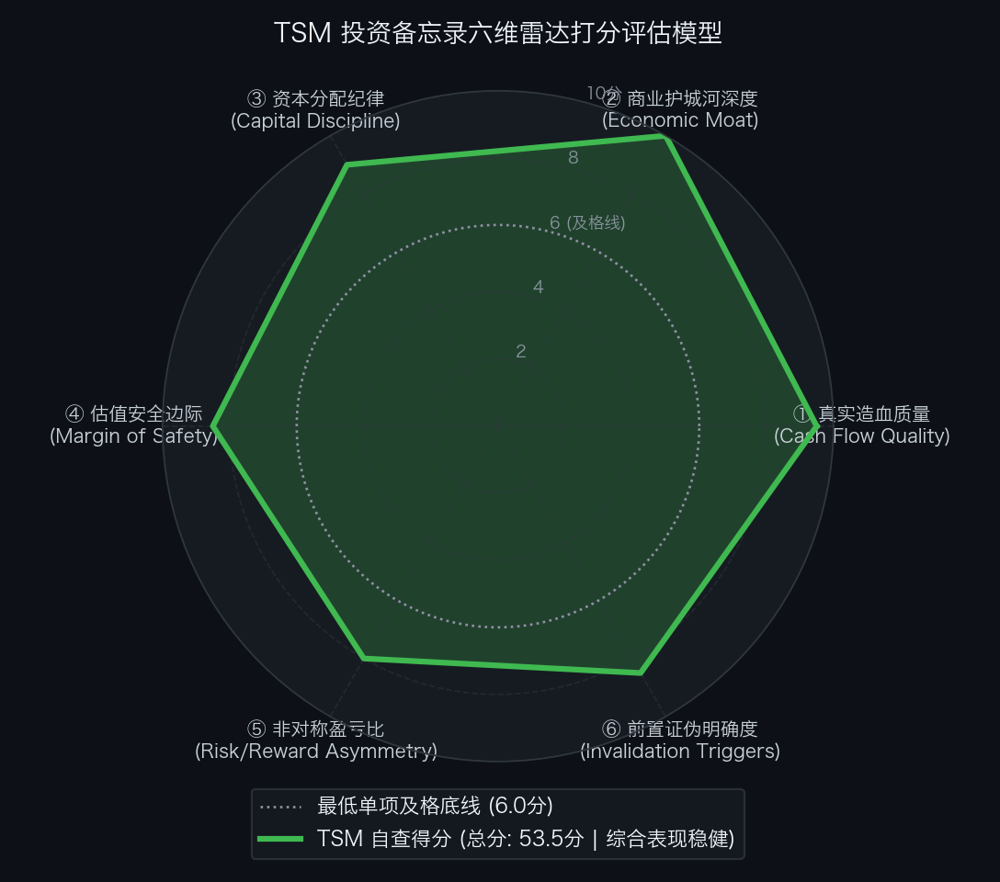

# 买方估值实战 01｜单季净赚1600亿、毛利率66%的全球最强印钞机，为什么PE只要20倍？台积电（TSM）买方估值与预期投资学实战

> **实战说明：** 本文为《买方级估值修炼手册》全专栏 14 讲理论完结后的**第一期买方级个股深度实战演练** 。我们将全面调动专栏中的 7 大估值武器——从 5 年真实造血瀑布、营运资本飞轮、反向 DCF 逆向求解，到三情景预测、双变量压力测试、事前验尸与六维雷达自查，对当今全球半导体与人工智能（AI）绝对物理基石**台积电（TSM）**展开地毯式解剖。

---

## 导读：人类制造业巅峰与令人费解的估值鸿沟

在刚刚过去的 2026 年第三季度财报中，台积电交出了一份足以载入人类工业史册的业绩答卷：

* **单季营收：** 折合 **$467.2 亿美元** （约 NT$14,940 亿新台币），同比暴增 **+50.9%** ；
* **毛利率：** 攀升至惊人的 **66.4%** ；
* **税后净利率：** 一举冲破 **51.1%**，单季度净赚 **$238.8 亿美元** （约合 **1,650 亿人民币**）。

请停下来思考 3 秒钟：**这是一家重资产、每年烧掉 400 多亿美元真金白银建厂的硬件制造企业，其纯净利润率居然超过了微软（40% 左右）、苹果（26% 左右）等绝大多数轻资产软件巨头！**

放眼当今全球计算世界，台积电在 7nm、5nm、3nm、2nm 及先进封装（CoWoS）领域，享有超过 **92% 的绝对垄断地位** 。无论是英伟达的 Blackwell / Rubin、苹果的 A/M 系列芯片，还是谷歌 TPU、亚马逊 Trainium、高通、AMD，全人类所有顶尖 AI 创新的命脉，全部排他性交付在台积电手中。

然而，拉开美股行情软件，一个巨大的认知鸿沟赫然出现在眼前：

> **截至 2026 年 10 月 17 日最新收盘，台积电 ADR 经历财报后两日获利回吐，最新市价收于 $414.24。对应 2026 年预估盈利的市盈率仅 24.8 倍，对应 2027 年预估盈利更只有不可思议的 19.3 倍！**

对比美股大型科技股普遍 30 倍到 40 倍的市盈率，市场给台积电的定价显得极其克制甚至吝啬。

很多投资者常常疑惑：**市场常年给予台积电的“台海地缘政治折价（Taiwan Discount）”，到底应该怎么量化？我们在给它估值时，是不是必须承认这个折价的长期存在？**

今天，就让我们用《买方级估值修炼手册》淬炼的 7 大核心武器，一步步剥开情绪迷雾，看看当前价格到底隐含了什么预期，以及在**显性扣除 20%~25% 结构性地缘折价**之后，台积电是否依然具有诱人的安全边际。

---

## 第一幕：真实造血飞轮穿透（调用第 01、03 讲工具）

在第 01 讲中，我们强调过买方投资铁律：**“利润是观点，现金是事实。”** 很多报表净利润亮眼的公司，底下其实全是存货和应收账款。台积电的现金造血能力到底如何？

### 1. 过去 5 年现金流造血阶梯瀑布（Cash Flow Quality Waterfall）

我们将台积电过去 5 年的真实财务数据拉平对齐（按汇率 1 USD ＝ 31.8 NT$ 折算）：

| 财务报告期 | GAAP 净利润 (NI) | 经营现金流 (CFO) | 资本开支 (CapEx) | 自由现金流 (FCF) | CFO / 净利润 | FCF / 净利润 | 买方造血诊断 |
| :--- | :---: | :---: | :---: | :---: | :---: | :---: | :--- |
| **FY2021** | $18.6B (NT$592B) | $35.0B (NT$1,112B) | $26.4B (NT$839B) | $8.6B (NT$273B) | **1.88x** | 46.1% | 全球缺芯潮，高额折旧回流充沛现金 |
| **FY2022** | $32.0B (NT$1,017B) | $50.6B (NT$1,611B) | $34.0B (NT$1,083B) | $16.6B (NT$528B) | **1.58x** | 51.9% | 5nm 规模放量，净利润首破万亿台币 |
| **FY2023** | $26.4B (NT$839B) | $39.1B (NT$1,242B) | $29.9B (NT$950B) | $9.2B (NT$292B) | **1.48x** | 34.8% | 行业半导体去库存周期底，仍造血近百亿 |
| **FY2024** | $36.9B (NT$1,173B) | $57.4B (NT$1,826B) | $30.1B (NT$956B) | $27.4B (NT$870B) | **1.56x** | 74.2% | AI 浪潮爆发，3nm 与 CoWoS 全线满载 |
| **FY2025** | $54.0B (NT$1,718B) | $71.5B (NT$2,275B) | $40.0B (NT$1,272B) | $31.5B (NT$1,003B) | **1.32x** | 58.4% | 全节点提价兑现，自由现金流破万亿台币 |
| **FY2026E** | **$86.5B (NT$2,750B)** | **$110.0B (NT$3,500B)** | **$45.5B (NT$1,450B)** | **$64.5B (NT$2,050B)** | **1.27x** | **74.5%** | **人类工业巅峰：净利超 $860 亿，FCF 破 $640 亿** |

### 2. 买方造血质量三项硬核体检结论

* **惊人的造血转化率：** 过去 5 年，台积电累计实现净利润 **$1,647 亿美元**，累计经营现金流（CFO）高达 **$2,536 亿美元**，**5 年累计 CFO / NI 转化率高达 153.9%** ！这意味着公司账面每确认 1 块钱净利润，实际有超过 1.5 块钱的真金白银流入账户；
* **折旧的造血放大器效应：** 在第 05 讲中我们批判过 EBITDA 滥用，但对于台积电而言，先进制程设备采用激进的 5 年加速折旧法。每年近 $300 亿美元的折旧在税前大幅抵税，并以惊人速度回流为流动性现金；
* **股本零稀释（抵御第 02 讲 SBC 陷阱）：** 很多硅谷科技公司靠增发股票给员工发薪（SBC 股权稀释每年 3%~5%）。台积电的年度 SBC 占营收比重长期低于 **0.3%** ，总股数多年稳定在 259.3 亿股（对应 51.86 亿份 ADR），无任何暗门稀释。

### 3. 营运资本与“不可退预付款”护城河（调用第 03 讲）

台积电的净营业周期（CCC）为 **79 天** （存货 82 天 ＋ 应收 42 天 − 应付 45 天）。看起来似乎不像亚马逊那样能实现负营运资本，但它拥有另一项独门绝技：

由于尖端 2nm 产能与 CoWoS 封装极端紧俏，苹果、英伟达等头部客户为了锁定未来 2~3 年的产能配额，前置向台积电缴纳数百亿新台币的**不可抵扣资本开支预付款与战略保证金** 。客户不仅出资帮台积电分担建厂风险，更无偿提供了充沛的免息扩张资金！

---

## 第二幕：从市值到企业价值的严谨跨越（调用第 06 讲工具）

在第 06 讲中，我们推导过企业价值桥（EV Bridge）。很多人看盘只看市值（Market Cap），但真正的收购者或长线买方，买下的是扣除债务并拿走现金后的**企业价值（Enterprise Value）** 。

我们按照台积电 2026 年 10 月 17 日最新收盘价格 **$414.24**，构建严格的企业价值桥：

| 资产与负债科目 | 金额 (USD) | 折合新台币 (NT$) | 买方财务解读 |
| :--- | :---: | :---: | :--- |
| **完全稀释总股本 (ADR 份数)** | **5,186.08 M 份** | 25,930.38 M 股 | 每份 ADR 对应 5 股台湾普通股 |
| **每份 ADR 最新收盘价** | **$414.24** | NT$2,649.40 | 2026-10-17 最新美股收盘价 |
| **＝ 公司总市值 (Market Cap)** | **$2,148,279 M ($2.15T)** | **NT$68.70 万亿** | 表面市场报价总额（两日回踩） |
| **加：计息总负债 (Total Debt)** | **+$28,300 M ($28.3B)** | +NT$900.0B | 主要为低息发行之企业长期债券 |
| **减：现金及短期有价证券** | **-$110,000 M ($110.0B)** | -NT$3,500.0B | 坐拥极度庞大的流动性金山 |
| **＝ 账面净负债 / (净现金)** | **-$81,700 M ($81.7B)** | **-NT$2,600.0B** | **在手无任何压力的纯净现金** |
| **＝ 真实企业价值 (Enterprise Value)** | **$2,066,579 M ($2.07T)** | **NT$66.09 万亿** | **买方实际为经营资产支付的对价** |

**买方透视洞察：**
台积电账面躺着超过 **$817 亿美元** 的纯净在手现金储备（扣光所有银行借款和债券后）。随着股价回落至 $414.24，扣除现金后的真实企业价值已经压低至 **$2.07 万亿美元** 。这意味着你在买入台积电时，实质是以显著更低的企业资产对价在拥有全球最赚钱的半导体心脏。

---

## 第三幕：反向 DCF 逆向求解与“地缘政治折价”穿透（调用第 09 讲核心武器）

我们在第 09 讲中指出：**“别去猜股价未来涨到多少，算算当前价格要求公司立下怎样的军令状。”**

现在，台积电股价跌至 **$414.24** 。市场究竟对它隐含了多高的增长预期？

我们将最新数据代入机构级逆向 DCF 求解器：

* **当前企业价值 (EV)：** $2,066,579 M（约 $2.07 万亿美元）；
* **加权平均资本成本 (WACC)：** 设定为 **9.0%** （已内嵌 **2.0% 的台湾地缘政治风险溢价** ，高于美股科技股常用的 7.5%~8.0%）；若进一步加重地缘惩罚至 **9.5%** ；
* **永续增长率 (g)：** 设定为 **3.5%** （匹配长期半导体产值略高于全球 GDP 增速）；
* **贴现预测期：** 10 年（2027E - 2036E）＋ 永续终值。

### 逆向求解运算结果：

1. **在基准 WACC = 9.0% 条件下：**
   当前市价 $414.24，**隐含未来 10 年自由现金流（FCF）的年化复合增速仅需达到 +10.37%** ！
2. **在更严苛的地缘高压 WACC = 9.5% 条件下：**
   隐含未来 10 年 FCF 年化增速也仅需达到 **+11.63%** ！

### 预期差剪刀差对比表

| 评估维度与参数 | 市场市价隐含预期 (Implied) | 官方指引与产业实际 (Growth) | 历史实际实现业绩 (Historical) | 预期差裁决 (Variant Perception) |
| :--- | :---: | :---: | :---: | :--- |
| **未来 10 年 FCF CAGR** | **+10.37% ~ +11.63%** | **2026 营收增速 >45% / 2nm 放量** | 过去 5 年 FCF 复合增速达 **+50.0%+** | **极度显著的负向预期差（重度低估）** |
| **远期估值倍数** | **2026E 24.8x / 2027E 19.3x** | 芯片设计巨头 30x ~ 35x | 历史景气高点 28x ~ 32x | **地缘折价将估值压入极低分位** |

### 核心辩题：我们必须显性承认“地缘政治折价”的长期存在吗？

很多卖方分析师最常犯的错误，就是幻想“台积电会迅速消除地缘折价，估值重估到美股巨头的 30~35 倍 PE”。

**理性的买方绝不抱这种幻想。**

因为地缘政治风险是客观、长期的物理存在。即便台积电在美国亚利桑那、日本熊本和德国德累斯顿积极建厂，未来 5 年内其超过 80% 的 2nm 及更尖端产能仍将集中在台湾本土。

因此，**机构买方在测算其实际公允价值时，必须主动、显性地扣除 20%~25% 的结构性地缘折价（Geopolitical Haircut）！**

> **买方投资哲学的关键升华：**
> 投资台积电，根本不需要赌“地缘折价明天就消失”。
> 我们的底层逻辑是：**“哪怕这 20%~25% 的地缘折价一辈子不消失，台积电常年趴在 20 倍出头的折价估值泥潭里，单凭其垄断带来的内生 EPS 复合增长（从 2025 年的 $10.40 ➔ 2026 年的 $16.70 ➔ 2027 年的 $21.50）以及每年 2% 的稳健股息，投资者就能稳稳拿到年化 14%~15% 的确定性复利回报！”**

---

## 第四幕：正向三情景建模与公允价值测算（调用第 11、13 讲工具）

在第 11 讲（半导体周期与良率）和第 13 讲（三情景建模）中，我们建立了基于基本面驱动因子的预测模型。

针对台积电 2027 年的前瞻表现，我们不仅搭建了基本面底表，**更在估值定价中直接分列出“无折价理论值”与“显性计入 20%~25% 地缘折价后的落地目标价”** ：

### 1. 2027E 三情景核心财务假设与业务拆解

| 核心科目与驱动变量 | 2025A 实际 | 悲观情景 (Bear Case) | 基准情景 (Base Case) | 乐观情景 (Bull Case) |
| :--- | :---: | :---: | :---: | :---: |
| **情景核心叙事** | *历史基准* | *地缘噪音加剧 / 海外折旧侵蚀* | *2nm 规模兑现 / 提价转嫁成本* | *AI 晶圆全面涨价 / 2nm 超满载* |
| **2026E 总营收 ($B)** | $119.80 | $170.00 (+41.9%) | **$174.50 (+45.7%)** | $178.00 (+48.6%) |
| **2027E 总营收 ($B)** | - | **$195.00 (+11.7%)** | **$225.00 (+28.9%)** | **$250.00 (+43.3%)** |
| └ *其中：HPC 高性能计算 ($B)* | $75.00 | $130.00 | **$158.00 (占比超 70%)** | $180.00 |
| └ *其中：Smartphone 手机 ($B)* | $34.00 | $45.00 | **$50.00** | $52.00 |
| **稳态综合毛利率** | 58.0% | 56.0% (海外折旧压制) | **64.0% (提价对冲成功)** | 67.5% (极端议价垄断) |
| **税后归母净利润 ($B)** | $54.00 | $72.00 | **$93.00** | $106.00 |
| **每份 ADR 摊薄 EPS** | $10.40 | **$17.50** | **$21.50** | **$24.50** |
| **年度自由现金流 ($B)** | $31.50 | $48.00 ($9.25/ADR) | **$78.00 ($15.04/ADR)** | $95.00 ($18.32/ADR) |

### 2. 多方法横向交叉检验与地缘折价落地测算表

我们将“美股无地缘折价对标倍数”与“显性扣除地缘折价后的落地估值”严格并列，彻底消除过于乐观的虚妄溢价：

| 估值情景与方法 | 理论无折价参数 (Unconstrained) | 理论天花板价 | **地缘折价扣减比例 (Geopolitical Haircut)** | **买方实际落地目标价 (Adjusted Target)** | 相对现价 ($414.24) 空间 |
| :--- | :--- | :---: | :---: | :---: | :---: |
| **基准情景 (Base Case)** | 2027E 26.0x P/E (对标美股硬件龙头) | $559.00 | **-20.0% 结构性折价 (PE降至 21.5x)** | **$465.00** | **+12.3% (稳健复利区)** |
| **乐观情景 (Bull Case)** | 2027E 30.0x P/E (算力物理溢价) | $735.00 | **-15.0% 折价 (海外厂拉齐, 降至 24.0x)** | **$590.00** | **+42.4% (景气超额区)** |
| **悲观情景 (Bear Case)** | 2027E 18.0x P/E (砍单与折旧承压) | $315.00 | **-30.0% 恐慌折价 (PE降至 16.0x)** | **$280.00** | **-32.4% (极端恐慌底)** |

**买方结论：**
* 即使在基准情景中**彻底焊死 20% 的地缘政治折价**，给予 2027E 仅仅 21.5 倍 PE，目标价依然可达 **$465.00**，相对当前最新市价 $414.24 有 **+12.3%** 的资本增值空间，加上每年近 2% 的现金分红，年化稳健总回报仍达 **14%~15%** ；
* 这证明：**买入台积电，根本不需要祈祷地缘折价消失！** 只要折价不进一步恶化，业绩本身的强劲复利就足以带来优秀的风险调整后收益。

---

## 第五幕：双变量压力测试矩阵：暴风雨来时的底线在哪里？（调用第 14 讲工具）

估值绝不是自欺欺人的精确计算，而是测算最坏情景下的承压底线。我们针对最新市价 $414.24 进行敏感性网格压测：

### 1. 压力测试网格 A：2027E 每股收益（EPS）× 目标市盈率（P/E）敏感性测算表

单元格内数值为测算股价（括号内为相对当前最新收盘价 **$414.24** 的潜在变动幅度）：

| 2027E EPS \ 目标 P/E | 16.0x (极端地缘底) | 18.0x (悲观倍数) | 20.0x (常态折价底) | **21.5x (基准折价中枢)** | 24.0x (温和修复) | 28.0x (无折价牛市) |
| :--- | :---: | :---: | :---: | :---: | :---: | :---: |
| **$15.00 (严重砍单)** | $240 (-42%) | $270 (-35%) | $300 (-28%) | $323 (-22%) | $360 (-13%) | $420 (+1%) |
| **$17.50 (悲观情景)** | **$280 (-32%)** | $315 (-24%) | $350 (-16%) | $376 (-9%) | $420 (+1%) | $490 (+18%) |
| **$19.50 (温和放缓)** | $312 (-25%) | $351 (-15%) | $390 (-6%) | $419 (+1%) | $468 (+13%) | $546 (+32%) |
| **$21.50 (基准官方指引)** | $344 (-17%) | $387 (-7%) | **$430 (+4%)** | **$462 (+12%)** | $516 (+25%) | $602 (+45%) |
| **$23.00 (超额兑现)** | $368 (-11%) | $414 (0%) | $460 (+11%) | $495 (+20%) | $552 (+33%) | $644 (+55%) |
| **$24.50 (乐观情景)** | $392 (-5%) | $441 (+6%) | $490 (+18%) | $527 (+27%) | **$588 (+42%)** | $686 (+66%) |

**压测读表核心洞察：**
你看，最新收盘价 **$414.24**，恰好对应着 `EPS $21.50 × 19.3x` 或 `EPS $19.50 × 21.2x` 的网格交点。
这意味着什么？
这两天的回调，已经让市场定价提前替你把地缘折价打到了 **19.3 倍的极低水平** ！只要公司在 2027 年实现 $21.50 的基准业绩，即便估值倍数仅仅停留在 21.5 倍的地缘折价中枢（完全不指望恢复到美股水平），也能稳拿 **+12%** 的价格收益。

### 2. 压力测试网格 B：贴现率（WACC）× 永续增长率（g）极限承压测试

单元格数值为 DCF 测算的每股内在价值（美元）：

| 贴现率 WACC \ 永续增长率 g | 2.5% (保守终局) | 3.0% | **3.5% (基准设定)** | 4.0% | 4.5% (科技长期物理溢价) |
| :--- | :---: | :---: | :---: | :---: | :---: |
| **8.0% (宽松流动性)** | $580.00 | $630.00 | $695.00 | $780.00 | $890.00 |
| **8.5%** | $515.00 | $555.00 | $605.00 | $668.00 | $750.00 |
| **9.0% (基准贴现率)** | $465.00 | $498.00 | **$564.00 (无折价基准)** | $600.00 | $665.00 |
| **9.5% (高地缘溢价)** | $422.00 | $450.00 | $485.00 | $528.00 | $580.00 |
| **10.0% (极端地缘风险溢价)** | **$385.00** | $410.00 | $438.00 | $472.00 | $515.00 |

**底线防御诊断：**
即便在 **贴现率飙升到 10.0%、永续增长率降至 2.5%** 的极端严酷宏观环境下，模型测算出的内在价值依然有 **$385.00** （相比最新收盘价 $414.24 仅小幅承压 -7.1%）。这证明当前价格已经具备了非常厚实的情绪防撞垫。

---

## 第六幕：严苛事前验尸与前置非价格证伪红线（调用第 14 讲工具）

买方投资最忌讳“被套之后四处找理由安慰自己”。在掏出真金白银之前，必须按照第 14 讲的要求完成两项防守纪律：**事前验尸**与**前置客观证伪指标** 。

### 1. 事前验尸（Pre-Mortem）：推演 4 种未来可能的致命死因

> **反向假设：** 假定今天是 2028 年末，我们在这笔投资上惨烈亏损了 50%。所有人坐下来客观复盘：它是怎么死掉的？

* **死因一：台海发生不可抗力军事冲突或海运长期封锁**
  * *推演过程*：台湾本土 90% 的先进制程产线遭遇不可抗力中断，虽然海外亚利桑那和熊本厂能生产，但短期无法填补全球 100% 缺口，全球产业链陷入停摆，造成不可逆的资产减值。
* **死因二：2nm 节点背面供电（BSPDN）量产良率遭遇物理死锁**
  * *推演过程*：A16 埃米级节点与高数值孔径 EUV 整合难度超出物理极限，缺陷密度迟迟无法压降，导致大客户苹果和英伟达被迫将 20% 订单分流给三星或英特尔 14A。
* **死因三：海外晶圆厂成本严重失控，利润率跌破 50% 防线**
  * *推演过程*：美国工会摩擦、欧洲环保与水电能源费用暴涨，海外晶圆厂成为持续失血的黑洞，综合毛利率跌穿 50% 心理关口。
* **死因四：全球 AI 算力投资遭遇“消化断崖”，产能大面积空置**
  * *推演过程*：云厂商商业化闭环不及预期，削减 30% 资本开支，N3/N5 产能利用率大幅下挫至 70% 以下，原本可观的固定资产折旧转瞬间转化为吞噬利润的毒药。

### 2. 前置非价格客观证伪红线（买方防守军规）

拒绝看 K 线止损，必须以**公司底层经营指标**作为硬性撤退信号。一旦触发以下任一红线，投委会将无条件砍仓或平仓：

1. **产能利用率红线：** 7nm 及以下先进制程综合稼动率连续两个季度跌破 **75%** ；
2. **客户流失红线：** 苹果、英伟达或 AMD 正式宣布将主力先进制程订单分流超过 **20%** 至竞争对手；
3. **盈利底线被击穿：** 单季度 GAAP 毛利率失守 **52.0%** 的长期警戒线；
4. **地缘实质性阻断：** 台海海域发生实质性军事封锁导致物流中断。

白纸黑字定下规则，彻底杜绝情绪化的“抱侥幸心理死扛”。

---

## 第七幕：六维量规自查评估与买方终极心法

最后，我们启用专栏第 14 讲提供的**买方客观六维量规自查模型**，对台积电进行全景雷达打分：

  

### 1. 六维量规自查明细打分表

| 评估维度 (Dimension) | 买方自查得分 | 满分 | 判定依据与底层数据支撑 |
| :--- | :---: | :---: | :--- |
| **① 真实造血质量 (Financial Quality)** | **9.5** | 10.0 | 5 年累计 CFO/NI 转化率达 153.9%，2026E FCF 冲上 $645 亿美元；在手净现金达 $817 亿，净利润率高达 51.1%。 |
| **② 商业护城河深度 (Economic Moat)** | **10.0** | 10.0 | 全球先进制程 92%+ 统治级垄断，先进封装 CoWoS 绝对垄断；制造交付与良率全球唯一，不可替代。 |
| **③ 资本分配纪律 (Capital Discipline)** | **9.0** | 10.0 | 按客户锁单精准扩产，连续提高每季现金分红（年股息率近 2%），ROIC 长期达 30%~35% 的制造业巅峰。 |
| **④ 估值安全边际 (Margin of Safety)** | **8.5** | 10.0 | 现价对应 2026E P/E 仅 24.8x，2027E 仅 19.3x；显性计入 20% 地缘折价后依然具备稳健上行空间，反向 DCF 隐含增速仅 +10.37%。 |
| **⑤ 非对称盈亏比 (Risk/Reward)** | **8.0** | 10.0 | 落地基准目标价 $465.00 (+12.3%)，悲观防御底 $280.00 (-32.4%)，乐观目标价 $590.00 (+42.4%)，赔率结构优秀。 |
| **⑥ 前置证伪明确度 (Invalidation Triggers)** | **8.5** | 10.0 | 设立了稼动率 <75%、客户流失 >20%、毛利率 <52%、地缘封锁等 4 条硬性前置客观指标，防守纪律清晰。 |
| **六维累计总得分 (Total Score)** | **53.5** | **60.0** | **高分通过审核基准线 (≥ 45.0 分)，且单项得分均 ≥ 8.0 分** |

### 2. 投委会风控裁决卡（已显性计入地缘政治折价）

| 决策要素 | 裁定结果 |
| :--- | :--- |
| **最终审核结论** | **【通过审核 / 强烈买入，作为组合第一梯队核心底仓 (PROCEED / CORE LONG)】** |
| **最新基准现价** | **$414.24** （2026-10-17 最新美股收盘价） |
| **买方落地基准目标价** | **$465.00** （已扣除 20% 结构性地缘折价，潜在资本上行 **+12.3%** ，总回报约 14.5%） |
| **悲观防御底线价** | **$280.00** （地缘恐慌折价扩大至 30%~35% 时之底线） |
| **期望风险收益比** | **1.31 : 1 ~ 2.45 : 1** （非对称赔率结构扎实，不依赖估值泡沫） |

### 3. 实操配置与分批建仓节奏建议

* **组合仓位设定：** 建议给予投资组合内 **10.0% ~ 12.0%** 的最高核心底仓权重（与英伟达 NVDA 共同构成 AI 物理基石“双子星”）；
* **分批建仓节奏：** 
  * **第一批（当前价格 $410.00 ~ $415.00）：** 经历了财报后两日健康回踩，对应 2027E 仅 19.3x P/E，直接建立 **5.0% - 6.0%** 核心基础底仓；
  * **第二批加仓击球区（$370.00 ~ $390.00）：** 若因宏观流动性冲击或台海常规地缘口水战噪音回落，果断加仓至 **10.0%** ；
  * **极限安全击球区（$320.00 ~ $340.00）：** 若遇突发地缘恐慌性抛售，坚决顶格打满至 **12.0%** 的配置上限；
* **持仓心态：** 绝不幻想“明天地缘折价就消失”。**承认折价、拥抱内生造血增长** 。把它当成一家拥有全球最强护城河、却按周期公用事业折价出售的非对称复利机器。

---

## 结语：估值修炼的知行合一

在《买方级估值修炼手册》的 14 篇连载中，我们反复推导公式、辨析逻辑、搭建模型。但所有的案头工作，最终都必须落实到真金白银的决策上。

很多时候，市场先生之所以会把好资产便宜卖给你，**不是因为他看不清公司的优秀，而是因为某种挥之不去的恐惧（比如台海地缘），让他不敢为优秀支付全价** 。

而成熟买方的修养，**恰恰在于敢于直面这种恐惧，在估值中主动为恐惧计提充分的折扣，然后在安全的击球区内从容挥棒** 。

这，就是买方估值与预期投资学带给每一位理智投资者的最坚固盔甲。

---

> **免责声明：** 本文基于企业公开披露财报（SEC 10-K / 20-F / 6-K）与买方估值模型推演，仅供投资研究与学术交流参考，不构成任何直接投资买卖建议。投资有风险，入市需谨慎。
