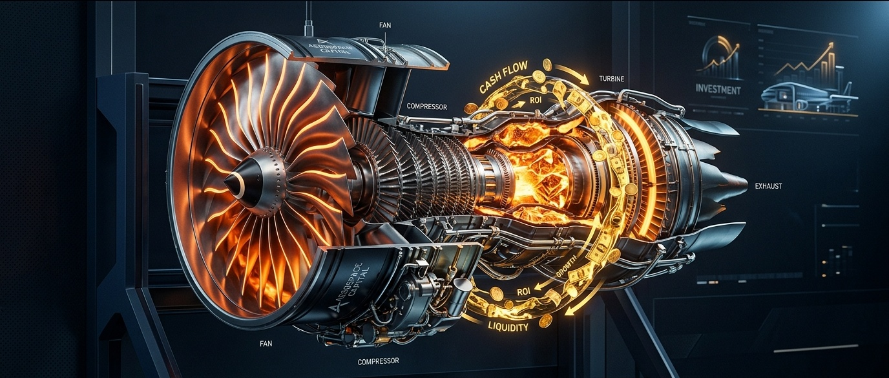

# 买方估值实战 02｜卖发动机不赚钱，修发动机赚百亿！分拆重生的通用电气（GE），凭什么享受38倍高PE？

> **实战说明：** 本文为《买方级估值修炼手册》专栏的**第二期个股深度实战案例** 。我们将调用第 01、03 讲的现金流阶梯与营运资本飞轮、第 06 讲的企业价值桥、第 09 讲的反向 DCF 逆向求解，以及第 12 讲专门用于航母级企业的 **SOTP（分部加总估值法）** ，全方位拆解人类工业史上最隐秘的“剃刀与刀片”暴利机器——**通用电气航天（GE Aerospace，NYSE: GE）** 。

---

## 导读：百年工业帝国的断臂涅槃与认知偏差

如果你对通用电气（GE）的印象，还停留在爱迪生发明的电灯泡、厨房里的微波炉、或者金融危机中几乎拖垮整个帝国的“GE Capital”，那么你可能错过了美股近两年来最震撼的一场“大象起舞”。

2024 年初，传奇 CEO 拉里·卡尔普（Larry Culp）以铁腕完成了对这艘百年工业巨轮的终极拆解：
* 医疗健康业务独立打包为 **GE HealthCare (GEHC)** ；
* 能源与风电业务独立打包为 **GE Vernova (GEV)** ；
* 留在美股最古老代码 **GE** 之下的，不再是庞杂拖沓的工业杂货铺，而是一家**全球最纯粹、地位最垄断的航空发动机与推进霸权——通用电气航天（GE Aerospace）！**

在刚公布的 2026 年第三季度财报中，GE Aerospace 交出了一份令人瞠目结舌的答卷：

* **新签订单：** 单季度暴增 **+49% 至 $19.0B（190 亿美元）** ，订单出货比（Book-to-Bill）高达 **1.43x** ；
* **积压订单（Backlog / RPO）：** 历史性冲破 **$2,120 亿美元** （相当于公司当前年营收规模的 4 倍以上！）；
* **调整后营业利润率：** 攀升至 **22.6%** （同比扩张 +210 个基点）；
* **全年自由现金流指引：** 在年内**第三次全线上调至 $9.1B - $9.4B** （自由现金流转化率持续超 100%）。

然而，拉开估值面板，很多价值投资者第一眼都会被吓退：

> **按最新收盘价 $299.87 计算，GE 对应 2026 年预估盈利的市盈率依然高达 37.3 倍！即便看 2027 年远期市盈率，依然在 30.3 倍的高位。**

一家搞工业制造的重资产机械公司，市盈率凭什么比谷歌、微软还贵？

它到底是泡沫高企的狂热透支，还是资本市场为“确定性年金现金流”支付的合理溢价？

今天，就让我们用《买方级估值修炼手册》的核心工具箱，把 GE Aerospace 剥开来看个通透。

---

## 第一幕：剃刀与刀片（Razor-and-Blades）极致商业模式与造血飞轮（调用第 01、03 讲工具）

很多人看不懂航空发动机，是因为习惯用传统制造业的眼光看它：“造一台机器，卖一台机器，赚个 10% 的差价”。

**但在航空动力领域，真实的赚钱逻辑完全颠倒了过来。**

### 1. 终极印钞机：发动机是剃刀，后市场维修才是刀片

GE Aerospace 与法国赛峰（Safran）50/50 合资的 CFM International，在民航最暴利的单通道窄体客机领域拥有绝对的统治地位：
* **波音 737 MAX 全系：** **100% 独家独揽** （LEAP-1B 发动机）；
* **空客 A320neo 系列：** 斩获近 **60% 份额** （LEAP-1A 发动机，竞对普惠 GTF 深陷粉末冶金缺陷）；
* **中国商飞 C919：** **100% 独家首发配套** （LEAP-1C 发动机）。

在这个领域，商业游戏规则是这样的：

1. **新机交付端（Equipment - 剃刀）：**
   向波音、空客交付一台全新的 LEAP 发动机，售价约 1,200 万至 1,500 万美元。在这一端，GE 几乎不赚什么钱，甚至在产能爬坡初期可能微幅折让出售；
2. **后市场服务与备件（Services - 刀片）：**
   一台发动机装上客机后，寿命长达 **25 到 30 年** 。在此期间，由于在万米高空承受千度高温与极高转速，每隔 5 到 7 年就必须进行一次深度车间大修（Shop Visits），同时高频更换高压涡轮叶片等关键热端零备件。

> **买方核心数据：**  
> 一台发动机在全生命周期内贡献的后市场维修与备件收入， **是其新机出厂售价的 3 到 4 倍！**  
> 更致命的是， **新机销售毛利率极低，而后市场服务与独家备件的毛利率高达 50% 到 60%！**

这意味着：**GE 每交付一台 LEAP 发动机，表面上看是卖了一台机械设备，实质上是为未来 25 年强行锁定了一笔源源不断的超高毛利现金流年金！**

### 2. 过去 5 年真实造血阶梯瀑布（Cash Flow Quality Waterfall）

在第 01 讲中我们强调过：**“净利润可以粉饰，但自由现金流骗不了人。”** 我们拉出 GE Aerospace 独立分拆调整后的过去 5 年造血数据：

| 财务报告期 | 持续经营净利润 (NI) | 经营现金流 (CFO) | 资本开支 (CapEx) | 自由现金流 (FCF) | CFO / 净利润 | FCF / 净利润 | 买方造血体检诊断 |
| :--- | :---: | :---: | :---: | :---: | :---: | :---: | :--- |
| **FY2022** | $3.50B | $4.80B | $1.20B | $3.60B | **1.37x** | **102.9%** | 疫情后国际航班复苏，大修需求反弹 |
| **FY2023** | $5.20B | $6.80B | $1.40B | $5.40B | **1.31x** | **103.8%** | 老款 CFM56 迎来延寿大修平台高峰 |
| **FY2024** | $6.80B | $8.20B | $1.80B | $6.40B | **1.21x** | **94.1%** | 纯血航空实体分拆，推行精益 FLIGHT DECK |
| **FY2025** | $7.90B | $9.80B | $1.90B | $7.90B | **1.24x** | **100.0%** | LEAP 交付破 2,000 台，服务利润率扩张 |
| **FY2026E** | **$8.40B** | **$11.30B** | **$2.05B** | **$9.25B** | **1.35x** | **110.1%** | **历史新高：FCF 指引上调至 $9.1B-$9.4B** |

你看，它的自由现金流/净利润转化率**连续多年保持在 100% 左右甚至更高** ！这是绝大多数工业制造企业完全无法想象的造血质量。

### 3. 飞行小时协议（CSA）与庞大的“无息客户浮存金”（调用第 03 讲）

在第 03 讲中，我们拆解过苹果、亚马逊如何利用营运资本“无本生利”。GE Aerospace 同样拥有独步天下的现金流飞轮：

全球绝大部分航司购买发动机后，都会与 GE 签订**按飞行小时计费的长期保障协议（CSA）** 。航空公司只要飞机在天上飞，每个月就必须按照飞行小时数向 GE 账户里**提前电汇预付现金** ；而 GE 真正为这台飞机进厂做车间大修，可能是 4 年甚至 5 年之后的事情。

这在 GE 的资产负债表上形成了超过 **180 亿美元的递延收入与客户合同负债** 。这是一笔完全免费、由全球各大航空公司无偿借给 GE 的庞大“无息浮存金（Float）”！

### 4. 穿透 Q3 财报：为什么单季 FCF 下滑 14%，指引却逆势上调？

在刚刚发布的 Q3 财报中，有一个细节引起了敏锐投资者的注意：**Q3 单季自由现金流为 $2.042B，同比下滑了 -13.5%（约 -14%）** 。

这是基本面走弱的信号吗？买方必须穿透底层，还原真实的全貌：

* **关键原因一：去年同期异常高的历史基数（High Base Effect）**  
  2025 年 Q3 是 GE Aerospace 独立拆分运行后客户现金结算最为集中的一个季度，当时单季 FCF 暴增 +30% 达到历史极值的 **$2.362B** ，自由现金流转化率异常高达 **134%** ！将一个普通平稳季度的现金流去对比历史极值峰值，自然会产生“同比下滑”的统计错觉；
* **关键原因二：Q4 交付前置备料与营运资本同比多占用近 11 亿美元（Working Capital Timing）**  
  根据刚刚公布的 2026 年三季报（Form 10-Q 真实信披）：GE 资产负债表存货余额攀升至 **$127.43 亿美元** ，较二季度末环比净增加 **+$3.03 亿美元** （较去年同期大幅净增超 **+$11.2 亿美元** ），主要用于备战 Q4 密集交付（单季交付超 500 台 LEAP）及 2027 年耐久套件量产的高温单晶叶片采购。叠加营收同比大增 18% 导致的主机厂应收款沉淀， **Q3 单季整个营运资金净占用现金高达 -$15.38 亿美元（而去年同期仅占用 -$4.41 亿美元，单季同比多流出 -$10.97 亿美元现金）** ！这正是单季账面现金流看似承压的最底层硬核推手；
* **关键原因三：看 9 个月累计（YTD）与全年指引证伪市场担忧**  
  把时间轴拉长到前 9 个月（YTD 9M），GE Aerospace 实际累计产生自由现金流 **$67.3 亿，同比依然强劲增长 +13.5%**（去年同期为 $59.3 亿）！更重要的是，管理层**反而将 2026 全年 FCF 指引从 8.9B-9.2B 上调至 9.1B - 9.4B（中枢 9.25B 美元，全年同比大增 +17%）** ！如果单季承压是内生恶化，管理层绝无底气连续三次上调全年指引。

---

## 第二幕：从市值到企业价值的严谨跨越（调用第 06 讲工具）

在第 06 讲中，我们推导过企业价值桥（EV Bridge）。很多人误以为 GE 依然背负着过去金融帝国的沉重债务。真实情况究竟如何？

我们按照 GE 2026 年 10 月 20 日最新收盘价 **$299.87** ，搭建严格的企业价值桥：

| 资产与负债科目 | 金额 (百万美元) | 折合十亿美元 | 买方财务解读 |
| :--- | :---: | :---: | :--- |
| **完全稀释总股本 (Diluted Shares)** | **1,042.00 M 股** | 10.42 亿股 | 年内累计回购超 $55 亿注销股本 |
| **每股最新收盘价** | **$299.87** | $299.87 | 自高点 $388 回踩 22.7% |
| **＝ 公司总市值 (Market Cap)** | **$312,465 M** | **$312.46 B** | 表面市场报价总额 |
| **加：计息总负债 (Total Borrowings)** | **+$19,000 M** | +$19.00 B | 主要为低息发行的长期企业债 |
| **减：现金及现金等价物** | **-$9,800 M** | -$9.80 B | 在手充沛高流动性现金资产 |
| **＝ 综合净负债 (Net Debt)** | **+$9,200 M** | **+$9.20 B** | **杠杆率仅 0.7x EBITDA（极度健康）** |
| **＝ 真实企业价值 (Enterprise Value)** | **$321,665 M** | **$321.66 B** | **买方收购整个实体资产支付的对价** |

**买方透视洞察：**
昔日负债累累的 GE 早已不复存在。分拆后的 GE Aerospace 综合净负债仅为 $92 亿美元，对比其单年超 $130 亿美元的税前息折摊前利润（EBITDA）， **净杠杆倍数仅为 0.7 倍** 。标准普尔与穆迪均给予其坚实的 A 级信用评级，财务暴雷风险已被彻底清除。

---

## 第三幕：反向 DCF 逆向求解：38倍高PE到底隐含了什么预期？（调用第 09 讲核心武器）

我们在第 09 讲中指出：**“别去拍脑袋猜股价涨到多少，算算当前价格要求公司立下怎样的军令状。”**

现在，GE 股价是 **$299.87** ，市盈率仍在 37 倍高位。市场究竟对它隐含了多高的自由现金流复合增速要求？

我们将当前数据代入机构级逆向 DCF 求解器：

* **当前企业价值 (EV)：** $321,665 M（$3,217 亿美元）；
* **基准自由现金流 (FCF)：** $9,250 M（2026 全年最新指引中枢 $9.1B-$9.4B）；
* **加权平均资本成本 (WACC)：** 设定为 **8.5%** （匹配航发高等级防守资产属性）；
* **永续增长率 (g)：** 设定为 **3.5%** （全球民航客运周转量 RPK 长期略高于全球 GDP 增速）；
* **贴现预测期：** 10 年（2027E - 2036E）＋ 永续终值。

### 逆向求解运算结果：

> **当前市价 $299.87，隐含未来 10 年自由现金流（FCF）的年化复合增速仅需达到 +10.09%！**

### 预期差剪刀差对比表

| 评估维度与参数 | 市场市价隐含预期 (Implied) | 官方指引与实际增速 (Growth) | 行业长期驱动背景 (Macro Reality) | 预期差裁决 (Variant Perception) |
| :--- | :---: | :---: | :---: | :--- |
| **未来 10 年 FCF CAGR** | **+10.09%** | **2026 FCF 增速 ~17% / 2027E >12%** | 全球窄体机延寿，后市场稳步释放 | **门槛温和，但已逐步计入确定性溢价** |
| **远期估值倍数** | **2026E 37.3x / 2027E 30.3x** | 赛峰 28x / TransDigm 35x | 独家垄断航发资产稀缺性 | **估值不便宜，需靠高造血质量消化** |

你看！很多散户一看到 37 倍 PE 就觉得“贵得离谱”；但反向 DCF 揭示了一个令人清醒的事实：
**现价 $299.87 要求的未来 10 年现金流年化增速只要 +10.09%！**

对于一家手握巨额积压订单、垄断全人类单通道客机动力的巨无霸而言，跑出 10.1% 的复合增速确定性很高。高市盈率并不是泡沫，而是市场给予其超高确定性的溢价。但这也提醒我们：**现价并未提供超额的估值打折，确定性很强，但并不算极端便宜。**

---

## 第四幕：SOTP 分部加总估值模型（调用第 12 讲专用武器）

在第 12 讲中，我们系统推导了分部加总估值法（SOTP）。GE Aerospace 旗下包含两个性质截然不同的业务单元，绝不能用单一倍数一刀切：

1. **商用发动机与服务（CES）：** 极高景气度、极高毛利（50%+）、双寡头垄断，具备消费必需品属性，理应享受与赛峰（Safran 26x）、TransDigm（30x）相当的 **27.0x EV / EBIT** 溢价倍数；
2. **国防与先进推进技术（DPT）：** 军品研发与换装订单稳健，但受政府成本加成合同约束，利润率较低（约 14%），估值中枢对标洛克希德·马丁与雷神（RTX），给予 **17.0x EV / EBIT** ；
3. **总部成本（Corporate）：** 常态化精益管理开支，按 **18.0x** 进行负向扣减。

### 1. 2027 年管理层前瞻：后市场增速常态化与新机逆风

在本次 Q3 业绩电话会上，管理层首次向买方市场系统披露了对 2027 年的展望信号，这是我们构建 SOTP 模型的核心锚点：

* **商业服务增速常态化（Normalizing）：** 管理层明确预期 2027 年商业服务（Commercial Services）收入将维持 **低双位数增长（Low-Double-Digit，约 10%~13%）** 。这意味着后市场从疫后“报复性大修＋CFM56 延寿”的 20%+ 超高速爆发期，正式过渡到更为常态、但久期极长的平稳收割期；
* **新一代引擎爬坡逆风（Headwind）：** 随着配套波音 777X 的新一代旗舰广体机发动机 **GE9X** 进入测试与试产爬坡阶段，预计在 2027 年将带来约 **$3 亿美元的利润逆风（~$300M Headwind）** 。这是典型的航发规律——新机早期交付由于学习曲线和初始良率，在会计上会阶段性摊薄利润率。

这提醒买方：**对 2027 年绝不能线性外推 20%+ 的利润狂飙，基准情景必须保持克制！**

### 2. 2027E 三情景业务拆解与 SOTP 目标价测算

| 核心科目与业务驱动 | 2025A 实际 | 悲观情景 (Bear Case) | **基准情景 (Base Case - 稳健兑现)** | 乐观情景 (Bull Case) |
| :--- | :---: | :---: | :---: | :---: |
| **情景核心叙事** | *历史基准* | *波音总装长期停滞 / 供应链摩擦* | *LEAP 大修爬坡 / 耐久套件落地* | *LEAP 满负荷 / GE9X 提前放量* |
| **2026E 调整后营收 ($B)** | $44.50 | $51.00 (+14.6%) | **$53.20 (+19.6%)** | $54.50 (+22.5%) |
| **2027E 调整后营收 ($B)** | - | **$57.00 (+11.8%)** | **$62.50 (+17.5%)** | **$67.00 (+22.9%)** |
| └ *其中：CES 商用分部 ($B)* | $33.50 | $43.00 | **$48.50** | $52.50 |
| └ *其中：DPT 防务分部 ($B)* | $12.00 | $14.00 | **$15.00** | $15.50 |
| **2027E 调整后营业利润 ($B)** | - | **$11.50** | **$13.20** | **$14.80** |
| └ *CES 营业利润 / 估值倍数* | - | $11.0B @ 22.0x | **$11.8B @ 27.0x (3,186.0B 美元)** | $12.5B @ 31.0x |
| └ *DPT 营业利润 / 估值倍数* | - | $1.8B @ 14.0x | **$2.0B @ 17.0x (340.0B 美元)** | $2.2B @ 19.0x |
| └ *总部管理成本扣减 ($B)* | - | $(1.2B) @ 16.0x | **$(1.2B) @ 18.0x (-216.0B 美元)** | $(1.1B) @ 18.0x |
| **2027E 调整后 EPS ($/股)** | $6.20 | **$8.80** | **$9.90** | **$11.00** |
| **2027E 自由现金流 ($B)** | $7.90 | **$9.50** | **$11.00** | **$12.50** |
| **企业价值 EV ($M)** | - | $248,000 | **$331,000** | $409,500 |
| **扣除净负债 ($M)** | - | $(9,200) | **$(9,200)** | $(9,200) |
| **综合公允目标价 ($)** | - | **$260.00** | **$365.00** | **$440.00** |
| **相对最新现价 ($299.87) 空间** | - | **-13.3% (极端悲观底)** | **+21.7%** | **+46.7%** |

---

## 第五幕：双变量压力测试矩阵：暴风雨来时的底线在哪里？（调用第 14 讲工具）

在第 14 讲中我们反复告诫：**“做投资不仅要想晴天能赚多少，更要测测暴风雨来时的安全底线。”**

针对 GE 最新市价 **$299.87** ，我们进行两组核心变量敏感性网格压测：

### 1. 压力测试网格 A：2027E 每股收益（EPS）× 目标市盈率（P/E）敏感性测算表

单元格内数值为测算股价（括号内为相对当前最新收盘价 **$299.87** 的潜在涨跌幅）：

| 2027E EPS \ 目标 P/E | 28.0x (极端估值压缩) | 32.0x (悲观倍数) | 35.0x (保守中枢) | **37.0x (基准中枢)** | 40.0x (牛市溢价) | 42.0x (高景气顶点) |
| :--- | :---: | :---: | :---: | :---: | :---: | :---: |
| **$8.50 (严重供应链危机)** | $238 (-23%) | $272 (-12%) | $298 (-3%) | $315 (+2%) | $340 (+10%) | $357 (+16%) |
| **$9.00 (悲观情景)** | $252 (-18%) | $288 (-6%) | $315 (+2%) | $333 (+8%) | $360 (+17%) | $378 (+23%) |
| **$9.50 (温和放缓)** | $266 (-14%) | **$304 (-1%)** | $333 (+8%) | $352 (+14%) | $380 (+23%) | $399 (+30%) |
| **$9.90 (基准官方指引)** | $277 (-10%) | $317 (+3%) | $347 (+13%) | **$366 (+19%)** | $396 (+29%) | $416 (+35%) |
| **$10.50 (超额交付)** | $294 (-5%) | $336 (+9%) | $368 (+19%) | $389 (+26%) | $420 (+36%) | $441 (+43%) |
| **$11.00 (乐观情景)** | $308 (0%) | $352 (+14%) | $385 (+25%) | $407 (+32%) | **$440 (+43%)** | $462 (+50%) |

**压测读表核心洞察：**
你看，最新收盘价 **$299.87** ，正好对应着 `EPS $9.50 × 31.6x` 的网格交点。
这意味着什么？
**市场目前已经提前为你打折消化了“2027 年 EPS 放缓至 $9.50（低于指引中枢 $9.90）”且“估值倍数跌落至 31.6 倍”的双重悲观情景！** 只要公司如期跑出基准业绩并让估值修复至 37 倍，向上就对应着 **+21.7%** 的基准修复空间。

### 2. 压力测试网格 B：贴现率（WACC）× 永续增长率（g）极限承压测试

单元格数值为 DCF 测算的每股内在价值（美元）：

| 贴现率 WACC \ 永续增长率 g | 2.5% (保守终局) | 3.0% | **3.5% (基准设定)** | 4.0% | 4.5% (航空超级景气) |
| :--- | :---: | :---: | :---: | :---: | :---: |
| **7.5% (低利率环境)** | $385.00 | $420.00 | $465.00 | $525.00 | $610.00 |
| **8.0%** | $335.00 | $362.00 | $398.00 | $445.00 | $505.00 |
| **8.5% (基准贴现率)** | $298.00 | $320.00 | **$365.00 (基准)** | $388.00 | $435.00 |
| **9.0%** | $268.00 | $285.00 | **$308.00** | $336.00 | $372.00 |
| **9.5% (极端紧缩)** | **$242.00** | $256.00 | $275.00 | $298.00 | $326.00 |

**底线防御诊断：**
即便在贴现率上升至 9.0% 的高压紧缩环境下，现价 $308.00 依然稳稳落在内在价值锚点上，展现了出色的下行防御厚度。

---

## 第六幕：严苛事前验尸与前置非价格证伪红线（调用第 14 讲工具）

在掏出真金白银建仓之前，必须严格执行第 14 讲的防守双保险：**事前验尸**与**前置客观证伪指标** 。

### 1. 事前验尸（Pre-Mortem）：推演 4 种未来可能的致命死因

> **反向假设：** 假定今天是 2028 年末，我们在 GE 这笔投资上亏损了 40%。所有人坐下来严肃复盘：它是怎么死掉的？

* **死因一：LEAP 发动机遭遇非计划空中停车（IFSD）或设计缺陷召回**
  * *推演过程*：高压涡轮叶片遭遇不可预见的材料疲劳，引发多起飞行中关车事件，FAA 下达全球停飞令，GE 面临数十亿美元赔偿且后市场现金流瞬间阻断。
* **死因二：空客 A320neo 订单大幅倒向普惠 GTF**
  * *推演过程*：普惠彻底克服粉末冶金缺陷，新一代 GTF Advantage 燃油经济性显著超越 LEAP，空客订单中 CFM 份额被蚕食跌破 45%，窄体机双寡头格局失衡。
* **死因三：热端单晶叶片与 CMC 铸件供应链严重瘫痪**
  * *推演过程*：上游精密铸造厂遭遇严重罢工或原料短缺，车间大修周转周期（TAT）拉长超过 40%，航司因修不起、等不起被迫采购第三方仿制备件（PMA）。
* **死因四：全球特大宏观衰退引发航空客运量雪崩**
  * *推演过程*：严重经济危机导致全球运力削减 25%，航司封存飞机，按飞行小时计费的 CSA 预收款大幅萎缩。

### 2. 前置非价格客观证伪红线（买方防守军规）

拒绝盯盘止损，必须以**底层商业指标**为撤退军令。一旦触发以下任一红线，投委会无条件砍仓或清盘：

1. **适航安全红线：** LEAP 家族发动机发生因核心机械或材料缺陷导致的强制大规模停飞；
2. **市场份额红线：** CFM LEAP-1A 在空客 A320neo 新增订单中的选装份额连续两个季度跌破 **45%** ；
3. **大修效率恶化红线：** 车间大修平均周转天数（TAT）同比拉长超 **20%** 且持续两个季度，表明精益 FLIGHT DECK 运营失效；
4. **造血质量红线：** 自由现金流（FCF）/ 净利润转化率连续两个季度跌破 **85%** （正常应 >100%）。

---

## 第七幕：六维量规自查评估与买方资产配置

最后，启用专栏第 14 讲的**买方客观六维量规自查模型** ，对 GE Aerospace 进行雷达打分：

  

### 1. 六维量规自查明细打分表

| 评估维度 (Dimension) | 买方自查得分 | 满分 | 判定依据与底层数据支撑 |
| :--- | :---: | :---: | :--- |
| **① 真实造血质量 (Financial Quality)** | **9.5** | 10.0 | 2026E FCF 上调至 $9.1B-$9.4B，FCF/NI 转化率超 110%；后市场毛利率 50%~60%，商业模式造血能力极强。 |
| **② 商业护城河深度 (Economic Moat)** | **10.0** | 10.0 | 全球 44,000 台在役商用航发，CFM 垄断窄体机动力（737 MAX 100%、A320neo ~60%）；15 年适航周期构筑绝对物理壁垒。 |
| **③ 资本分配纪律 (Capital Discipline)** | **9.0** | 10.0 | Larry Culp FLIGHT DECK 精益管理标杆，今年累计回购超 $55 亿；净负债仅 0.7x EBITDA，A 级资产负债表坚如磐石。 |
| **④ 估值安全边际 (Margin of Safety)** | **7.5** | 10.0 | 现价对应 2026E P/E 37.3x，2027E 降至 30.3x；估值已较为充分地反映了确定性，安全边际主要来自造血质量而非价格折扣。 |
| **⑤ 非对称盈亏比 (Risk/Reward)** | **7.5** | 10.0 | 基准目标价 $365.00 (+21.7%)，悲观防御底 $260.00 (-13.3%)，基准盈亏比为 1.63 : 1，中规中矩，非极端暴利赔率。 |
| **⑥ 前置证伪明确度 (Invalidation Triggers)** | **8.5** | 10.0 | 确立了适航安全停飞、A320neo 份额跌破 45%、大修 TAT 恶化 20%、FCF 转化率 <85% 等 4 条硬性前置红线。 |
| **六维累计总得分 (Total Score)** | **51.5** | **60.0** | **稳健通过审核基准线 (≥ 45.0 分)，属于高质量防守底仓标的** |

### 2. 买方辩证反思：1.63 : 1 赔率下的理性审视

很多个人投资者看到好公司就容易产生“无脑冲”的冲动，但专业的买方风控必须用冷水浇灭狂热：

* **1.63 : 1 的赔率到底算不算好？**  
  在基准情景下，现价 $299.87 向上看到 $365.00（+21.7%），向下看到极端悲观底 $260.00（-13.3%），风险收益比为 **1.63 : 1**（即承担 1 元下行风险博取 1.63 元收益）；在乐观情景下博取 +46.7% 收益，对应赔率为 **3.51 : 1** 。  
  客观地说：**这绝对不是那种周期大底“赔率 3:1 或 4:1 以上”的暴利非对称击球点！** GE 过去两年的股价已经大幅上涨，37 倍的市盈率意味着市场已经支付了相当一部分确定性溢价。
* **买方审慎定调：**  
  GE 是一家“无懈可击的好公司”，但目前“价格合理偏饱满”。它绝不适合重仓追高博取短期暴利，而适合作为长期防守型的**压舱石底仓** 。

### 3. 投委会风控裁决卡

| 决策要素 | 裁定结果 |
| :--- | :--- |
| **最终审核结论** | **【通过审核 / 核心配置·逢低分批布局（ACCUMULATE ON PULLBACKS），拒绝追高】** |
| **最新基准现价** | **$299.87** （2026-10-20 Q3 财报公布后最新收盘价） |
| **买方落地基准目标价** | **$365.00** （潜在资本上行空间 **+21.7%** ） |
| **悲观防御底线价** | **$260.00** （极端悲观下行回撤 **-13.3%** ） |
| **期望风险收益比** | **1.63 : 1 ~ 3.51 : 1** （中规中矩，属于高质量稳健赔率） |

### 4. 实操配置与分批建仓节奏建议

* **组合仓位设定：** 建议给予投资组合内 **5.0% ~ 8.0%** 的稳健底仓权重（工业高端制造第一防守底仓）；
* **分批建仓节奏（用纪律战胜贪婪）：** 
  * **第一批观察仓（当前价格 $295.00 ~ $305.00）：** 当前处于财报后情绪消化期，先建立 **3.0%** 观察底仓；
  * **第二批真正击球区（$260.00 ~ $280.00）：** 若因 2027 年服务增速放缓、波音装配噪音或宏观流动性回调，股价回落至此，此时 2027E PE 压缩至 26x~28x， **赔率拉开至 3.0 : 1 以上，果断加仓至 6.0% ~ 8.0%** ；
  * **极限安全击球区（$230.00 ~ $250.00）：** 若遇极端黑天鹅抛售，坚决顶格打满至 **8.0% ~ 10.0%** 配置上限；
* **持仓心态：** **买好公司，更要买在好赔率。** 航空发动机拥有长达 25 年的后市场现金流复利，不急于一时追高，用耐心等待市场先生奉上更具安全边际的筹码。

---

## 结语：看透工业资产的“年金属性”

很多人以为投资成长股只能买芯片、买 AI、买云服务。

但通用电气航天（GE Aerospace）的涅槃重生告诉我们：**当一个传统工业巨头把冗余的肢体全部砍掉，只留下那个拥有 44,000 台在役装机、占据全球 60%~100% 窄体机市场份额的纯粹动力心脏时，它就变成了一台无懈可击的年金印钞机。**

新机交付或许有波折，但只要人类还需要坐飞机跨越重洋，那 44,000 台发动机在万米高空的每一次旋转，都在为这家公司源源不断地带回应收与现金。

这，正是买方深度研究能够带你看透的、隐藏在 38 倍表面市盈率背后的真实商业奇迹。

---

> **免责声明：** 本文基于企业公开披露财报（SEC Form 10-K / 10-Q / 8-K）与买方估值模型推演，仅供投资研究与学术交流参考，不构成任何直接投资买卖建议。投资有风险，入市需谨慎。
