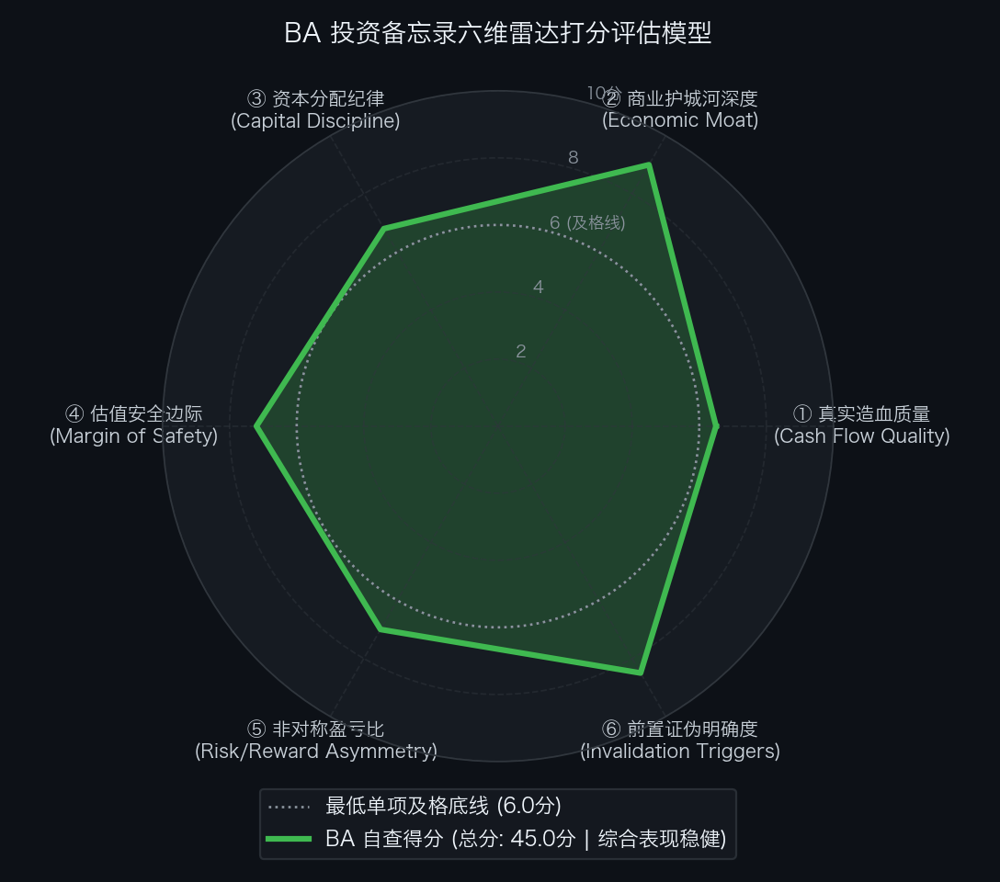

# 买方估值实战 04｜财报日重挫10%！天量订单承压制造瓶颈，大飞机双寡头波音（BA）究竟是折价黄金坑还是价值陷阱？

> **实战说明：** 本文为《买方级估值修炼手册》专栏的**第四期个股深度实战案例** 。我们将调用第 01、03 讲的现金流阶梯与营运资本穿透、第 06 讲的企业价值桥、第 09 讲的反向 DCF 逆向求解、第 12 讲针对航母级工业垄断资产的 **SOTP（分部加总估值法）** ，以及第 14 讲的事前验尸与六维客观量规自查模型，全面剖析刚经历季报预期重置的全球民航大飞机双寡头垄断巨头——**波音公司（The Boeing Company，NYSE: BA）** 。

---

## 导读：预期重置的季报剧震与资本市场的理性重估

2026 年 10 月 27 日，全球民航大飞机双寡头之一的波音公司（The Boeing Company）公布了最新的 2026 年第三季度业绩，并召开了由新任首席执行官 **凯利·奥特伯格（Kelly Ortberg）** 主持的全球投资者电话会议。

从长期战略与资产负债表关键防线来看，这份季报显现出若干筑底迹象：

* **在手未交付订单锁定长期排产：** 集团全口径未交付积压订单录得 **7,450 亿美元** ，其中商用飞机积压超 **6,300 架** （合同价值 6,120 亿美元），主要排产已延展至 2030 年代中期；
* **关键型号适航认证落地：** **737-7 与 737-10 正式斩获美国联邦航空局（FAA）适航型号认证（TC / ATC）** ，扫除了两款主力衍生机型投入商业运营（EIS）的核心监管准入障碍；
* **国防重点型号确立主力地位：** 美海军正式选定波音为主承包商，主导研发下一代 **F/A-XX 第六代舰载隐身战机** ，国防分部在手订单录得 **1,010 亿美元** ；
* **经营造血连续两季回正：** 继二季度自由现金流转正（+6.31 亿美元）后，三季度波音再次录得正向自由现金流 + **4.64 亿美元** （经营活动现金流达 + **14.96 亿美元** ，且包含了已全额支付的 **7.0 亿美元司法部 DOJ 历史和解金** ）；
* **后市场服务分部维持高利润率：** 全球服务分部（BGS）单季营业利润达 **10.20 亿美元（营利率 18.3%）** ，持续贡献年化约 40 亿美元的稳定营利底座。

然而，10 月 27 日业绩公布当日，盘面并未迎来修复性反弹，而是遭遇了资金的集中抛售：

> **波音美股（NYSE: BA）在财报发布当日重挫 -10.69%，单日下跌 `-$20.13`，股价跌破 170 美元关口，探底至 `$168.18`；随后数个交易日维持低位震荡，最新收盘于 `$171.55`。**

市场为何在订单创纪录、核心认证到手、现金流转正的背景下大幅下挫？

机构投资者的反应并非非理性的情绪宣泄，而是对波音**再次推迟生产爬坡节奏与下调近中期财务指引做出的理性风险重估**：

1. **全年交付目标落空：** 受制于雷顿工厂机翼制造瓶颈与关键零部件外协摩擦，管理层明确表示 2026 全年 737 交付量将**低于 500 架** ；
2. **提产关键节点顺延半年：** 737 稳定达到 47 架/月的时点从 2026 年底**推迟至 2027 年初** （目前产率徘徊于约 42 架/月），52 架/月节拍顺延至 **2027 年下半年** ；
3. **彻底终止“工序漂移”带来的短期阵痛：** 新管理层坚决落实**“拒绝工序漂移（No traveled work）”**准则，宁可放慢总装出厂节奏，也严禁将未闭环工序推入下一装配站位；
4. **中期现金流释放路径扁平化：** 管理层重塑了现金流爬坡预期——2026 年约为 **20 亿美元** ，2027 年约为 **30 亿美元** ，2028 年约为 **60 亿美元** ，虽然重申 2029 年达到 **100 亿美元** 的终局目标，但前置造血节奏明显放缓。

对高度关注单季兑现度与贴现久期的机构资金而言，交付推迟意味着单机制造固定成本的摊销周期被动拉长，沉重债务的去杠杆速度被迫放缓。

**这究竟是一家陷入结构性治理与制造泥潭的“价值陷阱”，还是市场在重估交付延误风险时过度打折、从而砸出非对称赔率的困境买点？**

我们将通过买方估值方法论工具箱，穿透财报表象，客观解剖波音的核心资产与风险定价。

---

## 第一幕：真实造血飞轮与装配工序摩擦穿透

在第 01 讲中我们指出：**“净利润是会计权责发生制下的观点，现金流才是穿透经营实质的硬事实。”** 在第 03 讲中我们进一步明确：**“分析制造业营运资本，必须区分企业是被动积压滞销失血，还是在监管约束下为修复制造工艺而主动承受的工序沉淀。”**

### 1. 过去 5 年现金造血阶梯瀑布（Cash Flow Quality Waterfall）

根据经全面审计的 Form 10-K 年报与最新公布的 Form 10-Q 季报，拉出波音过去 5 年及 2026 年最新实际造血数据（单位：百万美元，USD M）：

| 财务报告期 | GAAP 净利润 (NI) | 经营活动现金流 (CFO) | 维持性资本开支 (CapEx) | 自由现金流 (FCF) | CFO / 净利润转化率 | FCF / 净利润转化率 | 财报造血质量体检结论 |
| :--- | :---: | :---: | :---: | :---: | :---: | :---: | :--- |
| **FY2022** | -4,935.0 | -3,500.0 | 1,200.0 | -4,700.0 | 0.71x | 95.2% | 重度失血：供应链断裂与全球停飞库存积压 |
| **FY2023** | -2,222.0 | +3,057.0 | 1,400.0 | +1,657.0 | -1.38x | -74.6% | 阶段修复：窄体机恢复交付，现金流首次回正 |
| **FY2024** | -4,200.0 | -2,500.0 | 1,600.0 | -4,100.0 | 0.60x | 97.6% | 危机恶化：阿拉斯加航空门塞事故，工厂停产整顿 |
| **FY2025** | -3,500.0 | -1,200.0 | 1,500.0 | -2,700.0 | 0.34x | 77.1% | 触底承压：工会长期罢工与巨额重组开支计提 |
| **LTM (TTM)** | - **51.0** | **+3,724.0** | **3,183.0** | + **541.0** | **-73.0x** | **-10.6x** | **拐点确立：连续 4 季滚动现金流实现由负转正（+5.4 亿美元），跨越失血泥潭** |
| **FY2026E** | **-1,400.0** | **+5,400.0** | **3,400.0** | **+2,000.0** | **-3.86x** | - **142.9%** | **指引重置：严控工序质量，全年预计 FCF 约 20 亿美元（含 7 亿美元 DOJ 和解）** |

### 2. 拐点确立 vs 弹性脆弱：穿透波音真实的造血能力

解剖这份现金流量表，需要同时关注“边际改善”与“造血弹性的脆弱性”：

1. **拐点显现：连续两季自由现金流转正** 
 在经历了 2022-2025 连续多年年均失血数十亿美元的泥潭后，波音在 2026 年迎来了止血拐点。尽管一季度受复工整顿拖累失血 -14.5 亿美元，但二季度（+6.31 亿美元）与三季度（+4.64 亿美元，且全额吸收了 7 亿美元 DOJ 司法和解金）已经连续两个季度录得正向自由现金流。连续 4 个滚动季度的 TTM 自由现金流录得 + **5.41 亿美元** ，标志着前期最险峻的流动性危机暂告一段落；
2. **造血弹性依然脆弱：距常态化去杠杆尚有差距** 
 客观审视，年化 + **5.4 亿美元** 的自由现金流，对于一家总负债达 **483.6 亿美元**、年化利息开支超过 **23 亿美元** 的重资产工业巨头而言，仅仅是勉强保本。目前的造血规模尚不足以支持大规模自主偿债去杠杆；
3. **全年指引紧绷：市场在财报日集中抛售的深层根源** 
 管理层在电话会上维持 2026 全年 **约 +20 亿美元** 的自由现金流指引。但前三季度累计 FCF 为 - **3.59 亿美元** ，这意味着**第四季度需要产生约 23 亿美元的自由现金流** 。 
 新 CEO 宣布坚决执行“拒绝工序漂移”，严禁为凑数赶工出厂，并承认全年交付量将低于 500 架。面对严控生产节拍与四季度造血目标之间的张力，资金对兑现度的确定性产生疑虑，从而在财报当日引发了风险重估。

### 3. 穿透 Q3 现金流：边际改善与刚性负担并存

解剖 Q3 官方 10-Q 现金流量表与 Non-GAAP 调节表，这笔 +4.64 亿美元的自由现金流展现出两个层面的特征：

* **非经营性法律支出的落地：** 
 三季度经营活动现金流录得 + **14.96 亿美元** 。该项现金流包含了全额支付的 **7.0 亿美元司法部（DOJ）刑事调查历史和解金** 。若剔除该笔一次性行政罚款，单季核心经营现金流约为 **22 亿美元** 。
* **后市场服务分部（BGS）的护城河支撑：** 
 全球服务分部（BGS）单季营收达 55.8 亿美元，营业利润达 **10.20 亿美元（营利率 18.3%）** 。全球庞大的波音在役机队对原厂航材、延寿改装与 MRO 维修具备刚性需求，这一高确定性的后市场年金业务为波音锁定了一条年化约 **40 亿美元** 的营利安全防线。

### 4. 制造瓶颈的客观本质：监管红线下的工艺整改成本

市场最核心的担忧在于交付节奏为何频频延期。

从产业物理实质来看，这一放缓并非源于下游航司砍单，而是**波音在 FAA 现场驻厂严管下，被迫对过去积累的装配管理陋习进行的被动且必要的矫正**：

1. **工序漂移（Traveled Work）的危害机制：** 
 过去波音为了赶工交付以粉饰季报，往往在上一道工序未完成质检时，强行将飞机推进到下一个总装站位，工人常需在拥挤的机舱内跨工位补救，埋下质量隐患；
2. **“拒绝工序漂移”带来的短期财务代价：** 
 新任管理层执行“工件不达标决不流入下道工序”的铁律，在长期固然是重建适航信誉的必由之路；但**在熟练工断层、一级结构件供应商（如 Spirit AeroSystems）产能未完全恢复的背景下，严格质检必然导致装配周期拉长、在制品存货占用增加、单机固定成本摊销抬升** ；
3. **整改的现实影响：** 
 提产推迟是规范装配体系的物理成本。把整肃工序视作长期战略重构符合逻辑，但生产节拍的延后是确定性的当期代价，而质量体系的修复能否按期转化为预期的造血能力，依然面临执行不确定性。

---

## 第二幕：从市值到企业价值的严谨跨越

在第 06 讲中我们指出：**“分析高杠杆与重资产工业企业，切忌仅看表面股权市值，必须用企业价值（EV Bridge）穿透真实的资本结构负担。”**

按照截至 2026 年 10 月 30 日最新收盘价 `$171.55`（完全稀释总股本 8.28 亿股），搭建波音的企业价值桥：

| 资本结构要素 (Capital Structure Items) | 账面数据 / 测算金额 (百万美元) | 折合金额 (亿美元) | 买方财务解读与附注说明 |
| :--- | :---: | :---: | :--- |
| **最新普通股股价 (Stock Price)** | `$171.55` | `$171.55` | 2026-10-30 周五收盘价 |
| **完全稀释总股本 (Diluted Shares)** | **828.00 M 股** | 8.28 亿股 | 计入优先股转股后的完全稀释股本 |
| **＝ 稀释股票总市值 (Market Cap)** | **142,043.40 M** | **1,420.4 亿美元** | 财报公布后低位震荡股权总市值 |
| **加：短期有息借款 (ST Debt)** | **+4,210.00 M** | +42.1 亿美元 | 银行流动借款与短期商业票据 |
| **加：长期优先票据 (LT Debt)** | **+44,152.00 M** | +441.5 亿美元 | 固定利率投资级长期优先高级票据 |
| **＝ 有息负债总额 (Total Debt)** | **+48,362.00 M** | **+483.6 亿美元** | 处于危机后高杠杆去化承压阶段 |
| **减：现金及短期投资储备 (Cash)** | **-19,295.00 M** | -193.0 亿美元 | 账面流动性较为充裕，提供短期缓冲 |
| **＝ 综合纯净负债 (Net Debt)** | **+29,067.00 M** | **+290.7 亿美元** | 集团实际净负债规模 |
| **＝ 真实营运资产企业价值 (EV)** | **171,110.40 M** | **1,711.1 亿美元** | **收购波音全部核心营运资产的理论对价** |

### 买方资产负债表体检与偿债约束剖析：

1. **短期流动性缓冲较为充足，但并非毫无风险：** 
 波音账面储备了 **192.95 亿美元** 现金及短期投资。扣除短期借款 42.1 亿美元后，约拥有 150 亿美元的超额流动性储备，足以覆盖未来 2-3 年内的到期本息支付。管理层在电话会上重申“目前无股权再融资必要”，一定程度上稳定了短期情绪；
2. **沉重的利息开支压制股权价值积累：** 
 总负债高达 **483.6 亿美元** ，波音年化利息支出超过 **23 亿美元** ，这构成了对自由现金流的刚性蚕食；
3. **信用评级处于脆弱平衡：** 
 目前三大评级机构对波音维持 **BBB- / Baa3（最低投资级）** ，展望多为负面。一旦 2027 年提产节拍再次严重受挫，评级若被下调至高收益（垃圾级），其再融资成本将大幅跳升，届时股权折价配售的风险仍将不可忽视。当前的现金储备代表公司拥有 2-3 年的业务整改窗口，但并不意味着资产负债表已完全脱离险境。

---

## 第三幕：反向 DCF 逆向求解：现价到底隐含了怎样的预期军令状？

我们在第 09 讲中指出：**“反向 DCF 的核心价值，不在于预测未来，而在于倒推市场当前市价究竟对标的立下了多高的增长要求，进而衡量容错空间。”**

将最新财务数据代入机构级逆向 DCF 求解器：
* **当前企业价值 (EV)：** `$171,110.4 M`（约 1,711.1 亿美元）；
* **基准常态化自由现金流 (FCF)：** `$3,500.0 M`（设定为 2026-2027 年爬坡期年化造血中枢，平滑了一次性司法部和解影响与前期爬坡摩擦）；
* **加权平均资本成本 (WACC)：** 设定为 **8.5%** （反映其高负债与 BBB- 评级风险溢价）；
* **永续增长率 (g)：** 设定为 **2.5%** （匹配全球航空运输长期 GDP 中枢）；
* **贴现预测期：** 10 年（2027E - 2036E）＋ 永续终值。

### 逆向求解运算结果：

> **当前市价 `$171.55`，隐含未来 10 年自由现金流（FCF）的年化复合增速为 +16.23%。** 
> 对应第 10 年（2036 年）的年化自由现金流需达到 **157.5 亿美元** 。

### 预期差剪刀差对比分析：

| 评估维度与参数 | 市场现价隐含预期 (`$171.55`) | 财报前股价隐含预期 (`$188.00`) | 管理层战略指引 (2029 目标) | 预期差分析 (Variant Perception) |
| :--- | :---: | :---: | :---: | :--- |
| **未来 10 年 FCF CAGR** | + **16.23%** | +17.02% | 2026 年约 20 亿美元 → 2029 年 100 亿美元 | **增长门槛适度下移，计入了前置爬坡延期** |
| **第 10 年终局 FCF 门槛** | **157.5 亿美元** | 168.5 亿美元 | 2029 年达 100 亿美元，后续平缓增长 | **要求 2029 目标如期达成，后续保持温和扩张** |
| **莫布森 2×2 矩阵定位** | **【合理至中度折价区间】** | 【容错空间收窄区间】 | 7,450 亿美元积压订单排至 2030 年代 | **价格已反映短期延误，但对中远期兑现要求仍高** |

在财报公布前股价处于 `$188.00` 时，隐含的复合增速超过 + **17%** ，几乎不允许生产端出现任何意外延误；
而在回落至 `$171.55` 震荡企稳后，终局现金流要求比高位降低了 **11 亿美元** 。

若管理层能在 2029 年实现其 100 亿美元的造血目标，则 2029 至 2036 年的年化增速仅需达到约 **6.7%** 即可支撑现价。这表明市场已经在现价中**消化了 2026-2027 年爬坡节奏放缓的现实** ，但并未对波音的长期兑现能力彻底丧失信心，其定价处于“反映短期延误、但对 2028 年后加速兑现抱有明确预期”的阶段。

---

## 第四幕：SOTP 分部加总估值模型

在第 12 讲中，我们推导了针对航母级工业多元化企业的 SOTP 分部加总估值法。波音的业务架构包含民航制造、后市场航材服务与国防军工三大板块。

在估值乘数的选取上，需要客观反映各业务分部的商业模式差异，并审慎考量波音当前面临的治理与监管约束：

1. **商用飞机分部（BCA - Commercial Airplanes）：** 
 在手订单超 6,300 架（6,120 亿美元），主要机位锁定至 2030 年代。随着 737-7/10 适航认证落地，中长期稳态 Core EBIT 预期约为 `$5,800.0 M`（营利率 10.0%）。对标空客（Airbus）约 20.0x 乘数，考虑到波音受制于 FAA 生产节拍上限与安全信誉修复周期，给予约 10% 折价，按 **18.0x EV / EBIT** 测算；
2. **全球后市场服务分部（BGS - Global Services）：** 
 独家配套波音全球机队的航材与改装 MRO 服务，单季营利突破 10 亿美元，稳态 EBIT 预期约为 `$4,440.0 M`（营利率 18.5%）。作为高粘性、高壁垒的现金牛业务，对标 GE Aerospace（22x）与赛峰（Safran），审慎给予 **18.0x EV / EBIT** ；
3. **国防、太空与安全分部（BDS - Defense, Space & Security）：** 
 手握美海军 F/A-XX 六代机主合同，但过去数年在固定总价合同上屡有减值。稳态 EBIT 审慎预计为 `$2,400.0 M`（营利率 8.0%），对标洛克希德·马丁（16-17x），按折价区间下限给予 **15.0x EV / EBIT** 。

### 稳态 SOTP 分部加总估值底表

| 业务分部 (Business Segment) | 稳态远期营收 (百万美元) | 稳态 Core EBIT (百万美元) | 目标 EV/EBIT 乘数 | 隐含分部 EV (百万美元 / 折合) | 估值依据与审慎折价逻辑 |
| :--- | :---: | :---: | :---: | :---: | :--- |
| **1. 商用飞机分部 (BCA)** | 58,000.0 | 5,800.0 (10.0%) | **18.0x** | **104,400.0（1,044.0 亿美元）** | 对标空客 20x，考虑治理与 FAA 监管摩擦折价 10%。 |
| **2. 全球服务分部 (BGS)** | 24,000.0 | 4,440.0 (18.5%) | **18.0x** | **79,920.0（799.2 亿美元）** | 对标 GE Aerospace (22x)，匹配后市场高粘性年金业务。 |
| **3. 国防、太空与安全 (BDS)** | 30,000.0 | 2,400.0 (8.0%) | **15.0x** | **36,000.0（360.0 亿美元）** | 对标洛马 (16-17x)，考虑固定总价合同历史波动给予折价。 |
| **总业务资产企业价值 (EV)** | **112,000.0** | **12,640.0** | **17.43x (加权)**| **220,320.0（2,203.2 亿美元）** | 考虑治理折价后的营运资产公允价值总和。 |
| **(−) 减：综合净负债 (Net Debt)**| - | - | - | **-29,067.0（-290.7 亿美元）** | 集团最新账面综合净负债。 |
| **(＝) 股东权益内在价值** | - | - | - | **191,253.0（1,912.5 亿美元）** | 扣除负债后的股东权益总价值。 |

### SOTP 每股公允价值推导：

根据分部加总结果，波音营运资产公允总价值为 **2,203.20 亿美元** ，扣除最新账面综合净负债 290.67 亿美元后，归属于普通股股东的公允权益内在价值为 **1,912.53 亿美元** 。

按完全稀释后 828.00M 股股本计算：
* **SOTP 模型测算每股公允价值** ＝ 191,253.0 M ÷ 828.00 M 股 ＝ `$230.98`。

---

## 第五幕：正向三情景推演、压力测试与综合公允目标价定锚

在第 14 讲中我们指出：**“买方投资的核心工作，是用概率分布和极端承压测试，核算不利局面下的损失底线与非对称赔率。”**

### 1. 正向三情景稳态估值推演底表

基于 2028E 稳态造血兑现能力，我们构建完整勾稽的三情景估值分布底表：

| 估值情景 (Scenario) | 发生概率 | FY28E 稳态 FCF | FY28E 稳态 EPS | 目标估值倍数 (P/E) | 测算每股公允价值 | 核心假设推演 |
| :--- | :---: | :---: | :---: | :---: | :---: | :--- |
| **熊市情景 (Bear Case)** | **20%** | **4,000.0** | `$7.55` | **18.0x** | `$136.00` | 47 架/月节拍推迟至 2027 年末，777X 延期至 2028；在手订单与 BGS 构筑底座。 |
| **基准情景 (Base Case)** | **60%** | **6,000.0** | `$9.90` | **22.0x** | `$217.80` | 2027 年初达到 47 架/月，下半年达 52 架/月；737-7/10 顺利交付，稳态 FCF 达 60 亿美元。 |
| **牛市情景 (Bull Case)** | **20%** | **9,000.0** | `$13.00` | **27.0x** | `$351.00` | 57 架/月超预期攻克，777X 交付顺畅，BDS 营利回升至 10%，现金流提前向百亿爆发。 |
| **综合概率加权 (Blended)**| **100%** | — | — | — | `$228.08` | 概率加权每股期望公允价值（`$136.00` × 20% ＋ `$217.80` × 60% ＋ `$351.00` × 20% ＝ `$228.08`）。 |

### 2. 压力测试网格 A：2028E 核心 EPS × 目标市盈率（P/E）敏感性测算表

单元格数值为 2028 远期测算股价（美元）：

| 2028E EPS \ 目标 P/E | 16.0x (极端悲观) | 18.0x (审慎折价) | 20.0x (保守中枢) | **22.0x (基准中枢)** | 25.0x (常态中枢) | 27.0x (景气高位) |
| :--- | :---: | :---: | :---: | :---: | :---: | :---: |
| **6.50 (严重延误)** | 104.00 | 117.00 | 130.00 | 143.00 | 163.00 | 176.00 |
| **7.55 (悲观情景)** | 121.00 | `$136.00` | 151.00 | 166.00 | 189.00 | 204.00 |
| **8.50 (温和放缓)** | 136.00 | 153.00 | `$170.00` | 187.00 | 213.00 | 230.00 |
| **9.90 (基准路线图)** | 158.00 | 178.00 | 198.00 | `$218.00` | 248.00 | 267.00 |
| **11.50 (提产顺利)** | 184.00 | 207.00 | 230.00 | 253.00 | 288.00 | 311.00 |
| **13.00 (牛市情景)** | 208.00 | 234.00 | 260.00 | 286.00 | 325.00 | `$351.00` |

**压测读表：** 
最新收盘价 `$171.55`，恰好对应着 `EPS $8.50 × 20.2x` 或 `EPS $7.80 × 22.0x` 的网格交点。这表明市场当前价格已经包含了“2028 年核心 EPS 仅能达到 `$7.80 ~ $8.50`（低于管理层基准中枢 `$9.90` 约 15%~20%）”的预期，具有较为充分的悲观预期计入。

### 3. 压力测试网格 B：贴现率（WACC）× 永续增长率（g）极限承压测试

单元格数值为 DCF 测算的每股内在价值（美元）：

| 贴现率 WACC \ 永续增长率 g | 1.5% | 2.0% | **2.5% (基准设定)** | 3.0% | 3.5% (高景气假设) |
| :--- | :---: | :---: | :---: | :---: | :---: |
| **7.5% (宽信用环境)** | 237.70 | 256.60 | 279.30 | 307.00 | 341.60 |
| **8.0%** | 212.20 | 227.60 | 245.70 | 267.40 | 293.90 |
| **8.5% (基准贴现率)** | 190.50 | 203.10 | `$217.80` **(基准)** | 235.20 | 256.00 |
| **9.0%** | 171.80 | 182.30 | 194.40 | 208.50 | 225.20 |
| **9.5%** | 155.60 | 164.40 | 174.50 | 186.10 | 199.60 |
| **10.0% (极限高息底)** | `$141.40` | 148.80 | 157.30 | 166.90 | 178.10 |

**底线评估：** 
在将贴现率提高至 **10.0%** （相当于高利率加剧、信用利差扩大）且永续增长率降至 1.5% 的悲观假设组合下，DCF 内在价值约为 `$141.40`。现价 `$171.55` 距离此极限测试底线有约 17.6% 的缓冲区间。

### 4. 多模型交叉验证与综合公允目标价（Valuation Triangulation）

结合业务拆分（SOTP）、经营概率分布（三情景）与现金流贴现（DCF）三种估值方法，进行交叉验证与加权平衡：

| 估值方法 / 模型支柱 (Valuation Methodology) | 测算每股价值 (2028E) | 赋予权重 (Weight) | 权重设定依据与考量 | 加权贡献额 (美元) |
| :--- | :---: | :---: | :--- | :---: |
| **① 正向三情景概率加权 (Scenario Blended)** | `$228.08` | **40%** | 充分吸收熊市防撞垫（`$136.00`）与牛市爆发期权（`$351.00`）的概率分布。 | 91.23 |
| **② SOTP 分部加总估值 (Sum-of-the-Parts)** | `$230.98` | **40%** | 客观反映大飞机制造（BCA）与高毛利后市场航材服务（BGS）的独立营运资产价值。 | 92.39 |
| **③ 正向 DCF 内在价值 (Discounted FCF)** | `$217.80` | **20%** | 锚定稳态 60 亿美元 FCF、WACC 8.5%、g 2.5% 的现金流贴现底座。 | 43.56 |
| **【综合公允目标价】 (Consolidated Target)** | **—** | **100%** | **三大模型测算收敛区间**：`$218.00 ~ $231.00` | `$227.00` |

三大模型测算出的每股公允价值收敛于 `$218 ~ $231` 区间。加权平衡后的公允目标价为 `$227.00`。

### 5. 悲观防御底确立、持有期空间与预期年化 IRR 测算

完成上行综合公允目标价的定锚后，需同步对齐下行防御底座，进而完整决算持有期回报率与风险收益比：

#### （1）悲观防御底确立（风控短板论）

衡量下行风险时，不宜采用加权平均熨平风险，而是对比各独立模型测算的悲观下限，取最严苛的短板：
* **三情景推演熊市底（Bear Case）**：`$136.00`（47 架/月节拍推迟至 2027 年末，稳态 FCF 降至 40 亿美元，18.0x P/E）；
* **DCF 极限高息压测底（网格 B）**：`$141.40`（WACC 10.0%，g 1.5% 极限宏观环境）；
* **SOTP 保守资产底**：约 `$143.00`（各业务分部采用周期底部估值倍数）。

依据买方审慎风控原则，直接锚定三者中最严苛的底线——`$136.00`，作为本案的下行防御底座。

#### （2）持有期空间、年化 IRR 与盈亏比总决算

基于综合公允目标价 `$227.00` 与悲观防御底 `$136.00`，测算持有期空间与风险收益结构：

* **最新收盘价**：`$171.55`（2026-10-30 收盘价）
* **综合公允目标价**：`$227.00`（潜在空间 + **32.3%** ，安全边际 **24.4%** ）
* **持有周期**：约 **2.1 年** （2026 年 10 月末至 2028 年末）
* **预期年化回报率（IRR）**： 
 `IRR ＝ ($227.00 ÷ $171.55)^(1 ÷ 2.1) − 1 ＝ +14.3% / 年`
* **悲观防御底**：`$136.00`（下行风险 - **20.7%** ）
* **基准风险收益比（Risk / Reward）**： 
 `Risk/Reward ＝ ($227.00 − $171.55) ÷ ($171.55 − $136.00) ＝ $55.45 ÷ $35.55 ＝ 1.56 : 1` 
 *(若按牛市目标 `$351.00` 测算，牛市盈亏比达 5.05 : 1)*

---

## 第六幕：事前推演（Pre-Mortem）与前置证伪跟踪红线

在完成全套量化估值与赔率测算后，需进一步切换至防御视角，结合**事前推演（Pre-Mortem）**与**基本面跟踪指标**设定质性风控防线。

### 1. 事前推演（Pre-Mortem）：推演未来可能发生的 4 种风险情景

> **反向假设：** 设定今天是 2028 年末，该笔投资遭遇了超过 40% 的严重亏损，股价跌破 `$100.00`。推演导致该失败结果的核心破坏机制：

* **情景一：装配工艺与供应链结构性受阻（Supply Chain Impasse）** 
 雷顿工厂的机翼装配熟练度未能如期突破，Spirit AeroSystems 整合摩擦加剧，导致 737 月产节拍在 2027 年依然无法稳定突破 35 架/月，商用飞机分部陷入常态化低利润甚至失血泥潭。
* **情景二：再度爆发重大安全质量事故引致监管强制限产（Severe Quality Slip）** 
 在提产压力下再次发生重大总装疏漏，导致 FAA 进一步收紧适航自审权限，勒令波音全面冻结产线甚至撤销 737-7/10 认证，引发航司退单与转投空客。
* **情景三：国防分部（BDS）固定总价合同亏损再超预期（Defense Program Bleeding）** 
 KC-46 加油机、新空军一号 VC-25B 或 F/A-XX 六代机研发遇到不可逾越的技术障碍，固定总价合同发生成本严重超支，持续吞噬集团自由现金流。
* **情景四：信用评级遭降引发高息债务与被动配售（Credit Rating Downgrade）** 
 现金流反弹不及预期，穆迪与标普将波音信用评级降至高收益（垃圾级），导致其被剔除出投资级债券指数，再融资利率激增，逼迫公司在低位实施惩罚性股权折价配售。

### 2. 基本面跟踪指标与应对预案

为避免情绪化看盘，确立以下 4 项可量化的基本面跟踪指标，一旦触发坚决执行预案：

| 监控维度 | 关键跟踪指标 (Threshold) | 最新状态 | 触发后的应对动作 (Action) |
| :--- | :--- | :---: | :--- |
| **① 交付节拍** | 2027 年上半年 737 月产节拍仍未稳定达到 **42 架/月** 以上 | **观察中** （目前徘徊于约 42 架/月，目标 2027 初达 47 架） | **【削减 50% 仓位，召开投委会重审】** |
| **② 现金造血底线** | 连续 2 个季度自由现金流 (FCF) 重陷单季失血大于 - **5.0 亿美元** | **达标** （Q2 +6.3 亿、Q3 +4.6 亿美元连续转正） | **【判定造血逻辑受阻，减仓至 1% 观察仓】** |
| **③ 适航商业交付** | 737-7 或 737-10 无法在 2027 年上半年完成商业交付（EIS）首单交付 | **良好** （两款机型均已获得 FAA ATC 适航认证） | **【将估值模型全面降级至 Bear Case，暂停买入】** |
| **④ 评级流动性** | 穆迪或标普将波音信用评级下调至 **垃圾级 (Junk / High Yield)** | **稳定** （现金储备 193 亿美元，BBB- 评级处于底线） | **【无条件清仓离场，彻底终止跟踪覆盖】** |

---

## 第七幕：客观六维量规自查与买方击球区执行规划

在完成估值定价与质性排雷后，最终进入投委会综合评审与组合配置实操流程：

### 1. 六维量规自查评估

依据量规模型对波音基本面与估值进行多维度自查：

 

| 评估维度 (Dimension) | 满分 | 实际得分 | 达标判定 | 核心打分证据与财报底层事实 |
| :--- | :---: | :---: | :---: | :--- |
| **① 真实造血质量** | 10.0 | **6.5 分** | ✅ 达标 | 滚动 TTM FCF 实际转正至 +5.4 亿美元，Q2/Q3 连续两季造血改善，但年化资本开支超 31 亿美元仍显沉重。 |
| **② 商业护城河深度** | 10.0 | **9.0 分** | ✅ 达标 | 全球大飞机干线双寡头物理壁垒坚固，7,450 亿美元积压订单锁定长期排产，737-7/10 认证落地。 |
| **③ 资本分配纪律** | 10.0 | **6.8 分** | ✅ 达标 | 停止分红与回购，现金全额用于偿债去杠杆；推行“拒绝工序漂移”整改装配纪律。 |
| **④ 估值安全边际** | 10.0 | **7.3 分** | ✅ 达标 | 公允目标价 `$227.00` 相对现价 `$171.55` 具备 24.4% 安全边际，高于 20% 的基准线。 |
| **⑤ 非对称盈亏比** | 10.0 | **7.2 分** | ✅ 达标 | 基准盈亏比 1.56:1，牛市不对称盈亏比达 5.05:1，持有期年化 IRR 达 14.3%。 |
| **⑥ 前置证伪明确度** | 10.0 | **8.5 分** | ✅ 达标 | 42-47 架/月节拍、单季 -5 亿美元现金流底线、首单交付时间及 BBB- 信用评级红线清晰可量化。 |
| **六维累计总得分** | **60.0** | **45.3 分** | ✅ **达标** | 总分达到 45.3 分（基准线 45.0 分），现价具备试探性建仓的配置价值。 |

### 2. 参与困境资产定价的审慎考量

参与重资产工业困境反转资产的投资，需关注以下风控要点：

* **1.56 : 1 的基准赔率与 14.3% 年化 IRR 反映了合理的风险溢价：** 
 在基准预期下，现价 `$171.55` 相对公允目标价（`$227.00`）提供 +32.3% 的持有期空间，对应年化复合回报率（IRR）约为 +14.3%；下行至悲观防御底（`$136.00`）有 -20.7% 的风险敞口。若制造爬坡顺利迈入牛市情景（`$351.00`），盈亏比扩大至 5.05:1；
* **波音的经营体制仍处于修复期：** 
 新管理层的改革进入深水区，机翼制造摩擦、供应商协同及 480 亿美元负债的去化，都需要时间的推进；
* **关注核心资产底座，而非预期短期无瑕：** 
 在当前位置关注波音，核心逻辑在于在手 7,450 亿美元订单与民航双寡头的不可替代性构成了底层资产价值支撑；
* **严格执行仓位控制：** 
 尽管安全边际（24.4%）达到 20% 标准，但鉴于重资产困境反转过程的波动性，组合配置上限控制在 **5.0% 以内** ，首批以 2.0% ~ 2.5% 适度介入，防守优先。

### 3. 投委会风控裁决卡

| 决策要素 | 裁定结果 | 风控审评意见 |
| :--- | :--- | :--- |
| **综合评估结论** | **【处于一级击球区 / 具备分批建仓条件】** | 现价已较为充分地反映延期影响，估值安全边际达标，可启动初始观察仓分批介入。 |
| **最新基准现价** | `$171.55`（2026-10-30 收盘价） | 暴跌后在 168~175 美元区间低位筑底震荡，短期利空出清，生产管理向常态化整改定锚。 |
| **综合公允目标价** | `$227.00`（潜在空间 + **32.3%** ，年化 IRR + **14.3%** ） | 由情景概率、SOTP 拆解与贴现模型综合得出，反映 2028 年稳态价值。 |
| **估值安全边际** | **24.4%** （现价较公允目标价折价 24.4%） | 满足 20% 安全边际要求，具备较好的防御缓冲。 |
| **悲观防御底线价** | `$136.00`（极端悲观回撤 - **20.7%** ） | 由在手订单与 BGS 高粘性后市场现金流构筑防御底座。 |
| **期望风险收益比** | **1.56 : 1（基准）~ 5.05 : 1（牛市）** | 基准赔率合理，牛市弹性突出，具备非对称特征。 |

### 4. 击球区执行规划（用 IRR 和空间驱动配置）

| 击球区等级 | 目标买入区间 | 相对目标价 (`$227.00`) 折让 | 2 年持有期空间 | 预期年化 IRR | 期望盈亏比 (R/R) | 执行策略 |
| :--- | :---: | :---: | :---: | :---: | :---: | :--- |
| **一级击球区 (当前位置)** | `$165.00 ~ $175.00` | **折让 22.9% ~ 27.3%** | + **29.7% ~ 37.6%** | + **13.1% ~ 16.4%** | **1.33 : 1 ~ 2.14 : 1** | **安全边际达标（>20%），建立 2.0% ~ 2.5% 初始底仓** |
| **二级击球区 (深度调整)** | `$150.00 ~ $160.00` | **折让 29.5% ~ 33.9%** | + **41.9% ~ 51.3%** | + **18.1% ~ 21.8%** | **2.79 : 1 ~ 5.50 : 1** | **估值折让扩大（跌幅约 10%），增配至 3.5%** |
| **三级极限击球区 (极端承压)**| `$135.00 ~ $145.00` | **折让 36.1% ~ 40.5%** | + **56.6% ~ 68.1%** | + **23.8% ~ 28.1%** | **9.11 : 1 以上** | **直贴熊市防御底，非对称赔率爆发，打满至 5.0% 组合上限** |

* **组合仓位上限：** 将波音在组合中的总权重控制在 **5.0% 以内** ；
* **分批建仓节奏：** 
 * **第一批基础底仓（当前位置 `$165.00 ~ $175.00`）：** 股价在财报重挫后企稳，位于一级击球区内，**建立 2.0% ~ 2.5% 基础观察仓** ；
 * **第二批追加建仓（`$150.00 ~ $160.00`）：** 若市场继续反复消化爬坡放缓的悲观情绪，在此区间增配至 **3.5%** ；
 * **第三批防守配置（`$135.00 ~ $145.00`）：** 若发生极端宏观冲击或短期突发利空，逼近悲观防御底，**方可配置至 5.0% 仓位上限** ；
* **配置原则：** 面对困境反转类资产，核心在于以纪律应对不确定性。波音拥有双寡头壁垒、超 6,300 架积压订单及已获得的适航认证，但同时承担着债务与工艺整改成本。通过控制仓位与分批建仓，持续跟踪 2027-2028 年制造拐点的验证。

---

## 结语：不为故事买单，只为赔率挥棒

参与困境反转资产的研究与投资，关键在于避免被宏大叙事影响，坚持基于数据与赔率做客观决策。

波音当前的复苏之路依然面临挑战：雷顿工厂熟练工装配效率的爬坡、一级结构件供应商的重组协同、以及高达 480 亿美元的债务负担，各环节的摩擦仍可能反映在季度财务报表中。

评估重组与复苏进程，不宜假定过程一帆风顺，而应在市场因短期挫折而折价时，审视底层资产与赔率结构：

* 延展至 2030 年代中期的 6,300 余架商用客机在手储备；
* 737-7 与 737-10 最终获得的 FAA 适航认证；
* 维持高营利率的全球服务分部（BGS）与美军六代机核心项目；
* 账面约 193 亿美元流动性储备构筑的短期防线。

新管理层正视交付放缓并落实“拒绝工序漂移”，是规范装配体系的必经过程。

**看清资产负债表的现实与底牌，在 24.4% 的安全边际、14.3% 的持有期年化复合回报与 1.56 : 1 至 5.05 : 1 的非对称赔率下，以审慎的仓位和分批买入策略应对不确定性，方能在复杂市场环境中实现收益与风险的平衡。**

---

> **免责声明：** 本文基于上市公司公开披露财报（SEC Form 8-K / 10-K / 10-Q、官方投资者关系电话会实录）与买方量化估值模型推演，仅供投资研究与学术交流参考，不构成任何直接投资买卖建议。市场有风险，投资需谨慎。
