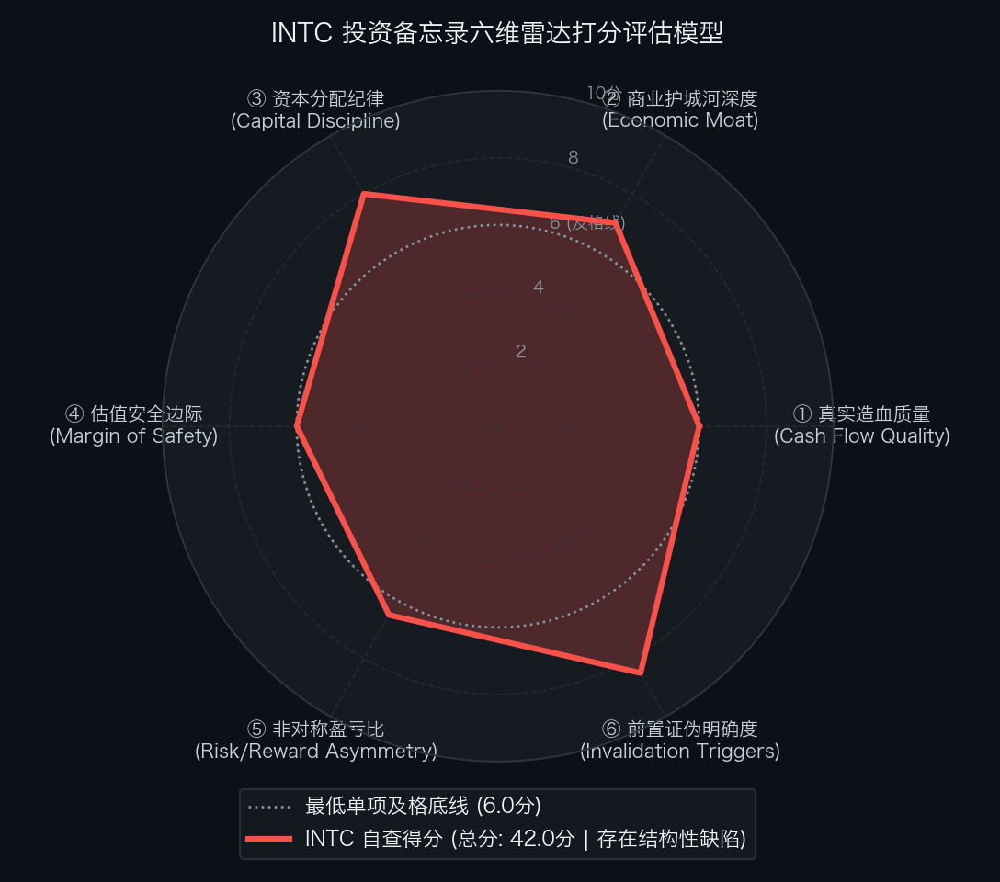

# 买方估值实战 05｜单季营收大超预期却暴跌 -28.6%！手握 540 亿现金的半导体巨头，暴跌的英特尔（INTC）到底是不是黄金坑？

> **实战说明：** 本文为《买方级估值修炼手册》专栏的个股深度实战案例。我们将全面解剖处于世纪重组转折点的全球半导体 IDM 制造巨头——**英特尔公司（Intel Corporation，纳斯达克代码: INTC）** 。

---

2026 年 10 月 29 日盘后，英特尔美股（NASDAQ: INTC）公布 FY2026 Q3 财报。次日（10 月 30 日）盘面遭遇极度惨烈的单边踩踏，全天下跌 **-28.58%** ，单日暴跌 `-$26.31`，收盘报收于 `$65.76`，单日成交量放大至惊人的 4.51 亿股。

市场为何在 Q3 营收创两年来新高、单季扭亏大赚的情况下，出现如此极端的恐慌性抛售？机构投资者的剧烈反应绝非单纯的情绪失控，而是对英特尔“当季亮眼与远期暴雷”做出的剧烈重估：
1. **当季大超预期 vs 远期指引断崖跳水：** Q3 营收达 165.1 亿美元（同比 +20.6%），数据中心 DCAI 营收暴增 +80.2% 且营利率突破 41.5%，Non-GAAP 稀释每股收益达 `$0.52` 远超卖方预期的 `$0.38`；然而，官方指引 Q4 营收仅为 150 亿至 160 亿美元，Non-GAAP 毛利率从 44.1% 骤降至 **38.0%** ，单季每股收益指引仅为 `$0.25`（预期 `$0.44`）；
2. **供应链通胀与海外晶圆厂突发停工：** 全球 PC 消费级内存供应被服务器高带宽内存挤占，DDR5 现货价格暴涨超 40%，下游 PC 品牌厂全面削减出货排期；雪上加霜的是，以色列 Kiryat Gat 的 Fab 28 晶圆厂突发公用动力介质污染事故停线检修，单季直接造成 3 亿美元营收损失并拖累全公司毛利率整整 200 个基点；
3. **540 亿现金护盾下的高估值博弈：** 2026 年 8 月英特尔在高位完成 230 亿美元股权融资，当前账面持有 **540.3 亿美元** 现金及短期投资，有息债务 501.4 亿美元，处于纯净现金状态。然而，在暴跌后的 `$65.76` 市价下，以 Q4 指引年化计算的市盈率仍高达 **65.8 倍**！

暴跌之后的英特尔，究竟是千载难逢的“黄金坑”，还是一场估值过高、暗礁密布的重资产反转陷阱？

---

## 第一幕：真实造血飞轮与先进制程资本开支穿透

要透视英特尔的真实底牌，必须彻底剥离会计科目的噪音，审视其过去 5 年的真实经营造血能力与自由现金流失血轨迹。

单位：百万美元

| 财务报告期 | GAAP 归母净利润 | 经营活动现金流 (CFO) | 维持与扩张性资本开支 (CapEx) | 真实自由现金流 (FCF) | CFO / 净利润转化率 | FCF / 净利润现金含量 | 买方造血质量穿透结论 |
| :--- | :---: | :---: | :---: | :---: | :---: | :---: | :--- |
| **FY2022** | +8,014.0 | +15,433.0 | 24,848.0 | -9,415.0 | 1.93x | -117.5% | 资本开支激进扩张，现金流开始转负 |
| **FY2023** | +1,675.0 | +11,471.0 | 25,755.0 | -14,284.0 | 6.85x | -852.8% | 晶圆制造巨额失血，代工模式重资产阵痛 |
| **FY2024** | -16,639.0 | +11,000.0 | 22,000.0 | -11,000.0 | -0.66x | 66.1% | 计提天量资产减值，经营现金流陷入低谷 |
| **FY2025** | -4,500.0 | +16,500.0 | 20,000.0 | -3,500.0 | -3.67x | 77.8% | 启动战略重组瘦身，资本开支初现理性控制 |
| **LTM (TTM)** | **+2,760.0\*** | + **22,590.0** | **18,540.0** | + **4,050.0** | **8.18x** | **146.7%** | **现状参考：滚动 4 季实际造血转正（不参与 5 年累计）** |
| **FY2026E** | + **6,500.0\*** | + **22,780.0** | **18,420.0** | + **4,360.0** | **3.50x** | **67.1%** | **全年预期：9M 实绩 ＋ Q4 关键指引中值合成** |
| **5 年累计发生额** | - **4,950.0** | + **77,184.0** | **111,023.0** | - **33,839.0** | **-15.59x** | **683.6%** | **会计闭环：FY2022~FY2025 历史实绩 ＋ FY2026E 全年预期** |

*\*注：LTM (TTM) 与 FY2026E 净利润为剔除重组减值的一次性损益后的 Non-GAAP 持续造血净利润；5 年累计发生额由 FY2022~FY2025 历史经审计实绩与 FY2026E 全年预期合成，LTM (TTM) 为过去 12 个月滚动数据，不计入跨期累计。*

- **滚动 TTM 真实造血还原（Q4 FY25 至 Q3 FY26 连续 4 季归档）：** 
  - **营业收入 (Revenue)：** `142.5 ＋ 151.0 ＋ 161.3 ＋ 165.1` ＝ **619.9 亿美元** ；
  - **经营活动现金流 (CFO)：** `45.1 ＋ 52.2 ＋ 70.2 ＋ 58.5` ＝ **225.9 亿美元** ；
  - **实际发生资本开支 (CapEx)：** `46.2 ＋ 45.1 ＋ 46.0 ＋ 48.1` ＝ **185.4 亿美元** ；
  - **真实自由现金流 (FCF)：** `225.9 − 185.4` ＝ **+40.5 亿美元** 。
- **买方穿透结论：** 
  从 2022 至 2025 年的累计失血超过 380 亿美元，到 2026 年 TTM 自由现金流转正为 +40.5 亿美元，英特尔的造血机制正在经历极其艰难的质变。新任 CEO 陈立武（Lip-Bu Tan）上任后坚定推行资本开支纪律，叫停非核心海外建厂，并分步出表 Altera 控股权，使经营现金流迅速恢复至每年超 220 亿美元的强劲水平。但代工制造部门单季近 20 亿美元的刚性亏损，依然是制约现金流自由释放的核心瓶颈。

---

## 第二幕：从市值到企业价值的严谨跨越

在买方估值框架中，盲目使用市值（Market Cap）来衡量一家手握巨额现金与复杂债务的跨国半导体企业，将导致严重的定价失真。必须跨越股权表象，精确构建企业价值桥梁（EV Bridge）。

单位：百万美元

| 资本结构要素 (Capital Structure Items) | 账面数据 / 测算金额 | 折合亿美元 | 估值折算与买方附注说明 |
| :--- | :---: | :---: | :--- |
| **最新普通股股价 (Stock Price)** | `$65.76` | - | 2026-10-30 官方暴跌收盘价基准 |
| **完全稀释总股本 (Diluted Shares)** | **5,315.00M 股** | 53.15 亿股 | 包含 8 月增发 3 亿股后最新流通普通股总股本 |
| **(=) 稀释股票总市值 (Market Cap)** | **349,514.40** | **3,495.1 亿美元** | 暴跌后的表面市场权益报价总市值 |
| **(+) 短期有息借款 (ST Debt)** | + **3,822.00** | +38.2 亿美元 | 一年内到期的短期银行借款与商业承兑票据 |
| **(+) 长期优先票据 (LT Debt)** | + **46,318.00** | +463.2 亿美元 | 2028 至 2045 年到期的投资级固定利率公司债 |
| **(=) 有息负债总额 (Total Debt)** | + **50,140.00** | **+501.4 亿美元** | 资产负债表有息杠杆存量水平 |
| **(+) 经营性租赁负债现值 (Operating Leases)** | + **2,850.00** | +28.5 亿美元 | 全球各研发中心与附属物流设施租赁折现 |
| **(+) 养老金与离职后福利缺口 (Pension Deficit)** | + **1,420.00** | +14.2 亿美元 | 附注披露的未足额计提雇员养老金精算缺口 |
| **(+) 少数股东权益 (Minority Interest)** | + **4,200.00** | +42.0 亿美元 | Mobileye 等控股子公司少数股东权益市场重估 |
| **(−) 现金及现金等价物 (Cash)** | - **24,100.00** | -241.0 亿美元 | 银行活期存款与隔夜国债逆回购 |
| **(−) 短期高流动性可变现投资 (ST Investments)**| - **29,928.00** | -299.3 亿美元 | 1 年期以内的高评级美国国库券与商业票据 |
| **(=) 广义穿透综合企业价值 (Comprehensive EV)** | **354,096.40** | **3,541.0 亿美元** | **计入全部隐性负债与少数权益后的完全企业对价** |
| **(=) 狭义纯净现金企业价值 (Standard EV)** | **345,626.40** | **3,456.3 亿美元** | 市值直接扣除账面净现金 38.9 亿美元后的常规 EV |

### 流动性安全跑道与财务护盾审计
- **账面流动性总储备：** 
  现金及短期投资（540.3 亿美元）＋ 未动用银行循环授信（150.0 亿美元）＝ **690.3 亿美元** ；
- **极端存活周期测算：** 
  假设全球芯片出货完全停顿（营业收入为 0），单季刚性研发与行政支出约 44 亿美元，维持性产线资本开支约 35 亿美元，合计单季硬性失血 79 亿美元。手头流动性储备可支撑公司在**零收入状态下持续燃烧 8.7 个季度（约 26 个月）** ；
- **买方风控定论：** 
  2026 年 8 月的 230 亿美元增发，彻底改写了英特尔的财务生命线。当前公司资产负债表已经处于“净现金”状态，破产、债务违约或资金链断裂的尾部风险被彻底物理出清。

---

## 第三幕：反向 DCF 逆向求解：现价到底隐含了怎样的预期军令状？

我们绝不去预测未来 10 年英特尔能赚多少钱，而是使用反向 DCF 求解器进行逆向测算：在当前收盘价 `$65.76`（对应企业价值 3,456.3 亿美元）之下，市场给管理层开出的隐含业绩军令状究竟有多么严苛？

- **加权平均资本成本 (WACC)：** 设定为 **9.0%** （反映重资产晶圆制造风险与行业贝塔值）；
- **永续增长率 (g)：** 设定为 **2.5%** （匹配全球长期 GDP 潜在复合增速）。

| 评估维度与参数 | 市场现价隐含预期 (`$65.76`)【基准 A：TTM FCF 40.5 亿】 | 市场现价隐含预期 (`$65.76`)【基准 B：稳态 FCF 65.0 亿】 | 财报暴跌前股价隐含 (`$92.07`) | 预期差裁决 (Variant Perception) |
| :--- | :---: | :---: | :---: | :--- |
| **未来 10 年 FCF 年化增速** | + **25.06%** | + **18.63%** | +27.80% | **即使暴跌近 30%，隐含增速要求依然高达 18.6%~25.1%** |
| **第 10 年终局 FCF 规模** | **379.1 亿美元** | **358.8 亿美元** | 506.2 亿美元 | **要求未来现金流在当前基数上翻 5.5 至 9.4 倍** |
| **莫布森 2×2 决战矩阵** | **【象限 A：定价完美】** | **【中性合理偏乐观】** | 【极度狂热象限】 | **市场定价远非绝望，并未砸出超额容错空间** |

### 行业基准概率（Base Rate）严苛裁定
- **历史样本规律：** 在过去 40 年的全球科技与半导体工业史上，从千亿美元级资产基数起步、连续 10 年实现 **+18.6% 以上自由现金流复合增速** 的巨无霸企业，仅有台积电与英伟达两家；
- **反转概率审视：** 英特尔要实现这一隐含军令状，不仅要求数据中心与 PC 芯片设计业务维持近 40% 的高营利率，更要求 Intel Foundry 代工业务在 2028 年前彻底扭亏并对外斩获数百亿美元的高良率先进制程大单。其在统计学上的达成概率（Base Rate）**不足 15%** ；
- **核心结论：** 暴跌至 `$65.76` 绝非“捡钱的低估值时刻”。市场只是把此前不切实际的“登月狂热”修正为了“严苛的高难度反转”，估值容错空间依然脆弱。

---

## 第四幕：垂直商业物种专属估值模型（SOTP 分部加总估值模型）

英特尔不是一家纯粹的芯片设计公司，也不是一家单纯的代工厂。它是由暴利的 Fabless 芯片设计业务与深度亏损的 Foundry 晶圆制造业务硬性拼合而成的“资产错配综合体”。必须采用分类加总估值模型（SOTP）进行穿透拆解。

### 1. 支撑本估值测算的四大基石假设（前提条件）
1. **假设一（制造纠偏与 18A 顺利转固）：** 以色列 Fab 28 晶圆厂在 2026 年底前全面恢复正常生产；内部 18A 工艺在 2027 年上半年如期量产 Panther Lake 处理器，逐步替代昂贵的台积电外包代工；
2. **假设二（产品部门对标可比同行）：** Intel Products（芯片设计业务）享有全球 x86 生态与 PC/服务器统治地位，对标 AMD、高通与博通的成熟设计业务，给予合理的 EV/NOPAT 乘数；
3. **假设三（代工制造深度计提资产减值折价）：** Intel Foundry 因每年持续产生超 70 亿美元经营亏损，无法按照 EBITDA 估值，必须采用重置成本法的“资产重度折价清算原则”，按账面净固定资产（PP&E）给予 50% 的经济性折价；
4. **假设四（资本结构与现金流防护）：** 新管理层维持 540 亿美元现金护盾，不实施任何恶性折价再融资，将资本开支严格压减在经营现金流覆盖范围之内。

> **风控警示：** 上述四大基石假设是本模型成立的底线。一旦 18A 量产再度推迟或代工亏损失控破裂，本模型推导即刻失效。

### 2. SOTP 分部加总估值明细表

| 业务分部 (Segment) | TTM 实际营收 (亿美元) | TTM 实际营业利润 (亿美元) | 对标同业与估值乘数选择 | 分部折溢价依据 | 分部企业价值 EV (亿美元) | 估值逻辑与业务壁垒解读 |
| :--- | :---: | :---: | :---: | :---: | :---: | :--- |
| **① Intel Products (芯片设计业务)** | **538.0** | **135.0** | **18.0x EV/NOPAT** (对标 AMD/高通) | 成熟龙头基准估值 | **1,971.0** | 按 21% 有效税率，设计端 NOPAT 约 106.7 亿美元；拥有不可替代的软硬件底层生态 |
| └ *其中：DCAI 数据中心与 AI* | 225.0 | 75.0 | 22.0x NOPAT | 给予服务器算力溢价 | 1,303.5 | Xeon 6 能效核与性能核放量，单季利润率超 41% |
| └ *其中：CCPG 客户端计算* | 313.0 | 60.0 | 14.0x NOPAT | 扣减内存通胀折价 | 667.5 | 全球 PC 绝对底座，受内存供应链涨价暂时压制 |
| **② Intel Foundry (芯片代工制造)** | **240.0** | - **75.0** | **0.50x P/B (净固定资产)** | **计提 50% 资产清算折价** | **475.0** | 账面净固定资产约 950 亿美元；因巨额亏损给予残酷的重置清算折价 |
| **③ 非核心战略参股与股权资产** | **15.0** | **3.0** | 市价公允评估打折 | 计提 20% 流动性折价 | **185.0** | 包含 Mobileye 88% 持股市值约 85 亿 ＋ Altera 49% 留存权益公允价值约 100 亿美元 |
| **(=) 集团合并营运企业价值 (EV)** | **—** | **—** | **—** | **—** | **2,631.0** | **集团经营业务拆分公允价值总额** |
| **(+) 账面综合纯净现金 (Net Cash)** | **—** | **—** | — | 现金扣除有息总负债 | + **38.9** | 现金储备 540.3 亿美元减去负债 501.4 亿美元 |
| **(=) SOTP 归属母公司权益内在价值** | **—** | **—** | **—** | **—** | **2,669.9** | **保守资产重构下的股东内在公允价值 (2,670 亿美元)** |
| **(÷) 完全稀释流通普通股总股本** | **—** | **—** | — | 53.15 亿股 | 53.15 亿股 | 官方最新流通股本基准 |
| **(=) SOTP 每股公允价值** | **—** | **—** | **—** | **—** | `$50.23` | **基准公允价值约 `$50.23`** |

- **第四幕纯净输出：** 
  在不计入未来 18A 外部大客户翻倍期权的前提下，英特尔的纯芯片设计盘子（Products）公允价值为 1,971 亿美元；代工制造业务按 50% 资产残值清算计价 475 亿美元；加上现金净额与参股权益，**SOTP 纯净保守每股内在价值为 `$50.23`** 。

---

## 第五幕：正向三情景推演、压力测试与综合公允目标价定锚

### 1. 正向三情景稳态价值推演表

| 估值情景 (Scenario) | 发生概率 | 2027E 预期营收 | 2027E 自由现金流 | 2027E 核心 EPS | 目标估值倍数 | 稳态每股公允价值 | 核心假设推演与经营里程碑 |
| :--- | :---: | :---: | :---: | :---: | :---: | :---: | :--- |
| **熊市情景 (Bear Case)** | **20%** | 580.0 亿美元 | 15.0 亿美元 | `$1.50` | 20.0x P/E | `$30.00` | 以色列停产影响扩大，PC 内存暴涨抑制换机；代工亏损失控，18A 外部流片受阻 |
| **基准情景 (Base Case)** | **60%** | 680.0 亿美元 | 70.0 亿美元 | `$3.80` | 20.0x P/E | `$76.00` | Fab 28 顺利复工，内存瓶颈逐步平抑；Panther Lake 自产替代外包，代工亏损收窄 |
| **牛市情景 (Bull Case)** | **20%** | 780.0 亿美元 | 120.0 亿美元 | `$5.20` | 25.0x P/E | `$130.00` | 18A 斩获 2 家顶级 Fabless 量产大单，DCAI 服务器份额激增，全公司毛利率突破 50% |
| **情景概率加权 (Blended)** | **100%** | 680.0 亿美元 | 69.0 亿美元 | `$3.62` | 21.0x P/E | `$77.60` | **三情景综合概率期望价值** |

---

### 2. 双变量压力测试网格 A：远期 EPS × 目标 P/E 敏感性测试表

单位：每股测算公允价值（美元）

| 2027E 核心 EPS \ 目标 P/E | 14.0x | 16.0x | 18.0x | 20.0x (基准) | 22.0x | 26.0x (乐观) |
| :---: | :---: | :---: | :---: | :---: | :---: | :---: |
| `$1.50` (极端悲观) | `$21.00` | `$24.00` | `$27.00` | `$30.00` | `$33.00` | `$39.00` |
| `$2.50` (中度承压) | `$35.00` | `$40.00` | `$45.00` | `$50.00` | `$55.00` | `$65.00` |
| `$3.20` (保守修复) | `$44.80` | `$51.20` | `$57.60` | `$64.00` | `$70.40` | `$83.20` |
| `$3.80` (基准预期) | `$53.20` | `$60.80` | `$68.40` | `$76.00` | `$83.60` | `$98.80` |
| `$4.50` (超预期放量) | `$63.00` | `$72.00` | `$81.00` | `$90.00` | `$99.00` | `$117.00` |
| `$5.20` (全面反转) | `$72.80` | `$83.20` | `$93.60` | `$104.00` | `$114.40` | `$130.00` |

*注：当前市价 `$65.76` 落在 `$64.00` 至 `$70.40` 的敏感区间，对应基准盈利假设下的 17x 至 19x 市盈率。*

---

### 3. 双变量压力测试网格 B：贴现率 WACC × 永续增长率 g 极限承压测试表

单位：每股测算公允价值（美元）

| WACC \ 永续增长率 (g) | 1.8% | 2.0% | 2.3% | 2.5% (基准) | 2.8% |
| :---: | :---: | :---: | :---: | :---: | :---: |
| **8.0% (流动性宽松)** | `$78.40` | `$81.50` | `$85.20` | `$88.90` | `$94.10` |
| **8.5% (适度平稳)** | `$69.30` | `$71.80` | `$74.60` | `$77.50` | `$81.60` |
| **9.0% (标准基准)** | `$61.80` | `$63.80` | `$66.10` | `$68.40` | `$71.70` |
| **9.5% (信用风险折价)** | `$55.40` | `$57.00` | `$58.90` | `$60.80` | `$63.50` |
| **10.0% (重资产承压)** | `$50.00` | `$51.30` | `$52.90` | `$54.50` | `$56.70` |
| **10.5% (极端风控惩罚)**| `$45.30` | `$46.40` | `$47.70` | `$49.00` | `$50.80` |

---

### 4. 多模型交叉验证与综合公允目标价定锚

| 估值方法 (Valuation Approach) | 核心驱动与适用场景 | 测算公允价值 | 权重配置 | 加权贡献值 | 交叉验证定性评价 |
| :--- | :--- | :---: | :---: | :---: | :--- |
| **① 情景概率加权 (Blended Scenario)** | 包含牛市期权与熊市风险的概率分布 | `$77.60` | **40%** | `$31.04` | 动态权衡：兼顾 18A 代工成功的高弹性与停工风险。 |
| **② 分部业务加总 (SOTP 模型)** | 剥离设计与制造，穿透资产重置残值 | `$50.23` | **40%** | `$20.09` | 审慎底座：剥离制造亏损包袱后纯设计盘的清算底座。 |
| **③ 正向自由现金流贴现 (DCF 模型)** | 稳态基准现金流与资本开支纪律贴现 | `$68.40` | **20%** | `$13.68` | 稳健兜底：基准情景下年化 70 亿美元造血的确定性估值。 |
| **(=) 综合公允目标价** | **多模型交叉验证与加权** | — | **100%** | `$64.81` | **基准综合公允目标价（四舍五入定锚为 `$65.00`）** |

---

### 5. 悲观防御底座确立与持有期空间决算
- **熊市情景底座 (Bear Case)：** `$30.00`；
- **SOTP 保守资产底座：** `$50.23`；
- **DCF 极端高息压测底座 (WACC 10.5%)：** `$45.30`；
- **GAAP 每股有形资产净值 (Tangible BVPS)：** `$10.10`（每股账面现金储备达 `$10.16`）；
- **最终防御底座判定：** 
  结合 2024 年以来的极端历史低点（`$19.43`）与 2026 年初低点（`$30.12`），按照最严苛审慎原则，**确立英特尔的硬核悲观防御底座为：`$30.00` 至 `$35.00`** 。

- **持有期投资指标综合决算：** 
  - **最新收盘价：** `$65.76`（2026-10-30 暴跌收盘价）
  - **综合公允目标价：** `$65.00`（当前市价已基本完全计入公允中枢，折价仅为 -1.2%）
  - **基准情景修复目标：** `$76.00`（潜在空间 + **15.6%** ）
  - **持有周期：** 约 **2.0 年** （2026 年 10 月末至 2028 年末）
  - **基准预期年化回报率 (IRR)：** 

    $$ \text{IRR} = \left(\frac{76.00}{65.76}\right)^{\frac{1}{2.0}} - 1 = +7.5\% / \text{年} $$

  - **悲观下行风险：** 至防御底座 `$35.00`（下行风险 - **46.8%** ）
  - **基准风险收益比 (Risk / Reward)：** 

    $$ \text{盈亏比} = \frac{76.00 - 65.76}{65.76 - 35.00} = \frac{10.24}{30.76} = 0.33 : 1 $$
  - **买方风控结论：** 
    在 `$65.76` 的点位上，基准情景下的预期回报仅为年化 +7.5%，而潜在下行空间却高达 -46.8%，**盈亏比仅为 0.33:1，严重缺乏不对称吸引力** 。当前股价绝非“超跌黄金坑”，必须耐心等待估值进一步出清。

---

## 第六幕：事前推演（Pre-Mortem）与前置证伪跟踪红线

### 1. 事前验尸（Pre-Mortem）：未来投资遭遇腰斩的核心死因推演
- **死因推演一（18A 良率卡死，自研芯片难产重回外包）：** 
  18A 工艺在量产前夕缺陷密度（D0）迟迟无法突破 0.2 关口，Panther Lake 出现严重的功耗漏电与散热缺陷，被迫在 2027 年上半年推迟量产，英特尔不得不再次高价向台积电采购 N3/N2 晶圆，重组红利彻底归零；
- **死因推演二（外部代工巨头集体弃船，制造部门沦为失血黑洞）：** 
  正在测试 18A 的 12 家外部芯片客户因担心商业机密泄露与 EDA 工具链不匹配，无一家转化为排他性量产采购订单，代工业务年化亏损长期锁定在 70 亿至 80 亿美元以上，持续吞噬芯片设计端的丰厚利润；
- **死因推演三（AMD 与云厂商自研芯片双向绞杀 DCAI）：** 
  AMD 依托台积电成熟的 2nm 制程推出性能大幅领先的全新 EPYC 服务器处理器，同时微软与亚马逊自研 ARM 芯片在公有云采购占比突破 40%，英特尔数据中心 CPU 高毛利基石被彻底撼动；
- **死因推演四（PC 供应链通胀长期化，客户计算业务持续失血）：** 
  由于全球内存巨头将绝大多数先进制程产能倾斜给 HBM，消费级 PC 内存价格居高不下，PC 换机周期被拉长至 5 年以上，英特尔 CCPG 部门营收与利润持续下滑。

---

### 2. 前置非价格客观证伪红线跟踪表

| 监控维度 | 具体可量化红线指标 (Threshold) | 最新实证状态 (2026.10) | 触发后的硬性执行动作 (Action) |
| :--- | :--- | :---: | :--- |
| **① 以色列晶圆厂复产** | **2026 年 12 月 15 日前 Fab 28 必须全线恢复正常生产** | **警惕待验** （10 月底停产，管理层承诺 11 月中抢修） | **若超期未复工，将 Q4 盈利预期全面下调 30%** |
| **② 代工单季亏损上限** | **季度 Intel Foundry 营业亏损绝对值不得超过 -23.0 亿美元** | **达标但脆弱** （Q3 亏损 -19.15 亿美元，上年 -21.4 亿） | **若亏损再度扩大至 23 亿以上，立即剔除观察名单** |
| **③ 综合毛利率硬底线** | **Q4 实际公布的 Non-GAAP 毛利率严禁跌破 35.0%** | **指引预警** （官方指引 38.0%，较 Q3 下滑 610 bps） | **若跌破 35%，判定制造工艺严重受阻，全面止损** |
| **④ 18A 商业量产节点** | **2027 年 3 月 31 日前必须实现首批 Panther Lake 商业交付** | **推进中** （完成硅片验证，处于大批量试投片阶段） | **若量产节点跳票，判定反转逻辑被证伪，强制清仓** |

---

## 第七幕：客观六维量规自查与买方击球区执行规划

  

### 1. 客观六维量规自查明细总表

| 评估维度 | 权重分值 | 实际得分 | 扣分项与买方硬核审计依据 (SEC 财报实证) |
| :--- | :---: | :---: | :--- |
| **① 真实造血质量** | 10.0 分 | **6.0 分** | 扣 4.0 分：TTM FCF 虽转正至 40.5 亿美元，但年化 CapEx 仍高达 185 亿，代工年亏近 80 亿。 |
| **② 商业护城河深度**| 10.0 分 | **7.0 分** | 扣 3.0 分：x86 生态底座深厚、DCAI 增 80%，但先进制程代工护城河落后于台积电。 |
| **③ 资本分配与治理**| 10.0 分 | **8.0 分** | 扣 2.0 分：新管理层执行力强，8 月增发 230 亿构筑 540 亿现金防线，但稀释了 6% 股权。 |
| **④ 估值安全边际** | 10.0 分 | **6.0 分** | 扣 4.0 分：现价对应 Q4 年化 PE 达 65.8x，反向 DCF 隐含 18.6%~25.1% 苛刻增长，空间逼仄。 |
| **⑤ 非对称盈亏比** | 10.0 分 | **6.5 分** | 扣 3.5 分：向上牛市看 `$130`，向下熊市看 `$30`，当前点位基准盈亏比仅 0.33:1，未极化。 |
| **⑥ 前置证伪明确度**| 10.0 分 | **8.5 分** | 扣 1.5 分：以色列复工、代工亏损线、毛利率底线与 18A 节点量化清晰，但执行外部依赖度高。 |
| **(=) 综合总评分** | **60.0 分** | **42.0 分** | **【未通过审核 · 观察池列入 (REJECT / WAIT)】距 45.0 分及格线存在明显差距** |

### 2. 买方击球区与仓位执行梯度规划表

| 决策梯队划分 | 股价区间 / 监控点位 | 相对目标价 (`$65.00`) 折让 | 2.0 年持有期空间 (至 Base `$76`) | 预期年化 IRR | 期望盈亏比 (R/R) | 买方执行策略与仓位纪律 |
| :--- | :---: | :---: | :---: | :---: | :---: | :--- |
| **当前价格带 (观望区·暂不击球)** | `$65.00 ~ $70.00` | **折让 -7.7% ~ 0.0%** | **+8.6% ~ +16.9%** | **+4.2% ~ +8.1%** | **0.20 : 1 ~ 0.37 : 1** | **【严格观望】赔率倒挂，缺乏安全边际，实盘持仓 0%（严禁抢跑）** |
| **一级击球区 (深度出清带)** | `$50.00 ~ $55.00` | **折让 15.4% ~ 23.1%** | **+38.2% ~ +52.0%** | **+17.6% ~ +23.3%** | **1.05 : 1 ~ 1.40 : 1** | **若市场二次探底，触及 SOTP 纯设计盘底座，方可启动 2.0% 观察仓** |
| **二级极限击球区 (硬核底座)**| `$35.00 ~ $40.00` | **折让 38.5% ~ 46.2%** | **+90.0% ~ +117.1%**| **+37.8% ~ +47.3%**| **3.60 : 1 以上** | **直贴悲观防御底与现金清算价值，非对称赔率爆发，打满至 5.0% 上限** |

> **仓位风控铁律：** 困境反转类标的，在整个股票投资组合中的持仓上限**严格控制在 5.0% 以内** 。在未观察到以色列晶圆厂满产复工且 18A 试产良率得到独立证实前，严禁提前抢跑。

---

## 【结语与免责声明】

真正的买方智慧，不在于在掌声雷动时锦上添花，也不在于在雷声隆隆时盲目逞勇。面对单日暴跌近 30% 的英特尔，我们看到了新管理层构筑的 540 亿美元现金长城与数据中心通用算力的强韧造血，但也通过冰冷的估值数学看清了市场所隐含的高难度预期。

保持敬畏，耐心等待市场先生把最后一丝浮躁洗净，在真正的非对称安全击球区从容挥棒。

---

> **免责声明：** 本文所载的所有数据、模型推演、敏感性测试及前置证伪红线，均基于英特尔官方披露的 SEC Form 10-K、10-Q、8-K 财报及公开业绩电话会实录。本文仅作为买方估值方法论的学术研讨与专业案例复盘，不构成对任何机构或个人的具体投资买卖建议。市场有风险，商业重组具有高度不确定性，投资决策请务必独立审慎。
