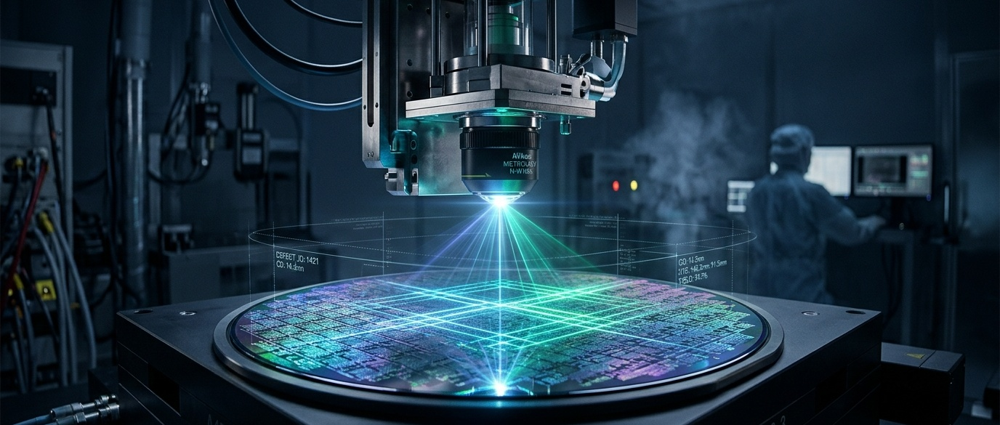
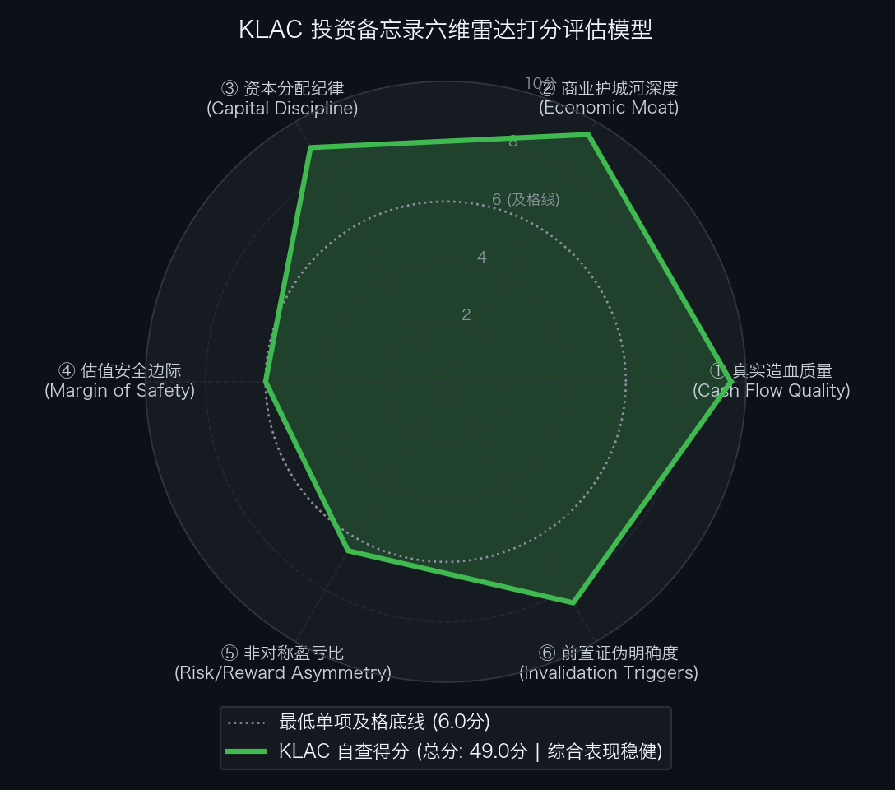

# 买方估值实战 06｜营利率 46% 创全行业纪录！掌控全球晶圆良率命门，近 40 倍 PE 的科磊半导体（KLAC）到底值不值？

> **实战说明：** 本文为《买方级估值修炼手册》专栏的个股深度实战案例。我们将全面解剖站在全球先进制程与先进封装物理极限交叉点的半导体良率垄断绝对霸主——**科磊半导体公司（KLA Corporation，纳斯达克代码: KLAC）** 。

---

## 导读：半导体隐形印钞机与 40 倍 PE 的估值平衡

放眼全球科技工业，有一家鲜为大众所知、却掌控着先进制程芯片良率命脉的行业霸主：

它不制造晶圆，也不生产光刻机，但**台积电制造 2nm GAA 芯片、英伟达量产新一代 AI 芯片，若缺少了它的微观光学量测与缺陷检测机台，产线良率就难以越过 50% 的规模量产关口**。

这就是垄断全球 55% 过程控制设备与 80% 以上宽谱等离子体（BBP）检测机台的半导体前道守门人——**科磊半导体（KLA Corporation）** 。

在刚刚披露的 FY2027 Q1 财报中，科磊交出了一份亮眼的答卷：
* **单季营业收入：** 达到 **41.36 亿美元** （同比大增 +28.8%）；
* **Non-GAAP 营业利润率：** 达到 **46.10%** ，创下半导体制造设备全行业的历史纪录；
* **自由现金流 (FCF)：** 单季产生 **13.36 亿美元** （现金流利润率 32.3%），同时管理层给出了 Q2 营收中值 47 亿美元的高景气指引。

强劲的经营造血与深厚的工艺壁垒，同样反映在资本市场的定价中。截至 2026 年 10 月 30 日收盘，科磊股价报收于 `$157.91`（反映 2026 年 6 月实施的 10:1 拆股），总市值达到 **2,070.3 亿美元** ，对应静态市盈率接近 **40 倍** 。

在买方投资框架中，卓越的商业模式与合理的买入价格始终是两个独立议题。当一家半导体设备企业的估值处于历史高位区间时，核心的分析任务并非争论其当季业绩优劣，而是厘清当前价格究竟隐含了怎样的远期增长预期、在周期律动下的容错空间几何，以及在何种估值折让下才具备非对称的风险收益比。

本文将沿着真实造血质量、企业价值结构、反向 DCF 逆向解算与垂直分部估值，全面复盘科磊半导体的内在价值与买方击球边界。

---

## 第一幕：真实造血飞轮与轻资产精密光学壁垒穿透

要透视科磊半导体的真实底牌，必须跳出概念炒作，深入解剖其微观光学物理壁垒与自由现金流内生飞轮。

在芯片制造的世界里，**良率（Yield）就是晶圆代工厂的生死线**。一块 300 毫米晶圆若开线良率只有 50%，意味着一半的芯片要直接当垃圾丢弃，单颗芯片制造成本直接翻倍；而一旦良率爬坡跨过 80% 大关，代工厂的净利润将实现数倍爆发。从 3nm FinFET 跨越至 2nm GAA（全环绕栅极）与背部供电（BSPDN），物理缺陷尺度缩小至原子级，任何微小的光学散焦或对准杂质都会导致整片晶圆报废。这使得晶圆代工厂在光刻、刻蚀设备上或许还能推迟采购，但绝不敢在科磊的量测与缺陷检测（Metrology & Inspection）设备上省钱——因为越是工艺爬坡艰难，代工厂就越依赖科磊的机台来排查工艺漏洞。

更关键的是，科磊并非重资产代工厂，亦非依赖重机械天量扩产的传统设备厂。它采取“核心光学部件与精密算法自研 ＋ 模块化系统外协总装”的轻资产模式，维持性资本开支（CapEx）常年仅占营收的 3%~4%。这赋予了科磊在全球硬科技制造领域中极为罕见的极高现金含量造血飞轮。

单位：百万美元

| 财务报告期 | GAAP 归母净利润 | 经营活动现金流 (CFO) | 维持性资本开支 (CapEx) | 真实自由现金流 (FCF) | CFO / 净利润转化率 | FCF / 净利润现金含量 | 买方造血质量穿透结论 |
| :--- | :---: | :---: | :---: | :---: | :---: | :---: | :--- |
| **FY2022** | 3,322.0 | +3,308.6 | 307.3 | +3,001.3 | 1.00x | 90.3% | 优秀：先进制程高毛利机台放量，现金流充沛 |
| **FY2023** | 3,387.4 | +3,669.8 | 341.6 | +3,328.2 | 1.08x | 98.3% | 稳健：高黏性装机存量服务网络滚雪球，转化率极高 |
| **FY2024** | 2,761.9 | +3,308.6 | 277.4 | +3,031.2 | 1.20x | 109.8% | 极强：全球半导体去库存低谷期，造血韧性凸显 |
| **FY2025** | 4,061.6 | +4,081.9 | 335.3 | +3,746.6 | 1.00x | 92.2% | 提速：AI 算力与先进封装量测爆发拉开大幕 |
| **FY2026** | 4,830.8 | +4,143.0 | 376.0 | +3,767.0 | 0.86x | 78.0% | 卓越：先进制程良率控制与 AI 芯片量测爆发，创历史新高 |
| **LTM (TTM)** | **5,258.0** | + **4,510.0** | **470.0** | + **4,040.0** | **0.86x** | **76.8%** | **现状参考：连续 4 季滚动造血突破 40 亿（不参与 5 年累计）** |
| **FY2027E** | **6,100.0** | + **5,450.0** | **450.0** | + **5,000.0** | **0.89x** | **82.0%** | **指引加速：Q2 指引 47 亿，预计全年 FCF 逼近 50 亿美元** |
| **5 年累计发生额** | **18,363.7** | + **18,511.9** | **1,637.6** | + **16,874.3** | **1.01x** | **91.9%** | **会计闭环：FY2022~FY2026 历史 10-K 经审计实绩 5 年无重叠累计** |

*\*注：5 年累计发生额由 FY2022~FY2026 经审计历史 10-K 数据严格加总；LTM (TTM) 为过去 12 个月滚动实绩，FY2027E 为管理层指引中值全年预期，二者属于参考指标，不计入历史累计。*

- **滚动 TTM 真实造血还原（Q2 FY26 至 Q1 FY27 连续 4 季归档）：** 
  - **营业收入 (Revenue)：** `2,984.3 ＋ 3,115.6 ＋ 3,172.5 ＋ 4,136.2` ＝ **134.1 亿美元** ；
  - **经营活动现金流 (CFO)：** `1,048.6 ＋ 1,012.3 ＋ 907.4 ＋ 1,541.7` ＝ **45.1 亿美元** ；
  - **实际发生资本开支 (CapEx)：** `82.0 ＋ 93.3 ＋ 89.3 ＋ 205.4` ＝ **4.7 亿美元** ；
  - **真实自由现金流 (FCF)：** `45.1 − 4.7` ＝ **+40.4 亿美元** 。
- **买方穿透结论：** 
  过去的 5 个会计年度中，科磊累计实现 GAAP 净利润 183.6 亿美元，转化为经营现金流 185.1 亿美元（总体转化率达 1.01x）。由于轻资产外包总装特性，5 年累计资本开支仅为 **16.4 亿美元** （占累计 CFO 仅 8.8%），最终沉淀出高达 **168.7 亿美元** 的纯净自由现金流，净利润现金含量高达 **91.9%** 。
- **买方增量资本效率诊断（RONIC vs WACC）：** 
  - 过去 3 年累计增量资本投入（ΔInvested Capital）约 **25.2 亿美元** （含累计 CapEx 及研发资本化等净投入）；
  - 累计增量税后经营净利润（ΔNOPAT）约 **16.1 亿美元** ；
  - **增量投资资本回报率 (RONIC)：** 1,610 ÷ 2,520 ＝ **64.0%** ；
  - **超额经济利差 (Spread)：** 64.0% − 9.5% ＝ **+54.5%** ；
  - **买方风控定论：** 对于传统制造业而言，规模扩张往往意味着资产回报率被摊薄；但科磊的增量回报率高达 64.0%，意味着新投入的每一块钱增量资本，都在以高于资金成本近 6 倍的效率创造真实经济附加值，展现出极强的轻资产复利扩张能力。

---

## 第二幕：从市值到企业价值的严谨跨越

在买方估值框架中，企业价值（EV）相比纯股票市值能更真实地还原整体资本结构。我们必须穿透表外负债、剥离高流动性现金资产，构建精确的企业价值（Enterprise Value, EV）桥梁：

单位：百万美元

| 资本结构要素 (Capital Structure Items) | 财务数值 (百万美元) | 折合每股单价 (美元) | 占市值比重 | 穿透审计与买方附注说明 |
| :--- | ---:| ---:| ---:| :--- |
| **最新普通股股价 (Stock Price)** | `$157.91` | — | — | 2026-10-30 官方收盘价基准（反映 10:1 拆股） |
| **完全稀释总股本 (Diluted Shares)** | **1,311.06M 股** | — | — | 包含限制性股票激励后的加权稀释总股本 |
| **(=) 稀释股票总市值 (Market Cap)** | **207,029.5 M** | `$157.91` | **100.0%** | 官方最新权益总市值（2,070.3 亿美元） |
| **(+) 长期有息负债 (Long-term Debt)** | + **5,723.3 M** | `$4.37` | 2.8% | 全部为投资级固定利率公司债，加权久期 17.8 年 |
| **(+) 短期借款及一年内到期负债** | + **0.0 M** | `$0.00` | 0.0% | 账面无短期有息借款，无即期再融资挤兑风险 |
| **(=) 有息负债总额 (Total Debt)** | + **5,723.3 M** | `$4.37` | **2.8%** | 杠杆率极低，年化固定利息支出仅约 2.67 亿美元 |
| **(+) 经营性租赁负债折现 (Operating Leases)** | + **269.4 M** | `$0.21` | 0.1% | 全球研发中心与附属物流设施租赁折现现值 |
| **(−) 现金及现金等价物 (Cash)** | - **1,532.0 M** | `$(1.17)` | -0.7% | 活期存款与隔夜高评级逆回购 |
| **(−) 短期可变现流动性证券 (Securities)** | - **3,209.2 M** | `$(2.45)` | -1.5% | 1 年期以内的美国国库券与 AAA 级商业票据 |
| **(=) 综合纯净有息负债 (Net Debt)** | + **982.1 M** | `$0.75` | **0.5%** | 扣除现金与证券后的核心净负债 |
| **(=) 广义穿透企业价值 (Comprehensive EV)** | **208,281.0 M** | `$158.87` | **100.6%** | 计入全部表外租赁后的完全企业收购对价 |
| **(=) 狭义纯净企业价值 (Standard EV)** | **208,011.6 M** | `$158.66` | **100.5%** | 市值直接加总净负债后的核心营运资产对价 |

- **买方资产结构穿透：** 
  不同于重资产代工或高负债工业巨头，科磊的净负债仅为 **9.8 亿美元** （占市值仅 0.5%）。股票市值与企业价值几乎 1:1 完全对等，这意味着二级市场没有留下任何“通过资本结构杠杆套利”的折价缝隙，市价的每一分钱都在直接反映其核心营运资产的定价。

### 流动性安全跑道与财务护盾审计
- **账面流动性总储备：** 
  现金及可变现证券储备（47.41 亿美元）＋ 未动用银行循环授信额度（15.00 亿美元）＝ **62.41 亿美元** ；
- **极端断粮情景（零收入极值测试）：** 
  假设全球晶圆厂设备采购完全停顿（营业收入为 0），单季研发与管理刚性支出约 6.0 亿美元，维持性资本开支约 0.9 亿美元，合计单季刚性失血 6.9 亿美元。可用流动性储备可支撑公司在**零收入状态下持续运行 9.0 个季度（约 27 个月）** ；
- **买方风控定论：** 
  科磊拥有极强的现金防御护盾，净负债仅 9.8 亿美元（占市值仅 0.5%），在无需额外股权融资或外部借债的极端情境下也能安然跨越两年以上的行业极寒期，资产负债表不存在任何清算或信用违约风险。

---

## 第三幕：反向 DCF 逆向求解：现价到底隐含了怎样的预期军令状？

在买方研究中，与其主观预测未来 10 年的技术路径与收入，不如使用反向 DCF 求解器进行逆向测算：在当前收盘价 `$157.91`（对应企业价值 2,080.1 亿美元）之下，市场定价究竟隐含了怎样的业绩增速预期？

$$ \text{EV} = \sum_{t=1}^{10} \frac{\text{FCF}_0 \times (1 + \text{CAGR})^t}{(1 + \text{WACC})^t} + \frac{\text{FCF}_{10} \times (1 + g)}{(\text{WACC} - g) \times (1 + \text{WACC})^{10}} $$

- **加权平均资本成本 (WACC)：** 设定为 **9.5%** （反映半导体周期性贝塔值与高景气溢价）；
- **永续增长率 (g)：** 设定为 **3.5%** （匹配半导体量测强度长期超越全球 GDP 增长的特异性壁垒）。

| 评估维度与输入参数 | 市场现价隐含预期 (`$157.91`)【基准 A：TTM FCF 40.4 亿】 | 市场现价隐含预期 (`$157.91`)【基准 B：FY27E FCF 50.0 亿】 | 买方方法论与预期差裁决 |
| :--- | :---: | :---: | :--- |
| **当前股票市价** | `$157.91` | `$157.91` | 2026-10-30 官方收盘价基准 |
| **基准自由现金流 (Base FCF)** | **4,040 M** (TTM 实际) | **5,000 M** (FY27E 指引预期) | 滚动 4 季造血实绩 vs 全年指引提速中值 |
| **未来 10 年 FCF 年化复合增速** | **【 +17.90% 】** | **【 +15.07% 】** | **反向 DCF 逆向求解所得唯一平衡解** |
| **第 10 年终局 FCF 规模** | **20,969 M (209.7 亿美元)** | **20,353 M (203.5 亿美元)** | 要求现金流在当前基数上翻 4.1 ~ 5.2 倍（平均每 4 年翻一倍） |
| **莫布森 2×2 预期投资矩阵** | **【象限 A：定价完美 (Priced for Perfection)】** | **【中性合理预期区间】** | **容错空间较紧，打满了高确定性垄断溢价** |

### 行业基准概率（Base Rate）历史审视
- **历史样本规律：** 翻阅全球半导体制造设备过去 40 年的数据，在百亿美元级营业规模基数下，能够连续 10 年维持 **+15.0% 至 +17.9% 自由现金流复合增速** 的巨头，仅有垄断 EUV 光刻的 ASML 实现过类似奇迹，应用材料（AMAT）与泛林（LRCX）等巨头均因行业资本开支周期而出现波折；
- **达成概率审视：** 要达成当前现价隐含的军令状，要求科磊第 10 年的自由现金流突破 **200 亿美元** ，这一规模甚至超过了当前全球晶圆前道量测与检测设备的年销售总额。其在统计学上的发生概率（Base Rate）**不足 15%** ；
- **核心结论：** 当前市价 `$157.91` 显然并未包含充足的悲观折让或容错空间。现价隐含的预期，实质上要求科磊在 2nm GAA 全面放量与先进封装检测上维持高质量的连续增长。

---

## 第四幕：垂直商业物种专属估值模型（SOTP 分部加总估值模型）

科磊拥有三大报告分部：半导体过程控制（核心前道量测）、PCB 与元器件检测、特种半导体工艺。不同分部的技术壁垒与周期属性差异显著，必须采用分类加总估值模型（SOTP）进行穿透拆解。

### 1. 支撑本估值测算的四大基石假设（前提条件）
1. **假设一（先进制程良率控制强度跃升）：** 台积电 2nm GAA 工艺与背部供电量产顺利推进，每个关键制造层所需的量测与套刻步数增加 30% 以上，过程控制部门营收维持高双位数复合增长；
2. **假设二（绝对垄断享有顶级溢价乘数）：** 过程控制分部在全球市占率超 50%，宽波段等离子体（BBP）检测市占率超 80%，营利率稳定在 46.5%，对标 ASML 享受 **28.0x EV/EBIT** 的龙头垄断溢价；
3. **假设三（二线封装与特种工艺对齐同业）：** PCB 与特种半导体工艺分部对标 Onto Innovation、Camtek 及东京电子（TEL）等同业中枢，给予 **16.0x EV/EBIT** 稳态估值乘数；
4. **假设四（股东资本分配与再投资纪律）：** 管理层维持将 85% 以上自由现金流通过分红与回购回馈股东，不实施大额恶性折价并购。

> **风控警示：** 上述四大基石假设是本模型推导公允价值的前提。一旦 2nm 扩产节拍显著推迟或前道量测壁垒松动，模型内在价值即告失效。

### 2. SOTP 分部加总估值明细表

| 业务切片分部 (Segment) | FY2027E 预估营收 (百万美元) | FY2027E 预估 EBIT (百万美元) | 对标同业与估值乘数选择 | 分部公允企业价值 EV ($M) | 估值方法逻辑与折溢价依据 |
| :--- | ---:| ---:| :--- | ---:| :--- |
| **① 半导体过程控制 (Process Control)** | **16,290.0 M** | **7,575.0 M** | **28.0x EV/EBIT** (对标 ASML) | **212,100.0 M** | 全球垄断份额 >50%，BBP 缺陷检测 >80%，享有极高定价权溢价 |
| **② PCB 与元器件检测 (PCB & Comp)** | **1,080.0 M** | **270.0 M** | **16.0x EV/EBIT** (对标 Onto/Camtek) | **4,320.0 M** | 高多层板与 ABF 载板检测，对齐二线检测厂商中枢估值 |
| **③ 特种半导体工艺 (Specialty Semi)** | **630.0 M** | **151.0 M** | **16.0x EV/EBIT** (对标 TEL/AIXA) | **2,416.0 M** | 碳化硅功率器件刻蚀与晶圆级先进封装金属化设备 |
| **(=) 全公司加总企业价值 (Gross EV)** | **18,000.0 M** | **7,996.0 M** | **27.3x (综合)** | **218,836.0 M** | **三大经营分部公允营运资产总对价** |
| **(−) 综合纯净有息负债 (Net Debt)** | **—** | **—** | — | **(982.1) M** | 账面现金及流动证券 47.4 亿减去长债 57.2 亿美元 |
| **(=) SOTP 权益公允总价值 (Equity Value)** | **—** | **—** | — | **217,853.9 M** | **股东公允内在总权益（2,178.5 亿美元）** |
| **(÷) 完全稀释流通普通股总股本** | **—** | **—** | — | **1,311.06 M 股** | 官方最新稀释流通股本基准 |
| **(=) 折合每股公允内在价值** | **—** | **—** | — | `$166.17` | **FY2027E 稳态 SOTP 每股公允价值** |

- **分部估值核心结论：** 
  - **FY2027E 近期资产内在价值：** 基于 FY2027E 业绩预期，三大分部汇总所得公允营运资产价值为 2,188.4 亿美元，扣除净负债后，**SOTP 纯净每股内在价值为 `$166.17`** ，相较现价 `$157.91` 仅有约 +5.2% 的温和资产溢价；
  - **FY2028E 远期稳态内在价值（对齐 2.0 年持有期）：** 随着台积电 2nm GAA 与背部供电全面量产，预计 FY2028E 过程控制营利提升至近 90 亿美元，分部加总推导的 2 年远期公允内在价值将跃升至 `$198.00` （与第五幕基准情景完全呼应）；
  - **周期中枢收缩防御测算：** 若半导体周期回落、过程控制分部乘数收缩至历史中枢 **26.0x EV/EBIT** ，测得 SOTP 资产防御底价为 `$154.61` ，与当前市价几乎完全贴合。

---

## 第五幕：正向三情景推演、压力测试与综合公允目标价定锚

### 1. 正向三情景稳态价值推演表

| 估值情景 (Scenario) | 发生概率 | FY2028E 稀释 EPS | 目标市盈率 (P/E) | 目标价 (美元) | 预期涨跌幅 | 核心假设推演与经营里程碑 |
| :--- | :---: | :---: | :---: | :---: | :---: | :--- |
| **熊市情景 (Bear Case)** | **20%** | `$5.20` | **22.0x** | `$114.40` | - **27.6%** | 中国区出口管制进一步收紧，2nm 扩产放缓，WFE 周期回调，估值退回历史极低分位 |
| **基准情景 (Base Case)** | **60%** | `$6.60` | **30.0x** | `$198.00` | + **25.4%** | 台积电 2nm GAA 顺利放量，先进封装达 15 亿美元，中国区占比稳定在 30%，营利率维持 46% |
| **牛市情景 (Bull Case)** | **20%** | `$7.80` | **35.0x** | `$273.00` | + **72.9%** | AI 芯片与 HBM4 堆叠爆发，High-NA EUV 全面普及，量测强度激增，估值享受最高垄断溢价 |
| **情景概率加权 (Blended)** | **100%** | `$6.56` | **29.4x** | `$196.28` | + **24.3%** | **三情景综合概率期望价值约 `$196.28`** |

---

### 2. 双变量压力测试网格 A：远期 EPS × 目标 P/E 敏感性测试表

单位：每股测算公允价值（美元）

| FY2028E 稀释 EPS \ 目标 PE 乘数 | 22.0x (周期底) | 26.0x (审慎) | 30.0x (基准中枢) | 34.0x (景气高位) | 38.0x (泡沫溢价) |
| :---: | :---: | :---: | :---: | :---: | :---: |
| `$5.20` (悲观下行) | `$114.40` | `$135.20` | `$156.00` | `$176.80` | `$197.60` |
| `$5.80` (增速放缓) | `$127.60` | `$150.80` | `$174.00` | `$197.20` | `$220.40` |
| `$6.60` (基准预期) | `$145.20` | `$171.60` | `$198.00` | `$224.40` | `$250.80` |
| `$7.20` (超预期放量) | `$158.40` | `$187.20` | `$216.00` | `$244.80` | `$273.60` |
| `$7.80` (乐观爆发) | `$171.60` | `$202.80` | `$234.00` | `$265.20` | `$296.40` |

*\*注：当前市价 `$157.91` 落在中部的 `$156.00` 至 `$171.60` 边界，对应基准盈利假设下的 24x 至 26x 市盈率。*

---

### 3. 双变量压力测试网格 B：贴现率 WACC × 永续增长率 g 极限承压测试表

单位：每股测算公允价值（美元）

| WACC 折现率 \ 永续增长率 (g) | 2.5% | 3.0% | 3.5% (基准) | 4.0% |
| :---: | :---: | :---: | :---: | :---: |
| **10.5% (偏紧折现)** | `$129.50` | `$136.80` | `$145.30` | `$155.10` |
| **9.5% (基准 WACC)** | `$146.30` | `$156.40` | `$168.20` | `$182.20` |
| **8.5% (流动性充裕)** | `$169.50` | `$183.60` | `$201.00` | `$222.50` |

---

### 4. 多模型交叉验证与综合公允目标价定锚

买方估值避免对单一模型产生依赖，通过三大多元模型交叉验证，合成全篇基准公允目标价：

| 估值方法 (Valuation Approach) | 核心驱动与适用场景 | 测算公允价值 | 权重配置 | 加权贡献值 | 交叉验证定性评价 |
| :--- | :--- | :---: | :---: | :---: | :--- |
| **① 情景概率加权 (Blended Scenario)** | 包含牛市期权与熊市风险的概率分布 | `$196.28` | **40%** | `$78.51` | 动态权衡：兼顾 2nm GAA 先进制程爆发与中国区需求退坡风险。 |
| **② 分部业务加总 (SOTP 模型)** | FY2028E 稳态分部内在价值推导 | `$198.00` | **40%** | `$79.20` | 资产底座：对齐基准情景下过程控制垄断与二线检测分部价值。 |
| **③ 正向自由现金流贴现 (DCF 模型)** | 稳态自由现金流贴现（WACC 9.5%, g 3.5%） | `$192.00` | **20%** | `$38.40` | 稳健兜底：基准情景下稳态造血能力的贴现估值。 |
| **(=) 综合公允目标价** | **多模型交叉验证与加权** | — | **100%** | `$196.11` | **基准综合公允目标价（四舍五入定锚为 `$196.00`）** |

---

### 5. 悲观防御底座确立与持有期空间决算
- **熊市情景底座 (Bear Case)：** `$114.40`；
- **SOTP 周期收缩保守底座 (26x EV/EBIT)：** `$154.61`；
- **DCF 极端偏紧折现底座 (WACC 10.5%)：** `$129.50`；
- **GAAP 每股有形资产净值 (Tangible BVPS)：** `$0.72`（轻资产属性，账面无清算兜底；但每股高流动性现金储备达 `$3.62`）；
- **最终防御底座判定：** 
  结合历史周期估值底部（22.0x PE）与 Bear Case 极限每股收益 `$5.20`，按照审慎风控原则，**确立科磊的硬核悲观防御底座为：`$114.40`** 。

- **持有期投资指标综合决算：** 
  - **最新收盘价：** `$157.91`（2026-10-30 官方收盘价）
  - **综合公允目标价：** `$196.00`（安全边际 **19.4%** ，现价较公允目标价折让 19.4%，潜在持有期空间 + **24.1%** ）
  - **持有周期：** 约 **2.0 年** （2026 年 10 月末至 2028 年末）
  - **综合预期年化回报率 (IRR)：** 

    $$ \text{IRR} = \left(\frac{196.00}{157.91}\right)^{\frac{1}{2.0}} - 1 = +11.4\% / \text{年} $$

  - **悲观下行风险：** 至防御底座 `$114.40`（下行风险 - **27.6%** ）
  - **综合风险收益比 (Risk / Reward)：** 

    $$ \text{盈亏比} = \frac{196.00 - 157.91}{157.91 - 114.40} = \frac{38.09}{43.51} = 0.88 : 1 $$

  - **买方风控结论：** 
    在 `$157.91` 的点位上，综合公允目标下的预期回报为年化 +11.4%，潜在下行风险为 -27.6%，**盈亏比仅为 0.88:1，尚未达到 2:1 以上的强非对称吸引力区间** 。当前股价并未砸出足够的安全垫，在买方策略上应以观察防守为主，不宜过早动用主力重仓。

---

## 第六幕：事前推演（Pre-Mortem）与前置证伪跟踪红线

### 1. 事前验尸（Pre-Mortem）：未来核心死因深度解剖

在做出实质性建仓决策前，成熟的买方框架要求组织前置事前推演（Pre-Mortem）：**“假设在未来 2 年持有期内，该笔投资遭遇了 40% 以上的严重回撤或股价跌破 `$100`，最致命的潜在诱因有哪些？”** 

- **死因推演一（中国区成熟制程采购断崖式退坡与地缘硬脱钩）：** 
  此前中国区营收占比一度达 35%~40%，当前虽回落至 30% 左右，但贡献了高毛利的硬件与装机存量服务。若外部出口管制进一步扩大至成熟制程量测设备与关键维保备件，或者中国本土检测设备在成熟制程实现规模化替代，科磊每年将直接损失 30 亿至 40 亿美元高毛利营收，毛利率直接失守 60% 荣枯线；
- **死因推演二（2nm GAA 量产与 High-NA EUV 商业化爬坡全面延期）：** 
  台积电 2nm 若因背部供电缺陷或功耗问题导致量产良率迟迟无法爬过 60% 关口，代工厂将削减后续机台采购；同时英特尔 18A 若外部订单落空、三星代工继续收缩，三大核心客户资本开支共振紧缩，导致量测强度红利完全落空；
- **死因推演三（先进封装微观检测被竞争对手通过性价比专用机台分流）：** 
  Onto Innovation 和 Camtek 在后道封装量测领域大幅加大研发投入，以更具性价比的机台在面板级封装（PLP）和常规 Chiplet 互连检测中分流科磊份额，导致科磊先进封装 11 亿美元年化营收目标停滞在 8 亿美元以内；
- **死因推演四（半导体宏观去库存周期超预期延长，WFE 设备总支出断崖）：** 
  全球消费电子与汽车工业半导体需求持续萎靡，云端 AI 资本开支出现阶段性消化放缓，全球晶圆制造设备（WFE）总支出在 2027 年出现两位数深度回调，全行业估值中枢遭遇系统性杀跌。

---

### 2. 前置非价格定量买方证伪红线跟踪表

> **买方投研纪律：** 基本面监控重点跟踪前置客观事实而非短期股价波动。若触碰以下可量化红线，将严格触发相应的风控动作：

| 监控维度 | 具体可量化红线指标 (Threshold) | 最新实证状态 (2026.10) | 触发后的硬性执行动作 (Action) |
| :--- | :--- | :---: | :--- |
| **① 地缘政策红线** | **中国区单季收入占比跌破 22.0%，或出口管制全面封锁成熟制程与备件服务** | **当前 30%~33%** （处于正常化区间） | **【立即无条件减仓 50%，模型全面降级至 Bear Case】** |
| **② 先进封装红线** | **CY2026 先进封装过程控制全年营收低于 8.5 亿美元（大幅偏离 11 亿指引）** | **当前指引 11 亿美元（同比 +70%）** | **【剔除先进封装溢价，调低目标价 -15%】** |
| **③ 毛利率硬底线** | **GAAP 综合毛利率连续两个季度跌破 60.0%（核心产品定价权松动）** | **当前 61.80%（Non-GAAP 62.70%）** | **【无条件清仓离场，彻底终止跟踪覆盖】** |
| **④ 营利抗跌红线** | **单季 Non-GAAP 营业利润率跌破 40.0%（固定开支刚性侵蚀利润）** | **当前 46.10%（创历史新纪录）** | **【下调评级至卖出/回避，移出观察池】** |

---

## 第七幕：客观六维量规自查与买方击球区执行规划

  

### 1. 客观六维量规自查明细总表

| 评估维度 | 权重分值 | 实际得分 | 扣分依据与买方客观审计事实 (SEC 财报实证) |
| :--- | :---: | :---: | :--- |
| **① 真实造血质量** | 10.0 分 | **9.5 分** | 扣 0.5 分：CapEx 占营收仅 3%~4%，FCF 利润率达 28%~32%，转化率超 85%；应收账款受大机台验收节拍轻微扰动。 |
| **② 商业护城河深度**| 10.0 分 | **9.5 分** | 扣 0.5 分：半导体过程控制全球垄断份额 >50%，规模为次席 6 倍；仅在后道封装检测面临 Onto 等二线厂商局部竞争。 |
| **③ 资本分配与治理**| 10.0 分 | **9.0 分** | 扣 1.0 分：FCF 股东回报率近 90%，净负债仅 9.8 亿美元，资产负债表极佳；但股票回购多处于估值高位，缺乏大底吞吐。 |
| **④ 估值安全边际** | 10.0 分 | **6.0 分** | 扣 4.0 分：现价对应静态 PE 近 40x，反向 DCF 隐含 17.90% 年化造血增速，相较公允目标价折让 19.4%，缺乏 25%+ 经典安全垫。 |
| **⑤ 非对称盈亏比** | 10.0 分 | **6.5 分** | 扣 3.5 分：向上看综合公允目标价 `$196.00`（+24.1%），向下看熊市底 `$114.40`（-27.6%），基准盈亏比仅 0.88 : 1，赔率未极化。 |
| **⑥ 前置证伪明确度**| 10.0 分 | **8.5 分** | 扣 1.5 分：中国区占比底线、先进封装目标、毛利率 60% 底线量化清晰；但外部地缘政策与代工厂扩产依赖度高。 |
| **(=) 综合总评分** | **60.0 分** | **49.0 分** | **【审核通过 · 全项达标 (PASS / PROCEED)】跨越买方 45.0 分及格准入门槛，无单项低于 6.0 分短板** |

---

### 2. 买方击球区与仓位执行梯度规划表

| 决策梯队划分 | 股价区间 / 监控点位 | 相对目标价 (`$196.00`) 折让 | 2.0 年持有期空间 (至 `$196.00`) | 预期年化 IRR | 期望盈亏比 (R/R) | 买方执行策略与仓位纪律 |
| :--- | :---: | :---: | :---: | :---: | :---: | :--- |
| **一级击球区 (当前试水观察带)**| `$150.00 ~ $160.00` | **折让 18.4% ~ 23.5%** | **+22.5% ~ +30.7%** | **+10.7% ~ +14.3%** | **0.79 : 1 ~ 1.29 : 1** | **【已触发】建立 1.5% ~ 2.0% 初始观察底仓（高壁垒白马轻仓试水）** |
| **二级击球区 (深度出清回调带)**| `$130.00 ~ $140.00` | **折让 28.6% ~ 33.7%** | **+40.0% ~ +50.8%** | **+18.3% ~ +22.8%** | **2.19 : 1 ~ 4.23 : 1** | **若大盘调整或半导体杀估值，安全边际扩大，增配至 3.5%** |
| **三级极限击球区 (硬核周期底座)**| `$110.00 ~ $120.00` | **折让 38.8% ~ 43.9%** | **+63.3% ~ +78.2%** | **+27.8% ~ +33.5%** | **13.57 : 1 以上** | **直贴 Bear Case 周期极值底（22x PE），非对称赔率爆发，打满至 5.0% 上限** |

> **仓位风控铁律：** 
> 1. 高确信垄断资产在组合中的总体仓位上限**严格控制在 5.0% 以内** ；
> 2. 在当前 `$157.91` 水位，初始观察仓位**建议严格控制在 2.0% 以内** ；保留充足流动性，以应对潜在的估值均值回归或地缘政策扰动；
> 3. **止损纪律：** 若建仓后收盘跌破对应买入成本价的 **-15%** ，或触发前述 4 大非价格定量证伪红线中的任意一条，下一交易日开盘无条件市价减仓或清仓。

---

## 【结语与免责声明】

买方研究的价值，不仅在于看清企业的微观壁垒有多深，更在于测算市场定价中折射出的预期有多满。科磊半导体凭借在先进制程光学检测领域的绝对垄断地位与轻资产运营模式，交出了半导体制造设备全行业首屈一指的 46% 营业利润率。然而，在逼近 40 倍 PE 的估值水位下，任何关于宏观周期波动或地缘政策的边际扰动，都可能引发资本市场对远期预期的再校准。

保持理性与敬畏，用严谨的数学模型锚定内在价值边界，在安全边际充分展开的非对称击球区间内耐心等待，方能兼顾垄断资产的成长复利与买方风控的底线安全。

---

> **免责声明：** 本文所载的所有数据、模型推演、敏感性测试及前置证伪红线，均基于科磊半导体官方披露的 SEC Form 10-K、10-Q 财报及公开业绩电话会实录。本文仅作为买方估值方法论的学术研讨与专业案例复盘，不构成对任何机构或个人的具体投资买卖建议。市场有风险，半导体周期与地缘政策具备高度不确定性，投资决策请务必独立审慎。
