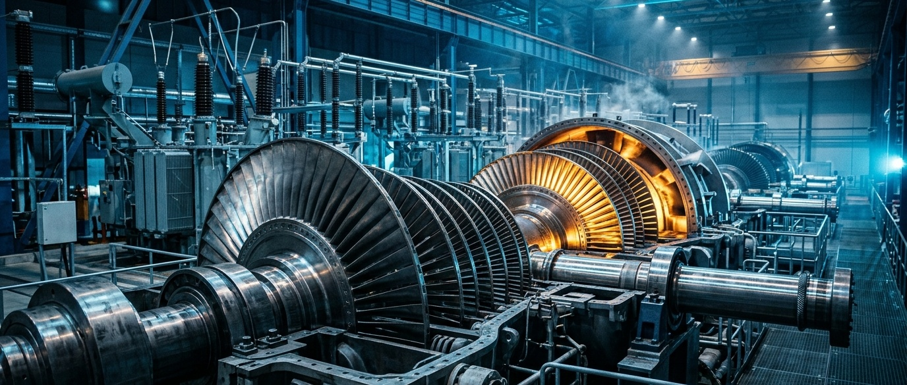
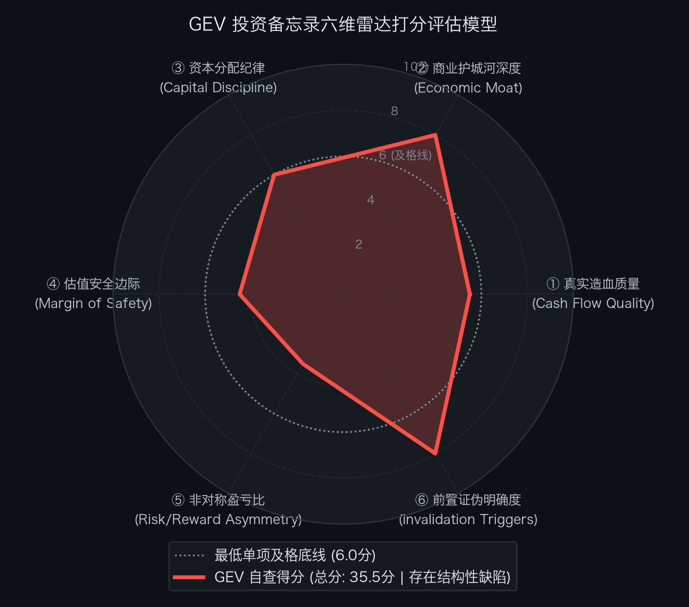

# 买方估值实战 08｜订单暴增96%现金流却靠预收！重挫9%的GE Vernova（GEV）到底值不值？

> **实战说明：** 本文为《买方级估值修炼手册》专栏的个股深度实战案例。我们将全面解剖站在全球 AI 数据中心电力饥渴、天然气重载发电与电网跨代重构交叉点的电力装备绝对霸主——**通用电气凡诺瓦公司（GE Vernova Inc.，纽约证券交易所代码: GEV）** 。

---

## 导读：全球电力巨擘与 2,232 亿市值的估值平衡

放眼全球电气化与能源基础设施工业版图，有一家脱胎于百年通用电气、掌控着全球电力运转中枢的超级庞然大物：

**全球现役运行的发电机组中，约有四分之一来自于它的技术装机** ；全美乃至欧洲老旧电网的扩容与跨代升级，严重依赖它的高压直流输电（HVDC）、巨型变压器与变电站总包；而正在席卷全球的 AI 数据中心热潮，更将天然气重载燃气轮机推上了基荷电力供给的王座。

这就是集燃气轮机、高压电网与风电装备于一体的全球电力基础设施领军者——**GE Vernova（GE Vernova Inc.）** 。

在刚刚披露的 FY2026 Q3 财报中，GE Vernova 交出了一份令人瞩目的基本面答卷：
* **订单与需求爆发：** 单季新获订单高达 **293 亿美元** （有机同比暴增 + **96%** ），在手积压履约义务（RPO）逼近 **1,970 亿美元** ，燃机设备在手积压与槽位预留（Slot Reservation）合计达 **122GW** （管理层预计年底突破 130GW）；
* **营利中枢跃升：** 单季营业收入达到 **126.42 亿美元** （同比大增 +26.8%），调整后 EBITDA 突破 **19.43 亿美元** （同比增长 +139.6%），EBITDA 利润率跳升至 **15.4%** ；
* **现金造血跳增与指引上修：** 前三季度自由现金流 (FCF) 达到 **153.07 亿美元** ，管理层全面上调 2026 全年 FCF 指引至 **160 亿 ～ 170 亿美元** 的历史极值。

强劲的电力超级周期叙事，此前曾推动公司股价在 11 月 3 日一度狂飙至 `$918.20`（市值 2,460 亿美元）。然而在买方风控常识中，高位缺乏安全边际的资产极易遭遇剧烈均值回归。截至 2026 年 11 月 4 日官方收盘，GE Vernova 股价**单日暴跌 -9.30%（-85.37 美元）** ，报收于 `$832.83`（盘中最低下探至 `$806.40`，盘后进一步探至 `$826.05`），完全稀释总市值回落至 **2,232.0 亿美元** ，扣除 139.4 亿美元净现金后，狭义标准企业价值（EV）收敛至 **2,092.6 亿美元** 。

在买方投资框架中，**卓越的产业卡位与合理的买入价格永远是两道独立的考题** 。即便经历单日逾 9% 的大幅下挫，当一家刚刚由巨亏反转而来的工业巨头依然沉淀在两千亿以上企业价值的高位时，买方的首要职责绝不是沉浸在宏大叙事中盲目抄底，而是冷酷地穿透财务报表底牌：
1. 2026 年前三季度高达 153 亿美元的自由现金流，到底有多少是真正的经营造血，有多少是源于客户预付款与合同负债膨胀带来的“流动性浮存”？
2. 即使经历本次深度回调，在当前 `$832.83` 市价之下，反向 DCF 逆推到底仍要求公司未来 10 年完成怎样的造血神话？在人类百年工业商业史大数中，该神话兑现的客观概率几何？
3. 在风电业务仍未彻底扭亏、电网大型工程项目交付摩擦频发的现实下，二级市场这轮大跌究竟是杀估值的开始，还是已经砸出了黄金击球区？买方的安全击球边界究竟在何处？

本文将沿着真实造血质量、企业价值结构、反向 DCF 逆向求解、SOTP 分部重估与双变量压力测试，全面复盘 GE Vernova 的内在价值与买方击球边界。

---

## 第一幕：真实造血飞轮与商业机制穿透

要透视 GE Vernova 的真实底牌，必须跳出概念炒作，深入解剖其微观商业收费机制与自由现金流内生飞轮。

### 商业模式与客户锁死机制
GE Vernova 的商业模式兼具**重资产设备销售**与**长周期高粘性服务履约**双重属性：
1. **天然气发电（Power 分部）：** 客户采购一台单价数千万美元的 HA 级或 F 级重型燃机只是商业关系的开端。燃机内部涡轮叶片长期在超过 1,500 摄氏度高温高压下运转，客户必须强制与原厂签署长达 10~25 年的 **长期服务协议（LTSA）** ，由 GEV 独家提供高频定检、大修与高毛利热通道备件更换。这种“设备为基、服务抽血”的模式，构筑了全球 25% 发电装机存量的现金流收割机；
2. **电气化电网（Electrification 分部）：** 伴随全球新能源并网与 AI 超算中心高功耗负荷，高压变压器与开关设备供不应求。GEV 掌控特高压与直流输电核心技术，产品交期排至 3~4 年后，掌握着极强的议价权与调价权；
3. **风电业务（Wind 分部）：** 陆上风电逐步趋稳，但海上风电此前因供应链通胀、固定价总包合同与叶片质量问题，仍处于亏损修复周期。

单位：百万美元（比率列除外）

| 财务报告期 | GAAP 归母净利润 | 经营活动现金流 (CFO) | 资本开支 (CapEx) | 真实自由现金流 (FCF) | CFO / 净利润转化率 | FCF / 净利润现金含量 | 买方造血质量穿透结论 |
| :--- | :---: | :---: | :---: | :---: | :---: | :---: | :--- |
| **FY2022** | (2,736) | (114) | 513 | (627) | — | — | 大额经营亏损，自由现金流严重失血 |
| **FY2023** | (438) | 1,186 | 744 | 442 | — | — | 净利为负，正 CFO 主要受 11 亿营运资本注入粉饰 |
| **FY2024** | 1,552 | 2,583 | 883 | 1,701 | 1.66x | 1.10x | 盈利反转，但含分拆过渡与 11 亿营运资本贡献 |
| **FY2025** | 4,884 | 4,987 | 1,277 | 3,710 | 1.02x | 0.76x | 稳态放量，CFO 含合同负债增加约 80 亿美元预收款 |
| **LTM (TTM)** | **10,368** | **19,216** | **2,101** | **17,115** | **1.85x** | **1.65x** | **现状参考：过去 12 个月滚动实绩（受 40 亿 Prolec 重估及 195 亿预收扰动，不参与累计）** |
| **FY2026E (指引)** | **[未单独指引]** | **[未单独指引]** | **[未单独指引]** | **16,500** | **—** | **—** | **预期参考：官方全年 FCF 指引中值 160–170 亿美元（非 GAAP，节点自适应）** |
| **5 年累计发生额** | **[会计非等额]** | **[会计非等额]** | **[会计非等额]** | **21,726** | **—** | **—** | **会计闭环：4 年历史经审计累计 5,226 ＋ 1 年指引 16,500 百万美元（见附注）** |

*\*注：5 年累计发生额由 FY2022–FY2025 四个完整历史经审计年度（累计 FCF 为 5,226 百万美元）加上 FY2026 官方 FCF 指引中值 16,500 百万美元构成；LTM 滚动实绩包含跨期重叠季度，已显性剔除出累计计算。*

### 滚动 TTM 真实造血还原与营运资本暗门穿透
- **过去 12 个月滚动现金流还原（截至 2026-09-30）：**
  - **经营活动现金流 (CFO)：** `16,737 (9M26) ＋ 4,987 (FY25) − 2,508 (9M25) = 19,216 百万美元`；
  - **实际资本开支 (CapEx)：** `1,430 (9M26) ＋ 1,277 (FY25) − 606 (9M25) = 2,101 百万美元`；
  - **滚动自由现金流 (FCF)：** `19,216 − 2,101 = 17,115 百万美元`。

- **买方造血质量深度排雷（合同负债与预收款透视）：**
  表面上看，LTM 产生的 171.2 亿美元自由现金流蔚为壮观。然而，穿透 2026 年前三季度现金流量表附注，真相昭然若揭：
  1. **合同负债与递延收入现金贡献：** 仅 2026 前三季度，合同负债与递延收入的现金流入就高达 **195.11 亿美元** ！
  2. **营运资产刚性占用：** 同期应收账款占用现金 16.67 亿美元，存货及递延成本占用 20.52 亿美元，合同资产占用 3.45 亿美元；
  3. **买方定论：** 所谓“爆发式现金流”，实质上是全球公用事业客户与科技巨头为了抢夺紧缺的燃机产能与变压器交付槽位（Slot），**向 GEV 账户集中打入的海量预付款与工程进度款** ！这笔天量现金本质上是客户提供的 **无息运营负债** 。一旦未来 1~2 年新签订单节拍正常化，公司必须开工采购钢材、稀贵合金并支付庞大工程安装成本，这些合同负债将迅速转入存货与工程消耗，届时自由现金流将面临剧烈的均值回归。买方严禁直接将 2026 年的预收高峰当成稳态现金流。

- **增量资本回报效率（RONIC vs WACC）：**
  GEV 自 2024 年 4 月自 GE 集团独立分拆，历史重组成本高昂，且 2026 前三季度净利润包含了约 40 亿美元 Prolec 原持股重估收益，导致会计报表利润失真。剔除重估收益后，当前增量投入主要流向燃机供应链扩能、电网变压器扩产（2025–2028 年计划投入 60 亿 CapEx 与 50 亿研发）以及拟耗资 90 亿美元收购 Trench Group。若新增产能无法维持当前 20%+ 的高毛利率，增量资本回报率（RONIC）将快速衰退至资本成本（WACC 9.0%）边缘。

---

## 第二幕：从市值到企业价值的严谨跨越

在买方估值框架中，企业价值（EV）相比纯股票市值能更真实地还原整体资本结构。我们必须穿透表外负债、剥离高流动性现金资产，构建精确的企业价值（Enterprise Value, EV）桥梁：

| 资本结构要素 (Capital Structure Items) | 账面金额 (百万美元) | 折合每股价值贡献 (美元) | 占市值比重 | 穿透审计与买方附注说明 |
| :--- | ---:| ---:| ---:| :--- |
| **最新普通股股价 (Stock Price)** | `$832.83` | — | — | 2026-11-04 官方收盘价基准（单日暴跌 -9.30%） |
| **完全稀释总股本 (Diluted Shares)** | **268.000 百万股** | — | — | Q3 稀释加权平均股数（期末已发行 264.68M） |
| **(=) 稀释股票总市值 (Market Cap)** | **223,198.4** | `$832.83` | **100.0%** | 官方最新权益总市值（2,232.0 亿美元） |
| **(+) 长期有息负债 (Long-term Debt)** | + **2,795.0** | `$10.43` | 1.3% | 不含一年内到期部分；含融资租赁款 |
| **(+) 短期借款及一年内到期负债** | + **31.0** | `$0.12` | 0.0% | 借款附注披露，流动负债项 |
| **(=) 有息负债总额 (Total Debt)** | + **2,826.0** | `$10.54` | **1.3%** | 负债结构极度健康，无短期再融资压力 |
| **(+) 经营性租赁负债折现 (Operating Leases)** | + **852.0** | `$3.18` | 0.4% | 分列于其他流动及非流动负债；全口径补充 |
| **(−) 现金及现金等价物与受限储备** | - **16,764.0** | `($62.55)` | -7.5% | 现金及等价物 16,733 ＋ 受限现金 31 |
| **(=) 综合纯净有息负债 (Net Cash)** | **(13,938.0)** | `($52.01)` | - **6.2%** | **总现金储备扣除总借款（净现金约 139.4 亿美元）** |
| **(=) 狭义纯净企业价值 (Standard EV)** | **209,260.4** | `$780.82` | **93.8%** | **市值减去净现金（核心营运资产标准 EV）** |
| **(=) 广义穿透企业价值 (Comprehensive EV)** | **210,112.4** | `$784.00` | **94.1%** | **计入经营租赁后的全面营运资产对价** |

### 流动性安全跑道与财务护盾审计
- **账面可用流动性总储备：** 现金及受限储备（167.64 亿美元）＋ 未动用循环信贷额度（30.00 亿美元）＝ **197.64 亿美元** （另有 30 亿美元备用信用证额度主要用于工程履约担保，不计入机动现金）；
- **极端断粮情景（零收入极值测试）：** 
  假设全球电力设备采购因不可抗力完全停摆（单季营业收入为 0），单季刚性研发开支约 3.5 亿美元，固定管理开支与维持性支出约 9.5 亿美元，维持性资本开支约 4.0 亿美元，合计单季刚性失血 17.0 亿美元。账面可用资金可支撑公司在**零收入状态下持续运转 11.6 个季度（约 35 个月）** ；
- **买方风控定论：** GEV 拥有高达 139.4 亿美元的纯净现金护盾，资产负债表反脆弱性极强，短期毫无信用或流动性违约风险。然而，资产负债表上真正沉重的负担是 **456.69 亿美元的流动合同负债** 与 **16.65 亿美元的产品质保负债** ，未来资金流向将由履约执行质量而非债务偿付决定。

### 资本分配与股东回报核验
FY2026 前三季度公司回购普通股约 52.96 亿美元、支付股息 4.06 亿美元；股份支付费用仅 1.94 亿美元，期末股数净减少约 1.8%（约 4.85 百万股），短期内回购缩股效应明确。10 月董事会将回购授权大幅提高至 200 亿美元。然而，公司拟以 **90 亿美元等值对价收购 Trench Group** （预计 2027 年底交割），叠加 2025–2028 年 110 亿美元资本开支与研发计划，资本开支、大型并购与高位股票回购将同时争夺现金。买方风控严禁将授权额度误当成确定性的每股增厚。

---

## 第三幕：反向 DCF 逆向求解：大跌后现价隐含了怎样的预期军令状？

在买方估值体系中，与其主观臆测未来 10 年的电网与燃机收入，不如使用反向 DCF 模型进行逆向测算：在经历单日暴跌 -9.30% 之后的最新收盘价 `$832.83`（对应标准企业价值 **2,092.6 亿美元** ）之下，二级市场定价到底隐含了怎样的自由现金流年化复合增速要求？

$$ \text{EV} = \sum_{t=1}^{10} \frac{\text{FCF}_0 \times (1 + \text{CAGR})^t}{(1 + \text{WACC})^t} + \frac{\text{FCF}_{10} \times (1 + g)}{(\text{WACC} - g) \times (1 + \text{WACC})^{10}} $$

- **折现率 (WACC)：** 设定为 **9.0%** （匹配成熟重型发电设备与电网工程制造的资本成本）；
- **永续增长率 (g)：** 设定为 **2.5%** （匹配成熟期全球电力工业长周期稳态增长）。

| 评估维度与输入参数 | 市场现价隐含预期 (`$832.83`)【基准 A：FY2025 经审计 FCF】 | 市场现价隐含预期 (`$832.83`)【基准 B：FY2026 官方指引中值】 | 买方方法论与预期差裁决 |
| :--- | :---: | :---: | :--- |
| **当前股票市价** | `$832.83` | `$832.83` | 2026-11-04 官方收盘价基准（暴跌 -9.30%） |
| **起始自由现金流 (Base FCF)** | **37.10 亿美元** (经审计常态造血) | **165.00 亿美元** (官方指引预期中点) | 剔除预收的稳态造血 vs 营运资本高峰值 |
| **未来 10 年 FCF 年化复合增速** | **【 +19.42% 】** | **【 -0.41% 】** | **反向 DCF 逆向求解所得唯一平衡解** |
| **第 10 年终局 FCF 规模** | **218.9 亿美元** | **158.3 亿美元** | 终局稳态现金流门槛（百万美元） |
| **终局价值折现占比 (PV of TV)** | **69.7%** | **50.4%** | 远期估值对终局的依赖程度 |
| **显性期现金流现值 (PV of Explicit)** | **634.4 亿美元** (30.3%) | **1,038.1 亿美元** (49.6%) | 前 10 年自由现金流折现总和 |
| **FCF 净扩张倍数 (10th / Base)** | **5.90x** | **0.96x** | 考卷严苛程度对比 |
| **莫布森 2×2 预期投资矩阵** | **【象限 A：定价偏紧 (High Expectations)】** | **【中性合理区间（假定预收可重复）】** | **隐含年化 +19.42% 增速门槛极高，容错率极低** |

### 行业基准概率（Base Rate）历史审视
- **历史样本规律：** 翻阅美股重型机械、发电设备与公用事业过去 50 年的商业史样本，对于一家完全稀释市值逾 2,230 亿美元的超大型工业制造巨头，要在已经实现扭亏的基础之上，**连续 10 年维持近 +19.4% 的自由现金流复合增速** ，其客观统计发生概率（Base Rate）依然低于 **5.0%** ；
- **达成前提与苛刻门槛：** 考卷 A 要求 GEV 在 2036 年的年自由现金流突破 **218.9 亿美元** （较 2025 年扩张近 6 倍）。这要求全球天然气燃机在手订单无重大延误、全球电网投资持续狂飙不出现财政缩紧、海上风电从年亏 5 亿逆转为稳健盈利、且原材料与工人工资通胀完全不侵蚀毛利率；
- **买方逆向定论：** 单日暴跌 -9.30% 固然促使市场情绪阶段性出清，但以常态造血基准考量，现价隐含的 + **19.42%** 自由现金流复合增速考卷 **依然极其苛刻，绝未跌出真正的安全边际** 。如果投资者把 2026 年因抢夺槽位而激增的 195 亿美元合同负债预收款当成长期年金，现价看似持平（仅需年化 -0.41%）；但买方投资纪律严禁将营运负债浮存误认为内生造血。在考卷 A 的审视下，现价 `$832.83` 依然容错率偏低。

---

## 第四幕：垂直商业物种专属估值模型（SOTP 分部加总估值模型）

GE Vernova 涵盖天然气燃机设备与服务、电网高压变电工程以及海上/陆上风电三大截然不同的业务板块。不同分部的成长驱动、毛利中枢与风险溢价大相径庭，必须采用分类加总估值模型（SOTP）进行穿透拆解。

### 1. 支撑本估值测算的四大基石假设（前提条件）
1. **假设一（燃机设备交付与高毛利 LTSA 飞轮）：** 122GW 在手设备积压与槽位预留稳步转化为出货，燃机服务收入在 2028 年突破 120 亿美元，整体 Power 分部 2028E EBITDA 达到 **65.0 亿美元** ，享受 **24.0x EV/EBITDA** 的核心工业垄断乘数；
2. **假设二（电网超级周期与变压器持续提价）：** Electrification 分部在 AI 数据中心高负荷与新能源并网驱动下维持双位数增长，Prolec 变压器整合顺畅，2028E EBITDA 达到 **34.0 亿美元** ，给予 **28.0x EV/EBITDA** 景气成长溢价乘数；
3. **假设三（风电业务大幅减亏并实现微利）：** 海上风电历史包袱出清，2026 年亏损 4–5 亿美元后逐步收窄，2028E EBITDA 仅留微幅亏损 -2.0 亿美元，给予 **3.0x EV/EBITDA** 的极低残余价值保护；
4. **假设四（并购与资本纪律不恶化）：** Trench Group 90 亿美元收购如期交割且不产生大额商誉减值，未分摊 Corporate 成本按每年 7.0 亿美元资本化（以 15.0x 乘数扣除 -105 亿美元企业价值）。

> **风控警示：** 上述四大基石假设是本模型推导公允价值的前提。一旦燃机槽位转化遇阻或电网交付违约，分部估值即告失效。

### 2. SOTP 分部加总估值明细表

单位：百万美元（特殊标注除外）

| 业务切片分部 (Segment) | 2028E 预估 EBITDA | 估值对标与倍数选择 | 分部公允企业价值 EV | 估值方法逻辑与折溢价依据 |
| :--- | ---:| :---: | ---:| :--- |
| **① 天然气发电分部 (Power)** | **6,500.0** | **24.0x EV/EBITDA** | **156,000.0** | 122GW 槽位支撑，LTSA 长期服务贡献稳定高毛利自由现金流 |
| **② 电气化电网分部 (Electrification)** | **3,400.0** | **28.0x EV/EBITDA** | **95,200.0** | 电网跨代扩容与变压器紧缺，成长最快分部，享受景气估值溢价 |
| **③ 风力发电设备分部 (Wind)** | **(200.0)** | **3.0x EV/EBITDA** | **(600.0)** | 审慎按微幅亏损保守估值，仅保留重资产拉丝与叶片厂残值 |
| **④ 未分摊集团管理成本 (Corporate)** | **(700.0)** | **15.0x EV/EBITDA** | **(10,500.0)** | 集团总部运营摩擦与法务、合规刚性开支资本化扣减 |
| **(=) 全公司加总企业价值 (Gross EV)** | **9,000.0** | **26.7x (综合)** | **240,100.0** | **三大核心经营分部公允营运资产总对价** |
| **(−) 综合纯净有息负债 (Net Cash)** | **—** | — | **(13,938.0)** | 加回账面净现金储备（167.64 亿现金减 28.26 亿总借款） |
| **(=) SOTP 权益公允总价值 (Equity Value)** | **—** | — | **254,038.0** | **归属普通股股东公允内在总权益（2,540.4 亿美元）** |
| **(÷) 完全稀释流通普通股总股本** | **—** | — | **268.000 百万股** | 官方最新稀释流通股本基准 |
| **(=) 折合每股公允内在价值** | **—** | — | `$948.00` | **2028E 稳态 SOTP 基准目标价（四舍五入定锚）** |

- **分部估值核心结论：** 
  - 基于 2028E 交付兑现的稳态 SOTP 测算，GE Vernova 的每股公允内在价值为 `$948.00`；
  - 经历单日 -9.30% 深度回调后，相较最新市价 `$832.83`，SOTP 稳态目标价（`$948.00`）所对应的理论持有期空间为 + **13.8%** ；
  - 估值虽然不再处于极端高位泡沫状态，但 +13.8% 的两年期理论空间依然缺乏经典买方 25%+ 的安全边际。

---

## 第五幕：正向三情景推演、压力测试与综合公允目标价定锚

### 1. 正向三情景稳态价值推演表

| 估值情景 (Scenario) | 发生概率 | 2028E 核心 EBITDA | 综合分部定价倍数 | 目标价 (美元) | 相对现价 (`$832.83`) | 核心假设推演与经营里程碑 |
| :--- | :---: | :---: | :---: | :---: | :---: | :--- |
| **悲观防御情景 (Bear Case)** | **20%** | 67.0 亿美元 | SOTP 悲观收缩倍数 | `$565.00` | - **32.2%** (下行敞口) | 槽位订单转化延期，电网供应链瓶颈，Wind 亏损超 5 亿，估值倍数系统性回落 |
| **基准公允情景 (Base Case)** | **60%** | 90.0 亿美元 | SOTP 基准稳态倍数 | `$948.00` | + **13.8%** (持有期空间) | 燃机 122GW 稳步放量，服务毛利维持，变压器持续提价，Wind 亏损收窄至微亏 |
| **乐观爆发情景 (Bull Case)** | **20%** | 111.0 亿美元 | SOTP 景气共振倍数 | `$1,267.00` | + **52.1%** (上行爆发) | AI 超算中心用电爆发引发天然气抢装潮，电网毛利突破 22%，Wind 彻底扭亏为盈 |
| **概率加权期望目标价** | **100%** | — | — | `$935.00` | + **12.3%** (加权空间) | **三情景综合概率期望价值约 935.00 美元** （`$935.00`） |

### 2. 双变量压力测试网格 A：远期核心 EBITDA × 综合 EV/EBITDA 敏感性测试表

单位：每股测算公允价值（美元）；固定简化净现金 139.38 亿美元、稀释股本 268.0 百万股。

| 2028E 核心 EBITDA \ 综合倍数 | 20x (周期底) | 23x (审慎中枢) | 26x (基准稳态) | 29x (景气高位) | 32x (泡沫溢价) |
| :--- | :---: | :---: | :---: | :---: | :---: |
| **6.7 亿美元 (Bear 经营受阻)** | `$552.01` | `$627.01` | `$702.01` | `$777.01` | `$852.01` |
| **8.0 亿美元 (温和复苏放缓)** | `$649.02` | `$738.57` | `$828.13` | `$917.68` | `$1,007.23` |
| **9.0 亿美元 (Base 稳态基准)** | `$723.65` | `$824.40` | `$925.14` | `$1,025.89` | `$1,126.63` |
| **10.0 亿美元 (超预期交付)** | `$798.28` | `$910.22` | `$1,022.16` | `$1,134.10` | `$1,246.04` |
| **11.1 亿美元 (Bull 景气共振)** | `$880.37` | `$1,004.62` | `$1,128.87` | `$1,253.13` | `$1,377.38` |

*\*注：大跌后最新市价 `$832.83` 已从 26x 倍数上方回落至 23x EV/EBITDA 中枢，盘中最低 `$806.40` 更是一度触及 22.5x 估值中枢，高位泡沫得到显著挤压。*

### 3. 双变量压力测试网格 B：贴现率 WACC × 永续增长率 g 极限承压测试表

以 FY2025 经审计的 37.10 亿美元常态 FCF 为审慎基数，显性设定前 5 年 FCF 年化增速 25%、后 5 年增速 12%，测试不同宏观利率与永续增长环境下的内在价值：

单位：每股内在价值（美元）

| 贴现率 (WACC) \ 永续增长率 (g) | 1.5% | 2.0% | 2.5% (基准) | 3.0% | 3.5% |
| :--- | :---: | :---: | :---: | :---: | :---: |
| **8.0% (流动性宽松)** | `$860.69` | `$908.44` | `$964.87` | `$1,032.59` | `$1,115.35` |
| **8.5%** | `$792.13` | `$831.39` | `$877.19` | `$931.33` | `$996.29` |
| **9.0% (基准折现率)** | `$733.03` | `$765.68` | `$803.35` | `$847.30` | `$899.24` |
| **9.5%** | `$681.61` | `$709.02` | `$740.35` | `$776.50` | `$818.68` |
| **10.0% (极限流动性紧缩)** | `$636.50` | `$659.72` | `$686.03` | `$716.10` | `$750.80` |

### 4. 多模型交叉验证与综合公允目标价定锚

| 估值方法维度 | 核心逻辑与适用场景 | 测算公允价值 | 权重配置 | 加权价值贡献 | 交叉验证买方定性评价 |
| :--- | :--- | :---: | :---: | :---: | :--- |
| **① 三情景概率加权 SOTP** | 兼顾牛市爆发与熊市订单延期风险的概率分布 | `$935.00` | **50%** | `$467.50` | 动态平衡：客观权衡电力超级周期与预收款退潮冲击 |
| **② Base Case SOTP 基准** | 2028E 燃机高毛利服务与电网变压器稳态兑现 | `$948.00` | **30%** | `$284.40` | 资产底座：对齐基准交付情景下的分部内在价值 |
| **③ Base Case DCF 现金流折现** | 常态 FCF 外推 25%/12% 高增长路径折现 | `$803.35` | **20%** | `$160.67` | 稳健兜底：剔除预收款幻觉后的真金白银造血底线 |
| **(=) 综合公允目标价** | **多模型交叉验证加权合成** | — | **100%** | `$913.00` | **基准公允目标价（四舍五入定锚为 913.00 美元）** |

### 5. 悲观防御底座确立与持有期空间决算
- **熊市情景底座 (Bear Case Floor)：** `$565.00`（对应 2028E 67 亿 EBITDA 与周期收缩估值）；
- **DCF 极限承压紧缩底座 (WACC 10.0%, g 1.5%)：** `$636.50`；
- **硬核防御底座判定：** 确立 GEV 在周期回调与订单消化期的 **核心防御底座为：** `$565.00`。

- **持有期投资指标综合决算** （基于大跌后最新市价 `$832.83`）： 
  - **最新官方收盘价：** `$832.83`（2026-11-04 官方收盘价，单日暴跌 -9.30%，-`$85.37`，盘中最低探至 `$806.40`，盘后进一步走低至 `$826.05`）
  - **相对综合公允目标价折让：** 现价较综合公允价值（`$913.00`）**折让 8.8%** （折溢价空间为 + **9.63%** ）
  - **相对 Base Case 目标价空间** （`$948.00`）：+ **13.83%** （+ `$115.17`）
  - **2.0 年预期年化复合回报率 (IRR)：** 
    $$ \text{IRR} = \left(\frac{948.00}{832.83}\right)^{\frac{1}{2.0}} - 1 = \mathbf{+6.69\% / \text{年}} $$
    *(年化回报提升至 6.69%，已明显高于 4.90% 的 10 年期美债收益率)*
  - **相对 Bear Case 防御底座下行风险** （`$565.00`）：- **32.16%** （- `$267.83`）
  - **基准期望风险收益比 (盈亏比)：** 
    $$ \text{盈亏比} = \frac{948.00 - 832.83}{832.83 - 565.00} = \frac{115.17}{267.83} = \mathbf{0.43 : 1} $$
    *(即每承担 1 美元的潜在下行风险，仅能博取 0.43 美元的预期收益，显著低于买方要求的 1:1 健康做多底线，胜率与赔率依然处于劣势！)*
  - **乐观情景牛熊比 (Bull vs Bear)：**
    $$ \text{牛熊盈亏比} = \frac{1,267.00 - 832.83}{832.83 - 565.00} = \frac{434.17}{267.83} = \mathbf{1.62 : 1} $$
  - **买方风控结论：** 
    单日暴跌 -9.30% 是市场对此前极端过度狂热的第一次大规模集中出清。盘中最低点 `$806.40` 已经极其逼近买方的一级击球区（`$730 ~ $800`）上限（仅距 `$6.40`）。现价 `$832.83` 处于 **回调过渡观察带** （`$800 ~ $880`）中低位，此时依然需要保持纪律，切忌急躁抢跑，耐心等待价格砸入击球区。

---

## 第六幕：事前推演（Pre-Mortem）与前置证伪跟踪红线

### 1. 事前验尸（Pre-Mortem）：未来核心死因深度解剖
在做出实质性投资前，买方风控强制展开事前推演：**“假设站在 2028 年末回望，该笔投资遭遇了 40% 以上的惨重亏损（股价跌破 500 美元），最致命的原因有哪些？”**

- **死因一（客户预付款退潮与现金流断层出现）：** 
  超大规模云厂商与公用事业客户在集中完成 2024–2026 年的算力机房电力槽位抢订后，由于下游 AI 变现滞后，新签订单增速骤降。前期大额预付款转入实际采购与设备出货期，但新进预付款枯竭，导致 2027–2028 年自由现金流从 160 亿美元断崖式跌回 30 亿美元左右。市场猛然醒悟此前的天量现金流并非真实稳态造血，高估值倍数系统性坍塌；
- **死因二（供应链通胀与高价总包合同现场成本失控）：** 
  重载燃机高温单晶合金、高压变压器取向硅钢及熟练技工短缺，导致 GEV 在 2025–2026 年锁定的长期固定价总包合同在交付时遭遇剧烈成本通胀。毛利空间被供应链涨价与工期延误罚款彻底侵蚀，Power 与电网分部利润率失守 15% 关口；
- **死因三（海上与陆上风电业务亏损再次失控扩口）：** 
  海上风电老旧机组再次出现叶片裂纹或齿轮箱质量索赔，深水总包安装船只租金暴涨，导致风电部门不仅未能在 2028 年收窄亏损，反而单年计提超 15 亿美元的合同亏损，直接反噬集团核心利润；
- **死因四（90 亿美元巨额并购引发商誉减值与资金链紧绷）：** 
  以约 90 亿美元等值对价收购 Trench Group 交割后，欧洲电网反垄断审查附带严苛分拆条件，业务整合协同远不及预期，不仅吞噬了账面大半净现金，更在后续计提巨额商誉减值，迫使公司暂停股票回购。

---

### 2. 前置非价格定量买方证伪红线跟踪表

> **买方投研纪律：** 基本面跟踪严禁与短期股价波动挂钩。只要触碰以下客观事实红线，无条件触发硬性执行动作：

| 监控维度 | 具体可量化红线指标 (Threshold) | 最新实证状态 (2026 Q3) | 触发后的硬性执行动作 (Action) |
| :--- | :--- | :---: | :--- |
| **① 燃机槽位红线** | **设备 backlog + slot reservation 连续 2 个季度环比下降且无合理出货交付解释** | 约 122GW（年末目标 ≥ 130GW） | **【下调 Power 增速假设，按 Bear 倍数重估】** |
| **② 分部利润率红线**| **Power 利润率连续 2 季低于 17%，或 Electrification 连续 2 季低于 15%** | Q3 分别为 21.4% 与 19.1% | **【将 Base EBITDA 至少下修 15%，暂停买入】** |
| **③ 风电止血红线** | **全年 Wind EBITDA 亏损超出 5 亿美元上限，或新增重大海上风电索赔计提** | 9M 累计亏损 5.85 亿美元（公司指引全年 4–5 亿） | **【Wind 业务残值归零，目标价下调一档】** |
| **④ 现金转换红线** | **合同负债连续 2 季下降同时存货/合同资产增加、单季 FCF 转负** | 9M CFO 167 亿，合同负债增加 195 亿 | **【将估值基数彻底切回 FY25 常态 FCF】** |
| **⑤ 并购资本纪律** | **Trench 交割后账面净现金跌破 50 亿美元，或并购杠杆率超 2.0x EBITDA** | 交易仍待审批，预计 2027 年底交割 | **【暂停回购增值假设，重审资本分配评级】** |

---

## 第七幕：客观六维量规自查与买方击球区执行规划

  

### 1. 客观六维量规自查明细总表

| 评估维度 | 权重分值 | 实际得分 | 扣分依据与买方客观审计事实 (SEC 财报实证) |
| :--- | :---: | :---: | :--- |
| **① 真实造血质量** | 10.0 分 | **5.5 分** | **【不及格】** 扣 4.5 分：历史造血周期短；2026 前三季度高达 153 亿美元 FCF 包含 195.1 亿美元客户预收款与合同负债现金贡献，不具备可持续性。 |
| **② 商业护城河深度**| 10.0 分 | **8.0 分** | 扣 2.0 分：全球在役机组贡献全球约 1/4 发电量，燃机 HA 架构与高压电网壁垒深厚；但 Wind 仍处亏损泥潭，大型工程存在延期超支风险。 |
| **③ 资本分配与负债**| 10.0 分 | **6.0 分** | 扣 4.0 分：账面净现金 139.4 亿美元，回购有效注销 1.8% 股本；但 Trench 收购需耗资 90 亿美元，且 2025-28 年 110 亿美元资本开支/研发争夺资金。 |
| **④ 估值安全边际** | 10.0 分 | **4.5 分** | **【不及格】** 扣 5.5 分：收盘于 `$832.83`，较综合公允价值（`$913.00`）折让 8.8%，较 Base Case（`$948.00`）空间为 +13.8%，仍未达到 25%+ 确定性安全边际。 |
| **⑤ 非对称盈亏比** | 10.0 分 | **3.5 分** | **【不及格】** 扣 6.5 分：向上基准空间 +13.8%，向下至 Bear Case（`$565.00`）风险达 -32.2%，基准期望盈亏比 0.43:1，赔率依然低于 1:1。 |
| **⑥ 前置证伪明确度**| 10.0 分 | **8.0 分** | 扣 2.0 分：Power 槽位储备、分部利润率、Wind 亏损上限及合同负债现金流逆转均订立了季度可跟踪的硬性门槛。 |
| **(=) 综合总评分** | **60.0 分** | **35.5 分** | **【维持观察池跟踪 (WATCH / WAIT)】客观量规综合评分 35.5 分；虽然单日下挫释放了部分估值风险，但造血质量（5.5分）触发买方一票否决权，耐守一级击球区** |

---

### 2. 买方击球区与仓位执行梯度规划表

结合前述测算的综合公允目标价（`$913.00`）、Base Case 目标价（`$948.00`）与悲观防御底座（`$565.00`），规划建仓梯队：

| 决策梯队划分 | 股价区间 / 监控点位 | 相对公允价值 (`$913.00`) 折让 | 2.0 年持有期空间 (至 Base `$948.00`) | 预期年化 IRR | 期望盈亏比 (R/R vs `$565.00` 底座) | 买方执行策略与仓位纪律 |
| :--- | :---: | :---: | :---: | :---: | :---: | :--- |
| **超买观察区 (高位透支带)**| `$880.00 ~ $950.00` | 溢价 + **4.1%** 至折让 **3.6%** | - **0.2%** 至 + **7.7%** | - **0.1%** 至 + **3.8%** | < **0.20 : 1** (严重倒挂) | **【极端透支带】** 前期狂热透支区间，已被大跌迅速击穿，追高面临剧烈回撤风险 |
| **回调过渡观察带 (风险出清中)**| `$800.00 ~ $880.00` | 折让 **3.6%** 至 **12.4%** | + **7.7%** 至 + **18.5%** | + **3.8%** 至 + **8.9%** | **0.20 : 1** 至 **0.62 : 1** | **【当前状态】** 最新收盘 `$832.83`（盘中最低 `$806.40`，盘后 `$826.05`），已探入过渡带中低位，逼近击球区，维持 0% |
| **一级观察击球区 (试水跟踪带)**| `$730.00 ~ $800.00` | 折让 **12.4% ~ 20.0%** | + **18.5% ~ +29.9%** | + **8.9% ~ +14.0%** | **0.62 : 1 ~ 1.21 : 1** | **若继续下探砸入该区间，建立 1.0% ~ 1.5% 小型试水观察仓** |
| **二级核心击球区 (价值显现带)**| `$650.00 ~ $730.00` | 折让 **20.0% ~ 28.8%** | + **29.9% ~ +45.8%** | + **14.0% ~ +20.8%** | **1.21 : 1 ~ 3.51 : 1** | **估值安全边际显现，增配至 2.5% ~ 3.0% 组合标配底仓** |
| **三级极限击球区 (硬核防御底)**| `$565.00 ~ $650.00` | 折让 **28.8% ~ 38.1%** | + **45.8% ~ +67.8%** | + **20.8% ~ +29.5%** | **3.51 : 1** 以上 (非对称爆发) | **直贴 Bear Case 周期底座，非对称赔率爆发，打满至 5.0% 配置上限** |

> **仓位与交易纪律：** 
> 1. GEV 属于高增长预期与重资产长周期项目交付交织的宽方差资产；在组合中的总体仓位上限 **严格控制在 5.0% 以内** ；
> 2. 当前最新官方收盘价 `$832.83` 虽然单日暴跌逾 9%，但仍处于过渡地带，买方纪律 **严禁急躁抄底** ；必须耐心等待市场预期进一步降温回踩至 `$800.00` 以下的一级击球区；
> 3. **止损纪律：** 若建仓后收盘跌破买入成本价的 - **15%** （若一级建仓成本为 `$750.00`，跌破 `$637.50` 触发），或触碰前述第 6 节任意一条非价格定量证伪红线，下一交易日开盘无条件市价减仓或清仓。

---

## 【结语与免责声明】

买方研究的核心魅力，在于当全市场沉浸在超级周期的宏大叙事中疯狂追高时，能够凭借对商业底层物理常识的深刻洞察与严密的数学估值模型，清醒地分辨出 **“好生意”与“好价格”之间的巨大鸿沟** 。

从 11 月 3 日的 `$918.20` 冲高，到 11 月 4 日单日暴跌 -9.30%（-`$85.37`）重挫至 `$832.83`（盘中最低探至 `$806.40`），二级市场迅速印证了买方风控框架的铁律：**没有安全边际的高估值泡沫，任何风吹草动都会引发踩踏** 。

保持敬畏，克制贪婪，知行合一地执行纪律。当狂热情绪继续出清、价格真正被引力拽入一级击球区（`$730 ~ $800`）时，才是专业买方从容出手的击球时刻。

---

> **免责声明：** 本文所载的所有数据、模型推演、敏感性测试及前置证伪红线，均基于 GE Vernova 官方披露的 SEC Form 10-K、10-Q 财报及公开业绩电话会实录。本文仅作为买方估值方法论的学术研讨与专业案例复盘，不构成对任何机构或个人的具体投资买卖建议。市场有风险，重工业周期与宏观利率具备高度不确定性，投资决策请务必独立审慎。
