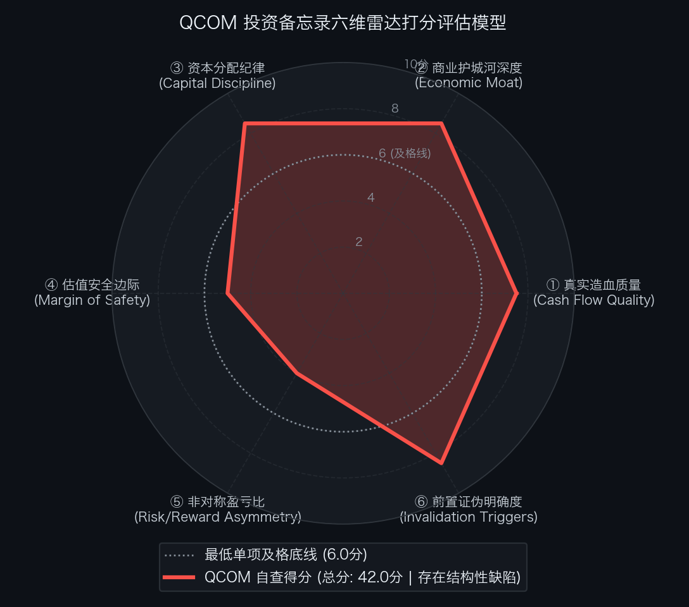

# 买方估值实战 09｜自由现金流骤降32%且指引下挫！高通（QCOM）能抄底吗？

> **实战说明：** 本文为《买方级估值修炼手册》专栏的第 09 篇个股深度实战案例。我们将全面解剖站在全球移动通信基带、智能汽车数字底盘与端侧 AI 算力交叉点的无线通信巨头——**高通公司（QUALCOMM Incorporated，纳斯达克代码: QCOM）** ，穿透其“手机主力盘单季下滑 26% 引发反向经营杠杆、全年自由现金流缩水 32.5%、Q1 EPS 指引同比下跌 18%”的财务底牌与安全边际边界。

---

## 导读：手机单季下滑 26% 遇上资本开支翻倍，高通迎来周期大考

在全球无线通信与智能终端产业链中，有一座几乎所有智能手机厂商都绕不开的“底层专利收费站”与“移动算力军火库”：

无论是苹果 iPhone 还是三星、小米等安卓旗舰机型，只要接入 3G / 4G / 5G 蜂窝移动网络，整机厂就必须向它按整机售价缴纳一笔无线标准必要专利（SEP）许可费；与此同时，搭载自研 3nm Oryon CPU 的 **骁龙 8 至尊版（Snapdragon 8 Elite）** 与 **数字底盘（Snapdragon Digital Chassis）** 正占据着全球 600 美元以上高端安卓旗舰手机与智能网联汽车的核心算力席位。

这就是掌管全球蜂窝通信命脉的半导体龙头——**高通公司（QUALCOMM Incorporated）** 。

然而，在 2026 年 11 月 4 日盘后披露的 FY2026 第四财季及全财年法定财报（Form 10-K，截至 2026 年 9 月 27 日）中，尽管市场目光多聚焦于“汽车芯片单季大增 89%”与“数据中心远期冲刺 50 亿美元”的成长亮点，但若穿透第一手财务底表与前瞻指引，三组核心经营数据却拉响了周期下行的警报：
* **手机主力盘明显失血：** 受全球晶圆厂产能向 AI 服务器 HBM 倾斜、移动端内存（LPDDR5X）涨价 30% 至 50% 压制整机排产影响，高通 Q4 手机芯片收入同比大跌 - **26.0%** 至 **51.40 亿美元** （单季减少近 18 亿美元营收，而全年手机收入 **248.50 亿美元** 仍占集团总收入近 58%）；
* **自由现金流缩水与资本开支翻倍的“剪刀差”：** 为推进服务器 CPU 流片与高阶智驾晶圆掩模研发，高通 FY2026 维持性资本开支（CapEx）激增 + **109.2%** 至 **24.94 亿美元** ，叠加经营现金流回落至 **111.45 亿美元** ，导致全年真实自由现金流（FCF）从 FY2025 的 128.20 亿美元同比下降 - **32.5%** 至 **86.51 亿美元** ；
* **FY2027 Q1 业绩指引全面走弱（反向经营杠杆显现）：** 管理层给出的 FY2027 Q1（传统消费电子旺季）Non-GAAP 摊薄 EPS 指引中值仅为 `$2.25`（同比大幅下滑 - **18.0%** ）；核心芯片分部（QCT）税前利润率（EBT Margin）指引更回落至 **20.0%** ~ **22.0%** 的低位（较历史高点下降 600 至 800 个基点）。

二级市场的估值重估随即展开：高通股价在 11 月 4 日财报发布盘后回踩 - **4.7%** 至 `$165.00`；11 月 5 日伴随费城半导体指数（SOX）单日重挫逾 12% 的行业大跌，高通盘中单日下跌 - **9.49%** 下探至 `$156.75`；截至 2026 年 11 月 6 日美股周五收盘，股价反弹报收于 `$165.41`（与财报盘后重估基准价 `$165.00` 基本持平），对应完全稀释总市值约 **1,770.5 亿** ~ **1,774.8 亿美元** ，狭义标准企业价值（EV）约 **1,844.8 亿** ~ **1,849.2 亿美元** 。

在买方投资框架中， **卓越的产业卡位与合理的买入价格永远是两道独立的考题** 。当一家科技巨头的主力业务遭遇逆风、利润率步入下行通道时，面对当前 `$165.00`（最新收盘 `$165.41`）的高通，我们需要穿透财务报表回答三个核心问题：
1. **新兴业务能否对冲主力业务下滑：** 汽车芯片单季增量（约 9 亿美元）与数据中心首季指引（6.5 亿美元），在短期内能否填补手机芯片单季减少 18 亿美元及苹果自研基带切流留下的收入与利润缺口？
2. **反向 DCF 预期审视：** 在美国 10 年期国债收益率处于 **4.90%** 高位、WACC 设定为 **9.5%** 的宏观环境下，以回落至 **86.51 亿美元** 的自由现金流为基数，当前股价隐含了怎样的未来 10 年业绩增速要求？
3. **安全边际与赔率核算：** 当 FY2027 全年 EPS 预期中枢下修至 `$10.50` 时，现价近 16 倍的远期市盈率是否具备足够的安全垫？合理的建仓击球区在什么位置？

本文将沿着 5 年现金流穿透、企业价值桥梁、反向 DCF 逆向求解、SOTP 五大板块重估与双变量压力测试，全面复盘高通的内在价值与买方击球边界。

---

## 第一幕：真实造血飞轮与“反向经营杠杆”病灶穿透

### 1. 商业模式双引擎：专利印钞机（QTL）与强周期算力场（QCT）
高通的商业模式建立在两根属性迥异的支柱之上：
1. **技术授权分部（QTL — 高通的法权压舱石）：** 掌控全球 3G / 4G / 5G 蜂窝通信核心标准必要专利（SEP）。无论手机厂商是否采购高通芯片，均须按整机售价的一定比例缴纳专利许可费。高通已先后与苹果、三星、华为、传音完成长协续约，每年稳定贡献 **55 亿** ~ **60 亿美元** 的高确定性收入，分部税前利润率（EBT Margin）常年高达 **72%** ~ **74%** ，是近乎零资本消耗的现金流底座；
2. **半导体芯片分部（QCT — 承受周期波动的主力盘）：** 涵盖智能手机（Handsets）、汽车电子（Automotive）、物联网与 AI PC（IoT）及初创的数据中心定制芯片（Data Center）。QCT 贡献集团逾 **85%** 的营收，但需要承担台积电 3nm / 2nm 先进制程高昂的晶圆采购成本与每年超 80 亿美元的刚性研发开支。

### 2. 过去 5 年真实造血质量穿透审计（FY2022–FY2026）
我们调取高通过去 5 个完整财年（FY2022–FY2026，截至 2026 年 9 月 27 日）的 SEC Form 10-K 经审计现金流量表，核算其真实现金流转化轨迹：

单位：百万美元（比率列除外）

| 财务报告期 | GAAP 归母净利润 | 经营活动现金流 (CFO) | 维持性资本开支 (CapEx) | 自由现金流 (FCF) | CFO / 净利润转化率 | FCF / 净利润现金含量 | 买方造血质量穿透结论 |
| :--- | :---: | :---: | :---: | :---: | :---: | :---: | :--- |
| **FY2022** | 12,940.0 | 9,100.0 | 2,300.0 | 6,800.0 | 70.3% | 52.5% | 达标：5G 手机出货高峰期备货，营运资本与资本投入偏高 |
| **FY2023** | 7,230.0 | 11,300.0 | 1,470.0 | 9,830.0 | 156.3% | 136.0% | 优秀：下游手机去库存，营运资本超额变现回流 |
| **FY2024** | 10,140.0 | 12,200.0 | 1,040.0 | 11,160.0 | 120.3% | 110.1% | 极佳：高端骁龙复苏与汽车高增，资本开支极度克制 |
| **FY2025** | 11,850.0 | 14,012.0 | 1,192.0 | 12,820.0 | 118.2% | 108.2% | 极佳：端侧 AI 手机放量，FCF 创下 128.2 亿美元历史峰值 |
| **FY2026 (最新年报)** | **13,628.0** | **11,145.0** | **2,494.0** | **8,651.0** | **81.8%** | **63.5%** | **关注：GAAP 净利含 57 亿所得税资产转回；CapEx 翻倍致 FCF 下滑 32.5%** |
| **FY2027E (审慎预期)** | 10,800.0 | 11,500.0 | 2,200.0 | 9,300.0 | 106.5% | 86.1% | 指引过渡：Q1 利润率探底至 21%，CapEx 维持高位，FCF 处于低谷修复期 |
| **5 年累计发生额** | **55,788.0** | **57,757.0** | **8,496.0** | **49,261.0** | **103.5%** | **88.3%** | **会计闭环：FY22–FY26 经审计实绩 5 年累计 FCF 达 492.6 亿美元** |

**财务排雷洞见一（穿透 GAAP 净利润增长 15% 的非现金税务因素）：**
表面上看，高通 FY2026 的 GAAP 归母净利润达到 **136.28 亿美元** （同比增长 +15.0%）。但穿透财报附注可以发现，其中包含了 **57.00 亿美元** 的递延所得税资产非现金账面转回收益。若观察现金流量表，FY2026 经营现金流（CFO）同比下滑 - **20.5%** 至 **111.45 亿美元** ，而资本开支（CapEx）因新业务晶圆掩模与基础设施投入同比大增 + **109.2%** 至 **24.94 亿美元** ，导致全年自由现金流（FCF）从 128.20 亿美元回落 - **32.5%** 至 **86.51 亿美元** ，FCF / 净利润现金含量降至 **63.5%** 。

**财务排雷洞见二（反向经营杠杆效应与边际资本回报率承压）：**
* **反向经营杠杆如何侵蚀芯片分部利润率：** 在半导体设计行业，前沿制程（3nm / 2nm）流片费、EDA 软件授权与核心研发团队薪酬（含每年逾 25 亿美元的股权激励 SBC）属于高度刚性的固定成本。当 Q4 手机芯片收入受移动端内存（LPDDR5X）涨价拖累而单季下滑 **26.0%** （减少近 18 亿美元）时，刚性研发与流片折旧无法同步缩减，直接导致 Q1 FY2027 指引中 QCT 税前利润率从历史高点 28% 回落至 **20.0%** ~ **22.0%** ，单季 Non-GAAP EPS 指引中值降至 `$2.25`（同比下跌 - **18.0%** ）；
* **增量投资资本回报率（RONIC vs WACC）审计：** 过去 3 年高通累计增量投资资本（ΔIC）约 **125.0 亿美元** ，累计增量税后净营业利润（ΔNOPAT）约 **42.0 亿美元** ，静态 RONIC 达 **33.6%** （高于 9.5% 的 WACC 约 + **24.1%** 个百分点）。但需要注意的是，FY2026 翻倍至 24.94 亿美元的资本开支正投向竞争激烈的服务器 CPU 与高阶智驾领域，在 QCT 利润率降至 21% 的背景下，边际资本回报率面临下行压力。

---

## 第二幕：企业价值桥梁（EV Bridge）与流动性安全垫

我们以财报披露后的重估基准市价 `$165.00`（注：2026 年 11 月 5 日随费半指数大跌最低探至 `$156.75`，11 月 6 日周五收盘收复至 `$165.41`，与 `$165.00` 偏差仅 0.25%）及 **FY2026 Form 10-K 经审计资产负债表（截至 2026 年 9 月 27 日）** 为基准，构建高通的企业价值桥梁：

单位：百万美元（每股单价与占市值比重列除外）

| 企业价值构成要素 | 财务数值 | 折合每股单价 (美元) | 占市值比重 (%) | 穿透审计与买方附注说明 |
| :--- | :---: | :---: | :---: | :--- |
| **普通股总市值 (Market Cap)** | **177,045.0** | **165.00** | **100.0%** | 基于 `1,073.00` 百万股最新稀释加权股本计算（按 11-06 收盘 `165.41` 测算为 `177,484.9`） |
| (+) 长期有息负债 (Long-term Debt) | 12,620.0 | 11.76 | 7.1% | 全部为投资级固定利率高级无抵押公司债 |
| (+) 短期借款及一年内到期负债 | 2,492.0 | 2.32 | 1.4% | 短期商业票据及一年内到期优先债券 |
| **(=) 有息负债总额 (Total Debt)** | **15,112.0** | **14.08** | **8.5%** | 债务久期结构优良，利息覆盖倍数超 18.0x |
| (+) 经营性租赁负债折现 (Operating Leases) | 774.0 | 0.72 | 0.4% | 全球研发中心与测试实验室长期租赁现值 |
| (−) 现金及现金等价物 (Cash) | (4,636.0) | (4.32) | -2.6% | 银行活期存款与高流动性现金储备 |
| (−) 短期可变现流动性证券 (Securities) | (3,045.0) | (2.84) | -1.7% | 1 年期以内的美国国库券与高评级商业票据（广义现金合计 `7,681.0`） |
| **(=) 综合纯净有息负债 (Net Debt)** | **7,431.0** | **6.93** | **4.2%** | 核心净有息负债仅 74.31 亿美元（净杠杆率仅 `0.86x` FY26 FCF） |
| **(=) 广义穿透企业价值 (Comprehensive EV)** | **185,250.0** | **172.65** | **104.6%** | 计入全部表外租赁后的完全企业收购对价 |
| **(=) 狭义纯净企业价值 (Standard EV)** | **184,476.0** | **171.93** | **104.2%** | 市值加总净负债后的核心营运资产标准 EV（Reverse DCF 求解分子） |

**流动性安全跑道极限压力测试（Liquidity Runway Stress Test）：**
* **流动性储备总额：** 账面现金及短期证券 **76.81 亿美元** ＋ 未动用循环授信额度 **50.00 亿美元** ＝ **126.81 亿美元** ；
* **极端断粮情景（零芯片收入极值测试）：** 单季刚性研发支出 18.50 亿美元 ＋ 行政管理支出 5.50 亿美元 ＋ 维持性 CapEx 3.50 亿美元 ＝ **单季刚性消耗 27.50 亿美元** ；
* **极端存活周期：** 126.81 亿美元 ÷ 27.50 亿美元/季 ＝ **4.6 个季度（约 14 个月）** ；若计入 QTL 专利授权每年 55 亿 ~ 60 亿美元的法权现金流入，高通的债务违约与流动性枯竭风险为 **0** 。

---

## 第三幕：反向 DCF 逆向拆解——当前市价隐含了怎样的军令状？

在预期投资学框架中，我们先用反向 DCF 逆向求解：在 10 年期美债收益率升至 4.90%、WACC 设定为 9.5%、永续增长率 g 设定为 3.0% 的基准参数下，当前 `$165.00`（11 月 6 日收盘 `$165.41`）对应的 1,844.8 亿美元标准企业价值，究竟隐含了怎样的未来 10 年自由现金流增长预期？

$$EV = \sum_{t=1}^{10} \frac{FCF_0 \times (1 + CAGR)^t}{(1 + WACC)^t} + \frac{FCF_{10} \times (1 + g)}{(WACC - g) \times (1 + WACC)^{10}}$$

我们将标准企业价值 `184,476.0` 百万美元、WACC `9.5%`、g `3.0%` 代入方程，分别基于 **情景 A** （FY2026 经审计实际 FCF `8,651.0` 百万美元）与 **情景 B** （FY2027E 手机持续承压下的保守基数 FCF `7,500.0` 百万美元）进行双轨逆向求解：

单位：百万美元（股价与百分比列除外）

| 估值解算输入要素 | 情景 A：基于 FY2026 经审计 FCF | 情景 B：基于 FY2027E 承压基数 FCF | 买方方法论与预期差诊断 |
| :--- | :---: | :---: | :--- |
| **基准股票市价 (美元/股)** | 165.00 | 165.00 | 财报盘后重估基准价（11-06 收盘为 `165.41`） |
| **目标狭义企业价值 (Standard EV)** | 184,476.0 | 184,476.0 | 含市值 `177,045.0` 及净有息负债 `7,431.0` |
| **期初基准自由现金流 (FCF0)** | 8,651.0 | 7,500.0 | FY26 经审计实绩 vs 若手机持续低迷之承压底线 |
| **折现率 (WACC) / 永续增长率 (g)** | 9.5% / 3.0% | 9.5% / 3.0% | 锚定 4.90% 美债无风险利率与半导体周期风险溢价 |
| **★ 隐含未来 10 年 FCF 年化复合增速** | + **3.52%** | + **5.38%** | **反向 DCF 逆向求解所得唯一数学平衡解** |
| **第 10 年末需达到的绝对 FCF 规模** | **12,220.0** | **12,630.0** | 终局稳态单年现金流需恢复至 **122.2 亿** ~ **126.3 亿美元** |

**逆向求解核心诊断（警惕“低隐含增速”背后的基数下移风险）：**
1. 表面上看，以 FY2026 经审计 FCF（86.51 亿美元）为基数，市场仅要求高通未来 10 年实现 + **3.52%** 的自由现金流年化复合增速，预期门槛看似不高；
2. 但从现金流周期位置审视，这一结论成立的前提是 **“86.51 亿美元已经是本轮周期的现金流低谷”** 。倘若 2027 上半年移动端内存涨价持续压制安卓出货、苹果自研基带加速切流，同时服务器 CPU 研发继续维持 25 亿美元高额资本开支，导致高通真实自由现金流进一步滑落至 **75.00 亿美元** （情景 B），那么现价隐含的 10 年复合增速要求将上升至 + **5.38%** 以上；
3. 换言之，当前 `$165.00` ~ `$165.41` 的股价已释放了部分估值压力，但尚未提供应对基本面进一步下探的充足安全垫，处于业绩下修与估值博弈的拉锯区。

---

## 第四幕：分部加总估值（SOTP）——五大业务板块分类称重

为避免将尚未兑现的远期规划提前折现，我们基于 **FY2027E 审慎盈利预期** ，将高通拆解为 **智能手机、汽车芯片、物联网与 AI PC、数据中心、QTL 专利技术授权** 五大板块，分别对标可比上市公司赋予估值倍数：

单位：百万美元（倍数与每股价值列除外）

| 业务切片分部 (Segment) | FY2027E 审慎营收 | FY2027E 预估 EBIT | 对标可比上市公司 | 采用估值倍数 (EV/EBIT) | 分部公允企业价值 | 每股价值贡献 (美元/股) | 估值方法逻辑与折溢价依据 |
| :--- | :---: | :---: | :--- | :---: | :---: | :---: | :--- |
| **① QCT 智能手机 (Handsets)** | 24,500.0 | 5,880.0 | 联发科、高通历史周期中枢 | 11.0x | 64,680.0 | 60.28 | 内存涨价压制出货且面临苹果基带切流，分部 EBIT 率按 24.0% 测算，给予周期底部 11.0x |
| **② QCT 汽车芯片 (Automotive)** | 8,200.0 | 2,132.0 | 恩智浦 (NXPI)、Mobileye、英飞凌 | 22.0x | 46,904.0 | 43.71 | 450 亿美元在手 Design-win 支撑，Q4 大增 89% 至 19.9 亿，给予智能座舱龙头 22.0x |
| **③ QCT 物联网与 AI PC (IoT)** | 7,200.0 | 1,512.0 | AMD、ARM、英特尔 (INTC) | 17.0x | 25,704.0 | 23.96 | Copilot+ PC 稳步渗透但面临 x86 竞争，按 21.0% 利润率审慎给予 17.0x 乘数 |
| **④ QCT 数据中心 (Data Center)** | 2,000.0 | 360.0 | 迈威尔科技 (MRVL)、博通 (AVGO) | 22.0x | 7,920.0 | 7.38 | 首年按 Q1 指引（6.5 亿）审慎年化并打折至 20.0 亿计价，暂不提前透支 35 亿 ~ 50 亿远期目标 |
| **⑤ QTL 专利技术授权 (Licensing)** | 6,000.0 | 4,380.0 | 专利年金信托、公用事业防御资产 | 12.0x | 52,560.0 | 48.98 | 73.0% 高利润率，长协虽已续约，但考虑全球手机存量零增长与潜在反垄断摩擦，按 12.0x 折价 |
| **(=) 全公司加总企业价值 (Gross EV)** | **47,900.0** | **14,264.0** | — | **13.86x** | **197,768.0** | **184.31** | **五大经营分部审慎公允营运资产总对价** |
| (−) 综合纯净有息净负债 (Net Debt) | — | — | — | — | (7,431.0) | (6.93) | 扣除账面净有息负债（`15,112.0` 总债减 `7,681.0` 广义现金） |
| **(=) SOTP 权益公允总价值** | — | — | — | — | **190,337.0** | **177.39** | 归属普通股股东公允内在总权益（1,903.4 亿美元），取整定锚每股 `177.00` 美元 |

**SOTP 核心启示：**
1. **专利授权与汽车芯片构筑刚性价值底盘：** 专利授权（每股 `$48.98`）＋ 汽车芯片（每股 `$43.71`）合计构筑 `$92.69` / 股的刚性底座，这两大高壁垒、长周期合约锁定的业务合计贡献了 **994.64 亿美元** 企业价值；即便在极端逆风下将手机与物联网硬件业务再按 7 折压缩、数据中心归零并扣除净负债，SOTP 极端保守底线仍可支撑 **135.00 美元/股** ；
2. **剥离远期乐观预期后 SOTP 内在价值回归理性：** 在审慎计价数据中心首年产出、并将手机业务估值倍数压缩至 `11.0x` 后，高通的 SOTP 公允价值在 `$177.00` 附近。现价 `$165.00`（11 月 6 日收盘 `$165.41`）较 SOTP 内在价值仅折让 **6.5%** ~ **6.8%** ，尚未达到 25% 以上的买方安全边际标准。

---

## 第五幕：双变量压力测试、多模型定锚与非对称赔率决算

### 1. 买方三情景概率分布推演（Bear / Base / Bull Scenarios）
面对 Q1 FY2027 同比下滑 18% 的 EPS 指引，我们将 FY2027 全年基准 Non-GAAP EPS 预测锚定在审慎的 `$10.50`，构建三情景概率分布矩阵：

单位：美元/股（概率、营收、倍数与百分比列除外）

| 估值情景 (Scenario) | 发生概率 | FY2027E 核心营收 (亿美元) | FY2027E 稀释 EPS | 目标市盈率 (P/E) | 情景目标价 | 相对现价 (`165.00`) 空间 | 核心基本面假设推演与经营里程碑 |
| :--- | :---: | :---: | :---: | :---: | :---: | :---: | :--- |
| **悲观防御情景 (Bear Case)** | 30% | 440.0 | 9.00 | 14.0x | **126.00** | - **23.6%** | **硬核防御底座** ：存储器涨价贯穿全年，QCT 利润率跌至 19%，数据中心不及预期，估值下移至 14.0x |
| **基准稳态情景 (Base Case)** | 50% | 480.0 | 10.50 | 17.5x | **185.00** | + **12.1%** | **基准演进轨迹** ：手机下半年温和复苏，汽车持续放量，QCT 利润率回升至 22%，估值回归 17.5x 中枢 |
| **乐观爆发情景 (Bull Case)** | 20% | 530.0 | 12.00 | 20.0x | **240.00** | + **45.5%** | **超预期共振** ：内存价格提前回落激发端侧 AI 换机潮，汽车营收超百亿，数据中心实现 35 亿突破 |
| **概率加权期望目标价** | **100%** | **478.0** | **10.35** | **17.0x** | **178.30** | + **8.1%** | 三情景数学期望：`0.30×126.00 + 0.50×185.00 + 0.20×240.00 = 178.30`（取整 `178.00`） |

### 2. 双变量敏感性压力矩阵 A：FY2027E EPS × 目标市盈率 (P/E) 网格
我们在 FY2027E 稀释 EPS（`$9.00 ~ $12.00`）与目标 P/E 乘数（`13.0x ~ 22.0x`）的 `5 × 5` 正交网格下，测算高通在各盈利与估值组合下的目标股价：

单位：美元/股

| FY2027E 稀释 EPS \ 目标 P/E | 13.0x (周期极值底) | 15.0x (审慎折价) | **17.5x (基准中枢)** | 20.0x (景气回归) | 22.0x (乐观溢价) |
| :--- | :---: | :---: | :---: | :---: | :---: |
| **9.00 (Bear 盈利失血)** | 117.00 | 135.00 | 157.50 | 180.00 | 198.00 |
| **9.80 (温和承压)** | 127.40 | 147.00 | 171.50 | 196.00 | 215.60 |
| **10.50 (Base 稳态预期)** | 136.50 | 157.50 | **183.75** | 210.00 | 231.00 |
| **11.20 (复苏好于预期)** | 145.60 | 168.00 | 196.00 | 224.00 | 246.40 |
| **12.00 (Bull 景气放量)** | 156.00 | 180.00 | 210.00 | 240.00 | 264.00 |

*(注：第一行熊市 EPS `$9.00` 在周期底部 `13.0x ~ 15.0x` 区间的中枢即为悲观盈利底线 **126.00 美元/股**)*

### 3. 双变量敏感性压力矩阵 B：WACC 折现率 × 永续增长率 (g) DCF 网格
以 FY2026 经审计 FCF（86.51 亿美元）及十年审慎恢复轨迹为基础，在 WACC（`8.5% ~ 10.5%`）与永续增长率 g（`2.0% ~ 4.0%`）正交网格下测算高通的 DCF 内在价值：

单位：美元/股

| 加权折现率 (WACC) \ 永续增长率 (g) | 2.0% (保守底线) | 2.5% (存量温和) | **3.0% (基准设定)** | 3.5% (景气延续) | 4.0% (乐观扩张) |
| :--- | :---: | :---: | :---: | :---: | :---: |
| **8.5% (流动性宽裕)** | 205.00 | 220.00 | 240.00 | 265.00 | 298.00 |
| **9.0% (利率温和回落)** | 188.00 | 200.00 | 216.00 | 235.00 | 260.00 |
| **9.5% (买方基准折现率)** | 172.00 | 182.00 | **195.00** | 210.00 | 230.00 |
| **10.0% (美债破 5.2% 情景)** | 158.00 | 166.00 | 177.00 | 189.00 | 205.00 |
| **10.5% (极端紧缩压力测试)** | 146.00 | 153.00 | 162.00 | 172.00 | 184.00 |

*(注：矩阵中心基准设定 WACC `9.5%`、g `3.0%` 对应 DCF 公允价值 **195.00 美元/股** ；右下角极端紧缩象限 WACC `10.5%`、g `2.0%` 锁定 DCF 悲观底线为 **146.00 美元/股**)*

### 4. 多模型横向交叉验证与双锚定（公允目标价 & 悲观防御底）

单位：美元/股（权重列除外）

| 估值方法维度 (Valuation Approach) | 核心驱动与适用场景 | 基准公允价值 | 权重配置 | 加权价值贡献 | 极端悲观底线及推导依据 |
| :--- | :--- | :---: | :---: | :---: | :--- |
| **① 三情景概率加权 (Blended Scenario)** | 客观反映熊市 30% 概率与牛市 20% 期权分布 | 178.00 | 30.0% | 53.40 | **126.00** （对应 30% 概率的 Bear Case 情景目标价） |
| **② SOTP 分部业务加总 (SOTP 模型)** | FY2027E 穿透 5 大板块真实营利对标同业倍数 | 177.00 | 30.0% | 53.10 | **135.00** （QTL+汽车 `$92.69` 刚性底座 + 手机/IoT 打 7 折减净债） |
| **③ FY27E 基准 P/E 市盈率定价法** | FY27E EPS `10.50` × `17.5x` 正常化估值中枢 | 185.00 | 25.0% | 46.25 | **126.00** （熊市 EPS `$9.00` × 周期底部 `14.0x` 倍数中枢） |
| **④ 10 年期正向现金流贴现 (DCF 模型)** | 审慎 FCF 贴现模型（WACC 9.5%, g 3.0%） | 195.00 | 15.0% | 29.25 | **146.00** （DCF 矩阵 B 右下角 WACC `10.5%`, g `2.0%` 极值） |
| **(=) 综合双锚定决算** | **公允目标价加权合成 / 防御底按审慎原则取最低交集** | **182.00** | **100.0%** | **182.00** | **防御底 126.00** （`min(126, 135, 146)`）；**目标价定锚 185.00** |

*(补充说明：高通 GAAP 每股有形净资产 Tangible BVPS 为 `$18.55`，含每股广义现金 `$7.16`；作为无晶圆厂轻资产设计公司，其下行防御底线由上述三大持续经营模型的最严苛交集 `$126.00` 决定)*

### 5. 持有期空间与非对称盈亏比决算
* **基准市价：** 财报后重估基准价 `$165.00`（2026-11-06 最新官方收盘价为 `$165.41`）
* **综合公允目标价：** `$185.00`（现价较公允价值仅 **折让 10.8%** ，持有期上行空间为 + **12.12%** ，即 + `$20.00` / 股；若按 11 月 6 日收盘 `$165.41` 测算，上行空间为 + **11.84%** ）
* **悲观防御底座：** `$126.00`（取多模型悲观底线最严苛交集，下行风险 - **23.64%** ，即 - `$39.00` / 股；按 `$165.41` 测算为 - **23.83%** ）
* **持有周期：** 约 **2.0 年** （2026 年 11 月至 2028 年末）
* **2.0 年预期年化复合回报率（IRR）：**

$$IRR = \left( \frac{185.00}{165.00} \right)^{\frac{1}{2.0}} - 1 = \mathbf{+5.89\% / \text{年}}$$

  *(注：5.89% 的资本利得年化回报率仅略高于 4.90% 的 10 年期美债无风险收益率，难以充分补偿半导体周期个股的下行波动风险)*
* **基准期望风险收益比（非对称盈亏比）：**

$$\text{期望盈亏比} = \frac{185.00 - 165.00}{165.00 - 126.00} = \frac{20.00}{39.00} = \mathbf{0.51 : 1}$$

  *(按 11 月 6 日收盘 `$165.41` 测算，盈亏比约为 `19.59 / 39.41 = 0.50 : 1`。即每承担 1 美元的下行风险，仅对应约 0.50 美元的预期上行收益，风险收益比明显倒挂，未达到买方 `2.50 : 1` 的建仓门槛)*

---

## 第六幕：事前推演（Pre-Mortem）与前置证伪跟踪红线

### 1. 事前验尸（Pre-Mortem）：未来核心死因深度解剖
在做出实质性建仓前，买方风控强制展开事前验尸推演：“假设站在 2027 年末回望，在 `$165.00` 买入高通后遭遇了 25% 以上的本金亏损（股价跌破 `$126.00`），最核心的诱因有哪些？”

* **死因一（反向经营杠杆持续恶化，QCT 利润率跌破 18%）：**
  存储芯片原厂将晶圆产能持续转去 HBM，LPDDR5X 成本高企迫使安卓手机 OEM 在 2027 全年削减出货。高通 3nm / 2nm 先进制程流片与掩模 CapEx 刚性摊销，导致 QCT 税前利润率从历史高点 28% 一路滑落至 **18%** 以下，单季 EPS 跌破 `$2.00`，引发盈利与估值的双重下修；
* **死因二（数据中心 50 亿美元远期目标受阻，云厂商坚持全栈自研）：**
  亚马逊 AWS 自研 Graviton / Trainium 与博通（AVGO）定制 ASIC 生态壁垒深厚，高通数据中心芯片在 Q1 实现 6.5 亿美元首秀后后续订单增长乏力，远期 50 亿美元年营收规划未能兑现，前期翻倍至 24.94 亿美元的资本开支面临减值压力；
* **死因三（苹果自研基带全面导入，蚕食高通百亿硬件基本盘）：**
  苹果自研调制解调器芯片良率突破，在 iPhone 产品线中大规模替换高通骁龙基带，导致高通单年永久性减少 30 亿 ~ 50 亿美元的高毛利芯片销售收入，且对台积电先进制程的包销议价权相应减弱；
* **死因四（车企价格战波及智能化配置，450 亿在手订单转化放缓）：**
  全球电动车与智能汽车价格战加剧，部分车企推迟高阶智驾平台量产或转向低成本方案，导致高通汽车芯片年化增速失守 20% 关口，高估值溢价收敛。

### 2. 前置非价格定量买方证伪红线跟踪表

> **买方投研纪律：** 基本面跟踪严禁与短期股价波动或主观情绪挂钩。只要未来季报触碰以下任一客观量化红线，无条件执行硬性风控动作：

| 红线编号 | 监控维度 | 前置量化证伪底线 (Hard Trigger) | 真实监测指标与现状 (FY26) | 触发后的硬性执行动作 (Action) |
| :---: | :--- | :--- | :---: | :--- |
| **①** | **利润率底线** | QCT EBT 利润率连续 2 个季度跌破 `19.0%`（反向经营杠杆恶化） | Q1 指引 **20.0%** ~ **22.0%** （已逼近临界点） | **【立即无条件减仓 50%，模型降级至 Bear】** |
| **②** | **手机企稳红线** | Q2 FY2027 手机芯片收入同比降幅依然超过 `-15.0%`（无复苏迹象） | Q4 实际同比大跌 - **26.0%** | **【将 Base EPS 下调至 9.50 美元以下】** |
| **③** | **数据中心兑现** | Q1 FY2027 数据中心单季实际营收低于 `5.0` 亿美元（大幅偏离指引） | 官方指引超 **6.5 亿美元** | **【剔除数据中心估值溢价，移出观察池】** |
| **④** | **QTL 法律红线** | 核心法域判定 QTL 授权违背 FRAND，导致授权收入永久性下滑超 `20.0%` | 苹果/华为/传音长协已续约 | **【清仓离场，彻底终止跟踪覆盖】** |

---

## 第七幕：客观六维量规自查与买方击球区执行规划

  

### 1. 客观六维量规自查明细总表

| 评估维度 | 权重分值 | 实际得分 | 扣分依据与买方客观审计事实 (SEC 财报实证) |
| :--- | :---: | :---: | :--- |
| **① 真实造血质量** | 10.0 分 | **7.5 分** | 扣 2.5 分：过去 5 年累计 FCF 达 492.6 亿美元（转化率 88.3%）；但 FY26 FCF 下滑 32.5% 至 86.5 亿美元，CapEx 翻倍至 24.9 亿美元，短期造血放缓。 |
| **② 商业护城河深度** | 10.0 分 | **8.5 分** | 扣 1.5 分：全球蜂窝通信 SEP 专利底座与骁龙 8 至尊版旗舰统治力稳固，汽车订单达 450 亿美元；但面临苹果自研基带替换与反向经营杠杆。 |
| **③ 资本分配与负债** | 10.0 分 | **8.5 分** | 扣 1.5 分：净有息负债仅 74.3 亿美元（0.86x FCF），流动性储备达 126.8 亿美元；但 CapEx 激增正与股东回购争夺现金流。 |
| **④ 估值安全边际** | 10.0 分 | **5.0 分** | **【不及格】** 扣 5.0 分：现价 `$165.00`（11-06 收盘 `$165.41`）对应真实预期 PE 约 15.7x，较公允价值 `$185.00` 折让仅 10.8%，缺乏 25%+ 安全垫。 |
| **⑤ 非对称盈亏比** | 10.0 分 | **4.0 分** | **【不及格】** 扣 6.0 分：基准期望盈亏比仅 `0.50 : 1 ~ 0.51 : 1`，上行空间仅 +12%，下行至 Bear 底座（`$126.00`）风险达 -23.8%，赔率明显倒挂。 |
| **⑥ 前置证伪明确度** | 10.0 分 | **8.5 分** | 扣 1.5 分：订立了 QCT 利润率破 19%、手机跌幅超 15%、数据中心不及 5 亿美元等清晰可量化的每季 10-Q 跟踪红线。 |
| **(=) 综合总评分** | **60.0 分** | **42.0 分** | **【未达准入门槛 · 维持观察池跟踪 (WATCH & WAIT)】综合评分 42.0 分（低于 45.0 分准入线），维度 ④ ⑤ 双双不及格，暂缓左侧建仓** |

---

### 2. 买方击球区与仓位执行梯度规划表

结合 **综合公允目标价** `$185.00` 与 **悲观防御底座** `$126.00`，我们设定以下左侧分档建仓梯度与仓位纪律：

| 决策梯队划分 | 股价区间 / 监控点位 | 相对公允价值 (`$185.00`) 折让 | 2.0 年持有期空间 (至 Base `$185.00`) | 预期年化 IRR | 期望盈亏比 (R/R vs `$126.00` 底座) | 买方执行策略与仓位纪律 |
| :--- | :---: | :---: | :---: | :---: | :---: | :--- |
| **超买/观望过渡带 (当前价格带)** | `$155.00 ~ $175.00` | 折让 **5.4%** ~ **16.2%** | + **5.7%** ~ + **19.4%** | + **2.8%** ~ + **9.3%** | **0.20 : 1** ~ **0.70 : 1** | **【维持 0% 仓位】** 11-04 盘后 `$165.00`、11-05 低点 `$156.75` 及 11-06 收盘 `$165.41` 均处于此带，耐心观望 |
| **一级试水击球区 (估值出清带)** | `$135.00 ~ $145.00` | 折让 **21.6%** ~ **27.0%** | + **27.6%** ~ + **37.0%** | + **13.0%** ~ + **17.0%** | **1.50 : 1** ~ **2.50 : 1** | 若市场继续消化业绩下修并回落至该区间（尤其在 `$140.00` 以下），建立 **1.0%** ~ **1.5%** 小型试水观察仓 |
| **二级核心击球区 (深度价值带)** | `$120.00 ~ $130.00` | 折让 **29.7%** ~ **35.1%** | + **42.3%** ~ + **54.2%** | + **19.3%** ~ + **24.2%** | **3.00 : 1** 以上 (非对称爆发) | 逼近 Bear Case 周期极值底座（`$126.00`），专利与汽车业务完全托底，增配至 **3.5%** ~ **5.0%** 组合核心底仓 |

> **仓位与交易纪律：** 
> 1. 高通当前正处于手机下游去库与 QCT 利润率压缩的过渡期，组合中目前 **维持 0% 敞口** ，切忌急躁抢跑；
> 2. 11 月 5 日费半指数大跌曾将高通股价下探至 `$156.75`，反映出在高利率与周期下行拐点处市场情绪的敏感性。只有当价格进一步回落至 `$145.00` 以下的一级击球区，买方才启动首次试水建仓；
> 3. **止损纪律：** 建仓后若收盘跌破买入成本价的 - **15%** （若一级建仓成本为 `$140.00`，跌破 `$119.00` 触发），或触碰前述第六幕 4 条非价格定量证伪红线中的任意一条，下一交易日开盘无条件市价减仓或清仓。

---

## 【结语与免责声明】

高通（QCOM）的实战复盘，清晰展现了周期拐点期科技巨头的定价逻辑： **远期新业务的成长叙事，无法在短期内对冲主力业务下滑与反向经营杠杆的财务重力** 。

当一家科技巨头出现“手机单季下滑 26%、资本开支翻倍导致自由现金流缩水 32.5%、下一季 EPS 指引下跌 18%”时，`$165.00`（最新收盘 `$165.41`）对应约 15.7 倍的真实远期市盈率，实质上处于向上空间约 12%、向下回撤风险约 24% 的均衡偏紧博弈带。面对 `0.51 : 1` 的风险收益比，成熟的买方策略是保持耐心，静待市场情绪充分出清、股价进入 `$135.00 ~ $145.00` 的安全击球区后再行出击。

> **免责声明：** 本文所有财务数据均直接溯源至高通公司（QUALCOMM Incorporated）向美国证券交易委员会（SEC）提交的 FY2022–FY2026 Form 10-K 年报及 Q4 FY2026 官方财报披露，市场价格基准涵盖 2026 年 11 月 4 日财报盘后及 11 月 6 日美股收盘。全文仅作为《买方级估值修炼手册》之投研方法论学术探讨与排雷推演案例，不构成任何证券买卖建议。市场有风险，投资须独立决策。
