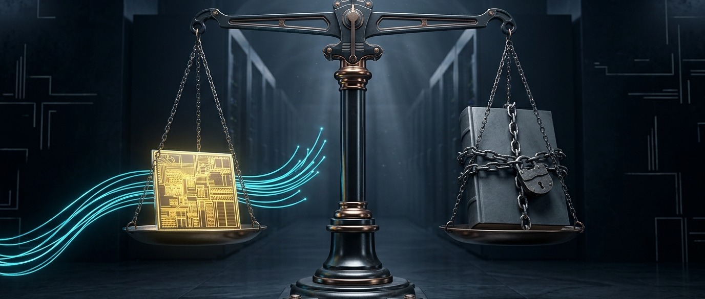
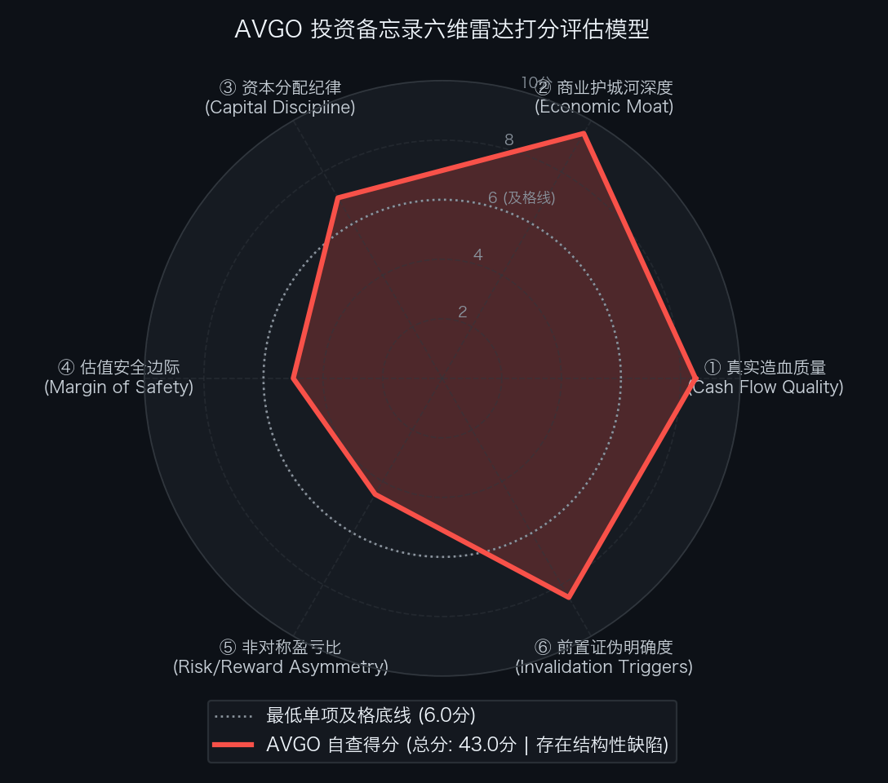

# 买方估值实战 10｜AI 收入暴增 135% 却藏 430 亿表外担保：回调近两成的博通，到底值多少？

> **实战说明：** 本文为《买方级估值修炼手册》专栏的第 10 篇个股深度实战案例。我们将穿透剖析全球定制化 AI 算力芯片（Custom XPU）与超大规模以太网交换芯片双料霸主——**博通公司（Broadcom Inc.，纳斯达克代码: AVGO）** 在高利率宏观环境与 630 亿美元表外算力租赁 SPV 架构下的真实风险收益边界。

---

## 导读：定制算力霸主的账面狂飙与 8-K 表外担保暗门

在生成式人工智能基础设施的算力版图中，如果说英伟达（NVIDIA）统治着通用 GPU 的标准品帝国，那么 **博通（Broadcom Inc.）** 则是科技巨头“去英伟达化”浪潮背后最大的定制硅片总包商与网络底座掌控者。

在物理连接与定制计算底层，博通握有三张极难复制的王牌：
1. **全球定制 AI 算力芯片（XPU/ASIC）超 70% 市占率：** 从谷歌迭代十年的 TPU 全系列、Meta 的 MTIA 训推芯片，到字节跳动、OpenAI 与 Anthropic 的定制算力集群，博通垄断了核心的 112G/224G SerDes 高速物理层接口 IP 与台积电 CoWoS 先进封装包销配额；
2. **超大规模 AI 以太网交换芯片超 80% 市占率：** 旗下 Tomahawk 5（51.2 Tbps）与最新量产的 Tomahawk 6（102.4 Tbps）是全球十万卡乃至百万卡 AI 集群横向扩展（Scale-Out）的事实标准；
3. **VMware 私有云全栈软件现金牛：** 收购 VMware 后全面切换至 3~5 年期不可撤销的 VCF 订阅合约，软件分部营业利润率高达 **81.0%** 。

反映在经营端，博通 FY2026 Q3（截至 2026 年 8 月 2 日，SEC Form 10-Q）及 Q4 官方指引呈现高速扩张态势：
* **单季营收与 AI 爆发：** Q3 总营收达 **271.00 亿美元** （同比 + **70.0%** ），其中 AI 半导体收入飙升至 **122.00 亿美元** （同比 + **135.0%** ，占半导体分部比重达 **65.6%** ），未交付积压订单（Backlog）达 **1,500 亿美元** ；
* **Q4 延续高增指引：** 管理层指引 FY2026 Q4 单季营收达 **348.00 亿美元** （同比 + **93.0%** ），其中 AI 半导体预计单季贡献 **174.00 亿美元** ；
* **充沛现金流产出：** Q3 单季自由现金流（FCF）达 **124.87 亿美元** （FCF 利润率 **46.1%** ），过去 12 个月滚动自由现金流（LTM FCF）达 **394.03 亿美元** 。

然而，亮眼的增长数据之下，两项关键的结构性变化引发了二级市场对博通定价逻辑的重新审视：

* **第一，10 月 27 日 Form 8-K 披露 430 亿美元表外残值担保敞口：** 为协助大模型独角兽 Anthropic 采购并租赁价值 **630 亿美元** 的博通定制 AI 算力机架与网络设备，美国银行、花旗、摩根士丹利及黑石集团组建了专项特殊目的实体（SPV），其中约 **430.0 亿 ~ 435.0 亿美元** 为第一留置权优先债。博通为促成交易，向优先债银团提供了 **或有残值差额担保（Residual Value Guarantee Backstop）** ——若承租方违约，博通须就租赁未偿余额的 **72.5%** 与定制机架二手变现价值之间的差额承担兜底赔付，未折现最大潜在担保敞口高达 **430.00 亿美元** （折合每股 `$8.71`）。不同于通用 GPU 具备广泛的二级流转市场，高度耦合特定模型架构的定制 ASIC 一旦遭遇客户违约或技术迭代，二手清算残值极低；
* **第二，整机机架交付（Rack-Scale）稀释毛利率与高利率宏观冲击：** 面向 Anthropic 与 OpenAI 的交付正从单一芯片转向携带大量外购 HBM3e/HBM4 内存及机柜过手成本（Pass-through Cost）的整机机架，导致 Q3 半导体毛利率同比下滑 **140 bps** 至 **66.8%** ，Q4 合并 Non-GAAP 毛利率指引环比再降 **120 bps** 至 **77.8%** 。与此同时，2026 年 11 月初美国 10 年期国债收益率维持在 **4.86% ~ 4.90%** 高位，叠加北美吉瓦级数据中心电力并网审批收紧，11 月 5 日费城半导体指数（SOX）单日重挫逾 **12%** 。

截至 2026 年 11 月 6 日美股收盘，博通股价报收于 `$293.69`（较 9 月下旬高点 `$361.99` 累计回撤 - **18.9%** ），对应 Non-GAAP 全面摊薄总市值 **14,499.5 亿美元** ，标准企业价值（EV）约 **14,853.9 亿美元** 。

当股价较历史高点回撤近两成后，买方研究需要客观回答三个核心问题：
1. 计入 430 亿美元表外残值担保风险与 594.2 亿美元账面债务后，博通的真实企业价值与资产底座究竟如何？
2. 在 10 年期美债收益率 **4.90%** 、WACC 升至 **9.5%** 的环境下，当前 `$293.69` 的股价隐含了未来 10 年怎样的自由现金流增长要求？
3. 现价是否已经提供了充足的估值安全垫与非对称赔率？真正的买方击球区位于何处？

---

## 第一幕：真实造血飞轮与商业机制穿透

要准确评估博通的内在价值，首先需要穿透其“无晶圆厂轻资产印钞机”的表象，审视其现金流创造机制、股权激励（SBC）摊薄成本以及收购 VMware 后的资产负债表结构。

### 1. 过去 5 年真实造血质量穿透审计
依据博通历年 SEC Form 10-K（FY2022–FY2025）及 FY2026 Q3 Form 10-Q（截至 2026 年 8 月 2 日），由于采用 Fabless 模式将晶圆制造与封装外包予台积电，博通资本开支（CapEx）占营收比重长期低于 **1.5%** ，五年累计自由现金流对 GAAP 净利润的转化率高达 **129.7%** ：

单位：百万美元（比率列除外）

| 财务报告期 | GAAP 归母净利润 | 经营活动现金流 (CFO) | 资本开支 (CapEx) | 真实自由现金流 (FCF) | CFO / 净利润转化率 | FCF / 净利润现金含量 | 买方造血质量穿透结论 |
| :--- | :---: | :---: | :---: | :---: | :---: | :---: | :--- |
| **FY2022 (截至 2022.10.30)** | 11,495.0 | 16,736.0 | 424.0 | 16,312.0 | 1.46x | 141.9% | 极佳：无晶圆厂轻资产模型，现金转化充沛 |
| **FY2023 (截至 2023.10.29)** | 14,082.0 | 18,085.0 | 452.0 | 17,633.0 | 1.28x | 125.2% | 极佳：传统半导体周期波动下现金流稳健增长 |
| **FY2024 (截至 2024.11.03)** | 5,895.0 | 19,962.0 | 548.0 | 19,414.0 | 3.39x | 329.3% | 正常：收购 VMware 产生大额无形资产摊销与重组费拉低 GAAP 净利 |
| **FY2025 (截至 2025.11.02)** | 23,126.0 | 27,537.0 | 623.0 | 26,914.0 | 1.19x | 116.4% | 跃升：VMware 订阅制协同释放叠加 AI 芯片放量 |
| **LTM (截至 2026.08.02)** | **38,265.0** | **40,653.0** | **1,250.0** | **39,403.0** | **1.06x** | **103.0%** | **现状参考：过去 12 个月滚动真实 FCF 达 394.0 亿美元（不计入累计）** |
| **FY2026E (含 Q4 官方指引)** | 43,500.0 | 48,500.0 | 1,550.0 | 46,950.0 | 1.11x | 107.9% | 预期参考：前三季实绩加 Q4 指引，全年 FCF 逼近 470 亿美元 |
| **5 年累计发生额 (FY22-FY26E)** | **98,098.0** | **130,820.0** | **3,597.0** | **127,223.0** | **1.33x** | **129.7%** | **会计闭环：5 年累计沉淀 1,272.2 亿美元自由现金流** |

*\*注：LTM 口径为 `9M FY26 + FY25 - 9M FY25` 滚动 12 个月实绩，因与 FY2025 及 FY2026E 存在跨期重叠，不计入 5 年累计求和；5 年累计由 FY2022–FY2025 四个完整财年 10-K 实绩加 FY2026E 全年预期构成。*

### 2. 三大财务与商业质量细节排雷
1. **SBC 股权激励与股本净摊薄审计：**
   收购 VMware 后，博通推行大规模 RSU 员工留任激励，FY2024 与 FY2025 的 SBC 费用分别达 **56.72 亿美元** 和 **64.80 亿美元** ；FY2026 前三季度 SBC 为 **54.10 亿美元** （年化约 **72.00 亿美元** ，随营收体量扩大，占营收比重从 FY24 的 **11.0%** 回落至 **6.9%** ）。扣除二级市场回购注销后，FY2026 Q3 Non-GAAP 全面摊薄股本为 **4,937.00 百万股** （GAAP 摊薄股本为 **4,887.00 百万股** ），同比净增幅约 **1.1%** 。在后续估值模型中，我们采用更严苛的 **4,937.00 百万股** 作为分母，并在永续增长率中计入每年约 **1.0%** 的股本摊薄折价。
2. **负有形账面净资产（Negative Tangible Book Value）：**
   截至 2026 年 8 月 2 日，博通账面股东权益总额为 **996.90 亿美元** ，但其中包含因历次并购沉淀的 **978.01 亿美元** 商誉（Goodwill）以及约 **285.00 亿美元** 无形资产净额。剔除商誉与无形资产后，博通的有形账面净资产为 - **266.11 亿美元** （折合每股 `-$5.39`）。这意味着博通不具备重资产清算价值托底，其估值完全建立在持续经营现金流之上。
3. **表外 SPV 收入确认与风险留存：**
   2026 年 10 月 27 日 8-K 披露的 **630 亿美元** Anthropic 机架租赁 SPV 采用破产隔离架构，由 SPV 向博通采购机架并确认博通当期硬件销售收入，使博通资产负债表免于直接并表 **430 亿美元** 优先债。但从经济实质看，博通提供的 **72.5%** 残值差额担保将下游大模型独角兽的信用风险留存在了表外。

### 3. 资本回报率与增量资本效率（ROIC vs. WACC）
* **存量投入资本回报率（ROIC）：** 包含并购商誉的广义投入资本约 **1,351.3 亿美元** ，对应 FY2026E 税后净营业利润（NOPAT）约 **468.0 亿美元** ，账面含商誉 ROIC 高达 **34.6%** ；若剔除商誉与无形资产，轻资产有形 ROIC 超过 **400%** ；
* **增量投入资本回报率（RONIC）与经济利差：** 尽管机架级交付拉低了半导体硬件毛利率，但由于营业费用率极低且无需重资产晶圆厂投资，博通的增量资本回报率（RONIC > **40.0%** ）依然远高于 **9.50%** 的加权平均资本成本（WACC），正经济利差超 + **25.0 个百分点** 。

---

## 第二幕：从市值到企业价值的严谨跨越

在评估像博通这样兼具高额并购债务与大额表外担保的巨头时，绝不能仅看股票市值，必须还原包含净债务、租赁负债及表外或有担保风险准备金在内的真实企业价值（EV）：

| 资本结构要素 (Capital Structure Items) | 账面金额 (百万美元) | 折合每股价值贡献 (美元) | 占市值比重 | 穿透审计与买方附注说明 |
| :--- | ---:| ---:| ---:| :--- |
| **最新普通股股价 (Stock Price)** | `293.69` | — | — | 2026-11-06 美股周五官方收盘价（较峰值回撤 -18.9%） |
| **完全稀释总股本 (Diluted Shares)** | **4,937.00 百万股** | — | — | FY26 Q3 10-Q Non-GAAP 全面摊薄股本（GAAP 为 4,887.00） |
| **(=) 稀释股票总市值 (Market Cap)** | **1,449,947.5** | `293.69` | **100.0%** | 约 **14,499.5 亿美元** |
| **(+) 长期有息负债 (Long-term Debt)** | + **57,167.0** | `11.58` | 3.94% | 收购 VMware 遗留高级优先票据与定期贷款（账面摊余值） |
| **(+) 短期借款及一年内到期负债** | + **2,252.0** | `0.46` | 0.16% | 一年内到期优先票据（总债务本金面值合计 61,079.0） |
| **(=) 有息负债总额 (Total Debt)** | + **59,419.0** | `12.04` | **4.10%** | 加权平均票面利率约 4.15%，债务久期分布均衡 |
| **(−) 现金及现金等价物 (Cash)** | - **23,975.0** | `(4.86)` | -1.65% | Q3 期末高流动性现金储备，较年初大幅增厚 |
| **(=) 综合纯净有息负债 (Net Debt)** | + **35,444.0** | `7.18` | **2.44%** | 净杠杆率（Net Debt / LTM FCF）已降至 **0.90x** |
| **(=) 狭义纯净企业价值 (Standard EV)** | **1,485,391.5** | `300.87` | **102.4%** | 约 **14,853.9 亿美元** （反向 DCF 标准分子） |
| **(+) 经营性租赁负债折现 (Operating Leases)** | + **1,650.0** | `0.33` | 0.11% | 全球研发中心与办公物业长期租赁负债现值 |
| **(+) 表外 SPV 残值担保风险计提 (20% 概率)** | + **8,600.0** | `1.74` | 0.59% | **2026-10-27 8-K 披露最高 43,000.0 百万美元残值担保之风险折算** |
| **(=) 广义穿透企业价值 (Comprehensive EV)** | **1,495,641.5** | `302.95` | **103.2%** | 约 **14,956.4 亿美元** （含表外或有担保风险之真实企业对价） |

**资产负债表与流动性跑道（Runway）诊断：**
* **账面债务可控但表外敞口不可忽视：** 博通账面净有息负债为 **354.44 亿美元** ，相对于接近 **470 亿美元** 的 FY2026E 自由现金流，净债务杠杆率不足 **0.8x** ，账面还本付息压力极小；但一旦计入 **430.00 亿美元** 的 Anthropic SPV 表外残值担保（按 **20%** 尾部违约与设备折价损耗率计提 **86.00 亿美元** 风险准备金），广义净债务负担上升至 **456.94 亿美元** （每股净负担 `$9.26`）；
* **极端生存跑道充裕：** 公司手握 **239.75 亿美元** 纯现金，足以全额覆盖未来 **10 年以上** 的一年内到期债务与刚性资本开支，短期流动性安全无虞。

---

## 第三幕：反向 DCF 逆向求解：现价隐含的预期

在 10 年期美债收益率升至 **4.90%** 、费城半导体指数剧烈震荡的背景下，我们放弃主观臆测，采用两阶段反向 DCF 模型逆向求解：当前 `$293.69` 的股价（对应标准 EV **14,853.92 亿美元** ）究竟要求博通在未来 10 年交出怎样的自由现金流增长考卷？

$$EV = \sum_{t=1}^{10} \frac{FCF_0 \times (1 + CAGR)^t}{(1 + WACC)^t} + \frac{FCF_{10} \times (1 + g)}{(WACC - g) \times (1 + WACC)^{10}}$$

* **核心折现参数设定：** 无风险利率取 **4.90%** （2026-11-06 十年期美债收益率），权益风险溢价（ERP）取 **4.50%** ，考虑 AI 资本开支周期与表外 SPV 信用敏感度取 Beta ＝ **1.15** ，结合税后债务成本与表外风险溢价，核定买方基准 **WACC ＝ 9.50%** ；考虑到千亿美金体量后的长期稳态及每年约 **1.0%** 的 SBC 股本净摊薄，设定永续增长率 **g ＝ 3.00%** 。
* **双造血基数对照：** 我们分别以 **基准 A（LTM 实际审计 FCF 394.03 亿美元）** 与 **基准 B（FY2026E 全年预计 FCF 469.50 亿美元）** 进行逆向求解：

| 评估维度与输入参数 | 市场现价隐含预期（基准 A：LTM 实绩） | 市场现价隐含预期（基准 B：FY26E 全年） | 买方方法论与预期差裁决 |
| :--- | :---: | :---: | :--- |
| **当前股票市价** | `293.69` | `293.69` | 2026-11-06 最新收盘价（总市值 14,499.5 亿美元） |
| **基准自由现金流 (Base FCF)** | **394.03 亿美元** | **469.50 亿美元** | LTM 截至 2026-08-02 实绩 vs FY2026E 全年预计值 |
| **加权平均资本成本 (WACC)** | **9.50%** | **9.50%** | 锚定 4.90% 十年期美债收益率与表外风险溢价 |
| **永续增长率 (g)** | **3.00%** | **3.00%** | 匹配长期名义 GDP 增速并扣除 1.0% SBC 摊薄 |
| **★ 隐含未来 10 年 FCF 年化复合增速** | + **12.33%** | + **9.81%** | **在近 470 亿美元高基数上需连续 10 年复合增长约 10% ~ 12.3%** |
| **第 10 年终局 FCF 规模 (FY2036E)** | **1,260.15 亿美元** | **1,197.05 亿美元** | 单年 FCF 需达约 1,200 亿 ~ 1,260 亿美元（接近当前苹果/微软体量） |
| **隐含第 10 年营收规模 (按 45% FCF 率)** | **2,800.33 亿美元** | **2,660.11 亿美元** | 要求 2036 年营收达到 2,660 亿 ~ 2,800 亿美元且平稳穿越周期 |
| **莫布森四象限预期投资矩阵** | **【定价合理偏紧】** | **【定价中性但基数处周期高位】** | **回调挤出了极端泡沫，但尚未留出应对周期回撤的充足安全垫** |

**莫布森商业史基准概率（Base Rate）审视：**
1. **前期高位泡沫已部分释放，但远未进入深度折价区：** 在 9 月下旬股价处于 `$361.99` 峰值时，市场隐含博通在 LTM 基数上需连续 10 年保持 + **15.0% 以上** 的复合增长；回落至 `$293.69` 后，以 FY2026E 全年预计 FCF（ **469.50 亿美元** ）为基数，隐含 10 年复合增速降至 + **9.81%** 。
2. **为何 9.81% 的隐含增速仍缺乏安全边际？** 表面上看，博通当前单季营收同比增速高达 + **70% ~ 93%** ，似乎远超 + **9.81%** 的十年年化门槛。但必须看到， **469.50 亿美元** 的 FY2026E FCF 是建立在北美四大云巨头 AI 资本开支历史极值、以及 **630 亿美元** 表外租赁 SPV 杠杆拉动订单的周期高点基数之上。纵观全球商业史，当一家硬件与软件混合巨头的自由现金流跨过 **450 亿美元** 门槛后，未来 10 年能克服下游资本开支周期律、保持年化 **10% 以上** 自由现金流复合增长并跃升至 **1,200 亿美元** 年度 FCF 的基准概率（Base Rate）约为 **20% ~ 25%** 。一旦 2027~2028 年 AI 数据中心电力并网放缓或大模型 ROI 不及预期导致 ASIC 采购回调 20%，现价在 **9.5%** 的高折现率下缺乏足够的缓冲气垫。

---

## 第四幕：分部加总估值（SOTP）——半导体与软件双引擎分类称重

由于博通由周期成长属性的“AI 与传统半导体硬件”与高粘性契约属性的“VMware 基础设施软件”两大异质引擎构成，单一市盈率难以准确刻画其内在价值。我们基于 **FY2027E 审慎经营基准** ，采用 SOTP 分部加总模型对其进行独立称重。

### 1. 支撑 SOTP 模型成立的三大基石假设
在给出分部估值前，必须明确模型赖以成立的三大前提（一旦任一前提证伪，下表内在价值将被下修）：
1. **AI 机架交付与毛利率底线假设：** 假设 Google、Meta 与 Anthropic 的定制 XPU 机架在 FY2027 按计划交付，半导体分部营收达 **880.00 亿美元** ，且尽管受整机机架组装与 HBM 过手成本稀释，半导体分部营业利润率仍能守住 **60.0%** 底线；
2. **VMware 续约与利润率稳态假设：** 假设 VMware VCF 订阅合同在 3 年锁定期内无大规模客户流失，基础设施软件分部 FY2027E 营收达 **360.00 亿美元** ，分部营业利润率维持在 **82.0%** ；
3. **表外 SPV 风险可控假设：** 假设 Anthropic 等大模型客户未发生系统性破产违约，我们将 **430.00 亿美元** 表外残值担保按 **20%** 压力损耗概率计提 **86.00 亿美元** 显性风险准备金（若发生全面违约，实际损失将远超此数）。

### 2. FY2027E 分部加总估值（SOTP）测算表

单位：百万美元（倍数与每股价值列除外）

| 业务切片分部与调节项 (Segment) | FY2027E 审慎营收 | 预估营业利润率 | FY2027E 预估 EBIT | 采用估值倍数 (EV/EBIT) | 分部公允企业价值 | 每股价值贡献 (美元/股) | 估值方法逻辑与折溢价依据 |
| :--- | :---: | :---: | :---: | :---: | :---: | :---: | :--- |
| **① 半导体解决方案 (Semiconductor)** | 88,000.0 | 60.0% | 52,800.0 | 18.0x | 950,400.0 | 192.51 | 反映机架级交付毛利稀释、前五大客户高度集中及费半指数估值中枢收敛，给予 18.0x |
| **② 基础设施软件 (Software)** | 36,000.0 | 82.0% | 29,520.0 | 24.0x | 708,480.0 | 143.50 | VCF 3~5 年期不可撤销合约锁死、82% 超高营业利润率，对标顶级企业软件给予 24.0x |
| **(=) 全公司加总企业价值 (Gross EV)** | **124,000.0** | **66.4%** | **82,320.0** | **20.15x** | **1,658,880.0** | **336.01** | **两大引擎公允营运资产总对价（约 16,588.8 亿美元）** |
| **(−) 综合纯净有息负债 (Net Debt)** | — | — | — | — | (35,444.0) | (7.18) | 扣除 Q3 期末账面净有息负债（`59,419.0` 总债减 `23,975.0` 现金） |
| **(−) 表外 SPV 残值担保风险准备金** | — | — | — | — | (8,600.0) | (1.74) | **2026-10-27 8-K 披露 430 亿美元残值担保按 20% 尾部压力损耗计提** |
| **(=) SOTP 股东公允总权益** | — | — | — | — | **1,614,836.0** | **327.09** | 归属普通股股东公允内在总权益（16,148.4 亿美元），取整定锚每股 `327.00` 美元 |

**SOTP 核心审计启示：**
1. **VMware 软件构筑高粘性现金流底盘，极端周期下 SOTP 防御底线为 231.00 美元/股：** 基础设施软件分部独立贡献了 **7,084.8 亿美元** 企业价值（折合每股 `$143.50`）；即便在行业极端逆风下，将软件分部倍数压缩至保守的 `19.0x`（`560,880.0` 百万美元），同时假设 AI 芯片需求降速导致半导体分部 EBIT 下滑 15% 且倍数压缩至 `14.0x`（`628,320.0` 百万美元），并在扣除净负债（`35,444.0` 百万美元）及加倍计提的表外 SPV 损失准备（`15,000.0` 百万美元）后，博通的 **SOTP 极端周期收缩底线仍可支撑 230.66 美元/股（取整 231.00 美元/股）** ；
2. **显性扣除表外风险后 SOTP 稳态公允价值为 327.00 美元/股：** 在审慎给予半导体硬件 `18.0x` EV/EBIT、并扣除每股 `$8.92` 的账面净债与表外担保准备后，博通的 SOTP 公允内在价值定格于 `$327.00` 附近。

---

## 第五幕：双变量压力测试、多模型定锚与非对称赔率决算

### 1. 买方三情景概率分布推演（Bear / Base / Bull Scenarios）
基于 FY2027E 审慎基准 Non-GAAP EPS `$16.80`，我们将北美 AI 数据中心电力审批进度、表外 SPV 信用风险与美债利率走势纳入考量，构建三情景概率分布矩阵：

单位：美元/股（概率、营收、倍数与百分比列除外）

| 估值情景 (Scenario) | 发生概率 | FY2027E 核心营收 (亿美元) | FY2027E 稀释 EPS | 目标市盈率 (P/E) | 情景目标价 | 相对现价 (`293.69`) 空间 | 核心基本面假设推演与经营里程碑 |
| :--- | :---: | :---: | :---: | :---: | :---: | :---: | :--- |
| **悲观防御情景 (Bear Case)** | 25% | 1,080.0 | 14.50 | 15.0x | **217.50** | - **25.9%** | **硬核防御底座** ：北美 AI 机房电力审批受阻致 XPU 订单推迟 20%，SPV 担保计提减值，10Y 美债维持 5.0%+，估值压至 15.0x |
| **基准稳态情景 (Base Case)** | 55% | 1,240.0 | 16.80 | 20.0x | **336.00** | + **14.4%** | **基准演进轨迹** ：Google/Meta/Anthropic 机架按期交付，VMware 续约稳健，10Y 美债企稳于 4.8%~4.9%，给予 20.0x 龙头倍数 |
| **乐观爆发情景 (Bull Case)** | 20% | 1,380.0 | 18.50 | 23.0x | **425.50** | + **44.9%** | **超预期共振** ：OpenAI 自研芯片提前大规模放量，Tomahawk 6 统领百万卡集群，美债回落至 4.2% 以下推动估值修复至 23.0x |
| **概率加权期望目标价** | **100%** | **1,228.0** | **16.57** | **19.35x** | **324.28** | + **10.4%** | 三情景数学期望：`0.25×217.50 + 0.55×336.00 + 0.20×425.50 = 324.28`（取整 `324.00`） |

### 2. 双变量敏感性压力矩阵 A：FY2027E EPS × 目标市盈率 (P/E) 网格
我们在 FY2027E 稀释 EPS（`$14.50 ~ $18.50`）与目标 P/E 乘数（`15.0x ~ 23.0x`）的 `5 × 5` 正交网格下，测算博通在各盈利与估值组合下的目标股价：

单位：美元/股

| FY2027E 稀释 EPS \ 目标 P/E | 15.0x (周期极值底) | 17.5x (审慎折价) | **20.0x (基准中枢)** | 21.5x (景气温和) | 23.0x (乐观溢价) |
| :--- | :---: | :---: | :---: | :---: | :---: |
| **14.50 (Bear 订单推迟/减值)** | 217.50 | 253.75 | 290.00 | 311.75 | 333.50 |
| **15.60 (温和承压)** | 234.00 | 273.00 | 312.00 | 335.40 | 358.80 |
| **16.80 (Base 稳态预期)** | 252.00 | 294.00 | **336.00** | 361.20 | 386.40 |
| **17.60 (交付好于预期)** | 264.00 | 308.00 | 352.00 | 378.40 | 404.80 |
| **18.50 (Bull 全面放量)** | 277.50 | 323.75 | 370.00 | 397.75 | 425.50 |

*(注：第一行左上角熊市 EPS `$14.50` 叠加周期底部 `15.0x` 倍数，即为悲观情景盈利底线 **217.50 美元/股**)*

### 3. 双变量敏感性压力矩阵 B：WACC 折现率 × 永续增长率 (g) DCF 网格
以 FY2026E 全年自由现金流 **469.50 亿美元** 为期初基数，设定未来 10 年（FY2027E–FY2036E）审慎基准 FCF 复合增速为 + **11.0%** （前 3 年受在手 Backlog 驱动增长 + **18% ~ 20%** ，第 4~10 年受高基数与周期常态化影响放缓至 + **7.5%** ），扣减账面净债务与表外 SPV 风险准备金后，在 WACC（`8.5% ~ 10.5%`）与永续增长率 g（`2.0% ~ 4.0%`）正交网格下测算博通的 DCF 内在价值：

单位：美元/股

| 加权折现率 (WACC) \ 永续增长率 (g) | 2.0% (保守底线) | 2.5% (存量温和) | **3.0% (基准设定)** | 3.5% (景气延续) | 4.0% (乐观扩张) |
| :--- | :---: | :---: | :---: | :---: | :---: |
| **8.5% (降息宽松情景)** | 369.80 | 387.40 | 408.20 | 433.10 | 463.50 |
| **9.0% (温和利率情景)** | 336.50 | 350.60 | 367.00 | 386.30 | 409.40 |
| **9.5% (买方基准折现率)** | 308.10 | 319.50 | **332.60** | 347.80 | 365.70 |
| **10.0% (美债破 5.2% 情景)** | 283.60 | 293.00 | 303.60 | 315.80 | 330.00 |
| **10.5% (极端流动性紧缩)** | 262.30 | 270.10 | 278.80 | 288.70 | 300.10 |

*(注：矩阵中心基准设定 WACC `9.5%`、g `3.0%` 对应 DCF 公允价值 **332.60 美元/股** ；左下角极端紧缩象限 WACC `10.5%`、g `2.0%` 锁定 DCF 悲观底线为 **262.30 美元/股**)*

### 4. 多模型横向交叉验证与双锚定（公允目标价 & 悲观防御底）

单位：美元/股（权重列除外）

| 估值方法维度 (Valuation Approach) | 核心驱动与适用场景 | 基准公允价值 | 权重配置 | 加权价值贡献 | 极端悲观底线及推导依据 |
| :--- | :--- | :---: | :---: | :---: | :--- |
| **① 三情景概率加权 (Blended Scenario)** | 纳入 25% 概率 AI 降速与 SPV 表外减值风险 | 324.28 | 40.0% | 129.71 | **217.50** （对应 Bear Case 熊市 EPS `$14.50` × `15.0x` P/E） |
| **② SOTP 分部业务加总 (SOTP 模型)** | 区分 18x 半导体与 24x 软件并扣 86 亿担保准备 | 327.09 | 40.0% | 130.84 | **231.00** （软件压至 19x + 半导体 EBIT 降 15% 压至 14x 减净债及担保） |
| **③ 10 年期正向现金流贴现 (DCF 模型)** | 审慎 FCF 贴现模型（WACC 9.5%, g 3.0%） | 332.60 | 20.0% | 66.52 | **262.30** （DCF 矩阵 B 左下角 WACC `10.5%`, g `2.0%` 极值） |
| **(=) 综合双锚定决算** | **公允价加权合成 / 防御底按审慎原则取最低交集** | **327.07** | **100.0%** | **327.07** | **防御底 217.50** （`min(217.5, 231, 262.3)`）；**目标价定锚 330.00** |

*(补充说明：博通因并购 VMware 沉淀巨额商誉，GAAP 每股有形净资产 Tangible BVPS 为 `-$5.39`，含每股现金 `$4.86`；作为轻资产现金牛，其下行防御底线由上述三大持续经营模型的最严苛交集 `$217.50` 决定)*

### 5. 持有期空间与非对称盈亏比决算
* **基准市价：** 2026-11-06 最新官方收盘价 `$293.69`
* **综合公允目标价：** `$330.00`（现价较公允价值仅 **折让 11.00%** ，持有期上行空间为 + **12.36%** ，即 + `$36.31` / 股）
* **悲观防御底座：** `$217.50`（取多模型悲观底线最严苛交集，下行风险 - **25.94%** ，即 - `$76.19` / 股）
* **持有周期：** 约 **2.0 年** （2026 年 11 月至 2028 年末）
* **2.0 年预期年化复合回报率（IRR）：**

$$IRR_{\text{价格}} = \left( \frac{330.00}{293.69} \right)^{\frac{1}{2.0}} - 1 = \mathbf{+6.00\% / \text{年}}$$

  *(注：若计入每年约 0.80% 的股息率，综合预期年化回报率约为 + **6.80% / 年** ，较 4.90% 的无风险 10 年期美债收益率仅提供 190 bps 的超额风险补偿，难以覆盖半导体周期波动与 430 亿美元表外 SPV 担保风险)*
* **基准期望风险收益比（非对称盈亏比）：**

$$\text{期望盈亏比} = \frac{330.00 - 293.69}{293.69 - 217.50} = \frac{36.31}{76.19} = \mathbf{0.48 : 1}$$

  *(即便按 Base Case 目标价 `$336.00` 测算，盈亏比也仅为 `42.31 / 76.19 = 0.56 : 1`。即每承担 1 美元的下行风险，仅对应 0.48 ~ 0.56 美元的预期上行收益，风险收益比倒挂，未达到买方 `2.50 : 1` 的建仓门槛)*

---

## 第六幕：事前推演（Pre-Mortem）与前置证伪跟踪红线

### 1. 事前验尸（Pre-Mortem）：三大核心死因深度推演
假设站在 2027 年末回望，在 `$293.69` 买入博通后遭遇了 26% 以上的深度回撤（跌破 `$217.50`），最可能触发这一结果的三大潜在杀伤路径如下：
1. **死因一（表外卖方信贷反噬——Anthropic 现金流承压触发 430 亿美元 SPV 残值担保减值）：**
   2026 年 10 月 27 日 8-K 披露的 **630 亿美元** 租赁 SPV 将未上市大模型独角兽的融资与商业化风险传导至博通表外。若 2027 年大模型 API 价格战加剧导致 Anthropic 商业化现金流不足以覆盖高昂机架租金，且一级市场后续融资受阻，优先债银团将执行 **72.5%** 残值差额担保条款。由于高度定制化的 XPU 机架在二级市场缺乏通用买家，博通将面临数十亿乃至上百亿美元的真金白银赔付，直接冲击自由现金流；
2. **死因二（北美电网并网瓶颈导致吉瓦级 AI 数据中心延期，触发 ASIC 订单去库存）：**
   2026 年 11 月初美国多州公用事业委员会（PUC）与联邦能源监管机构收紧了对超大规模数据中心独立并网供电协议的审批。若物理机房通电时间推迟 6~12 个月，云巨头将放缓后续定制 ASIC 晶圆投片与网络交换机提货，博通 **1,500 亿美元** 的在手积压订单（Backlog）将面临跨年度延期交付（Push-out）；
3. **死因三（10 年期美债收益率突破 5.50%，引发负有形净资产与高负债科技股估值重估）：**
   博通账面背负 **594.19 亿美元** 总有息债务，且有形账面净资产为 - **266.11 亿美元** 。若美国再通胀压力推动 10 年期国债收益率突破 **5.50%** ，WACC 将被动推升至 **10.5% 以上** ，市场对高杠杆与表外融资架构的容忍度下降，估值倍数向 `15.0x` 压缩。

### 2. 前置非价格客观证伪红线跟踪表

| 监控维度 | 具体可量化红线指标 (Threshold) | 最新实证状态 (FY26 Q3 / 8-K) | 触发后的硬性执行动作 (Action) |
| :--- | :--- | :---: | :--- |
| **① 表外 SPV 担保风险** | **任意季度因 SPV 承租方违约计提或有负债损失超过 5.0 亿美元，或表外残值担保敞口突破 600 亿美元** | 10-27 8-K 披露残值担保敞口 430 亿美元，暂未发生违约减值 | **【立即无条件清仓离场，移出核心备选池】** |
| **② AI 订单与出货动量** | **AI 半导体单季营收连续 2 个季度环比下滑，或集团披露 Backlog 较峰值缩水超过 15.0%** | Q3 AI 营收 122 亿美元（环比高增），Q4 指引 174 亿美元，Backlog 1,500 亿 | **【下调 Base EPS 至 14.50 美元，目标价下调至 250 美元】** |
| **③ 机架化毛利率底线** | **因 HBM 涨价或机架组装占比过高，导致半导体分部毛利率跌破 60.0% 或集团合并毛利率跌破 73.0%** | Q3 半导体毛利率 66.8%（同比 -140bps），Q4 合并毛利率指引 77.8% | **【将半导体分部 EV/EBIT 倍数下调至 15.0x】** |
| **④ VMware 客户留存** | **3 年期锁定期届满时客户向开源 KVM/Nutanix 流失，致软件分部单季营收同比转负或营业利润率跌破 72.0%** | Q3 软件营收 85 亿美元（同比 +36%），营业利润率高达 81.0% | **【下调软件分部估值倍数，重新核算债务安全垫】** |

---

## 第七幕：客观量规自查与买方击球区执行规划

### 1. 客观六维量规自查明细总表（60 分制）

| 评估维度 | 权重分值 | 实际得分 | 扣分依据与买方客观审计事实 (SEC 财报实证) |
| :--- | :---: | :---: | :--- |
| **① 真实造血质量** | 10.0 分 | **8.5 分** | 扣 1.5 分：5 年累计 FCF/NI 转化率高达 129.7%，LTM FCF 达 394 亿美元；但 10-27 8-K 动用 630 亿美元表外租赁 SPV 拉动远期订单。 |
| **② 商业护城河深度** | 10.0 分 | **9.5 分** | 扣 0.5 分：定制 ASIC（市占率 >70%）与超大规模以太网交换芯片（市占率 >80%）双重物理壁垒，叠加 VMware 长期合约锁死。 |
| **③ 资本分配与治理** | 10.0 分 | **7.0 分** | 扣 3.0 分：账面净债务 354.4 亿美元（0.9x LTM FCF），但存在 -266.1 亿美元负有形净资产及高达 430.0 亿美元的表外 SPV 残值担保敞口。 |
| **④ 估值安全边际** | 10.0 分 | **5.0 分** | 扣 5.0 分（不及格）：在 9.5% WACC 下，现价 `293.69` 较综合公允价值 `330.00` 仅折让 11.0%，未达到 20% 以上的安全垫门槛。 |
| **⑤ 非对称盈亏比** | 10.0 分 | **4.5 分** | 扣 5.5 分（不及格）：上行至目标价仅 +12.4%，下行至悲观防御底座达 -25.9%，期望盈亏比仅 `0.48 : 1`，风险收益比倒挂。 |
| **⑥ 前置证伪明确度** | 10.0 分 | **8.5 分** | 扣 1.5 分：SPV 减值附注、AI 分部环比增速、半导体毛利率及 Backlog 均可由每季 10-Q 与 8-K 精确量化追踪。 |
| **(=) 综合总评分** | **60.0 分** | **43.0 分** | **【审核结论：一票否决 · 维持观望】** 总分低于 45.0 分准入线，且安全边际与盈亏比双双不及格，现价 `$293.69` 严禁盲目抢反弹。 |

### 2. 买方击球区与仓位执行梯度规划表
尽管博通具备极强的 AI 算力定制与网络芯片垄断地位，但好资产必须配合能补偿表外风险与高利率环境的合理买价。基于 `$330.00` 综合公允目标价与 `$217.50` 悲观防御底座，我们设定三级左侧买方击球区：

| 决策梯队划分 | 股价区间 / 监控点位 | 相对目标价折让 | 持有期空间 | 预期年化 IRR | 期望盈亏比 (R/R) | 买方执行策略与仓位纪律 |
| :--- | :---: | :---: | :---: | :---: | :---: | :--- |
| **当前观望过滤带 (现价所处区)** | `$275.00 ~ $310.00` | 折让 6.1% ~ 16.7% | +6.5% ~ +20.0% | +3.2% ~ +9.5% | `0.25 : 1 ~ 0.96 : 1` | **【0% 仓位 · 持币观望】** 现价 `$293.69` 处于此区间，盈亏比仅 `0.48 : 1` 倒挂，耐心等待回调出清 |
| **一级击球区 (观察试水建仓带)** | `$250.00 ~ $265.00` | **折让 19.7% ~ 24.2%** | + **24.5% ~ 32.0%** | + **11.6% ~ 14.9%** | `1.37 : 1 ~ 2.46 : 1` | **【1.5% ~ 2.0% 观察底仓】** 对应 FY27E P/E 压缩至 `14.9x ~ 15.8x`，安全边际突破 20%，下沿 `$250.00` 处盈亏比达 `2.46 : 1` |
| **二级击球区 (深度回调核心带)** | `$220.00 ~ $240.00` | **折让 27.3% ~ 33.3%** | + **37.5% ~ 50.0%** | + **17.3% ~ 22.5%** | `4.00 : 1 ~ 44.0 : 1` | **【加仓 2.5% ~ 3.0%】** 市场已将 SPV 担保与 AI 降速风险充分计价，赔率高度不对称，累计仓位增配至 **4.0% ~ 5.0%** |
| **三级极限击球区 (硬核防御底)** | `$205.00 ~ $217.50` | **折让 34.1% ~ 37.9%** | + **51.7% ~ 61.0%** | + **23.2% ~ 26.9%** | **极高非对称赔率** | **【满配上限 6.0%】** 直贴悲观防御底座，若第 6 幕四条非价格红线均未触发，锁定长期核心筹码；若跌破 `$205.00` 且触发红线则无条件止损 |

---

## 结语：看清定制算力的皇冠，也算清表外担保的账单

博通无疑是全球半导体与企业软件商业史上极其罕见的“资本并购与技术卡位大师”。陈福阳（Hock Tan）凭借对 112G/224G SerDes 物理层 IP、超大规模以太网交换芯片以及 VMware 私有云订阅制的精准整合，构建了一台年产近 **470 亿美元** 自由现金流的现金机器。

然而，成熟的买方研究从不因为一家企业的过往辉煌而对新增的财务结构变化视而不见。2026 年 10 月 27 日 Form 8-K 披露的 **630 亿美元** Anthropic 算力机架租赁 SPV 与 **430 亿美元** 残值担保，叠加整机机架交付带来的毛利率稀释，标志着博通为了维持高增长，已经开始动用表外信用背书。在 10 年期美债收益率处于 **4.90%** 高位、WACC 达 **9.5%** 的宏观现实下，`$293.69` 的股价虽较最高点回撤了 **18.9%** ，但仅提供了 **11.0%** 的估值折让与 `0.48 : 1` 的倒挂赔率。

> **买方终极心法：** 不要因为股价从高点跌了近 20% 就误以为遍地黄金。看清定制算力的垄断皇冠，同时算清 430 亿美元表外担保的风险账单，在 `$250.00` 以下的击球区从容等待非对称赔率出现，才是穿越半导体周期的生存之道。

---

*免责声明：本文为《买方级估值修炼手册》专栏的第 10 篇个股估值实战演练案例，所有财务与经营数据均客观溯源至 Broadcom Inc. 披露的 SEC Form 10-K、FY2026 Q3 Form 10-Q、2026 年 10 月 27 日 Form 8-K 及官方财报电话会实录。文中所涉估值模型、假设参数及击球区推演仅供买方投研方法论交流与教学参考，在任何情况下均不构成对任何人的证券买卖建议。市场有风险，投资需独立判断并自负盈亏。*
