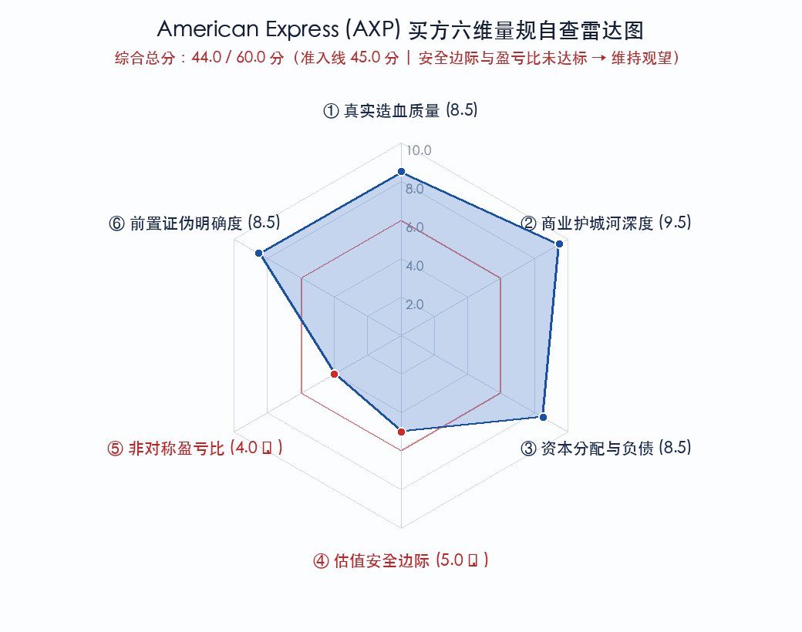

# 买方估值实战 11｜Q3 净利暴增 28% 遇上 5.12% 美债利率：7.07 倍有形净资产的美国运通，到底值多少？

> **实战说明：** 本文为《买方级估值修炼手册》专栏的第 11 篇个股深度实战案例。我们将采用金融机构专属穿透框架（FIG），解剖全球高净值支付与闭环网络龙头——**美国运通公司（American Express Company，纽交所代码: AXP）** 在顺周期拨备红利、小微企业信贷分化以及 **5.12% ~ 5.15%** 无风险美债收益率环境下的真实价值边界。

---

## 导读：高净值特许经营权的表观狂飙与 5.12% 利率重估

在美股金融与支付板块的版图中，美国运通（AXP）长期扮演着极具辨识度的角色：它既不像 Visa 和 Mastercard 那样仅充当不碰资金的四方清算通道，也不同于依赖零息活期存款赚取传统存贷利差的摩根大通或美国银行。

运通构建了一套独特的“三位一体”闭环商业架构：
1. **三方闭环独家网络：** 集发卡行、清算网络与收单机构于一身，截至 2026 年 Q3 全球商户受理网点突破 **1.9 亿家** ，依托全链路消费行为数据实现行业最低梯队的欺诈率，从而稳定锁定显著高于四方网络的商户综合扣率；
2. **类 SaaS 会员卡费订阅经济：** 围绕白金卡、金卡等高端产品构建机场贵宾厅、精选酒店与精致餐饮权益生态，Q3 净卡费收入同比大增 **16%** （汇率调整后 **17%** ）至 **29.70 亿美元** ；
3. **高净值消费金融底座：** 截至 2026 年 9 月 30 日，全公司持卡人贷款与应收余额达 **2,331.53 亿美元** （同比 + **8%** ），核心一级资本充足率（CET1）稳居 **10.9%** ，有形普通股权益回报率（ROTCE）接近 **40%** 。

反映在 2026 年 10 月 23 日披露的 **FY2026 Q3 Form 10-Q** 上，美国运通交出了一份表观极为亮眼的单季成绩单：
* **核心营收与卡费：** Q3 扣除利息支出后总营收达 **200.62 亿美元** （同比 + **9.0%** ），其中净利息收入 **49.40 亿美元** （+ **10%** ）、商户折扣收入约 **101.70 亿美元** （+ **8%** ）、净卡费收入 **29.70 亿美元** （+ **16%** ）；
* **盈利跳升与指引上修：** GAAP 净利润达 **37.12 亿美元** （同比 + **28%** ），GAAP 稀释 EPS 飙升至 `$5.42`（同比 + **31%** ），剔除特殊项目后的调整后核心 EPS 录得 `$4.68`（同比 + **13.0%** ），管理层顺势将全年调整后 EPS 指引下限上修至 `$17.60 ~ $17.90`。

然而，穿透三季报附注与 11 月中旬的最新宏观变化，三项冷峻的事实正在重塑其风险收益边界：

* **第一，GAAP 盈利暴增包含一次性股权出售与顺周期拨备释放：** Q3 GAAP 净利润的跳升，源于出售全球商旅（Amex GBT）股权确认的 **9.82 亿美元税前收益** （税后 **7.51 亿美元** ，折合每股 `$1.11`），部分被全球精简约 **5%** 岗位计提的 **3.36 亿美元税前重组费用** 抵消；同时，合并信贷损失拨备同比骤降 - **23.5%** 至 **9.85 亿美元** （去年同期 **12.87 亿美元** ），对当期利润形成显著托举；
* **第二，小微企业卡核销率与零售端出现分化：** 尽管 Q3 全球综合本金净核销率低至 **1.8%** ，但 11 月 16 日最新发布的 Form 8-K 月度信贷文件（截至 10 月 31 日）显示，`1,151.0 亿美元` 美国消费卡组合本金净核销率环比微升 10 bps 至 **1.6%** （9 月为 **1.5%** ，30 天逾期率 **1.2%** ），而 `481.0 亿美元` 美国小微企业卡组合本金净核销率仍高达 **2.0%** （9 月为 **2.1%** ，30 天逾期率 **1.3%** ，高出消费端 40 bps；且商业服务分部 Q3 税前利润同比下滑 - **6.0%** 至 **10.29 亿美元** ）；
* **第三，10 年期美债收益率稳居 5.12% 高位与高息存款成本刚性：** 受 10 月 CPI/PPI 通胀数据反弹影响，美国 10 年期国债收益率在 11 月 13 日冲上 **5.15%** 后，截至 11 月 16 日收盘仍稳居 **5.12%** 高位。由于运通资产负债表上 **1,550.0 亿美元** 客户存款主要为高息线上储蓄与定期存单，缺乏零息支票沉淀，高无风险利率不仅制约资金成本下降，更直接将买方股权折现成本（CoE）推升至 **9.50%** 。

截至 2026 年 11 月 16 日美股周一收盘，美国运通股价报收于 `$319.05`（单日微跌 - **0.48%** ，较 11 月初阶段高点 `$343.89` 累计回撤 - **7.2%** ），对应加权稀释股本 **674.00 百万股** 与总市值 **2,150.40 亿美元** ，折合有形普通股净资产市净率（`P/TBV`）高达 **7.07 倍** 。

在 **5.12%** 的无风险利率与 **7.07 倍** `P/TBV` 的现实定价下，我们必须冷静拆解三个核心问题：
1. 剔除 GBTG 出售收益与顺周期拨备红利后，运通的真实股东自由现金流（FCFE）底座究竟有多厚？
2. 在 `9.50%` 股权折现率下，现价 `$319.05` 隐含了未来 10 年怎样的盈利增长考卷？这到底是低预期黄金坑，还是中性偏紧定价？
3. 面对潜在的信用均值回归与利率重估，买方的非对称安全击球区落在什么区间？

---

## 第一幕：金融机构真实造血与信贷暗门穿透

研究金融机构必须彻底切换会计范式：**商业银行与消费金融机构严禁使用工业企业的 EBITDA 与企业自由现金流（FCFF）**。客户存款既是负债也是原材料，银行真正属于普通股股东的现金流量，是扣除风险加权资产（RWA）增长所需核心资本留存后的 **股东自由现金流（FCFE）** 。

### 1. 过去 5 年盈利质量与股东自由现金流（FCFE）阶梯审计
依据 SEC 历年 Form 10-K（FY2022–FY2025）及 FY2026 Q3 Form 10-Q，运通依靠接近 **40%** 的有形净资产回报率（ROTCE），无需像高杠杆区域银行那样不断增发股本补充资本，每年仅需留存约 **22%** 的利润即可支撑 ~ **8%** ~ **10%** 的卡余额扩张，其余约 **78%** 常态化净利润均能转化为可供回购与分红的真实 FCFE：

单位：百万美元（比率列除外）

| 财务报告期 | 扣除利息后总营收 | GAAP 归母净利润 | 常态化核心净利润 | RWA 增长资本留存 | 股东自由现金流 (FCFE) | FCFE / 净利润转化率 | 有形净资产回报率 (ROTCE) | 买方造血与信贷质量穿透定性 |
| :--- | :---: | :---: | :---: | :---: | :---: | :---: | :---: | :--- |
| **FY2022** | 52,862.0 | 7,514.0 | 7,514.0 | 1,650.0 | 5,864.0 | 78.0% | 34.2% | 极佳：疫后商旅恢复，低坏账高转化 |
| **FY2023** | 60,515.0 | 8,374.0 | 8,374.0 | 1,840.0 | 6,534.0 | 78.0% | 35.1% | 极佳：净卡费高增与年轻客群放量驱动 |
| **FY2024** | 65,949.0 | 10,129.0 | 9,850.0 | 2,050.0 | 7,800.0 | 77.0% | 37.6% | 极佳：净利首破百亿美元门槛，ROTCE 破 37% |
| **FY2025** | 72,229.0 | 10,833.0 | 10,833.0 | 2,380.0 | 8,453.0 | 78.0% | 38.4% | 极佳：闭环扣率稳固，卡费订阅持续复利 |
| **LTM (截至 2026.09.30)** | **77,586.0** | **12,256.0** | **11,760.0** | **2,590.0** | **9,170.0** | **78.0%** | **39.5%** | **现状参考：剔除 GBTG 与重组净收益 496.0 百万美元后稳健** |
| **FY2026E (含全年指引)** | 79,450.0 | 12,450.0 | 11,960.0 | 2,630.0 | 9,330.0 | 78.0% | 39.8% | 预期参考：营收增 ~10%，调整后 EPS `$17.60~$17.90` |
| **5 年累计发生额 (FY22-FY26E)** | **331,005.0** | **49,300.0** | **48,531.0** | **10,550.0** | **37,981.0** | **77.0%** | — | **会计闭环：5 年累计可分配股东现金流 379.81 亿美元** |

*\*注：LTM 口径严格按 `9M FY26 + FY25 - 9M FY25` 还原（总营收 `58,606 + 72,229 - 53,249 = 77,586.0` 百万美元；GAAP 净利润 `9,794 + 10,833 - 8,371 = 12,256.0` 百万美元），剔除 Q3 出售 GBTG 税后收益 `751.0` 与重组税后成本约 `255.0` 的净正影响 `496.0` 百万美元后，LTM 常态化核心净利润为 `11,760.0` 百万美元；LTM 与 2026E 行中 `78.0%` 转化率以常态化核心净利为分母（相对 GAAP 净利为 `74.8%` 与 `74.9%`），5 年累计 `77.0%` 对应 `37,981.0 ÷ 49,300.0`。LTM 因存在跨期重叠，不计入 5 年累计求和。*

### 2. 三大金融专项体检：AOCI 证券浮亏、CECL 顺周期拨备与小微卡分化
1. **AOCI 证券浮亏与流动性安全垫（杜绝硅谷银行式挤兑风险）：**
   截至 2026 年 9 月 30 日，运通账面累计其他综合收益（AOCI）为 - **33.93 亿美元** 。与手握 `432.03 亿美元` 高流动性现金储备及 `303.97 亿美元` 有形普通股权益相比，即便将全部 AOCI 未实现浮亏视作实际资本扣减，运通依然保留着极其充裕的流动性与监管资本缓冲。
2. **CET1 充足率与近零稀释的股东回馈纪律：**
   Q3 期末核心一级资本充足率 **CET1 升至 10.9%** （稳居管理层 `10.0% ~ 11.0%` 目标上沿），Q3 单季通过 **16.0 亿美元** 股票回购与 **6.0 亿美元** 普通股分红向股东回馈 **22.0 亿美元** 。公司每年股权激励（SBC）占营收比重不足 **0.7%** ，加权稀释股本连续多年净缩减至 **674.00 百万股** 。
3. **CECL 拨备顺周期性与小微企业卡分化警惕：**
   Q3 全公司信贷损失拨备降至 **9.85 亿美元** （同比 - **23.5%** ），信用卡余额损失准备金池维持在 **58.66 亿美元** 。但穿透 11 月 16 日最新 Form 8-K 月度信贷报告（截至 10 月 31 日）：美国消费卡与小微企业卡持有投资余额合计升至 `1,632.0 亿美元`，其中美国消费卡（`1,151.0 亿美元` 余额）净核销率从 9 月 **1.5%** 微升至 **1.6%** （30 天逾期率 **1.2%** ）；而美国小微企业卡（`481.0 亿美元` 余额）净核销率虽从 9 月 **2.1%** 微降至 **2.0%** （30 天逾期率 **1.3%** ），但仍持续高于消费卡 **40 bps** ，且商业服务分部 Q3 税前利润同比下滑 - **6.0%** 。在买方模型中，必须假定未来周期中合并核销率从 **1.8%** 的极低水位向上回归。

---

## 第二幕：金融资本结构、有形净资产与监管缓冲桥梁

在评估金融机构时，股票市值（Equity Value）直接对应股东对金融净资产的索取权。我们需要构建包含 `P/TBV` 有形净资产倍比、存款与债务负债结构、以及监管缓冲的资本结构桥梁：

| 金融机构资本结构与价值锚定要素 | 审计金额 (百万美元) | 折合每股价值 (美元) | 相对市值 / TCE 倍率 | 穿透审计与 SEC 科目附注说明 |
| :--- | ---:| ---:| ---: | :--- |
| **最新普通股股价 (2026.11.16 收盘)** | `319.05` | — | — | 美股周一最新收盘价（日间波动 `$316.96 ~ $321.10`，较峰值回撤 -7.2%） |
| **加权平均稀释总股本 (Diluted Shares)** | **674.00 百万股** | — | — | FY26 Q3 Form 10-Q 披露稀释股本（基本股本 `673.00` 百万股） |
| **(=) 稀释股票总市值 (Equity Value)** | **215,039.7** | `319.05` | **100.0%** | 约 **2,150.40 亿美元** （权益 FCFE 模型基准分子） |
| **账面归母股东权益 (Shareholders' Equity)** | **35,797.0** | `53.11` | **6.01x P/B** | 含实收资本 `11,302.0` + 留存收益 `27,888.0` + AOCI `(3,393.0)` |
| **(−) 商誉及无形资产净额** | `(5,400.0)` | `(8.01)` | — | 含 `4,872.0` 商誉（FY25 10-K 基准）及约 `528.0` 无形资产 |
| **(=) 有形普通股股东权益 (TCE)** | **30,397.0** | `45.10` | **7.07x P/TBV** | **对应稳态 ROTCE 约 39.5%，高 P/TBV 依赖极高资本效率维系** |
| **资产端：卡余额与贷款总额** | **233,153.0** | `345.92` | — | Q3 末同比 +8%（10 月末美消费卡与小微卡 HFI 余额合计升至 `163.2B`） |
| **资产端：现金及现金等价物** | **43,203.0** | `64.10` | **占市值 20.0%** | Q3 期末超高流动性储备，足以覆盖长期流动性波动 |
| **拨备池：卡余额信用损失准备金** | **5,866.0** | `8.70` | **占总余额 2.52%** | CECL 预期信用损失拨备池，当前覆盖 `1.8%` 净核销率充裕 |
| **负债端：客户存款 (Customer Deposits)** | **155,000.0** | `229.97` | — | 较 YE25 `152.5B` 增长 +1.6%，主要为高息储蓄（高存款贝塔） |
| **负债端：长短期有息债务总额** | **59,900.0** | `88.87` | — | 长期债务 `58,500.0` + 短期借款 `1,400.0`，总存款及债务 `2,150 亿` |
| **巴塞尔监管指标：CET1 充足率** | **10.9%** | — | — | 处于 `10.0% ~ 11.0%` 目标上线附近，资本冗余支撑常规回购 |

**银行股戈登增长校验（Gordon Growth P/TBV）：**
按照金融估值经典定理：

$$ \frac{P}{TBV} = \frac{ROTCE - g}{CoE - g} $$

当稳态 `ROTCE ＝ 39.5%`、永续增长率 `g ＝ 3.00%` 且高利率下买方股权成本 `CoE ＝ 9.50%` 时，仅考虑表内资本生息业务的理论均衡 `P/TBV` 为 **5.62 倍** ；即便叠加 GMNS 轻资产网络清算费率带来的结构性溢价，全公司合理 `P/TBV` 估值中枢也约在 **7.5 倍 ~ 7.8 倍** 。这从资产负债表底层印证了一点：当前 `$319.05`（ **7.07 倍** `P/TBV`）并非处于破净或深度折价状态，其安全边际高度依赖高利率环境与分红复利速度。

---

## 第三幕：反向 DCF 逆向求解：5.12% 美债下的隐含考卷

在 2026 年 11 月中旬美国 10 年期国债收益率稳居 **5.12% ~ 5.15%** 的宏观背景下，我们采用 **两阶段股东自由现金流（FCFE）反向求解器** ，测算当前 `2,150.40 亿美元` 的股票总市值隐含了未来 10 年怎样的复利增速要求：

$$ \text{Market Cap} = \sum_{t=1}^{10} \frac{\text{FCFE}_0 \times (1 + \text{CAGR})^t}{(1 + \text{CoE})^t} + \frac{\text{FCFE}_{10} \times (1 + g)}{(\text{CoE} - g) \times (1 + \text{CoE})^{10}} $$

* **核心股权折现参数设定：** 无风险利率取 2026-11-16 官方收盘十年期美债收益率 **5.12%** （继 11 月 13 日冲上 `5.15%` 后仍稳居 `5.10%` 以上高位），成熟消费金融龙头权益风险溢价（ERP）取 **4.15%** ，调整后 Beta 取 **1.05** ，由此推导买方基准股权成本 `CoE ＝ 5.12% + 1.05 × 4.15% ＝ 9.48%`，审慎核定为 **9.50%** ；永续增长率设定为 **3.00%** 。
* **双造血基数对照：** 我们分别以 **基准 A（LTM 常态化 FCFE 91.70 亿美元）** 与 **基准 B（FY2026E 常态化 FCFE 93.30 亿美元）** 代入模型求解：

| 评估维度与输入参数 | 市场现价隐含预期（基准 A：LTM 常态化） | 市场现价隐含预期（基准 B：FY26E 常态化） | 买方方法论与预期差裁决 |
| :--- | :---: | :---: | :--- |
| **当前股票市价 / 总市值** | `$319.05` / `2,150.40 亿美元` | `$319.05` / `2,150.40 亿美元` | 2026-11-16 最新收盘价 × 674.00 百万稀释股本 |
| **基准股东自由现金流 (Base FCFE)** | **91.70 亿美元** | **93.30 亿美元** | LTM 剔除 GBTG 一次性净收益 vs FY2026E 常态化预期 |
| **股权资本成本 (CoE)** | **9.50%** | **9.50%** | 锚定 `5.12% ~ 5.15%` 十年期美债收益率之严苛买方折现标准 |
| **永续增长率 (g)** | **3.00%** | **3.00%** | 匹配长期名义消费增速与资本留存稳态 |
| **★ 隐含未来 10 年 FCFE 年化复合增速** | + **8.21%** | + **7.98%** | **要求近百亿美元基数之上连续 10 年复利增长约 8.0% ~ 8.2%** |
| **第 10 年终局 FCFE 规模 (FY2036E)** | **201.86 亿美元** | **201.07 亿美元** | 第 10 年单年可分配股东现金流需突破 201 亿美元（扩增约 2.2 倍） |
| **莫布森四象限预期投资矩阵** | **【定价中性偏紧】** | **【合理但缺乏折价缓冲】** | **5.12% 以上高利率使低利率时代的“低估值幻觉”彻底消散** |

**莫布森商业史基准概率（Base Rate）审视：**
在 4.1% 低美债时期，市场曾误以为 `$320` 上下的运通处于极度悲观的低预期象限；但当 10 年期美债收益率稳居 **5.12%** 以上、买方折现率锚定在 **9.50%** 时，现价 `$319.05` 要求运通未来 10 年股东自由现金流年化增长 + **7.98%** ~ + **8.21%** 。客观对照运通当前实绩：总刷卡交易额增速已收敛至 + **8.0%** ，且合并坏账率正处于 **1.8%** 的周期低点（未来 10 年大概率经历 1~2 轮信贷周期回归 `2.5%` 以上的正常化水平）。能在百年金融史大数法则下稳步兑现约 + **8.0%** ~ + **8.2%** 十年复利增长、且终局 FCFE 突破 **201 亿美元** ，恰好属于**“业绩按部就班兑现、估值不高也不低”**的中性定价区域，并不足以在当下提供丰厚的买方安全垫。

---

## 第四幕：分部加总估值（SOTP）——四大法定板块分类称重

由于美国运通横跨“零信用风险清算网络（GMNS）”、“高粘性会员卡费与消费金融（USCS）”、“周期性小微商业卡（CS）”与“跨境高增长业务（ICS）”，我们严格按 SEC 10-Q 四大法定报告分部，基于 **FY2027E 常态化税后净利润** 展开分部称重。

### 1. 支撑 SOTP 模型成立的三大基石假设
1. **卡费与会员续约假设：** 假设 FY2027E 净卡费收入维持 + **14%** 增长，白金卡及金卡年度续约率守住 **94%** 以上；
2. **信贷周期温和假设：** 假设全球合并本金净核销率从 **1.8%** 温和回归至 **1.9% ~ 2.0%** ，不出现宏观衰退引发的拨备暴增；
3. **费率监管稳态假设：** 假设美国国会《信用卡竞争法案》（CCCA）等强制压低商户扣率法案在评估期内未获通过生效。

### 2. FY2027E 分部加总估值（SOTP）测算表

单位：百万美元（倍数与每股价值列除外）

| SEC 法定业务分部 (Segment) | FY27E 预估营收 | 预估常态化税后净利 | 对标同业与估值乘数 (P/E) | 分部公允权益价值 | 每股价值贡献 (美元/股) | 估值方法逻辑与折溢价依据 |
| :--- | :---: | :---: | :---: | :---: | :---: | :--- |
| **① 美国零售消费服务 (USCS)** | 43,200.0 | 7,150.0 | **17.5x** | 125,125.0 | 185.65 | 高粘性卡费年金与 1.6% 超低零售净核销率，在银行估值之上给予消费会员溢价 |
| **② 全球商户与清算网络 (GMNS)** | 6,100.0 | 3,450.0 | **22.0x** | 75,900.0 | 112.61 | 零信用风险纯交易清算网络，对标 Visa/Mastercard（25x~28x）打八折给予 22.0x |
| **③ 全球商业企业服务 (CS)** | 19,500.0 | 2,950.0 | **13.5x** | 39,825.0 | 59.09 | 反映小微企业 2.0% 较高核销率及 Q3 分部税前利润同比 -6% 的周期折价 |
| **④ 国际卡服务 (ICS)** | 15,800.0 | 1,450.0 | **16.0x** | 23,200.0 | 34.42 | 跨境高增长但短期市场营销投放摊薄分部利润率，审慎给予 16.0x |
| **(=) 四大分部加总权益价值** | **84,600.0** | **15,000.0** | **17.60x** | **264,050.0** | **391.77** | **四大经营分部稳态公允价值总和** |
| **(−) 未分摊总部费用及监管资本留存折现** | `(5,150.0)` | `(1,722.0)` | **15.0x** | `(25,830.0)` | `(38.32)` | 集团层面未分摊技术平台、运营中后台费用及资本留存刚性拖累 |
| **(=) SOTP 股东公允总权益** | **79,450.0** | **13,278.0** | **17.94x** | **238,220.0** | **353.44** | 对应 FY27E 合并常态化 EPS `$19.70`，SOTP 取整定锚每股 `$353.00` |

**SOTP 核心审计启示：**
1. **清算网络与零售卡费构筑核心底座，极端周期下 SOTP 防御底线为 255.00 美元/股：** 清算网络（GMNS，`$112.61/股`）与美国零售（USCS，`$185.65/股`）合计撑起近 **3,000 亿美元** 分部底盘；即便在欧美宏观停滞、坏账拨备上升的极端逆风下，假设四大分部权益价值总体收缩约 **25%** 至 `1,977.0 亿美元`（USCS/CS 估值倍数下压至 `11.5x ~ 14.5x`），扣除总部净费用折现 `258.3 亿美元` 后，SOTP 极端周期收缩底线仍可支撑 **255.00 美元/股** ；
2. **现价较 SOTP 内在价值仅余微薄折价：** 剔除总部未分摊开销拖累后，SOTP 公允价值在 `$353.44` 附近。现价 `$319.05` 仅折让 **9.7%** ，离买方 **20%** 以上的安全垫标准仍有明显差距。

---

## 第五幕：双变量压力测试、多模型双锚定与非对称赔率决算

### 1. 买方三情景概率分布推演（Bear / Base / Bull Scenarios）
基于 FY2027E 常态化核心 EPS 基准 `$19.70`（较 FY26E 调整后 EPS 指引中枢 `$17.75` 稳健增长 + **11.0%** ），我们结合美国信贷周期走势与 10 年期美债利率路径，构建三情景概率分布矩阵：

单位：美元/股（概率、营收、倍数与百分比列除外）

| 估值情景 (Scenario) | 发生概率 | FY27E 核心营收 (亿美元) | FY27E 稀释 EPS | 目标市盈率 (P/E) | 情景目标价 | 相对现价 (`319.05`) 空间 | 核心基本面假设推演与经营里程碑 |
| :--- | :---: | :---: | :---: | :---: | :---: | :---: | :--- |
| **悲观防御情景 (Bear Case)** | 25% | 815.0 | 16.50 | 15.0x | **247.50** | - **22.4%** | **硬核防御底座：** 美欧消费降速，合并净核销率升至 `2.5%` 致拨备激增，10Y 美债滞留 `5.25%+`，估值压缩至 `15.0x` |
| **基准稳态情景 (Base Case)** | 55% | 860.0 | 19.70 | 18.0x | **354.60** | + **11.1%** | **基准演进轨迹：** 净卡费维持 `+14%` 增长，核销率温和升至 `1.9% ~ 2.0%`，10Y 美债企稳于 `5.0%` 附近，给予 `18.0x` |
| **乐观爆发情景 (Bull Case)** | 20% | 910.0 | 21.20 | 20.0x | **424.00** | + **32.9%** | **超预期共振：** 刷卡交易额重回 `+10%+`，小微企业信用企稳，10Y 美债回落至 `4.4%` 以下推动估值修复至 `20.0x` |
| **概率加权期望目标价** | **100%** | **858.8** | **19.20** | **17.65x** | **341.71** | + **7.1%** | 数学期望：`0.25×247.50 + 0.55×354.60 + 0.20×424.00 ＝ 341.71` |

### 2. 双变量敏感性压力矩阵 A：FY2027E EPS × 目标市盈率 (P/E) 网格
我们在 FY2027E 稀释 EPS（`$16.50 ~ $21.20`）与目标 P/E 乘数（`15.0x ~ 21.0x`）的 `5 × 5` 正交网格下，测算运通在各盈利与估值组合下的目标股价：

单位：美元/股

| FY2027E 稀释 EPS \ 目标 P/E | 15.0x (信用恶化底) | 16.5x (审慎折价) | **18.0x (基准中枢)** | 19.5x (景气温和) | 21.0x (宽松溢价) |
| :--- | :---: | :---: | :---: | :---: | :---: |
| **16.50 (Bear 拨备激增)** | **247.50** | 272.25 | 297.00 | 321.75 | 346.50 |
| **18.10 (温和承压)** | 271.50 | 298.65 | 325.80 | 352.95 | 380.10 |
| **19.70 (Base 稳态预期)** | 295.50 | 325.05 | **354.60** | 384.15 | 413.70 |
| **20.50 (略超预期)** | 307.50 | 338.25 | 369.00 | 399.75 | 430.50 |
| **21.20 (Bull 全面扩张)** | 318.00 | 349.80 | 381.60 | 413.40 | 445.20 |

*(注：第一行左上角熊市 EPS `$16.50` 叠加信用周期底部 `15.0x` P/E 倍数，锁定盈利情景悲观底线为 **247.50 美元/股**)*

### 3. 双变量敏感性压力矩阵 B：股权成本 (CoE) × 永续增长率 (g) 两阶段 FCFE 网格
以 FY2026E 常态化 FCFE **93.30 亿美元** 为期初基数，设定未来 10 年（FY2027E–FY2036E）审慎复合增速为 + **9.50%** （低于过去 5 年 ~12% 实绩，充分计入周期均值回归），在股权成本 CoE（`8.5% ~ 10.5%`）与永续增长率 g（`2.0% ~ 4.0%`）正交网格下测算运通的每股内在价值：

单位：美元/股

| 股权成本 (CoE) \ 永续增长率 (g) | 2.0% (保守衰退) | 2.5% (存量温和) | **3.0% (基准设定)** | 3.5% (景气延续) | 4.0% (乐观扩张) |
| :--- | :---: | :---: | :---: | :---: | :---: |
| **8.5% (降息宽松情景)** | 383.74 | 404.84 | 429.79 | 459.72 | 496.30 |
| **9.0% (利率温和回落)** | 353.12 | 370.48 | 390.73 | 414.66 | 443.38 |
| **9.5% (买方基准 CoE)** | 326.69 | 341.12 | **357.78** | 377.21 | 400.18 |
| **10.0% (美债破 5.5% 情景)** | 303.65 | 315.77 | 329.63 | 345.62 | 364.27 |
| **10.5% (极端紧缩压力测试)** | **283.40** | 293.67 | 305.31 | 318.61 | 333.96 |

*(注：矩阵中心基准设定 CoE `9.5%`、g `3.0%` 对应两阶段 FCFE 内在价值 **357.78 美元/股** ；左下角极端紧缩象限 CoE `10.5%`、g `2.0%` 锁定 FCFE 贴现悲观底线为 **283.40 美元/股**)*

### 4. 多模型横向交叉验证与双锚定（公允目标价 & 悲观防御底）

单位：美元/股（权重列除外）

| 估值方法维度 (Valuation Approach) | 核心驱动与适用场景 | 基准公允价值 | 权重配置 | 加权价值贡献 | 极端悲观底线及推导依据 |
| :--- | :--- | :---: | :---: | :---: | :--- |
| **① 三情景概率加权 (Blended Scenario)** | 纳入 25% 概率信用恶化与 `5.25%+` 高利率压缩 | 341.71 | 40.0% | 136.68 | **247.50** （对应 Bear Case EPS `$16.50` × `15.0x` P/E） |
| **② 分部业务加总 (SOTP - FY2027E)** | 区分 22x 清算网络与 13.5x 商业卡及 17.5x 零售卡 | 353.44 | 40.0% | 141.38 | **255.00** （四大分部总价值缩水 25% 扣总部费用折现） |
| **③ 两阶段股东现金流折现 (FCFE DCF)** | 锚定 `9.50%` CoE 与 `3.00%` 永续增速之复利现金流 | 357.78 | 20.0% | 71.56 | **283.40** （矩阵 B 左下角 CoE `10.5%`, g `2.0%` 极值） |
| **(=) 综合双锚定决算** | **公允目标价加权合成 / 防御底按审慎原则取最低交集** | **349.62** | **100.0%** | **349.62** | **防御底 247.50** （`min(247.5, 255, 283.4)`）；**目标价定锚 350.00** |

*(补充说明：运通期末 GAAP 每股有形净资产 `TBVPS ＝ $45.10`；作为强特许经营权消费金融网络，其持续经营防御底线由上述三大模型的最严苛交集 `$247.50` 确立，相当于 `5.49x` 极端周期 `P/TBV`)*

### 5. 持有期空间与非对称盈亏比决算
* **基准市价：** 2026-11-16 最新官方收盘价 `$319.05`
* **综合公允目标价：** `$350.00`（现价较公允价值仅 **折让 8.84%** ，持有期上行空间为 + **9.70%** ，即 + `$30.95` / 股）
* **悲观防御底座：** `$247.50`（取多模型悲观底线最严苛交集，下行风险 - **22.43%** ，即 - `$71.55` / 股）
* **持有周期：** 约 **2.0 年** （2026 年 11 月至 2028 年末）
* **2.0 年预期年化复合回报率（IRR）：**

$$IRR_{\text{价格}} = \left( \frac{350.00}{319.05} \right)^{\frac{1}{2.0}} - 1 = \mathbf{+4.74\% / \text{年}}$$

  *(注：若计入每年约 `1.00%` 的现金股息率，综合预期年化回报率约为 + **5.74% / 年** ；相对于 11 月 16 日 **5.12%** 的 10 年期无风险美债收益率，仅提供 **62 bps** 的微薄超额风险补偿，难以匹配权益资产承压风险)*
* **基准期望风险收益比（非对称盈亏比）：**

$$\text{期望盈亏比} = \frac{350.00 - 319.05}{319.05 - 247.50} = \frac{30.95}{71.55} = \mathbf{0.43 : 1}$$

  *(即便按 Base Case 目标价 `$354.60` 测算，盈亏比也仅 `35.55 / 71.55 ＝ 0.50 : 1`。每承担 1 美元的下行风险仅对应 0.43 ~ 0.50 美元的预期上行收益，风险收益比显著倒挂，远低于买方 `2.50 : 1` 的建仓门槛)*

---

## 第六幕：事前推演（Pre-Mortem）与前置证伪跟踪红线

### 1. 事前验尸（Pre-Mortem）：三大核心死因深度推演
假设站在 2028 年末回望，在 `$319.05` 买入美国运通后遭遇了 22% 以上的深度回撤（跌破 `$247.50`），最可能触发这一结果的三大潜在杀伤路径如下：
1. **死因一（宏观停滞引发“高净值消费降级 ＋ 中小企业违约共振”，净核销率升破 2.8%）：**
   长期高利率最终刺破中小微企业流动性，同时压制白领金融科技群体的奖金与高端差旅消费。小微企业卡净核销率从当前 **2.0% ~ 2.1%** 攀升至 **3.5% 以上** ，并带动零售消费卡核销率上行，CECL 拨备模型从“少提释放”骤然逆转为“巨额前瞻增提”，对盈利形成乘数级下杀；
2. **死因二（高息存款重定价侵蚀净利差，叠加年费提价疲劳）：**
   10 年期美债长期滞留在 **5.0% ~ 5.5%** 区间迫使运通上调高息储蓄存款（HYSA）利率挽留资金；同时竞争对手加大高端返现权益补贴，导致年轻客群对年费再次提价产生疲劳、续约率跌破 **88%** ，净卡费同比增速掉入个位数， **7.07 倍** `P/TBV` 的特许估值溢价瓦解；
3. **死因三（美国《信用卡竞争法案》CCCA 或监管强制压低刷卡扣率）：**
   美国国会或反垄断监管机构落地强制网络路由分流政策或限制商户综合扣率（Discount Rate），直接削弱运通独有的三方闭环定价权与 GMNS 高毛利池。

### 2. 前置非价格客观证伪红线跟踪表

| 监控维度 | 具体可量化红线指标 (Threshold) | 最新实证状态 (Q3 10-Q / 11-16 8-K) | 触发后的硬性执行动作 (Action) |
| :--- | :--- | :---: | :--- |
| **① 信贷坏账红线** | **合并净核销率连续 2 个季度突破 2.5%，或美国小微企业卡核销率突破 3.2%** | 合并 `1.8%`；10 月美小微卡 `2.0%`、消费卡 `1.6%` | **【立即无条件减仓 50% 至清仓】** |
| **② 会员飞轮红线** | **净卡费单季同比增速连续 2 个季度跌破 8.0%** | Q3 净卡费 `29.70 亿美元`（YoY +16%） | **【剔除类 SaaS 估值溢价，P/E 下调至 14.0x】** |
| **③ 商业分部失血** | **商业服务分部 (CS) 税前利润连续 3 个季度同比负增长超过 10.0%** | Q3 CS 税前利润 `1,029.0M`（YoY -6%） | **【下调 FY27E EPS 至 Bear 悲观情景】** |
| **④ 监管资本与扣率** | **CET1 核心一级资本充足率跌破 9.5%，或美国强制限制扣率法案落地生效** | `CET1 ＝ 10.9%`；刷卡扣率机制稳固 | **【无条件清仓离场，彻底终止跟踪】** |

---

## 第七幕：客观量规自查与买方击球区执行规划

### 1. 客观六维量规自查明细总表（60 分制）

| 评估维度 | 权重分值 | 实际得分 | 扣分依据与买方客观审计事实 (SEC 财报实证) |
| :--- | :---: | :---: | :--- |
| **① 真实造血质量** | 10.0 分 | **8.5 分** | 扣 1.5 分：Q3 净卡费 +16%（29.7 亿）、ROTCE 近 40%，主业调整后盈利扎实；但 GAAP 受 GBTG 一次性收益抬升、且 10 月小微卡核销率仍达 2.0%（9 月 2.1%）。 |
| **② 商业护城河深度** | 10.0 分 | **9.5 分** | 扣 0.5 分：三方闭环支付网络（1.9 亿+ 商户）与高净值白金会员生态极难复制，客群持续年轻化。 |
| **③ 资本分配与治理** | 10.0 分 | **8.5 分** | 扣 1.5 分：CET1 达 10.9% 目标上沿，单季回购 16 亿 + 分红 6 亿，SBC 占比 <0.7%；因高息存款贝塔限制资金成本弹性酌情扣分。 |
| **④ 估值安全边际** | 10.0 分 | **5.0 分** | 扣 5.0 分（不及格）：在 `5.12%` 十年期美债（CoE `9.50%`）下，现价 `$319.05` 仅较 `$350.00` 公允价折让 `8.84%`，且 `P/TBV` 高达 `7.07x`。 |
| **⑤ 非对称盈亏比** | 10.0 分 | **4.0 分** | 扣 6.0 分（不及格）：持有期上行仅 +9.70%（含息 IRR 仅跑赢美债 62 bps），而下行至 `$247.50` 达 -22.43%，盈亏比倒挂为 `0.43 : 1`。 |
| **⑥ 前置证伪明确度** | 10.0 分 | **8.5 分** | 扣 1.5 分：月度 8-K 高频披露消费与小微企业净核销率/逾期率，卡费增速与 CET1 均可由 10-Q 精确量化跟踪。 |
| **(=) 综合总评分** | **60.0 分** | **44.0 分** | **【审核结论：一票否决 · 维持观望】** 总分低于 45.0 分准入线，且安全边际与盈亏比双双不及格，现价 `$319.05` 严禁盲目追高。 |

### 2. 买方击球区与仓位执行梯度规划表
在美债利率稳居 **5.12%** 高位的新定价坐标系下，好公司必须匹配能覆盖信用均值回归风险与权益风险溢价的买价。基于 `$350.00` 综合公允目标价与 `$247.50` 悲观防御底座，我们划定三级左侧击球区：

| 决策梯队划分 | 股价区间 / 监控点位 | 相对目标价折让 | 持有期空间 | 预期年化 IRR (价格 / 含息) | 期望盈亏比 (R/R) | 买方执行策略与仓位纪律 |
| :--- | :---: | :---: | :---: | :---: | :---: | :--- |
| **当前观望过滤带 (现价所处区)** | `$300.00 ~ $330.00` | 折让 5.7% ~ 14.3% | +6.1% ~ +16.7% | +3.0%~+8.0% / +4.0%~+9.0% | `0.24 : 1 ~ 0.95 : 1` | **【0% 仓位 · 持币观望】** 现价 `$319.05` 处于此区间，含息年化回报贴着 5.12% 美债线运行，严守纪律观望 |
| **一级击球区 (观察试水建仓带)** | `$270.00 ~ $282.00` | **折让 19.4% ~ 22.9%** | + **24.1% ~ 29.6%** | +11.4%~+13.9% / + **12.4%~14.9%** | `1.97 : 1 ~ 3.56 : 1` | **【1.5% ~ 2.5% 观察底仓】** 对应 FY27E P/E 压缩至 `13.7x ~ 14.3x`，安全边际逼近 20%，中枢盈亏比跨越 `2.5 : 1` |
| **二级击球区 (深度回调核心带)** | `$252.00 ~ $265.00` | **折让 24.3% ~ 28.0%** | + **32.1% ~ 38.9%** | +14.9%~+17.9% / + **15.9%~18.9%** | `4.86 : 1 ~ 21.78 : 1` | **【加仓增配至 4.0% ~ 5.5%】** 贴近 SOTP 极端周期收缩底（`$255.00`），提供极具吸引力的非对称赔率 |
| **三级极限击球区 (硬核防御底)** | `$235.00 ~ $247.50` | **折让 29.3% ~ 32.9%** | + **41.4% ~ 48.9%** | +18.9%~+22.0% / + **19.9%~23.0%** | **极高非对称赔率** | **【满配上限 6.0% ~ 8.0%】** 直贴 Bear Case 底线，在第六幕四条非价格红线未触发下果断吃满赔率 |

---

## 结语：莫把顺周期低坏账与一次性收益，当成无视利率的理由

美国运通毫无疑问是全球消费金融领域最难被颠覆的特许经营权资产之一。接近 **40%** 的有形净资产回报率、同比高增 **16%** 的净卡费订阅年金以及高达 **1.8%** 的极优合并净核销率，印证了其闭环网络与高净值客群的深厚护城河。

然而，投研中最容易犯下的错误，是将“优秀的好生意”与“任何价格都值得买入的好投资”划上等号。当 10 年期美债收益率稳居 **5.12%** 高位、小微企业卡核销率维持 **2.0%** 左右、且 Q3 表观盈利掺杂了出售 GBTG 股权的顺风收益时，`$319.05` 的现价（ **7.07 倍** `P/TBV`）仅仅给出了约 + **5.74%** 的含息年化回报预期与 `0.43 : 1` 的倒挂赔率。

> **买方终极心法：** 好资产的护城河负责守住价值底线，而价格折让与无风险利率共同决定赔率上限。面对年化回报仅跑赢美债 62 个基点的交易区间，保持定力、等待股价落入 `$270.00 ~ $282.00` 以下的非对称击球区，才是机构买方穿越宏观利率周期的稳健之道。

---

*免责声明：本文为《买方级估值修炼手册》专栏的第 11 篇个股估值实战演练案例，所有财务与信贷数据均客观溯源至 American Express Company 披露的 SEC Form 10-K、FY2026 Q3 Form 10-Q、月度信贷表现 Form 8-K 及官方财报文件。文中所涉估值模型、假设参数及击球区推演仅供买方投研方法论交流与教学参考，在任何情况下均不构成对任何人的证券买卖建议。市场有风险，投资需独立判断并自负盈亏。*
