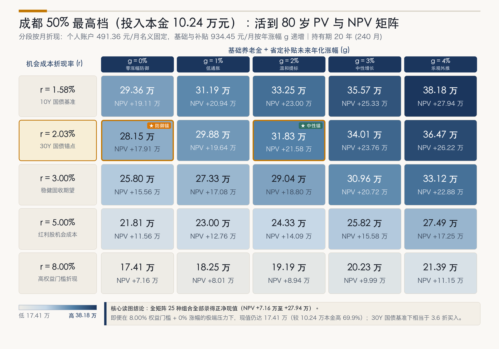
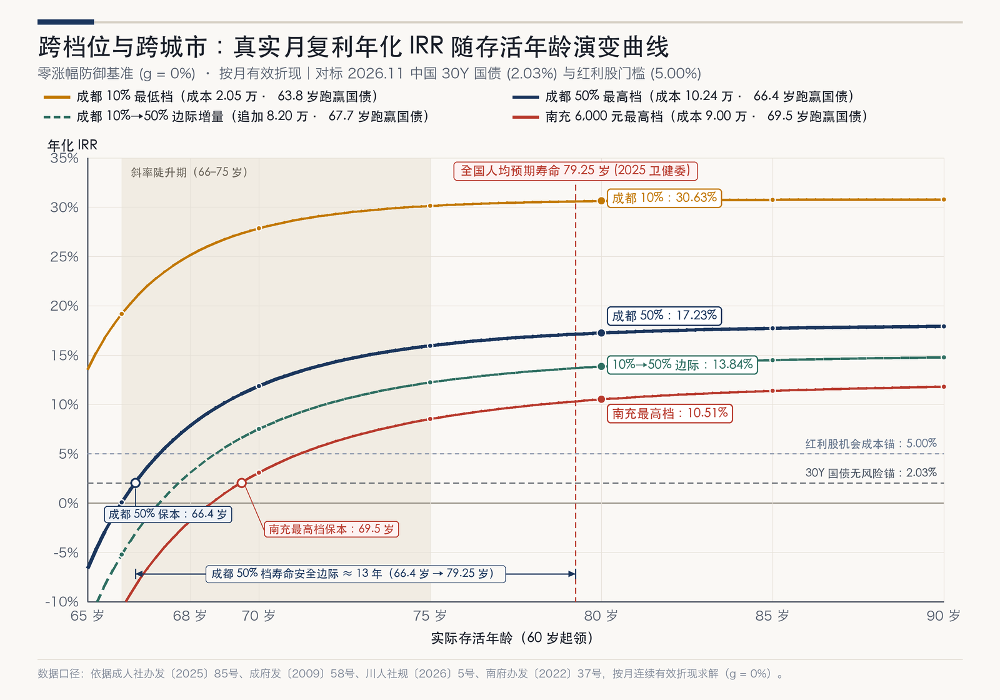

# 补缴 10 万、月领 1,400 元：用华尔街估值模型，重算成都这笔养老账

> **核心导读：** 一次性拿出 10 万元，未来领回来的现金流折现到今天到底值多少？至少要活到几岁才跑赢 30 年国债？该选 2 万低档还是顶格 10 万？本文用买方 DCF 估值框架，以成都与南充最新官方政策为底账，把真实赔率与风控底线算到小数点后两位。

---

## 第一幕：热点纠偏与资产重定义——拆穿“6 年回本”的静态幻觉

### 1.1 先做三项基础概念纠偏与政策核验

2026 年 11 月，成都市部分区县社保经办大厅排起长队，“一次性补缴 10 万多、月领 1,400 多元”成为家庭资产配置圈热议焦点。动用买方估值模型测算之前，必须先把三项客观政策边界核对清楚：

* **制度属性纠偏：** 本轮引发排队热潮的标的，并非银行与券商推广的第三支柱“个人养老金”（年度税优缴存上限 12,000 元），而是第一支柱中的 **成都市城乡居民基本养老保险（简称“城居保”）** 60 周岁及以上一次性趸缴 15 年政策。两者在账户封闭逻辑、财政补贴来源与待遇给付公式上均不相同。
* **政策窗口核验：** 围绕网传“2026 年底一次性补缴关停”的说法，其实存在两层误读——  
  一方面，省级缴费文件 [川人社规〔2024〕12号](https://rst.sc.gov.cn/rst/xzgfxwj/2024/12/31/b5ecdaac47d642bb80c2c27430497e78.shtml) 已明确成都市按本市现行办法独立执行，原本就不受省级文件到期日限制；  
  另一方面，针对四川省内其余 20 个市州（包括下文对照的南充市），省人社厅等三部门也于 2026 年 11 月 2 日印发 [川人社规〔2026〕7号](https://rst.sc.gov.cn/rst/xzgfxwj/2026/11/4/92308e02da1f4dfb9d3e8c45e9588b5c.shtml)，将补缴政策有效期正式延至 **2028 年 12 月 31 日** 。符合条件的家庭无需因恐慌截止日期而盲目扎堆。
* **户籍与准入条件：** 参保人须具备成都市户籍，且年满 60 周岁时累计缴费不足 15 年；根据 [成都市人社局官方答复](https://cdhrss.chengdu.gov.cn/cdrsj/c140462/2026-07/21/content_ed3eddd7acf74b3ea49c5dbfb34ec2b9.shtml)，若在 60 周岁之后才由市域外迁入成都，还须满足 **落户满 3 年** 且未领取其他国家基本养老保障待遇的前提。

依据成都市人社局、财政局、税务局联合印发的 [成人社办发〔2025〕85号](https://cdhrss.chengdu.gov.cn/cdrsj/c109727/2026-01/04/content_09f84ec5372b404fabbff8e446b20c71.shtml)，2026 年成都市城居保按上年度全省城镇非私营单位在岗职工平均工资设定 5 个缴费档次，具体标准整理如下（表 1）：

（单位：元）

| 缴费档次（占省平工资比例） | 16–59 岁个人年缴（费率 10%） | 16–59 岁政府年补贴（费率 2%） | 16–59 岁年入账合计（12%） | 60 岁+一次性趸缴 15 年成本（无补贴） |
| :--- | :---: | :---: | :---: | :---: |
| 一档（10%） | 1,138.32 | 227.64 | 1,365.96 | 20,489.40 |
| 二档（20%） | 2,276.64 | 455.28 | 2,731.92 | 40,978.80 |
| 三档（30%） | 3,414.96 | 683.04 | 4,098.00 | 61,470.00 |
| 四档（40%） | 4,553.28 | 910.68 | 5,463.96 | 81,959.40 |
| **五档（50% 最高档）** | **5,691.60** | **1,138.32** | **6,829.92** | **102,448.80** |

注：2025 年度五档（50%）一次性趸缴 15 年成本为 101,898.00 元；随全省平均工资调整，2026 年度同步微调至 102,448.80 元。

### 1.2 从股票估值视角重定义：为什么“6 年回本”是静态 P/E 幻觉？

社会传言普遍采用一句简单的除法：102,448.80 ÷ (1,425.81 × 12) ＝ 5.99 年，由此得出“不到 6 年回本，相当于年化 16.7% 股息率”的结论。

站在股票与固收研究的视角看，这组除法等价于在用 **静态市盈率（Static P/E）** 5.99 倍 评估一笔消耗型资产——正如专栏第 04 讲《市盈率（P/E）的谎言》中拆解过的，静态倍数把动态现金流压缩成了一张静态快照，直接掩盖了两个结构性定价盲区：

1. **本金属性彻底不同：** 以 10.24 万元 买入一只股息率 6% 的公用事业股票或 30 年期国债，每年收到现金分红的同时，底层本金股权或债券仍在账户中可随时交易变现；而一次性趸缴养老金是用 102,448.80 元 本金 **不可逆买断一份与存活寿命绑定的终身年金合约** ，前 5.99 年 收到的钱本质上首先是 **拿回自己的本金摊销** ，之后存活年份收到的才是真正意义上的净投资收益。
2. **货币时间价值缺失：** 把未来的第 1 个月至第 72 个月现金流等权相加，等价于默认资金的机会成本（折现率 r）等于 0%。在现实金融市场中，哪怕只看无风险国债，这笔钱原本也可以赚取无风险票息或股息。

我们将成都 50% 最高档每月实领金额拆解并代入不同折现率（假设首月按 1,425.81 元 计发，下文第二幕推导精确来源），利用按月有效折现率重新测算动态回本周期（表 2）：

$$ r_m = (1 + r)^{\frac{1}{12}} - 1 $$

| 机会成本折现率锚 (r) | 对应现实资产参照 | 零涨幅基准 (g=0%) 动态回本 | 对应回本年龄 | 温和提标情景 (g=2%) 动态回本 | 对应回本年龄 |
| :--- | :--- | :---: | :---: | :---: | :---: |
| 0.00% | 静态账面不折现 | 72 个月（5.99 年） | 66.0 岁 | 70 个月（5.83 年） | 65.8 岁 |
| 1.58% | 2026.11 中国 10 年期国债 | 76 个月（6.33 年） | 66.3 岁 | 73 个月（6.08 年） | 66.1 岁 |
| **2.03%** | **2026.11 中国 30 年期国债** | **77 个月（6.42 年）** | **66.4 岁** | **74 个月（6.17 年）** | **66.2 岁** |
| 3.00% | 银行长期大额存单/稳健固收 | 80 个月（6.67 年） | 66.7 岁 | 77 个月（6.42 年） | 66.4 岁 |
| 5.00% | 优质高股息红利股期望 | 86 个月（7.17 年） | 67.2 岁 | 82 个月（6.83 年） | 66.8 岁 |
| 8.00% | 长期主动权益机会成本 | 97 个月（8.08 年） | 68.1 岁 | 92 个月（7.67 年） | 67.7 岁 |

一旦引入时间价值与机会成本，所谓“6 年回本”实际被拉长至 **6.4 ~ 8.1 年** 。如果机会成本定在权益资产常用的 8.0% 门槛，至少要持续领到接近 68.1 岁，累计折现现值才真正跨过 102,448.80 元 的本金关口。

---

## 第二幕：底层账本穿透——1,425.81 元由哪三条现金流水龙头拼成？

搭建 DCF 模型不宜直接用网传模糊数字做黑箱贴现。网上流传最广的算式是“个人账户养老金 ＝ 102,448.80 ÷ 139 ≈ 737 元，再加成都基础养老金约 700 元”，两者碰巧凑成 1,437 元。**这组算法在结果上看似接近，但在会计科目和政策原文上存在显著偏差，会直接误导后续的通胀增长建模与身故清退兜底测算。**

依据成都市现行城居保基石文件 [成府发〔2009〕58号](https://www.chengdu.gov.cn/gkml/cdsrmzfbgt/qtwj/1613191603906781184.shtml) 第七条、第八条及附件计发办法，叠加缴费比例调整文件 [成府函〔2012〕31号](https://www.chengdu.gov.cn/gkml/cdsrmzfbgt/qtwj/1613191571853910016.shtml) 与四川省 川人社规〔2026〕5号 最新标准，成都这份养老金本质上是一份 **双轨混成合约** ，由三条完全不同的现金流水龙头拼接而成。

### 2.1 反推计发基数与三条流水龙头拆解

由 成人社办发〔2025〕85号 公布的 50% 档 15 年总缴费额 102,448.80 元 除回 15 年（180 个月）、50% 档位及 12% 总费率，可精确还原成都市 2026 年度的月均养老金计发基数（对应年基数 113,832.00 元）：

$$ \text{月计发基数} = \frac{102,448.80}{15 \times 12 \times 50\% \times 12\%} = 9,486.00 \text{ 元/月} $$

以此计发基数代入 成府发〔2009〕58号 与 川人社规〔2026〕5号 官方公式，首月 1,425.81 元 的真实底层结构清晰浮现（表 3）：

* **龙头一：指数化基础养老金（统筹基金支出，具备政策增长属性）**  
  成都市城居保区别于全国绝大多数省市的核心特征，在于它继承了“类职工化”的指数化基础养老金设计。根据文件附件，基础养老金按退休日计发基数、本人缴费档次系数（50% 档即 0.50）及缴费年限（15 年）的 1% 核算：

$$ \text{指数化基础养老金} = 9,486.00 \times 50\% \times 15 \times 1\% = 711.45 \text{ 元/月} $$

* **龙头二：个人账户养老金（8% 建账除以 139，名义固定年金）**  
  成府发〔2009〕58号 第七条明确规定：按参保人缴费基数的 8% 建立个人账户。在 12% 的总缴费费率中，实际只有 8% ÷ 12% ＝ 2/3（即 68,299.20 元）记入个人账户储存额，另外 4%（34,149.60 元）进入社会统筹大池。退休时以个人账户储存额除以国家规定的 60 岁计发月数 139：

$$ \text{个人账户养老金} = \frac{68,299.20}{139} = 491.36 \text{ 元/月} $$

* **龙头三：省定基础养老金补贴（财政人头定额补贴，具备政策增长属性）**  
  依据四川省提标通知 [川人社规〔2026〕5号](https://rst.sc.gov.cn/rst/xzgfxwj/2026/10/9/0b1f4597ea3f4ea1b7b1b84df7eb45d1.shtml)，全省城乡居民基础养老金最低标准连续三年上调：2024 年 7 月调至 163 元/月，2025 年 7 月调至 193 元/月，自 **2026 年 7 月 1 日** 起再度上调 30 元 至 223.00 元/月（80 周岁及以上高龄最低标准为 233.00 元/月）。这一部分不论缴费档次高低，由中央与省市财政按人头定额发放。

（单位：元/月）

| 现金流组成部分 | 资金支取来源 | 公式核心参数 | 首月测算金额 | 占总养老金比重 | 未来通胀/政策调整属性 |
| :--- | :--- | :--- | :---: | :---: | :--- |
| ① 指数化基础养老金 | 地方社保统筹基金 | 9,486.00 × 50% × 15 × 1% | 711.45 | 49.9% | **可增长年金**（挂钩社平与政策调节） |
| ② 个人账户养老金 | 个人账户（8% 建账） | 68,299.20 ÷ 139 | 491.36 | 34.5% | **名义固定年金**（起领后额面固化） |
| ③ 省定基础养老金补贴 | 中央与省级财政兜底 | 川人社规〔2026〕5号 基准 | 223.00 | 15.6% | **可增长年金**（跟随国家/省定提标） |
| **合计首月实领金额** | 统筹、个人与财政结合 | 现金流分项汇总 | **1,425.81** | **100.0%** | 可增长部分 934.45 元（65.5%） |

注：部分区市县在计发时存在数元地方微调、计发基数尾差或提前缴费期间零星记账利息，实际核定值通常落在 1,426 ~ 1,433 元/月 区间，本文统一以纯官方公式基准 1,425.81 元/月 作为保守贴现起点。

### 2.2 拆解对 DCF 建模的实质意义

厘清上述会计结构后，一个决定估值准确度的物理约束立刻浮出水面：

491.36 元 的个人账户养老金（占总领取额的 **34.5%** ）一旦办理退休核定即固化为名义固定现金流，**不会自动随着物价或社会平均工资上涨** ；真正具备抗通胀上调弹性的，是以 711.45 元 + 223.00 元 ＝ 934.45 元 为基数的统筹基础部分（占比 **65.5%** ）。若不将这两条现金流拆分折现，而是简单粗暴地对 1,425.81 元 整体套用增速 g，以 r ＝ 2.03%、g ＝ 4% 为例，会导致提标带来的增长溢价被高估 **52.6%** （折现现值虚增 4.37 万元，净现值高估 16.7%）。

---

## 第三幕：正向 DCF 估值与双维度敏感性大考

### 3.1 锚定 2026 年 11 月宏观参数与基准持有期

* **无风险利率锚点：** 截至 2026 年 11 月 20 日，中国 10 年期国债收益率处于 1.58% 附近（11 月 20 日收盘 1.576%，近期运行区间 1.57% ~ 1.60%），30 年期超长期国债收益率为 2.03% （近期运行区间 2.02% ~ 2.05%）。考虑到养老金合约横跨 20 至 30 年长久期且具备主权与地方财政信用背书，采用 2.03% （30 年期国债收益率）作为无风险折现基准，同时列示 3.00% （稳健固收）、5.00% （高股息红利股）与 8.00% （权益投资门槛）用于压力测试。需要说明的是，国债可在二级市场随时变现，而养老金完全锁死流动性；若按固收定价习惯在 2.03% 无风险锚上叠加 100 ~ 200 bps 的流动性溢价（Illiquidity Premium），则对应下文表 4 中的 3.00% ~ 5.00% 折现行。
* **基准领取年限（寿命锚点）：** 根据国家卫健委公布的最新统计数据，2025 年中国居民人均预期寿命已达 79.25 岁。按人口生命表精算规律，由于未满 60 岁的早年风险样本已被自然过滤，能够平安活到 60 岁的参保人，其平均预期余寿通常在 20 年 左右（即平均存活至 80 岁；按人口统计规律，女性 60 岁后的预期余寿通常较男性再长 4 ~ 5 年，对应安全边际更为宽裕）。因此，我们将正向 DCF 的基准持有期锚定为 **20 年（240 个月，60 岁领至 80 岁）** 。

按月连续复利分段折现公式定义如下，其中 M_fixed ＝ 491.36，M_grow ＝ 934.45，T ＝ 20 年（即 12T ＝ 240 个月），可增长部分假定每年年初按年化增长率 g 调升一次：

$$ PV(r, g, T) = \sum_{m=1}^{12T} \frac{M_{\text{fixed}} + M_{\text{grow}} \cdot (1 + g)^{\lfloor (m-1)/12 \rfloor}}{(1 + r_m)^m} $$

### 3.2 正向现值（PV）与净现值（NPV）双变量敏感性矩阵

将成都 50% 最高档成本 102,448.80 元 作为 t ＝ 0 期初始现金流出，测算活到 80 岁时在不同折现率 r 与不同基础养老金年涨幅 g 组合下的真实折现现值 PV 与净现值 NPV ＝ PV − 10.2449 万元（表 4 & 图 1）：

（单位：万元，单元格为 PV / NPV 对应数值）

| 机会成本折现率 (r) | g = 0%（零涨幅） | g = 1%（低通胀） | g = 2%（温和提标） | g = 3%（历史均值） | g = 4%（乐观外推） |
| :--- | :---: | :---: | :---: | :---: | :---: |
| 1.58%（10Y 国债） | 29.36 / +19.11 | 31.19 / +20.94 | 33.25 / +23.00 | 35.57 / +25.33 | 38.18 / +27.94 |
| **2.03%（30Y 国债锚）** | **28.15** / + **17.91** | 29.88 / +19.64 | **31.83** / + **21.58** | 34.01 / +23.76 | 36.47 / +26.22 |
| 3.00%（稳健固收） | 25.80 / +15.56 | 27.33 / +17.08 | 29.04 / +18.80 | 30.96 / +20.72 | 33.12 / +22.88 |
| 5.00%（红利股门槛） | 21.81 / +11.56 | 23.00 / +12.76 | 24.33 / +14.09 | 25.82 / +15.58 | 27.49 / +17.25 |
| 8.00%（权益机会成本） | 17.41 / +7.16 | 18.25 / +8.01 | 19.19 / +8.94 | 20.23 / +9.99 | 21.39 / +11.15 |

> **热力图核心读图结论：**  
> 在 25 种交叉情景下，未来现金流折现到今天的净现值全部为显著正数。在“未来 20 年一分钱不涨（g ＝ 0%）加 30 年期国债无风险锚（r ＝ 2.03%）”的防御基准下，花 10.24 万元 买到的现金流资产内在现值高达 28.15 万元（相当于以 3.6 折 的深度折价购入主权信用级资产，单笔交易直接锁定 +17.91 万元 的超额净现值）。即便放在 8.00% 的股票机会成本与零涨幅压力测试下，其现值依然高达 17.41 万元，较成本高出 69.9%。

### 3.3 真实年化内含报酬率（IRR）矩阵：看懂寿命与复利的斜率拐点

若把成本 102,448.80 元 视为买入价，反向求解令上述 PV ＝ Cost 成立的贴现率 r，即可得到这笔养老金投资在真实按月复利口径下的年化内含报酬率 IRR（表 5）：

| 实际存活年龄（累计领金年数） | g = 0%（零涨幅） | g = 1%（低通胀） | g = 2%（温和提标） | g = 3%（历史均值） | g = 4%（乐观外推） |
| :--- | :---: | :---: | :---: | :---: | :---: |
| 65 岁（领满 5 年） | -6.67% | -6.18% | -5.69% | -5.19% | -4.69% |
| 66 岁（领满 6 年） | 0.07% | 0.61% | 1.15% | 1.70% | 2.26% |
| 67 岁（领满 7 年） | 4.63% | 5.21% | 5.80% | 6.39% | 6.98% |
| 68 岁（领满 8 年） | 7.83% | 8.44% | 9.05% | 9.68% | 10.30% |
| 70 岁（领满 10 年） | 11.85% | 12.49% | 13.15% | 13.81% | 14.48% |
| 75 岁（领满 15 年） | 15.94% | 16.63% | 17.33% | 18.05% | 18.78% |
| **80 岁（领满 20 年 · 基准）** | **17.23%** | **17.94%** | **18.66%** | **19.40%** | **20.16%** |
| 85 岁（领满 25 年） | 17.71% | 18.42% | 19.15% | 19.91% | 20.68% |
| 90 岁（领满 30 年） | 17.90% | 18.62% | 19.35% | 20.11% | 20.89% |

从表中可以清晰看到一条反直觉的复利几何规律：**养老金 IRR 并非随寿命延长而线性攀升，其真正的斜率跃升期集中在 66 岁至 75 岁这 9 年间。** 活过 66 岁跨过保本线后，70 岁时 IRR 已跃升至 **11.85% ~ 13.15%** ，75 岁达到 **15.94% ~ 17.33%** ；而从 80 岁再多活 10 年到 90 岁，年化 IRR 仅从 17.23% 小幅增厚至 17.90% （边际增幅不足 70 bps），长寿增厚的主要是累计现金流总额而非复利速率。此外，从公司金融严谨口径看，IRR 隐含了月领现金流按同等利率再投资的假设；现实中养老金多用于日常消费，因此评估真实财富增量应以 3.2 节的 **净现值（NPV）** 为主锚，IRR 更适合作为跨档位与跨产品的横向比价标尺。

---

## 第四幕：反向 DCF——必须活到几岁，才算跑赢国债与红利股？

正向 DCF 虽然精密，却需要提前拍定一个“我能活多少年”的主观假设。对于个人而言，这恰恰是最难预测的未知数。在专栏第 09 讲《反向 DCF：别猜股价，算算当前价格隐含了什么预期？》中介绍的 **反向 DCF（Reverse DCF）** 思维恰好能把思路倒转：不再猜测自己能活多久，而是让投入的 102,448.80 元 市价反向吐出那道客观的“保本寿命考卷”。

在最保守的零涨幅基准（g ＝ 0%，即未来 20 年养老金一分不涨）下，我们逐月累加不同折现率下的现金流现值，求解令净现值由负转正（∑ PV_m ≥ 102,448.80）所需的最短存活年龄（表 6）：

| 想要跑赢的替代资产门槛 | 设定年化折现率 (r) | g = 0% 所需月数（岁数） | 对照 80 岁预期寿命的安全边际 | g = 2% 所需月数（岁数） | 考卷难度评估 |
| :--- | :---: | :---: | :---: | :---: | :--- |
| 名义收回本金 | 0.00% | 72 个月（66.0 岁） | **14.0 年** | 70 个月（65.8 岁） | 很低 |
| 跑赢 10 年期国债 | 1.58% | 76 个月（66.3 岁） | **13.7 年** | 73 个月（66.1 岁） | 很低 |
| **跑赢 30 年期国债** | **2.03%** | **77 个月（66.4 岁）** | **13.6 年** | **74 个月（66.2 岁）** | **很低** |
| 跑赢银行稳健固收 | 3.00% | 80 个月（66.7 岁） | **13.3 年** | 77 个月（66.4 岁） | 很低 |
| 跑赢高股息红利股 | 5.00% | 86 个月（67.2 岁） | **12.8 年** | 82 个月（66.8 岁） | 较低 |
| 跑赢主动权益机会成本 | 8.00% | 97 个月（68.1 岁） | **11.9 年** | 92 个月（67.7 岁） | 中等偏低 |

这份反向 DCF 考卷给出了清晰直观的安全边际尺度：**哪怕未来养老金标准一分钱不涨，参保人只要从 60 岁平安活到 66.4 岁，就已经在真实折现意义上跑赢了 2026 年 11 月的 30 年期国债；只要活到 67.2 岁，就已经跑赢了年化 5.0% 的优质红利资产。** 对照中国 79.25 岁 的人均预期寿命与 60 岁群体约 80 岁 的平均预期终点，这份投资天然附带了 **12 ~ 13 年** 以上的寿命缓冲垫。

---

## 第五幕：跨档位与跨城市横评——从“ROIC 与资本容量”到“区域制度套利”

为了看清成都 50% 最高档究竟只是“居民养老的普通红利”，还是显著稀缺的“制度性超额 Alpha”，我们引入两个横向对照组进行同口径贴现：

1. **同城低档对照（成都 10% 最低档）：** 依据 成人社办发〔2025〕85号，60 岁一次性补缴 15 年成本 20,489.40 元；按相同官方公式拆解，指数化基础养老金 142.29 元 ＋ 个人账户 98.27 元（13,659.60 ÷ 139）＋ 省定基础养老金 223.00 元 ＝ 首月实领 **463.56 元** （可增长部分 365.29 元，占比 78.8%）。
2. **同省跨城对照（南充市 6,000 元最高档）：** 依据南充市实施办法 [南府办发〔2022〕37号](https://www.nanchong.gov.cn/zwgk/zc/zfbwj/nfbf/t_1762179.html) 明确的 15 档城乡居保个人缴费政策（最高档 6,000 元/年），若 60 岁一次性补缴 15 年，成本为 **90,000.00 元** （一次性补缴不享受 280 元/年的政府缴费补贴），100% 全额进入个人账户；按现行计发规则，个人账户养老金 ＝ 90,000.00 ÷ 139 ＝ 647.48 元/月（名义固定，占比 74.4%），叠加 2026 年 7 月起执行的四川省统一城乡居民基础养老金最低标准 223.00 元/月（可增长部分，占比 25.6%），合计首月领取 **870.48 元** 。

我们将成都 50% 最高档、成都 10% 最低档、成都“由 10% 升级至 50% 档的边际增量”以及南充 6,000 元最高档放入同一按月复利 DCF 引擎（锚定 80 岁 / 20 年 持有期与 2.03% 30 年期国债无风险利率），得出完整横向决算表（表 7 & 图 2）：

| 核心估值与收益指标（基准持有至 80 岁 / 20 年） | 成都 50% 最高档 | 成都 10% 最低档 | 成都 10%→50% 边际增量 | 南充 6,000 元最高档 |
| :--- | :---: | :---: | :---: | :---: |
| 一次性补缴总成本（元） | 102,448.80 | 20,489.40 | +81,959.40 | 90,000.00 |
| 个人账户养老金·固定（元/月） | 491.36（34.5%） | 98.27（21.2%） | +393.09 | 647.48（74.4%） |
| 基础+补贴养老金·可增长（元/月） | 934.45（65.5%） | 365.29（78.8%） | +569.16 | 223.00（25.6%） |
| **退休首月总领取额（元/月）** | **1,425.81** | **463.56** | + **962.25** | **870.48** |
| 静态名义回本周期（年） | 5.99 | 3.68 | 7.10 | 8.62 |
| **零涨幅现值 PV / r=2.03%（万元）** | **28.15** | **9.15** | + **19.00** | **17.19** |
| **零涨幅净现值 NPV / r=2.03%（万元）** | + **17.91** | + **7.10** | + **10.81** | + **8.19** |
| 温和涨幅现值 PV / r=2.03%, g=2%（万元） | 31.83 | 10.59 | +21.24 | 18.06 |
| 红利锚现值 PV / r=5.00%, g=0%（万元） | 21.81 | 7.09 | +14.72 | 13.31 |
| **真实月复利 IRR / g=0%（年化）** | **17.23%** | **30.63%** | **13.84%** | **10.51%** |
| 真实月复利 IRR / g=2%（年化） | 18.66% | 32.42% | 15.12% | 11.07% |
| 真实月复利 IRR / g=3%（年化） | 19.40% | 33.33% | 15.78% | 11.38% |
| 反向 DCF：跑赢 30Y 国债需活至（岁） | 66.4 | 63.8 | 67.7 | 69.5 |
| 反向 DCF：跑赢 5% 红利股需活至（岁） | 67.2 | 64.1 | 68.8 | 71.2 |

这张横向对照表清晰暴露出两大极具教科书意义的买方资本配置洞见：

### 5.1 同城跨档启示：ROIC 百分比与“再投资容量”的决断

单纯看内部收益率，成都 10% 最低档高达 **30.63%**（3.68 年 回本，63.8 岁 即跑赢 30 年国债），账面远胜 50% 最高档的 **17.23%** 。核心原因在于 223.00 元/月 的省定基础养老金不论交 2 万还是交 10 万都等额发放，显著摊高了低档位的分子收益。

但买方决策从不单纯追求表面的百分比，而是聚焦 **资本容量与边际增量回报（Incremental ROIC）** ：如果因为迷恋 30.63% 的收益率而只投 2.05 万元，最终只能赚走 + **7.10 万元** 的净现值，剩下的 8.20 万元 闲置资金若只能购买 2.03% 的国债或存进银行吃定存，整体组合净现值就会白白萎缩。

反观专门抽离出来的 **10% 升档至 50% 边际增量投资**（多掏 81,959.40 元 本金，换取每月多领 962.25 元）：这笔增量资金自身的独立年化 IRR 依然高达 **13.84%**（若含 2% 提标则达 **15.12%** ），只需活过 68.8 岁 就能跑赢 5.0% 的红利资产，并额外锁进 + **10.81 万元** 的净现值。只要家庭现金流承受得了 10.24 万元 的成本，任何理性的资本配置都会选择顶格拉满 50% 最高档容量。

### 5.2 跨城市对照启示：同省不同命的现金流结构与抗通胀含金量

同样在四川省内，南充最高档补缴 9.00 万元（仅比成都少掏 1.24 万元），首月却只能领取 **870.48 元** ，与成都相差 **555.33 元/月**（成都起步现金流高出整整 **63.8%** ），对应 80 岁净现值差距高达近 10 万元（+17.91 万 vs +8.19 万）。原因全部写在制度底层：南充市执行全省统一城乡居保框架，缺少成都那项挂钩职工社平工资的 711.45 元 指数化基础养老金。

更隐蔽的差距藏在 **抗通胀敞口与增长弹性** 上：

* **南充最高档：** 月领构成中，**74.4%** 来自名义固定的个人账户养老金（647.48 元），只有 25.6% 来自可随政策提标的省定基础养老金（223.00 元）。当未来年化提标速度从 0% 上行到 3% 时，南充的 IRR 仅从 10.51% 微升至 11.38%（弹性提升 + **87 bps** ）。
* **成都 50% 档：** 结构恰好倒挂过来，**65.5%** 属于可随全省平均工资与财政提标增长的统筹基数，同样从 0% 升至 3%，成都 IRR 直接从 17.23% 跃升至 19.40%（弹性高达 + **217 bps** ）。

但也必须给出一个客观公允的对照结论：即便拿掉成都的特殊政策光环，南充 6,000 元最高档活到 80 岁依然有 10.51% 的无信用违约 IRR（69.5 岁 即可跑赢当前 30 年期国债，且 9.00 万元 本金 100% 计入个人账户可全额继承，外加 10,445.76 元（12 个月本人当月实领养老金）丧葬与抚恤保障），依然显著优于商业养老保险年金与定期存款。成都政策则是将这一公共社会保障品进一步放大成少见的财政高赔率窗口。

---

## 第六幕：下行风险边界、压力测试与家庭实操核查清单

无论前期 DCF 计算出的正净现值多么诱人，缺乏下行底线校验与流动性测试的盲目建仓，都会导致真实家庭资产负债表受损。沿用专栏第 14 讲《安全边际与投资备忘录自查》中的风控压力测试框架，我们在决策前先量化三项核心隐患，并给出四步实地核查清单。

### 6.1 风险一：17% IRR 从何而来？切忌将过去高提标线性外推

必须清醒厘清这份金融合约的对手方与超额收益来源：**社保基金并不是通过二级市场投资赚取了每年 17% 的无风险收益，成都城居保的高 IRR 本质上是地方财政与社会统筹池向符合条件的本地户籍老人进行的跨期转移支付与制度补贴。**

正因为收益来源高度依赖财政统筹承受力，随着深度老龄化加速与地方财政步入紧平衡周期，全社会平均工资基数增速与基础养老金连续大幅调升的斜率存在自然收敛可能。因此，在家庭财务规划中，审慎的防御姿态必须以 g ＝ 0% ~ 1%（仅保名义甚至零增发）作为核心评估基准，切忌用 g ＝ 4% 的过去线性外推来替消费贷或过度集中押注寻找心理安慰。这一点与专栏第 08 讲《终值陷阱与自洽法则》中的核心约束完全相通——任何长期增速假设均须受制于宏观与财政现实边界，不可按历史惯性线性外推。

### 6.2 风险二：最易踩坑的“前期身故退还底线（Floor）”双口径压力测试

如果办理补缴并起领后，在第 1 年或第 3 年遭遇身故变故，原本 10.24 万元 本金到底能退回多少？这是衡量下行保护垫（Downside Floor）最核心的一道题。

依据成都市早期基石法规《成都市城乡居民养老保险试行办法》（成府发〔2009〕58号）**第八条第（四）款** 原文表述：

> “参保人领取养老金期间死亡，社会保险经办机构将其个人缴纳的养老保险费扣除已领取养老金后的余额，一次性支付给其指定受益人或法定继承人，并按死亡当月养老金标准向其直系亲属一次性支付 4 个月的养老金作为丧葬补贴。”

然而在跨年制度衔接与全国统一城乡居保系统并轨的实操语境下，由于第七条同时规定仅按基数 8%（68,299.20 元）建账个人账户，公开经办信息中对退还基数存在两种现实理解口径：**口径 A（严格按 58 号文第八条退还实缴本金余额）** 与 **口径 B（按全国统一居保口径仅退还 8% 个人账户储存额余额，另 4% 统筹沉淀不可退）** 。

我们针对领满 1 个月、12 个月、36 个月及 60 个月四个前期身故极端节点，将成都双口径与南充标准口径（全额 9 万入个人账户退余额，叠加按 南府办发〔2022〕37号 计发的 4 个月丧葬费与 8 个月一次性抚恤金，合计 12 个月本人当月实领养老金 10,445.8 元）展开全额资金回笼压力测试（表 8）：

（单位：元）

| 前期身故时间节点 | 对比测试口径 | 累计已领养老金 | 身故退还余额 | 丧葬/抚恤补贴 | 家庭总现金回笼 | 相对投入成本净盈亏 |
| :--- | :--- | :---: | :---: | :---: | :---: | :---: |
| **领满 1 个月身故** | 成都口径 A（退实缴余额） | 1,425.8 | 101,023.0 | 5,703.2 | 108,152.0 | + **5,703.2** |
| 领满 1 个月身故 | **成都口径 B（退 8% 账户）** | 1,425.8 | 67,807.8 | 5,703.2 | 74,936.9 | - **27,511.9** |
| 领满 1 个月身故 | 南充标准口径（9 万账户） | 870.5 | 89,352.5 | 10,445.8 | 100,668.8 | +10,668.8 |
| **领满 12 个月身故** | 成都口径 A（退实缴余额） | 17,109.7 | 85,339.1 | 5,703.2 | 108,152.0 | + **5,703.2** |
| 领满 12 个月身故 | **成都口径 B（退 8% 账户）** | 17,109.7 | 62,402.9 | 5,703.2 | 85,215.8 | - **17,233.0** |
| 领满 12 个月身故 | 南充标准口径（9 万账户） | 10,445.8 | 82,230.2 | 10,445.8 | 103,121.8 | +13,121.8 |
| **领满 36 个月身故** | 成都口径 A（退实缴余额） | 51,329.2 | 51,119.6 | 5,703.2 | 108,152.0 | +5,703.2 |
| 领满 36 个月身故 | **成都口径 B（退 8% 账户）** | 51,329.2 | 50,610.2 | 5,703.2 | 107,642.6 | + **5,193.8** |
| 领满 36 个月身故 | 南充标准口径（9 万账户） | 31,337.3 | 66,690.7 | 10,445.8 | 108,473.8 | +18,473.8 |
| **领满 60 个月身故** | 成都口径 A（退实缴余额） | 85,548.6 | 16,900.2 | 5,703.2 | 108,152.0 | +5,703.2 |
| 领满 60 个月身故 | **成都口径 B（退 8% 账户）** | 85,548.6 | 38,817.6 | 5,703.2 | 130,069.4 | + **27,620.6** |
| 领满 60 个月身故 | 南充标准口径（9 万账户） | 52,228.8 | 51,151.2 | 10,445.8 | 113,825.8 | +23,825.8 |

压力测试清楚揭示出风险的真实边界：若参保地系统按口径 A 清算，本合约不存在本金亏损可能（永远锁定名义正盈余）；即便处于更严苛的口径 B（仅退 8% 个人账户余额），真正的本金回撤风险窗口也仅仅集中在领金开始的最初 **30.4 个月**（约 2.5 年），最极端第 1 个月身故的最大本金净亏损上限被锁死在 -27,511.9 元（最大本金回撤约 26.9%）。一旦度过两年半，已领总养老金叠加上可退还账户余额与丧葬补贴，名义账面便已全面翻正；对于南充标准口径，则因 9.00 万元 100% 记入个人账户，从第 1 个月起总回笼即高于初始本金。

### 6.3 风险三：流动性长期锁定与举债补缴红线

1. **零流动性溢价代价：** 这是一笔买入即锁死本金、不支持中途退保取现、不支持质押变现的非流动合约。在家庭资产配置上，如果 10.24 万元 挤占了老人必需的急救备用金、大病医疗兜底现金，或者家庭通过刷信用卡、借消费贷（真实年化利率 4% ~ 8%）硬凑本金去换取 1,425 元/月 的细水长流现金流，一旦遭遇突发刚性大额支出就会引发严重的现金流期限错配危机。
2. **年轻家庭的隐藏筹码（按年逐缴补贴红利）：** 从前文表 1 可见，60 岁一次性补缴 **不享受政府缴费补贴** ；如果家中有 45 岁至 59 岁的成都户籍成员提前按年缴费，以 2026 年 50% 档为例，个人每年只掏 5,691.60 元，政府额外补助 **1,138.32 元/年** （相当于交钱瞬间即斩获 20.0% 的即时补贴收益并复利记账利息）。能够提前规划按年参保，综合净现值显著高于等到 60 岁再一次性补齐。

### 6.4 家庭实操四步核查清单（Checklist）

对于考虑为家中长辈或自身办理城乡居保一次性趸缴的家庭，建议在前往窗口缴款前逐项核验以下四项客观条件：

* 🟢 **步骤一：核对属地身份与落户年限底线**  
  查询长辈是否满足“本地户籍、达到 60 周岁且未领取其他职工或居民基本养老金”；若属 60 岁后迁移落户成都，核实是否已满 3 年 硬门槛，未满时限切勿轻信任何有偿代办承诺。
* 🟢 **步骤二：致电社保专线钉死身后退还经办口径**  
  缴款前拨打当地人社专线（成都 028-12333 / 南充 0817-12333）或前往街道社保窗口确认：若参保人在领满 2.5 年内身故，系统清算退还余额是按全额实缴本金核减（口径 A），还是仅按 8% 个人账户余额核减（口径 B）？如果长辈当前患有重度基础疾病或高风险重疾，而属地仅按口径 B 清退且可承受能力有限，应审慎评估是否改选 10% 低档（2.05 万元）试水，规避前 30 个月 2.75 万元 统筹沉淀风险。
* 🟡 **步骤三：资产负债表流动性与零杠杆测试**  
  核实扣除这笔 9.00 万 ~ 10.24 万元 一次性支出后，家庭活期与高流动性货币基金是否仍足以覆盖至少 12 个月 日常生活开销与 10 万元 以上大病医疗应急垫资；严守 **零举债补缴底线** ，绝不动用高息消费贷或透支信用融资。
* 🟢 **步骤四：拉满边际资本容量（确认健康达标后优先顶格）**  
  在流动性冗余、健康状况总体平稳且已完成上述核查的前提下，成都参保家庭不要因 10% 档 30.63% 的表面收益率而停留在最低档。升级至 50% 档的增量部分仍具备 13.84% ~ 15.12% 的高壁垒无违约年化回报，足以帮整个家庭多锁住 + **10.81 万元** 的长期净现值。

---

## 尾声：DCF 是穿透一切人生大账的通用透视眼

无论是给台积电、美国运通做估值，还是给父母面前这张看似不起眼的居民养老缴费单定夺“交 2 万还是交 10 万”，**底层的金融公理其实完全相通** ：把任何一份复杂合约拆成具体的“现金流时间轴”、“不可增长名义本金 vs 可通胀调升部分”、“机会成本折现率”以及“最坏情景下的清算回撤底线”。

> 当全市场都在用粗浅的静态“回本年数”互相传递情绪和焦虑时，买方模型帮我们做了一件最质朴的事：用同一把冷静而诚实的尺子，量出生活里究竟什么是真正的安全边际，什么是该握紧的确定性红利。

如果你也想把今天这套“现金流折现 ＋ 敏感性热力矩阵 ＋ 反向 DCF”模型，套用到自己未来的工作收入、退休年金与家庭安全垫上亲手调滑块试算，可以体验这个免费小工具 → 个人现金流 DCF 实验室

---

### 数据口径与免责声明

本文引用的政策文件均以文内对应的官方原文链接为准；中国 10 年期（1.58%）与 30 年期（2.03%）国债收益率采自 2026 年 11 月下旬公开债市数据，全国居民人均预期寿命 79.25 岁 援引国家卫生健康委员会公开统计。文内所有贴现与 IRR 测算均基于按月连续有效折现模型，仅作估值方法推演与科普交流，不构成任何个人财务或参保决策建议，具体参保资格与实际退休核定待遇请以当地社保经办窗口实时核算为准。
