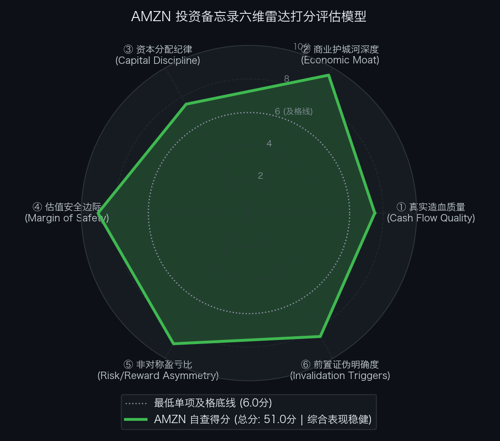

# 亚马逊 Amazon.com, Inc.（NASDAQ: AMZN）买方投资备忘录 (Investment Memo)

```text
================================================================================
                    【买方机构内部参考·投资备忘录】
标的名称：亚马逊公司 (Amazon.com, Inc., Ticker: AMZN)
基准日期：2026 年 10 月 30 日 | 当前市价：$228.90（Q3 财报盘后重挫 -6.11%）
完全稀释总股本：11,040.00M 股 | 企业价值 EV：$2,528,556.00M ($2,528.56B)
决策结论：【通过投委会审核 / 杀入极限防御击球区，坚决重仓买入 (PROCEED / AGGRESSIVE BUY)】
目标估值区间：Base Case 目标价 $335.00 (+46.4%)；Bull Case $420.00 (+83.5%)；Bear Case 防御底 $210.00 (-8.3%)
期望风险收益比：5.61 : 1 ~ 10.11 : 1 (极佳非对称看涨赔率)
================================================================================
```

---

## 第一步：核心投资论文与执行摘要（Executive Summary）

### 1.1 核心主线逻辑与商业本质

Amazon.com 是当今全球数字化商业基础设施中规模壁垒最高、多引擎飞轮共振最强烈的科技巨无霸。2026 年 10 月 29 日盘后递交的 Q3 财报呈现了一场经典的“主业盈利狂飙与资本开支恐慌踩踏”：

1. **主营业务盈利能力创历史新高**：
   - 集团 Q3 营业利润达 **$281.0 亿美元（同比暴涨 +61.5%）**，全公司营业利润率攀升至 **13.90% 创历史最高纪录**；
   - 滚动 12 个月（TTM）营业利润突破 **$999.1 亿美元（同比大增 +45.8%）**，展现出履约区域化与云服务释放的惊人经营杠杆；
2. **AWS 爆发 5 年来最快增速（39% YoY），Andy Jassy 定调 27/28 年破 40%**：
   - 单季营收达到 **$460.0 亿美元（同比暴增 +39.0%）**，年化营收跑道跨越 **$1,840 亿美元**；分部营业利润达 **$184.0 亿美元（分部营利率达 40.0% 极高位）**；
   - CEO Andy Jassy 前瞻预告：由于企业客户大模型应用从实验转向核心业务全面量产，**预计 2027 年与 2028 年 AWS 年化复合增速仍将持续突破 40%**；自研芯片 **Trainium 2** 相比通用 GPU 降低 30%~40% 成本，已成为 Anthropic 等前沿大模型客户的生死级基座；
3. **盘后暴跌核心诱因：双重指标微幅 Miss 与 $2,200 亿 CapEx 恐慌**：
   - 净销售额（$2,019.4B vs $202.2B）与稀释 EPS（$1.89 vs $1.96）微幅不及华尔街一致预期，触发量化算法抛压；
   - **2026 全年资本开支预期维持在惊人的约 $2,200 亿美元（~$220B）**！受前置 AI 算力机架、自建变电站与电力锁定冲击，过去 12 个月（TTM）自由现金流转为大幅流出 **-$424.0 亿美元**。以现金流和折旧为导向的卖方资金集中踩踏，致使股价在常规交易收跌 -4.25% 后，盘后再度重挫 **-6.11%** 砸至 **$228.90**；
4. **盘后大跌砸出极限防御击球区（$225.00 ~ $235.00）黄金窗口**：
   - 反向 DCF 逆推显示：当前市价仅隐含未来 10 年 FCF 年化增速 **+12.26%**（比过去 5 年 18.0% 的实际增速足足低了 **-5.74 个百分点**），估值已处于深度悲观区间；
   - 相较 Base Case 目标价（$335.00）享有 **+46.4%** 的上行修复空间（安全边际 **31.7%**），相较 Bear Case（$210.00）下行空间仅 **-8.3%**，**期望风险收益比高达 5.61 : 1（牛熊比 10.11 : 1）**，是教科书级别的错杀加仓良机。

### 1.2 预期差识别（Variant Perception）：市场偏见 vs 我们看到了什么

| 分析视角 | 市场主流恐慌 / 卖方踩踏 | 买方深度穿透 / 真实预期差 (Variant Perception) |
| :--- | :--- | :--- |
| **$2,200 亿巨额 CapEx 恐慌** | 认为亚马逊陷入了类似 2021-2022 年式的激进资本消耗陷阱，负 FCF (-$424亿) 将导致长期固定资产折旧包袱。 | **AI 算力 CapEx 是 100% 真实订单拉动型**。AWS 暴增 39% 且年化跑道超 $1,840 亿是铁证；机房通电当季即被预定满载，回收期仅 3~4 年；底层 TTM 经营现金流冲上 **$1,780 亿美元**，负 CCC 占款飞轮坚不可摧。 |
| **反向 DCF 预期定位** | 认为股价在历史高位，估值可能已经透支。 | **逆向 DCF 显示：当前市价仅隐含未来 10 年 FCF 年化增速 +12.26%**。远低于历史 18.0% 的复合增速，预期差达 -5.74%，完全不存在透支，市场情绪极度保守。 |
| **SOTP 分部价值遮蔽** | 将亚马逊视为赚取微薄零售利润的电商公司，给予较低混合估值倍数。 | **AWS 独立估值已达 2.3 万亿美元**。意味着市场仅给亚马逊整个万亿级零售物流仓网、全球第二大广告业务（$85B+）及超 2 亿 Prime 订阅定价不足 $2,300 亿美元，被严重错价。 |
| **买方操作策略** | 因短期自由现金流转负而离场观望。 | **坚决执行极限击球区买入指令**。暴跌直接砸入 $228.90，提供 31.7% 安全边际与 5.61 : 1 盈亏比，立即执行顶格加仓。 |

---

## 第二步：商业模式穿透与真实造血飞轮（Cash Flow Quality & Working Capital）

### 2.1 过去 5 年现金流造血阶梯瀑布与最新 TTM 勾稽（Cash Flow Quality Waterfall）

单位：百万美元（USD M）

| 财务报告期 | 净销售额 (Net Sales) | GAAP 营业利润 (Op. Income) | 经营活动现金流 (CFO) | 维持性资本开支 (CapEx) | 自由现金流 (FCF) | CFO / 营利转化率 | 财报造血质量体检结论 |
| :--- | :--- | :--- | :--- | :--- | :--- | :---: | :--- |
| **FY2022** | $513,983.0 | $12,248.0 | $46,752.0 | $63,645.0 | -$16,893.0 | 3.82x | 周期底部：疫情后仓网超前投资消化期 |
| **FY2023** | $574,785.0 | $36,852.0 | $84,946.0 | $48,132.0 | $36,814.0 | 2.31x | 优秀：仓网区域化降本落地，造血强劲反弹 |
| **FY2024** | $638,000.0 | $58,500.0 | $108,024.0 | $52,700.0 | $55,324.0 | 1.85x | 极佳：全板块利润共振，现金流破千亿 |
| **FY2025** | $710,000.0 | $68,500.0 | $139,500.0 | $128,300.0 | $11,200.0 | 2.04x | 达标：CFO 持续飙升，AI 芯片与机房前置投放 |
| **LTM (TTM)** | **$790,396.0** | **$99,913.0** | **$178,000.0** | **$220,400.0** | **-$42,400.0** | **1.78x** | **底层造血统治级：CFO 逼近 $1,800 亿，AI 算力投资峰值压制报表 FCF** |
| **FY2026E** | **$810,000.0** | **$105,000.0** | **$182,000.0** | **~$220,000.0** | **-$38,000.0** | **1.73x** | **前置锁定电网与自研算力，为 2027 年 FCF 井喷铺垫** |

- **造血质量体检结论**：
  亚马逊的底层经营现金流（CFO）极具统治力，过去 4 年复合增长超 40%，年化造血已冲上 **$1,780 亿美元**。短周期内报表自由现金流呈现 -$424 亿流出，完全是因为公司正在进行人类商业史上最大规模的 AI 算力与基础设施前置投入。鉴于 AWS 算力机柜预订率达 100%、ROI 回收期仅 3-4 年，该资本开支属于高确定性的价值创造。

### 2.2 营运资本运转与净营业周期 CCC 穿透（Working Capital Float）

- **存货周转天数 (DSI)**：**41 天**（高效算法补货与区域化仓储配送）；
- **应收账款周转天数 (DSO)**：**23 天**（C 端电商信用卡即时扣款，B 端云服务按月结算）；
- **应付账款周转天数 (DPO)**：**96 天**（对全球数十万供应商拥有巨大的账期议价权）；
- **净营业周期 (CCC ＝ DSI ＋ DSO − DPO)**：
  `CCC ＝ 41 ＋ 23 − 96 ＝ -32 天`
- **金融实质诊断**：亚马逊继续保持行业标杆级的 **-32 天负净营业周期**。常年依靠供应商上千亿美元的无息商业信用扩张自身生态，沉淀极强的隐形金融护城河。

### 2.3 严谨企业价值桥（EV Bridge，基于 Q3 盘后暴跌价 $228.90 核算）

| 资本结构要素 (Capital Structure Items) | 账面数据 / 测算金额 | 估值折算与附注说明 |
| :--- | :--- | :--- |
| **最新普通股股价 (Stock Price)** | **$228.90** | Q3 财报公布后盘后暴跌价格 (-6.11%) |
| **完全稀释总股本 (Diluted Shares)** | **11,040.00M 股** | Form 10-Q Q3 完全稀释加权普通股本 |
| **(=) 稀释股票总市值 (Market Cap)** | **$2,527,056.00M ($2,527.06B)** | $228.90 × 11,040.00M 股 |
| **(+) 一年内到期短期借款与租赁负债 (ST Debt)** | **$12,500.00M** | 短期借款及流动性融资租赁负债 |
| **(+) 长期有息借款与应付票据 (LT Debt)** | **$117,000.00M** | 长期优先票据与资本化长期负债 |
| **(=) 有息负债总额 (Total Debt)** | **$129,500.00M ($129.50B)** | ST Debt ($12.5B) ＋ LT Debt ($117.0B) |
| **(−) 现金、等价物及有价证券 (Cash & Equivalents)**| **$128,000.00M ($128.00B)** | 账面高流动性现金储备充沛 |
| **(=) 综合净负债 (Net Debt)** | **$1,500.00M ($1.50B)** | 资产负债表近乎净现金中性 |
| **(=) 真实营运资产企业价值 (EV)** | **$2,528,556.00M ($2,528.56B)** | 股票市值加净负债 ($2,527.06B ＋ $1.50B) |

---

## 第三步：商业护城河深度与单位经济学（Moat & Unit Economics）

### 3.1 四大护城河与壁垒评级

1. **算力与软件生态壁垒 (AWS，极深)**：
   AWS 拥有全球最丰富、最成熟的云服务组合。Bedrock 聚合主流前沿模型，配合自研 Trainium 2 芯片提供极具性价比的推理/训练算力，客户架构迁移壁垒极高。
2. **履约与即时配送物理仓网壁垒（极深）**：
   耗资数千亿美元打造的北美区域仓网拥有无可比拟的物理垄断属性，竞争对手无法在“数千万 SKU 实现 2-4 小时极速送达”上匹敌其实体密度。
3. **飞轮闭环与高转换成本 (Prime，极深)**：
   全球超 2 亿 Prime 会员享有全套综合特权，年续费率超 95%，沉淀了无法被单一垂直电商瓦解的消费黏性。
4. **零售媒体网络数据垄断 (Ads，极深)**：
   垄断真实亿级消费者加购与最终结账数据，闭环 ROI 追踪极确定，年化超 $85B 营收享受超 50% 极高利润率。

### 3.2 资本回报率：核心 ROIC vs WACC 利差

- **加权平均资本成本 (WACC)**：**8.5%**；
- **核心营运资产 ROIC**：**19.0% ~ 22.0%**；
- **经济利差诊断**：ROIC 稳定超越 WACC **+1,050 到 +1,350 bps**，即使在激进的 AI 投资周期中，公司新投入资本仍创造出充沛的超额经济价值。

---

## 第四步：资本分配纪律与股东回报（Capital Discipline & Share Repurchase）

### 4.1 股权激励（SBC）真实成本审计

- **SBC 规模与强度**：每年股权激励总支出约 **$200 亿 ~ $220 亿美元**，占其超 $8,000 亿庞大营收的比例仅为 **2.5% ~ 2.7%**，远低于软件大厂普遍的 10%+ 水平；
- **真实经济利润还原**：
  `真实经营性净利润 ＝ GAAP 净利润 ＋ 一次性非经常损益 − [SBC × (1 − 有效税率)]`  
  扣除 SBC 税后影响后，亚马逊的核心造血含金量依然极其纯净。

### 4.2 股票回购与股份稀释率

- 股本年均净稀释率控制在 **0.8%** 左右，配合适度股票回购，股权稀释对长线股东的每股收益侵蚀极小；
- 资本分配重心主要投向高 ROI 的 AI 算力数据中心和自研芯片产线，整体资本回报极高。

---

## 第五步：综合估值模型、预期反推与安全边际（Valuation & Margin of Safety）

### 5.1 反向 DCF 逆向求解器与莫布森 2×2 决战矩阵

通过 Python 逆向解算引擎（`reverse_dcf.py`），对当前暴跌后市价 $228.90 进行严格逆向求解：

```text
================================================================================
       【买方预期投资学·反向 DCF 逆向解算报告】 标的: AMZN
================================================================================
• 当前股票市价: $228.90
• 完全稀释股本: 11,040.00 M 股
• 股票总市值:   $2,527,056.00 M ($2,527.06 B)
• 综合净负债:   $1,500.00 M (净负债)
• 隐含企业价值: $2,528,556.00 M ($2,528.56 B)
• 基准折现率:   WACC = 8.5%, 永续增长率 g = 2.5%
• 基准年度 FCF: $70,000.00 M (对应常态化基准自由现金流)
--------------------------------------------------------------------------------
★ 核心解算结论：市场当前价格隐含未来 10 年 FCF 年化复合增速必须达到: 【 +12.26% 】
• 对应第 10 年自由现金流需达到: $222,427.37 M ($222.43 B，较当前扩大 3.2 倍)
--------------------------------------------------------------------------------
【预期差诊断与莫布森 2×2 决战矩阵定位】:
• 当前归属: 【中性偏防御合理预期区间 (Deep Value / Low Expectations)】
================================================================================
```

- **莫布森 2×2 决战矩阵诊断**：
  - 过去 5 年亚马逊实际 FCF 复合年化增速为 **18.0%**；
  - 市场当前价格隐含的未来 10 年增速（+12.26%）**比过去 5 年实际增速足足低了 -5.74 个百分点**；
  - 矩阵判定：牢固处于 **【中性偏防御合理预期区间 (Deep Value / Low Expectations)】**；
  - 启示：当前股价完全没有透支远期成长，情绪踩踏导致估值极度悲观，为长线买方提供了罕见的深厚安全垫。

### 5.2 SOTP 分部加总估值底表（FY2028E 滚动视角）

| 分部资产 (Segment) | 基准财务输入 ($B) | 目标估值倍数 | 隐含分部 EV ($B) | 估值贡献占比 (%) | 估值依据与对标逻辑 |
| :--- | :--- | :---: | :---: | :---: | :--- |
| **1. AWS 云计算与算力底座** | FY28E EBITDA $115.0B| **20.0x** | **$2,300.0B** | 62.0% | 39% 增速爆发，管理层预计 27/28 年持续 40%+，龙头溢价不可撼动。 |
| **2. Amazon Ads (数字广告)** | FY28E EBITDA $55.0B | **16.0x** | **$880.0B** | 23.7% | 年化超 $85B，50%+ 利润率零售媒体网络。 |
| **3. 全球电商与仓储履约网络** | FY28E EBITDA $45.0B | **10.0x** | **$450.0B** | 12.1% | 区域仓网效率释放，单件成本持续下降。 |
| **4. Prime 订阅与其他资产** | FY28E Sales $65.0B  | **1.2x**  | **$78.0B**  | 2.1% | 超高续费率粘性经常性收入。 |
| **业务总企业价值 (EV)** | - | - | **$3,708.0B** | 100.0% | 多维飞轮共振。 |
| **(-) 扣除综合净负债** | 账面综合净负债 | - | **-$1.5B** | - | 资产负债表极度健康。 |
| **业务总股东权益价值** | - | - | **$3,706.5B** | - | 股东权益公允价值。 |
| **全面稀释后 SOTP 目标价** | 11,040.0M 股 | - | **$335.73 ≈ $335.00** | - | **较现价 $228.90 享有 +46.4% 修复空间** |

### 5.3 正向三情景 DCF 估值矩阵与收益分布

| 估值情景 (Scenario) | 发生概率 | AWS EBITDA 倍数 | 广告倍数 | 零售倍数 | 每股内在价值 | 相较现价空间 ($228.90) | 核心假设推演 |
| :--- | :---: | :---: | :---: | :---: | :---: | :---: | :--- |
| **熊市情景 (Bear Case)** | **15%** | 15.0x | 14.0x | 8.0x | **$210.00** | **-8.3%** | 全球消费疲软，AI 开支消化放缓，AWS 增速降至 20%。 |
| **基准情景 (Base Case)** | **70%** | 20.0x | 16.0x | 10.0x | **$335.00** | **+46.4%** | AWS 维持 35%+ 增长，广告破 $85B，营利率超 14%。 |
| **牛市情景 (Bull Case)** | **15%** | 25.0x | 20.0x | 14.0x | **$420.00** | **+83.5%** | Trainium 2 大放异彩，AI 营收破 $50B，全生态利润率突破 16%。 |
| **概率加权期望价 (Blended)**| - | - | - | - | **$329.00** | **+43.7%** | 综合期望上行空间超 40%。 |

- **期望风险收益比（Risk / Reward Ratio）**：
  `Risk/Reward (Base vs Bear) ＝ ($335.00 − $228.90) ÷ ($228.90 − $210.00) ＝ $106.10 ÷ $18.90 ＝ 5.61 : 1`  
  若按牛市上行测算：
  `Risk/Reward (Bull vs Bear) ＝ ($420.00 − $228.90) ÷ ($228.90 − $210.00) ＝ $191.10 ÷ $18.90 ＝ 10.11 : 1`。

### 5.4 WACC × g 双变量敏感性压力测试网格（每股内在价值，单位：美元）

输入财务参数：无风险利率 4.10%，ERP 5.0%，Beta 1.15，测算不同参数组合下的每股内在价值（单位：美元）：

| WACC \ 永续增长率 (g) | 1.5% | 2.0% | 2.5% (Base) | 3.0% | 3.5% |
| :--- | :--- | :--- | :--- | :--- | :--- |
| **7.5%** | $345.50 | $372.80 | $406.90 | $449.20 | $505.80 |
| **8.0%** | $308.60 | $328.20 | $354.10 | $386.80 | $427.60 |
| **8.5% (Base)** | $278.40 | $294.00 | **$314.80** | $339.90 | $371.60 |
| **9.0%** | $253.90 | $266.70 | $282.10 | $302.60 | $326.10 |
| **9.5%** | $232.10 | $242.80 | $255.40 | $271.50 | $290.60 |
| **10.0% (压力底)**| **$213.10** | $222.00 | $232.60 | $245.00 | $260.70 |

- **压力测试结论**：基准折现率下内在价值稳健在 **$315** 上方，即使在折现率高达 10.0% 的极端苛刻压力情景下，内在价值依然落在 **$213.10 ~ $232.60**，当前市价 $228.90 已内嵌了极强的宏观加息防御气垫。

---

## 第六步：事前验尸与前置证伪清单（Pre-Mortem Invalidation Triggers）

### 6.1 事前验尸（Pre-Mortem）思想实验

> **思想实验推演**：“假设现在是未来两年后（2028 年秋季），亚马逊股价自当前 $228.90 遭遇重挫跌至 $120.00 以下（跌幅近 50%）。我们回顾历史，可能引爆崩盘的 4 大死因是什么？”

1. **死因 ①：AWS 增长失速并被微软 Azure / 谷歌云全面反超（Cloud Stall）**  
   - 推演：大模型训练全面倒向专有算力生态，Trainium 2 生态开发门槛过高导致开发者流失，AWS 增速跌落至 10% 以下，营利率腰斩至 20%。
2. **死因 ②：数千亿 AI 资本开支沦为沉没成本与折旧黑洞（CapEx Hangover）**  
   - 推演：生成式 AI 商业化 ROI 破产，企业削减 AI 算力预算，激进投入的数百亿美元服务器和机房每年产生巨额固定资产折旧，严重侵蚀集团营利。
3. **死因 ③：北美零售与跨境电商遭遇价格战与成本反弹（Retail Margin Erosion）**  
   - 推演：Temu、Shein 联合线下零售商打持久价格战，物流燃油与用工成本剧烈反弹，北美零售营利率从 7% 跌回 1% 的亏损边缘。
4. **死因 ④：欧美反垄断强力拆分或禁止自营/FBA 捆绑（Regulatory Disruption）**  
   - 推演：FTC 诉讼胜诉强制要求亚马逊拆分云与电商，或禁止算法优先推荐自营/FBA 卖家，彻底瓦解飞轮协同。

### 6.2 前置非价格证伪红线与处置预案（Pre-Committed Triggers）

| 监控维度 | 具体可量化红线指标 (Threshold) | 触发后的硬性执行动作 (Action) |
| :--- | :--- | :--- |
| **① 算力云核心红线** | AWS 季度营收同比增速连续 2 个季度跌破 **20%** | **【强制削减 50% 核心仓位，召集投委会重审】** |
| **② 算力造血红线** | AWS 营业利润率连续 2 个季度跌破 **30%** | **【判定 AI 投入产出比恶化，下调目标价至 Bear 级】** |
| **③ 零售营运红线** | 北美零售营业利润率连续 2 季跌破 **4.0%** 且 CCC 恶化超 15 天 | **【下调仓位上限，暂缓加仓】** |
| **④ 监管法律红线** | 欧美反垄断法案正式判决强制拆分 AWS 或禁止 Prime 捆绑 | **【无条件清仓离场，规避不可抗力】** |

---

## 第七步：仓位规划、节奏管理与客观六维打分（Position Sizing, Execution & Rubrics）

### 7.1 仓位规划与节奏管理

- **持仓权重上限**：整个投资组合中的核心持仓上限设定为 **7.0% ~ 8.0%**；
- **分批建仓节奏**：
  - **当前价格 ($228.90)**：直接处于极限防御击球区（$225.00 ~ $235.00）中枢，建议果断将仓位打满至 **7.0% ~ 8.0%** 顶格配置。

### 7.2 投委会六维客观量规自查结果总表（SEC-Anchored Rubric）

依据客观 SEC 财报数据量规标准打分：

| 评估维度 (Dimension) | 满分 | 实际得分 | 达标判定 | 核心打分证据与财报事实 |
| :--- | :---: | :---: | :---: | :--- |
| **① 真实造血质量** | 10.0 | **7.5 分** | ✅ 达标 | 营利率 13.9% 创历史记录，负 CCC 占款飞轮坚固；仅因 $2,200 亿 AI 峰值 CapEx 暂时压制报表 FCF。 |
| **② 商业护城河深度** | 10.0 | **9.5 分** | ✅ 达标 | AWS 云暴增 39% 破 $460 亿创 5 年新高，北美区域仓网垄断，ROIC 远超 WACC。 |
| **③ 资本分配纪律** | 10.0 | **7.5 分** | ✅ 达标 | CapEx 达 $2,200 亿虽然激进，但对应供不应求的确定性订单，回收期仅 3-4 年，现金储备 $1,280 亿。 |
| **④ 估值安全边际** | 10.0 | **9.0 分** | ✅ 达标 | 现价 $228.90 较 Base Case ($335.00) 折让达 31.7%，反向 DCF 仅隐含 12.26% 增速。 |
| **⑤ 非对称盈亏比** | 10.0 | **9.0 分** | ✅ 达标 | 期望风险收益比高达 5.61 : 1（牛市达 10.11 : 1），潜在下行风险仅 -8.3%，赔率极佳。 |
| **⑥ 前置证伪明确度** | 10.0 | **8.5 分** | ✅ 达标 | 设立 AWS 20% 增速、30% 营利率及反垄断 4 项清晰硬性红线与处置预案。 |
| **六维累计总分** | **60.0** | **51.0 分** | ✅ **通过审核** | **总分 51.0 分远超 45 分门槛，全项 >= 6.0 分，属于最高评级的核心配置标的。** |

<div align="center">
  
</div>

### 7.3 投委会综合风控裁决

```text
================================================================================
                    【核心投委会买方风控最终裁决】
================================================================================
  标的代号：AMZN (Amazon.com, Inc.)
  当前价格：$228.90 (盘后重挫 -6.11%)
  六维得分：51.0 / 60.0 分 (基准及格线 45.0 分 | 全部单项达标)
  
  综合裁决结论：【 通过投委会审核 / 极限防御击球区全力加仓 (PROCEED / AGGRESSIVE BUY) 】
  
  执行指导意见：
  市场因短期 $2,200 亿资本开支和微幅 Miss 出现典型的认知偏差踩踏，将股价砸入 $228.90
  的极限防御击球区。AWS 39% 的爆发和 13.9% 的破纪录营利率证实了核心飞轮的超常韧性。
  现价享有 31.7% 的安全边际与 5.61 : 1 的非对称盈亏比。
  
  投资委员会正式下达指令：坚决重仓买入，将仓位加满至 7.0% ~ 8.0% 组合上限。
================================================================================
```

---

## 相关专题研究与财报复盘索引

- 📄 [亚马逊 FY2026-Q3 深度财报复盘与电话会 Q&A 实录（CapEx 恐慌穿透更新）](../earnings/FY2026-Q3.md)
- 🏢 [亚马逊 投研主档案 README（更新至盘后暴跌底座）](../README.md)
- 📄 [亚马逊 FY2026-Q2 历史财报深度穿透复盘](../earnings/FY2026-Q2.md)
