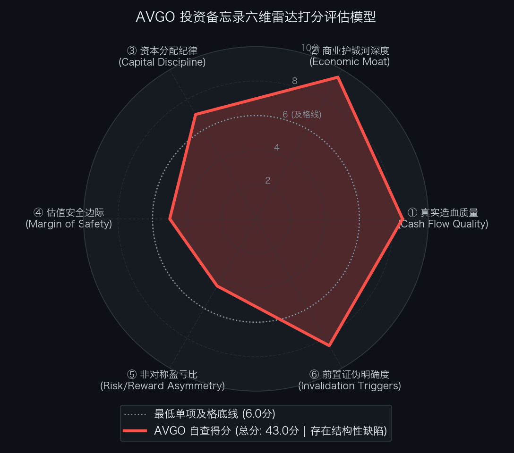

# Broadcom Inc. (AVGO) 买方深度投资备忘录

> **文档归属**: `companies/AVGO/research/investment-memo.md`  
> **基准定价日**: 2026 年 11 月 6 日（美股周五收盘价 `$293.69`，继 11 月 5 日费城半导体指数单日暴跌超 12% 后微弹 +0.74%，较 9 月下旬高点 `$361.99` 累计回撤 -18.9%）  
> **最新财报节点**: FY2026 Q3（截至 2026 年 8 月 2 日，SEC Form 10-Q）及 2026 年 10 月 27 日 SEC Form 8-K 重大资产支持租赁 SPV 披露  
> **核心估值参数**: Non-GAAP 全面摊薄总股本 `4,937.00` 百万股（GAAP 摊薄股本 `4,887.00` 百万股） | 市值 `1,449,947.5` 百万美元（`14,499.5` 亿美元） | 标准企业价值 (EV) `1,485,391.5` 百万美元（`14,853.9` 亿美元）  
> **买方综合评级**: **【未达准入门槛 · 维持观察池跟踪 (WATCH & WAIT)】** （六维总分 `43.0 / 60.0 分`，估值安全边际与非对称盈亏比双双低于 6.0 分及格线；综合公允目标价定锚于 `$330.00`，下行防御底座 `$217.50`，现价期望盈亏比仅 `0.48 : 1`）

---

## 一、 核心投资论点与预期差（Core Thesis & Variant Perception）

### 1.1 买方一句话定性
博通（Broadcom Inc., NASDAQ: AVGO）是全球定制化 AI 算力芯片（Custom XPU/ASIC，市占率超 70%）与超大规模以太网交换芯片（Tomahawk/Jericho 系列，市占率超 80%）的行业龙头，叠加 VMware 私有云基础设施软件的高粘性现金流底座。然而，在 2026 年 11 月初 10 年期美债收益率升至 `4.86% ~ 4.90%`、费城半导体指数（SOX）单日重挫逾 12% 的宏观环境下，叠加 2026 年 10 月 27 日 Form 8-K 披露的 630 亿美元 Anthropic AI 算力机架租赁 SPV 及高达 `430.0` 亿美元（`$43,000M`）表外残值担保敞口，博通的估值逻辑已从“纯粹轻资产垄断溢价”转向“需计入大额表外信贷背书与高无风险利率的折现模型”。将 WACC 设定为 `9.5%` 并扣除表外或有担保风险折价后，现价 `$293.69` 距离综合公允目标价（`$330.00`）仅余 +12.4% 空间，而距 Bear Case 防御底座（`$217.50`）仍有 -25.9% 回撤风险，期望盈亏比明显倒挂（`0.48 : 1`），当前阶段维持观望。

### 1.2 三大核心预期差（Variant Perception vs. 市场共识）

1. **市场共识盲区一：忽视 10 月 27 日 Form 8-K 披露的 430 亿美元表外残值担保（Vendor Financing Backstop）敞口**
   - **市场乐观叙事** ：普遍将 Anthropic 持续扩大的数百亿美元级定制 XPU 机架大单视作无风险的纯增量收入，线性外推 FY2027~FY2028 营收高速增长。
   - **买方穿透审计** ：根据博通于 **2026 年 10 月 27 日提交的 SEC Form 8-K** ，为协助 Anthropic 采购并租赁价值高达 630 亿美元（`$63.0B`）的博通定制 AI 算力机架与网络设备，美国银行、花旗、摩根士丹利及黑石集团组建了专项特殊目的实体（SPV），其中约 `430.0 ~ 435.0` 亿美元为第一留置权优先债（First-Lien Debt）。博通为促成交易，向优先债银团提供了 **或有残值差额担保（Residual Value Guarantee Backstop）** ：若承租方违约，博通须就租赁未偿余额的 **72.5%** 与定制 AI 机架二手变现价值之间的差额承担兜底赔付，未折现最大潜在担保敞口高达 `43,000.0` 百万美元（430 亿美元，折合每股 `$8.71`）。不同于英伟达通用 GPU 具备广泛的二级流转市场，高度耦合特定大模型架构的定制 ASIC（XPU）一旦遭遇客户违约或架构迭代淘汰，其二手清算残值较低。这意味着博通实质上动用了资产负债表外的卖方信贷担保来拉动远期订单。
2. **市场共识盲区二：低估无风险利率中枢上移（10Y 美债 4.90%）对长久期科技资产的估值收敛效应**
   - **市场乐观叙事** ：沿用 `4.0% ~ 4.1%` 的低无风险利率假设与 `8.0% ~ 8.5%` 的 WACC，给予博通 25x~30x 远期市盈率。
   - **买方穿透审计** ：2026 年秋季美国 10 年期国债收益率一度突破 `5.25%`，截至 11 月 6 日仍维持于 `4.86% ~ 4.90%` 高位；叠加北美 AI 数据中心面临中期选举后的电力并网审批收紧与表外融资监管审视，权益风险溢价（ERP）走阔。我们将博通的 WACC 设定为 `9.5%`。在 `9.5%` 折现率下，估值倍数中枢相应下移，高于 20x FY27E P/E 的定价缺乏充足的无风险利差保护。
3. **市场共识盲区三：低估整机机架交付（Rack-Scale Delivery）带来的毛利率结构性稀释**
   - **市场乐观叙事** ：认为 AI 业务扩张将带动整体毛利率持续上行。
   - **买方穿透审计** ：FY2026 Q3 博通 AI 收入升至 `12,200` 百万美元（同比 +135%），占半导体收入比重已达 65.6%。但定制 XPU 携带大量第三方高带宽内存（HBM3e/HBM4 采购自 SK 海力士等）及 CoWoS 先进封装过手成本（Pass-through Cost），且面向 Anthropic 与 OpenAI 的交付正从单一芯片转向整机机架（Rack-scale），导致 Q3 半导体毛利率同比下滑 140 bps 至 `66.8%`，管理层指引 Q4 合并 Non-GAAP 毛利率进一步环比下降 120 bps 至 `77.8%`。高毛利的以太网交换芯片（Tomahawk 6）虽能对冲部分压力，但半导体分部的估值倍数需客观反映硬件系统集成属性加重的现实。

---

## 二、 业务解剖与护城河诊断（Business Teardown & Moat Analysis）

### 2.1 双引擎商业架构与 FY2026 Q3 最新经营实绩

截至 FY2026 Q3（2026 年 8 月 2 日），博通单季总营收达 `27,100` 百万美元（同比 +70%，环比 +18%），Non-GAAP 营业利润率达 `66.1%`（同比 +360 bps），单季自由现金流（FCF）达 `12,487` 百万美元（FCF Margin `46.1%`），期末未交付积压订单（Backlog）达 `1,500` 亿美元。

| 业务分部 (Segment) | FY26 Q3 营收 (`$M`) | 营收占比 (%) | 同比增速 (YoY) | 分部营业利润率 | 核心产品矩阵与下游客户结构 |
| :--- | :---: | :---: | :---: | :---: | :--- |
| **半导体解决方案 (Semiconductor Solutions)** | 18,600.0 | 68.6% | +92.0% | ~60.5% | **AI 定制芯片与网络** （Q3 达 `12,200M`，YoY +135%，含 Google TPU、Meta MTIA、Anthropic/OpenAI XPU 及 Tomahawk 5/6 交换机）； **非 AI 半导体** （`6,400M`，企稳复苏） |
| **基础设施软件 (Infrastructure Software)** | 8,500.0 | 31.4% | +36.0% | ~81.0% | **VMware Cloud Foundation (VCF)** 全栈私有云订阅、Symantec 网络安全、CA 大型机软件与 Brocade 光纤通道存储网络 |
| **合并总计 (Consolidated Total)** | **27,100.0** | **100.0%** | + **70.0%** | **66.1%** | Q4 FY26 官方指引营收 `34,800M`（YoY +93%，其中 AI 半导体指引 `17,400M`） |

### 2.2 护城河深度审计：三大物理与契约壁垒 vs. 一大结构性风险

1. **物理层与 IP 垄断壁垒（7nm/5nm/3nm SerDes 与 CoWoS 产能锁死）** ：
   - 在超大规模 AI 集群中，算力芯片间的互联带宽与功耗是核心瓶颈。博通掌握全球领先的 112G/224G SerDes 物理层接口 IP、PCIe Gen6 及光互连（CPO）技术，云巨头（Google、Meta、字节跳动、OpenAI、Anthropic）若想绕开英伟达 NVLink 封闭生态自研 ASIC，博通是极少数具备超大型复杂晶圆流片、台积电 CoWoS 产能包销议价权与 HBM 供应链整合能力的交钥匙（Turnkey）合作伙伴。
2. **以太网 Scale-Up / Scale-Out 协议标准壁垒** ：
   - 博通主导超以太网联盟（UEC），其 `Tomahawk 5`（51.2 Tbps）与最新量产的 `Tomahawk 6`（102.4 Tbps）交换芯片在开源 AI 集群网络中市占率超过 80%。随着单集群规模向十万卡乃至百万卡演进，网络交换芯片在 AI 机架 BOM 中的价值占比稳步提升，且享有 75%+ 的高毛利率。
3. **VMware 私有云高转换成本契约壁垒** ：
   - 收购 VMware 后，博通全面停止永久许可证销售，推动客户迁移至 3~5 年期不可撤销的 `VMware Cloud Foundation (VCF)` 全栈订阅合同。截至 Q3，超过 90% 的全球前 10,000 大企业客户已签署长期订阅合约，分部营业利润率提升至 `81.0%`，成为每年贡献超 220 亿美元经营现金流的稳定底座。
4. **结构性风险：客户高度集中与表外 SPV 信用捆绑** ：
   - 博通 AI 半导体收入高度集中于前五大超大规模客户。尤其是 2026 年 10 月披露的 630 亿美元 Anthropic 租赁 SPV，使博通在硬件供应商角色之外承担了大额残值担保。一旦未上市大模型独角兽（Anthropic 或 OpenAI）商业化变现不及预期或融资受阻，博通将面临订单缩水与 `430.0` 亿美元残值担保触发的双重压力。

---

## 三、 财务排雷与真实造血穿透审计（Financial Forensics & Cash Flow Truth）

### 3.1 过去 5 年（FY2022–FY2026E）现金流转化审计

依据 SEC Form 10-K（FY2022–FY2025）及 FY2026 Q3 Form 10-Q（截至 2026 年 8 月 2 日），博通属于轻晶圆厂（Fabless）现金牛，资本开支（CapEx）占营收比重长期低于 `1.5%`，五年累计自由现金流对 GAAP 净利润转化率达 `129.7%`：

> **表注** ：以下底表内所有金额统一折算为 **百万美元** ，表内单元格仅保留纯数字与百分比符号。LTM 口径为 `9M FY26 + FY25 - 9M FY25`（截至 2026 年 8 月 2 日过去 12 个月审计值）；FY2026E 为前三季实际值加 Q4 官方指引（营收 `34,800` 百万美元，Non-GAAP 营业利润率约 `66.0%`）汇总。

| 财年周期 | GAAP 净利润 | 经营现金流 (CFO) | 资本开支 (CapEx) | 自由现金流 (FCF) | CFO / 净利润 | FCF / 净利润 | 造血质量审计定性 |
| :--- | :---: | :---: | :---: | :---: | :---: | :---: | :--- |
| **FY2022 (截至 2022.10.30)** | 11,495 | 16,736 | 424 | 16,312 | 1.46x | 141.9% | 极佳（无晶圆厂轻资产模型） |
| **FY2023 (截至 2023.10.29)** | 14,082 | 18,085 | 452 | 17,633 | 1.28x | 125.2% | 极佳（现金转化高度稳健） |
| **FY2024 (截至 2024.11.03)** | 5,895 | 19,962 | 548 | 19,414 | 3.39x | 329.3% | 收购 VMware 无形资产摊销与重组拉低 GAAP 净利 |
| **FY2025 (截至 2025.11.02)** | 23,126 | 27,537 | 623 | 26,914 | 1.19x | 116.4% | 极佳（VMware 协同释放 + AI 放量） |
| **LTM (截至 2026.08.02)** | **38,265** | **40,653** | **1,250** | **39,403** | **1.06x** | **103.0%** | **过去 12 个月真实 FCF 达 394.0 亿美元** |
| **FY2026E (含 Q4 官方指引)** | 43,500 | 48,500 | 1,550 | 46,950 | 1.11x | 107.9% | 全年预计产生近 470 亿美元自由现金流 |
| **5 年累计 (FY22至FY26E)** | **98,098** | **130,820** | **3,597** | **127,223** | **1.33x** | **129.7%** | **五年累计 FCF 达 1,272.2 亿美元，内生造血充沛** |

### 3.2 股权激励（SBC）与并购无形资产摊销排雷

1. **SBC 真实成本穿透** ：
   - 受收购 VMware 后大规模员工留任期权授予及高股价下 RSU 激励增加影响，博通 FY2024 与 FY2025 的 SBC 费用分别达 `5,672` 百万美元和 `6,480` 百万美元；FY2026 前三季度（9M FY26）SBC 为 `5,410` 百万美元（年化约 `7,200` 百万美元，占全年预计营收比重已从 FY24 的 `11.0%` 回落至 `6.9%`）。
   - 同时，博通通过二级市场股票回购对冲了大部分 SBC 摊薄：FY2026 Q3 全面摊薄股本为 `4,937.00` 百万股，同比净增幅控制在 `1.1%` 以内。在 DCF 与 SOTP 模型中， **我们在永续增长率与目标倍数中计入了每年约 1.0% 的股本摊薄折价** 。
2. **并购后的资产负债表结构：负有形净资产（Negative Tangible Book Value）** ：
   - 截至 2026 年 8 月 2 日（Q3 10-Q），博通账面股东权益总额为 `99,690.0` 百万美元，但其中包含 `97,801.0` 百万美元的商誉（Goodwill）以及约 `28,500.0` 百万美元的并购无形资产净额。
   - 剔除商誉与无形资产后，博通的有形账面净资产（Tangible Book Value）为 `-26,611.0` 百万美元（折合每股 `-$5.39`）。这意味着其估值完全建立在持续现金流创造能力之上，缺乏有形重资产清算价值托底。

### 3.3 营运资本飞轮与表外 SPV 收入确认审计

- **存货与应收账款健康度** ：截至 FY2026 Q3，博通账面存货为 `2,315` 百万美元，存货周转天数（DIO）仅约 `34 天`；应收账款周转天数（DSO）约 `31 天`，净营业周期（CCC）保持高效率。
- **表外 SPV 应收与担保隔离审计** ：2026 年 10 月 27 日 8-K 披露的 630 亿美元 Anthropic 机架租赁 SPV 采用破产隔离架构，由 SPV 向博通采购机架并确认博通当期硬件销售收入，从而使博通账面免于直接计入长达数年的融资租赁应收款和 430 亿美元优先债。但从经济实质看，博通承担的 `72.5%` 残值差额担保（最高 `43,000` 百万美元）仍构成潜在财务敞口。在买方企业价值桥（EV Bridge）与 SOTP 估值中，我们对此计提显性的 **表外或有负债风险准备金** 。

---

## 四、 企业价值桥梁与资本结构（Enterprise Value Bridge）

基于 2026 年 11 月 6 日收盘价 `$293.69` 及 **FY2026 Q3 Form 10-Q（截至 2026 年 8 月 2 日）** 与 **2026 年 10 月 27 日 Form 8-K** ，我们构建博通的标准与广义企业价值桥梁：

> **表注** ：以下底表内金额单位统一为 **百万美元** ，每股折算单位为 **美元/股** （基于 Non-GAAP 全面摊薄股本 `4,937.00` 百万股）。

| 企业价值构成项 (EV Bridge Component) | 审计金额 (百万美元) | 每股折算 (美元/股) | 占市值比重 (%) | 会计科目溯源与买方审计附注 |
| :--- | :---: | :---: | :---: | :--- |
| **基准股价 (2026.11.06 收盘)** | 293.69 | 293.69 | — | 经历 11 月 5 日费半指数暴跌 -12% 后的最新收盘价 |
| **Non-GAAP 全面摊薄总股本 (百万股)** | 4,937.00 | — | — | FY26 Q3 10-Q 披露（GAAP 摊薄股本为 4,887.00 百万股） |
| **总市值 (Implied Market Cap)** | **1,449,947.5** | **293.69** | **100.0%** | **约 14,499.5 亿美元** |
| (+) 长期有息债务 (Long-Term Debt) | +57,167.0 | +11.58 | +39.4% | 收购 VMware 遗留高级票据与定期贷款（账面摊余值） |
| (+) 短期债务及一年内到期长债 | +2,252.0 | +0.46 | +1.6% | 含当前到期优先票据（有息债务本金面值合计 61,079.0） |
| **有息债务账面总额 (Total Debt)** | + **59,419.0** | + **12.04** | + **41.0%** | **加权平均票面利率约 4.15%，久期分布均衡** |
| (-) 现金及现金等价物 (Cash & Equiv.) | (23,975.0) | (4.86) | -16.5% | Q3 期末高流动性现金储备，较年初大幅增厚 |
| **净有息债务 (Net Debt)** | + **35,444.0** | + **7.18** | + **24.4%** | **净杠杆率 (Net Debt / LTM FCF) 已降至 0.90x** |
| **标准企业价值 (Standard EV)** | **1,485,391.5** | **300.87** | **102.4%** | **约 14,853.9 亿美元（Reverse DCF 基准分子）** |
| (+) 经营租赁负债 (Operating Leases) | +1,650.0 | +0.33 | +1.1% | 全球研发中心与办公物业长期租赁负债 |
| (+) 表外 SPV 残值担保风险计提 (20% 概率) | +8,600.0 | +1.74 | +5.9% | **2026.10.27 8-K 披露最高 43,000 百万美元残值担保之风险计提** |
| **买方广义风险调整后 EV (Adjusted EV)** | **1,495,641.5** | **302.95** | **103.2%** | **全口径含表外或有担保风险敞口之真实企业价值** |

---

## 五、 反向 DCF 预期拆解（Reverse DCF & Implied Expectations）

在评估目标价之前，我们先用逆向工程求解：在 10 年期美债收益率升至 `4.90%`、WACC 设定为 `9.5%` 的宏观环境下，当前 `$293.69` 的股价（对应标准 EV `1,485,391.5` 百万美元）隐含了怎样的 10 年自由现金流复合增速要求？

### 5.1 核心折现率（WACC）推导
- **无风险利率 (Rf)** ：采用 2026 年 11 月 6 日美国 10 年期国债收益率 `4.90%`。
- **权益风险溢价 (ERP) 与 Beta** ：取成熟科技龙头 ERP `4.50%`，博通调整后 Beta 为 `1.15`（计入 AI 资本开支周期属性与表外 SPV 信用敏感度），权益成本 `Ke = 4.90% + 1.15 × 4.50% = 10.08%`。
- **税后债务成本 (Kd)** ：存量债务加权成本结合新发债利率约 `5.30%`，有效税率 `14.0%`，税后 `Kd = 4.56%`。
- **加权平均资本成本 (WACC)** ：按市值权重 `96.0%`、净债务权重 `4.0%` 加权，并计入表外 SPV 流动性溢价，基准 WACC 锁定为 `9.50%`。
- **永续增长率 (g)** ：考虑到千亿美金体量后的长期稳态与每年约 1.0% 的 SBC 股本摊薄，设定永续净增长率 `3.00%`。

### 5.2 两阶段反向 DCF 数学方程与双基数求解

两阶段现金流折现方程如下：

$$EV = \sum_{t=1}^{10} \frac{FCF_0 \cdot (1 + g_{1\text{-}10})^t}{(1 + WACC)^t} + \frac{FCF_0 \cdot (1 + g_{1\text{-}10})^{10} \cdot (1 + g)}{(WACC - g) \cdot (1 + WACC)^{10}}$$

我们将标准企业价值 `1,485,391.5` 百万美元、WACC `9.50%`、g `3.00%` 代入方程，分别以 **基数 A** （LTM 实际审计 FCF `39,403` 百万美元）与 **基数 B** （FY2026E 全年预计 FCF `46,950` 百万美元）进行逆向求解：

> **表注** ：以下底表内金额单位统一为 **百万美元** ，表内单元格仅保留纯数字与百分比符号。

| 逆向求解维度 | 基数 A：LTM 实际审计 FCF | 基数 B：FY2026E 全年预计 FCF | 历史与行业物理极限对照基准 |
| :--- | :---: | :---: | :--- |
| **期初自由现金流 (FCF0)** | 39,403.0 | 46,950.0 | FY22~FY25 实际 FCF 从 16,312 增至 26,914 (3Y CAGR +18.2%) |
| **目标企业价值 (Standard EV)** | 1,485,391.5 | 1,485,391.5 | 对应 2026-11-06 收盘价 293.69 美元/股 |
| **折现率 (WACC) / 永续增长率 (g)** | 9.5% / 3.0% | 9.5% / 3.0% | 锚定 4.90% 十年期美债收益率与表外风险溢价 |
| **市价隐含未来 10 年 FCF 复合增速 (10Y CAGR)** | + **12.33%** | + **9.81%** | **在近 470 亿美元高基数上需连续 10 年复合增长约 10% 至 12.3%** |
| **隐含第 10 年末 (FY2036E) 终值 FCF** | **126,015.0** | **119,705.0** | **第 10 年单年 FCF 需达 1,197 亿 至 1,260 亿美元（接近当前苹果/微软体量）** |
| **隐含第 10 年末年营收规模 (按 45% FCF 率倒推)** | **280,033.3** | **266,011.1** | **要求博通年营收在 2036 年达到 2,660 亿 至 2,800 亿美元且平稳穿越周期** |

### 5.3 预期可行性诊断
1. **回调释放了部分高估值压力，但尚未进入深度折价区间** ：
   - 在 9 月底股价 `$361.99` 时，市场隐含博通在 LTM 基数上需连续 10 年保持 `+15.0%+` 的复合增长；经历 11 月初回调至 `$293.69` 后，以 FY2026E 全年 FCF（`46,950` 百万美元）为基数，隐含 10 年复合增速降至 `+9.81%`。
2. **为何 9.81% 的隐含增速仍需警惕周期均值回归？**
   - 表面上看，博通 FY2026 Q4 单季营收同比增长 +93%，高于 `+9.81%` 的十年年化门槛。但需要注意的是：`46,950` 百万美元的 FY2026E FCF 是建立在北美云巨头 AI CapEx 扩张高点、以及 630 亿美元表外 SPV 租赁杠杆拉动订单的周期高位基数之上。
   - 若 2027~2028 年 AI 数据中心电力审批放缓，或大模型投资回报率（ROI）不及预期导致超大规模客户削减 20%~30% 的 ASIC 采购，自由现金流将面临周期性回落。在 `9.5%` 的折现率下，现价处于合理区间附近，尚未留出充分应对周期回撤与表外担保风险的安全边际。

---

## 六、 多维估值矩阵与敏感性压力测试（Valuation Matrix & Sensitivity）

我们采用 **分部加总估值法（SOTP）** 、 **双变量敏感性 DCF 压力矩阵** 与 **三情景概率加权模型（Bear / Base / Bull）** 进行交叉验证。

### 6.1 分部加总估值（SOTP — 基于 FY2027E 稳态基准）

> **模型设定说明** ：为避免以远期峰值利润透支当下估值，我们以未来 12 个月可见度较高的 **FY2027E 基准预测** 为锚点，结合宏观高利率环境与分部业务属性设定目标估值倍数，同时显性扣除 2026-10-27 8-K 表外 SPV 残值担保的期望损失（按最大敞口 `43,000` 百万美元 × 20% 尾部违约/折价概率 = `8,600` 百万美元）。

> **表注** ：以下底表内金额单位统一为 **百万美元** ，每股价值单位为 **美元/股** 。

| 业务分部与企业价值调节项 | FY2027E 预计营收 | 预计营业利润率 | FY2027E 营业利润 (EBIT) | 买方目标倍数 (EV/EBIT) | 分部估值 / 调节额 | 每股价值贡献 | 倍数定锚逻辑与折溢价说明 |
| :--- | :---: | :---: | :---: | :---: | :---: | :---: | :--- |
| **① 半导体解决方案 (Semiconductor)** | 88,000.0 | 60.0% | 52,800.0 | 18.0x | 950,400.0 | 192.51 | 反映机架级交付毛利稀释、客户集中度及费半指数估值中枢收敛，给予 18.0x |
| **② 基础设施软件 (Infrastructure Software)** | 36,000.0 | 82.0% | 29,520.0 | 24.0x | 708,480.0 | 143.50 | VCF 3~5 年期锁死合同、82% 营业利润率，对标顶级企业软件给予 24.0x EV/EBIT |
| **分部加总总企业价值 (Gross EV)** | **124,000.0** | **66.4%** | **82,320.0** | **20.15x** | **1,658,880.0** | **336.01** | **合并口径隐含 FY27E EV/EBIT 为 20.15x** |
| (-) 账面净有息债务 (Net Debt) | — | — | — | — | (35,444.0) | (7.18) | 截至 2026-08-02 审计净债务（总债 59,419 - 现金 23,975） |
| (-) 表外 SPV 残值担保风险准备金 | — | — | — | — | (8,600.0) | (1.74) | **2026.10.27 Form 8-K 披露 430 亿美元残值担保按 20% 压力损耗计提** |
| **SOTP 归属普通股总权益价值** | — | — | — | — | **1,614,836.0** | **327.09** | **折合 16,148.4 亿美元，对应 SOTP 公允每股价值约 327.00 美元** |

### 6.2 正向 DCF 双变量敏感性压力矩阵（WACC vs. 永续增长率 g）

我们以 FY2026E 全年自由现金流 `46,950.0` 百万美元为期初基数，设定未来 10 年（FY2027E–FY2036E）审慎基准 FCF 复合增速为 `+11.0%`（前 3 年受已签署 Backlog 驱动增长 `+18% ~ +20%`，第 4~10 年受周期常态化与高基数影响放缓至 `+7.5%`），扣减账面净债务 `35,444.0` 百万美元及表外 SPV 风险准备金 `8,600.0` 百万美元后，在 WACC（`8.5% ~ 10.5%`）与永续增长率 g（`2.0% ~ 4.0%`）双变量正交网格下测算博通每股内在价值（单位： **美元/股** ）：

| WACC \ 永续增长率 (g) | 2.0% (悲观衰退) | 2.5% (保守稳态) | **3.0% (买方基准)** | 3.5% (乐观扩张) | 4.0% (极度亢奋) |
| :---: | :---: | :---: | :---: | :---: | :---: |
| **8.5% (降息宽松情景)** | 369.80 | 387.40 | 408.20 | 433.10 | 463.50 |
| **9.0% (温和利率情景)** | 336.50 | 350.60 | 367.00 | 386.30 | 409.40 |
| **9.5% (买方基准 WACC)** | 308.10 | 319.50 | **332.60** | 347.80 | 365.70 |
| **10.0% (美债破 5.2% 情景)** | 283.60 | 293.00 | 303.60 | 315.80 | 330.00 |
| **10.5% (极端流动性紧缩)** | 262.30 | 270.10 | 278.80 | 288.70 | 300.10 |

> **压力矩阵穿透解读** ：
> 1. 在基准坐标（`WACC = 9.5%`, `g = 3.0%`）下，博通的正向 DCF 公允价值为 `$332.60`（取整定锚为 `$333.00`）。
> 2. **宏观利率敏感度显著** ：若 10 年期美债收益率从 `4.90%` 继续上冲至 `5.40%` 推动 WACC 升至 `10.0%`，即便基本面保持不变，公允价值也会收敛至 `$303.60`（与现价 `$293.69` 基本持平）；若叠加永续增长率预期回落至 `2.0%`，每股价值将下移至 `$262.30`。

### 6.3 正向三情景推演（Bear / Base / Bull Scenarios — 基于 FY2027E Non-GAAP EPS）

> **表注** ：以下底表内 EPS 与目标价单位为 **美元/股** ，仅保留纯数字与百分比符号。

| 情景模式 (Scenario) | 赋予概率 | FY2027E 预计营收 (`$M`) | FY2027E Non-GAAP EPS | 目标 P/E 倍数 | 情景目标价 | 较现价 (`293.69`) 空间 | 核心基本面与宏观假设条件 |
| :--- | :---: | :---: | :---: | :---: | :---: | :---: | :--- |
| **悲观情景 (Bear Case)** | 25% | 108,000.0 | 14.50 | 15.0x | **217.50** | - **25.9%** | **防御底座** ：北美 AI 数据中心电力审批受阻导致 XPU 订单推迟 20%，Anthropic 融资承压引发 SPV 担保计提减值，10Y 美债维持 5.0%+ 高位，估值降至 15x |
| **基准情景 (Base Case)** | 55% | 124,000.0 | 16.80 | 20.0x | **336.00** | + **14.4%** | **基准轨迹** ：Google/Meta/Anthropic 机架按计划交付，VMware 续约稳健，10Y 美债企稳于 4.8%~4.9%，市场给予 20x 稳态龙头倍数 |
| **乐观情景 (Bull Case)** | 20% | 138,000.0 | 18.50 | 23.0x | **425.50** | + **44.9%** | **超预期共振** ：OpenAI 自研芯片提前大规模放量，Tomahawk 6 领跑百万卡集群网络，美债收益率回落至 4.2% 以下推动估值修复至 23x |
| **概率加权期望值 (Expected)** | **100%** | **122,800.0** | **16.57** | **19.35x** | **324.28** | + **10.4%** | 三情景数学期望值：`0.25×217.50 + 0.55×336.00 + 0.20×425.50 = 324.28` |

### 6.4 多模型交叉验证与综合公允目标价定锚

我们将上述三大独立估值模型按权重汇总：

> **表注** ：以下底表内目标价与加权贡献单位统一为 **美元/股** 。

| 估值方法论 (Valuation Methodology) | 模型公允价值 | 赋予权重 | 加权价值贡献 | 较现价 (`293.69`) 折溢价 | 模型核心锚点与优劣势互补说明 |
| :--- | :---: | :---: | :---: | :---: | :--- |
| **① 三情景概率加权模型 (Scenario Weighted)** | 324.28 | 40.0% | 129.71 | +10.4% | 纳入 25% 概率的 AI 资本开支降速与 SPV 表外减值尾部风险 |
| **② 分部加总估值法 (SOTP - FY2027E)** | 327.09 | 40.0% | 130.84 | +11.4% | 区分 18x 半导体硬件与 24x VMware 软件估值，并显性扣除 86 亿美元 SPV 风险准备 |
| **③ 正向两阶段自由现金流折现 (DCF)** | 332.60 | 20.0% | 66.52 | +13.2% | 锚定 9.5% WACC 与 3.0% 永续增长率，反映长久期现金流在高利率下的折现值 |
| **买方综合公允目标价 (Triangulated Target)** | **327.07** | **100.0%** | **327.07** | + **11.4%** | 取整定锚综合公允目标价为 `330.00` 美元/股 |

---

## 七、 事前验尸与前置证伪红线（Pre-Mortem & Falsification Redlines）

假设站在 **2027 年 11 月** 回望，在 `$293.69` 买入博通后遭遇了 26% 以上的本金亏损（股价跌至 `$217.50` 以下），复盘推演最可能触发这一结果的三大核心诱因，并据此设立前置非价格证伪红线：

### 7.1 三大核心死因推演（Pre-Mortem）
1. **死因一：表外卖方信贷反噬——Anthropic / OpenAI 现金流承压触发 430 亿美元 SPV 残值担保减值**
   - 2026 年 10 月 27 日 8-K 披露的 630 亿美元租赁 SPV 将未上市大模型独角兽的融资风险传导至博通的资产负债表外。若 2027 年大模型 API 价格竞争导致 Anthropic 商业化现金流不足以覆盖机架租金，优先债银团执行 `72.5%` 残值担保条款，而高度定制化的 XPU 机架在二级市场变现困难，博通将面临大额现金赔付并拖累自由现金流。
2. **死因二：北美电力并网瓶颈与审批收紧导致超大规模 AI CapEx 周期性去库存**
   - 2026 年 11 月 5 日费半指数大跌的导火索之一，是美国多州公用事业委员会（PUC）与联邦能源监管机构对吉瓦级（GW-scale）AI 数据中心独立并网协议的审查收紧。若物理机房通电时间推迟 6~12 个月，云巨头将放缓后续 ASIC 晶圆投片，博通 1,500 亿美元的 Backlog 面临延期交付（Push-out）。
3. **死因三：10 年期美债收益率突破 5.50% 引发高负债科技股估值进一步压缩**
   - 博通账面背负 `594.2` 亿美元总债务，且有形账面净资产为 `-266.1` 亿美元。若通胀反弹推动 10 年期国债收益率突破 `5.50%`，WACC 将升至 `10.5%+` 并继续压制估值倍数。

### 7.2 四条量化前置非价格证伪红线（一票否决清仓线）

> **风控纪律** ：一旦未来季度财报或 SEC 文件触及以下任意一条量化红线，代表核心投资逻辑受损，无条件执行清仓或移出备选池：

| 红线编号 | 监控维度 | 具体量化观测指标 | 正常健康区间 | **一票否决证伪阈值（触发即撤退）** | 核验信源 |
| :---: | :--- | :--- | :---: | :--- | :--- |
| **红线 ①** | **表外 SPV 担保风险** | 租赁 SPV 减值计提或新增表外残值担保总额 | 0 减值 / 担保不再新增 | 任意季度因 SPV 承租方违约计提或有负债损失 > `500` 百万美元，或表外残值担保敞口突破 `60,000` 百万美元 | SEC Form 10-Q / 8-K 附注 (Commitments & Contingencies) |
| **红线 ②** | **AI 订单与出货动量** | AI 半导体单季营收环比增速 & 集团 Backlog | 环比正增长 / Backlog 稳步上升 | AI 半导体单季营收出现连续 2 个季度环比下滑，或集团披露 Backlog 较峰值缩水 > `15.0%` | 季度财报电话会及 Form 10-Q 分部披露 |
| **红线 ③** | **机架化毛利率底线** | 半导体分部毛利率 & 集团合并 Non-GAAP 毛利率 | 半导体 > 64% / 集团 > 75% | 因 HBM 涨价或机架组装占比过高，导致半导体分部毛利率跌破 `60.0%` 或集团合并毛利率跌破 `73.0%` | 季度财报损益表及分部补充数据 |
| **红线 ④** | **VMware 客户流失率** | 基础设施软件分部单季营收与营业利润率 | 营收同比 > +10% / OPM > 78% | 3 年期锁定期届满时若出现客户显著流失（迁移至 Nutanix/开源 KVM），软件分部营收同比转负或 OPM 跌破 `72.0%` | Form 10-Q 基础设施软件分部数据 |

---

## 八、 买方六维自查与仓位执行纪律（Buy-Side Rubric & Position Sizing）

### 8.1 持有期年化回报（IRR）与非对称盈亏比审计

以 2026 年 11 月 6 日收盘价 `$293.69` 为定锚基准，结合综合公允目标价 `$330.00`、基准情景目标价 `$336.00` 与悲观情景防御底座 `$217.50`，核算 2.0 年持有期（至 FY2028 年底）的预期回报与盈亏比：

- **相对综合公允目标价折让** ：现价较综合公允价值（`$330.00`） **折让 11.0%** （上行空间为 + **12.36%** ，即 `+$36.31`/股）。
- **相对 Base Case 目标价空间** （`$336.00`）：+ **14.41%** （`+$42.31`/股）。
- **2.0 年预期年化复合回报率（IRR，含约 0.8% 股息率）** ：

$$IRR = \left( \frac{330.00}{293.69} \right)^{\frac{1}{2.0}} - 1 + 0.80\% = 6.00\% + 0.80\% = \mathbf{+6.80\% / \text{年}}$$

  *(注：在承担半导体周期波动与 430 亿美元表外 SPV 担保风险的前提下，6.80% 的预期年化回报率较 4.90% 的无风险 10 年期美债收益率仅提供 **190 bps** 的超额风险补偿，难以覆盖权益资产的下行波动风险)*
- **相对 Bear Case 防御底座下行风险** （`$217.50`）：- **25.94%** （`-$76.19`/股）。
- **现价非对称期望盈亏比（Risk/Reward Ratio）** ：

$$\text{Risk/Reward} = \frac{\text{上行空间 } (330.00 - 293.69)}{\text{下行风险 } (293.69 - 217.50)} = \frac{36.31}{76.19} = \mathbf{0.48 : 1}$$

  *(即便按 Base Case `$336.00` 计算，盈亏比也仅为 `42.31 / 76.19 = 0.56 : 1`，低于买方建仓要求的 `2.50 : 1` 门槛)*

### 8.2 买方六维自查打分矩阵（60 分制客观量规）

  

> **表注** ：依据买方风控标准，总分低于 `45.0 分` 或任意单项低于 `6.0 分`（尤其是④安全边际与⑤盈亏比），自动触发一票否决，暂缓建仓。

| 评估维度 | 权重满分 | 买方得分 | 是否及格 | 客观量规评分依据（严格溯源 SEC 财报与估值测算） |
| :--- | :---: | :---: | :---: | :--- |
| **① 真实造血质量 (Cash Flow Truth)** | 10.0 | **8.5** | ✅ 及格 | 5 年累计 FCF/NI 达 129.7%，LTM FCF 达 394 亿美元；但因 10 月 27 日 8-K 动用 630 亿美元表外租赁 SPV 拉动订单，扣除 1.5 分 |
| **② 商业护城河深度 (Moat Durability)** | 10.0 | **9.5** | ✅ 极优 | 定制 ASIC (>70%) 与超大规模以太网交换芯片 (>80%) 双重物理壁垒，叠加 VMware 长期合约锁死 |
| **③ 资本分配与负债健康度 (Balance Sheet)** | 10.0 | **7.0** | ✅ 及格 | 账面净债务 354.4 亿美元（0.9x LTM FCF），但存在 `-266.1` 亿美元负有形净资产及高达 `430.0` 亿美元的表外 SPV 残值担保敞口 |
| **④ 估值安全边际 (Margin of Safety)** | 10.0 | **5.0** | ❌ **不及格** | 在 9.5% WACC 下，现价 `293.69` 较综合公允价值 `330.00` 仅折让 11.0%，未达到 20% 以上的安全垫要求 |
| **⑤ 非对称盈亏比 (Asymmetric R/R)** | 10.0 | **4.5** | ❌ **不及格** | 上行至目标价仅 +12.4%，下行至 Bear 底座达 -25.9%，期望盈亏比仅 `0.48 : 1`，风险收益比倒挂 |
| **⑥ 前置证伪明确度 (Falsification Clarity)** | 10.0 | **8.5** | ✅ 优秀 | SPV 减值附注、AI 分部环比增速、半导体毛利率及 Backlog 均可由每季 10-Q 与 8-K 精确量化追踪 |
| **买方六维综合总分 (Total Score)** | **60.0** | **43.0** | ❌ **一票否决** | **总分低于 45.0 分准入线，且维度④与⑤双双不及格 ➔ 评级定调为【维持观察池跟踪 (WATCH & WAIT)】** |

### 8.3 分档动态建仓击球区（Strike Zones）与仓位纪律

基于 `$330.00` 的综合公允目标价与 `$217.50` 的悲观情景防御底座，设定以下左侧分档建仓梯度与仓位纪律：

| 策略档位 (Strike Zone) | 触发价格区间 (美元/股) | 较公允价值 (`330.00`) 折让 | 区间中枢期望盈亏比 | 建议分配仓位 (占组合净值) | 执行条件与交易纪律说明 |
| :--- | :---: | :---: | :---: | :---: | :--- |
| **当前观望过滤带 (No-Trade Zone)** | **275.00** ~ **310.00** | 6.1% ~ 16.7% | 0.25 : 1 ~ 0.96 : 1 | **0.0% (暂缓建仓)** | 现价 `293.69` 落在此区间。盈亏比倒挂，避免因短期回撤幅度产生锚定心理，耐心持币等待 |
| **一级试水击球区 (Tier 1 Starter)** | **250.00** ~ **265.00** | **19.7%** ~ **24.2%** | **1.37 : 1** ~ **2.46 : 1** | **1.5%** ~ **2.0%** | 对应 FY27E P/E 压缩至 `14.9x ~ 15.8x`，安全边际突破 20%，在区间下沿 `250.00` 附近盈亏比逼近 `2.5 : 1`，可建立观察底仓 |
| **二级核心击球区 (Tier 2 Core Buy)** | **220.00** ~ **240.00** | **27.3%** ~ **33.3%** | **4.00 : 1** ~ **45.0 : 1** | + **2.5%** ~ **3.0%** (累计 4%~5%) | 深度价值区（接近 Bear Case 底座 `217.50`），市场已将 SPV 违约与 AI 降速风险充分计价，提供非对称赔率，增配至核心仓位 |
| **极端止损与逻辑证伪清仓线** | < **205.00 或触及红线** | — | — | **无条件清仓至 0.0%** | 若跌破二级建仓均价 `-12%`（约 `205.00`）且伴随第 7.2 节任意一条非价格证伪红线触发，次日开盘无条件市价止损离场 |
