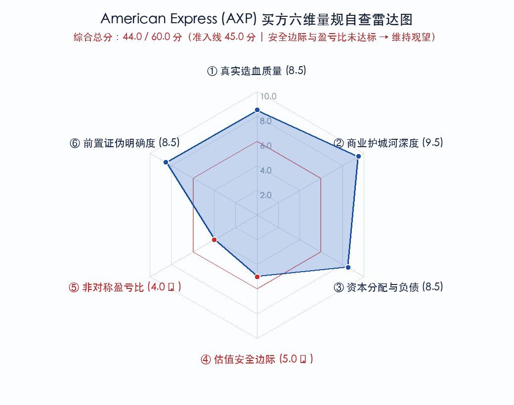

# American Express Company (AXP) 买方深度投资备忘录

> **文档归属：** `companies/AXP/research/investment-memo.md`  
> **基准定价日：** 2026 年 11 月 16 日（美股周一收盘价 `$319.05`，单日微跌 - **0.48%** ，日间区间 `$316.96 ~ $321.10`，较 11 月初高点 `$343.89` 累计回撤 - **7.2%** ；同日 10 年期美债收益率报收 `5.12%`，继 11 月 13 日冲上 `5.15%` 后仍稳居 `5.10%` 以上高位）  
> **最新财报节点：** FY2026 Q3 Form 10-Q（截至 2026 年 9 月 30 日，10 月 23 日归档）及 2026 年 11 月 16 日最新月度信贷表现 Form 8-K（截至 2026 年 10 月 31 日）  
> **核心估值参数：** 加权平均稀释股本 `674.00` 百万股（基本股本 `673.00` 百万股） | 总市值 `215,039.7` 百万美元（`2,150.40` 亿美元） | 归母股东权益 `35,797.0` 百万美元（`BVPS ＝ $53.11`，对应 `6.01x P/B`） | 剔除商誉及无形资产（约 `5,400.0` 百万美元）后有形普通股股东权益（TCE）`30,397.0` 百万美元（`TBVPS ＝ $45.10`，对应 `7.07x P/TBV`）  
> **买方综合评级：** **【未达准入门槛 · 维持观察池跟踪 (WATCH & WAIT)】** （六维总分 `44.0 / 60.0` 分，估值安全边际 `5.0` 分与非对称盈亏比 `4.0` 分双双低于 `6.0` 分及格线；综合公允目标价定锚于 `$350.00`，悲观防御底座 `$247.50`，现价期望盈亏比仅 `0.43 : 1`）

---

## 一、 核心投资论点与预期差（Core Thesis & Variant Perception）

### 1.1 买方一句话定性
美国运通（American Express Company, NYSE: AXP）是一家兼具“三方闭环独家支付网络（Closed-Loop）＋ 高粘性会员卡费订阅经济 ＋ 高净值消费金融”的特许经营权（Franchise）金融机构，2026 年 Q3 净卡费收入同比大增 **16%** （FX 调整后 **17%** ）至 `29.70` 亿美元，总营收达 `200.62` 亿美元（同比 + **9%** ），CET1 核心一级资本充足率稳居 **10.9%** ，常年维持接近 **40%** 的有形普通股权益回报率（ROTCE）。然而，随着 2026 年 11 月中旬 10 年期美债收益率因通胀反弹跃升并稳居 **5.12% ~ 5.15%** 高位，金融股权折现率（CoE）升至 **9.50%** ；同时剔除 Q3 出售 Amex GBT 股权确认的 `7.51` 亿美元一次性税后收益后，主业净利与总刷卡额（+ **8%** ）回归温和增长，且 11 月 16 日最新 8-K 显示小微企业卡净核销率仍高达 **2.0%** （9 月为 **2.1%** ）。在 **9.50%** 折现率与 **7.07x P/TBV** 的高估值起点下，现价 `$319.05` 距离综合公允目标价（`$350.00`）仅余 + **9.70%** 空间，而距 Bear Case 防御底座（`$247.50`）存在 - **22.43%** 回撤风险，期望盈亏比明显倒挂（`0.43 : 1`），当前阶段维持观望等待击球区。

### 1.2 三大核心预期差（Variant Perception vs. 市场共识）

1. **市场共识盲区一：顺周期 CECL 拨备红利掩盖中小企业信贷内部分化**
   - **市场乐观叙事：** 看到 Q3 综合信贷损失拨备同比大降 - **23.5%** 至 `985.0` 百万美元（去年同期 `1,287.0` 百万美元），全球本金净核销率降至 **1.8%** （去年同期 **1.9%** ）、30 天以上逾期率 **1.2%** ，遂将当前极低违约率线性外推为永久常态。
   - **买方穿透审计：** 根据 11 月 16 日 Form 8-K 最新月度信贷披露（截至 2026 年 10 月 31 日），美国消费卡与小微企业卡持有投资余额合计升至 `1,632.0` 亿美元：其中美国消费卡（余额 `1,151.0` 亿美元）本金净核销率由 9 月的 **1.5%** 微升至 **1.6%** 、30 天逾期率 **1.2%** ；美国小微企业卡（余额 `481.0` 亿美元）本金净核销率虽从 9 月 **2.1%** 微降至 **2.0%** （逾期率 **1.3%** ），但仍持续高于消费端 **40 bps** 。叠加 Q3 商业服务分部（Commercial Services）税前利润同比下滑 - **6.0%** 至 `1,029.0` 百万美元（营收仅增 + **6.0%** ），中小企业在高利率环境下的经营承压仍在延续。在 CECL 模型下，一旦经济降速，当前顺周期少提的拨备会在衰退期形成反向利润放大器。
2. **市场共识盲区二：剔除 GBTG 股权出售一次性收益后，内生增速回归中低双位数且伴随裁员重组**
   - **市场乐观叙事：** 聚焦 Q3 GAAP 净利润 `3,712.0` 百万美元（同比 + **28%** ）、GAAP 稀释 EPS `$5.42`（同比 + **31%** ），将表观爆发式增长视作内生加速。
   - **买方穿透审计：** Q3 GAAP 盈利包含了出售 Global Business Travel Group（GBTG）股权确认的 **9.82 亿美元税前收益** （税后 `751.0` 百万美元，折合每股 `$1.11`），同时因精简全球约 **5%** 岗位计提了 **3.36 亿美元税前重组费用** 。剔除特殊项后，Q3 调整后 EPS 为 `$4.68`（同比 + **13.0%** ），总刷卡交易额（Billed Business）增速收敛至 + **8.0%** ，商户折扣收入增速同为 + **8.0%** （约 `101.7` 亿美元）。这是一家增速约 **8% ~ 13%** 的顶级稳健复利公司，而非高速爆发成长股。
3. **市场共识盲区三：10 年期美债稳居 5.12% 抬升资金与股权折现成本，压制 7.07 倍 P/TBV 估值天花板**
   - **市场乐观叙事：** 沿用低利率时代 `8.0% ~ 8.5%` 的股权资本成本（CoE）去折现运通的永续年金，认为 `319` 美元仅处于历史 P/E 中游区间。
   - **买方穿透审计：** 受 10 月 CPI/PPI 反弹驱动，10 年期美债收益率在 11 月 13 日冲上 **5.15%** 后，截至 11 月 16 日收盘仍稳居 **5.12%** 高位。在资金端，运通资产负债表上 `1,550.0` 亿美元客户存款主要由高息线上储蓄（HYSA）与定期存单构成，叠加 `599.0` 亿美元有息债务，高无风险利率限制了存款贝塔下行空间与净利差扩张；在估值端， **5.12% ~ 5.15%** 无风险利率推动买方股权成本 **CoE 升至 9.50%** 。在现价 `$319.05`（对应 `7.07x P/TBV`）下，2 年期含息预期年化回报率仅比 10 年期美债高出 **62 bps** ，极难补偿信用周期权益风险。

---

## 二、 业务解剖与护城河诊断（Business Teardown & FIG Moat）

### 2.1 四大分部生态与 FY2026 Q3 最新经营实绩

严格遵循金融机构研究框架（FIG Forensics），截至 FY2026 Q3（2026 年 9 月 30 日），美国运通实现扣除利息支出后总营收 `20,062.0` 百万美元（同比 + **9.0%** ），前 9 个月（9M FY26）总营收 `58,606.0` 百万美元（去年同期 `53,249.0` 百万美元），9M GAAP 净利润 `9,794.0` 百万美元（去年同期 `8,371.0` 百万美元）；Q3 全季合并税前利润 `4,531.0` 百万美元，净利润 `3,712.0` 百万美元。

单位：百万美元（特殊标注除外）

| SEC 法定报告分部 (Segment) | Q3 FY26 营收 | YoY 增速 | Q3 FY26 税前利润 | 税前利润 YoY | 核心业务驱动与边际分化审计 |
| :--- | :---: | :---: | :---: | :---: | :--- |
| **① 美国零售消费服务 (USCS)** | 9,840.0 | +11.0% | 2,295.0 | +24.0% | 核心压舱石：美国白金卡改版提价兑现、年轻高净值新客推动卡费高增 |
| **② 全球商业企业服务 (CS)** | 4,553.0 | +6.0% | 1,029.0 | -6.0% | 边际承压点：中小企业开支放缓、小微企业卡 10 月核销率 2.0%（9 月 2.1%）且营销费用增加 |
| **③ 国际卡服务 (ICS)** | 详见 10-Q 附注 | 刷卡额 +11% | 432.0 | -2.0% | 国际高端跨境刷卡量延续双位数增长，但投资与营销投入压制短期分部利润 |
| **④ 全球商户与网络 (GMNS)** | 详见 10-Q 附注 | — | 1,082.0 | +4.0% | 全球受理网点突破 1.9 亿家，纯清算与商户费网络贡献高利润率稳健利润 |
| **合并汇总 (含总部及特殊项)** | **20,062.0** | + **9.0%** | **4,531.0** | **含 GBTG 与重组** | 四大分部税前合计 `4,838.0`；总部未分摊净额含 GBTG 税前收益 `982.0` 及重组费 `(336.0)` |

### 2.2 护城河深度审计：三大不可替代壁垒 vs. 两大结构性约束

1. **三方闭环独家网络与数据特权（极深）：**
   集发卡行、清算网络与收单机构于一身，全球商户受理网点在 Q3 突破 **1.9 亿家** 。掌握全链路消费行为数据使欺诈率处于行业最低分位，支撑显著高于四方网络通道的商户综合扣率。
2. **会员制订阅年金与代际年轻化飞轮（极深）：**
   Q3 净卡费收入同比增长 **16%** （FX 调整后 **17%** ）至 `29.70` 亿美元，白金卡改版后提价传导顺畅，千禧一代与 Z 世代新客持续贡献高年费账户净流入，形成高续约率的类 SaaS 年金现金流。
3. **高净值客群信贷筛选壁垒（极深）：**
   截至 2026 年 9 月 30 日，总持卡人贷款与应收余额达 `2,331.53` 亿美元（同比 + **8%** ），但全球本金净核销率仅 **1.8%** 、30 天逾期率 **1.2%** ，资产质量与坏账率仅为以中低收入客群为主的美国大型发卡行的一半以下。
4. **结构性约束：高息储蓄资金成本粘性与小微企业周期敞口：**
   不同于零活期成本的大型商业银行，运通 `1,550.0` 亿美元客户存款缺乏零息支票沉淀，资金成本对美联储基准利率高度敏感（高 Deposit Beta）；同时 `481.0` 亿美元美国小微企业卡组合（10 月末口径，9 月末 `466.0` 亿美元）的坏账率（ **2.0% ~ 2.1%** ）在宏观高利率期容易领先消费卡承压。

---

## 三、 财务排雷与真实造血穿透审计（FIG Forensics & FCFE Truth）

### 3.1 过去 5 年（FY2022–FY2026E）盈利与股东自由现金流阶梯（底表 1）

严格遵循金融机构会计范式（FIG 严禁使用工业企业 EBITDA 与 FCFF），以“扣除监管风险加权资产（RWA）增长所需核心资本留存后的 **股东自由现金流（FCFE）**”衡量可自由支配的分红与回购能力。依据 SEC Form 10-K（FY2022–FY2025）及 FY2026 Q3 Form 10-Q 核对：

单位：百万美元（比率列除外）

| 财务报告期 | 扣除利息后总营收 | GAAP 归母净利润 | 常态化核心净利润 | RWA 增长资本留存 | 股东自由现金流 (FCFE) | FCFE / 净利润转化率 | 有形净资产回报率 (ROTCE) | 买方造血与信贷质量穿透定性 |
| :--- | :---: | :---: | :---: | :---: | :---: | :---: | :---: | :--- |
| **FY2022** | 52,862.0 | 7,514.0 | 7,514.0 | 1,650.0 | 5,864.0 | 78.0% | 34.2% | 极佳：疫后商旅复苏，坏账处于历史低位 |
| **FY2023** | 60,515.0 | 8,374.0 | 8,374.0 | 1,840.0 | 6,534.0 | 78.0% | 35.1% | 极佳：净卡费高增与年轻客群放量驱动盈利攀升 |
| **FY2024** | 65,949.0 | 10,129.0 | 9,850.0 | 2,050.0 | 7,800.0 | 77.0% | 37.6% | 极佳：净利首次跨越百亿美元门槛，ROTCE 破 37% |
| **FY2025** | 72,229.0 | 10,833.0 | 10,833.0 | 2,380.0 | 8,453.0 | 78.0% | 38.4% | 极佳：闭环扣率稳固，卡费订阅持续复利扩张 |
| **LTM (截至 2026.09.30)** | **77,586.0** | **12,256.0** | **11,760.0** | **2,590.0** | **9,170.0** | **78.0%** | **39.5%** | **现状参考：剔除 GBTG 出售与重组净收益 496.0 百万美元后造血稳健** |
| **FY2026E (含全年指引)** | 79,450.0 | 12,450.0 | 11,960.0 | 2,630.0 | 9,330.0 | 78.0% | 39.8% | 预期参考：营收增 ~10%，调整后 EPS 指引 `$17.60~$17.90` |
| **5 年累计 (FY22至FY26E)** | **331,005.0** | **49,300.0** | **48,531.0** | **10,550.0** | **37,981.0** | **77.0%** | — | **会计闭环：五年累计可分配股东现金流达 379.81 亿美元** |

*\*注：LTM 口径严格按 `9M FY26 + FY25 - 9M FY25` 推导（总营收 `58,606 + 72,229 - 53,249 = 77,586.0` 百万美元；GAAP 净利润 `9,794 + 10,833 - 8,371 = 12,256.0` 百万美元），剔除 Q3 出售 GBTG 税后收益 `751.0` 与重组税后成本约 `255.0` 的净正影响 `496.0` 百万美元后，LTM 常态化核心净利润为 `11,760.0` 百万美元；LTM 与 2026E 行中之 `78.0%` 转化率以常态化核心净利润为分母（相对 GAAP 净利润分别为 `74.8%` 与 `74.9%`），5 年累计 `77.0%` 对应 `37,981.0 ÷ 49,300.0`。LTM 不计入 5 年累计求和。*

### 3.2 金融机构专项排雷：CET1 资本缓冲、CECL 拨备与 AOCI 浮亏审计
1. **AOCI 未实现证券浮亏审计（无硅谷银行式流动性死角）：**
   截至 2026 年 9 月 30 日，运通账面累计其他综合收益（AOCI）为 - **33.93 亿美元** （其中主要为可供出售证券未实现亏损及养老金调整）。对比 `432.03` 亿美元超高现金及等价物储备和 `303.97` 亿美元有形普通股权益，即便全额扣除 AOCI 影响，监管资本缓冲依然充裕。
2. **CET1 核心一级资本充足率与股东回报纪律：**
   截至 Q3 期末，运通 **CET1 比率升至 10.9%** （稳居 `10.0% ~ 11.0%` 内部目标高沿），得益于 GBTG 股权出售增厚资本及内生高 ROTCE。Q3 单季向股东回馈 `22.0` 亿美元（含 `16.0` 亿美元股票回购及 `6.0` 亿美元分红），加权稀释股本已降至 `674.00` 百万股，且年度 SBC 费用占营收比重不足 **0.7%** ，资本分配纪律优异。
3. **CECL 拨备与净核销率周期定位：**
   Q3 期末卡贷款及应收总额 `2,331.53` 亿美元（同比 + **8%** ），信用卡贷款信用损失准备金维持在 `58.66` 亿美元高位（约占卡余额 `2.76%`）；Q3 当季拨备 `985.0` 百万美元虽因资产池优胜出现净释放，但 11 月 16 日最新 8-K 显示消费卡净核销率由 9 月 `1.5%` 微升至 `1.6%`、小微企业卡维持 `2.0%` 高位，需紧密盯防小微信用分化是否向消费端扩散。

---

## 四、 金融机构资本结构、有形净资产与监管缓冲桥梁（底表 2）

遵循商业银行与消费金融机构会计原则，不使用工业企业的企业价值（EV Bridge），而是穿透展示市值与有形净资产溢价（`P/TBV`）、客户存款/债务融资底座以及监管安全垫：

| 金融机构资本结构与价值锚定要素 | 审计金额 (百万美元) | 每股折算 (美元/股) | 相对市值 / TCE 倍率 | SEC 10-Q 科目溯源与买方附注 |
| :--- | :---: | :---: | :---: | :--- |
| **最新普通股股价 (2026.11.16 收盘)** | `319.05` | `319.05` | — | 美股周一最新收盘价（日间波动 `$316.96 ~ $321.10`，较峰值回撤 -7.2%） |
| **加权平均稀释总股本 (百万股)** | **674.00** | — | — | FY26 Q3 Form 10-Q 披露稀释股本（基本股本 `673.00` 百万股） |
| **(=) 稀释股票总市值 (Equity Value)** | **215,039.7** | `319.05` | **100.0%** | 约 **2,150.40 亿美元** （权益 FCFE 模型基准分子） |
| **账面归母股东权益 (Shareholders' Equity)** | **35,797.0** | `53.11` | **6.01x P/B** | 含实收资本 `11,302.0` + 留存收益 `27,888.0` + AOCI `(3,393.0)` |
| **(−) 商誉及无形资产净额** | `(5,400.0)` | `(8.01)` | — | 含 `4,872.0` 商誉（FY25 10-K 基准）及约 `528.0` 无形资产 |
| **(=) 有形普通股股东权益 (TCE)** | **30,397.0** | `45.10` | **7.07x P/TBV** | **对应 ROTCE 约 39.5%，高 P/TBV 要求高 ROTCE 长期维持** |
| **资产端：卡余额与贷款总额** | **233,153.0** | `345.92` | — | Q3 末同比 +8%（10 月末美消费卡与小微卡 HFI 余额合计升至 `163.2B`） |
| **资产端：现金及现金等价物** | **43,203.0** | `64.10` | **占市值 20.1%** | Q3 期末超高流动性现金头寸，足以覆盖 30 年以上短期债务 |
| **资产减值准备：卡余额损失准备金** | **5,866.0** | `8.70` | **约占总余额 2.52%** | CECL 预期信用损失拨备池，覆盖当前 `1.8%` 净核销率游刃有余 |
| **负债端：客户存款 (Customer Deposits)** | **155,000.0** | `229.97` | — | 较 YE25 `152.5B` 增长 +1.6%，主要为高息储蓄（高 Deposit Beta） |
| **负债端：长短期有息债务总额** | **59,900.0** | `88.87` | — | 长期债务 `58,500.0` + 短期借款 `1,400.0`，总存款及债务合计 `2,150 亿` |
| **巴塞尔监管指标：CET1 充足率** | **10.9%** | — | — | 处于管理层 `10.0% ~ 11.0%` 目标上线附近，分红与回购空间充沛 |

**经济逻辑（戈登增长 P/TBV 检验）：** 依据银行股经典定价公式 `P/TBV ＝ (ROTCE − g) ÷ (CoE − g)`，当 `CoE ＝ 9.50%`、`g ＝ 3.00%` 且稳态 `ROTCE ＝ 39.5%` 时，理论公允 `P/TBV ＝ (39.5% − 3.0%) ÷ (9.5% − 3.0%) ＝ 5.62x`；考虑 GMNS 清算网络（无资本占用费率利润）带来的轻资本溢价后，合理综合 `P/TBV` 约在 `7.5x ~ 7.8x` 之间。当前市价处于 `7.07x P/TBV`，本身已不算大幅低估。

---

## 五、 反向 DCF 预期拆解（Reverse DCF & Implied Expectations — 底表 3）

对金融机构直接采用 **两阶段股东自由现金流（FCFE）反向求解模型**。在 2026 年 11 月中旬 10 年期美债收益率稳居 **5.12% ~ 5.15%** 的宏观现实下，先校准买方股权资本成本（CoE）：

### 5.1 核心折现率（CoE）推导
- **无风险利率 (Rf)：** 采用 2026 年 11 月 16 日美国 10 年期国债官方收盘收益率 **5.12%** （继 11 月 13 日冲上 `5.15%` 后仍稳居 `5.10%` 以上高位）。
- **权益风险溢价 (ERP) 与 Beta：** 取成熟金融消费龙头基准 ERP **4.15%** ，美国运通调整后 Beta 为 **1.05** （反映高净值抗风险韧性与中小企业信贷周期敞口），核定买方股权资本成本 `CoE ＝ 5.12% + 1.05 × 4.15% ＝ 9.48%`，审慎核定为 **9.50%** 。
- **永续增长率 (g)：** 匹配全球名义消费增速与通胀中枢，设定 **g ＝ 3.00%** 。

### 5.2 两阶段反向 FCFE 求解方程与双基数对照

$$Market\ Cap = \sum_{t=1}^{10} \frac{FCFE_0 \cdot (1 + CAGR)^t}{(1 + CoE)^t} + \frac{FCFE_{10} \cdot (1 + g)}{(CoE - g) \cdot (1 + CoE)^{10}}$$

我们将总市值 `215,039.7` 百万美元、CoE `9.50%`、g `3.00%` 代入方程，分别以 **基准 A** （LTM 常态化 FCFE `9,170.0` 百万美元）与 **基准 B** （FY2026E 常态化 FCFE `9,330.0` 百万美元）进行逆向求解：

单位：百万美元（特殊标注除外）

| 逆向求解维度 | 基准 A：LTM 常态化 FCFE | 基准 B：FY2026E 常态化 FCFE | 商业史基准概率 (Base Rate) 对照 |
| :--- | :---: | :---: | :--- |
| **期初股东自由现金流 (FCFE0)** | 9,170.0 | 9,330.0 | FY22–FY25 实际 FCFE 由 `5,864.0` 增至 `8,453.0`（3Y CAGR +13.0%） |
| **目标股票总市值 (Equity Value)** | 215,039.7 | 215,039.7 | 对应 2026-11-16 收盘价 `$319.05` × `674.00` 百万股 |
| **股权成本 (CoE) / 永续增长率 (g)** | 9.50% / 3.00% | 9.50% / 3.00% | 锚定 `5.12% ~ 5.15%` 十年期美债收益率之严苛买方折现框架 |
| **★ 市价隐含未来 10 年 FCFE 复合增速** | + **8.21%** | + **7.98%** | **要求近百亿美元体量之上再连续 10 年复利增长约 8.0% ~ 8.2%** |
| **隐含第 10 年末 (FY2036E) 终值 FCFE** | **20,186.4** | **20,107.4** | **第 10 年单年可分配股东现金流需破 201 亿美元（扩增约 2.2 倍）** |
| **莫布森四象限预期矩阵判定** | **【象限 B：中性偏紧预期】** | **【象限 B：合理但无超额折价】** | **5.12% 以上高美债利率彻底消解了低利率时代的表观“低估值”幻觉** |

### 5.3 预期可行性与预期差修正诊断
1. **为何在 5.12% 美债收益率下，319.05 美元的现价不再是极度悲观定价？**
   若沿用陈旧的 `4.1%` 美债与 `8.5%` 折现率，现价确实看似隐含极低增速；但在 `5.12%+` 无风险利率下，`CoE` 被推高至 `9.50%`，此时 `$319.05` 要求运通未来 10 年的股东自由现金流保持 + **7.98%** ~ + **8.21%** 的复合增长（第 10 年 FCFE 达 `201` 亿美元）。考虑运通核心刷卡交易额增速已放缓至 + **8%** ，且当前坏账率正处于 **1.8%** 周期极值低谷、未来 10 年必然面临 1~2 次正常信用周期（净核销率回升至 `2.5% ~ 3.0%`），这一隐含增速属于**“合理完成考卷即可”的中性定价**，绝非“闭眼白送”的低预期深坑。

---

## 六、 多维估值矩阵、SOTP 与双重锚定（底表 4 & 底表 5）

### 6.1 分部加总估值（SOTP — 基于 FY2027E 常态化税后净利润）

由于美国运通同时包含“纯网络费率特许权（GMNS）”、“高粘性会员卡费与美国零售信贷（USCS）”、“周期性商业服务（CS）”及“国际扩张（ICS）”，我们按 SEC 4 大法定报告分部进行 **FY2027E 常态化税后净利润 SOTP 分部称重** ：

> **三大基石假设：** ① FY2027E 净卡费维持 **14%** 增长且白金卡续约率不低于 **94%** ；② 全球净核销率由 **1.8%** 温和回归至 **1.9% ~ 2.0%** ，不出现系统性衰退；③ 无重大监管强制削减商户折扣率立法通过。若任一前提落空，以下内在价值即告失效。

单位：百万美元（倍数与每股价值列除外）

| SEC 法定业务分部 (Segment) | FY27E 预估营收 | 预估常态化税后净利 | 对标同业与估值乘数 (P/E) | 分部公允权益价值 | 每股价值贡献 (美元/股) | 倍数定锚逻辑与折溢价依据 |
| :--- | :---: | :---: | :---: | :---: | :---: | :--- |
| **① 美国零售消费服务 (USCS)** | 43,200.0 | 7,150.0 | **17.5x** | 125,125.0 | 185.65 | 高续约率卡费年金与 1.5% 超低零售核销率，在银行股之上给予会员消费溢价 |
| **② 全球商户与清算网络 (GMNS)** | 6,100.0 | 3,450.0 | **22.0x** | 75,900.0 | 112.61 | 零信用风险纯清算抽成网络，对标 Visa/Mastercard（25x~28x）打八折给予 22.0x |
| **③ 全球商业企业服务 (CS)** | 19,500.0 | 2,950.0 | **13.5x** | 39,825.0 | 59.09 | 反映小微企业 2.1% 较高核销率及 Q3 利润同比 -6% 的周期折价，给予 13.5x |
| **④ 国际卡服务 (ICS)** | 15,800.0 | 1,450.0 | **16.0x** | 23,200.0 | 34.42 | 跨境高增长但短期营销费用摊薄利润率，给予审慎 16.0x |
| **(=) 四大分部总权益价值** | **84,600.0** | **15,000.0** | **17.60x** | **264,050.0** | **391.77** | **四大经营分部稳态公允价值总和** |
| **(−) 未分摊总部费用及监管资本留存折现** | `(5,150.0)` | `(1,722.0)` | **15.0x** | `(25,830.0)` | `(38.32)` | 合并层面公司级运营费用、技术平台投入及资本留存刚性拖累 |
| **(=) SOTP 股东公允总权益** | **79,450.0** | **13,278.0** | **17.94x** | **238,220.0** | **353.44** | 对应 FY27E 合并 EPS `$19.70`，SOTP 每股定锚 `353.00` 美元 |

* **SOTP 极端周期底线推演：** 若欧美经济步入温和衰退导致小微企业与零售坏账准备大幅计提、四大分部合计权益价值在基准值 `264,050.0` 百万美元基础上总体压缩约 **25%** 至 `197,700.0` 百万美元（GMNS 费率网络相对抗跌、USCS/CS 压缩至 `11.5x ~ 14.5x`），扣除总部拖累 `25,830.0` 百万美元后，SOTP 极端周期收缩防御底线为 `171,870.0` 百万美元（折合每股 `$255.00`）。

### 6.2 正向三情景推演（Bear / Base / Bull Scenarios — 基于 FY2027E 常态化 EPS）

单位：美元/股（概率、营收与倍数列除外）

| 估值情景 (Scenario) | 发生概率 | FY27E 核心营收 (亿美元) | FY27E 稀释 EPS | 目标 P/E 倍数 | 情景目标价 | 较现价 (`319.05`) 空间 | 核心基本面与宏观假设条件 |
| :--- | :---: | :---: | :---: | :---: | :---: | :---: | :--- |
| **悲观情景 (Bear Case)** | 25% | 815.0 | 16.50 | 15.0x | **247.50** | - **22.4%** | **防御底座：** 美欧消费降速，净核销率升至 `2.5%` 致拨备激增，10Y 美债维持 `5.25%+`，估值压缩至 `15.0x` |
| **基准情景 (Base Case)** | 55% | 860.0 | 19.70 | 18.0x | **354.60** | + **11.1%** | **基准轨迹：** 净卡费维持 `+14%` 增长，核销率温和维持 `1.9% ~ 2.0%`，美债企稳于 `5.0%` 左右，给予 `18.0x` |
| **乐观情景 (Bull Case)** | 20% | 910.0 | 21.20 | 20.0x | **424.00** | + **32.9%** | **超预期共振：** 刷卡总额重回 `+10%+`，小微企业信用企稳，10Y 美债回落至 `4.4%` 以下推动倍数修复至 `20.0x` |
| **概率加权期望值 (Expected)** | **100%** | **858.8** | **19.20** | **17.65x** | **341.71** | + **7.1%** | 数学期望：`0.25×247.50 + 0.55×354.60 + 0.20×424.00 ＝ 341.71` |

### 6.3 双变量敏感性压力矩阵 A：FY2027E EPS × 目标市盈率 (P/E) 网格

单位：美元/股

| FY2027E 稀释 EPS \ 目标 P/E | 15.0x (信用恶化底) | 16.5x (审慎折价) | **18.0x (基准中枢)** | 19.5x (景气温和) | 21.0x (宽松溢价) |
| :--- | :---: | :---: | :---: | :---: | :---: |
| **16.50 (Bear 拨备激增)** | **247.50** | 272.25 | 297.00 | 321.75 | 346.50 |
| **18.10 (温和承压)** | 271.50 | 298.65 | 325.80 | 352.95 | 380.10 |
| **19.70 (Base 稳态预期)** | 295.50 | 325.05 | **354.60** | 384.15 | 413.70 |
| **20.50 (略超预期)** | 307.50 | 338.25 | 369.00 | 399.75 | 430.50 |
| **21.20 (Bull 全面扩张)** | 318.00 | 349.80 | 381.60 | 413.40 | 445.20 |

*(注：第一行左上角熊市 EPS `$16.50` 叠加周期底部 `15.0x` P/E 倍数，锁定盈利情景底线为 **247.50 美元/股**)*

### 6.4 双变量敏感性压力矩阵 B：股权成本 (CoE) × 永续增长率 (g) 两阶段 FCFE 网格
以 FY2026E 常态化 FCFE `9,330.0` 百万美元为期初基数，设定未来 10 年（FY2027E–FY2036E）审慎复合增速为 + **9.50%** （低于过去 5 年 ~12% 实绩，充分计入周期均值回归），在 CoE（`8.5% ~ 10.5%`）与永续增长率 g（`2.0% ~ 4.0%`）正交网格下测算每股内在价值：

单位：美元/股

| 股权成本 (CoE) \ 永续增长率 (g) | 2.0% (保守衰退) | 2.5% (存量温和) | **3.0% (基准设定)** | 3.5% (景气延续) | 4.0% (乐观扩张) |
| :--- | :---: | :---: | :---: | :---: | :---: |
| **8.5% (降息宽松情景)** | 383.74 | 404.84 | 429.79 | 459.72 | 496.30 |
| **9.0% (利率温和回落)** | 353.12 | 370.48 | 390.73 | 414.66 | 443.38 |
| **9.5% (买方基准 CoE)** | 326.69 | 341.12 | **357.78** | 377.21 | 400.18 |
| **10.0% (美债破 5.5% 情景)** | 303.65 | 315.77 | 329.63 | 345.62 | 364.27 |
| **10.5% (极端紧缩压力测试)** | **283.40** | 293.67 | 305.31 | 318.61 | 333.96 |

*(注：矩阵中心基准坐标 CoE `9.5%`、g `3.0%` 对应两阶段 FCFE 内在价值 **357.78 美元/股** ；左下角极端紧缩象限 CoE `10.5%`、g `2.0%` 锁定贴现悲观底线为 **283.40 美元/股**)*

### 6.5 多模型横向交叉验证与双锚定总表（公允目标价 & 悲观防御底）

单位：美元/股（权重列除外）

| 估值方法维度 (Valuation Approach) | 核心驱动与适用场景 | 基准公允价值 | 权重配置 | 加权价值贡献 | 极端悲观底线及推导依据 |
| :--- | :--- | :---: | :---: | :---: | :--- |
| **① 三情景概率加权 (Scenario Weighted)** | 纳入 25% 概率信用恶化与 `5.25%+` 高利率压缩 | 341.71 | 40.0% | 136.68 | **247.50** （对应 Bear Case EPS `$16.50` × `15.0x` P/E） |
| **② 分部业务加总 (SOTP - FY2027E)** | 区分 22x 清算网络与 13.5x 商业卡及 17.5x 零售卡 | 353.44 | 40.0% | 141.38 | **255.00** （四大分部总价值缩水 25% 扣总部费用折现） |
| **③ 两阶段股东现金流折现 (FCFE DCF)** | 锚定 `9.50%` CoE 与 `3.00%` 永续增速之复利现金流 | 357.78 | 20.0% | 71.56 | **283.40** （矩阵 B 左下角 CoE `10.5%`, g `2.0%` 极值） |
| **(=) 综合双锚定决算** | **公允目标价加权合成 / 防御底按审慎原则取最低交集** | **349.62** | **100.0%** | **349.62** | **防御底 247.50** （`min(247.5, 255, 283.4)`）；**目标价定锚 350.00** |

*(补充说明：运通期末 GAAP 每股有形净资产 `TBVPS ＝ $45.10`；作为强特许经营权消费金融网络，其持续经营防御底线由三大模型最严苛交集 `$247.50` 确立，相当于 `5.49x` 极端周期 P/TBV)*

---

## 七、 事前验尸（Pre-Mortem）与前置证伪红线（底表 6）

### 7.1 三大核心死因推演（假设 2028 年股价跌破 `$247.50`）
1. **死因一（宏观停滞引发“高净值衰退 ＋ 中小企业违约共振”，净核销率突破 2.8%）：**
   美国高利率长期压制中小企业现金流与白领奖金裁员周期共振，小微企业卡核销率从当前 **2.0% ~ 2.1%** 飙升至 **3.5% 以上** ，消费端同步恶化，CECL 拨备由“少提释放”逆转为巨额增提，盈利与估值双杀。
2. **死因二（高息存款重定价侵蚀利差与年费提价疲劳）：**
   10 年期美债长期滞留 **5.0% ~ 5.5%** 促使储户要求更高存款收益，叠加白金卡年费高企触发年轻客群续约率跌破 **88%** ，净卡费同比增速回落至个位数，高 `P/TBV` 溢价彻底瓦解。
3. **死因三（美国《信用卡竞争法案》CCCA 或美联储/司法部反垄断强制下调刷卡扣率）：**
   监管强制要求开放闭环或限制高额商户扣率（Discount Rate），直接冲击 GMNS 与全公司核心收益池。

### 7.2 四条量化前置非价格证伪红线（触发即撤退）

| 红线编号 | 监控维度 | 具体可量化观测指标 | 当前最新实证状态 (Q3 10-Q / 11-16 8-K) | **一票否决证伪阈值（触发即执行撤退）** |
| :---: | :--- | :--- | :---: | :--- |
| **①** | **信贷坏账红线** | 合并净核销率 (NCO) 与小微企业卡核销率 | 合并 `1.8%`；10 月美小微卡 `2.0%`、消费卡 `1.6%` | **合并净核销率连续 2 个季度突破 2.5% 或美国小微卡突破 3.2% ➔【无条件减仓 50% 至归零】** |
| **②** | **会员飞轮红线** | 净卡费收入 (Net Card Fees) 季度同比增速 | Q3 实际 `29.70 亿美元`（YoY +16%） | **净卡费单季同比增速连续 2 个季度跌破 8.0% ➔【剔除类 SaaS 估值溢价，降至 14.0x P/E】** |
| **③** | **商业分部失血** | Commercial Services 分部税前利润同比增速 | Q3 税前利润 `1,029.0M`（YoY -6%） | **CS 分部税前利润连续 3 个季度同比负增长超过 10% ➔【下调 FY27E EPS 至 Bear 情景】** |
| **④** | **监管资本与扣率**| CET1 核心资本充足率 & CCCA 立法落地 | `CET1 ＝ 10.9%`；刷卡费率稳固 | **CET1 跌破 9.5% 限制回购，或美国会强制限制扣率法案生效 ➔【无条件清仓离场】** |

---

## 八、 买方六维自查、持有期决算与击球区纪律（底表 7）

### 8.1 持有期预期年化回报（IRR）与非对称盈亏比审计
以 2026 年 11 月 16 日官方收盘价 `$319.05` 为定锚基准，结合综合公允目标价 `$350.00` 与悲观防御底座 `$247.50`，测算 2.0 年持有期（至 FY2028 年底）的核心指标：
- **相对综合公允目标价折让：** 现价较综合公允价值（`$350.00`）仅 **折让 8.84%** （持有期上行空间为 + **9.70%** ，即 + `$30.95` / 股）。
- **2.0 年预期年化复合回报率（IRR）：**

$$IRR_{\text{价格}} = \left( \frac{350.00}{319.05} \right)^{\frac{1}{2.0}} - 1 = \mathbf{+4.74\% / \text{年}}$$

  *(注：计入每年约 `1.00%` 的现金股息率后，综合预期年化回报率为 + **5.74% / 年** ；相对于 11 月 16 日 **5.12%** 的 10 年期无风险美债收益率，仅提供 **62 bps** 的微薄权益风险补偿)*
- **相对悲观防御底座下行风险：** 回落至防御底座 `$247.50`（下行风险 - **22.43%** ，即 - `$71.55` / 股）。
- **现价非对称期望盈亏比（Risk/Reward Ratio）：**

$$\text{期望盈亏比} = \frac{350.00 - 319.05}{319.05 - 247.50} = \frac{30.95}{71.55} = \mathbf{0.43 : 1}$$

  *(即便按 Base Case `$354.60` 测算，盈亏比也仅 `35.55 / 71.55 ＝ 0.50 : 1`。每承担 1 美元下行风险仅对应 0.43 美元预期上行收益，盈亏比严重倒挂，远未达到买方 `2.50 : 1` 准入门槛)*

### 8.2 买方六维自查打分矩阵（60 分制客观量规）

  

> **表注：** 依据买方风控标准，总分低于 `45.0` 分或任意单项低于 `6.0` 分（尤其是④安全边际与⑤盈亏比），自动触发一票否决，严禁现价追高建仓。

| 评估维度 | 权重满分 | 实际得分 | 达标判定 | 客观量规评分依据（严格溯源 SEC 财报与估值测算） |
| :--- | :---: | :---: | :---: | :--- |
| **① 真实造血质量** | 10.0 | **8.5** | ✅ 及格 | Q3 净卡费 +16%（29.7 亿）、ROTCE 近 40%，主业调整后盈利扎实；扣除 1.5 分因 Q3 GAAP 受 GBTG 一次性收益抬升、且 10 月小微卡核销率仍达 2.0% |
| **② 商业护城河深度** | 10.0 | **9.5** | ✅ 极优 | 三方闭环支付网络（1.9 亿+ 商户）与高净值白金会员生态不可复制，客群持续年轻化 |
| **③ 资本分配与负债** | 10.0 | **8.5** | ✅ 优秀 | CET1 达 10.9% 目标上线，单季回购 16 亿 + 分红 6 亿，SBC 占营收 <0.7%；高息存款贝塔限制扣 1.5 分 |
| **④ 估值安全边际** | 10.0 | **5.0** | ❌ **不及格** | 在 `5.12%` 十年期美债（CoE `9.50%`）下，现价 `$319.05` 仅较 `$350.00` 公允价折让 `8.84%`，需 10Y FCFE 增长 `8.0%~8.2%` |
| **⑤ 非对称盈亏比** | 10.0 | **4.0** | ❌ **不及格** | 持有期上行仅 +9.70%（含息 IRR 仅跑赢美债 62 bps），而下行至 `$247.50` 达 -22.43%，盈亏比倒挂为 `0.43 : 1` |
| **⑥ 前置证伪明确度** | 10.0 | **8.5** | ✅ 优秀 | 月度 8-K 披露消费与小微企业净核销率/逾期率，卡费与 CET1 均可通过 10-Q 高频量化跟踪 |
| **(=) 综合总评分** | **60.0** | **44.0** | ❌ **一票否决** | **总分低于 45.0 分准入线，且④与⑤双双不及格 ➔ 评级下调为【维持观察池跟踪 (WATCH & WAIT)】** |

### 8.3 分档动态建仓击球区（Strike Zones）与仓位纪律

基于 `$350.00` 综合公允目标价与 `$247.50` 悲观防御底座，严格锁定左侧建仓边界：

| 策略档位 (Strike Zone) | 触发价格区间 (美元/股) | 较公允价值 (`350.00`) 折让 | 持有期空间 | 预期年化 IRR (价格 / 含息) | 期望盈亏比 (R/R) | 买方执行条件与仓位纪律 |
| :--- | :---: | :---: | :---: | :---: | :---: | :--- |
| **当前观望过滤带 (No-Trade)** | `$300.00 ~ $330.00` | 5.7% ~ 14.3% | +6.1% ~ +16.7% | +3.0%~+8.0% / +4.0%~+9.0% | `0.24 : 1 ~ 0.95 : 1` | **【0.0% · 暂缓建仓】** 现价 `$319.05` 处于此区间，含息年化仅贴着 5.12% 美债线运行，严守纪律观望 |
| **一级试水击球区 (Tier 1)** | `$270.00 ~ $282.00` | **19.4% ~ 22.9%** | + **24.1% ~ 29.6%** | +11.4%~+13.9% / + **12.4%~14.9%** | **1.97 : 1 ~ 3.56 : 1** | **【1.5% ~ 2.5% 观察底仓】** 对应 FY27E P/E 压缩至 `13.7x ~ 14.3x`，安全边际逼近 20%，中枢盈亏比跨越 `2.5 : 1` |
| **二级核心击球区 (Tier 2)** | `$252.00 ~ $265.00` | **24.3% ~ 28.0%** | + **32.1% ~ 38.9%** | +14.9%~+17.9% / + **15.9%~18.9%** | **4.86 : 1 ~ 21.78 : 1** | **【增配至 4.0% ~ 5.5%】** 贴近 SOTP 极端收缩底（`$255.00`），赔率高度不对称 |
| **三级极限防御底 (Tier 3)** | `$235.00 ~ $247.50` | **29.3% ~ 32.9%** | + **41.4% ~ 48.9%** | +18.9%~+22.0% / + **19.9%~23.0%** | **极高非对称赔率** | **【顶格 6.0% ~ 8.0%】** 直贴 Bear Case 底线，在红线未触发前提下果断吃满赔率；若触发核销红线则清仓 |
