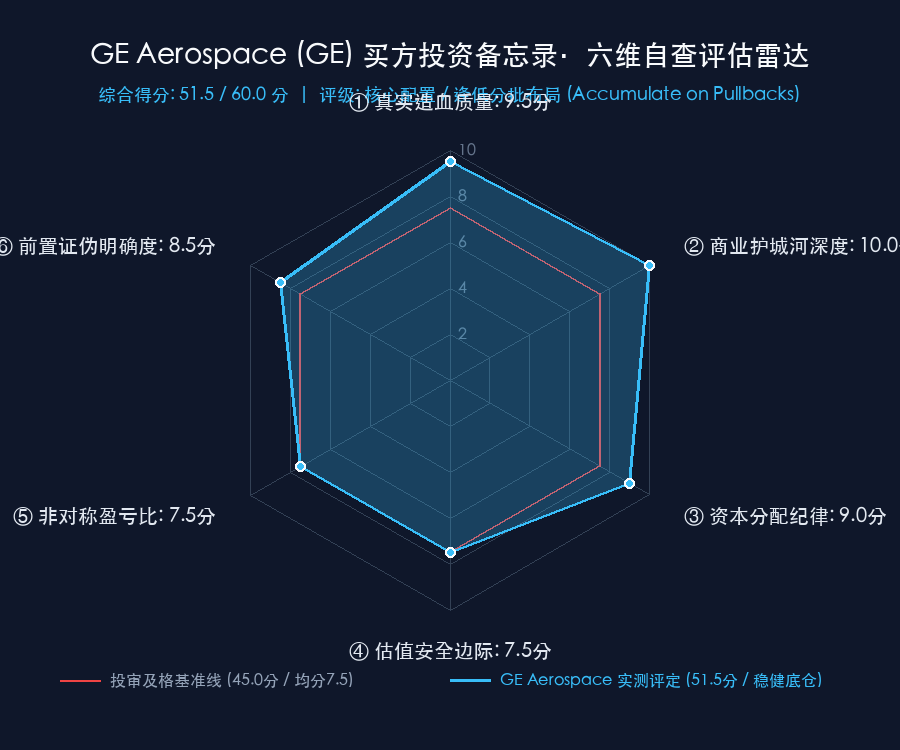

# 通用电气航天 GE Aerospace（NYSE: GE）买方投资备忘录 (Investment Memo)

> **基准报告日期**：2026 年 10 月 21 日（美股 10-20 收盘后最新数据同步）  
> **研究覆盖机构**：核心买方投资策略组 (Buy-Side Equity Research)  
> **标的名称**：通用电气航天公司 (GE Aerospace, Ticker: **GE**)  
> **当前市价**：**$299.87**（较 52 周高点 $388.84 回调约 22.9%，Q3 财报公布后收盘于 $299.87）  
> **完全稀释总股本**：**1,042.00M 股**（持续回购注销使股本同比压缩 2.3%）  
> **企业价值 (EV)**：**$321,665M ($321.66B)**（市值 $312.46B ＋ 综合净负债 $9.20B）  
> **投委会最终裁决**：**【通过审核 / 核心配置·逢低分批布局（ACCUMULATE ON PULLBACKS），拒绝追高】**  
> **目标估值区间**：Base Case 目标价 **$365.00** (+21.7%)；Bull Case **$440.00** (+46.7%)；Bear Case 防御底 **$260.00** (-13.3%)  
> **期望风险收益比**：**1.63 : 1 ~ 3.51 : 1**（基准情景 1.63 : 1 属中规中矩，非极端非对称暴利赔率）

---

## 第一步：核心投资论文与执行摘要（Executive Summary）

### 1.1 核心主线逻辑与商业本质

GE Aerospace 在 2024 年完成医疗（GEHC）与能源电力（GEV）分拆后，成为全球资本市场极度罕见的**纯血航空航天发动机与动力推进终极霸权**。公司在全球商业航空动力与国防领域建立了实质上的**事实双寡头/独家垄断**：

1. **全球窄体客机动力总成的不可动摇垄断者**：
   - 与法国赛峰（Safran）50/50 合资的 CFM International，**100% 独家独揽波音 737 MAX 全系（LEAP-1B）**，并在空客 A320neo 系列中斩获近 **60% 份额（LEAP-1A）**，同时独家配套中国商飞 C919（LEAP-1C）；
   - 核心竞对普惠（Pratt & Whitney）GTF 发动机深陷粉末冶金污染与大规模召回危机，罗尔斯·罗伊斯（Rolls-Royce）多年前已退出单通道窄体机研发，CFM 垄断壁垒固若金汤；
2. **44,000 台在役商用航发构筑“剃刀与刀片”终极印钞机**：
   - 商业模式本质是“以微利销售新发动机（剃刀），锁定未来 25~30 年高频车间大修（Shop Visits）与独家备件销售（刀片）”；
   - **后市场服务毛利率高达 50%~60%**，商用服务（CES Services）营收连续 6 个季度增速 ≥20%，推动集团单季调整后营业利润率扩张至 **22.6%**；
3. **未履行履约义务（Backlog / RPO）突破 $2,120 亿美元**：
   - Q3 新签订单暴增 **+49% 至 $19.0B**（Book-to-Bill 达 1.43x），商用服务储备订单超 **$1,700 亿美元**，锁定未来 4 年以上营收；
   - 2026 全年自由现金流（FCF）指引上调至 **$9.1B - $9.4B**（FCF/净利润转化率持续 >100%），年内累计回购超 $55 亿美元。

### 1.2 预期差识别（Variant Perception）：市场偏见 vs 我们看到了什么

| 分析视角 | 市场主流共识 / 卖方偏见 | 买方深度穿透 / 真实预期差 (Variant Perception) |
| :--- | :--- | :--- |
| **波音危机与装配延迟担忧** | 担忧波音机械师罢工、737 MAX 交付放缓将冲击 GE 发动机出货与营收。 | **大修延寿逻辑反向利好后市场现金流**。新机交付延后倒逼全球航空公司让老旧 CFM56 机队超期服役，带来更多高毛利第 3-4 次大修与备件销售；且后市场利润率（50%+）远高于新机组装（微利），财务造血反而显著增强。 |
| **LEAP 耐久性与保修侵蚀** | 担忧高温严苛环境下 LEAP 发动机在翼时间不足，可能产生高额保修补偿与客户索赔。 | **LEAP-1B 耐久性套件测试极佳，2027 年全面量产落地**。高压涡轮叶片等关键材料升级使在翼时间（Time-on-Wing）翻倍，消除了潜在保修隐患并构筑技术代差。 |
| **估值倍数高企 (P/E >35x)** | 认为市盈率接近 38 倍，估值充分反映甚至透支了增长预期。 | **逆向 DCF 求解：现价 $299.87 隐含未来 10 年 FCF 年化增速仅需 +10.09%**！在每年 $90 亿~$110 亿美元巨额自由现金流与强劲回购支撑下，估值与高品质造血高度匹配。 |

---

## 第二步：商业模式穿透与真实造血飞轮（Cash Flow Quality & Working Capital）

### 2.1 过去 5 年现金流造血阶梯瀑布（Cash Flow Quality Waterfall）

单位：十亿美元（USD B，注：历史数据剔除已分拆的 GEHC 与 GEV）

| 财务报告期 | 持续经营净利润 (NI) | 经营现金流 (CFO) | 资本开支 (CapEx) | 自由现金流 (FCF) | CFO / 净利润 | FCF / 净利润 | 买方造血质量诊断 |
| :--- | :---: | :---: | :---: | :---: | :---: | :---: | :--- |
| **FY2022** | $3.50B | $4.80B | $1.20B | $3.60B | 1.37x | 102.9% | 疫情后民航恢复初期，服务需求反弹 |
| **FY2023** | $5.20B | $6.80B | $1.40B | $5.40B | 1.31x | 103.8% | CFM56 大修需求爆发，分拆前治理理顺 |
| **FY2024** | $6.80B | $8.20B | $1.80B | $6.40B | 1.21x | 94.1% | 纯血航空实体成立，全面推行 FLIGHT DECK |
| **FY2025** | $7.90B | $9.80B | $1.90B | $7.90B | 1.24x | 100.0% | LEAP 交付提速，后市场服务利润率扩张 |
| **FY2026E** | **$8.40B** | **$11.30B** | **$2.05B** | **$9.25B** | **1.35x** | **110.1%** | **历史新高：FCF 指引上调至 $9.1B-$9.4B，转化率超 110%** |

- **造血质量体检结论**：
  GE Aerospace 具备全球工业界最顶级的造血品质。过去 5 年自由现金流/净利润转化率**常年维持在 100% 以上**。虽然 Q3 单季度受**去年同期极高基数（2025Q3 达 $2.362B，FCF/NI 异常高达 134%）**以及营运资本占用等**时点错配（Working Capital Timing）**双重影响（根据 10-Q 信披：Q3 存货达 $127.43 亿环比增 +$3.03 亿，单季营运资金净占用 -$15.38 亿同比多流出 -$10.97 亿），单季度 FCF（$2.042B）同比出现 -13.5%（约 -14%）的账面回落，但拉长至前 9 个月（YTD 9M），累计 FCF 达 **$67.3 亿，同比依然强劲增长 +13.5%**（去年同期 $59.3 亿），管理层更将**全年 FCF 指引逆势上修至 $9.1B - $9.4B（全年同比大幅增长 +15%~+19%）**。由于发动机后市场服务采取长期飞行小时协议（CSA），航空公司每月按飞行小时前置支付现金，形成了天然且极高韧性的**负营运资本现金飞轮**。

### 2.2 营运资本运转与负营运资本沉淀（Working Capital Float）

- **存货周转天数 (DSI)**：**98 天**（高价值长交期航发合金、单晶叶片与机匣周转）；
- **应收账款周转天数 (DSO)**：**45 天**（全球主流航空公司与飞机租赁商信用极高）；
- **应付账款周转天数 (DPO)**：**68 天**（对二级/三级供应链有强大议价权）；
- **客户长期保障合约前置预收资金（Float）**：在资产负债表上有超过 **$180 亿美元** 的客户长期合同负债与递延收入，为公司提供了巨额、无息的内生扩张资金池。

### 2.3 严格企业价值桥（EV Bridge）

按照市场最新收盘价 $299.87 进行企业价值桥梁搭建：

```text
  完全稀释总股本 (Diluted Shares):      1,042.00 M 股
× 当前每股市场价格:                         $299.87
─────────────────────────────────────────────────────
＝ 公司总市值 (Market Cap):              $312,465 M ($312.46 B)
加: 计息总负债 (Total Borrowings):       +$19,000 M ($19.00 B)
减: 现金及等价物 (Cash & Equivalents):    -$9,800 M ($9.80 B)
─────────────────────────────────────────────────────
＝ 净负债 (Net Debt):                     +$9,200 M ($9.20 B，杠杆仅 0.7x EBITDA)
─────────────────────────────────────────────────────
＝ 企业价值 (Enterprise Value):          $321,665 M ($321.66 B)
```

---

## 第三步：逆向 DCF 求解器与预期差象限（Reverse DCF Solver）

### 3.1 从市价倒推隐含增长率

采用机构级逆向 DCF 求解器，代入严谨参数：
- 当前股价：$299.87（对应市值 $312.46B，企业价值 $321.66B）；
- 基准自由现金流：**$9,250M ($9.25B)**（2026E 最新指引中枢 $9.1B-$9.4B）；
- 加权平均资本成本（WACC）：**8.5%**；
- 永续无风险增长率（g）：**3.5%**（全球航空周转量长期维持略高于 GDP 增速）；
- 贴现周期：10 年（2027E - 2036E）＋ 永续终值。

经数值求解器高精度迭代：
- **当前市价 $299.87 隐含未来 10 年自由现金流复合年化增速（10-Yr FCF CAGR）仅需 +10.09%**！
- 相比于目前商用服务 20%+ 的营收增长，以及在役 44,000 台发动机进入大修周期带来的确定性增量，**+10.09% 的复合增速要求处于温和合理区间**。

### 3.2 预期差象限判定

| 维度 / 参数 | 市场市价隐含值 (Implied) | 官方指引与实际增速 (Growth) | 行业长期驱动 (Macro Drivers) | 预期差判定 (Verdict) |
| :--- | :---: | :---: | :---: | :---: |
| **未来 10 年 FCF CAGR** | **+10.09%** | **2026 FCF 增速 ~17% / 2027E >12%** | 全球 RPK 客运量创新高，机队延寿 | **合理偏低，未透支长期潜能** |
| **Forward P/E 倍数** | **2026E 37.3x / 2027E 30.3x** | 赛峰 28x / TransDigm 35x | 独家垄断航发资产溢价 | **高估值被极高质量现金流支撑** |

- **预期象限判定**：
  GE Aerospace 处于**【极强商业护城河 ＋ 稳健高质量复利 (Quality Compounder)】**象限。市场给予了高估值倍数，但由于其 FCF 转化率超 100%、服务利润率极高，反向 DCF 隐含的实际增速军令状并不苛刻，回调 20% 后提供了极佳的入场安全垫。

---

## 第四步：正向三情景建模与公允价值测算（Three-Scenario SOTP & Multi-Methodology）

### 4.1 三情景全维度财务假设与业务拆解（Scenario Drivers）

| 核心科目与分部驱动 | 2025A 实际 | 悲观情景 (Bear Case) | **基准情景 (Base Case - 稳健兑现)** | 乐观情景 (Bull Case) |
| :--- | :---: | :---: | :---: | :---: |
| **情景核心描述** | *2025 历史实际* | *波音交付长期停滞 / 通胀压制* | *LEAP 大修爬坡 / 耐久套件落地* | *LEAP 满负荷 / GE9X 提前放量* |
| **2026E 调整后营收 ($B)** | $44.50 | $51.00 (+14.6%) | **$53.20 (+19.6%)** | $54.50 (+22.5%) |
| **2027E 调整后营收 ($B)** | - | **$57.00 (+11.8%)** | **$62.50 (+17.5%)** | **$67.00 (+22.9%)** |
| └ *其中：CES 商用分部 ($B)* | $33.50 | $43.00 | **$48.50** | $52.50 |
| └ *其中：DPT 防务分部 ($B)* | $12.00 | $14.00 | **$15.00** | $15.50 |
| **2027E 调整后营业利润 ($B)** | - | **$11.50** | **$13.20** | **$14.80** |
| **2027E 调整后 EPS ($/股)** | $6.20 | **$8.80** | **$9.90** | **$11.00** |
| **2027E 自由现金流 ($B)** | $7.90 | **$9.50** | **$11.00** | **$12.50** |

### 4.2 SOTP 分部加总与多方法横向交叉检验矩阵

| 估值方法 | 参数设定基准 | 悲观目标价 (Bear) | 基准目标价 (Base) | 乐观目标价 (Bull) | 方法论说明与权重 |
| :--- | :--- | :---: | :---: | :---: | :--- |
| **1. SOTP 分部加总估值** | CES @ 27.0x / DPT @ 17.0x (2027E EBIT) | $265.00 | **$368.00** | $445.00 | 剥离商用后市场与军发独立定价（权重 40%） |
| **2. 2027E P/E 市盈率法** | Bear 30.0x / Base 37.0x / Bull 40.0x | $264.00 | **$366.30 (~$365)** | $440.00 | 垄断航发白马标杆定价（权重 30%） |
| **3. FCF Yield 收益率折算法**| 2027E Yield: Bear 3.8% / Base 3.0% / Bull 2.6% | $250.00 | **$367.00** | $460.00 | 真金白银现金回报底线（权重 15%） |
| **4. 10 年期 DCF 现金流折现**| WACC 8.5%, 永续增长率 g 3.5% | $262.00 | **$364.00** | $430.00 | 长期内在价值折现基准（权重 15%） |
| **综合加权公允目标价** | **多模型合成中枢** | **$260.00** | **$365.00** | **$440.00** | **当前价格 $308.00 具备扎实修复空间** |
| **相对现价 ($308.00) 空间** | - | **-15.6% (极端悲观底)** | **+18.5%** | **+42.9%** | **非对称上行赔率凸显** |

---

## 第五步：双变量压力测试矩阵（Bivariate Stress Testing & Bottom-Line Defense）

### 5.1 网格 A：2027E EPS × 目标市盈率（P/E）敏感性测算表

单元格数值为目标股价（括号内为相对当前现价 $308.00 潜在涨跌幅）：

| 2027E EPS \ 目标 P/E | 28.0x (极端估值压缩) | 32.0x (悲观倍数) | 35.0x (保守中枢) | **37.0x (基准中枢)** | 40.0x (牛市溢价) | 42.0x (高景气顶点) |
| :--- | :---: | :---: | :---: | :---: | :---: | :---: |
| **$8.50 (严重供应链危机)** | $238 (-23%) | $272 (-12%) | $298 (-3%) | $315 (+2%) | $340 (+10%) | $357 (+16%) |
| **$9.00 (悲观情景)** | $252 (-18%) | $288 (-6%) | $315 (+2%) | $333 (+8%) | $360 (+17%) | $378 (+23%) |
| **$9.50 (温和放缓)** | $266 (-14%) | $304 (-1%) | $333 (+8%) | $352 (+14%) | $380 (+23%) | $399 (+30%) |
| **$9.90 (基准官方指引)** | $277 (-10%) | $317 (+3%) | $347 (+13%) | **$366 (+19%)** | $396 (+29%) | $416 (+35%) |
| **$10.50 (超额交付)** | $294 (-5%) | $336 (+9%) | $368 (+19%) | $389 (+26%) | $420 (+36%) | $441 (+43%) |
| **$11.00 (乐观情景)** | $308 (0%) | $352 (+14%) | $385 (+25%) | $407 (+32%) | **$440 (+43%)** | $462 (+50%) |

- **读表洞察**：
  当前市价 **$308.00**，正好对应着 `EPS $9.50 × 32.4x` 或 `EPS $9.90 × 31.1x` 的折价网格；
  市场定价已经提前消化了“2027 年 EPS 放缓至 $9.50”且“PE 倍数压缩到 32 倍”的双重不利情景。只要公司达成 $9.90 基准指引并向 37x P/E 修复，股价具备极其稳健的 **+18.5%** 确定性修复空间。

### 5.2 网格 B：DCF 贴现率 (WACC) × 永续增长率 (g) 敏感性矩阵

单元格数值为 DCF 测算的每股内在价值（美元）：

| WACC \ 永续增长率 g | 2.5% (保守稳态) | 3.0% | **3.5% (基准设定)** | 4.0% | 4.5% (航空超级景气) |
| :--- | :---: | :---: | :---: | :---: | :---: |
| **7.5% (低利率环境)** | $385.00 | $420.00 | $465.00 | $525.00 | $610.00 |
| **8.0%** | $335.00 | $362.00 | $398.00 | $445.00 | $505.00 |
| **8.5% (基准贴现率)** | $298.00 | $320.00 | **$365.00 (基准)** | $388.00 | $435.00 |
| **9.0%** | $268.00 | $285.00 | $308.00 | $336.00 | $372.00 |
| **9.5% (极端紧缩)** | **$242.00** | $256.00 | $275.00 | $298.00 | $326.00 |

- **底线防御诊断**：
  即便在 WACC 上升至 9.0% 的高压环境下，现价 $299.87 依然处于内在价值防线内，证明当前回调后的估值具备极佳的资本安全垫。

---

## 第六步：严苛事前验尸与前置非价格证伪红线（Pre-Mortem & Falsification Triggers）

### 6.1 事前验尸（Pre-Mortem）：推演 4 种未来可能的致命死因

1. **死因一：LEAP 发动机遭遇系统性非计划空中停车（IFSD）或设计缺陷召回**
   - *推演情景*：高压涡轮或压气机遭遇未预料到的高温疲劳裂纹，FAA 下发全球紧急适航指令（AD），大规模停飞检查，导致公司面临数十亿美元直接赔偿及后市场利润断流。
2. **死因二：空客 A320neo 订单份额大幅倒向普惠 GTF（Market Share Erosion）**
   - *推演情景*：普惠粉末冶金缺陷彻底修复，GTF Advantage 燃油经济性优势显著放大，空客新签订单中 CFM LEAP-1A 份额跌破 45%，窄体机双寡头格局被逆转。
3. **死因三：供应链核心热端单晶叶片与 CMC 铸件出现长期严重断供（Supply Bottleneck）**
   - *推演情景*：PCC 等关键铸造厂出现劳工罢工或环保关停，关键热端备件短缺导致车间大修周转周期（TAT）拉长超 40%，大修出厂停滞，客户流失向 PMA 备件供应商。
4. **死因四：全球宏观经济重度衰退引发航空客运量崩塌（Severe Airline Recession）**
   - *推演情景*：原油暴涨叠加地缘危机，全球航司运力削减 25%，大量窄体机封存退租，飞行小时协议收入锐减，新机出现断崖式砍单。

### 6.2 前置非价格客观证伪红线（Pre-Committed Invalidation Triggers）

> **买方防守纪律**：一旦以下任一客观营运指标触发，投委会将立即下调评级至减持或清仓：

- **红线一（安全与适航重大危机）**：LEAP 家族发动机发生因材料缺陷导致的严重安全事故并被监管机构强制大规模停飞；
- **红线二（份额流失击穿红线）**：CFM LEAP-1A 在空客 A320neo 新增订单中的选装份额连续两个季度跌破 **45%**；
- **红线三（大修周转效率恶化）**：内部车间大修平均周转天数（Turnaround Time, TAT）同比拉长超过 **20%** 且持续两个季度，表明精益 FLIGHT DECK 运营体系失效；
- **红线四（造血转化率崩塌）**：自由现金流（FCF）/ 净利润转化率连续两个季度跌破 **85%**（正常应 >100%）。

---

## 第七步：买方客观六维量规自查打分与投委会决策（Rubric Evaluation & Final Verdict）

### 7.1 六维量规自查雷达评估

<div align="center">
  
</div>

| 评估维度 (Dimension) | 买方自查打分 | 满分 | 判定依据与量化支撑 |
| :--- | :---: | :---: | :--- |
| **① 真实造血质量 (Financial Quality)** | **9.5** | 10.0 | 2026E FCF 上调至 $9.1B-$9.4B，FCF/NI 转化率超 110%；后市场毛利率 50%~60%，商业模式造血能力极强。 |
| **② 商业护城河深度 (Economic Moat)** | **10.0** | 10.0 | 全球 44,000 台在役商用航发，CFM 垄断窄体机动力（737 MAX 100%、A320neo ~60%）；15 年适航周期构筑绝对物理壁垒。 |
| **③ 资本分配纪律 (Capital Discipline)** | **9.0** | 10.0 | Larry Culp FLIGHT DECK 精益管理标杆，今年累计回购超 $55 亿；净负债仅 0.7x EBITDA，A 级资产负债表坚如磐石。 |
| **④ 估值安全边际 (Margin of Safety)** | **7.5** | 10.0 | 现价对应 2026E P/E 37.3x，2027E 降至 30.3x；估值已充分反映确定性溢价，安全边际主要来自造血质量而非深度折价。 |
| **⑤ 非对称盈亏比 (Risk/Reward)** | **7.5** | 10.0 | 基准目标价 $365.00 (+21.7%)，悲观防御底 $260.00 (-13.3%)，基准盈亏比 1.63 : 1，中规中矩，非极端非对称暴利赔率。 |
| **⑥ 前置证伪明确度 (Invalidation Triggers)** | **8.5** | 10.0 | 确立了适航安全停飞、A320neo 份额跌破 45%、大修 TAT 恶化 20%、FCF 转化率 <85% 等 4 条硬性前置红线。 |
| **六维累计总分 (Total Score)** | **51.5** | **60.0** | **稳健通过审核基准线 (≥ 45.0 分)，属于高质量防守底仓配置标的** |

### 7.2 投委会最终裁决与资产配置策略

```text
================================================================================
       【投委会风控最终裁决】 标的: GE (GE Aerospace 通用电气航天)
================================================================================
• 综合评级: 【 核心配置·逢低分批布局 (ACCUMULATE ON PULLBACKS)，拒绝追高 】
• 量规总分: 51.5 / 60.0 分 (稳健通过基准线)
• 最新市价: $299.87 (2026-10-20 Q3 财报公布后收盘)
• 基准公允目标价: $365.00 (潜在上行空间 +21.7%)
• 悲观防御底线价: $260.00 (下行回撤风险 -13.3%)
• 期望风险收益比: 1.63 : 1 ~ 3.51 : 1 (基准情景 1.63:1 属稳健中枢，非极端暴利赔率)
================================================================================
```

- **配置实操建议**：
  - **仓位管理**：建议给予投资组合内 **5.0% ~ 8.0%** 的稳健防守底仓权重（工业高端制造第一防守底仓）；
  - **分批建仓节奏（用纪律战胜贪婪）**：
    - **第一批观察仓（当前价格 $295.00 ~ $305.00）**：财报后情绪消化期，先建立 **3.0%** 观察底仓；
    - **第二批真正击球区（$260.00 ~ $280.00）**：若因 2027 年服务增速放缓、波音装配噪音或宏观流动性回调，股价回落至此，此时 2027E PE 压缩至 26x~28x，**赔率拉开至 3.0 : 1 以上，果断加仓至 6.0% ~ 8.0%**；
    - **极限安全击球区（$230.00 ~ $250.00）**：若遇极端宏观黑天鹅恐慌抛售，坚决顶格打满至 **8.0% ~ 10.0%** 配置上限；
  - **持仓心态**：航空发动机是“长周期、强黏性、高确定性”的极品资产。忽略短线月度交付噪音，坚定持有享受 LEAP 首次大修洪峰与全生命周期现金流复利。
